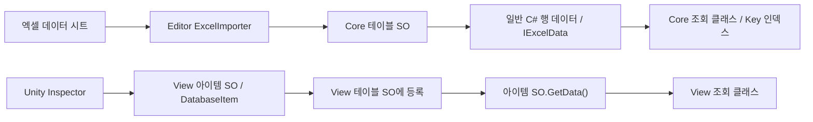
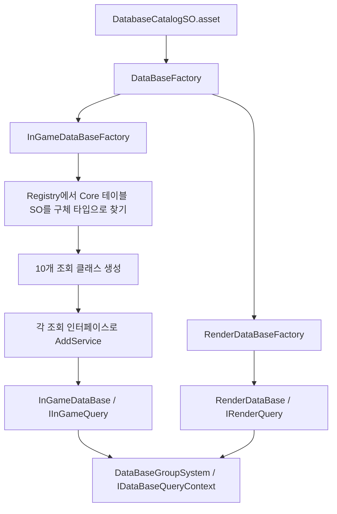

# DT 폴더 구조와 Core / View SO 사용 가이드

기준: 2026-10-06, 현재 `Project_L` 소스 및 에셋. 이 문서는 DT(Data Table) 폴더 정리, ExcelImporter 연결, SO 저장 위치, Key 조회와 Factory 조립 방식을 설명한다. 구현된 내용과 앞으로 추가할 설계를 구분한다.

## 1. 정리 기준

데이터 정의는 **그룹 → 테이블 → Core / View → 테이블 / 아이템** 순서로 배치한다. C# 스크립트와 실제 `.asset` 파일은 별도 폴더에 보관한다.

| 구분 | 작성 원본 | 데이터 표현 | 사용 목적 |
|---|---|---|---|
| Core | `Assets/DataTable`의 엑셀 데이터 시트 | 테이블 SO 안의 일반 C# 행 데이터 목록 | 수치, 코드, ID 등 엑셀로 관리할 데이터 |
| View | Unity에서 생성하고 Inspector로 설정한 에셋 | 테이블 SO에 등록한 개별 아이템 SO | 프리팹·머티리얼 등 엔진 참조와 GUI로 구성할 데이터 |

**Core 테이블도 ScriptableObject다.** Core / View는 SO 사용 여부가 아니라 데이터 작성 방식의 구분이다. Core의 각 행은 일반 C# 클래스이며, 행마다 개별 SO 에셋을 만들지 않는다.

이 문서의 DT `Core` 폴더는 런타임의 `InGameSystem/CoreSystem/CoreCaculator`와 다른 영역이다.

## 2. 데이터 스크립트 폴더

기준 위치: `Assets/ProjectL/Script/Systems/DataBaseSystem/Data`.

```text
Data/
├─ DataBaseSO.cs                         기존 카탈로그 파생 타입
├─ InGame/
│  ├─ InGameGroup.cs
│  └─ Table/
│     └─ <테이블명>/
│        ├─ Enum/                        관련 Enum이 있는 경우
│        ├─ Core/
│        │  └─ Table/
│        │     ├─ <이름>MasterDataTableSO.cs
│        │     └─ Item/
│        │        └─ <이름>MasterData.cs
│        └─ View/
│           └─ Table/
│              └─ Item/                  수동 SO 정의를 추가할 자리
└─ Render/
   ├─ RenderGroup.cs
   └─ Table/
      └─ <Effect | Light | Material | Texture>/
         ├─ Enum/                        관련 Enum이 있는 경우
         ├─ Core/Table/Item/              향후 확장할 자리
         └─ View/
            └─ Table/
               ├─ 기존 테이블 SO 정의
               └─ Item/
                  └─ 기존 아이템 SO 정의
```

실제 Stage 배치 예:

```text
Data/InGame/Table/Stage/
├─ Enum/                                 임시 Enum 정의 유지
├─ Core/
│  └─ Table/
│     ├─ StageMasterDataTableSO.cs
│     └─ Item/StageMasterData.cs
└─ View/
   └─ Table/
      └─ Item/                           현재 구현된 아이템 없음
```

InGame의 기존 Map / Stage 수동 SO·Data 정의를 정리한 뒤, 엑셀에 있는 10개 Master 테이블을 Core에 새로 정의했다. InGame의 각 테이블에 View 폴더도 준비했지만 현재 전투 구성 View SO는 구현하지 않았다.

Render의 데이터 스크립트도 같은 그룹·테이블·Core / View 구조로 정리했다. 기존 Effect / Light / Material 정의는 View에 배치했다. 기존 스크립트 이동 시 `.meta`도 함께 이동하여 SO의 스크립트 참조를 유지했다. `TextureDataSO.cs`는 현재 빈 파일이며 테이블·조회·Factory 등록은 없다.

Enum은 테이블 아래의 별도 폴더에 둔다. **임시 InGame Enum은 이번 엑셀 스키마 작성에 사용하지 않았다.** 엑셀에 있는 숫자 코드·플래그를 그대로 저장하며 Enum 변환을 수행하지 않는다. 기존 Render 조회의 Enum 키 사용은 유지한다.

## 3. 현재 Core 테이블 10개

각 엑셀에는 해당 Master 이름의 데이터 시트가 있다. 행 클래스는 그 시트의 컬럼을 기준으로 정의했다.

| 엑셀 / 데이터 시트 | 폴더 | 행 클래스 | 테이블 SO 클래스 | 조회 클래스 |
|---|---|---|---|---|
| ChapterMaster | Chapter | ChapterMasterData | ChapterMasterDataTableSO | ChapterTable |
| CharacterMaster | Character | CharacterMasterData | CharacterMasterDataTableSO | CharacterTable |
| DescriptionMaster | Description | DescriptionMasterData | DescriptionMasterDataTableSO | DescriptionTable |
| ItemMaster | Item | ItemMasterData | ItemMasterDataTableSO | ItemTable |
| MethodMaster | Method | MethodMasterData | MethodMasterDataTableSO | MethodTable |
| ObjectMaster | Object | ObjectMasterData | ObjectMasterDataTableSO | ObjectTable |
| ObstacleMaster | Obstacle | ObstacleMasterData | ObstacleMasterDataTableSO | ObstacleTable |
| StageMaster | Stage | StageMasterData | StageMasterDataTableSO | StageTable |
| TerrainMaster | Terrain | TerrainMasterData | TerrainMasterDataTableSO | TerrainTable |
| UpgradeStatisticMaster | UpgradeStatistic | UpgradeStatisticMasterData | UpgradeStatisticMasterDataTableSO | UpgradeStatisticTable |

예를 들어 `Stage_Key`는 직렬화 필드 이름을 그대로 유지하고, 코드에서는 `StageMasterData.Key`로 읽는다. 원본 시트에 있는 `Chpater_StageWidth` 같은 철자도 임포트 필드에는 그대로 유지하며 접근 프로퍼티 이름은 `StageWidth`로 정리했다.

## 4. 실제 SO 에셋 저장 위치

스크립트 정의는 `Script`에, 실제 에셋은 **`Assets/ProjectL/DataBaseSO`**에 저장한다.

```text
Assets/ProjectL/DataBaseSO/
├─ DatabaseCatalogSO.asset
├─ InGameGroup/
│  ├─ InGameGroup.asset
│  └─ <테이블명>Table/
│     └─ Core/
│        └─ Table/
│           └─ <이름>MasterDataTableSO.asset
└─ RenderGroup/
   ├─ RenderGroup.asset
   ├─ EffectTable/                       기존 테이블·Items 에셋 유지
   ├─ LightTable/                        기존 테이블·Item 에셋 유지
   └─ MaterialTable/                     기존 테이블·Items 에셋 유지
```

실제 Stage 에셋:

```text
Assets/ProjectL/DataBaseSO/InGameGroup/StageTable/Core/Table/StageMasterDataTableSO.asset
```

**Render는 데이터 스크립트 폴더를 통일했고, 기존 SO 에셋 저장 경로는 유지했다.** Render의 실제 에셋까지 `View/Table/Item` 경로로 모두 옮긴 상태는 아니다.

`InGameGroup.asset`에는 Core 테이블 SO 10개가 등록되어 있다. `DatabaseCatalogSO.asset`에는 InGameGroup과 기존 RenderGroup이 등록되어 있다.

## 5. ExcelImporter가 Core SO를 만드는 방식

현재 설치된 importer는 `mikito/unity-excel-importer`이며 Systems 어셈블리에 `ExcelImporter` 참조를 추가했다. 프로젝트 전용 Editor 메뉴나 자동 등록 도구는 추가하지 않았다.

```csharp
[ExcelAsset(
    ExcelName = "StageMaster",
    AssetPath = "ProjectL/DataBaseSO/InGameGroup/StageTable/Core/Table",
    LogOnImport = true)]
public sealed class StageMasterDataTableSO : DatabaseTable
{
    public List<StageMasterData> StageMaster = new();

    public override IEnumerable<IDatabaseItem> GetAllData()
    {
        if (StageMaster == null)
            return Array.Empty<IDatabaseItem>();

        return StageMaster;
    }
}
```

위 예시는 관련 using과 namespace를 생략한 구조 예시다.

- `ExcelName`: 확장자를 제외한 엑셀 이름.
- 목록 필드 `StageMaster`: 실제 데이터 시트 이름과 일치.
- 직렬화된 행 필드 `Stage_Key` 등: 시트 컬럼 이름과 일치.
- `AssetPath`: `Assets/`를 제외한 저장 경로. 실제 에셋은 `Assets/ProjectL/DataBaseSO/...`에 생성된다.
- 엑셀 임포트·재임포트 시 기존 테이블 SO 데이터가 갱신된다.

런타임 조회는 임포트된 SO를 읽는다. 게임에서 `.xlsx`를 매번 직접 읽는 구조는 아니다. Core 데이터 수정은 엑셀에 반영한 뒤 재임포트한다. SO 목록을 직접 수정하면 다음 임포트에서 엑셀 값으로 갱신될 수 있다.

## 6. IData / IExcelData / IDataProvider 연결

```csharp
public interface IExcelData : IDatabaseItem, IData { }
```

현재 `IData`, `IDatabaseItem`, `IExcelData`는 마커 인터페이스다. `IExcelData`에 `Key` 프로퍼티가 선언되어 있지는 않으며, 각 행 클래스가 `public int Key`를 제공한다.

| 계층 | 현재 형태 | 데이터 제공 방식 |
|---|---|---|
| Catalog | `DatabaseCatalogSO` | `IDataProvider<IDatabaseGroup>` |
| Group | `DatabaseGroup` 파생 SO | `IDataProvider<IDatabaseTable>` |
| Table | `DatabaseTable` 파생 SO | `IDataProvider<IDatabaseItem>` |
| Core 행 | 일반 C# 클래스, `IExcelData` 구현 | 테이블의 목록에 직접 들어감 |
| View 아이템 | `DatabaseItem` 파생 SO | `GetData()`로 내부 `IData` 반환 |

`DatabaseTable.GetAllData()`는 virtual이다. Core 테이블은 이 메서드를 재정의하여 일반 행 객체를 직접 반환한다. View 테이블은 기존 기반 클래스의 `databaseItems` 목록으로 아이템 SO를 제공한다.

Core 행은 `DatabaseItem`을 상속하지 않는다. 사용자가 만든 `IExcelData : IDatabaseItem, IData`를 직접 구현하므로 테이블의 `IDataProvider<IDatabaseItem>` 계약을 그대로 사용할 수 있다.

## 7. Core / View SO 접근 흐름



Core 조회 클래스는 `GetAllData()`에서 받은 행을 바로 등록한다. 별도의 아이템 SO를 거치거나 `GetData()`를 호출하지 않는다.

기존 Render 조회는 `EffectDataSO`, `LightDataSO`, `MaterialDataSO`를 받아 각 SO의 `GetData()` 결과를 등록한다. 같은 테이블 기반 계약을 사용하면서 원본 표현에 맞게 데이터를 꺼내는 방식만 다르다.

## 8. 조회 클래스 폴더와 Key 조회 계약

기준 위치: `Assets/ProjectL/Script/Systems/DataBaseSystem/Queries`.

```text
Queries/
├─ InGameDataBase/
│  ├─ ExcelTableIndex.cs                 공통 Key 인덱스
│  ├─ InGameDataBase.cs                  명시적인 조회 프로퍼티 집합
│  └─ Table/
│     └─ <테이블명>/
│        ├─ Core/<테이블명>Table.cs
│        └─ View/                        향후 수동 SO 조회를 추가할 자리
└─ RenderDataBase/
   ├─ RenderDataBase.cs
   └─ RenderTable/                      기존 Effect / Light / Metrial 조회 유지
```

모호했던 **`Queries/InGameDataBase/InGameTable`을 없애고 테이블별 폴더로 정리했다.** 인터페이스는 대응하는 조회 클래스와 같은 파일에 둔다. Render의 조회 클래스 폴더는 현재 `RenderTable`이라는 기존 구조를 유지한다.

```csharp
internal interface IStageTableQuery : IServiceModule
{
    StageMasterData GetStage(int key);
    bool TryGetStage(int key, out StageMasterData data);
    IReadOnlyList<StageMasterData> GetAllStages();
}
```

10개 조회 클래스는 각자 대응하는 인터페이스와 `IExportSystemServices`를 구현한다. 조회 클래스는 일반 C# 객체이며 별도 SO 에셋을 만들지 않는다.

| 동작 | 계약 |
|---|---|
| `Get…(key)` | 발견하면 반환, 없으면 `KeyNotFoundException` |
| `TryGet…(key, out data)` | 없으면 `false`, out 데이터는 null |
| `GetAll…()` | 시트 순서를 유지한 읽기 전용 목록 |
| 생성 시 검사 | null provider·목록·행, 다른 행 타입, 0 이하 Key, 중복 Key 검사 |
| 빈 시트 | 빈 테이블로 정상 처리 |

공통 `ExcelTableIndex<TData>`가 `Dictionary<int, TData>`를 만든다. 각 조회 클래스는 `data => data.Key`를 전달한다. 인덱스는 DB 생성 시 한 번 구성되며 원본 목록의 추가·삭제를 자동 반영하지 않는다. SO가 재임포트되면 DB를 다시 생성하여 조회 캐시를 갱신한다.

## 9. 카탈로그 → Factory → 조회 서비스 조립



등록 흐름은 현재 Factory에 명시되어 있다.

```csharp
DataBaseRegistry<IDatabaseTable> tables = new(data);
SystemBuilderHelper builder = new();

new StageTable(tables.GetDataBase<StageMasterDataTableSO>())
    .ExportServices(builder);

// 나머지 9개도 각각 등록한다.
return new InGameDataBase(builder.BuildSystemReader());
```

`DataBaseRegistry`는 **SO의 구체적인 클래스 타입**을 조회한다. 같은 타입의 테이블을 같은 그룹에 중복 등록하면 오류가 나며, 필요한 테이블이 없으면 조립에 실패한다. 이 타입 조회와 각 조회 클래스의 **행 Key 조회**는 별도 역할이다.

`InGameTableKey`에는 10개 조회 서비스 키를 정의했다. 각 조회 클래스가 `AddService<I…TableQuery>(this)`로 자신을 등록하고, `InGameDataBase`가 해당 서비스를 받아 `IInGameQuery`의 프로퍼티로 제공한다.

```csharp
// ProjectL.Systems 내부에서 사용하는 예시.
IDataBaseQueryContext db =
    (IDataBaseQueryContext)DataBaseFactory.Create(catalog);

StageMasterData stage = db.InGameQuery.StageTableQuery.GetStage(100001);
bool found = db.InGameQuery.ItemTableQuery.TryGetItem(itemKey, out var item);
IReadOnlyList<CharacterMasterData> characters =
    db.InGameQuery.CharacterTableQuery.GetAllCharacters();
```

현재 쿼리 인터페이스는 `internal`이며 Systems 어셈블리 내부에서 사용한다. 명시적인 `StageTableQuery`, `ItemTableQuery` 등의 프로퍼티가 테이블별 접근과 IDE 자동완성을 제공한다. `internal` 자체는 접근 범위를 제한하는 역할이다.

**자동 카탈로그 조립이나 새 편의성 클래스는 아직 구현하지 않았다.** 현재는 카탈로그의 SO 등록과 Factory의 조회 클래스 등록을 명시적으로 유지한다. 향후 조립의 반복 작업을 줄이더라도 테이블별 조회 인터페이스·프로퍼티를 유지하는 방향으로 논의했다.

## 10. 새 Core 테이블을 추가할 때

1. `Assets/DataTable`에 엑셀을 준비하고 실제 데이터 시트 이름·컬럼을 확정한다.
2. `Data/InGame/Table/<테이블명>/Core/Table/Item`에 `[Serializable]`, `IExcelData` 행 클래스를 만든다. 직렬화 필드 이름은 컬럼 이름에 맞추고 코드용 접근 프로퍼티를 제공한다.
3. 같은 테이블의 `Core/Table`에 `DatabaseTable` 파생 SO를 만든다. `[ExcelAsset]`, 시트 이름과 같은 목록 필드, `GetAllData()` override를 정의한다.
4. `AssetPath`를 별도 SO 저장 위치로 지정하고 Unity에서 스크립트 컴파일 후 엑셀을 재임포트한다.
5. 생성된 테이블 SO를 `InGameGroup.asset`에 등록한다. Catalog에는 해당 그룹 SO를 등록한다.
6. `Queries/InGameDataBase/Table/<테이블명>/Core`에 조회 인터페이스·클래스를 추가한다.
7. `InGameTableKey`, `IInGameQuery`, `InGameDataBase`, `InGameDataBaseFactory`에 조회 연결을 추가한다.

엑셀 임포트에 필요한 C# 스키마와 조회 연결은 현재 직접 정의한다. 카탈로그에 에셋을 넣는 것만으로 새로운 조회 프로퍼티가 자동 생성되지는 않는다.

## 11. 전투 스테이지 View SO 구상 — 미구현

현재 엑셀에는 전투 스테이지에 등장하는 유닛 종류·수량·배치 위치 데이터가 없다. `Chapter_BattleStage`는 챕터의 전투 스테이지 수이고, `Stage_Level`은 설명상 레벨 디자인 문서를 참조하는 값이다.

논의한 방식은 **Core Stage 데이터는 유지하고, 전투 구성은 Unity Inspector로 작성하는 View SO를 추가하는 것**이다.

```text
예정 스크립트 위치:
Data/InGame/Table/Stage/View/Table/CombatStageDataTableSO.cs
Data/InGame/Table/Stage/View/Table/Item/CombatStageDataSO.cs

예정 SO 저장 위치:
Assets/ProjectL/DataBaseSO/InGameGroup/StageTable/View/Table/...

예정 구성:
StageKey
유닛 배치 목록
  └─ CharacterKey + 위치
```

Core의 `StageKey`와 View 전투 SO의 `StageKey`로 연결한다. 배치 목록의 한 항목을 유닛 한 명으로 정의하면 등장 유닛 수는 목록 개수로 계산할 수 있다. 이 방식은 구상이며 클래스·에셋·조회 서비스는 아직 만들지 않았다. 처음에는 기본 Inspector를 사용하고, 격자 편집 GUI는 필요해질 때 추가하는 방향이다.

## 12. 이번 정리에서 제거한 기존 구성과 확인 결과

- 삭제한 기존 InGame 수동 SO·Data를 대신하여 Core Master 테이블 10개와 행 클래스 10개를 추가했다.
- 기존 `StageMapTable`, `StageViewPropTable` 및 이전 StageRoot 기반 조회를 정리하고 새 Core 조회로 연결했다.
- `StageGeneratorSystem`, `StageServiceManager`, `StageServiceCollection`을 삭제하고 InGame Core Factory·그룹·서비스 키 연결을 제거했다. 이들은 GlobalSystem이 아니라 InGameSystem/CoreSystem에 있던 코드다.
- `MapProgressBuffer`와 전용 `MapProgressData`를 삭제하고 Buffer Factory·그룹·서비스 키 및 전용 테스트 연결을 정리했다.
- Current / Stage / Artifact / Character / Currency 버퍼, Stage UI와 이벤트 시스템 등은 이 삭제 대상에 포함되지 않았다.
- Core 조회 구현 시 별도의 Unity 프로젝트에서 Key 조회·데이터 검사·실제 SO 조회·최상위 DBFactory 연결 테스트 73개가 통과했다.
- 스테이지 시스템 및 맵 버퍼 정리 후 Unity C# 컴파일러로 Systems와 Framework 테스트 어셈블리 컴파일을 확인했고 모두 통과했다. 이는 테스트 어셈블리의 컴파일 확인이며, 해당 시점에 전체 테스트를 다시 실행한 결과는 아니다.

## 13. 코드 확인 위치

- [기반 SO / IData / IExcelData / IDataProvider](../../Framework/DataBase/DatabaseCatalogSO.cs)
- [타입별 Registry](../../Framework/DataBase/DataBaseRegistry.cs)
- [Stage Core 테이블 SO](../DataBaseSystem/Data/InGame/Table/Stage/Core/Table/StageMasterDataTableSO.cs)
- [Stage Core 행](../DataBaseSystem/Data/InGame/Table/Stage/Core/Table/Item/StageMasterData.cs)
- [Stage Key 조회](../DataBaseSystem/Queries/InGameDataBase/Table/Stage/Core/StageTable.cs)
- [공통 Excel Key 인덱스](../DataBaseSystem/Queries/InGameDataBase/ExcelTableIndex.cs)
- [InGame 조회 프로퍼티](../DataBaseSystem/Queries/InGameDataBase/InGameDataBase.cs)
- [InGame 테이블 조립](../Factory/DBFactory/Group/InGameDataBaseFactory.cs)
- [최상위 DB 조립](../Factory/DBFactory/DataBaseFactory.cs)
- [DB 조회 Context](../DataBaseSystem/DataBaseGroupSystem.cs)
- [DB·테이블 서비스 키](../ServiceKeys/DataBaseGroupServiceKey.cs)
- [기존 Render 조회](../DataBaseSystem/Queries/RenderDataBase/RenderDataBase.cs)
