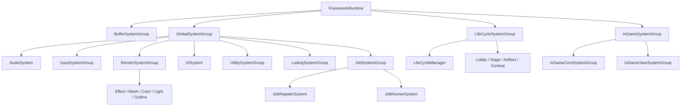
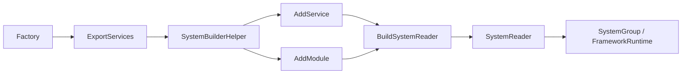
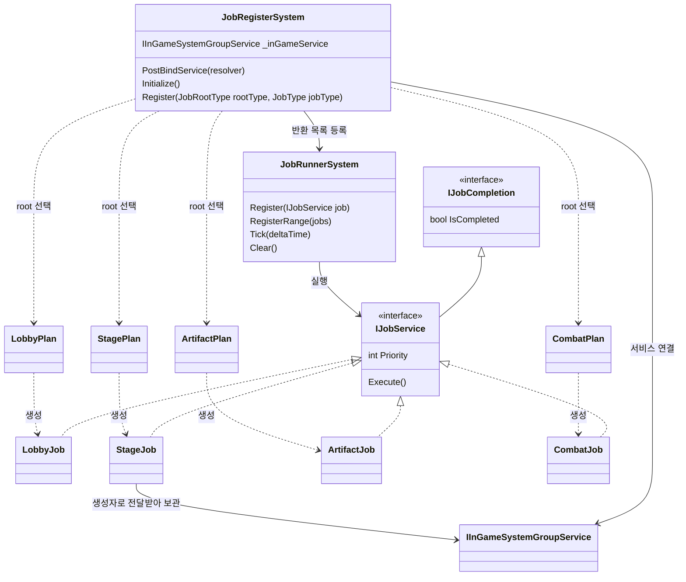
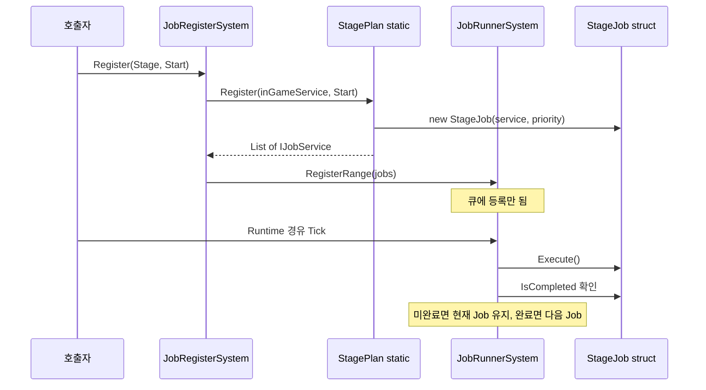
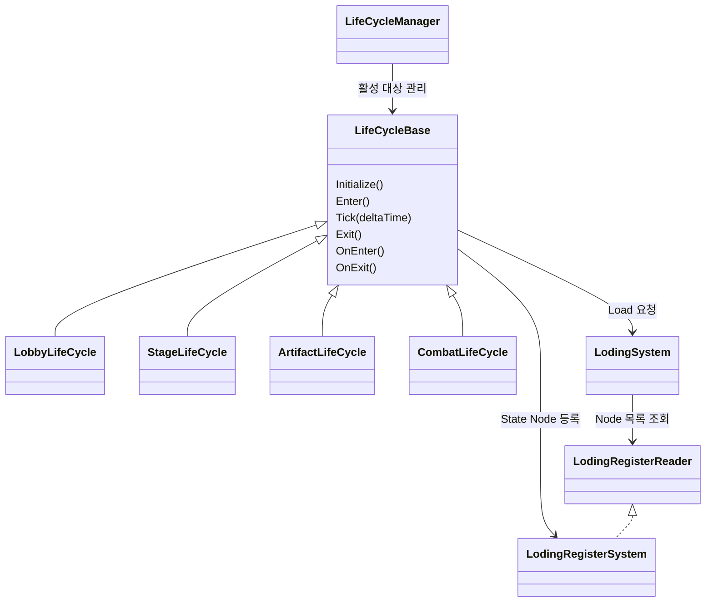
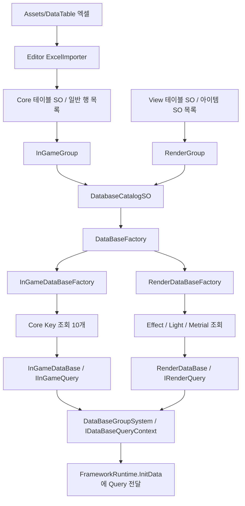
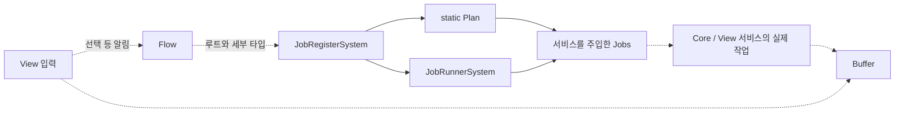

# ProjectL Framework / Systems 구조

기준: 2026-09-22 현재 소스. 기존 구조 문서의 조립·Job·로딩·데이터 흐름 설명을 현재 폴더와 등록 관계에 맞춰 갱신했다. 요약은 [코드 구조](../../README.md), 사용 계약은 [개발 가이드](framework-programmer-guide.md)를 참고한다.

DT 관련 갱신: 2026-10-06. 데이터 폴더·Core / View SO·엑셀 임포트·조회 연결은 [DT 구조 가이드](data-table-core-view-guide.md)를 기준으로 확인한다. 아래 6절의 DB 흐름과 7절의 스테이지 시스템 상태도 이에 맞춰 갱신했다.

## 1. 폴더와 어셈블리 경계

```text
Assets/ProjectL/
├─ Script/
│  ├─ Framework/                       공용 기반: Framework 어셈블리
│  │  ├─ Composition/                  Builder, FrameworkRuntime
│  │  ├─ SystemBase/                   계약, Reader, Store, 키 기반 타입
│  │  ├─ DataBase/                     SO·Registry 기반 타입
│  │  └─ Utility/                      Pool, Queue, 구독 Scope
│  ├─ Systems/                         게임 서비스: ProjectL.Systems 어셈블리
│  │  ├─ ServiceKeys/
│  │  ├─ DataBaseSystem/{Data,Queries}/
│  │  ├─ Factory/{Loading,Runtime}/
│  │  └─ RuntimeSystem/
│  │     ├─ BufferSystems/
│  │     ├─ GlobalSystem/              Input, UI, Render, Loading, Job, Utility, Audio
│  │     ├─ InGameSystem/
│  │     │  ├─ CoreSystem/CoreCaculator/{Contracts,Domain,Application}/
│  │     │  └─ ViewSystem/
│  │     └─ LifeCycleSystem/           GlobalSystem과 같은 계층
│  ├─ Render/                          URP RendererFeature·셰이더·렌더 리소스
│  └─ Tool/Editor/                     모델 임포트 후처리
├─ DataBaseSO/                         실제 SO 에셋
├─ Prefabs/
└─ Resources/                          Resources 기준 상대 경로 유지
```

| 경계 | 현재 의존성 / 책임 |
|---|---|
| Framework | Unity 기반 공용 코드. Systems, Core, FMOD 참조 없음 |
| ProjectL.Systems | References Framework, Core.Contracts, Core.Application, TMP, Unity UI, and FMOD. Its chapter coordinator applies accepted results to Buffer. |
| ProjectL.Core.Contracts | 별도 asmdef, Unity 엔진 참조 없음 |
| ProjectL.Core.Domain | Core.Contracts 참조, Unity 엔진 참조 없음 |
| ProjectL.Core.Application | Core.Contracts와 Core.Domain 참조, Unity 엔진 참조 없음 |
| Render | 별도 asmdef 없이 기본 게임 어셈블리에 포함 |
| Tool/Editor | 에디터 전용 기본 어셈블리에 포함 |

CoreCaculator는 폴더상 Systems 아래지만 하위 asmdef 세 개로 분리된다. Framework 18개, Systems 서비스 143개, Core 188개, Render 6개, Tool 1개의 C# 파일이 있다. 폴더 이름 `CoreCaculator`와 기존 타입 철자 `Loding`, `Scop`, `Metrial`은 현재 코드와 동일하게 사용한다.

### 네임스페이스 규칙

`ProjectL.<Script 아래 상대 폴더 경로>`를 사용한다. `Script` 자체는 네임스페이스에 넣지 않는다.

| 위치 | 네임스페이스 |
|---|---|
| Framework/Composition | `ProjectL.Framework.Composition` |
| Framework/SystemBase | `ProjectL.Framework.SystemBase` |
| Systems/ServiceKeys | `ProjectL.Systems.ServiceKeys` |
| Systems/RuntimeSystem/LifeCycleSystem/Base | `ProjectL.Systems.RuntimeSystem.LifeCycleSystem.Base` |
| Systems/RuntimeSystem/GlobalSystem/UISystem/Base | `ProjectL.Systems.RuntimeSystem.GlobalSystem.UISystem.Base` |
| Systems/Factory/Runtime/LifeCycle | `ProjectL.Systems.Factory.Runtime.LifeCycle` |
| Tool/Editor | `ProjectL.Tool.Editor` |

Core도 긴 실제 폴더 경로를 따른다. 예: `ProjectL.Systems.RuntimeSystem.InGameSystem.CoreSystem.CoreCaculator.Domain.Combat`. 어셈블리 이름 `ProjectL.Core.Domain`은 그대로이며 네임스페이스와 구분한다.

## 2. 실제 Factory 조립 관계



화살표는 Factory가 실제 등록하는 포함 관계다. LifeCycle은 Global의 자식이 아니다. 루트 생성 코드는 [FrameworkRuntimeFactory](../Factory/Runtime/RunTimeSystemFactory.cs)에 있으며 Buffer → Global → InGame → LifeCycle 순서로 등록한다. 루트 Shutdown은 역순이다.

- Global 내부 등록 순서는 Render → Utility → Input → Audio → Loading → UI → Job이다.
- LifeCycle 팩토리는 [Factory/Runtime/LifeCycle](../Factory/Runtime/LifeCycle/LifeCycleSystemFactory.cs)에 있다. 초기화는 의존 그룹 다음, 종료는 그들보다 먼저 실행된다.
- AudioSystem은 GlobalSystemFactory에 등록되어 AudioServiceCommand로 노출된다. AudioBase에는 서비스 인터페이스를 직접 주입한다. FMODPlus의 GUI·스캐너는 Editor 전용 FMODPlus.Editor 어셈블리에 둔다.
- InGameViewSystemFactory는 빈 Builder로 그룹을 만든다. UIBase 파생체인 LoadingUI·StageUI는 씬 검색과 등록으로 연결한다.
- 유지 UI는 `UISystem/Base/GlobalUIBase`를 상속한다. UISystem은 최초 BindScene 완료 전 등록된 유지 루트를 `_globalUIs`에 수집하며, 플레이 중 해당 UI의 루트 GameObject를 DontDestroyOnLoad로 유지한다. 이후 BindScene에서는 저장된 유지 UI를 Registry에 복원하고 열린 루트 상태를 보존한다. GlobalUI를 다시 수집·바인딩하지 않으므로 이후 씬에 추가된 GlobalUI는 목록에 포함되지 않는다.
- `OpenGlobalUI()`는 초기화·서비스 바인딩 후 저장된 유지 UI만 `OpenUI(id, true)`로 연다. 유지 UI의 개별 `OpenUI(id)`도 같은 방식으로 처리하며, 일반 화면 이력에 넣지 않는다. `CloseUI`·`HideAllUI`로 닫을 수 있고 Shutdown에서 유지 UI 목록과 수집 상태를 초기화한다.
- RenderSystemFactory는 Outline까지 등록한다. TextEffectSystem·TextureDataSO는 빈 파일이며 실행 연결이 없다.
- DB Query는 별도 DataBaseFactory에서 생성하여 Runtime.InitData에 전달한다. 루트 런타임 그룹으로 등록하지 않는다.

## 3. 공통 조립·조회와 실행



AddService는 조회할 계약, AddModule은 생명주기 호출 대상을 등록한다. Builder는 한 번 Build한 뒤 닫힌다. Create·Build는 Initialize를 자동 호출하지 않는다.

Runtime은 자신에게 등록된 그룹 중 해당 계약을 구현한 그룹에만 BindScene / InitData / PostBindService / Initialize / Tick / Shutdown을 전달한다. 각 그룹도 자식에게 전달할 단계를 직접 구현한다. 모든 중첩 그룹의 Shutdown이 역순인 것은 아니다. Global·InGame·LifeCycle은 역순이며 Render·Utility는 현재 자식 등록 순서로 종료한다.

루트 resolver가 전달된 소비자의 조회 예:

```csharp
var global = resolver.GetService(SystemGroupsService.Global);
var inGame = resolver.GetService(SystemGroupsService.InGame);
var lifeCycle = resolver.GetService(SystemGroupsService.LifeCycle);

var render = global.RenderServiceCommand;
var ui = global.UIServiceCommand;
var jobs = global.JobServiceCommand.JobRegister;
jobs.Register(JobRootType.Stage, JobType.Start);
```

Render / UI / Input / Utility / Loding / Job 키는 Global 내부 Reader에서 사용한다. 루트 `resolver.GetService(SystemGroupsService.Render)`처럼 조회하면 찾지 못한다. Buffer 서비스는 내부 BufferSystemKey와 각 ReadSink/WriteSink 계약을 통해 사용한다.

Runtime.Initialize는 필요한 InitData와 PostBindService가 완료됐는지 검사한다. Tick은 Initialize 이후에만 가능하다. 서비스 바인딩 단계에는 루트 resolver를 전달하므로 형제 LifeCycle이 Global의 로딩 서비스를 조회할 수 있다.


## 4. Job 등록과 실행



Plan은 static 클래스이고 Job은 struct다. 대표적으로 StageJob의 서비스 주입 관계를 표시했다.
나머지 세 Job도 같은 방식으로 서비스를 받는다.

등록기의 딕셔너리:

```csharp
Dictionary<
    JobRootType,
    Func<IInGameSystemGroupService, JobType, List<IJobService>>
> _plans;
```

초기화 시 루트와 함수를 연결한다.

```csharp
_plans[JobRootType.Stage] = StagePlan.Register;
```

요청 시 서비스를 전달하고 반환된 목록을 큐에 넣는다.

```csharp
var jobs = _plans[rootType](_inGameService, jobType);
_runner.RegisterRange(jobs);
```



현재 JobType은 None/Start다. None은 빈 목록, Start는 해당 루트의 임시 Job 한 개를 반환한다.
실제 게임 동작은 각 Job에 아직 연결되지 않았다. Execute는 주입 상태를 확인하고 완료 처리한다.
Runner는 작은 Priority부터 실행하며 같은 우선순위는 등록 순서를 유지한다.
한 Tick에서 즉시 완료 작업은 최대 32개 처리하고 남은 작업은 다음 Tick으로 넘긴다.
현재 List 생성 및 IJobService로 변환하는 struct boxing이 있어 무할당 구현은 아니다.

## 5. 생명주기와 로딩



1. LifeCycleBase.Initialize에서 자신의 SceneIndex에 SceneExitLoaded/SceneEnterLoaded Node를 LodingRegisterSystem에 등록한다.
2. LifeCycleManager.Change는 대상 LifeCycle에 Load 요청을 보낸다. 현재 State의 종료는 Loading 순서 안에서 처리한다.
3. LodingRegisterSystem은 공통·Scene별 Node 목록을 보관한다. LodingSystem은 읽기 전용 LodingRegisterReader로 목록을 조회해 실행한다.
4. LodingSystem은 BeforeLoad 공통 Node를 실행한 뒤 현재 Scene의 SceneExitLoaded Node를 실행한다.
5. 대상 씬의 LoadSceneAsync가 완료되면 SceneEnterLoaded Node를 실행하고 AfterLoad 공통 Node를 실행한다.
6. 공통 Node는 Fade·입력 잠금·Loading UI처럼 모든 전환에 필요한 작업을 담당한다. State Node는 해당 State의 화면·입력 바인딩을 담당한다.
7. 같은 단계의 Node는 Priority가 작은 순서와 같은 Priority의 등록 순서로 실행된다. 이 NodeQueue는 Global JobRunner와 별개다.
8. Flow 시작과 종료는 각 OnEnter/OnExit의 TODO 상태다.

임시 SceneIndex는 Lobby=0, Stage=1, Artifact=2, Combat=3이다.
실제 Build Settings와 SceneIndex의 연결은 별도 확인이 필요하다.

## 6. Core / View SO → DB 조회

DT의 상세 폴더, SO 저장 위치, 테이블 추가 절차는 [DT 구조 가이드](data-table-core-view-guide.md)를 참고한다. Core는 엑셀로 작성하고 View는 Unity에서 직접 설정한다. Core 테이블도 SO이며, Core의 행은 일반 C# 데이터 클래스다.



- 데이터 정의 스크립트는 `DataBaseSystem/Data/<그룹>/Table/<테이블>/Core 또는 View`에 있다. 실제 SO 에셋은 `Assets/ProjectL/DataBaseSO`에 별도로 저장한다.
- Core의 행 클래스는 `IExcelData : IDatabaseItem, IData`를 구현한다. Core 테이블은 virtual `GetAllData()`를 재정의하여 행을 직접 반환한다.
- View는 기존 `DatabaseItem` 파생 아이템 SO를 사용하고, 조회 클래스가 `GetData()`로 내부 데이터를 읽는다. 기존 Render 데이터는 이 방식이다.
- InGame Core 테이블은 Chapter / Character / Description / Item / Method / Object / Obstacle / Stage / Terrain / UpgradeStatistic의 10개다.
- `DataBaseRegistry`는 구체 SO 타입으로 테이블을 찾는다. Core 조회 클래스는 별도로 각 행의 정수 Key를 인덱싱한다.
- 조회는 `db.InGameQuery.StageTableQuery.GetStage(key)`처럼 명시적인 internal 인터페이스·프로퍼티로 노출한다. 자동 카탈로그 조립이나 제네릭 조회 API로 교체한 상태는 아니다.
- 조회 폴더는 `Queries/InGameDataBase/Table/<테이블>/Core`로 정리했다. 각 테이블의 View 조회 폴더는 확장용이며 현재 전투 View SO는 미구현이다.
- Core SO가 재임포트되면 DB를 다시 생성하여 조회 인덱스를 갱신한다.
- 기존 Map / Stage 수동 SO, StageMap / StageViewProp 조회 및 이전 StageRoot 구조는 삭제되었다. StageGeneratorSystem / StageServiceManager / StageServiceCollection의 조립 연결도 제거했다.
- MapProgressBuffer와 전용 데이터·등록·조회 연결을 삭제했다. BufferSystemGroup은 Current / Stage / Artifact / Character / Currency 서비스를 제공한다.
- 전투의 유닛 구성·배치는 Stage View SO를 Inspector에서 작성하고 StageKey로 연결하는 방향을 논의했으며 아직 구현하지 않았다.

## 7. 현재 구현과 다음 연결 지점

| 항목 | 현재 상태 |
|---|---|
| Factory → 그룹 → 서비스 조회 | 코드상 연결됨 |
| Global → JobSystemGroup → 등록기/Runner | 코드상 연결됨 |
| 등록기 → static Plan → 서비스가 주입된 struct Job | 코드상 연결됨 |
| Job의 실제 게임 작업 | 임시 골격 |
| LifeCycle 진입/종료 → Loading 콜백 | 코드상 연결됨 |
| Flow의 상태 전환과 Job 등록 요청 | 실제 Flow 클래스 없음 |
| InGame View 시스템 | 그룹만 있으며 하위 시스템 미등록 |
| InGame Core와 Buffer | 그룹 조립 유지. 기존 Stage 생성·관리 시스템과 MapProgressBuffer는 삭제됨 |
| View ↔ Buffer ↔ Core의 전체 플레이 흐름 | View와 Job의 실제 동작 연결 필요 |
| Unity가 Runtime 생성·Tick을 구동하는 진입점 | 현재 Assets 소스에서 실제 게임 부트스트랩 호출자가 확인되지 않음 |

아래 점선은 미연결 기능의 확장 방향이며, 완성된 실행 경로를 뜻하지 않는다.



실선은 등록·실행 기반 연결, 점선은 앞으로 기능을 붙일 경로다.
현재 구조를 검토하는 문서이므로 전체 Unity 빌드 성공을 뜻하지 않는다.


## 8. 소스 확인 위치

| 내용 | 소스 |
|---|---|
| 공용 Runtime / Builder | [FrameworkRuntime](../../Framework/Composition/FrameworkRuntime.cs), [SystemBuilderHelper](../../Framework/Composition/SystemBuilderHelper.cs) |
| 루트 조립 | [FrameworkRuntimeFactory](../Factory/Runtime/RunTimeSystemFactory.cs) |
| Global 조립 / 서비스 | [GlobalSystemFactory](../Factory/Runtime/Global/GlobalSystemFactory.cs), [GlobalSystemGroup](../RuntimeSystem/GlobalSystem/GlobalSystemGroup.cs) |
| LifeCycle 조립 / 전달 | [LifeCycleSystemFactory](../Factory/Runtime/LifeCycle/LifeCycleSystemFactory.cs), [LifeCycleSystemGroup](../RuntimeSystem/LifeCycleSystem/LifeCycleSystemGroup.cs) |
| DB 생성 | [DataBaseFactory](../Factory/DBFactory/DataBaseFactory.cs) |
| 실제 키 | [SystemGroupsService](../ServiceKeys/SystemGroupsService.cs), [Buffer·DB 키](../ServiceKeys/DataBaseGroupServiceKey.cs) |
| 렌더 카메라 검사 | [RenderFeatureCameraFilter](../../Render/Shader/PostProcessing/RenderFeatureCameraFilter.cs) |
| 임포트 노멀 생성 | [OutlineNormalPostprocessor](../../Tool/Editor/OutlineNormalPostprocessor.cs) |

네 URP RendererFeature는 Game/SceneView만 허용하며 PreviewScene 카메라와 Prefab Stage의 SceneView를 제외한다. OutlineNormalPostprocessor는 모델 임포트 시 동일 위치 정점의 평균 노멀을 UV3에 저장하며 Mesh.normals를 덮어쓰지 않는다.

SO 에셋·프리팹·Resources 이동은 GUID를 유지했다. 기본 Material Query 등록과 Unity 구동 연결은 아직 남아 있는 확인 사항이며 상세 가이드의 DR-001·003을 참고한다. 이전 변경의 컴파일·managed 테스트 기록과 실제 Unity Editor 실행 확인은 구분한다.
