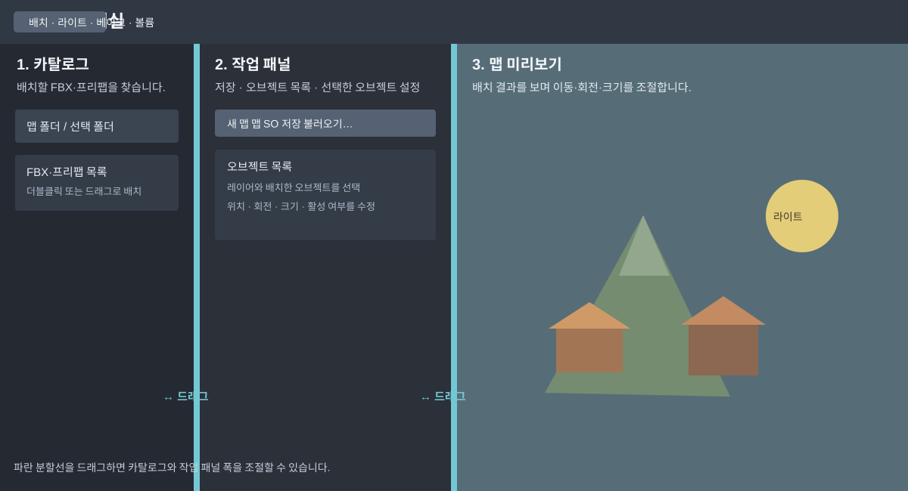

# FBX 맵 작업실 사용 설명서

이 문서는 Unity를 처음 쓰는 그래픽 작업자가 `ProjectL > FBX 배치` 도구로 맵을 만들고, 라이트와 후처리를 확인한 뒤 저장하는 방법을 설명합니다.

> 이 도구는 실제 씬을 바로 수정하지 않습니다. 별도의 **작업실 화면**에서 맵을 조립하고, 완료한 결과만 프리팹과 맵 SO로 저장합니다. 실수해도 원래 씬이 바뀌지 않습니다.



## 1. 시작하기

Unity 상단 메뉴에서 `ProjectL > FBX 배치`를 누릅니다.

처음 열면 빈 맵 작업실이 보입니다. 이전에 저장한 맵을 고치려면 다음 중 하나를 사용합니다.

1. 오른쪽 작업 패널에서 `불러오기…`를 누릅니다.
2. 저장된 `<맵이름>_Map.asset`을 선택합니다.
3. `맵 불러오기 (베이크 포함)`을 누릅니다.

`_Map.asset`은 맵 프리팹과 베이크 라이트 정보를 한 묶음으로 기억하는 파일입니다. 프리팹만 직접 열기보다 `_Map.asset`으로 여는 편이 안전합니다.

## 2. 화면 읽는 법

### 왼쪽: 카탈로그

`에셋` 탭에서 배치할 FBX·일반 프리팹·Variant 프리팹을 고릅니다.

- `맵 폴더`: 프로젝트의 기본 맵 리소스 폴더로 이동합니다.
- `선택 폴더`: Project 창에서 선택한 폴더로 이동합니다.
- 폴더 행을 클릭하면 하위 폴더로 들어갑니다.
- 에셋을 더블클릭하면 작업 패널의 `추가 위치`에 배치합니다.
- 에셋을 오른쪽 미리보기 화면으로 드래그하면 원하는 지점에 바로 배치할 수 있습니다.

### 가운데: 작업 패널

저장, 오브젝트 목록, 선택한 오브젝트의 속성을 다룹니다.

- `새 맵`: 빈 작업실에서 다시 시작합니다.
- `맵 SO 저장`: 현재 배치 상태를 저장합니다.
- `다른 이름으로 저장`: 새 프리팹 이름이나 폴더로 복사해 저장합니다.
- `오브젝트 목록`: 현재 맵 안의 레이어와 오브젝트를 선택합니다.
- 오브젝트를 하나 선택하면 위치, 회전, 크기, 켜짐 여부를 수정할 수 있습니다.

### 오른쪽: 맵 미리보기

실제 배치 결과를 보면서 편집하는 영역입니다.

- 왼쪽 드래그: 여러 오브젝트를 사각형으로 선택합니다.
- `W`: 이동, `E`: 회전, `R`: 크기 조절입니다.
- `F`: 선택한 오브젝트가 화면에 잘 보이도록 카메라를 맞춥니다.
- 마우스 휠: 확대/축소, 마우스 휠 버튼 드래그: 화면 이동입니다.

### 작업 영역 크기 조절

왼쪽/가운데, 가운데/오른쪽 경계의 가는 세로 분할선을 좌우로 드래그합니다.

- FBX를 많이 찾을 때는 왼쪽 카탈로그를 넓힙니다.
- 이름이 긴 오브젝트·설정을 볼 때는 가운데 작업 패널을 넓힙니다.
- 넓은 지형을 볼 때는 두 패널을 줄여 오른쪽 미리보기 영역을 넓힙니다.

조절한 폭은 작업실을 다시 열어도 유지됩니다.

## 3. FBX·프리팹 배치하기

1. 왼쪽 `에셋` 탭에서 원하는 FBX·프리팹이 있는 폴더로 이동합니다.
2. 에셋을 더블클릭하거나 오른쪽 미리보기로 드래그합니다. Project 창의 에셋도 직접 드래그할 수 있습니다.
3. 방금 추가한 오브젝트를 선택한 뒤 `W`, `E`, `R`로 위치·방향·크기를 맞춥니다.
4. 같은 종류끼리 정리하려면 상단의 `새 레이어 이름`을 입력하고 `추가`를 누릅니다.
5. 오브젝트를 선택한 뒤 `선택 옮기기`로 해당 레이어에 넣습니다.

작업 패널의 `배치 에셋`에 FBX·프리팹을 지정하거나 `Project에서 선택한 에셋 가져오기`를 누르고, `가상 씬에 추가 + Unpack`을 눌러도 추가됩니다.

표면 위에 놓기 옵션이 켜져 있으면, 드래그한 에셋은 보이는 메시 표면에 맞춰 배치됩니다. 바닥만 기준으로 놓고 싶다면 상단의 표면 대상에서 레이어를 지정합니다.

배치한 에셋은 **중첩 프리팹까지 완전히 Unpack**합니다. 컴포넌트·메시·머티리얼 참조와 Variant 설정은 배치 시점의 값으로 가져오며, 원본 프리팹의 이후 변경은 배치본에 자동 반영되지 않습니다. 작업실에서 위치·컴포넌트를 편집해도 원본 프리팹은 유지됩니다. 메시·머티리얼 같은 공유 에셋 자체를 편집하면 해당 에셋을 쓰는 다른 오브젝트에도 반영됩니다. 배치한 프리팹의 후처리 Volume Profile은 작업실용 복사본으로 편집합니다.

## 4. 라이트 배치와 확인

왼쪽 탭에서 `라이트`를 선택합니다.

1. Directional, Point, Spot 등 원하는 라이트를 추가합니다.
2. 미리보기 화면에서 라이트를 선택하고 위치·회전을 조절합니다.
3. 오른쪽 상단의 `씬 조명`을 켜면 배치한 라이트 결과를 확인할 수 있습니다.

라이트는 **편집용 미리보기**와 **베이크 결과**가 다를 수 있습니다. 최종 분위기는 반드시 베이크를 마친 뒤 `베이크 완성본`에서 확인하세요.

## 5. 기존 후처리 Volume 가져오기

후처리 Volume은 블룸, 색 보정, 톤매핑, 비네트처럼 화면 전체 분위기를 바꾸는 Unity 기능입니다.

1. 원래 씬의 Hierarchy에서 가져올 `Global Volume` 오브젝트를 찾습니다.
2. 맵 작업실 왼쪽 탭에서 `볼륨`을 선택합니다.
3. `기존 Volume` 칸에 원래 씬의 **Volume 컴포넌트**를 드래그합니다.
4. `기존 Volume 가져오기`를 누릅니다.
5. `후처리 미리보기`가 켜져 있는지 확인합니다.

가져온 Volume은 작업실 전용 복사본입니다.

- 원래 씬의 Volume과 Profile은 수정되지 않습니다.
- Priority, Weight, Global/Local 설정, Profile 효과를 함께 복사합니다.
- Local Volume은 Collider도 함께 복사합니다.
- 가져온 뒤 작업실에서 값을 고쳐도 원본에는 영향이 없습니다.
- 맵을 저장하면 복사본은 맵 프리팹에 포함됩니다.

볼륨 탭에서 `글로벌 볼륨 추가`는 새 빈 Volume을 만들고 싶을 때만 사용합니다. 이미 만들어 둔 분위기를 쓰려면 항상 `기존 Volume 가져오기`를 사용하세요.

### Volume과 큐브형 볼류메트릭 포그는 다릅니다

`HeightVolumeFog`처럼 큐브 메시와 머티리얼로 만든 안개는 Unity 후처리 Volume이 아닙니다. 이 안개는 일반 오브젝트처럼 FBX/프리팹 배치 영역에 두어야 합니다. Volume 가져오기는 블룸·색 보정 같은 **후처리**만 다룹니다.

## 6. 라이트 베이크하기

왼쪽 탭에서 `베이크`를 선택합니다.

### 베이크 전 체크

- 고정된 배경·건물·지형은 베이크 대상이어야 합니다.
- 움직이는 오브젝트는 베이크 대상에서 제외합니다.
- 필요한 메시에는 UV2가 있어야 합니다. `누락 UV2 자동 생성`을 사용할 수 있습니다.
- 라이트 Mode는 `Baked` 또는 `Mixed`로 설정합니다.
- 현재 씬에 저장하지 않은 변경이 있다면 먼저 저장합니다.

### 베이크 순서

1. 필요하면 `빠른 확인`으로 가볍게 테스트합니다.
2. 최종 작업 전에는 `기본 품질` 또는 원하는 품질 값을 설정합니다.
3. `베이크 + 맵 SO 저장`을 누릅니다.
4. 완료될 때까지 배치·라이트·재질을 바꾸지 않습니다.
5. 완료 후 자동으로 `베이크 완성본`이 표시됩니다.

베이크는 조명 텍스처를 만드는 작업입니다. 블룸·색 보정 같은 후처리 Volume은 베이크 이미지에 굽지 않으며, 작업실 미리보기와 게임 실행에서 별도로 적용됩니다.

## 7. 저장하면 만들어지는 파일

`맵 SO 저장` 또는 베이크 저장에서 선택한 폴더를 기준으로 파일이 만들어집니다.

```text
선택한 저장 폴더/
├─ DesertMap.prefab                 ← 배치한 메시·라이트·가져온 Volume
├─ DesertMap_Map.asset              ← 프리팹과 베이크 데이터를 연결하는 맵 SO
├─ DesertMap_Volumes/
│  └─ Mood.asset                    ← 저장된 후처리 Profile
└─ DesertMap_Lighting/
   └─ Bake_날짜_식별자/
      ├─ BakedLighting.asset        ← 라이트맵 연결 정보
      ├─ Lightmap-*.exr/png         ← 라이트 텍스처
      ├─ LightingSettings.lighting
      └─ Bake.unity
```

같은 맵을 다시 저장하거나 다시 베이크하면 기존 `<맵이름>_Map.asset`은 유지되고, 최신 베이크 결과를 가리키도록 갱신됩니다.

## 8. 게임 스테이지에 연결하기

맵 저장만으로 게임 스테이지에 자동 연결되지는 않습니다. 맵 담당자가 준비한 `ViewStage` Data 에셋에서 연결합니다.

1. `DataBaseSO/ViewGroup` 안의 해당 스테이지 `ViewStage` Data 에셋을 엽니다.
2. `Map` 칸에 방금 저장한 `<맵이름>_Map.asset`을 넣습니다.
3. 해당 Data 에셋이 `ViewStageDataTable` 목록에 들어 있는지 확인합니다.
4. Unity에서 저장한 뒤 전투 씬을 실행해 확인합니다.

`ViewStage` Data 에셋은 게임이 어떤 맵을 어느 StageKey에 표시할지 정하는 카탈로그 정보입니다. 반면 `_Map.asset`은 맵 제작 결과물입니다. 두 파일은 역할이 다르므로 서로 다른 폴더에 보관합니다.

## 9. 자주 생기는 문제

### 맵이 너무 어둡거나 라이트가 안 보입니다

1. 상단 `씬 조명`이 켜져 있는지 확인합니다.
2. 라이트 오브젝트가 비활성화되지 않았는지 확인합니다.
3. 베이크 결과를 보는 중이라면 `배치 편집으로`로 돌아가 라이트를 수정합니다.
4. 수정 후에는 다시 베이크합니다.

### 후처리 분위기가 안 보입니다

1. 볼륨 탭의 `후처리 미리보기`를 켭니다.
2. 가져온 Volume의 `볼륨 켜기`와 `영향도`가 켜져 있는지 확인합니다.
3. Profile 안의 효과에서 Override 체크가 켜져 있는지 확인합니다.
4. 원본 Volume이 아니라, 작업실 목록에 있는 복사본을 수정하고 있는지 확인합니다.

### 저장한 맵을 다시 열었는데 라이트맵이 안 보입니다

1. 프리팹이 아니라 `<맵이름>_Map.asset`을 `불러오기…`로 엽니다.
2. 라이트 텍스처와 `_Lighting` 폴더를 이동·삭제하지 않았는지 확인합니다.
3. 라이트나 배치가 바뀌었다면 다시 베이크합니다.

### 맵을 저장했는데 게임에서 예전 맵이 나옵니다

1. `ViewStage` Data 에셋의 `Map` 참조가 새 `_Map.asset`인지 확인합니다.
2. `ViewStageDataTable`에 그 Data 에셋이 등록되어 있는지 확인합니다.
3. StageKey가 다른 스테이지 Data와 중복되지 않는지 확인합니다.

## 10. 작업 종료 전 최종 확인

- [ ] 맵을 `_Map.asset`으로 다시 열어 배치가 맞는지 확인했다.
- [ ] `베이크 완성본`에서 조명 결과를 확인했다.
- [ ] 필요한 기존 후처리 Volume을 가져와 분위기를 확인했다.
- [ ] 프리팹, `_Map.asset`, `_Volumes`, `_Lighting` 폴더를 함께 보관했다.
- [ ] ViewStage Data 에셋에 올바른 `_Map.asset`을 연결했다.
- [ ] 전투 씬에서 실제 스테이지를 한 번 실행해 확인했다.

기술적인 저장 구조와 런타임 동작이 필요하면 [맵 작업실 SO 저장과 DB 연결](map-workspace-so.md) 문서를 참고합니다.
