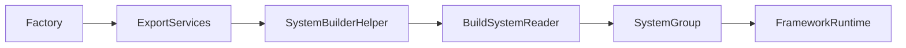

# Framework / Systems 개요

2026-09-22 현재 구조. 상세 내용은 [구조 문서](../../../Assets/ProjectL/Script/Systems/Documentation/framework-architecture.md), 계약과 제한은 [개발 가이드](../../../Assets/ProjectL/Script/Systems/Documentation/framework-programmer-guide.md)를 참고한다.

## 영역 구분

| 영역 | 역할 |
|---|---|
| Assets/ProjectL/Script/Framework | 공용 계약·Builder·Runtime·Store·DB 기반·Pool·Queue |
| Assets/ProjectL/Script/Systems | 게임 서비스·실제 키·Factory·SO 타입·Query |
| Systems/RuntimeSystem/GlobalSystem | UI·Input·Render·Loading·Job·Utility 등 공용 게임 서비스 |
| Systems/RuntimeSystem/LifeCycleSystem | Lobby·Stage·Artifact·Combat 진행 구간 |
| Systems/RuntimeSystem/InGameSystem | 인게임 Core/View 그룹 및 CoreCaculator |
| Assets/ProjectL/Script/Render | URP RendererFeature와 셰이더 리소스 |
| Assets/ProjectL/Script/Tool/Editor | 노멀 임포트 후처리 등 에디터 도구 |
| Assets/ProjectL/DataBaseSO, Prefabs, Resources | 실제 게임 에셋 |

Framework에 게임별 구현을 넣지 않는다. LifeCycle과 Global은 같은 RuntimeSystem 계층이다. UI·Render의 기반 클래스는 Global 하위, LifeCycle의 기반 클래스는 LifeCycleSystem/Base에 둔다.

## 조립과 실행



- **Service:** IServiceModule 파생 인터페이스로 제공하는 기능 API.
- **Module:** 초기화·Tick·종료 등 실행에 참여하는 객체.
- **Builder:** AddService와 AddModule을 각각 받아 한 번 Build한다.
- **Reader / Store:** 등록한 서비스와 생명주기별 모듈 목록을 제공한다.
- **Group:** 필요한 자식 서비스만 Context로 노출하고 생명주기를 전달한다.
- **FrameworkRuntime:** 루트 Reader를 보유하고 실행 단계·조회 수명을 검사한다.

Factory.Create나 BuildSystemReader는 Initialize를 자동 호출하지 않는다. 등록 목록은 Build 이후 고정되지만 서비스 내부 상태까지 불변은 아니다.

## 런타임 계층

```text
FrameworkRuntime
├─ BufferSystemGroup
├─ GlobalSystemGroup
│  ├─ RenderSystemGroup (Effect / Mesh / Color / Light / Outline)
│  ├─ UtilitySystemGroup (Delay / Event)
│  ├─ InputSystemGroup
│  ├─ LodingSystemGroup
│  ├─ UISystem
│  └─ JobSystemGroup
├─ InGameSystemGroup
│  ├─ InGameCoreSystemGroup
│  └─ InGameViewSystemGroup
└─ LifeCycleSystemGroup
   ├─ LifeCycleManager
   └─ Lobby / Stage / Artifact / Combat
```

루트 등록은 Buffer → Global → InGame → LifeCycle, 종료는 역순이다. AudioSystem 파일은 GlobalSystem/AudioSystem에 있지만 현재 기본 Factory의 등록 대상은 아니다. InGame View는 현재 빈 그룹이다. 폴더 존재와 실제 조립 여부는 구분한다.

## 서비스 조회

`resolver`는 전달받은 ISystemServiceResolver다.

```csharp
var global = resolver.GetService(SystemGroupsService.Global);
var render = global.RenderServiceCommand;
var jobs = global.JobServiceCommand;
var lifeCycle = resolver.GetService(SystemGroupsService.LifeCycle);
```

Render·UI·Input·Job·Utility·Loading은 Global을 통해 조회한다. LifeCycle은 루트에서 직접 조회한다. 자세한 API는 [서비스 안내](02_Framework_Services.md)에 있다.

## 데이터와 실행 준비

SO Catalog → DataBaseFactory → Query → Runtime.InitData 흐름을 사용한다. Query와 Buffer의 실행 상태는 역할이 다르다. Runtime.Initialize 전에 필요한 데이터·서비스 바인딩을 완료하고, Initialize 이후 Tick을 전달한다. BindScene 위치와 씬 재바인딩은 연결 코드가 관리한다.

현재 Runtime의 Unity 구동 진입점은 연결이 필요하며 Material Query 등록도 미완성이다. 구조가 존재한다고 전체 게임 초기화가 완료된 것으로 보지 않는다.

## 네임스페이스와 어셈블리

네임스페이스는 `ProjectL.<Script 아래 상대 폴더>`다. CoreCaculator 내부도 이 규칙을 따른다. Core의 Contracts / Domain / Application은 기존 이름의 별도 asmdef를 유지하며 Systems 어셈블리에 합쳐지지 않는다.

신규 시스템은 [제작·등록·조회 안내](03_System_Creation_Registration_Query.md), 설계 원칙은 [개발 지침](Framework%20Development%20Guidelines.md)을 참고한다.
