# UnitState 정비 — Task 1~8 학습형 구현 가이드

> 과거 기록 (2026-10-06 정리): 아래 내용은 Framework/Buffer 전환 전 구현이며 현재 구현 지침이 아닙니다. 삭제된 계획·설계 원문은 Git 커밋 `606fdf4c`에서 확인할 수 있습니다. 현재 구조와 API는 [Framework 개발 가이드](../../../Assets/ProjectL/Script/Systems/Documentation/framework-programmer-guide.md)와 실제 코드를 기준으로 확인합니다.

> 최신 결정: 기존 `DirectionalPattern = 8`은 새 `ForwardExpanding = 5`로 전환합니다. 예전 셀 배열은 변환할 때만 검사하고, 전환 후에는 `AppointRange`로 확장형 셀을 계산합니다. 원본 계획과 Category 문서에 남은 “구 DirectionalPattern 유지” 설명보다 이 결정을 우선합니다. 다른 설계 기준은 기존 계획을 따릅니다.

## 읽는 순서와 기준

이 가이드는 상세 계획 (Git 이력: `2026-09-12-unit-state-pre-framework-refactor.md`)에 맞춰 파일을 하나씩 고치는 방법을 설명합니다. 코드 이름은 검색할 수 있도록 그대로 적고, 해야 할 일은 쉬운 말로 풀어 씁니다. [Stage Outcome 가이드](stage-outcome-night-cycle-tasks-3-8-implementation-guide.md)처럼 파일별로 Step을 나눕니다.

각 파일의 **이 파일에서 만들 결과**를 먼저 읽고, 세부 Step의 **이번 단계의 목표**를 따라 작성하세요. 그 아래에는 수정 위치와 순서, 필요한 경우 흐름도와 예시가 있습니다. 목표 문장에 적힌 결과가 만들어졌으면 다음 단계로 넘어가면 됩니다.

**Task 1 → 2 → 3 → 4 → 5 → 6 → 7 → 8 순서로 읽고, 각 Task 안에서도 Step 번호대로 진행합니다.** 각 Step의 완료 기준은 그 시점에 만들 수 있는 결과만 뜻합니다. 뒤 Task의 코드를 먼저 만들거나 앞 문서로 돌아가 작업할 필요가 없도록, 공통 검사 연결은 Task 4, 전투 서비스 연결은 Task 6에 모았습니다. 같은 파일을 뒤 Task에서 다시 고치는 것은 그 Task에 적힌 새 작업입니다.

현재 가이드는 이 작업 체크아웃에서 계속 구현하기 위한 순서입니다. 앞선 Step 2-3 작업에서 이미 앞당겨 수정한 부분은 아래에 따로 표시합니다. 이것은 처음부터 구현할 때 뒤 Task를 무조건 먼저 하라는 지시가 아닙니다.

전체 완성 코드를 붙여 넣는 방식 대신 함수 선언, 조건문 힌트, 처리 순서를 제공합니다. '함수 선언 예시'는 받을 값과 돌려줄 값의 형태를 보여 줍니다. 세미콜론으로 끝난 예시를 일반 클래스에 그대로 넣지 말고 설명에 따라 함수 본문을 작성하세요. 기존 계획이 확정한 AttackAim·범위 계산 함수·UnitState 생성자 형태는 유지합니다.

'기존 함수 재사용'이라고 적힌 곳은 이미 필요한 동작이 있으면 파일 자체를 수정하지 않아도 됩니다. 대신 지정된 호출 위치에 연결하세요. Unity 담당자에게 넘기는 작업은 전달할 표와 수정 내용을 작성하면 됩니다. 실제 연결 완료와 전달 완료는 구분합니다.

완료 확인은 각 Task 끝의 체크리스트에 모았습니다. 공통 원칙은 P1~P7에서 한 번 설명하고 이후에는 해당 절을 참조합니다.

코드 힌트는 해당 Step의 **일부분**입니다. 코드 바로 앞에 어느 함수 안에 넣는지와 변수의 뜻을 적었습니다. ‘호출 인자 한 개’라고 표시한 줄은 함수 본문에 단독으로 넣지 말고 생성자 호출 괄호 안에 넣으세요. 목록·집합을 쓰는 파일은 `System.Collections.Generic`, `Math`·예외·배열을 쓰는 파일은 `System` 사용 선언이 필요합니다. 프로젝트 타입은 위의 파일별 namespace 설명에 맞춰 참조합니다.

<a id="execution-order"></a>
## 지금 어디까지 했고, 다음에 무엇을 할까

**2026-09-14 코드 확인 기준입니다. 구현 반영과 테스트 통과는 구분합니다.** 앞 작업에서 구 팩토리·공격 LocalCells 제거와 일부 후속 연결을 진행했지만, 빌드와 실행 테스트는 하지 않았습니다.

| 순서 | 이 단계에서 끝낼 일 | 현재 작업과의 관계 |
|---|---|---|
| Task 1 Step 1~2 | enum과 Method/Range 설정으로 전환 | 구 패턴 경로 제거까지 반영됨 |
| **Task 1 Step 3** | **UnitSpec에서 새 이름의 두 기존 조합을 허용하고 나머지를 거부** | **Step 3-1 코드는 이미 있음. Step 3-2의 입력 경계 설명을 읽고 Step 4로 진행** |
| Task 1 Step 4 | Catalog에서도 같은 두 조합과 기존 1×1 조건 유지 | enum 갱신과 구 셀 검사 제거가 반영됨 |
| Task 2 | 방어값 전달, Definition 중심의 UnitState 생성 | Step 1~7 코드 반영됨. 요청에 따라 테스트·검증은 보류했으며 다음 구현은 Task 3 |
| Task 3 | 방향·선택·범위 계산기를 순서대로 구성 | Step 1~7 코드 반영됨. D4 미확정 입력은 명시적으로 보류했으며 다음 구현은 Step 8 |
| Task 4 | 효과 설정·Category 입력·공통 조합 검사·대상 수집 구성 | Step 1~4 반영됨. Step 5~6은 최신 Category 계획에 맞춘 정리 후 진행 |
| Task 5 | 피해·비용 평가 준비 및 확정 규칙 연결 | D2/D7 미정 규칙은 P7의 별도 결정 항목 |
| Task 6 | 앞에서 만든 계산을 Preview·Plan·실행·AI에 연결 | 기존 공격 API를 새 경로에 연결하는 단계 |
| Task 7 | Unity 데이터와 Core의 최종 계약 연결 | 구 패턴 필드 제거와 ShotGun 8→5만 반영됨. 방어값·Category 등은 별도 작업 |
| Task 8 | 완성한 Core를 Framework 이전 작업에 인계 | 인계 범위는 해당 Task 설명 적용 |

**Task 4 Step 3을 마쳤다고 Cannon 공격이 실제로 폭발하는 것은 아닙니다.** 지금은 Category와 Impact 설정을 Core Definition까지 전달하고, 현재 지원할 공격 설정 조합과 필요한 Aim 종류를 한 함수에서 판정할 수 있게 만든 단계입니다. 실제 효과 셀과 피격 대상 계산은 뒤 Step에서 구현합니다.

### 앞당겨 반영한 Step 2-3 작업 기록

- 새 팩토리 호출, 공격 LocalCells 프로퍼티, Catalog의 구 셀 검사를 정리했습니다.
- Task 3의 CreateExpanding 및 기존 Rotation4 경로 연결만 먼저 작성했습니다. Task 3에서는 이를 재사용하고 나머지 Shape·AttackDirection·큰 range 처리를 완성합니다.
- Task 7의 SO·Adapter·Validator에서 구 배열 의존을 제거했습니다. ShotGun은 AttackRange=2를 유지하며 새 공식의 4셀 모양으로 바뀌었습니다. 구 6셀 모양과 같은 데이터라는 뜻은 아닙니다.
- 기존 테스트 파일의 구 API 참조와 일부 검사도 변경했습니다. 새 범위에 맞춘 기대값 정리와 테스트 실행까지 완료한 상태는 아닙니다.

이 기록은 재구현을 막기 위한 것입니다. 다음 Task에 같은 파일이 나오면 이미 있는 코드는 사용하고, 그 Task가 새로 요구하는 결과만 작성하세요.

<a id="flow-reading"></a>
## 부연 설명을 읽고 코드로 옮기는 방법

아래 흐름도는 **개편 후 목표 동작**입니다. 현재 코드가 이미 이렇게 동작한다는 뜻은 아닙니다. 해당 스크립트 Step 뒤에 붙인 부연 설명을 읽고 기존 본문을 구간별로 바꾸면 됩니다. 완성 알고리즘 코드 대신 반복 대상, 분기 조건, 저장할 값과 작은 예시를 제공합니다.

그림의 사각형은 처리, 마름모는 `if` 분기, 화살표는 실행 순서입니다. 그림에 생략된 기존 null·입력 검증은 앞 Step 지시대로 유지합니다. 구체적인 실패 이유는 해당 API 계약에 맞춰 반환합니다.

| 자주 나오는 표현 | 코드에서 할 일 |
|---|---|
| guard / 입력 검사 | 메서드 앞쪽에서 잘못된 입력을 거부하는 조건문을 작성합니다. |
| overload / 위임 생성자 | 인자 목록이 다른 생성자들을 `this(...)`로 공통 생성자에 연결합니다. |
| helper | 메서드의 한 가지 일을 분리한 작은 함수입니다. 필요한 값을 인자로 받고 결과를 반환합니다. |
| 기본 설정 / Definition | 유닛 종류가 공유하는 기본 능력치와 특성 정보입니다. |
| 현재 상태 / State | 실제 유닛 한 개의 현재 HP·자원 등입니다. |
| 특성 / Trait | 비용 할인이나 피해 감소처럼 유닛에 붙는 효과입니다. |
| 공격 설정 조합 / profile | 범위 모양·대상 선택 방식·효과 모양을 함께 정한 설정입니다. |
| 적용 전 검사 / preflight | 실제 HP나 AP를 바꾸기 전에 계획대로 처리할 수 있는지 검사합니다. |
| 기존 호출 유지 / 호환 | 기존 함수를 쓰던 코드도 새 처리 방식으로 계속 실행되게 연결합니다. |
| 후보 수집 | 반복문에서 조건을 만족한 항목만 List나 집합에 추가합니다. |
| 해석된 Aim | 사용자 입력을 검증하고 필요한 방향까지 채운 선택값입니다. |
| 계획 / Plan | 나중에 적용할 결과와 변경 전 기대값을 보관하는 객체입니다. |
| 적용 / Commit | 사전 검증을 마친 계획값을 실제 상태에 저장하는 단계입니다. |

막히는 구간부터 바로 읽어도 됩니다: [생성자 인자 전달](#flow-constructor-chain), [UnitState 생성과 턴 시작](#flow-unit-state), [Shape 반복문](#flow-shape-loops), [방향 선택](#flow-selection), [Cannon](#flow-cannon), [공격 Plan](#flow-attack-plan), [Preview와 실행](#flow-facade).

각 스크립트에서는 먼저 **입력값 → 조건 분기 → 계산 결과 → 반환 또는 상태 저장** 네 구간을 찾습니다. 한 번에 전체를 바꾸기 어렵다면, 설명된 첫 구간부터 작성하고 다음 구간에 필요한 변수가 무엇인지 확인하며 내려갑니다. 값을 둘 위치와 실패 시 상태를 보존하는 원칙은 기존 P1~P7을 참조합니다.

## 현재 코드와 Plan 사이의 차이

아래 표는 가이드 최초 작성 당시 작업 체크아웃 `feature/Cheon/CoreLifeCycle`을 기준으로 한 차이입니다. 이후 반영된 변경은 위의 작업 기록을 우선합니다. 원본 Plan은 수정하지 않았습니다.

| 실제 코드 | 가이드에서 적용하는 위치 |
|---|---|
| UnitSpec/Definition/State가 기본 수치를 하나씩 받는 생성자와 Appoint 값을 각각 보유 | Task 2에서 정의 중심 생성으로 변경 |
| Spec→Definition 변환은 별도 DefinitionFactory가 아닌 UnitCatalog.CreateDefinition | Task 2 Step 4 |
| UnitFactory가 TraitRuntimeState를 만들고 Reserve를 점유 | Task 2 Step 5에서 이 역할 보존 |
| Radial은 마름모이며 UnitAttackService에도 별도 거리 검증 존재 | Task 3 계산기와 Task 6 IsTargetInRange/Plan을 함께 변경 |
| CategoryKey/AttackAim/ImpactPatternSpec 구현 파일이 현재 Core에 없음 | 신규 타입으로 표시. Category Plan 병합 작업을 구현 완료로 간주하지 않음 |
| AttackResolutionPlan/Preview/Result가 PrimaryTargetId와 Rotation4를 전제 | Task 3 입력과 Task 6 결과/계획을 함께 이행 |
| IEnemyAiCombatGateway가 EnemyAiTurnService.cs 안에 선언됨 | Task 6에서 같은 파일을 수정 |
| EnemyAiPolicy의 Manhattan은 공격 후보 정렬과 이동 추적 양쪽에 사용됨 | 공격 판정/순위와 이동 계산을 분리. 기존 보조 함수 전체를 무조건 지우지 않음 |
| InGameSystemGroup은 빈 서비스/Export 뼈대이고 InGame 키가 없음 | Task 8에서 이전 단계로 인계. 앞 Task에서 Framework 코드를 작성하지 않음 |

<a id="common"></a>
## 공통 원칙 — 이후에는 이 절만 참조한다

<a id="ownership"></a>
### P1. 어떤 값을 어느 클래스에 둘까

UnitSpec은 밖에서 입력받은 유닛 설정입니다. UnitDefinition은 그 설정을 검사한 뒤 보관하는 기본 능력치와 특성 정보입니다. UnitState는 실제로 생성된 유닛 한 개의 현재 상태입니다. 기본 공격력처럼 여러 인스턴스가 공유해도 되는 값은 Definition에서 읽습니다. 현재 행동 비용이나 할인 사용 여부처럼 한 유닛만 바뀌는 값은 State/해당 TraitRuntimeState에 둡니다.

실제로 지불할 공격 비용·최종 피해는 특정 행동과 대상에 따라 달라집니다. 매번 계산한 결과를 UnitDefinition에 덮어쓰거나 모든 수치에 Base/Current/Final 필드를 세 개씩 만들지 않습니다. 평가 결과가 Plan으로 전달되면 충분합니다.

```text
UnitSpec → UnitCatalog.CreateDefinition → UnitDefinition
                                           ↓
                              UnitFactory.CreateReserveUnit
                                           ↓
                                       UnitState
```

<a id="snapshot"></a>
### P2. Snapshot은 외부에 넘기는 값이다

Snapshot은 화면 등에 보여 줄 값을 복사해 담는 자료입니다. UnitState나 바꿀 수 있는 TraitRuntimeState 자체를 넘기지 말고 숫자·enum·ID·좌표를 담으세요. 배열도 원본과 별개로 복사해야 합니다. ReadOnlyMemory로 감싸기만 하면 다른 곳에서 원본 배열을 바꿨을 때 내용이 달라질 수 있습니다. 이미 생성 후 바뀌지 않는 TraitStatusSnapshot은 새 배열에 모아 전달할 수 있습니다.

UnitStatsSnapshot에는 유닛의 기본 공격 비용을, AttackPreview에는 이번 공격에서 실제로 지불할 비용을 담습니다. 할인된 비용을 기본 능력치처럼 표시하지 않도록 구분하세요.

<a id="geometry"></a>
### P3. 이동 거리와 공격 범위는 따로 계산한다

이동의 Manhattan 거리/비용은 유지합니다. 공격에서는 Method가 범위 모양을 정합니다. 방향별 Range n은 그 방향 n단계이고 Method 6은 사각형입니다. 이를 모든 공격에 적용할 새 공통 거리 공식으로 바꾸지 않습니다.

```text
Appointable Cells: 선택 가능 영역의 합집합
→ 선택 셀/방향 해석
→ Attack Geometry: 선택한 한 갈래 또는 위치
→ Impact Pattern: 효과 셀
→ Hit Resolution: 실제 피격 대상
```

순서가 있는 공격 경로와 표시용 Y/X 정렬을 구분합니다. 표시용 합집합을 그대로 피격 대상 수집에 넘기면 Cross의 네 갈래가 한 번에 공격되는 오류가 생깁니다.

<a id="aim"></a>
### P4. AttackAim은 사용자의 선택을 보존한다

AttackAim에는 사용자가 고른 대상 또는 셀과 방향을 담습니다. 방향을 고르지 않았지만 가능한 방향이 하나뿐이면 Core가 그 방향을 채웁니다. 여러 방향이 가능하면 후보를 돌려주고 입력 쪽에서 사용자가 고른 방향을 다시 보냅니다. 목록의 첫 방향을 임의로 선택하지 않습니다. 이 동작과 enum 이름 변경은 이미 정해진 구현 작업입니다.

구 Entity API는 `ForEntity`에 위임합니다. Cell aim에서는 Empty PrimaryTargetId를 허용하지만 Entity aim의 빈 ID를 허용하지 않습니다.

<a id="atomicity"></a>
### P5. Preview와 Commit 사이에는 Plan이 있다

Preview는 현재 상태를 읽어 Plan을 만들고 표시용 결과로 변환합니다. 실행 요청은 Preview를 실행 허가로 쓰지 않고 최신 상태에서 같은 규칙으로 새 Plan을 만듭니다.

Plan에는 공격 후 HP, 지불할 비용, 이동 기록, 특성의 변경 내용을 미리 담습니다. 실제로 적용하기 전에는 계산할 때 읽었던 HP·점유 셀·자원·턴 순서가 여전히 맞는지 검사합니다. 모든 검사가 끝난 뒤 한 번에 적용해야, 앞 대상의 HP만 바꾸고 뒤 대상에서 실패하는 일을 막을 수 있습니다. 배열 준비와 숫자 범위 검사도 적용 전에 끝냅니다.

UnitAttackService는 공격의 계획·적용을 담당합니다. StageCombatFacade는 공격 결과와 Timeline·승패·Snapshot의 Stage 수준 흐름을 묶습니다. 공격 계산기가 Stage 승패를 판단하지 않습니다.

<a id="framework"></a>
### P6. Framework는 검증된 Core를 연결한다

참조 방향은 `Framework → Core.Application → Core.Domain/Contracts`다. InGame은 같은 Stage 슬롯의 상태로 명령을 호출합니다. Shape·방어 계산·특성 규칙을 Framework 래퍼에 다시 작성하지 않습니다. 이 원칙은 Task 8 전까지 Framework 파일을 수정해야 한다는 의미가 아닙니다.

<a id="pending"></a>
### P7. 지금 구현할 부분과 기획이 더 필요한 부분

D3(공격 Manhattan 제거)와 DirectionalPattern=8을 ForwardExpanding=5로 바꾸는 매핑은 확정입니다. Cannon은 AreaType 0/1/2와 캐릭터별 AreaRange, 자기 중심과 인접 8칸의 직접 조준 금지까지 확정됐습니다. Square 중심 포함·Range 증가식, HorizontalRow 축, Pierce 선정·차단 같은 Q1~Q4 세부 규칙은 별도 결정이 필요합니다.

| 입력 | 해당 지점에서 기다릴 내용 | 먼저 가능한 작업 |
|---|---|---|
| D1 | ActionUseCost/AttackCost 관계, ActionCostMin/Max 원문 의미 | 기존 비용 이름 유지, 상태 분리, enum 명칭 정리 |
| D2 | 물리 방어 공식·최소 피해·피격자 쪽 보정 순서·건물/환경 적용 | PhysicalDefense 저장/조회, 평가 함수의 입출력 준비 |
| D4 | 전방 초기/갱신 게임 규칙, 5번 방향 집합, 여러 칸을 차지하는 유닛의 범위 계산 기준점 | 명시 Direction 입력, 단위 방향을 받아 범위 모양 계산 |
| D5 | 캐릭터 AppointTarget, 순위/동률, 관통 세부 충돌 | enum 데이터와 후보 수집, 기존 확정 공격 설정 조합 |
| D6 | 추가 일반 6번 공격 설정 조합의 효과 | 기존 단일 대상과 확정 Cannon 효과 |
| D7 | 고정/비율 비용 감소 조합 순서 | 개별 비율 감소의 올림 처리 |

미정 항목에는 해당 함수를 완성된 것처럼 0/false/첫 enum으로 채우지 않습니다. 준비한 입출력과 실제 동작이 완성된 부분을 구분합니다.

<a id="task1"></a>
# Task 1 — 공격 방식 이름과 기존 데이터 바꾸기

## 이번 Task에서 완성할 것

새 1~6 명칭을 준비하고 구 숫자의 의미가 바뀌지 않도록 전환 대상을 정리합니다. UnitState 생성자 개편은 [Task 2](#task2), 범위 모양 계산 구현은 [Task 3](#task3)에서 합니다. Plan 13.1절이 기준입니다.

## Step 1 — AppointMethod.cs

**이 파일에서 만들 결과:** 새 AppointMethod 이름·번호와 기존 데이터의 변환 목록을 준비합니다.

**수정 파일:** `Assets/Scripts/ProjectL/Core/Contracts/Common/AppointMethod.cs`  
**타입:** 기존 `public enum`, `ProjectL.Core.Contracts.Common` namespace.

### Step 1-1 — enum 사용 위치별 변환 목록 작성

**이번 단계의 목표:** 어떤 파일·자산을 어떤 값으로 바꿀지 표로 적으세요. 바로 바꿀 수 없는 항목에는 이유와 담당 Task를 남기면 됩니다.

현재 2=HorizontalLine, 3=VerticalLine, 4=Cross, 5=DiagonalCross입니다. 새 이름만 문자열 치환하면 특히 기존 Cross=4 데이터가 Queen으로 해석됩니다. 다음 검색 결과를 바탕으로 구현 작업 메모에 `파일/호출처 또는 자산 → 구 값·저작 셀 → 새 값 또는 변환 대기 사유 → 수정 담당 Task` 표를 작성합니다. 이 Step의 작성해 둘 결과물은 검색 결과가 아니라 사용 위치별 변환 목록입니다.

```powershell
rg -n 'AppointMethod\.|CreateRadial|CreateDirectionalPattern|_appointMethod:' Assets/Scripts/ProjectL Assets/Tests Assets/DataBase
```

구 8→새 5는 이 가이드 Step 2의 최신 결정을 사용합니다. 다른 값의 변환 기준은 원본 Plan 13.1절 (Git 이력: `2026-09-12-unit-state-pre-framework-refactor.md`)을 참조합니다. Core 참조는 다음 Step에서 수정하고 Unity 자산은 Task 7 인계 목록으로 넘깁니다.

<a id="hint-enum-migration"></a>
#### 힌트 — 검색 결과를 어떻게 수정 목록으로 만들까

검색 결과를 세 부류로 나누세요. `AppointMethod.DirectionalPattern`을 비교하는 코드는 새 이름으로 바꿀 곳, `CreateDirectionalPattern(...)`은 생성 방식을 바꿀 곳, 자산에 저장된 숫자 8은 데이터 변환이 필요한 곳입니다. 이름 검색만 하면 숫자로 저장된 자산을 놓칠 수 있습니다.

구 데이터라고 확인된 입력에서만 사용할 짧은 변환 조건의 예입니다.

```csharp
bool isOldExpanding = legacyMethodNumber == 8;
```

`legacyMethodNumber`는 구 형식에서 읽은 int입니다. 이 조건이 참이면 Step 2-3의 모양 검사와 Range 변환으로 이어집니다. 새 형식의 숫자를 여기에 다시 넣지 마세요. 완료한 항목 옆에는 ‘생성 함수 교체’, ‘범위 계산 교체’, ‘자산 변환’ 중 무엇을 끝냈는지 적으면 됩니다.

### Step 1-2 — 새 enum 선언과 Core에서 이 값을 쓰는 코드 교체

**이번 단계의 목표:** 아래 enum 선언으로 바꾸고 이를 사용하는 Core 코드를 함께 수정하세요. 구 7·8을 쓰는 곳은 다음 Step의 변환 작업과 함께 처리합니다.

목표는 아래와 같습니다. 값과 이름은 구현에서 다시 선택할 항목이 아닙니다.

```csharp
public enum AppointMethod
{
    None = 0,
    ForwardLine = 1,
    ForwardLineWithDiagonal = 2,
    Cross = 3,
    Queen = 4,
    ForwardExpanding = 5,
    RadialSquare = 6
}
```

구 8을 쓰는 곳은 Step 2에서 ForwardExpanding=5로 바꿉니다. 구 7은 별도 변환 대상이며 임의로 5번에 합치지 않습니다. enum만 바꾸면 계산기와 생성 함수의 옛 참조가 남을 수 있으므로 아래 변경 목록을 따라 함께 갱신하세요. 구 8을 최종 enum에 다시 추가하지 않습니다.

## Step 2 — AttackPatternSpec.cs

**이 파일에서 만들 결과:** 공격 설정에 `Method`와 `AppointRange`를 저장합니다. 기존 `DirectionalPattern` 생성은 `ForwardExpanding` 생성으로 바꾸고, 전환이 끝나면 이 클래스의 `LocalCells`를 제거합니다.

**수정 파일:** `Assets/Scripts/ProjectL/Core/Contracts/Commands/AttackPatternSpec.cs`  
**타입:** 기존 `public sealed class`.

### Step 2-1 — 셀 배열 대신 Method와 Range를 저장하기

**이번 단계의 목표:** 최종 private 생성자는 Method와 Range만 받게 만드세요. 새 설정에 옛 셀 배열을 저장하지 않습니다.

현재 private 생성자는 `method, appointRange, localCells` 세 값을 받고 배열을 복사합니다. 바꾼 뒤에는 ‘어떤 방식인가’와 ‘몇 칸인가’만 저장하면 됩니다. 실제 공격 셀은 Task 3의 계산기가 만듭니다.

| 바꾸기 전 | 바꾼 뒤 |
|---|---|
| 직접 입력한 셀 배열을 저장하고 매번 회전 | Method 5와 Range를 저장하고 필요할 때 확장형 셀 계산 |
| 셀 배열에서 사거리 역산 | 새 입력의 range를 그대로 저장 |
| `DirectionalPattern = 8` | `ForwardExpanding = 5` |

목표 생성자의 형태입니다. 본문은 **유효한 Method 검사 → 음수 range 거부 → 두 프로퍼티 저장** 순서로 작성하세요.

```csharp
private AttackPatternSpec(AppointMethod method, int appointRange);
```

저장 부분만 보면 다음 두 줄입니다.

```csharp
Method = method;
AppointRange = appointRange;
```

기존 `LocalCells` 복사 코드와 프로퍼티는 Task 3의 계산기·Catalog·호출처가 새 설정을 읽도록 바뀐 뒤 제거합니다. 그전까지 컴파일을 유지하기 위해 남겨둔 멤버는 전환 중인 코드이며 최종 기능으로 남기지 않습니다.

`FootprintLocalCells`는 유닛이 차지하는 칸이고, `ImpactPatternSpec`의 셀은 효과 모양입니다. 이번에 없애는 것은 **AttackPatternSpec이 공격 범위를 저장하던 LocalCells**입니다. 다른 두 배열까지 지우지 마세요.

### Step 2-2 — 5번과 6번 설정을 만드는 함수 추가

**이번 단계의 목표:** 숫자 하나로 ForwardExpanding 또는 RadialSquare 설정을 만들 수 있게 하세요.

기존 CreateRadial 근처에 아래 두 함수를 작성합니다.

```csharp
public static AttackPatternSpec CreateForwardExpanding(int range);
public static AttackPatternSpec CreateRadialSquare(int range);
```

두 함수 모두 입력받은 range를 공통 생성자로 넘깁니다. 5번 생성 함수에서 사용할 반환 부분의 힌트입니다.

```csharp
return new AttackPatternSpec(AppointMethod.ForwardExpanding, range);
```

6번은 같은 방식으로 RadialSquare를 전달하세요. 이 함수 안에는 셀을 만드는 반복문이 들어가지 않습니다. `CreateForwardExpanding(3)`의 결과는 Method=5, AppointRange=3인 설정입니다. 깊이별 1·3·5셀을 계산하는 것은 Task 3입니다.

기존 `CreateRadial(range)` 호출을 유지해야 한다면 CreateRadialSquare에 연결할 수 있습니다. 기존 Entity 공격 API를 유지하는 것과 구 DirectionalPattern 계산을 유지하는 것은 별개입니다.

### Step 2-3 — 옛 셀을 5번 설정으로 변환한 뒤 옛 함수 제거

**현재 진행 안내:** 이 절의 삭제·호출 교체는 앞선 작업에서 이미 반영했습니다. 아래는 변환 규칙의 기록이며, 현재 체크아웃에서 Task 3/7을 다시 먼저 수행하라는 뜻이 아닙니다. 변경 범위는 [작업 기록](#execution-order)을 읽고 Step 3으로 진행하세요. 다른 구 데이터가 추가로 발견되면 변환 대상 목록에 기록하고 Task 7에서 처리합니다.

**이번 단계의 목표:** 기존 셀을 검사해 새 Range를 정하고 호출처를 CreateForwardExpanding으로 바꾸세요. 전환 후 CreateDirectionalPattern과 공격 범위용 LocalCells 사용이 없어야 합니다.

호출 코드에서 이미 지정 거리를 알고 있다면 바로 `CreateForwardExpanding(range)`로 바꾸세요. 셀 배열만 남아 있는 입력은 아래 절차로 옮깁니다.

1. 배열이 null·빈 배열인지, 원점이나 중복 셀이 있는지 검사합니다.
2. 어느 방향을 기준으로 작성된 셀인지 확인합니다. 아래 예시는 Up 기준입니다. 다른 기준이 명시된 데이터는 그 기준을 맞춘 뒤 검사하고, 방향을 추측하지 않습니다.
3. 가장 깊은 전방 셀로 Range 후보를 구합니다. Up 기준에서는 y가 깊이입니다.
4. Task 3의 확장형 계산 결과와 **셀 집합 전체**를 비교합니다. 개수나 가장 먼 셀만 같다고 통과시키지 않습니다.
5. 정확히 맞으면 그 Range로 CreateForwardExpanding을 호출합니다. 다르면 해당 데이터의 수정이 필요하다고 표시합니다.

Up 기준 Range 2의 정상 셀은 `(0,1), (-1,2), (0,2), (1,2)` 네 개입니다. `(0,1), (0,2)` 두 개만 있으면 기존 함수에서 허용했더라도 새 5번 모양과 다릅니다. 누락 셀을 임의로 추가해서 조용히 통과시키지 마세요.

Task 3 계산기를 작성한 뒤 사용할 **집합 비교 부분만** 힌트로 보면 다음과 같습니다. 이 코드는 옛 입력을 변환하는 쪽에 둡니다. Contracts의 AttackPatternSpec이 Domain 계산기를 참조하게 만들지 마세요.

```csharp
var expectedCells = new HashSet<CellCoord>(
    AppointShapeCalculator.CreateExpanding(CellCoord.Up, range));

bool sameShape = expectedCells.SetEquals(normalizedCells);
```

`normalizedCells`는 기준 방향을 맞춘 옛 셀 목록입니다. 중복 검사도 앞에서 별도로 해야 합니다. 집합 비교는 중복을 구별하지 않기 때문입니다. 작은 입력의 변환 예시이며 큰 입력 처리는 Task 3 Step 4-5를 따릅니다.

변환용 임시 함수가 필요하면 제거할 호출처를 작업 메모에 적으세요. 새 게임 실행에서는 옛 셀 배열로 공격 범위를 계산하지 않습니다. Unity 자산은 Task 7 담당자가 변환하고, 그 작업까지 끝난 뒤 임시 함수와 옛 프로퍼티를 지웁니다.

<a id="flow-pattern-migration"></a>
#### 부연 설명 — 바뀐 공격 설정이 실제 셀이 되는 순서

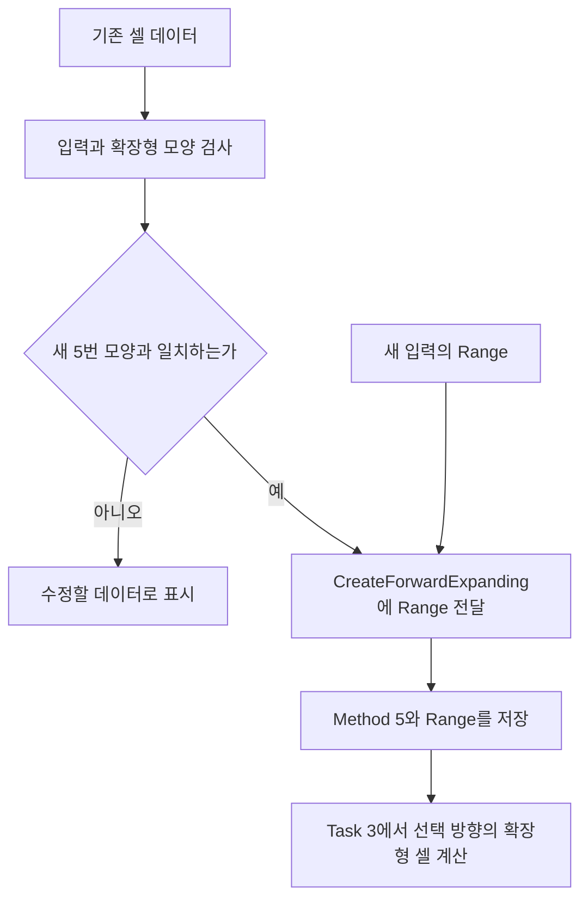

완료 기준은 ‘새 함수가 생겼다’에서 끝나지 않습니다. **설정에는 Method·Range만 남고, 셀을 만드는 일은 Task 3으로 옮겨졌는지**까지 확인하세요. Task 3이나 Unity 변환이 아직이면 남은 호출처를 기록하고 전체 전환 완료 표시는 기다립니다.

다른 파일에서 이어서 고칠 곳은 아래와 같습니다. 한 번에 모두 지우기보다, 새 호출을 연결한 뒤 옛 참조를 제거하세요.

| 파일 또는 사용 위치 | 실제로 바꿀 부분 |
|---|---|
| AppointMethod와 비교문 | DirectionalPattern을 ForwardExpanding으로 변경 |
| AttackPatternSpec 생성 호출 | 셀 배열 대신 확정한 Range 전달 |
| UnitState.AttackPatternLocalCells | 범위 계산기의 참조를 바꾼 뒤 제거 |
| AppointRangeCalculator | 저장된 셀 회전 대신 방향별 모양 계산 |
| AttackGeometryCalculator | 이번에 선택한 방향의 확장형만 계산 |
| UnitSpec·UnitCatalog·공통 조합 표 | 새 Method와 Range로 검사, 옛 배열 검사는 변환 시에만 수행 |
| 기존 테스트 보조 생성 코드 | 새 생성 함수를 사용하고 5번 예시는 실제 확장형 셀로 변경 |
| Unity Adapter·기존 자산 | Task 7 담당자가 같은 변환 규칙으로 수정 |

이 표는 제거할 곳을 찾기 위한 목록입니다. 이동 footprint와 Impact 셀 배열은 제거 대상이 아닙니다.


## Step 3 — UnitSpec.cs: 새 이름으로 기존 공격 조합 검사 유지

**이 Step의 최종 목표:** UnitSpec을 만들 때 아래 두 조합은 받아들이고, 뒤섞인 조합은 예외로 거부하게 합니다.

| AttackPattern.Method | AttackTargetMode | 이 Step에서의 결과 |
|---|---|---|
| RadialSquare | SingleTarget | 허용 |
| ForwardExpanding | AllHostilesInArea | 허용 |
| RadialSquare | AllHostilesInArea | 거부 |
| ForwardExpanding | SingleTarget | 거부 |

**수정 파일:** `Assets/Scripts/ProjectL/Core/Contracts/Commands/UnitSpec.cs`  
**타입:** 기존 `public sealed class`.

### Step 3-1 — 생성자의 두 조합 조건을 새 enum 이름으로 맞추기

**이번 단계의 목표:** private 공통 생성자의 `isSupportedAttackPair`와 바로 아래 예외 분기가 다음 형태가 되게 하세요.

```csharp
bool isSupportedAttackPair =
    (attackPattern.Method == AppointMethod.RadialSquare &&
     attackTargetMode == AttackTargetMode.SingleTarget) ||
    (attackPattern.Method == AppointMethod.ForwardExpanding &&
     attackTargetMode == AttackTargetMode.AllHostilesInArea);

if (!isSupportedAttackPair)
{
    throw new ArgumentException(
        "지원하지 않는 공격 패턴과 대상 방식 조합입니다.",
        nameof(attackTargetMode));
}
```

위 코드는 새 메서드를 만드는 것이 아니라 **기존 생성자 안의 조건과 예외 부분을 수정할 위치**입니다. 앞쪽의 attackPattern null 검사와 AttackTargetMode 검사, 뒤쪽의 능력치·Trait 검사 및 필드 저장은 유지합니다.

처리 순서는 다음과 같습니다.

```text
생성자 인자를 받음
→ attackPattern이 null인지 검사
→ attackTargetMode가 정상 enum 값인지 검사
→ 위 두 조합 중 하나인지 검사
→ 나머지 기존 입력 검사
→ 복사할 배열을 복사하고 필드에 저장
```

`&&`는 두 값이 모두 맞아야 한다는 뜻이고, `||`는 두 조합 중 하나만 맞으면 된다는 뜻입니다. 예를 들어 ForwardExpanding과 SingleTarget을 넘기면 두 괄호가 모두 false이므로 예외가 발생하고 UnitSpec 생성이 중단됩니다.

**현재 코드 상태:** 이 조건과 예외 분기가 이미 반영되어 있습니다. 위와 같다면 수정할 것이 없으며 Step 3-2로 진행합니다. enum에 1~6이 선언되어 있다는 이유만으로 여섯 방식의 모든 조합을 여기서 허용하지 않습니다.

**완료 기준:** 새 이름으로 위 두 조합을 검사하고, 미지원 조합을 거부하는 코드가 있습니다. 공통 검사 함수 작성은 이 Step의 완료 조건이 아닙니다.

<a id="hint-shared-validation"></a>
#### 공통 검사 함수로 바꾸는 것은 언제인가

`AttackProfileCompatibility.GetSupportedAimKind`로 교체하는 작업은 **Task 4 Step 3**에 있습니다. 거기서 필요한 Category·Impact 입력과 함수를 준비한 뒤 UnitSpec/Catalog 호출을 함께 수정합니다. 지금은 그 함수를 호출하거나 Category/Impact 인자를 추가하지 않습니다.

### Step 3-2 — UnitSpec에 새 설정이 들어오는 경계 정리

**이번 단계의 목표:** UnitSpec이 구 숫자나 셀 배열을 직접 해석하지 않고, 이미 만들어진 AttackPatternSpec을 받게 합니다.

1. Step 1-1의 변환 목록에서 UnitSpec 생성에 연결되는 호출을 봅니다.
2. 새 경로는 `CreateRadialSquare(range)` 또는 `CreateForwardExpanding(range)`로 만든 객체를 생성자에 넘깁니다.
3. 구 숫자 8을 새 enum으로 단순 cast하거나, UnitSpec 안에서 구 셀로 Range를 역산하는 코드가 있다면 그 입력 변환을 정리합니다. 이미 변환된 호출이면 추가 코딩은 없습니다.

현재 Unity Adapter의 ForwardExpanding 호출은 `CreateForwardExpanding(definition.AttackRange)`로 변경되어 있고, ShotGun의 저장값도 5로 변경되었습니다. 이 입력을 다시 구 데이터로 변환하지 않습니다.

**완료 기준:** UnitSpec의 입력은 새 AttackPatternSpec이며, 구 숫자의 뜻을 생성자 안에서 추측하지 않습니다. 비용 이름은 [P7](#pending)을 유지합니다. 여기까지 읽고 **Task 1 Step 4로 진행**합니다.

<a id="flow-profile-validation"></a>
#### 지금 작성한 검사는 언제 실행되는가

UnitSpec 생성 시 입력을 검사합니다. 전투 중 공격 범위를 계산하거나 HP를 깎는 코드는 이 Step에 넣지 않습니다. 지금은 설정을 받아도 되는지 판단하고, 실제 공격 계산과 실행은 뒤 Task에서 연결합니다.

## Step 4 — UnitCatalog.cs: 게임 시작 전에도 같은 기존 조합 검사

**이 Step의 최종 목표:** 게임을 시작할 때 검사하는 Catalog도 Step 3의 두 공격 조합을 같은 새 이름으로 검사합니다.

**수정 파일:** `Assets/Scripts/ProjectL/Core/Application/BootstrapModels/UnitCatalog.cs`  
**읽고 수정할 함수:** `ValidateAttackConfiguration(UnitDefinition definition)`.

### Step 4-1 — 새 이름으로 검사하고 구 셀 검사 제거하기

**이번 단계의 목표:** 이 함수에 다음 흐름을 남기세요.

1. AttackPattern이 null이면 예외를 던집니다.
2. RadialSquare + SingleTarget이면 허용합니다.
3. ForwardExpanding + AllHostilesInArea가 아니면 예외를 던집니다.
4. ForwardExpanding이면 기존 1×1 원점 footprint 조건을 검사합니다.
5. 제거한 LocalCells의 빈 배열·원점·중복 검사 코드는 삭제합니다.

이 함수는 UnitSpec과 별도로 게임 시작 가능 여부를 확인하는 기존 경계입니다. 지금은 두 곳의 같은 조건을 유지합니다. Task 4 Step 3에서 공통 함수를 만든 후 두 곳을 함께 교체합니다.

**현재 코드 상태:** 위 수정은 앞선 작업에서 반영했습니다. 추가로 공통 함수를 만들 필요 없이 다음 Task로 진행할 수 있습니다. 기존 1×1 조건은 D4에 필요한 기준이 확정되기 전까지 유지합니다.

## 완료 체크리스트

- [ ] 새 enum 이름과 번호로 공격 설정을 만들 수 있습니다.
- [ ] 설정은 Method와 Range를 저장하고, 구 공격 LocalCells 경로는 정리되어 있습니다.
- [ ] UnitSpec은 Step 3의 두 기존 조합을 허용하고 뒤섞인 조합을 거부합니다.
- [ ] Catalog는 같은 두 조합과 기존 ForwardExpanding 1×1 조건을 검사합니다.
- [ ] 앞당겨 변경한 계산기·Unity 자산 범위를 [작업 기록](#execution-order)에서 구분했습니다.

**다음 작업은 Task 2 Step 1입니다.** Task 1 완료를 위해 Task 4의 공통 함수를 미리 만들지 않습니다.

<a id="task2"></a>
# Task 2 — 기본 능력치와 유닛의 현재 상태 나누기

## 이번 Task에서 완성할 것

[P1](#ownership)의 소유권을 실제 생성 경로에 적용하고 PhysicalDefense를 Snapshot까지 전달합니다. 방어 공식은 [Task 5](#task5)에서 연결합니다. 이 Task는 Plan 13.2절에 대응합니다.

## Step 1 — UnitSpec.cs

**이 파일에서 만들 결과:** 입력한 물리 방어력이 UnitSpec에 그대로 저장되도록 만듭니다.

**수정 파일:** `Assets/Scripts/ProjectL/Core/Contracts/Commands/UnitSpec.cs`  
**타입:** 기존 `public sealed class`.

### Step 1-1 — 필드 영역에 물리 방어력 추가

**이번 단계의 목표:** PhysicalDefense 프로퍼티와 방어값을 받는 생성자 입력을 추가하세요. 새 유닛 입력에서 방어값을 직접 지정할 수 있으면 됩니다.

AttackPower 근처에 `public int PhysicalDefense { get; }`를 둡니다. 새 입력은 방어값을 명시적으로 받게 합니다. 구 overload만 전환용으로 0을 전달하며 신규 유닛 데이터의 기본 기획값 0이라고 주장하지 않습니다.

### Step 1-2 — 생성자 전달 경로 정리

**이번 단계의 목표:** 각 생성자에서 마지막 생성자까지 방어값을 넘기세요. 예를 들어 7을 넣으면 최종 저장값도 7이어야 합니다.

PhysicalDefense를 받는 신규 public overload와 private 공통 생성자의 인자 목록을 함께 확장합니다. 신규 overload는 받은 값을 그대로 전달하고, 기존 호환 overload는 명시적인 0을 전달하도록 각 생성자 위임 호출을 수정합니다. private 생성자에서 음수 방어력 거부 → 방어값 저장 순서로 작성합니다.

힌트는 이 입력 검사까지입니다.

```csharp
if (physicalDefense < 0)
    throw new ArgumentOutOfRangeException(nameof(physicalDefense));
```

<a id="hint-defense-chain"></a>
#### 힌트 — 인자 추가는 선언과 호출을 한 쌍으로 고친다

생성자 선언에 `int physicalDefense`를 추가한 다음, 그 생성자를 부르는 `this(...)`도 하나씩 수정하세요. 선언만 고치면 호출 인자가 부족하고, 인자 순서를 잘못 맞추면 다른 능력치가 방어력으로 들어갈 수 있습니다.

긴 호출에서는 아래처럼 인자 이름을 붙이는 부분을 사용하세요. **호출 괄호 안에 들어갈 인자 한 개**의 예입니다.

```csharp
physicalDefense: physicalDefense
```

새 입력은 받은 값을 넘기고, 구 호출을 유지하는 생성자만 명시적인 0을 넘깁니다. 공통 생성자에서는 기존 음수 검사 아래에 `PhysicalDefense = physicalDefense;`를 넣습니다. 입력 7을 따라가며 ‘받음 → 넘김 → 저장’ 세 곳이 모두 7인지 읽어 보면 됩니다.

### Step 1-3 — 복사와 기존 검증 보존

**이번 단계의 목표:** 생성자를 수정해도 기존 배열 복사와 잘못된 값 거부가 남도록 하세요. 새 인자 때문에 기존 검사를 삭제하지 않습니다.

FootprintLocalCells 및 Traits 복사는 [P2](#snapshot)의 소유권 원칙을 입력에도 적용한 것입니다. 기존 null/중복 TraitKey, 이동비, Timeline 검사를 유지합니다. 생성자 전체를 새 필드 대입만 남기고 축소하지 않습니다.

**현재 코드 상태:** Step 1-1~1-3이 반영되어 있습니다. 구 생성자는 전환용 방어력 0을 전달하고, 방어력을 받는 전체 생성 경로는 입력값을 private 공통 생성자까지 전달합니다.

<a id="flow-constructor-chain"></a>
#### 부연 설명 — 여러 생성자에서 PhysicalDefense 하나를 전달하는 방법

**손댈 곳은 세 군데입니다:** 프로퍼티 선언, 공통 생성자의 인자·검사·대입, 공통 생성자를 부르는 각 `this(...)` 인자 목록.

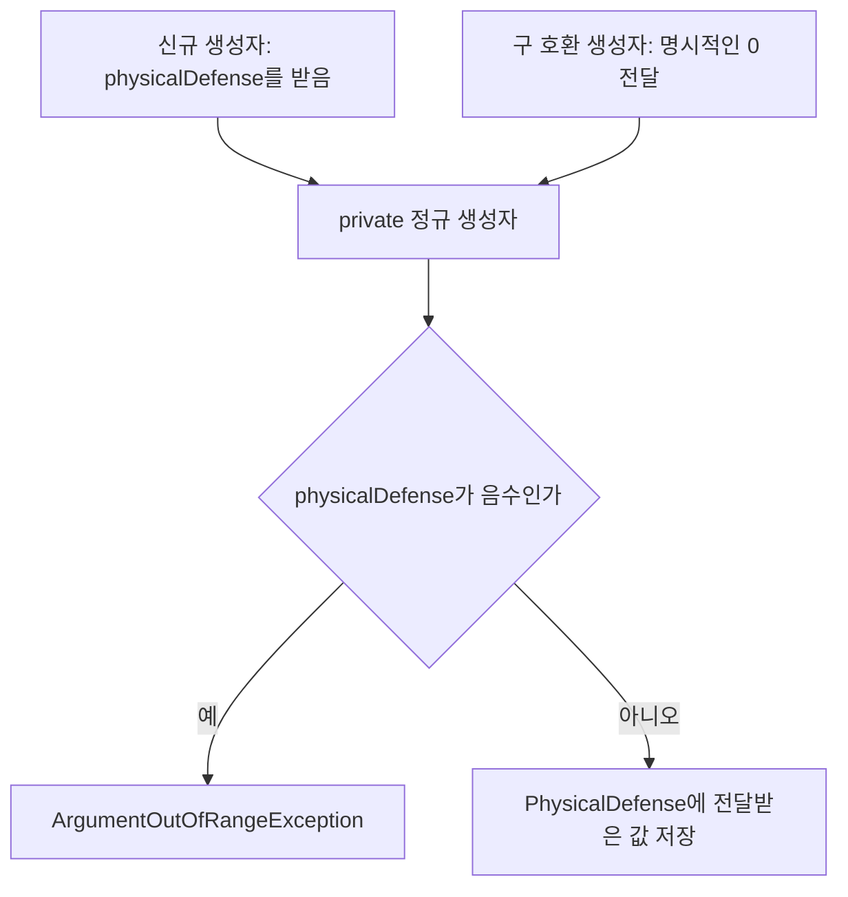

같은 클래스에 인자 목록이 다른 생성자가 여러 개 있는 것을 overload라고 합니다. `this(...)`는 ‘같은 클래스의 다른 생성자에 일을 넘긴다’는 뜻입니다. 그래서 모든 생성자 본문에 검사를 복사할 필요 없이, 최종적으로 모이는 공통 생성자에서 한 번 검사합니다.

신규 입력이 7이면 각 `this(...)`를 따라가며 마지막 인자도 7이어야 합니다. 중간 생성자가 무조건 0을 넘기면 코드는 실행되어도 입력이 사라집니다. 인자가 많을 때는 호출에서 `physicalDefense: physicalDefense`처럼 이름을 붙이면 무엇을 전달하는지 읽기 쉽습니다. 이는 일부 인자의 힌트이며 전체 생성자를 복사할 완성 코드는 아닙니다.

## Step 2 — UnitDefinition.cs

**이 파일에서 만들 결과:** 공유할 기본 능력치를 UnitDefinition에 저장하고 방어력도 함께 전달합니다.

**수정 파일:** `Assets/Scripts/ProjectL/Core/Domain/Entities/UnitDefinition.cs`  
**타입:** 기존 `public sealed class`.

### Step 2-1 — 기본 능력치를 UnitDefinition에 모으기

**이번 단계의 목표:** PhysicalDefense를 추가하고 Appoint 값은 Pattern에서 읽도록 정리하세요. 같은 값을 두 곳에 따로 대입하지 않게 만듭니다.

PhysicalDefense를 추가하고 각 생성자 경로로 받습니다. 기본 공격·이동·턴 순서 설정과 TraitDefinitions는 여기서 유지합니다. 현재 AttackPattern과 AppointMethod/Range가 중복 대입되는 부분은 Pattern에서 읽을 수 있게 정리합니다. UnitDefinition 안에서도 같은 값을 두 프로퍼티에 따로 저장하지 않게 합니다.

<a id="hint-definition-getters"></a>
#### 힌트 — 기본 설정 안의 중복 값도 정리한다

현재 Definition은 AttackPattern을 저장하면서 AppointMethod와 AppointRange도 따로 대입합니다. 두 값이 항상 Pattern에서 나와야 한다면 아래처럼 읽도록 바꿀 수 있습니다.

```csharp
public AppointMethod AppointMethod => AttackPattern.Method;
public int AppointRange => AttackPattern.AppointRange;
```

그다음 생성자에 남아 있는 AppointMethod·AppointRange 대입을 지우세요. AttackPattern 자체는 null을 거부한 뒤 저장합니다. 이 수정은 기본 공격 설정을 읽는 방법만 바꾸며, UnitState의 현재 자원까지 여기로 옮기지 않습니다([P1](#ownership)).

### Step 2-2 — 공통 생성자의 검증 순서

**이번 단계의 목표:** 공통 생성자에서 음수 방어력을 거부하고 정상값을 저장하세요. 기존 수치·특성 검사도 계속 실행되어야 합니다.

기존 private 생성자의 공통 값 검사 옆에 PhysicalDefense 음수 거부를 추가하고 필드 대입 구간에서 저장합니다. 이동/대상/비용/Timeline 조건 → Trait 배열 검사·복사·정렬 → 기본 필드 대입의 기존 순서를 유지합니다. 모든 위임 생성자에서 방어 인자를 전달하도록 수정하여 입력이 중간에 유실되지 않게 합니다.

현재 `ValidateCommonValues(...)`가 EntityKey의 네 유닛 값을 허용합니다. 이 작업을 이유로 새 CategoryKey를 EntityKey처럼 다루거나 등록 체계를 교체하지 않습니다.

**현재 코드 상태:** Step 2-1~2-2가 반영되어 있습니다. AppointMethod/Range는 AttackPattern에서 읽고, 방어력은 공통 생성자에서 음수를 거부한 뒤 저장합니다. UnitCatalog에서 UnitSpec의 방어력을 전달하는 작업은 Step 4에서 진행합니다. 다음 구현은 Step 3-1입니다.

## Step 3 — UnitState.cs

**이 파일에서 만들 결과:** UnitState는 Definition에서 기본값을 읽고, 현재 HP·자원·특성 상태는 유닛별로 유지하도록 바꿉니다.

**수정 파일:** `Assets/Scripts/ProjectL/Core/Domain/Entities/UnitState.cs`  
**타입:** 기존 `public class UnitState : CombatEntityState` 유지.

### Step 3-1 — 기본값을 Definition에서 읽도록 바꾸기

**이번 단계의 목표:** 기본 능력치 프로퍼티가 Definition 값을 읽게 바꾸고 중복 저장과 대입을 지우세요. 현재 AP와 남은 이동량은 State에 남깁니다.

필드 영역에 `internal UnitDefinition Definition { get; }`를 추가합니다. 기본 수치 프로퍼티를 정의 조회로 바꿉니다. 전투 중 효과로 달라질 수 있는 수치는 UnitState에서 기본값임을 드러내는 `Base*` 이름을 사용합니다.

```csharp
public AppointMethod AppointMethod => Definition.AppointMethod;
public int BaseAttackPower => Definition.AttackPower;
public int BasePhysicalDefense => Definition.PhysicalDefense;
```

MoveMethod와 AttackPattern처럼 전투 중 바뀌지 않는 설정은 그대로 Definition에서 읽습니다. MoveRange/Cost, AppointRange, AttackPower, PhysicalDefense, 기본 행동·공격 비용, Priority/Delay는 `BaseMoveRange`, `BaseAttackPower`처럼 기본값임을 드러내고 Definition에서 읽습니다. 해당 기본값의 private setter 및 생성자 중복 대입을 제거합니다. CurrentActionCost와 RemainingMoveRange는 정의에 위임하면 안 됩니다. 전체 구분은 [P1](#ownership)을 따릅니다.

현재 Core 서비스와 기존 테스트가 구 이름을 사용하므로 전환 중에는 아래처럼 **저장 공간이 없는 호환 조회**를 남깁니다. 이는 능력치를 UnitState에 다시 저장하는 필드가 아닙니다. Task 5~6에서 실제 최종 공격력·비용 계산 경로를 연결하고 호출부를 새 이름으로 옮긴 뒤 제거합니다.

```csharp
public int AttackPower => BaseAttackPower;
public int PhysicalDefense => BasePhysicalDefense;
```

### Step 3-2 — 목표 생성자 만들기

**이번 단계의 목표:** Definition을 받는 새 생성자를 작성하세요. 부모 생성자에서 Definition을 읽기 전에 null을 검사할 수 있어야 합니다.

기존 생성자들 아래에 공통 유닛 생성 경로를 준비합니다.

```csharp
internal UnitState(EntityId id, UnitDefinition definition, Owner owner,
    EntityLocation location, UnitTraitStateSet traits);
```

작성 순서: definition null 방어 → base에 Key/MaxHealth/Footprint/Location 전달 → 인스턴스 입력 검사 → Definition과 traits 저장. `base(...)`에서 definition을 읽는 경우 본문의 null 검사보다 먼저 실행된다는 점을 반영하여 null이 NullReferenceException으로 새지 않게 합니다. 필요하면 작은 검사용 보조 함수를 사용하되 같은 정의를 복제하지 않습니다.

<a id="hint-state-constructor"></a>
#### 힌트 — 부모 생성자보다 먼저 null을 막는 작은 함수

Definition에서 값을 처음 꺼내기 전에 사용할 검사용 함수의 예입니다. 이 정도 크기의 보조 함수는 그대로 작성해도 됩니다.

```csharp
private static UnitDefinition RequireDefinition(UnitDefinition definition)
{
    return definition
        ?? throw new ArgumentNullException(nameof(definition));
}
```

부모 생성자 인자에서 Definition을 처음 읽는 자리에 `RequireDefinition(definition).Key`를 사용하세요. C#은 인자를 왼쪽부터 평가하므로 여기서 null이면 뒤의 MaxHealth·Footprint를 읽기 전에 멈춥니다. 다른 인자 순서로 작성한다면 가장 먼저 읽는 위치에 검사를 둬야 합니다.

부모 생성자 호출을 통과한 뒤 본문에서는 Definition 참조를 저장하고 traits도 null인지 검사합니다. 기존 멤버 이름을 쓰는 저장 부분은 다음과 같습니다.

```csharp
Definition = definition;
UnitTraitStateSet = traits
    ?? throw new ArgumentNullException(nameof(traits));
```

기존 생성자에 있던 기본 공격력·거리의 중복 대입은 Step 3-1에서 지웁니다. 기본값 검사는 Definition을 만드는 과정에 남아 있어야 합니다.

### Step 3-3 — 기존 생성자를 새 경로로 옮긴 뒤 제거

**이번 단계의 목표:** 전환 중에는 기존 priority·delay와 Timeline 설정 유무를 보존하고, Step 5에서 실제 생성 호출과 테스트 생성 헬퍼를 새 방식으로 옮긴 뒤 스칼라 생성자를 제거하세요.

호환 overload가 필요한 동안에는 하나의 정의 구성 경로로 연결합니다. 현재 생성자마다 priority/delay와 HasTimelineConfiguration이 다르므로 무조건 true 또는 0으로 통일하지 않습니다. UnitFactory 전환과 기존 테스트 호출 정리가 끝나면 `EntityId, UnitDefinition, Owner, EntityLocation, UnitTraitStateSet`을 받는 생성자만 남깁니다. 게임 준비 검증은 Catalog가 계속 담당합니다.

### Step 3-4 — 턴 시작과 이동 메서드의 기본값 연결

**이번 단계의 목표:** 턴 시작과 이동 메서드가 새 기본값 조회를 사용하도록 고치세요. 현재 자원과 이동 기록을 저장하는 동작은 유지합니다.

다음 반환형/함수는 유지하면서 기본값 참조만 새 정의 조회로 연결합니다.

```csharp
public void BeginTurnResources();
public void ApplyPlannedCombatMove(CellCoord targetAnchor,
    int remainingMoveRangeAfter, int currentActionCostAfter,
    int pendingMoveActionCostAfter);
internal void ApplyAttackCost(int effectiveActionCost);
internal void CommitPendingMovement();
```

BeginTurnResources에서 AP/이동량 초기화의 우변은 새 Definition 위임 프로퍼티를 사용하도록 고치고, 좌변은 기존 인스턴스 자원 필드로 유지합니다. 체크포인트 초기화 대입과 ApplyPlannedCombatMove의 전후 자원 저장은 그대로 유지합니다. CommitPendingMovement의 이동 거리를 공격 범위 모양으로 교체하지 않습니다. TraitSet은 Factory가 만든 인스턴스별 값을 저장합니다.

**현재 코드 상태:** Step 3-1~3-4가 반영되어 있습니다. `UnitState`는 기본값을 따로 대입하지 않고 `Definition`에서 읽으며, 전투 중 달라지는 `CurrentActionCost`와 `RemainingMoveRange`는 계속 인스턴스에 저장합니다. `BaseAttackPower`를 포함한 `Base*` 이름을 추가했고 구 이름은 저장 공간 없는 호환 조회로만 남겼습니다. 실제 게임과 기존 테스트의 생성 호출을 모두 Definition 방식으로 옮겼으며, UnitState에는 다섯 인자를 받는 생성자 하나만 남았습니다.

<a id="flow-unit-state"></a>
#### 부연 설명 — UnitState 생성과 턴 시작은 서로 다른 시점이다

**생성자에서 할 일:** 유효한 Definition과 이 유닛만의 Trait 상태를 받아 연결합니다. **턴 시작에 할 일:** 현재 자원을 기본값으로 채웁니다. 생성자 정리 때문에 두 작업을 한 메서드로 합치지 않습니다.

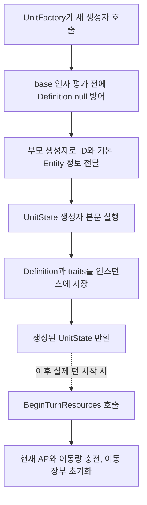

`base(...)`는 부모인 CombatEntityState 생성자를 호출합니다. C#은 **부모 생성자를 실행한 뒤 자식 생성자 본문으로 들어옵니다.** 따라서 본문 첫 줄에서 definition을 검사해도 `base(... definition.Key ...)`의 null 접근을 막기에는 늦습니다. 첫 Definition 접근에 검사용 보조 함수를 사용하도록 구성하고, 검증된 객체의 값을 부모에게 전달합니다.

아래는 조회와 대입의 차입니다.

| 코드 위치 | 변경 후 의미 |
|---|---|
| `PhysicalDefense => Definition.PhysicalDefense` | 읽을 때 Definition의 값을 반환합니다. 별도 저장 대입은 없습니다. |
| `CurrentActionCost = MaxActionCost` | 턴 시작 시 기본 최대값을 현재 자원에 복사합니다. |
| `RemainingMoveRange = MoveRange` | 턴 시작 시 이번 턴 이동량을 채웁니다. |

예를 들어 같은 Definition으로 만든 A와 B의 기본 최대 AP가 10이라고 하자. 턴 시작 후 A가 3을 쓰면 A의 현재 AP만 7이고 B는 10입니다. Definition의 MaxActionCost는 여전히 10입니다. 이 예시는 기본값과 현재값을 어느 프로퍼티에 연결할지 판단할 때 사용합니다.

기존 `BeginTurnResources`의 이동 장부는 현재 Anchor를 체크포인트로 저장하고 누적 확정 거리와 Pending 비용을 0으로 만드는 부분입니다. `ApplyPlannedCombatMove`는 전달받은 이동 후 값을 저장합니다. 이 Task에서 그 값을 새로 계산하는 코드를 넣지 않습니다. 공격 후 정산을 바꿀 때는 [공격 실행 흐름](#flow-facade)을 참조합니다.

## Step 4 — UnitCatalog.cs

**이 파일에서 만들 결과:** UnitSpec에서 읽은 방어력을 UnitDefinition 생성 시 넘깁니다.

**수정 파일:** `Assets/Scripts/ProjectL/Core/Application/BootstrapModels/UnitCatalog.cs`  
**타입:** 기존 `internal sealed class`.

### Step 4-1 — 변환 함수 수정

**이번 단계의 목표:** CreateDefinition의 new UnitDefinition 호출에 spec.PhysicalDefense를 전달하세요.

```csharp
private UnitDefinition CreateDefinition(UnitSpec spec);
```

기존 처리 순서인 TraitSpec 등록 조회 → 타입 일치 확인 → Definition 생성 → 정렬 → 점유 모양 생성 → UnitDefinition 생성을 유지합니다. 마지막 `new UnitDefinition(...)` 호출에 `spec.PhysicalDefense`를 추가합니다. 방어값을 기본 상수나 기존 AttackPower 인자로 잘못 전달하지 않도록 대응시킵니다.

<a id="hint-catalog-transfer"></a>
#### 힌트 — Catalog는 값을 계산하지 않고 옮긴다

CreateDefinition의 마지막 new UnitDefinition 호출을 찾으세요. 여기에 넣을 방어값은 Spec에서 읽습니다. 긴 인자 목록의 해당 자리에는 아래처럼 이름을 붙일 수 있습니다.

```csharp
physicalDefense: spec.PhysicalDefense
```

위 한 줄은 생성자 호출 괄호 안에 넣는 부분입니다. UnitDefinition 생성자 인자도 Step 2에서 같은 이름으로 추가되어 있어야 합니다. Catalog에서 피해를 줄이거나 방어값을 0으로 다시 계산하지 않습니다.

Trait 변환 반복문과 footprint 생성은 기존 위치에 둡니다. 이 Step의 변경은 ‘새 방어 인자 하나가 마지막 호출까지 도착하게 하기’부터 시작하면 됩니다.

### Step 4-2 — 게임 준비 검증 유지

**이번 단계의 목표:** ValidateCombatReady의 이동·비용·턴 순서·공격 설정 검사를 유지하세요. 지원하지 않는 설정은 전투 시작 전에 거부되어야 합니다.

```csharp
public void ValidateCombatReady();
```

HasTimelineConfiguration, MoveMethod, 공격 조합, MoveCost, AttackCost 검사는 여전히 필요합니다. “Definition이 생성 후 값이 바뀌지 않는 구조이니 모든 설정이 게임에서 지원된다”고 가정하지 않습니다. 등록·조합 검증 역할은 [P1](#ownership)의 입력 흐름 안에 남습니다.

**현재 코드 상태:** Step 4-1~4-2가 반영되어 있습니다. `CreateDefinition`은 `spec.PhysicalDefense`를 새 `UnitDefinition` 생성자에 전달하고, 기존 `ValidateCombatReady` 검사는 유지되어 있습니다.

## Step 5 — UnitFactory.cs

**이 파일에서 만들 결과:** 각 유닛의 Trait 상태를 따로 만들고 새 UnitState 생성자를 호출합니다.

**수정 파일:** `Assets/Scripts/ProjectL/Core/Application/Factories/UnitFactory.cs`  
**타입:** 기존 `internal sealed class`.

### Step 5-1 — 기존 생성 함수의 끝부분 교체

**이번 단계의 목표:** 긴 new UnitState 호출을 ID·Definition·Owner·Location·TraitStateSet을 받는 호출로 바꾸세요.

```csharp
internal UnitState CreateReserveUnit(UnitDefinition definition,
    Owner owner, int reserveSlotIndex);
```

현재 이미 definition/owner/slot 검사와 TraitRuntimeState 생성이 있습니다. 긴 스칼라 `new UnitState(...)` 부분만 새 생성자 호출로 바꿉니다.

<a id="hint-factory-call"></a>
#### 힌트 — 긴 스칼라 호출을 다섯 인자로 줄이기

이미 준비한 값에 이름을 붙여 읽어 보면 간단합니다. 아래 `id`는 발급한 ID, `location`은 Reserve 위치, `traitSet`은 반복문에서 만든 상태들을 묶은 객체입니다. 현재 코드의 변수명이 다르면 그 이름을 사용하세요.

```csharp
var unit = new UnitState(
    id, definition, owner, location, traitSet);
```

이 줄 앞에는 Trait 상태 생성과 검사가, 뒤에는 slot 점유와 반환이 옵니다. 이 호출을 만들기 위해 Definition을 또 생성하거나 TraitStateSet을 다시 비우지 마세요. 재료가 준비되는 순서는 [Factory 흐름도](#flow-unit-factory)를 참조합니다.

### Step 5-2 — 인스턴스 상태 생성 및 점유 순서

**이번 단계의 목표:** 유닛 생성에 성공한 뒤 slot을 점유하게 하세요. 다른 유닛끼리 같은 TraitRuntimeState 객체를 쓰지 않게 합니다.

순서: 빈 slot 확인 → ID/Reserve 위치 준비 → 각 TraitRuntimeState 생성 → null/key/구체 타입 검증 → UnitTraitStateSet 구성 → UnitState 생성 성공 → Reserve 점유 → 반환. 동일 Definition에서 생성한 두 유닛에 같은 TraitRuntimeState 객체를 재사용하지 않습니다.

<a id="flow-unit-factory"></a>
#### 부연 설명 — Factory에서 반복문이 만드는 것은 유닛별 Trait 상태다

**읽을 함수:** CreateReserveUnit. **반복 대상:** Definition의 Trait 정의들. **반복 결과:** 이번 유닛의 TraitRuntimeState 목록.

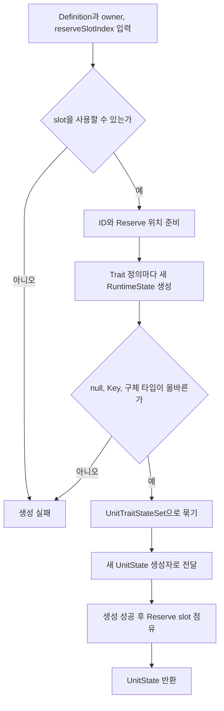

기존 Trait 반복문은 그대로 두고, 반복문이 끝난 뒤의 긴 `new UnitState(...)` 호출을 먼저 교체하면 수정 범위를 따라가기 쉽습니다. 새 생성자에 필요한 다섯 값은 위에서 만든 ID, 입력 Definition, 입력 Owner, 준비한 Location, 묶은 TraitStateSet입니다.

slot 점유는 생성 성공 뒤에 둡니다. 먼저 점유한 다음 Trait 생성에 실패하면 유닛이 없는데 slot만 찬 상태가 될 수 있습니다. A와 B를 연속 생성할 때는 Definition을 공유해도 반복문에서 만드는 RuntimeState 객체들은 각각 새 것이어야 한다([P1](#ownership)).

**현재 코드 상태:** Step 5-1~5-2가 반영되어 있습니다. 긴 scalar 생성자 호출은 `new UnitState(entityId, definition, owner, entityLocation, unitTraitStateSet)`으로 바뀌었습니다. TraitRuntimeState를 유닛마다 새로 만들고 UnitState 생성 성공 뒤 Reserve slot을 점유하는 순서는 기존 구현이 이미 충족하고 있어 그대로 유지했습니다. 기존 테스트의 생성 호출은 `UnitStateTestFactory`가 UnitDefinition을 만든 뒤 같은 다섯 인자 생성자를 호출하도록 옮겼고, UnitState의 구 스칼라 생성자는 제거했습니다.

## Step 6 — UnitStatsSnapshot.cs

**이 파일에서 만들 결과:** 화면에 넘길 UnitStatsSnapshot에도 물리 방어력을 담습니다.

**수정 파일:** `Assets/Scripts/ProjectL/Core/Contracts/Snapshots/UnitStatsSnapshot.cs`  
**타입:** 기존 `public readonly struct`.

### Step 6-1 — 프로퍼티와 생성자 수정

**이번 단계의 목표:** PhysicalDefense 프로퍼티와 생성자 인자를 추가하고 값을 저장하세요. 기존 생성자는 명시적인 0을 넘겨 연결합니다.

AttackPower 옆에 PhysicalDefense를 추가합니다. 공통 생성자에서 음수를 거부하고 대입합니다. 방어값을 받는 생성자는 받은 값을 공통 생성자로 전달하고, 구 호환 생성자는 명시적인 0으로 위임하도록 수정합니다. 내부 Definition 참조를 추가하지 않는다([P2](#snapshot)).

### Step 6-2 — 기본값과 현재값 확인

**이번 단계의 목표:** 기본 수치와 현재 자원을 각각 올바른 프로퍼티에서 받게 하세요. 기본 이동량 대신 남은 이동량을 넣는 식의 혼동이 없어야 합니다.

기본 비용·기본 이동량은 위임 프로퍼티에서 복사하고, CurrentActionCost/RemainingMoveRange는 State에서 복사합니다. 현재 ActionPoint/AttackRange 별칭은 Plan의 전환 정책을 따르며 이 Task에서 새 의미를 부여하지 않습니다.

**현재 코드 상태:** Step 6-1~6-2가 반영되어 있습니다. `UnitStatsSnapshot`은 `PhysicalDefense`를 받고 음수를 거부한 뒤 저장합니다. 구 생성자들은 호환값 0을 전달하며, 새 전체 생성자는 기본 수치와 현재 자원을 각각 별도 인자로 받습니다.

## Step 7 — StageSnapshotBuilder.cs

**이 파일에서 만들 결과:** BuildEntity가 현재 유닛의 방어력과 자원을 Snapshot에 담도록 연결합니다.

**수정 파일:** `Assets/Scripts/ProjectL/Core/Application/StageRun/StageSnapshotBuilder.cs`  
**타입:** 기존 타입과 접근 수준 유지.

### Step 7-1 — Unit 분기 갱신

**이번 단계의 목표:** Unit 분기의 UnitStatsSnapshot 생성 호출에 unit.PhysicalDefense를 추가하세요.

```csharp
public EntitySnapshot BuildEntity(CombatEntityState entity);
```

`if (entity is UnitState unit)` 내부의 UnitStatsSnapshot 생성 인자에 PhysicalDefense를 추가합니다. 현재 Catalog에서 Definition을 조회해 `_traitResolver.CreateStatuses(definition, unit)`를 호출하므로 이 연결을 임의로 삭제하지 않습니다.

<a id="hint-snapshot-call"></a>
#### 힌트 — Snapshot 생성 인자에 실제 조회값을 연결하기

BuildEntity의 `entity is UnitState unit` 분기 안에서 new UnitStatsSnapshot 호출을 찾으세요. 다음 인자를 기존 attackPower 근처에 추가합니다.

```csharp
physicalDefense: unit.PhysicalDefense
```

UnitStatsSnapshot 생성자에서 받은 값을 같은 이름의 프로퍼티에 저장하도록 Step 6과 함께 수정합니다. 이 한 줄을 넣으려다 ‘해당 인자를 받는 생성자가 없다’는 오류가 나오면 먼저 Snapshot 생성자 선언과 연결을 확인하세요. UnitState의 값을 계산하지 않고 읽어 전달하는 자리입니다.

### Step 7-2 — 전장/대기/사망 상태 확인

**이번 단계의 목표:** 점유 셀은 살아 있고 전장에 배치된 경우에만 읽게 하세요. Reserve나 사망 유닛의 점유 셀 배열은 기존처럼 비어 있어야 합니다.

죽었거나 Reserve에 있는 Entity에는 GetOccupiedCell을 무조건 호출하면 안 됩니다. 기존 occupiedCells 조건을 유지하고, Snapshot 확장이 배치 예외를 새로 만들지 않는지 확인합니다.

**현재 코드 상태:** Step 7-1~7-2가 반영되어 있습니다. `StageSnapshotBuilder`는 UnitState의 `BasePhysicalDefense`를 Snapshot에 전달하며, Reserve·사망 Entity의 점유 셀을 비워 두는 기존 조건은 유지되어 있습니다.

<a id="flow-snapshot-builder"></a>
#### 부연 설명 — BuildEntity에서 Unit 분기만 따라가 보기

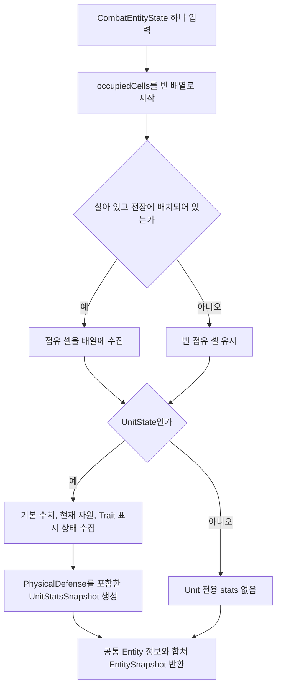

이 작업에서 새로 추가하는 줄은 UnitStatsSnapshot 생성 인자의 `physicalDefense: unit.PhysicalDefense`다. 그 인자를 받을 Snapshot 생성자는 Step 6에서 먼저 확장합니다.

예를 들어 Reserve 유닛의 방어력이 7이면 Snapshot에도 방어력 7은 들어가지만 전장 점유 셀은 빈 배열입니다. ‘방어값을 보여 주려면 점유 셀도 읽어야 한다’고 연결하지 않습니다. Snapshot 복사 원칙은 [P2](#snapshot)를 참조합니다.

## 완료 체크리스트

- [ ] PhysicalDefense 7이 Spec→Definition→State→Snapshot에서 7입니다.
- [ ] 공유 Definition의 두 유닛이 현재 자원/HP/Trait 상태는 공유하지 않습니다.
- [ ] 기존 이동 체크포인트와 턴 시작 초기화가 유지됩니다.
- [ ] 기존 `UnitCombatStaticStatsTests`, 배치/생성 통합 검사로 위 흐름을 확인합니다.
- [ ] 방어값 전달 완료와 실제 피해 경감 완료를 구분합니다.

전체 흐름: `UnitSpec → UnitCatalog → UnitDefinition → UnitFactory → UnitState → StageSnapshotBuilder → UnitStatsSnapshot → 외부 소비자`.

**검증 상태:** 요청에 따라 RED 테스트, 검증 테스트, 빌드는 실행하지 않았습니다. 위 체크리스트의 실행 검증은 보류 상태입니다.
<a id="task3"></a>
# Task 3 — 선택 가능한 전체 범위와 이번 공격 범위 나누기

## 이번 Task에서 완성할 것

[P3](#geometry)의 네 영역을 분리하고 [P4](#aim)의 선택 계약을 만듭니다. 실제 적을 모으거나 HP를 변경하는 것은 후속 Task입니다. 전방·5번·다중 점유 모양의 미정 범위는 [P7](#pending)을 참조합니다.

## Step 1 — AttackDirection.cs

**이 파일에서 만들 결과:** 공격 방향 8개와 방향 미지정 값을 코드로 표현합니다.

**신규 파일:** `Assets/Scripts/ProjectL/Core/Contracts/Common/AttackDirection.cs`  
**타입:** `public enum`, `ProjectL.Core.Contracts.Common` namespace.

### Step 1-1 — Plan의 방향 번호 선언

**이번 단계의 목표:** 아래 확정 번호대로 AttackDirection enum을 작성하세요. 기존 Rotation4는 바꾸지 않습니다.

None=0, Up=1, UpRight=2, Right=3, DownRight=4, Down=5, DownLeft=6, Left=7, UpLeft=8을 사용합니다. Rotation4 자체는 수정하지 않습니다. 방향 벡터는 위쪽을 (0,1), 오른쪽을 (1,0)으로 대응합니다.

### Step 1-2 — None의 의미 구분

**이번 단계의 목표:** None을 방향 미지정 값으로 처리하세요. None을 받아 길이가 있는 공격 경로를 생성하지 않게 합니다.

None은 위치 조준이나 미지정 방향입니다. (0,0) 방향으로 Ray를 생성하라는 뜻이 아닙니다. 유효성은 다음 Step의 입력을 사용하는 상황에서 판단합니다.

## Step 2 — AttackAimKind.cs

**이 파일에서 만들 결과:** Entity 선택과 Cell 선택을 구분하는 enum을 만듭니다.

**신규 파일:** `Assets/Scripts/ProjectL/Core/Contracts/Common/AttackAimKind.cs`  
**타입:** `public enum`.

### Step 2-1 — 기존 Category 계획 계약 사용

**이번 단계의 목표:** None=0, Entity=1, Cell=2를 선언하세요. Category 작업에서 이미 만든 파일이 있다면 그것을 사용합니다.

None=0, Entity=1, Cell=2. 별도 Direction aim 종류를 추가하지 않습니다. Direction은 AttackAim에 붙는 정보입니다. 현재 소스에는 파일이 없으므로 Category 작업에서 먼저 만들었다면 새로 만들지 않고 그 파일을 사용합니다.

### Step 2-2 — 선택 해석에서 사용할 실패 enum 준비

**이번 단계의 목표:** `Assets/Scripts/ProjectL/Core/Contracts/Results/AttackFailureReason.cs`에 InvalidAttackDirection과 AmbiguousAttackDirection을 추가합니다. InvalidAttackAim이 없으면 Category 계획의 같은 실패 계약으로 추가합니다. 기존 번호는 그대로 두고 사용하지 않는 번호를 명시합니다.

Step 7의 선택 해석 함수가 이 값들을 반환하므로 여기서 먼저 선언합니다. Preview와 Result에 전달하는 연결은 Task 6에서 합니다.

## Step 3 — AttackAim.cs

**이 파일에서 만들 결과:** 선택한 대상 또는 셀과 방향을 AttackAim 하나에 담습니다.

**신규 파일:** `Assets/Scripts/ProjectL/Core/Contracts/Commands/AttackAim.cs`  
**타입:** `public readonly struct`, `ProjectL.Core.Contracts.Commands` namespace.

### Step 3-1 — 값 구성

**이번 단계의 목표:** Kind·EntityId·Cell·Direction과 네 생성 함수를 추가하세요. 필요한 선택값을 모두 전달할 수 있으면 됩니다.

필드 영역은 Kind, EntityId, nullable CellCoord인 Cell, AttackDirection인 Direction으로 구성합니다. private 생성자와 다음 public 팩토리를 둡니다.

```csharp
public static AttackAim ForEntity(EntityId entityId);
public static AttackAim ForEntity(EntityId entityId, AttackDirection direction);
public static AttackAim ForCell(CellCoord cell);
public static AttackAim ForCell(CellCoord cell, AttackDirection direction);
```

### Step 3-2 — 팩토리 내부 처리

**이번 단계의 목표:** Entity 생성 함수는 빈 ID를 거부하고, Cell 생성 함수는 좌표를 저장하게 하세요. 방향 생략 시에는 None을 넣습니다.

Entity 경로: empty ID 거부 → Direction enum 검사 → Kind=Entity/Cell 없음 설정 → 반환. Cell 경로: Direction enum 검사 → Kind=Cell/EntityId.Empty/Cell 값 설정 → 반환. 방향 없는 overload는 None을 전달합니다.

맵 경계나 살아 있는 대상 검사는 팩토리에서 할 수 없습니다. 현재 전투 정보가 없는 값 생성 단계이기 때문입니다. default(AttackAim)의 Kind=None은 표현 가능하되 공개 Command에서 거부하게 합니다.

<a id="hint-aim-factory"></a>
#### 힌트 — 방향 enum 검사와 전투 중 유효성 검사를 나누기

AttackAim 생성 함수에서는 Direction이 enum에 있는 값인지 검사할 수 있습니다. 아래 검사는 Entity·Cell 생성 함수의 공통 생성 부분에 둡니다.

```csharp
if (!Enum.IsDefined(typeof(AttackDirection), direction))
    throw new ArgumentOutOfRangeException(nameof(direction));
```

None도 정의된 enum 값이므로 이 검사를 통과합니다. None을 허용하는 이유는 ‘아직 방향을 지정하지 않았다’는 입력을 표현하기 위해서입니다. 실제로 방향을 자동 선택할 수 있는지는 [선택 해석](#flow-selection)에서 판단합니다.

Entity 생성에서는 빈 EntityId를 거부하고 Cell을 null로 둡니다. Cell 생성에서는 좌표를 저장하고 EntityId를 Empty로 둡니다. ‘그 좌표가 맵 안인가’, ‘그 적이 살아 있는가’는 이 자료형이 알 수 없으므로 전투 서비스가 검사합니다.

## Step 4 — AppointShapeCalculator.cs

**이 파일에서 만들 결과:** 입력한 방향과 거리로 사각형·직선·확장형의 상대 좌표 배열을 만듭니다.

**신규 파일:** `Assets/Scripts/ProjectL/Core/Domain/Combat/AppointShapeCalculator.cs`  
**타입:** `public static class`, `ProjectL.Core.Domain.Combat` namespace.

### Step 4-1 — 세 개의 입력값만으로 결과를 계산하는 함수 선언

**이번 단계의 목표:** 아래 세 함수를 추가하세요. 맵이나 UnitState 없이 인자만으로 좌표 배열을 계산하도록 작성합니다.

```csharp
public static CellCoord[] CreateSquare(int range);
public static CellCoord[] CreateRay(CellCoord directionStep, int range);
public static CellCoord[] CreateExpanding(CellCoord forwardStep, int range);
```

출력은 local 좌표 배열입니다. 이 함수들은 UnitState나 Entity 목록을 읽지 않습니다. 월드 변환은 다음 Step에서 처리합니다.

### Step 4-2 — 중앙을 뺀 사각형 셀 만들기

**이번 단계의 목표:** 중앙을 뺀 사각형 좌표를 반환하게 하세요. Range 1의 결과는 8셀, Range 0은 빈 배열입니다.

range 음수 검사 → x/y 양축의 허용 구간 구성 → 원점 제외 → local cells 수집 → 독립 배열 반환. range=0이면 빈 배열입니다. 조건 힌트만 사용해 반복문은 직접 작성합니다.

```csharp
Math.Abs(dx) <= range && Math.Abs(dy) <= range
```

<a id="hint-square-loop"></a>
#### 힌트 — 사각형 반복문에서 중앙 한 칸만 건너뛰기

y 반복 안에 x 반복을 넣으세요. 각 축의 시작은 -range, 끝은 +range입니다. 두 반복문 안에서 사용할 제외 조건은 다음과 같습니다.

```csharp
if (x == 0 && y == 0)
    continue;
```

이 조건 아래에서 좌표 하나를 목록에 추가합니다. `&&`가 중요한 이유는 **x와 y가 모두 0인 중앙 한 칸**만 빼야 하기 때문입니다. `||`로 쓰면 가로축·세로축까지 빠집니다.

Range 1에서 y=-1일 때 3개, y=0일 때 2개, y=1일 때 3개를 모으면 8개입니다. 반복 변수와 큰 range 처리는 Step 4-5를 적용하세요.

### Step 4-3 — 한 방향으로 이어지는 셀 만들기

**이번 단계의 목표:** 지정한 방향으로 1칸부터 range칸까지 좌표를 만드세요. 대각선 Range 3도 좌표 3개입니다.

directionStep 각 축이 -1..1인지 확인 → 둘 다 0인 입력 거부 → 깊이 1부터 range까지 한 방향의 좌표 생성 → 반환. 오른쪽 Range=3 결과는 (1,0),(2,0),(3,0)입니다. 대각선에도 이동 비용 2를 곱하지 않습니다.

<a id="hint-ray-vector"></a>
#### 힌트 — 방향을 좌표로 만든 뒤 깊이를 곱하기

먼저 directionStep이 허용된 단위 방향인지 검사하세요. 두 축이 각각 -1..1이어야 하고 (0,0)은 안 됩니다. 이후 깊이 d=1부터 range까지 좌표 한 개씩 만듭니다.

```csharp
var cell = new CellCoord(
    checked(directionStep.X * d),
    checked(directionStep.Y * d));
```

이 코드는 반복문 안에서 ‘이번 깊이의 셀’을 만드는 부분입니다. directionStep=(1,1), d=2이면 (2,2)가 됩니다. d를 x/y 두 축의 이동 비용처럼 합치지 않습니다. 만들어진 cell을 결과 목록에 추가하고 다음 깊이로 진행하세요.

### Step 4-4 — 앞으로 갈수록 넓어지는 셀 만들기

**이번 단계의 목표:** 직교 전방의 깊이별 폭이 1·3·5처럼 늘어나게 하세요. Up, Range 3이면 합계 9셀이 나옵니다.

forwardStep이 직교 단위 벡터인지 검사 → 수직 right 벡터 계산 → 깊이 d별 lateral 범위 구성 → 두 축을 합쳐 local cell 생성 → 반환.

힌트: 깊이 d의 lateral은 `-(d-1)..+(d-1)`입니다. 폭과 실제 좌표 변환을 혼동하지 말고 Up의 깊이 3을 먼저 손으로 그린 뒤 회전해 봅니다. 5번 전체 허용 방향과 대각 확장은 D4가 정해진 뒤 연결합니다. DirectionalPattern을 5번으로 바꾼다는 결정 자체는 이미 확정됐습니다.

<a id="hint-expanding-loop"></a>
#### 힌트 — 확장형의 두 반복문을 깊이와 가로 폭으로 나누기

바깥 반복은 전방 깊이 d, 안쪽 반복은 그 깊이의 좌우 위치입니다. 직교 단위 방향인지 먼저 검사하고, 오른쪽을 가리키는 벡터를 하나 만듭니다.

```csharp
var rightStep = new CellCoord(forwardStep.Y, -forwardStep.X);
int halfWidth = d - 1;
```

두 번째 줄은 **바깥 깊이 반복문 안**에 들어갑니다. 안쪽에서는 lateral을 -halfWidth부터 +halfWidth까지 순회합니다. Up 기준으로 d=2이면 rightStep=(1,0), lateral=-1,0,1입니다.

이번 셀을 만드는 부분의 힌트입니다. CellCoord에는 벡터 곱셈 연산자가 없으므로 x/y를 각각 계산하세요.

```csharp
var cell = new CellCoord(
    checked(forwardStep.X * d + rightStep.X * lateral),
    checked(forwardStep.Y * d + rightStep.Y * lateral));
```

d=2, lateral=-1을 대입하면 (-1,2)가 됩니다. 옆 칸 3개를 모았으면 d=3으로 넘어갑니다. Range 3의 결과는 깊이별 1+3+5=9셀입니다. 방향·Range 입력 검사와 배열 반환은 앞 Step 순서대로 직접 연결하세요.

### Step 4-5 — 큰 입력 처리

**이번 단계의 목표:** 큰 range에서도 숫자가 넘치거나 반복문이 끝나지 않는 일이 없게 하세요. 맵용 계산은 실제 맵 안의 범위로 제한합니다.

이 Step은 두 파일에서 이어집니다. **지금 AppointShapeCalculator에서 할 일**은 배열 크기를 `long`으로 먼저 계산하고, 배열 길이로 표현할 수 없으면 `ArgumentOutOfRangeException`으로 거부하며, 반복 변수도 마지막 증가에서 넘치지 않게 `long`으로 돌리는 것입니다. **다음 Step 5의 AppointRangeCalculator에서 할 일**은 전체 local 배열을 만들지 않고 맵의 `0..Width-1`, `0..Height-1` 셀만 순회하면서 같은 Shape 포함 조건을 적용하는 것입니다. 새 임의 게임 사거리 상한을 도입하지 않습니다.

<a id="hint-large-range"></a>
#### 힌트 — 큰 수를 안전하게 처리할 위치

int 최댓값에 1을 더하면 숫자 범위를 벗어납니다. 사각형 전체 배열의 예상 셀 수도 int로 먼저 계산하지 말고 long으로 계산하세요.

```csharp
long side = 2L * range + 1;
```

다음 곱셈도 checked 등으로 범위 초과를 확인한 뒤 수행합니다. 배열로 만들 수 없는 크기를 조용히 잘라 반환하면 잘못된 범위가 됩니다. 전체 배열 함수는 표현 불가능한 입력을 명확히 거부하고, 맵용 계산은 먼저 맵 안의 x/y 구간을 구해 실제 셀만 만듭니다. 임의의 게임 사거리 상한을 새로 정하는 것이 아닙니다.

예를 들어 20×20 맵의 조회 때문에 Range가 매우 큰 사각형 전체를 먼저 만들 필요는 없습니다. 맵 안 후보마다 같은 Shape 조건을 판정하거나 맵과 겹치는 좌표 구간만 반복하세요. 두 경로의 포함 조건은 같아야 합니다.

**현재 코드 상태:** 세 전체 배열 함수는 크기와 반복 경계를 `long`으로 처리하며, Square와 Expanding은 결과 셀 수가 `int` 배열 길이를 넘으면 명시적으로 거부합니다. 맵용 계산은 Step 5에서 `ContainsSquare`, `ContainsRay`, `ContainsExpanding` 조건을 재사용하여 맵 셀만 순회합니다.

<a id="flow-shape-loops"></a>
#### 부연 설명 — 범위 모양별 반복문에서 무엇을 하나씩 만드는가

세 함수 모두 **local 좌표를 모으는 List를 만든 뒤 배열로 반환합니다.** local은 ‘원점을 기준으로 몇 칸 떨어졌는가’라는 뜻입니다. 이 함수에서는 맵 위 실제 위치를 더하지 않습니다.

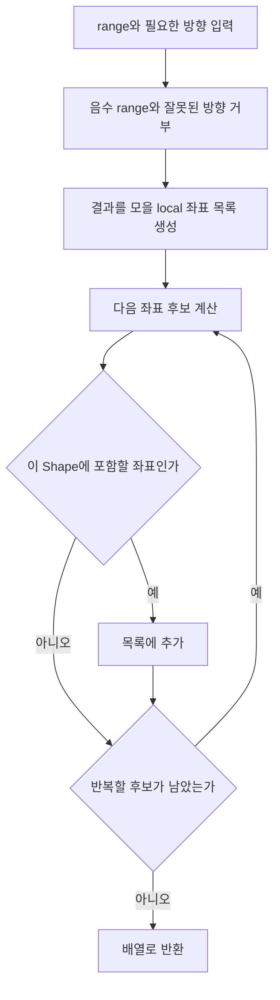

| 함수 | 바깥 반복 | 안쪽 반복 또는 계산 | 작은 예시 |
|---|---|---|---|
| CreateSquare | y를 -range부터 +range까지 | 각 y에서 x도 같은 범위로 순회. (0,0)은 건너뜀 | Range 1이면 3×3에서 가운데를 뺀 8셀 |
| CreateRay | 깊이 d를 1부터 range까지 | directionStep의 각 축에 d를 곱함 | UpRight, Range 3 → (1,1), (2,2), (3,3) |
| CreateExpanding | 깊이 d를 1부터 range까지 | lateral을 -(d-1)부터 +(d-1)까지 순회 | Up의 깊이 2 → (-1,2), (0,2), (1,2) |

Expanding의 좌표 힌트는 `forwardStep × d + rightStep × lateral`입니다. 먼저 Up에서 d=1,2,3의 행을 만들면 각 행의 셀 수가 1,3,5가 됩니다. 합계는 9셀입니다. 이 함수가 직교 전방을 계산하는 것과 실제 캐릭터에게 어떤 방향을 허용할지는 다른 단계다([P7](#pending)).

`continue`는 이번 좌표만 건너뛰고 반복을 계속할 때 씁니다. `return`은 함수 전체를 끝내므로 Square에서 원점을 만났다고 return하면 나머지 칸이 사라집니다. 큰 range의 안전한 계산·열거는 바로 앞 Step 4-5를 적용합니다.

## Step 5 — AppointRangeCalculator.cs

**이 파일에서 만들 결과:** 유닛이 선택할 수 있는 전체 맵 셀을 AppointMethod별로 계산합니다.

**수정 파일:** `Assets/Scripts/ProjectL/Core/Domain/Combat/AppointRangeCalculator.cs`  
**타입:** 기존 `public sealed class`.

### Step 5-1 — 전체 지정 영역 생성 경로 수정

**이번 단계의 목표:** Manhattan 공격 범위 계산을 Method별 모양 생성으로 바꾸세요. 맵 밖·자기 점유 셀·중복 셀을 뺀 배열을 반환합니다.

```csharp
public CellCoord[] CalculateRangeCells(StageMapState map, UnitState source);
```

현재 Radial 분기의 `abs(dx)+abs(dy)`로 포함 여부를 판단하는 루프를 제거하고 Method별 범위 모양 생성 경로로 교체합니다. 구현 순서는 공격자의 현재 상태 검사 → 해당 Method의 허용 방향/위치 Shape 구성 → local→world 변환 → 맵 밖 제외 → 자기 점유 셀 제외 → 중복 제거 → Y/X 표시 순서 반환입니다.

Cross는 직교 네 Ray, Queen은 여덟 Ray의 합집합입니다. Method 2는 현재 전방과 양옆 대각 후보만 포함합니다. Method 1/2의 “현재 전방” 공급은 D4 지점이며, 임시로 항상 R0을 넣고 기능 완료로 하지 않습니다.

**현재 코드 상태:** RadialSquare는 중앙을 뺀 사각형, Cross는 직교 네 Ray, Queen은 여덟 Ray의 합집합으로 맵 안 셀만 계산합니다. ForwardExpanding의 기존 실행 호환 경로는 네 직교 방향을 유지합니다. Method 1/2와 여러 칸 유닛은 D4 입력이 없으므로 임의 계산하지 않고 명시적인 `NotSupportedException`으로 구분합니다.

### Step 5-2 — 방향 계산 함수의 역할 재배치

**이번 단계의 목표:** 새 공격 방향은 AttackDirection으로 계산하고 대상에 맞는 방향을 모두 모으세요. 그 목록을 선택 해석 함수에 넘깁니다.

이 Step에서는 앞 Step 4의 Shape 함수를 사용해 방향별 셀과 후보 방향을 계산합니다. 기존 Rotation4 호출은 현재 서비스용으로 유지하고, 새 AttackDirection 경로를 추가합니다. 다음 Step에서 만들 CalculateAttackCells를 아직 호출하지 않습니다. 그 계산기와의 공통 처리 연결은 Step 6-3에서 합니다. `FindMatchingDirections`가 하던 대상 겹침 판정은 새 Method의 허용 방향을 순회해 각 공격 셀과 대상 점유 셀의 교집합을 구하고, 일치하는 `AttackDirection`을 모두 모으도록 바꿉니다. 이 목록을 Step 7의 후보 입력으로 전달합니다. 기존 LocalCells를 Rotation4로 돌리는 실행 코드는 제거하고, ForwardExpanding의 선택 방향과 Range로 셀을 생성합니다. 옛 셀의 방향을 맞추는 처리가 필요하다면 데이터 변환에서만 사용합니다. 완료 후 새 8방향 값을 Rotation4로 cast하는 호출이 없어야 합니다.

<a id="hint-direction-candidates"></a>
#### 힌트 — FindMatchingDirections는 맞는 방향을 전부 모은다

허용된 방향을 하나 꺼내고, 그 방향의 공격 셀을 구한 다음, 대상의 점유 셀과 겹치는지 확인합니다. 겹치면 후보 방향 목록에 한 번 추가하고 다음 방향을 검사합니다.

순회 중 모아 둔 목록을 예로 들면 다음 상태가 가능합니다.

```csharp
var candidates = new List<AttackDirection>();
```

여기에 첫 방향을 추가했다고 함수 전체를 return하지 마세요. 여러 칸을 차지한 대상이 둘 이상의 공격 방향과 겹칠 수 있습니다. 모든 허용 방향을 검사한 뒤 후보 배열을 반환해야 Task 3 Step 7이 모호한 선택을 구별할 수 있습니다.

5번의 셀은 LocalCells 회전이 아니라 CreateExpanding 계산에서 받아야 합니다. 어떤 방향을 허용할지는 이미 확정한 설정을 사용하고, D4에 남은 방향을 임의로 추가하지 않습니다.

**현재 코드 상태:** `AttackDirection`을 받는 방향별 계산과 후보 탐색 overload가 추가되어 있습니다. 후보는 전달받은 허용 방향을 끝까지 순회해 모두 모으며 중복 방향은 한 번만 처리합니다. 기존 서비스의 `Rotation4` overload는 숫자 cast 없이 Up/Right/Down/Left를 명시적으로 변환해 같은 계산 경로에 위임합니다.

### Step 5-3 — 공격에서 거리 함수를 쓰는 호출 목록 기록

**이번 단계의 목표:** 공격 판정에서 CalculateMinimumDistance를 부르는 파일·메서드를 작업 메모에 적으세요. 실제 서비스 호출 교체는 Task 6 Step 5에서 합니다. 이 Step에서는 이동·공격 호출을 구분한 목록이 결과물입니다.

현재 `public int CalculateMinimumDistance(CombatEntityState source, CombatEntityState target)`가 공격 적합성 검증에 쓰입니다. 호출처 목록을 만들고 다음 Step으로 진행합니다. 이 목록의 실제 수정은 [Task 6 Step 5](#attack-service-step)가 담당합니다. 이 메서드를 Chebyshev로 바꾸기만 해서 공격 개편을 끝내지 않습니다.

**현재 호출 목록:**

- `UnitAttackService.TryBuildAttackResolutionPlan`: RadialSquare 단일 대상의 공격 가능 여부를 Manhattan 거리로 다시 검사합니다. Task 6 Step 5에서 새 지정 영역/선택 검사로 교체합니다.
- `UnitAttackService.IsTargetInRange`: 공격 후보가 RadialSquare 범위 안인지 Manhattan 거리로 검사합니다. Task 6 Step 5에서 대상 점유 셀과 새 범위 셀의 교집합 검사로 교체합니다.
- 이동 서비스에서 이 함수를 호출하는 곳은 없습니다. 메서드 자체와 이동 거리 계산을 이번 Step에서 변경하지 않습니다.

<a id="flow-range-world"></a>
#### 부연 설명 — local 좌표를 맵 셀로 바꾸고 중복을 제거하기

**읽을 함수:** CalculateRangeCells. 아래 예시는 원점이 명확한 1×1 유닛입니다. 일반 여러 칸을 차지하는 유닛의 범위 계산 기준점을 임의로 정하는 예시가 아닙니다.

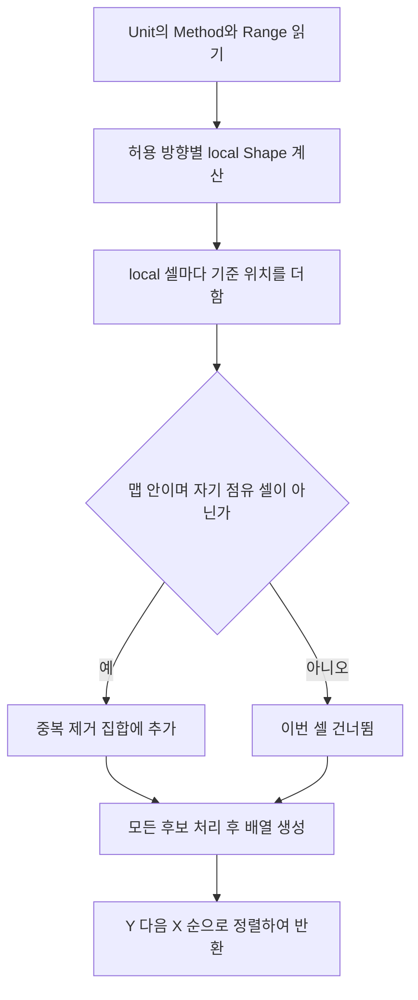

유닛이 (10,10)에 있고 오른쪽 local 셀이 (2,0)이면 실제 셀은 (12,10)입니다. 월드 좌표는 이처럼 **기준 위치 + local 좌표**로 만듭니다. 덧셈을 안전한 범위로 계산한 후 맵 경계를 판정합니다.

여러 방향이나 원점에서 같은 셀이 나올 수 있으므로 HashSet 같은 집합에 추가하면 중복을 지울 수 있습니다. List에 넣고 정렬하는 것만으로는 중복이 없어지지 않습니다. 집합을 다 만든 뒤 표시 순서대로 배열을 만듭니다.

Cross Range 3의 전체 조회 결과는 12셀입니다. 다음 AttackGeometryCalculator가 Right를 받으면 그중 오른쪽 3셀만 이번 공격 경로로 만듭니다. **전체 조회 결과를 그대로 affectedCells에 넣는 연결**을 이 지점에서 특히 주의한다([P3](#geometry)).

## Step 6 — AttackGeometryCalculator.cs

**이 파일에서 만들 결과:** 전체 후보 중 이번에 선택한 한 방향 또는 위치의 공격 셀만 계산합니다.

**신규 파일:** `Assets/Scripts/ProjectL/Core/Domain/Combat/AttackGeometryCalculator.cs`  
**타입:** `public sealed class`.

### Step 6-1 — 이번 공격만 계산하는 함수

**이번 단계의 목표:** 해석이 끝난 방향·위치를 받는 CalculateAttackCells를 작성하세요. 필요한 입력과 반환형은 아래 예시를 사용합니다.

Plan이 파일 책임만 정한 부분입니다. 아래는 그 책임을 현재 Map/State 타입에 연결하는 함수 선언 예시입니다.

```csharp
public CellCoord[] CalculateAttackCells(StageMapState map, UnitState source,
    AttackDirection direction, CellCoord? targetCell);
```

Direction/targetCell은 해석이 끝난 값입니다. Entity aim이라면 Application에서 대상 조회 후 필요한 좌표를 전달합니다. 계산기 안에 Catalog/Entity 저장소를 새로 넣지 않습니다.

이 클래스는 Step 5에서 만든 맵 제한 계산을 재사용합니다. 필드와 생성자는 아래 모양으로 시작하면 됩니다. null 검사는 생성자에서 한 번만 합니다.

```csharp
private readonly AppointRangeCalculator _rangeCalculator;

public AttackGeometryCalculator(AppointRangeCalculator rangeCalculator)
{
    _rangeCalculator = rangeCalculator
        ?? throw new ArgumentNullException(nameof(rangeCalculator));
}
```

`StageSessionFactory`나 `UnitAttackService`에 연결하는 작업은 전체 Task 6입니다. 지금은 이 클래스를 만들고 기존 계산기를 받을 수 있게 준비하는 데까지만 진행합니다.

### Step 6-2 — 함수 내부 순서

**이번 단계의 목표:** 선택한 한 갈래나 중심만 반환하게 하세요. Cross에서 Right를 고르면 다른 세 방향 셀이 들어가면 안 됩니다.

지원되는 Method와 해석값 조합 확인 → 단일 Ray/Expanding 또는 선택 위치 구성 → 월드 변환/잘림 → 결과 반환. 6번의 targetCell은 중심이고 3×3 전개는 Task 4의 Impact 단계입니다. 피해 대상을 여기서 고르지 않습니다.

진행 순서가 필요한 결과와 외부 표시 순서를 구분하는 것은 [P3](#geometry)을 적용합니다. 관통을 대비해 무조건 Y/X 정렬한 배열만 기준 계산 경로로 남기지 않습니다.

먼저 입력 조합을 아래처럼 나눕니다.

| source.AppointMethod | 필요한 입력 | 이 함수가 반환할 것 |
|---|---|---|
| RadialSquare | `direction=None`, `targetCell` 있음 | 선택한 셀 하나 |
| ForwardLine / ForwardLineWithDiagonal | 해석이 끝난 `direction`, `targetCell=null` | 그 방향의 Ray |
| Cross | 직교 `direction`, `targetCell=null` | 선택한 한 Ray |
| Queen | 8방향 중 하나, `targetCell=null` | 선택한 한 Ray |
| ForwardExpanding | 현재는 직교 `direction`, `targetCell=null` | 선택한 한 확장형 |

RadialSquare 분기는 아래 순서로 작성합니다.

1. `targetCell.HasValue`가 아니거나 Direction이 None이 아니면 잘못된 내부 호출로 거부합니다.
2. `_rangeCalculator.CalculateRangeCells(map, source)`로 현재 선택 가능한 셀을 받습니다.
3. 배열 안에 targetCell이 있으면 `new[] { targetCell.Value }`를 반환합니다.
4. 없으면 맵 밖 또는 사거리 밖 선택이므로 `ArgumentOutOfRangeException`으로 거부합니다.

방향형 분기는 Direction=None과 targetCell이 들어온 호출을 먼저 거부한 뒤, 다음 한 호출로 선택 방향의 맵 안 셀만 받습니다.

```csharp
CellCoord[] cells = _rangeCalculator.CalculateDirectionalCells(
    map, source, direction);
```

여기서 `CalculateRangeCells`를 호출하면 Cross의 네 갈래나 Queen의 여덟 갈래가 모두 섞이므로 안 됩니다. Method별 허용 방향 검사는 Step 5 계산기가 다시 확인합니다. Method 1/2의 후보 방향을 이 함수에서 현재 Rotation으로 추측하지 말고, 앞 선택 해석에서 확정된 Direction만 받습니다.

<a id="hint-geometry-method5"></a>
#### 힌트 — 5번에서 맵 제한 계산을 재사용하고 진행 순서를 되찾기

이 함수에 들어올 때는 선택 Direction이 이미 검사된 상태입니다. Step 4-5 때문에 여기서 `CreateExpanding(source.AppointRange)` 전체 배열을 다시 만들지 않습니다. 위의 `CalculateDirectionalCells`를 호출하면 맵 밖이 잘린 한 방향 셀을 받을 수 있습니다.

다만 Step 5의 결과는 화면 표시를 위해 Y/X 순서입니다. 실제 공격 경로는 방향 기준으로 가까운 깊이부터 처리할 수 있어야 하므로 반환 전에 `depth`, 같은 깊이에서는 `lateral` 순서로 다시 정렬합니다. worldCell에서 공격 원점을 빼 localX/localY를 구한 뒤 아래 값을 비교 키로 사용합니다.

```csharp
long depth = localX * forwardStep.X + localY * forwardStep.Y;
long lateral = localX * rightStep.X + localY * rightStep.Y;
```

`forwardStep`은 선택 Direction의 단위 벡터이고 `rightStep`은 `new CellCoord(forwardStep.Y, -forwardStep.X)`입니다. `Array.Sort` 비교 함수에서 depth를 먼저 비교하고, 같으면 lateral을 비교하세요. Ray는 모든 셀의 lateral이 0이므로 자연스럽게 가까운 칸부터 정렬됩니다. Expanding은 깊이 1의 한 칸, 깊이 2의 세 칸 순서가 됩니다.

Direction 변환은 숫자 cast가 아니라 private switch 함수로 작성합니다.

| Direction | forwardStep |
|---|---|
| Up / UpRight / Right / DownRight | `(0,1)` / `(1,1)` / `(1,0)` / `(1,-1)` |
| Down / DownLeft / Left / UpLeft | `(0,-1)` / `(-1,-1)` / `(-1,0)` / `(-1,1)` |

정렬할 때 원점은 `source.GetOccupiedCell(0)`입니다. 각 world cell마다 `localX = (long)cell.X - origin.X`, `localY = (long)cell.Y - origin.Y`를 구하세요. Step 5 계산이 여러 칸 유닛을 먼저 거부하므로 여기서 다른 원점을 새로 추측하지 않습니다.

이 메서드 안에서 허용 방향을 전부 반복하면 안 됩니다. 전체 방향 조회는 AppointRangeCalculator가 담당하고, 여기서는 방금 고른 한 방향만 계산합니다. 다른 방향에서 쓸 일반 대각 확장 규칙은 D4 확정 후 연결합니다.

### Step 6-3 — 방향별 계산을 공통 경로에 연결

**이번 단계의 목표:** Step 5의 방향별 계산과 방금 만든 선택 방향 계산이 같은 Shape 조건을 사용하도록 연결합니다.

Step 5의 `CalculateDirectionalCells(map, source, AttackDirection)`이 이미 `ContainsRay`와 `ContainsExpanding`을 사용하는 공통 경로입니다. AttackGeometryCalculator의 방향형 분기는 이 overload를 호출하고 진행 순서만 다시 정리하세요. Shape 반복문을 이 파일에 복사하지 않습니다.

기존 `Rotation4` overload와 현재 서비스 호출은 그대로 둡니다. 서비스가 새 AttackAim을 받도록 교체하는 것은 전체 Task 6입니다. 새 방향 enum을 Rotation4로 숫자 cast하지 않습니다.

**이 Step에서 수정하지 않을 것:** `UnitAttackService`, `AttackPreview`, `AttackResult`, View/Input, Impact 3×3, 피해 대상 수집. Step 6의 결과는 오직 “이번에 선택한 한 방향 또는 한 위치의 셀 배열”입니다.

**현재 코드 상태:** Step 6-1~6-3이 반영되어 있습니다. RadialSquare는 현재 지정 범위에 포함된 선택 셀 하나만 반환하고, 방향형 Method는 Step 5의 `AttackDirection` overload로 맵 안의 한 방향 셀만 받은 뒤 depth/lateral 순서로 정렬합니다. 서비스·View·Impact 연결은 변경하지 않았습니다.

## Step 7 — AttackSelectionResolver.cs

**이 파일에서 만들 결과:** 입력 방향을 검사하고, 방향이 없으면 후보 수에 따라 선택값 또는 실패 이유를 반환합니다.

**신규 파일:** `Assets/Scripts/ProjectL/Core/Domain/Combat/AttackSelectionResolver.cs`  
**타입:** `public sealed class`.

### Step 7-1 — 선택 해석 입출력

**이번 단계의 목표:** TryResolve가 성공 여부·해석한 Aim·실패 이유를 돌려주게 만드세요. 호출자가 가진 방향 후보를 입력으로 받습니다.

Plan은 새 결과 타입을 강제하지 않습니다. AttackAim을 재사용하는 보조 함수 예시는 다음과 같습니다.

```csharp
public bool TryResolve(AttackAim aim,
    ReadOnlySpan<AttackDirection> candidateDirections,
    out AttackAim resolvedAim, out AttackFailureReason failureReason);
```

호출자는 Method에서 허용되며 선택 셀/대상과 겹치는 방향만 candidateDirections에 담습니다. 위치 aim은 호출 전에 공격 설정 조합을 확인하고 별도 위치 해석 경로를 사용합니다. 빈 방향 목록을 임의의 Up으로 바꾸지 않습니다.

`aim.Direction`과 `candidateDirections`는 서로 다른 값입니다.

- `aim.Direction`: 입력 또는 UI가 요청한 방향 한 개입니다. 아직 고르지 않았다면 None입니다.
- `candidateDirections`: Core가 Step 5에서 공격 모양과 선택 대상을 비교해 계산한 실제 가능 방향 목록입니다. 사용자가 보내는 두 번째 후보 입력이 아닙니다.

예를 들어 ForwardExpanding의 넓은 부분에 있는 적이 Up과 Right 양쪽 모양에 걸칠 수 있습니다. 첫 Preview 요청은 `AttackAim.ForEntity(targetId)`라 Direction=None이고, Core는 `FindMatchingDirections`로 `[Up, Right]`를 계산합니다. Resolver는 둘 중 하나를 마음대로 고르지 않고 Ambiguous를 반환합니다. UI가 Right를 고른 다음 `AttackAim.ForEntity(targetId, Right)`를 다시 보내면, Core는 최신 상태에서 후보 `[Up, Right]`를 다시 계산하고 요청한 Right가 그 안에 있는지 확인합니다.

```text
사용자 입력 Aim(target, Direction 또는 None)
    +
Core 계산 후보 방향 목록
    ↓
AttackSelectionResolver
    ↓
하나로 확정된 Aim 또는 실패
```

**먼저 알아둘 호출 범위:** 이 함수는 방향이 필요한 공격에서만 호출합니다. RadialSquare 단일 대상이나 Cannon 위치 지정처럼 Direction=None이 정상인 profile은 전체 Task 6의 서비스 분기에서 이 Resolver를 건너뛰고 Aim을 그대로 다음 단계에 전달합니다. 따라서 이 함수에서 `candidateDirections.Length == 0`은 “방향이 필요 없는 공격”이 아니라 “선택한 대상과 맞는 방향이 하나도 없음”입니다.

**전제 계약:** `AttackFailureReason.InvalidAttackAim`은 Task 3 Step 2-2에서 이미 추가되어 있습니다. default AttackAim이나 Kind와 내부 값이 맞지 않는 입력은 이 값으로 실패시킵니다.

### Step 7-2 — 선택 판정 순서

**이번 단계의 목표:** 후보 1개면 자동 선택하고 여러 개면 선택 필요 실패를 반환하세요. 명시한 방향이 후보에 없으면 InvalidAttackDirection으로 거부합니다.

유효 aim 확인 → 명시 Direction 유무 분기 → 명시 방향이 후보에 포함되는지 검사 → 미지정이면 후보 개수 확인 → 유일 후보로 resolvedAim 구성 또는 모호성 실패 → 반환. 입력 Direction을 덮어쓰기 전에 허용 여부를 먼저 검사합니다.

모호성 실패의 후보 목록은 호출자가 이미 갖고 있으므로 Task 6의 Preview에 전달합니다. [P4](#aim)의 설명을 여기서 다시 구현 규칙으로 바꾸지 않습니다.

함수 본문은 아래 다섯 구간을 위에서부터 작성하면 됩니다.

#### 1. 실패 기본값부터 대입

함수 첫 줄에서 두 out 값을 먼저 채웁니다. 이후 성공 분기에서만 덮어쓰면 어떤 return 경로에서도 out 대입을 빠뜨리지 않습니다.

```csharp
resolvedAim = default;
failureReason = AttackFailureReason.InvalidAttackAim;
```

#### 2. Aim 자체가 정상인지 검사

아래 조건을 만족하지 않으면 위 기본 실패값을 유지하고 `false`를 반환합니다.

| aim.Kind | 반드시 맞아야 하는 내부 값 |
|---|---|
| Entity | EntityId가 비어 있지 않음, Cell은 null |
| Cell | EntityId는 Empty, Cell은 값이 있음 |
| None 또는 정의되지 않은 값 | 실패 |

Direction도 enum에 정의된 값이어야 합니다. `AttackDirection.None`은 잘못된 enum이 아니라 “아직 방향을 고르지 않음”이므로 이 검사에서는 통과시킵니다.

#### 3. Core가 계산한 후보 방향 목록 확인

여기서 가장 중요한 일은 사용자가 요청한 방향과 실제 가능 방향을 비교할 준비를 하는 것입니다. Step 5의 `FindMatchingDirections`가 None·중복 없이 정상 enum만 담은 배열을 만드는 것이 기본 계약입니다.

정의되지 않은 enum, None, 중복이 후보 배열에 들어왔는지 확인하는 코드는 외부 사용자 입력을 다시 검증하는 핵심 로직이 아니라 **Core 내부 계약이 깨졌는지 막는 방어 코드**입니다. 처음 구현할 때는 한 번 순회해 이런 값이 있으면 `InvalidAttackDirection`으로 실패시키면 됩니다. 핵심 판정은 이어지는 두 구간의 ‘요청 방향이 목록에 포함됐는가’와 ‘미지정일 때 후보가 몇 개인가’입니다.

#### 4. 입력 Aim에 방향이 이미 있는 경우

`aim.Direction != AttackDirection.None`이면 candidateDirections 안에서 같은 방향을 찾습니다.

- 찾음: `resolvedAim = aim`, `failureReason = None`, `true` 반환
- 끝까지 못 찾음: `failureReason = InvalidAttackDirection`, `false` 반환

후보가 여러 개여도 사용자가 그중 하나를 명시했다면 성공입니다. 이 분기에서는 다른 후보가 몇 개인지 셀 필요가 없습니다.

#### 5. 입력 Aim에 방향이 없는 경우

이제 `aim.Direction == None`인 경우만 남습니다. 후보 개수에 따라 정확히 세 갈래로 나눕니다.

| 후보 개수 | 처리 |
|---|---|
| 0개 | `InvalidPrimaryTarget`, `false` |
| 1개 | 그 방향을 넣어 새 AttackAim 생성, `None`, `true` |
| 2개 이상 | `AmbiguousAttackDirection`, `false` |

후보가 한 개일 때 원래 선택값을 잃지 않도록 Kind에 따라 팩토리를 고릅니다.

```csharp
AttackDirection selected = candidateDirections[0];
resolvedAim = aim.Kind == AttackAimKind.Entity
    ? AttackAim.ForEntity(aim.EntityId, selected)
    : AttackAim.ForCell(aim.Cell.Value, selected);
failureReason = AttackFailureReason.None;
return true;
```

EntityId나 Cell을 새 값으로 추측하지 않습니다. 입력 Aim에 있던 값을 그대로 사용하고 Direction만 채웁니다.

<a id="hint-selection-branch"></a>
#### 힌트 — 여러 방향일 때 바로 빠져나오는 분기

명시 방향이 없는 입력을 처리하는 부분에서 후보 수를 검사합니다. 위 0개와 1개 분기 뒤에 여러 개인 경우를 다음처럼 둡니다.

```csharp
if (candidateDirections.Length > 1)
{
    resolvedAim = default;
    failureReason = AttackFailureReason.AmbiguousAttackDirection;
    return false;
}
```

이 코드는 **방향 선택이 필요한 공격에서 Direction=None인 분기 안**에 들어갑니다. 방향이 필요 없는 공격은 이 함수 호출 전에 분리합니다. 성공 경로에서는 원래 EntityId 또는 Cell을 보존하고 선택한 방향만 채웁니다. 모든 반환 경로에서 out 값이 정해져야 합니다.

<a id="flow-selection"></a>
#### 부연 설명 — TryResolve의 if 분기를 직접 나누는 순서

**입력:** AttackAim과 ‘허용 방향이면서 선택 대상에도 맞는’ 후보 목록. **출력:** 성공 여부, 해석한 Aim, 실패 이유입니다. `out`은 반환값 외에 호출자에게 값을 더 돌려주는 C# 문법입니다. 성공·실패 모든 경로에서 out 값이 정해져야 합니다.

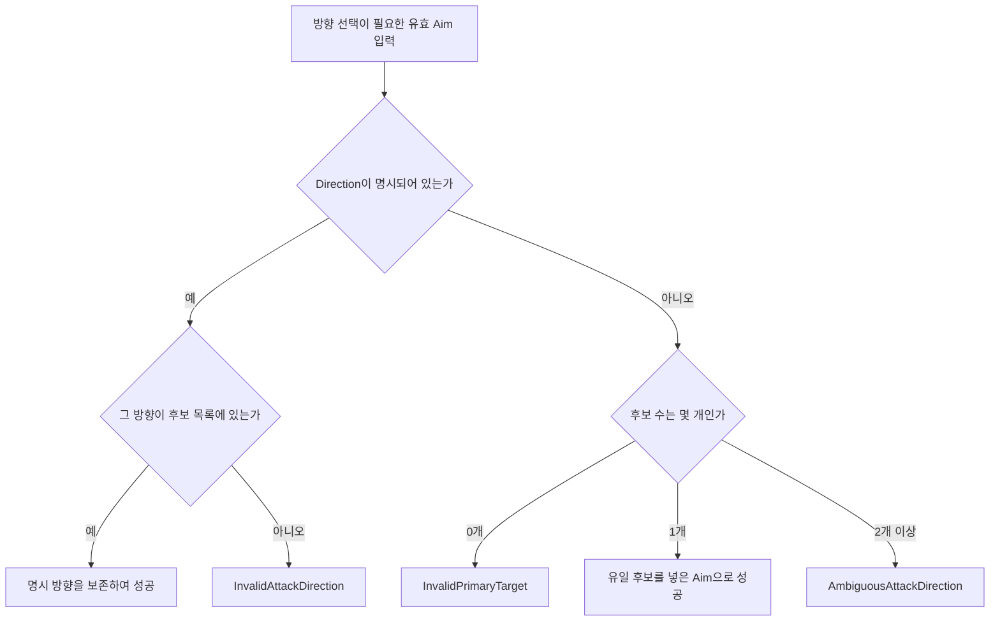

후보가 Right 하나이고 입력이 None이면 Right를 채워 성공합니다. 같은 후보에서 사용자가 Up을 보냈다면 Right로 고쳐 주는 것이 아니라 InvalidAttackDirection으로 실패합니다. 후보가 여러 개인 경우에는 호출자가 가진 목록을 Preview에 전달합니다.

0개는 ‘여러 방향 중 선택하지 못했다’가 아니라 ‘해당 선택에 맞는 방향이 없다’는 뜻이므로 `InvalidPrimaryTarget`을 반환합니다. 방향이 필요 없는 공격 설정 조합은 이 Resolver 호출 전에 별도 처리하므로 빈 방향 후보만 보고 실패시키지 않습니다. 후보를 만드는 단계는 [앞 Range 설명](#flow-range-world)을 참조합니다.

**현재 코드 상태:** Step 7-1~7-2가 반영되어 있습니다. `AttackSelectionResolver`는 Aim 내부 값과 후보 목록을 확인하고, 명시 방향은 후보 포함 여부로 판정합니다. 방향이 없으면 후보 0개는 `InvalidPrimaryTarget`, 1개는 해당 방향을 채운 Aim 성공, 2개 이상은 `AmbiguousAttackDirection`으로 반환합니다. 서비스·Preview·View 연결은 아직 변경하지 않았습니다.

## Step 8 — 실패 결과를 서비스에 연결할 위치 기록

**이번 단계의 목표:** Step 2-2에서 준비한 실패 enum이 Step 7의 반환값에 들어가도록 하고, Task 6에서 전달할 결과를 기록합니다.

InvalidAttackAim은 Aim 내부 값 불일치, InvalidAttackDirection은 명시 방향 또는 후보 배열 불일치, AmbiguousAttackDirection은 미지정 복수 후보입니다. 후보 방향 배열은 호출자가 보관합니다. Task 6에서 Preview/Result의 실패 이유와 후보 목록에 전달합니다. 지금 Preview/Result 파일을 먼저 확장하지 않습니다.

**완료 기준:** 선택 해석 함수가 실패 이유를 반환하며 후보 목록을 버리지 않습니다. 외부 결과로의 전달까지 완료했다고 표시하지 않습니다.

## 완료 체크리스트

- [ ] 1×1 Range 3에서 Cross 12셀, Queen 24셀, Method 6 48셀입니다.
- [ ] Right 선택은 오른쪽 세 칸이며 전체 Cross 합집합이 아닙니다.
- [ ] 명시 방향 불일치와 미지정 복수 후보가 구분됩니다.
- [ ] `AppointRangeCalculatorTests`의 구 4셀 기대값을 주변 8셀로 갱신할 지점을 알고 있습니다.
- [ ] D4를 기다리는 입력 정보 연결과 이미 완성한 범위 모양 계산 함수를 구분했습니다.

전체 흐름: `Appoint 설정 → 전체 Range → AttackAim → 후보 방향 → AttackSelectionResolver → AttackGeometryCalculator → Task 4`.

<a id="task4"></a>
# Task 4 — 맞을 대상 고르기와 Cannon 폭발 범위 계산

## 이번 Task에서 완성할 것

Task 3이 만든 공격 셀에서 실제 후보를 수집하고 확정 공격 설정 조합을 연결합니다. 대상의 HP는 아직 바꾸지 않습니다. 카테고리 효과의 기준은 Plan 13.4절과 연결된 Category 계획입니다.

## Step 1 — AppointTarget.cs

**이 파일에서 만들 결과:** 기획의 대상 선택 방식 1~5를 별도 enum으로 표현합니다.

**신규 파일:** `Assets/Scripts/ProjectL/Core/Contracts/Common/AppointTarget.cs`  
**타입:** `public enum`.

### Step 1-1 — 숫자와 의미 기록

**이번 단계의 목표:** 가까운 단일·먼 단일·가까운 모든·먼 모든·범위 내 모든을 1~5로 선언하세요.

1=가까운 단일, 2=먼 단일, 3=가까운 모든, 4=먼 모든, 5=범위 내 모든. Plan이 영문 멤버 철자까지 정하지 않은 부분은 이 의미가 드러나는 이름으로 작성합니다. None=0을 둘 경우 정상 유닛의 지정 규칙으로 사용하지 않습니다.

**현재 코드 상태:** Step 1-1이 반영되어 있습니다. `None=0`, `NearestSingle=1`, `FarthestSingle=2`, `NearestAll=3`, `FarthestAll=4`, `AllInRange=5`로 선언했습니다. 아직 `UnitDefinition`이나 기존 `AttackTargetMode`에 연결하지 않았습니다.

### Step 1-2 — 대상 선택 규칙이 더 필요한 부분 구분

**이번 단계의 목표:** enum과 값 전달까지 준비하고, 거리·동률·캐릭터 값이 필요한 계산은 D5 대기로 남기세요. 구 TargetMode를 숫자로 자동 변환하지 않습니다.

타입 선언과 값 전달은 준비 가능합니다. “가까운”의 기준, 동률 처리, 캐릭터 데이터가 없으면 기존 AttackTargetMode 숫자로 자동 변환하는 코드는 작성하지 않습니다. 그 지점부터 D5가 필요하다([P7](#pending)).

## Step 2 — 확장 가능한 Impact 설정 계약

**이 Step에서 만들 결과:** 실제 효과 셀 배열을 미리 저장하지 않고, 효과 계산에 필요한 `Method`와 캐릭터별 `Range`를 저장합니다. 현재 확정된 일반 공격의 중립 설정과 Cannon의 세 AreaType을 표현할 수 있어야 합니다.

**신규 파일:**

- `Assets/Scripts/ProjectL/Core/Contracts/Common/CannonAreaType.cs`
- `Assets/Scripts/ProjectL/Core/Contracts/Common/AttackImpactMethod.cs`
- `Assets/Scripts/ProjectL/Core/Contracts/Commands/ImpactPatternSpec.cs`

### 먼저 구분할 것 — 지정 범위와 효과 설정은 다르다

| 값 | 담당하는 질문 | 예 |
|---|---|---|
| `AttackPatternSpec` | 어디를 공격 대상으로 지정할 수 있는가? | Method 6, AppointRange 3 |
| `AttackAim` | 이번 공격에서 어느 Entity·Cell·Direction을 골랐는가? | Cell (5,5) |
| `ImpactPatternSpec` | 선택 뒤 어떤 방식과 크기로 효과를 계산할 것인가? | Square, Range 1 |
| 후속 `ImpactPatternCalculator` | 설정과 선택값으로 실제 효과 셀은 무엇인가? | Q1 확정 후 계산 |

`ImpactPatternSpec`은 효과 셀 자체가 아니라 **효과 셀을 계산할 설정**입니다. 따라서 `CreateCannon(Square, 1)`을 호출해도 이 객체 안에 9개 offset 배열을 만들지 않습니다.

```text
Appoint Method/Range로 선택 가능 위치 계산
    ↓
AttackAim으로 실제 위치 또는 방향 선택
    ↓
ImpactPatternSpec의 Method/Range 읽기
    ↓
후속 계산기가 실제 effectCells 계산
    ↓
AttackTargetResolver가 겹치는 Entity 수집
```

이 분리 덕분에 같은 Cannon Category라도 캐릭터마다 `Square/1`, `HorizontalRow/2`, `Pierce/2`처럼 서로 다른 효과 설정을 가질 수 있습니다.

### Step 2-1 — 기획의 Cannon AreaType과 Core 계산 방식 선언

**이번 단계의 목표:** PPT 입력 번호와 Core가 사용할 효과 방식 번호를 별도 enum으로 선언하세요.

`CannonAreaType`은 기획 데이터의 숫자를 그대로 표현합니다. `Square=0`은 정상값이므로 None처럼 취급하면 안 됩니다.

```csharp
public enum CannonAreaType
{
    Square = 0,
    HorizontalRow = 1,
    Pierce = 2,
}
```

`AttackImpactMethod`은 Core가 후속 계산에서 분기할 방식입니다. 일반 공격이 추가 효과 범위를 사용하지 않는 경우도 `SingleCell`로 명시합니다.

```csharp
public enum AttackImpactMethod
{
    SingleCell = 1,
    Square = 2,
    HorizontalRow = 3,
    Pierce = 4,
}
```

두 enum을 숫자로 직접 cast하지 않습니다. 아래 `CreateCannon`의 switch가 기획 입력을 Core 방식으로 명시적으로 바꿉니다.

### Step 2-2 — ImpactPatternSpec에 Method와 Range 저장

**이번 단계의 목표:** 변경할 수 없는 `Method`와 `Range`를 저장하고 두 생성 함수를 제공하세요.

```csharp
public sealed class ImpactPatternSpec
{
    public AttackImpactMethod Method { get; }
    public int Range { get; }

    public static ImpactPatternSpec CreateSingleCell();
    public static ImpactPatternSpec CreateCannon(
        CannonAreaType areaType,
        int areaRange);
}
```

private 생성자는 정의되지 않은 `AttackImpactMethod`와 음수 Range를 거부한 뒤 값을 저장합니다. `CreateSingleCell()`은 `SingleCell, 0`을 전달합니다. `CreateCannon()`은 다음 표처럼 switch로 변환합니다.

| CannonAreaType | AttackImpactMethod | Range 의미 |
|---|---|---|
| Square | Square | 공간 확장 크기 |
| HorizontalRow | HorizontalRow | 행의 공간 확장 크기 |
| Pierce | Pierce | 최대 서로 다른 피격 유닛 수 |

`CreateCannon()`은 정의되지 않은 AreaType과 음수 `areaRange`를 거부합니다. Range 0은 계약에 저장할 수 있지만, 실제 캐릭터 데이터로 허용할지는 Square/HorizontalRow의 Q1과 Pierce의 Q2가 정해진 뒤 Catalog의 출하 준비 검사에서 결정합니다.

핵심 변환은 다음 모양입니다.

```csharp
AttackImpactMethod method;
switch (areaType)
{
    case CannonAreaType.Square:
        method = AttackImpactMethod.Square;
        break;
    case CannonAreaType.HorizontalRow:
        method = AttackImpactMethod.HorizontalRow;
        break;
    case CannonAreaType.Pierce:
        method = AttackImpactMethod.Pierce;
        break;
    default:
        throw new ArgumentOutOfRangeException(nameof(areaType));
}

return new ImpactPatternSpec(method, areaRange);
```

### 이 Step에서 계산하지 않는 것

- Square의 중심 셀을 최종 피해에 포함할지
- Square Range가 증가할 때 정확히 어느 셀까지 포함할지
- HorizontalRow가 월드 X축인지 공격 방향 기준 가로인지
- Pierce가 어떤 유닛부터 세고 무엇이 관통을 막는지
- 맵 밖 clipping과 실제 `effectCells` 생성

이 항목은 저장 계약이 아니라 후속 geometry 규칙입니다. `CreateSquare3x3()`이나 임의 local offset 배열을 `ImpactPatternSpec`의 핵심 계약으로 다시 넣지 않습니다.

**현재 코드 상태:** Step 2-1~2-2가 반영되어 있습니다. `CannonAreaType`, `AttackImpactMethod`, `ImpactPatternSpec`이 추가됐고, `CreateSingleCell()`과 `CreateCannon(areaType, areaRange)`가 명시적인 변환과 음수 검사를 수행합니다. UnitSpec/Definition/Catalog 전달은 바로 다음 Step 3까지 반영됐습니다. 실제 효과 셀 계산, 서비스, View는 아직 연결하지 않았습니다.

**Step 2 완료 기준:** 같은 Cannon Category의 서로 다른 Type/Range를 값으로 보존할 수 있고, 고정 3×3 offset 배열을 요구하지 않습니다.

> **다음 Step 주의:** Step 3~4는 최신 Category 계획에 맞춰 정리했습니다. 아래 Step 5~6에는 이전 Cannon 규칙과 서비스 연결 전제가 일부 남아 있으므로 최신 계획에 맞춰 절을 다시 정리하기 전에는 그대로 구현하지 않습니다.

<a id="profile-step"></a>
## Step 3 — Category와 Impact를 Definition까지 전달하고 공격 조합을 한 곳에서 검사

**이 Step에서 만들 결과:** `CategoryKey`와 `ImpactPatternSpec`이 `UnitSpec → UnitDefinition → UnitState`로 이어지고, 네 값의 조합을 `AttackProfileCompatibility` 한 곳에서 판단합니다. 여기서는 실제 폭발 셀이나 피해 대상을 계산하지 않습니다.

### 먼저 흐름 보기

```text
Unity/외부 입력
    ↓
UnitSpec
  - CategoryKey
  - AttackPattern
  - AttackTargetMode
  - ImpactPattern
    ↓ UnitCatalog.CreateDefinition
UnitDefinition
  - 위 네 설정을 변경 불가능한 전투 정의로 보관
    ↓ UnitFactory가 Definition을 UnitState에 전달
UnitState
  - 새 값을 복사해 저장하지 않고 Definition에서 읽음
    ↓
후속 공격 서비스가 AttackProfileCompatibility로 Aim 종류 확인
```

`CategoryKey`는 유닛이 Base/Rider/Heavy/Cannon 중 무엇인지 나타냅니다. `ImpactPattern`은 공격을 지정한 뒤 효과가 퍼지는 방법과 크기입니다. 둘은 유닛 인스턴스마다 변하는 체력이나 AP가 아니므로 Definition에 두는 값입니다.

### Step 3-1 — CategoryKey와 전달 경로 추가

**이번 단계의 목표:** Category와 Impact 설정이 중간에서 사라지지 않게 세 계층을 연결하세요.

1. `Core/Contracts/Common/CategoryKey.cs`에 다음 값을 선언합니다.

```csharp
public enum CategoryKey
{
    None = 0,
    Base = 10,
    Rider = 20,
    Heavy = 30,
    Cannon = 40,
}
```

2. `UnitSpec`과 `UnitDefinition`에 아래 두 프로퍼티를 추가합니다.

```csharp
public CategoryKey CategoryKey { get; }
public ImpactPatternSpec ImpactPattern { get; }
```

3. 새 전체 `UnitSpec` 생성자는 두 값을 명시적으로 받습니다. private 공통 생성자에서 `None`, 정의되지 않은 Category, null Impact를 거부하고 저장합니다.
4. `UnitCatalog.CreateDefinition`은 `spec.CategoryKey`, `spec.ImpactPattern`을 `UnitDefinition` 생성자에 그대로 전달합니다.
5. `UnitState`는 필드를 새로 만들지 않고 Definition을 통해 읽습니다.

```csharp
public CategoryKey CategoryKey => Definition.CategoryKey;
public ImpactPatternSpec ImpactPattern => Definition.ImpactPattern;
```

기존 호출을 한 번에 모두 고칠 필요는 없습니다. 기존 생성자는 호환값인 `CategoryKey.Base`와 `ImpactPatternSpec.CreateSingleCell()`을 새 공통 생성자로 넘깁니다. 새 Unity Adapter 경로를 만들 때는 실제 Category와 Impact를 반드시 전달하며, 누락값을 임의로 Base로 바꾸지 않습니다.

### Step 3-2 — AttackProfileCompatibility 작성

**이번 단계의 목표:** Category, 지정 방식, 대상 방식, Impact를 따로 검사하지 말고 한 표로 비교한 뒤 필요한 Aim 종류를 반환하세요.

**신규 파일:** `Assets/Scripts/ProjectL/Core/Contracts/Commands/AttackProfileCompatibility.cs`  
**타입:** `public static class`.

```csharp
public static AttackAimKind GetSupportedAimKind(
    CategoryKey category,
    AttackPatternSpec appointPattern,
    AttackTargetMode targetMode,
    ImpactPatternSpec impactPattern);
```

검사 순서는 다음과 같습니다.

```text
Category가 정상인가
    ↓
AttackPattern과 ImpactPattern이 null이 아닌가
    ↓
TargetMode가 정상인가
    ↓
아래 지원표의 한 행과 정확히 맞는가
    ├─ 예: 해당 AttackAimKind 반환
    └─ 아니오: ArgumentException
```

현재 지원표는 다음과 같습니다.

| Category | 지정 설정 | TargetMode | Impact | 반환 AimKind |
|---|---|---|---|---|
| Base/Rider/Heavy | RadialSquare | SingleTarget | SingleCell, Range 0 | Entity |
| Base/Rider/Heavy | ForwardExpanding | AllHostilesInArea | SingleCell, Range 0 | Entity |
| Cannon | RadialSquare | AllDamageablesInArea | Square, 캐릭터별 Range | Cell |

Cannon의 `HorizontalRow`와 `Pierce`는 값으로는 저장할 수 있지만, Appoint 방식과 조준 기준이 Q1~Q4에서 확정되지 않았으므로 아직 이 표에서 허용하지 않습니다. Cannon이 항상 Method 6이라고 일반화하지도 않습니다.

`ImpactPatternSpec`은 실제 offset 배열을 갖지 않으므로 9셀 집합을 여기서 검사하지 않습니다. Range 0도 계약 객체에는 저장할 수 있습니다. 다만 현재 Cannon 전투 데이터로 출하할 수 없으므로 `UnitCatalog.ValidateCombatReady`에서 Cannon Range 0을 거부합니다. 이렇게 하면 다음 두 검사를 섞지 않습니다.

- `AttackProfileCompatibility`: 이 공격 설정의 종류를 Core가 아는가?
- `UnitCatalog.ValidateCombatReady`: 지금 확정된 규칙만으로 실제 전투에 투입할 수 있는가?

Cannon은 아군·Neutral·피해 가능한 건물까지 피격 후보가 될 수 있으므로 기존 `AllHostilesInArea`의 뜻을 바꾸지 않고 `AttackTargetMode.AllDamageablesInArea = 3`을 추가합니다.

### Step 3-3 — UnitSpec, UnitDefinition, Catalog에서 공통 함수 호출

**이번 단계의 목표:** 파일마다 있던 공격 조합 조건을 제거하고 같은 공통 함수를 호출하세요.

- `UnitSpec` private 생성자: 기존 `isSupportedAttackPair` 조건을 공통 호출로 교체합니다.
- `UnitDefinition` private 생성자: 직접 생성되는 Definition도 같은 불변식을 지키도록 공통 호출을 사용합니다.
- `UnitCatalog.ValidateAttackConfiguration`: Definition이 보관한 네 값을 공통 호출에 넘깁니다. 공통 함수의 `ArgumentException`은 어떤 Unit 설정이 잘못됐는지 알 수 있는 `InvalidOperationException`으로 감쌉니다.
- 기존 `ForwardExpanding` 공격자의 1×1 footprint 검사는 공격 조합표와 다른 조건이므로 Catalog에 유지합니다.

```csharp
AttackProfileCompatibility.GetSupportedAimKind(
    categoryKey,
    attackPattern,
    attackTargetMode,
    impactPattern);
```

생성 단계에서는 반환값을 저장할 필요가 없습니다. 실제 입력 `AttackAim.Kind`와 비교하는 일은 후속 공격 서비스 연결 단계에서 합니다.

**현재 코드 상태:** Step 3-1~3-3이 반영되어 있습니다. `CategoryKey`와 `AllDamageablesInArea`가 추가됐고, Category/Impact는 `UnitSpec → UnitDefinition → UnitState`로 전달됩니다. 기존 생성자는 `Base + SingleCell`로 호환됩니다. 현재 공통 표는 기존 두 공격과 Cannon Square/Cell Aim을 인정하며, Cannon Range 0은 Catalog의 전투 준비 검사에서 거부합니다. Unity Adapter, CategoryRegistry, 실제 Cannon 효과 셀, 대상 수집, View는 변경하지 않았습니다.

**Step 3 완료 기준:** Category와 Impact가 Definition까지 보존되고, UnitSpec·UnitDefinition·Catalog가 같은 공격 조합 판정 함수를 사용합니다. 다음 구현은 최신 Category 피격 정책에 맞게 Step 4를 먼저 정리하는 작업입니다.

## Step 4 — 효과 셀과 겹치는 피격 후보 수집

**이 Step에서 만들 결과:** 이미 계산된 효과 셀 안에서 살아 있고 배치된 `CombatEntityState`를 찾아 한 번씩 반환합니다. 일반 공격은 적만, Cannon은 공격자 자신을 제외한 모든 피해 가능 Entity를 수집합니다. HP와 AP는 바꾸지 않습니다.

**신규 파일:** `Assets/Scripts/ProjectL/Core/Domain/Combat/AttackTargetResolver.cs`  
**타입:** `public sealed class`.

### 먼저 이 함수의 입력과 출력 이해하기

```csharp
public CombatEntityState[] CollectCandidates(
    UnitState attacker,
    ReadOnlySpan<CellCoord> effectCells,
    IReadOnlyDictionary<EntityId, CombatEntityState> entities,
    AttackTargetMode targetMode,
    HostilityPolicy hostilityPolicy);
```

- `attacker`: 자기 자신 제외와 적대 관계 판정에 사용합니다.
- `effectCells`: 앞 계산기가 만든 이번 공격의 실제 효과 셀입니다. 이 함수가 범위 모양을 다시 계산하지 않습니다.
- `entities`: 현재 Stage가 가진 Unit과 건물입니다.
- `targetMode`: 적만 고를지, Owner와 무관하게 모든 피해 가능 Entity를 고를지 결정합니다.
- `hostilityPolicy`: `SingleTarget`, `AllHostilesInArea`의 적대 관계 판정에 사용합니다.
- 반환값: 효과 셀과 겹치는 후보를 `EntityId` 순으로 정렬한 배열입니다.

```text
공격 설정과 Aim
    ↓ 후속 Impact 계산기
효과 셀 배열
    ↓ AttackTargetResolver
피격 후보 배열
    ↓ 후속 AttackTargetPlan
대상별 피해 계산과 전체 사전 검증
```

이 Step은 가운데의 후보 수집만 담당합니다.

### Step 4-1 — 입력과 TargetMode 검사

**이번 단계의 목표:** 잘못된 호출은 즉시 예외로 막고, 빈 효과 셀은 빈 배열로 반환하세요.

다음 입력을 거부합니다.

- null `attacker`, `entities`, `hostilityPolicy`
- `AttackTargetMode.None` 또는 정의되지 않은 값
- 현재 후보 수집기가 지원하지 않는 새로운 TargetMode

현재 처리할 TargetMode는 다음과 같습니다.

| TargetMode | 후보 조건 |
|---|---|
| `SingleTarget` | 공격자와 적대 관계인 Entity |
| `AllHostilesInArea` | 공격자와 적대 관계인 모든 Entity |
| `AllDamageablesInArea` | Owner와 무관한 모든 `CombatEntityState` |

`SingleTarget`은 실제 서비스가 선택한 주 대상의 셀만 `effectCells`로 넘기는 방식으로 한 명을 얻습니다. Resolver가 가까운 대상이나 주 대상을 다시 선택하지 않습니다.

### Step 4-2 — 효과 셀과 Entity 점유 셀 겹침 검사

**이번 단계의 목표:** 살아 있고 전투 맵에 배치된 Entity의 점유 셀 중 하나라도 효과 셀과 겹치면 후보에 한 번만 추가하세요.

처리 순서는 다음과 같습니다.

```text
효과 셀을 HashSet으로 준비
    ↓
entities.Values에서 다음 Entity 읽기
    ↓
null이면 잘못된 입력으로 거부
    ↓
공격자 자신 / 사망 / 미배치이면 제외
    ↓
일반 공격인데 적대 관계가 아니면 제외
    ↓
Entity의 점유 셀을 하나씩 확인
    ↓
효과 셀과 하나라도 겹치면 EntityId 기준으로 한 번만 추가
    ↓
전체 후보를 EntityId 순으로 정렬해 반환
```

핵심 겹침 검사는 다음 모양입니다.

```csharp
bool overlaps = false;
for (int cellIndex = 0; cellIndex < target.CellCount; cellIndex++)
{
    if (effectCellSet.Contains(target.GetOccupiedCell(cellIndex)) == false)
        continue;

    overlaps = true;
    break;
}
```

다중 셀 건물이나 유닛이 효과 셀 네 칸과 겹치더라도 결과에는 한 번만 들어갑니다. `HashSet<EntityId>`는 같은 Entity 객체가 잘못된 여러 Dictionary 항목으로 들어왔을 때도 중복 결과를 막습니다.

### Step 4-3 — 일반 공격과 Cannon의 피격 정책 분리

**이번 단계의 목표:** 기존 적대 공격의 의미를 유지하면서 Cannon만 소유권과 무관한 피격 후보를 허용하세요.

일반 공격의 `SingleTarget`, `AllHostilesInArea`는 다음 검사를 통과해야 합니다.

```csharp
hostilityPolicy.AreHostile(attacker.Owner, target.Owner)
```

Cannon의 `AllDamageablesInArea`는 이 적대 검사를 하지 않습니다. 따라서 다음 Entity가 효과 셀과 겹치면 후보가 될 수 있습니다.

- 같은 Owner의 Unit
- Enemy Unit
- Neutral Entity
- 피해 가능한 건물

모든 `CombatEntityState`가 현재 `IDamageable` 계약을 가지므로 별도의 Unit 전용 필터나 Structure 전용 분기를 넣지 않습니다. 공격자 자신의 `EntityId`만 항상 제외합니다. HP가 없는 지형 타일은 `entities`에 들어오는 `CombatEntityState`가 아니므로 후보가 되지 않습니다.

주변 1칸 직접 조준 금지는 Aim 유효성 규칙이며 이 후보 수집기에서 처리하지 않습니다. 그 주변 셀이 간접 폭발 피해를 받는지는 Q3 대상이므로, 이 Step에서 임의로 제외하지 않습니다.

### Step 4-4 — 이 Resolver가 하지 않는 일

다음은 후속 Step의 책임입니다.

- Square/HorizontalRow의 실제 효과 셀 계산
- Pierce가 먼저 맞힐 유닛과 최대 N명 선정
- AppointTarget의 가까운/먼 대상 및 동률 처리
- 공격력, 상성, 방어력 계산
- HP/AP/Timeline 변경
- Preview와 실제 명령 연결

특히 Pierce는 진행 방향 순서가 확정된 뒤 별도 `CannonPierceTargetResolver`가 먼저 대상을 선정해야 합니다. 이 Resolver의 `EntityId` 정렬을 Pierce 선정 순서로 사용하지 않습니다.

**현재 코드 상태:** Step 4-1~4-4가 반영되어 있습니다. `AttackTargetResolver`가 일반 공격의 적대 후보와 Cannon의 Owner 무관 후보를 분리해 수집하고, 자기 자신·사망·미배치 Entity를 제외하며, 다중 점유 중복을 막고 `EntityId` 순으로 반환합니다. 공격 서비스, 실제 Impact geometry, 피해 계산, View는 변경하지 않았습니다.

**Step 4 완료 기준:** 호출자가 효과 셀과 TargetMode를 넘기면 현재 피격 정책에 맞는 후보 배열을 얻습니다. 실제 공격에 연결했다고 표시하지 않습니다.
## Step 5 — SafeBombardmentTraitRule.cs

**이 파일에서 만들 결과:** Cannon이 금지 영역 안의 셀을 착탄 중심으로 고르지 못하게 합니다.

**신규 파일:** `Assets/Scripts/ProjectL/Core/Domain/Traits/Rules/SafeBombardmentTraitRule.cs`  
**타입:** Category 계획의 `internal sealed class`, 기존 특성 기능 구조 사용.

### Step 5-1 — 계약 선행 상태 확인

**이번 단계의 목표:** Category 계획의 지정 셀 검사 인터페이스와 관련 자료형을 연결하세요. 이미 있다면 같은 것을 사용합니다.

Category Plan Task 5의 `IAppointCellValidator`, `AppointCellTraitContext`, Contribution이 있어야 합니다. 이 가이드에서 다른 인터페이스를 만들지 않습니다. 해당 계획의 공통/효과 타입을 아직 작성하지 않았다면 타입 단계부터 연결합니다.

### Step 5-2 — 금지 영역 함수의 처리 순서

**이번 단계의 목표:** 선택 중심이 어느 점유 셀에서든 Chebyshev 거리 8 이하이면 거부하세요. 거리가 9인 중심은 이 제한을 통과합니다.

`ValidateAppointCell(...)`은 `AppointCellValidationContribution`을 반환합니다. attacker의 점유 셀들을 읽고 선택 중심과 각 셀의 축별 차를 구합니다. 아래는 금지 영역에만 쓰는 힌트입니다.

```csharp
Math.Max(Math.Abs(dx), Math.Abs(dy)) <= 8
```

어느 점유 셀에서든 이 조건이면 거부 Contribution, 전부 밖이면 허용 Contribution을 반환합니다. 검사는 착탄 중심에만 적용합니다. 3×3 효과 셀마다 이 검사를 다시 적용하면 사각지대 안쪽의 피격 효과까지 잘라 버립니다.

**D4와 구분:** 일반 다중 점유 모양의 Appoint 원점은 미정이지만 Cannon 금지 영역은 점유 셀별 정사각형 합집합으로 이미 정해져 있습니다.

<a id="hint-blind-spot"></a>
#### 힌트 — 거리 계산 전에 long으로 바꾸기

선택 중심과 점유 셀의 좌표 차를 long으로 계산하세요. 아래 `sourceCell`은 공격자 점유 셀 중 현재 검사하는 하나이고, center는 선택 중심입니다.

```csharp
long dx = (long)center.X - sourceCell.X;
long dy = (long)center.Y - sourceCell.Y;
bool blocked = Math.Max(Math.Abs(dx), Math.Abs(dy)) <= 8;
```

blocked가 true인 셀을 하나라도 만나면 거부 결과를 반환합니다. 공격자의 모든 점유 셀을 통과해야 허용입니다. 거부 결과를 만드는 구체 함수는 Category 계획의 Contribution 타입을 사용합니다. 이 비교를 폭발 효과 셀마다 다시 하지 않습니다([Cannon 흐름](#flow-cannon)).

## Step 6 — UnitAttackService.cs

**이 Step에서 만들 결과:** Task 6에서 사용할 Cannon 계산의 호출 순서와 서비스 수정 위치를 기록합니다. 실제 서비스 연결 완료는 Task 6의 결과입니다.

**수정 파일:** `Assets/Scripts/ProjectL/Core/Application/Combat/UnitAttackService.cs`  
**타입:** 기존 `internal sealed class`.

### Step 6-1 — 셀 중심의 공격 셀을 효과 영역으로 바꾸는 연결

**이번 단계의 목표:** Task 6에서 수정할 TryBuildAttackResolutionPlan의 위치와 아래 호출 순서를 구현 메모에 기록하세요. 이 Step은 연결 설계이며 서비스 본문 수정은 Task 6에서 한 번에 수행합니다.

기존 `TryBuildAttackResolutionPlan(...)`의 affectedCells/affectedTargets 구성 지점을 찾습니다. 파일명·메서드명·사용할 계산기와 아래 순서를 메모합니다. Task 6에서 Aim overload와 함께 실제 호출을 작성합니다.

`공통 Method 6 Range 포함 → SafeBombardment 결과 → 선택 중심 + Impact local offsets → 맵 밖 제거 → Resolver 후보 수집`.

효과가 비었다는 이유로 정상적인 Cannon 빈 셀 공격을 거부하지 않습니다. Empty 대상의 비용 처리와 성공 시 특성 변경은 Task 6 Plan/Commit에서 다룹니다.

<a id="flow-cannon"></a>
#### 부연 설명 — Cannon의 중심 선택과 폭발 셀을 끝까지 따라가기

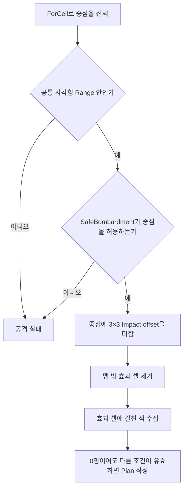

1×1 Cannon이 (10,10), Range 9라고 하자. 중심 (18,18)은 사각형 안이지만 금지 거리 8에 걸려 두 번째 분기에서 실패합니다. 중심 (19,19)은 사거리 안이며 금지 영역 밖이므로 통과합니다.

중심이 정해진 뒤 x/y offset -1,0,1을 더하면 효과 셀은 각 축 18..20입니다. (18,18)에 있는 적은 이 폭발로 맞을 수 있습니다. 중심 검사 함수를 효과 셀마다 다시 호출하면 이 적을 잘못 빼게 됩니다.

효과 셀은 존재하지만 그 안에 적이 없을 수 있습니다. 이때 빈 것은 **피격 대상 목록**입니다. 정상적인 빈 셀 공격은 비용을 소비하고 성공하되 피격 전용 효과는 발생하지 않습니다. 비용·성공 특성 적용은 [Plan 작성](#flow-attack-plan)으로 이어집니다.

## 완료 체크리스트

- [ ] AppointTarget을 구 TargetMode와 cast하지 않았습니다.
- [ ] Impact 원점 조건과 구 방향 패턴 원점 조건을 구분합니다.
- [ ] Cannon (10,10), Range 9에서 (18,18)은 금지, (19,19)은 중심 선택 가능입니다.
- [ ] (19,19)의 효과가 (18,18)에 닿는 것은 허용합니다.
- [ ] D5의 순위·관통 미정 부분과 완료한 후보 수집을 구분합니다.

전체 흐름: `선택 geometry → ImpactPattern → 효과 셀 → AttackTargetResolver → 대상별 피해 평가(Task 5)`.

<a id="task5"></a>
# Task 5 — 방어력·특성을 반영한 피해와 비용 계산

## 이번 Task에서 완성할 것

대상별 최종 피해와 실제로 지불할 비용을 계획에 공급합니다. [P5](#atomicity)의 계산과 실제 적용을 나누는 방식을 따릅니다. D2·D7이 필요한 계산은 따로 표시하고 임의의 공식으로 채우지 않습니다.

## Step 1 — PhysicalDamageCalculator.cs

**이 파일에서 만들 결과:** 물리 방어 계산 함수가 받을 값과 반환할 값을 정리하고, 공식 확정 후 구현할 위치를 잡습니다.

**신규 파일:** `Assets/Scripts/ProjectL/Core/Domain/Combat/PhysicalDamageCalculator.cs`  
**타입:** `public static class`로 구성 가능한 입력값만 사용하는 계산 타입.

### Step 1-1 — 입력과 출력 준비

**이번 단계의 목표:** 입력은 피해량·물리 방어력, 출력은 최종 피해량으로 준비하세요. 공식이 없는 동안에는 선언 설명만 남기고 실행 호출은 추가하지 않습니다.

Plan은 함수의 구체 이름을 강제하지 않습니다. 간단한 보조 함수 형태는 다음과 같습니다.

```csharp
public static int Calculate(int incomingDamage, int physicalDefense);
```

입력할 값과 음수를 거부할 조건까지 정리할 수 있습니다. Context가 필요한 특성 합성은 여기서 처리하지 않습니다.

### Step 1-2 — 방어 공식 확정 후 이어서 작성할 부분

**이번 단계의 목표:** D2가 없으면 계산식과 호출 연결을 대기로 표시하세요. 확정 후 함수 본문과 Step 7의 호출을 함께 작성합니다.

이 함수의 핵심 공식부터는 D2가 필요합니다. 뺄셈인지 비율인지, 최소 피해가 0/1인지 정해지지 않았습니다. `return incomingDamage` 또는 `Math.Max(1, attack-defense)`로 임시 완성하지 않습니다. D2가 없으면 위 함수 선언 형태와 음수 입력 조건을 구현 메모에 남기고, 실행 경로에는 호출을 추가하지 않습니다. 일반 static 클래스에 본문 없는 메서드를 추가해 컴파일을 깨뜨리지 않습니다. 방어값 전달은 계속 진행하고, D2 확정 후 이 함수의 본문과 Step 7 호출을 함께 작성합니다.

## Step 2 — AttackDamageTraitContext.cs

**이 파일에서 만들 결과:** 공격자 쪽 계산과 피격자 쪽 계산에 필요한 값을 각각 올바른 곳에 전달합니다.

**수정 파일:** `Assets/Scripts/ProjectL/Core/Domain/Traits/Contexts/AttackDamageTraitContext.cs`  
**타입:** 기존 `internal readonly struct`.

### Step 2-1 — 공격자 계산에 필요한 정보 유지와 대상별 입력의 전달 위치 결정

**이번 단계의 목표:** 기존 공격자용 Context는 유지하세요. 확정된 공격자 특성이 새 값을 요구하지 않으면 이 파일 자체는 수정하지 않아도 됩니다.

현재 TraitDefinition, Clone한 TraitRuntimeState, BaseDamage는 공격자 쪽 보정 평가용으로 유지합니다. 확정된 공격자 쪽 보정 Rule이 추가 정보를 요구하지 않으면 이 파일은 수정하지 않습니다. 대상별 방어값은 Step 7의 평가 루프에서 준비하고, Heavy의 위치·착탄 원점은 Category 계획의 IncomingDamageTraitContext로 전달합니다. 완료 상태는 새 대상 정보가 필요하다는 이유만으로 기존 공격자 계산에 필요한 정보에 모든 정보를 몰아넣지 않고 각 평가 호출에 필요한 입력이 연결된 것입니다.

### Step 2-2 — 각 계산 함수에 필요한 값 전달

**이번 단계의 목표:** Heavy의 피격자 정보와 공격 원점은 IncomingDamageTraitContext로 넘기세요. 다른 값은 사용하는 특성이 요구할 때만 추가합니다.

공격자 쪽 보정 효과가 실제로 필요로 하는 대상/위치 값만 추가합니다. 피격자 쪽 보정 방어 Context를 공격자 쪽 보정 Context에 억지로 합치지 않습니다. Category 계획의 IncomingDamageTraitContext에는 defender와 ImpactOrigin을 전달합니다. 기존 TraitRuntimeState.Clone 의미는 유지합니다.

## Step 3 — AttackCostContribution.cs

**이 파일에서 만들 결과:** 고정값 할인과 퍼센트 할인을 서로 다른 값으로 전달합니다.

**수정 파일:** `Assets/Scripts/ProjectL/Core/Domain/Traits/Contributions/AttackCostContribution.cs`  
**타입:** 기존 `internal readonly struct`.

### Step 3-1 — 현재 데이터가 표현하는 것

**이번 단계의 목표:** 기존 FlatReduction은 고정값 감소로 유지하세요. 비율을 담을 별도 프로퍼티와 생성자 인자를 다음 단계에서 추가합니다.

현재 Source, FlatReduction, MinimumCost, ConsumeOnSuccessfulAttack만 있습니다. 비율 감소를 기존 FlatReduction 숫자에 숨기면 단위가 깨집니다.

### Step 3-2 — 비율 표현 준비

**이번 단계의 목표:** 0~100 정수 비율을 저장하고 범위 밖 입력을 거부하세요. 기존 생성자는 비율 0을 넘겨 연결합니다.

정수 퍼센트를 담는 별도 읽기 전용 프로퍼티(구현 이름 예: `PercentReduction`)와 이를 받는 생성자 인자를 추가하고 0..100 범위를 벗어나면 거부합니다. 기존 생성자는 비율 0인 호환 경로로 연결할 수 있습니다. 고정/비율 혼합 순서는 이 struct에서 결정하지 않습니다. D7 이전에는 각각의 기여를 운반하는 것까지 구현합니다.

<a id="hint-percent-field"></a>
#### 힌트 — 고정값과 비율을 같은 숫자에 넣지 않기

기존 FlatReduction 바로 옆에 별도 프로퍼티를 두고 공통 생성자가 이를 받게 합니다.

```csharp
public int PercentReduction { get; }
```

생성자 검사 부분의 힌트입니다.

```csharp
if (percentReduction < 0 || percentReduction > 100)
    throw new ArgumentOutOfRangeException(nameof(percentReduction));
```

그 아래에서 PercentReduction에 값을 저장합니다. 기존 생성자는 새 인자에 0을 넘기도록 연결합니다. Source·MinimumCost·ConsumeOnSuccessfulAttack 전달은 유지하세요. 이 자료형은 ‘할인 정보’를 담고, 여러 할인 정보를 합치는 계산은 Resolver가 합니다.

## Step 4 — ICombatTraitResolver.cs

**이 파일에서 만들 결과:** 새 피해·환급 계산을 호출할 함수와 그 결과 자료형을 함께 맞춥니다.

**수정 파일:** `Assets/Scripts/ProjectL/Core/Application/Combat/Traits/ICombatTraitResolver.cs`  
**타입:** 기존 `internal interface ICombatTraitResolver` 및 같은 파일의 Evaluation struct들.

### Step 4-1 — 평가 결과와 메서드 대응

**이번 단계의 목표:** 계산에 추가된 반환값이 있으면 이 파일의 Evaluation struct와 구현체를 함께 수정하세요. 같은 의미의 값이 양쪽에서 빠지지 않아야 합니다.

현재 반환형은 AttackCostEvaluation, AttackDamageEvaluation, TraitActionPlan입니다. 새 데이터가 생기면 구현체와 이 계약을 같은 단위로 맞춥니다. 이 파일 이름과 달리 Evaluation struct도 여기 선언되어 있으므로 별도 이름의 파일을 찾느라 헤매지 않습니다.

### Step 4-2 — 기존 특성 계산 함수 추가 위치

**이번 단계의 목표:** Category 계획의 피격자 피해 평가와 환급 함수를 연결하세요. 기존 EvaluateAttackDamage는 공격자 쪽 계산을 계속 담당합니다.

Category 계획의 피격자 쪽 보정 평가와 refund 계획이 준비되면 그 계약을 사용합니다. 기존 `EvaluateAttackDamage(UnitDefinition definition, UnitState unit, int baseDamage)`는 공격자 쪽 보정 역할을 유지하고 대상의 방어 수치를 UnitDefinition에 저장하는 호출로 바꾸지 않습니다.

## Step 5 — CombatTraitResolver.cs

**이 파일에서 만들 결과:** 특성을 반영한 실제 공격 비용과 피해 계산 결과를 반환합니다.

**수정 파일:** `Assets/Scripts/ProjectL/Core/Application/Combat/Traits/CombatTraitResolver.cs`  
**타입:** 기존 `internal sealed class`.

### Step 5-1 — 실제로 지불할 비용 평가

**이번 단계의 목표:** 비율 단독 할인은 올림과 최소 비용을 적용하세요. 기본 비용 5의 50% 감소 결과는 3이어야 합니다.

```csharp
public AttackCostEvaluation EvaluateAttackCost(UnitDefinition definition, UnitState unit);
```

기존 FlatReduction 합산 경로는 유지합니다. 비율 단독 감소 경로는 long 곱셈 → 100으로 나눈 값을 정수 올림 → 적용 가능한 최소 비용 하한(최소 1) 순서로 작성합니다. 5의 50% 감소는 3입니다. 먼저 아래 곱셈을 작성하고, 이어지는 코드 힌트에서 올림과 최소 비용 처리를 연결하세요.

```csharp
long numerator = (long)baseCost * (100 - percentReduction);
```

고정 감소와 어느 순서로 합칠지는 D7 이후에 연결합니다. 할인 성공 소비의 PositiveCostContributors 수집은 보존합니다.

<a id="hint-cost-rounding"></a>
#### 힌트 — 정수 나눗셈에서 올림 처리하기

위 numerator를 계산한 뒤 **비율 단독 감소 경로**에서는 다음 두 줄로 올림값을 구할 수 있습니다.

```csharp
long roundedCost = (numerator + 99L) / 100L;
int effectiveCost = checked((int)Math.Max(1L, roundedCost));
```

numerator=250이면 (250+99)/100의 정수 나눗셈 결과가 3입니다. numerator=300이면 399/100=3이므로 이미 정수인 비용을 더 올리지는 않습니다. 개별 기여의 MinimumCost가 1보다 큰 경우에는 기존 하한 처리도 이어서 적용하세요.

마지막에는 effectiveCost와 실제 할인에 참여한 특성 정보를 AttackCostEvaluation에 담습니다. 원본 AP 차감과 할인 사용 상태 변경은 여기서 하지 않습니다. 고정·비율 혼합 규칙은 [P7](#pending)의 D7을 따릅니다.

### Step 5-2 — 공격자 쪽 보정과 피격자 쪽 보정을 분리

**이번 단계의 목표:** 공격자 보정 결과를 피격자별 계산에 넘기세요. 물리 방어와 Heavy 경감의 결합 순서는 D2 확정 후 연결합니다.

```csharp
public AttackDamageEvaluation EvaluateAttackDamage(
    UnitDefinition definition, UnitState unit, int baseDamage);
```

기존 공격자 쪽 보정 결과를 계산한 뒤 Application의 대상별 평가가 물리 방어와 피격자 쪽 보정 규칙으로 넘깁니다. D2에서 정한 적용 순서만 사용합니다. Heavy의 감소를 물리 방어가 있다는 이유로 제거하지 않습니다.

<a id="flow-cost-evaluation"></a>
#### 부연 설명 — 비용 평가에서 숫자를 계산하는 순서

**읽을 함수:** EvaluateAttackCost. 기본 비용을 입력으로 읽고, 이번 공격에서 실제로 지불할 비용을 반환합니다. 이 함수에서 CurrentActionCost를 차감하지 않습니다.

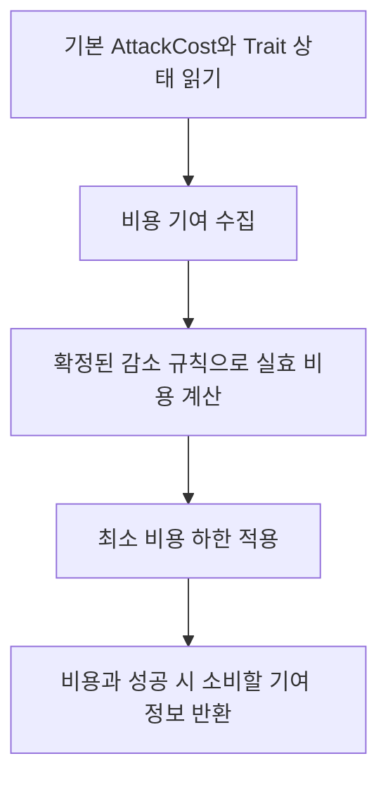

비율 단독 감소 예시로 기본 비용 5, 감소율 50%이면 남은 비율은 50%다. 곱셈 결과 250을 100으로 나누면 2.5이므로 **올림한 3**을 비용으로 사용합니다. 정수 나눗셈을 먼저 해서 2를 얻은 뒤 올림하려 하면 소수 정보가 이미 없어졌습니다. 몫과 나머지로 올림을 처리하거나 올림용 정수식을 사용합니다. 곱셈 중간값은 long으로 둡니다.

현재 AP가 2이고 계산된 비용이 3이면 이후 공격 Plan 단계에서 실패합니다. 이 평가 함수는 AP를 2에서 -1로 바꾸지 않습니다. 고정 감소와 비율 감소가 함께 있을 때의 조합은 D7 경계이며, 이 예시로 순서를 확정하지 않는다([P7](#pending)).

## Step 6 — AttackTargetPlan.cs

**이 파일에서 만들 결과:** 대상 하나의 최종 피해·예상 HP·해제할 셀을 계획에 담습니다.

**수정 파일:** `Assets/Scripts/ProjectL/Core/Application/Combat/AttackTargetPlan.cs`  
**타입:** 기존 `internal readonly struct`.

### Step 6-1 — 최종 피해를 받는 현재 생성자 활용

**이번 단계의 목표:** 생성자에는 계산이 끝난 최종 피해를 전달하세요. 이 생성자에 방어 공식을 추가하지 않습니다.

현재 생성자는 EntityId, damage, healthBefore, releaseCells를 받고 HealthAfter/WillBeKilled를 만듭니다. 피해 공식은 생성자에 넣지 않습니다. 대상별 계산이 끝난 `damage`만 받습니다.

### Step 6-2 — 사망/점유 정보 일치

**이번 단계의 목표:** 사망 예정 대상에는 해제할 점유 셀을 담고 생존 대상에는 빈 배열을 담으세요.

HealthAfter가 0이면 해제 셀이 필요하고 살아 있으면 해제 셀이 없어야 합니다. 현재 검증을 유지합니다. UnitAttackService가 사망 셀을 미리 준비하는 과정도 함께 맞춥니다.

## Step 7 — UnitAttackService.cs

**이 파일에서 만들 결과:** 대상마다 방어를 반영한 예상 결과를 만들고 실제 적용 시에는 그 값을 한 번만 사용합니다.

**수정 파일:** `Assets/Scripts/ProjectL/Core/Application/Combat/UnitAttackService.cs`.

### Step 7-1 — 대상별 loop에 피해 평가 연결

**이번 단계의 목표:** 피격 대상 반복문 안에서 각 대상의 값으로 최종 피해와 AttackTargetPlan을 만드세요. 방어 공식 연결은 D2 확정 후 완료합니다.

`TryBuildAttackResolutionPlan(...)`에서 `for (int i = 0; i < affectedTargets.Length; i++)`를 찾습니다. 지금은 모든 대상에 attacker AttackPower와 같은 공격자 쪽 보정 계산용 정보를 사용합니다.

대상 조회 → 대상 방어값/원점 준비 → 공격자 쪽 보정/피격자 쪽 보정 평가 → 최종 피해/HealthAfter 예상 → 사망 셀 준비 → AttackTargetPlan 생성 순서로 바꿉니다. 건물은 UnitState로 강제 캐스팅하지 않습니다. 건물 방어 적용이 필요한 지점은 D2 부분입니다.

<a id="hint-target-plan-build"></a>
#### 힌트 — 계산한 피해를 대상별 계획에 넣기

D2에 따라 최종 피해 계산이 끝났다고 할 때, 현재 대상 HP와 사망 시 해제할 셀을 준비합니다. 그 다음 생성하는 계획의 한 줄은 아래와 같습니다.

```csharp
var targetPlan = new AttackTargetPlan(
    target.Id, finalDamage, target.CurrentHealth, releaseCells);
```

finalDamage는 이미 계산한 최종 피해, releaseCells는 사망 예정이면 수집한 점유 셀 배열이고 살아남으면 빈 배열입니다. 이 계획을 목록에 넣고 다음 대상으로 넘어가세요. finalDamage를 임의의 공격력 상수로 채우거나 여기서 target.TakeDamage를 호출하지 않습니다.

예를 들어 최종 피해 4, 현재 HP 3이면 예상 HP는 0이고 해제 셀이 필요합니다. 피해 4, HP 10이면 예상 HP 6이며 해제 셀은 없어야 합니다. 위 생성자는 이미 그 관계를 검사하므로 호출자가 맞는 배열을 준비해야 합니다.

### Step 7-2 — TakeDamage와 중복 적용 방지

**이번 단계의 목표:** Commit은 이미 정한 HealthAfter를 적용하게 하세요. 적용 시 방어 계산을 다시 해서 피해를 두 번 줄이지 않습니다.

현재 Commit은 ApplyPlannedHealth로 HP를 적용합니다. 여기서 이미 계산한 피해에 방어를 다시 적용하지 않는지만 확인합니다. `CombatEntityState.TakeDamage(int amount)` 전체를 자동 변경할 필요는 없습니다. 환경 피해 적용은 D2에서 명시한 범위만 연결합니다.

<a id="flow-damage-loop"></a>
#### 부연 설명 — 대상마다 계산하고, HP에는 아직 쓰지 않기

**손댈 반복문:** TryBuildAttackResolutionPlan의 affectedTargets 순회. 이번 반복의 대상 하나에 대한 값을 지역 변수에 모으고 마지막에 AttackTargetPlan 하나를 만듭니다.

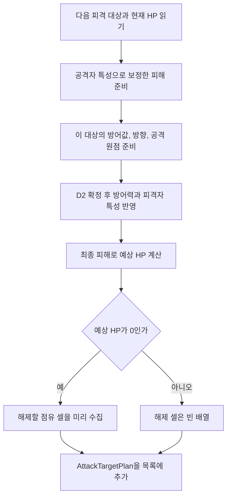

공격자 특성으로 늘어난 피해와 피격자 특성으로 줄어드는 피해를 각각 계산합니다. 앞 대상 A의 방어값을 루프 바깥 변수에 남겨 다음 대상 B에게 쓰지 않도록, 대상 의존 값은 반복문 안에서 매번 준비합니다. 공통으로 재사용할 수 있는 것은 대상에 의존하지 않는 계산 결과뿐입니다.

HP 저장 예시로, **이미 계산된 최종 피해**가 4이고 현재 HP가 10이면 Plan에는 변경 전 10과 예상 6이 담깁니다. 이 예시는 방어 공식을 정하는 예시가 아닙니다. 이 시점 실제 CurrentHealth는 여전히 10입니다. Commit에서 계획된 6을 적용합니다.

D2가 없으면 위 그림의 피해 평가 연결은 아직 완성할 수 없습니다. 준비 가능한 데이터 전달과 공식 적용을 구분하고 [Step 1의 대기 처리](#task5)를 따릅니다. 건물처럼 UnitState가 아닌 대상에 대한 방어 적용도 추측해서 채우지 않습니다.

## 완료 체크리스트

- [ ] 대상마다 다른 방어/위치가 계산에 필요한 정보에 전달됩니다.
- [ ] 기본 비용과 실제로 지불할 비용, 공격자 쪽 보정과 피격자 쪽 보정 결과가 분리되어 있습니다.
- [ ] 최소한 `CombatTraitRuleTests`, `UnitAttackPreviewTests`의 관련 통합 결과와 실제 HP를 확인합니다.
- [ ] 방어 계산을 Plan과 HP 적용 단계에서 두 번 하지 않습니다.
- [ ] D2/D7이 미정이면 해당 통합은 아직 완료로 표시하지 않습니다.

전체 흐름: `후보 대상 → 공격자 보정 → 대상별 방어/incoming → AttackTargetPlan → AttackResolutionPlan(Task 6)`.
<a id="task6"></a>
# Task 6 — 조회·미리보기·실제 공격 연결

## 이번 Task에서 완성할 것

Task 3~5의 입력/계산을 실제 Query·Preview·Command·AI 경로에 연결합니다. 이 Task의 공통 설명은 [P4](#aim), [P5](#atomicity)를 참조합니다. Plan 15절의 공격·턴 순서·자원을 함께 적용하기 전 검사 선행 준비도 여기에서 수행합니다.

## Step 1 — AttackRangeResult.cs

**이 파일에서 만들 결과:** 공격 가능 셀·금지 셀·선택 종류와 방향 정보를 조회 결과에 담습니다.

**수정 파일:** `Assets/Scripts/ProjectL/Core/Contracts/Results/AttackRangeResult.cs`  
**타입:** 기존 `public readonly struct`.

### Step 1-1 — 전체 지정 정보 추가

**이번 단계의 목표:** AimKind·BlockedAppointCells·허용 방향 정보를 추가하세요. 특정 셀에서 선택 가능한 방향은 Preview 정보와 구분합니다.

기존 RangeCells/InRangeTargetIds/CanAffordAttack 옆에 Category 계획의 AimKind, BlockedAppointCells와 Plan의 후보 방향 정보를 추가합니다. 배열은 [P2](#snapshot)를 따릅니다.

여기서 후보 방향은 이 유닛이 사용할 수 있는 방향 전체입니다. 특정 마우스 셀과 겹친 방향 목록은 다음 Step의 Preview 정보입니다. 두 목록의 의미를 동일하게 만들지 않습니다.

### Step 1-2 — Success/Failure 팩토리 연결

**이번 단계의 목표:** Success·Failure가 추가 정보를 받아 저장하게 하세요. 비용이 부족해도 범위 정보는 남기고 지불 가능 여부만 false로 표시합니다.

반환형은 각각 `AttackRangeResult`다. 기존 인자에 확장값을 추가하는 공통 처리 경로를 만들고 호환 overload는 비어 있는 확장 정보로 위임합니다. 비용이 부족해도 범위/후보를 유지하고 CanAffordAttack만 false로 내리는 기존 동작을 보존합니다.

## Step 2 — AttackPreview.cs

**이 파일에서 만들 결과:** 공격 미리보기에 원래 선택, 해석한 방향, 예상 결과와 필요한 방향 후보를 담습니다.

**수정 파일:** `Assets/Scripts/ProjectL/Core/Contracts/Results/AttackPreview.cs`  
**타입:** 기존 `public readonly struct`.

### Step 2-1 — 선택과 결과 방향 담기

**이번 단계의 목표:** Aim과 새 방향 값을 저장하고 모호성 실패에도 방향 후보를 담으세요.

Aim, 해결된 방향, 특정 선택의 후보 방향 목록을 전달할 수 있게 합니다. 기존 Rotation4 AttackDirection 이 값을 쓰는 코드를 새 AttackDirection으로 이행합니다. 성공 결과뿐 아니라 AmbiguousAttackDirection 실패에도 후보를 담아야 합니다.

### Step 2-2 — Entity 선택과 Cell 선택의 검사 조건 나누기

**이번 단계의 목표:** Entity 선택의 빈 ID는 거부하되 유효한 Cell 선택은 대상 0명도 표현하게 하세요.

현재 Success가 PrimaryTargetId.Empty를 무조건 거부합니다. Entity aim일 때는 유지하고 Cell aim일 때는 허용하도록 바꿉니다. 대상 목록이 0인 합법 Cannon Preview도 표현 가능해야 합니다.

처리 순서: aim 종류/입력 유효성 → 성공이면 해결된 선택 유효성 → 대상/효과 배열 검사 → 복사 → 결과 값 저장. 실패 결과는 요청한 선택을 잃지 않게 합니다.

<a id="hint-result-invariants"></a>
#### 힌트 — 빈 대상 ID를 검사할 때 Aim 종류부터 확인하기

성공 결과를 만드는 함수에서 ‘ID가 비었는가’만 검사하던 조건을 찾아 Aim 종류를 함께 확인하도록 바꿉니다. 아래는 조건을 나누는 부분의 예입니다.

```csharp
bool needsPrimaryTarget = aim.Kind == AttackAimKind.Entity;
bool missingPrimaryTarget = primaryTargetId.IsEmpty;
```

두 값이 모두 true일 때 기존 빈 ID 오류를 발생시키세요. Cell이면 중심 좌표가 있는지와 해당 선택이 이미 검증됐는지를 확인합니다. Entity에서는 살아 있는 적 primary가 실제 피격 목록에도 있어야 합니다.

이 조건을 Preview·Result·내부 실행 결과·Plan에서 따로 다른 의미로 만들지 마세요. 각 생성자의 같은 조건을 찾아 동일한 선택 규칙으로 갱신합니다. 실패 결과는 잘못된 입력 자체도 설명해야 하므로 성공 생성자 검사를 그대로 복사하지 않습니다.

## Step 3 — AttackResult.cs

**이 파일에서 만들 결과:** 실제 실행 결과에 선택 정보와 변경 후 상태를 담습니다.

**수정 파일:** `Assets/Scripts/ProjectL/Core/Contracts/Results/AttackResult.cs`  
**타입:** 기존 `public readonly struct`.

### Step 3-1 — 실제 실행 결과에 같은 계약 적용

**이번 단계의 목표:** Aim·방향과 실제 사용 비용·피격 결과·Snapshot을 전달하세요. 예상값을 실행 결과처럼 저장하지 않습니다.

Step 2와 같은 Aim/방향 의미를 사용합니다. ActionCostSpent, Hits, CurrentStage, TraitActivations는 실제 Commit 결과에서 받습니다. Preview 값을 그대로 넣지 않습니다.

### Step 3-2 — 호환 PrimaryTargetId

**이번 단계의 목표:** Entity 선택은 대상 ID, Cell 선택은 Empty를 제공하게 하세요. 빈 ID만으로 정상적인 셀 공격을 거부하는 조건을 바꿉니다.

Entity aim이면 선택 EntityId, Cell aim이면 Empty를 제공합니다. 실패 Result도 원 요청 Aim과 현 상태 Snapshot을 보존합니다. PrimaryTargetId.Empty를 무조건 거부하는 생성자/Success 팩토리 조건을 `Entity aim일 때만 거부`하도록 교체합니다. Cell aim은 유효한 중심과 빈 Hits로도 성공 Result를 만들 수 있어야 합니다.

## Step 4 — AttackResolutionPlan.cs

**이 파일에서 만들 결과:** 공격 적용에 필요한 값과 적용 전 확인할 값을 AttackResolutionPlan에 모읍니다.

**수정 파일:** `Assets/Scripts/ProjectL/Core/Application/Combat/AttackResolutionPlan.cs`  
**타입:** 기존 `internal readonly struct`.

### Step 4-1 — Cell 공격은 대상이 없어도 계획을 만들도록 바꾸기

**이번 단계의 목표:** 대상 1명 이상·primary 포함 조건은 Entity 선택에만 적용하세요. 유효한 Cell 선택은 대상 0명 계획을 허용합니다.

현재 생성자는 PrimaryTargetId 비어 있지 않음, TargetPlans 하나 이상, 대상 목록에 primary 포함을 요구합니다. 이를 Entity aim 조건으로 한정합니다. Cell aim은 중심/공격 셀이 유효하면 대상 0개를 허용합니다. 단순히 모든 검증을 제거하지 않습니다.

### Step 4-2 — 적용할 값과 기대값 준비

**이번 단계의 목표:** Aim·방향·자원·체크포인트의 변경 전후 값을 담고 생성 시 잘못된 조합을 거부하세요.

기존 대상별 Plan, 비용, TraitTransitionBatch를 보존하고 Aim/새 방향과 공격 정산의 전후 자원·체크포인트 정보를 연결합니다. Plan 13.6절 및 Category 적용 전 검사가 기준입니다.

생성 순서: 입력/aim 검사 → 대상 중복/Entity primary 포함 조건 확인 → 자원 전후 값 검증 → 배열/상태 변경 값 보관 → 반환. Plan은 struct이므로 null 검사 대신 유효하지 않은 default를 막는 입력 항상 지켜야 할 조건이 필요합니다.

### Step 4-3 — 정렬과 경로 정보 구분

**이번 단계의 목표:** 결과의 Entity ID 정렬을 유지하되 관통 진행 순서로 사용하지 마세요. 공격 진행 정보는 별도로 보존합니다.

현재 targetPlans는 대상 ID 순서가 안정적입니다. 이 순서를 관통 순서로 쓰지 않습니다. 진행 공격 셀 정보와 표시/적용 결과 순서의 관계는 [P3](#geometry)에 따릅니다.

<a id="attack-service-step"></a>
## Step 5 — UnitAttackService.cs

**이 파일에서 만들 결과:** 범위 조회·미리보기·실제 공격이 같은 선택과 계산을 사용하도록 연결합니다.

**수정 파일:** `Assets/Scripts/ProjectL/Core/Application/Combat/UnitAttackService.cs`  
**타입:** `internal sealed class UnitAttackService`. 같은 파일 위쪽에 `public readonly struct AttackExecutionResult`도 있습니다.

### Step 5-1 — GetAttackRange 갱신

**이번 단계의 목표:** GetAttackRange와 IsTargetInRange가 같은 범위 셀을 사용하게 바꾸세요. 사각형 모서리를 거리 검사로 다시 거부하지 않게 합니다.

```csharp
public AttackRangeResult GetAttackRange(EntityId attackerId);
```

현재 phase→Entity 존재/Unit 여부→배치/생존→active→지원 조합→점유 검증 흐름을 유지합니다. 그 뒤 새 범위 모양과 지정 제한으로 셀을 만듭니다. Entity 후보는 아래 함수가 동일한 범위 셀 포함 판정을 사용하도록 수정합니다.

```csharp
private bool IsTargetInRange(UnitState attacker, CombatEntityState target);
```

대상 점유 셀이 지정 영역과 겹치는지 확인하되 공격 설정 조합의 실제 선택 유효성도 만족해야 합니다. `CalculateMinimumDistance`로 다시 반려하면 사각형 모서리가 화면에는 보이지만 공격은 실패합니다.

### Step 5-2 — AttackAim을 받는 PreviewAttack 추가

**이번 단계의 목표:** AttackAim을 받는 PreviewAttack을 추가하고 기존 EntityId 호출도 이 함수로 연결하세요.

```csharp
public AttackPreview PreviewAttack(EntityId attackerId, AttackAim aim);
```

처리 순서: public 입력 검사 → 같은 Plan 작성 함수 호출 → 성공이면 대상별 예상 HP/실제로 지불할 비용/해결된 선택을 Preview로 변환 → 실패면 원 aim/실패 이유/가능한 후보 방향을 보존합니다. 기존 EntityId overload는 ForEntity 경로로 연결합니다.

### Step 5-3 — Plan 작성 함수를 Aim 중심으로 변경

**이번 단계의 목표:** 선택 검사부터 대상·비용·특성 계산까지 한 Plan 작성 함수로 묶으세요. 계산 중 실제 상태는 바꾸지 않습니다.

기존 함수 이름을 유지합니다. 추가 후보 방향 출력이 필요하면 같은 계획 작성 경로에서 반환하도록 보완합니다.

```csharp
internal bool TryBuildAttackResolutionPlan(EntityId attackerId, AttackAim aim,
    out AttackResolutionPlan plan, out AttackFailureReason failureReason);
```

함수 안에서 작성할 순서:

1. phase, 현재 actor, 생존/배치/점유 확인.
2. 지원 공격 설정 조합과 aim 종류 확인. Entity는 살아 있는 적대 primary 조회, Cell은 중심 좌표 확인.
3. 전체 지정 영역/제한에서 선택 후보를 구하고 Direction 해석.
4. 선택 공격 셀과 Impact를 계산하고 대상 후보/피격 규칙 적용.
5. 실제로 지불할 비용 계산 및 현재 비용으로 지불 가능한지 확인.
6. 대상마다 Task 5의 최종 피해/HP/해제 셀 계산.
7. 공격 성공 특성 상태 변경 및 자원/체크포인트 정산 계산.
8. 생성 후 바뀌지 않는 AttackResolutionPlan 생성 후 반환.

환급 예정 비용을 부족한 공격비를 채우는 데 쓰지 않습니다. Rider 정산은 Category 규칙 그대로 사용합니다.

<a id="hint-plan-payment"></a>
#### 힌트 — 계산 중 실패하면 Plan을 적용하지 않고 반환하기

비용 평가 결과를 받은 뒤 현재 AP로 지불 가능한지 검사합니다. 아래는 계획 작성 함수 안의 비용 부족 분기만 보여 줍니다.

```csharp
if (attacker.CurrentActionCost < costEvaluation.EffectiveCost)
{
    plan = default;
    failureReason = AttackFailureReason.ActionCostInsufficient;
    return false;
}
```

`costEvaluation`은 Resolver가 반환한 AttackCostEvaluation입니다. 이 분기 앞뒤에 AP 차감 코드를 넣지 마세요. 환급받을 비용을 현재 AP에 미리 더해서 통과시키지도 않습니다.

부족하지 않다면 대상별 계획과 성공 특성 변경을 계산한 뒤 완성된 Plan을 반환합니다. 후보 방향 반환이 필요한 경우에는 별도 출력에도 원래 목록을 보존합니다([공격 Plan 설명](#flow-attack-plan)).

### Step 5-4 — CommitAttack의 검증/적용 구간 분리

**이번 단계의 목표:** 읽기 검사와 상태 적용을 나누세요. Facade가 HP 변경 전에 공격 계획을 검사할 수 있게 합니다.

```csharp
internal AttackExecutionResult CommitAttack(AttackResolutionPlan plan);
```

현재 메서드는 대상 HP/맵 점유를 확인하고 prepared result를 만든 뒤 HP·비용·Trait를 적용합니다. 이 중 읽기 검증을 공격·턴 순서·자원을 함께 적용하기 전 검사에서 실행할 수 있도록 분리합니다. 보조 함수의 이름을 정할 때는 반환형은 `void`인 `ValidateAttackPlan(AttackResolutionPlan plan)`처럼 뜻이 명확해야 합니다.

확인할 순서: 공격자 존재/유효 상태 → 기대 자원/선택 상태 → 모든 대상 HP/점유 → Trait 상태 변경 적용 가능성 → 정산 산술/결과 구성 준비. 전체 성공 뒤 HP/점유·AP·체크포인트·Trait를 적용합니다. TraitSet.ApplyPrevalidated 호출이 뒤에 있다는 이유만으로 검증이 끝났다고 가정하지 않습니다.

### Step 5-5 — 같은 파일의 AttackExecutionResult 갱신

**이번 단계의 목표:** 같은 파일의 AttackExecutionResult도 Aim·8방향·빈 셀 공격을 담게 수정하세요.

private 생성자 및 `Success(...)`, `Failure(...)`의 반환형은 `AttackExecutionResult`다. Aim/8방향/Cell Empty primary 허용을 공개 Result와 맞춥니다. `hits.Length==0`은 합법 Cell 공격일 수 있습니다. 이 내부 결과에 StageSnapshot을 넣어 Facade 책임을 옮기지 않습니다.

<a id="flow-attack-plan"></a>
#### 부연 설명 — 긴 공격 메서드를 여덟 구간으로 나누어 작성하기

TryBuildAttackResolutionPlan을 한 번에 작성하려 하지 말고 아래 구간 순서로 채웁니다. 각 구간은 앞 구간이 만든 값을 입력으로 받습니다.

| 구간 | 이번 구간에서 만드는 값 | 실패하면 |
|---|---|---|
| 1. 공격자 검사 | 유효한 attacker | 실패 이유를 설정하고 false 반환 |
| 2. 공격 설정 조합 및 Aim 검사 | Entity 대상 또는 Cell 중심 | 동일하게 반환 |
| 3. 방향 해석 | resolvedAim과 후보 방향 | 후보 정보도 호출자에게 전달 |
| 4. 공격 셀·Impact·대상 수집 | 효과 셀과 피격 대상 배열 | 해당 선택 규칙의 실패 반환 |
| 5. 비용 평가 | effectiveCost | 현재 AP로 지불 불가하면 반환 |
| 6. 대상별 계산 | AttackTargetPlan 배열 | 계산을 완료하지 못하면 적용하지 않음 |
| 7. 성공 특성·자원 정산 | 특성 상태 변경과 최종 자원·체크포인트 값 | 정산 불가하면 적용하지 않음 |
| 8. 계획 묶기 | 완성된 AttackResolutionPlan | 성공 시 true 반환 |

3~6의 세부 반복은 [방향 해석](#flow-selection), [Cannon](#flow-cannon), [대상별 피해](#flow-damage-loop)를 참조합니다. 이 표 아래에 같은 알고리즘을 다시 작성할 필요는 없습니다.

지역 변수는 ‘이번 호출 동안만 들고 있는 계산값’입니다. 예를 들어 effectiveCost나 targetPlans는 여기서 만들지만, `attacker.CurrentActionCost`나 대상 HP를 바꾸는 호출은 하지 않습니다. 마지막에 이 값들을 Plan에 묶습니다.

서비스의 PreviewAttack은 성공 Plan에서 표시용 예상값을 꺼냅니다. 다만 **외부에서 사용하는 Facade Preview는 Timeline과 공격 정산까지 검증해야 합니다.** UnitAttackService의 계획 성공만으로 전체 Preview 성공을 확정하지 말고 [다음 Facade 흐름](#flow-facade)에 연결합니다.

빈 대상 배열인 Cannon 공격도 5·7·8 구간을 실행합니다. 6의 반복문은 0회 돌 뿐입니다. 따라서 ‘대상 0명이라 바로 성공 반환’하면 비용과 성공 특성 계획을 건너뛰게 됩니다.

## Step 6 — UnitTraitStateSet.cs

**이 파일에서 만들 결과:** 특성 변경을 복사본에서 먼저 확인하고 성공 시에만 원본에 적용합니다.

**수정 대상 확인 파일:** `Assets/Scripts/ProjectL/Core/Domain/Traits/UnitTraitStateSet.cs`  
**타입:** 기존 `public sealed class`.

### Step 6-1 — 복사본에서 특성 변경을 먼저 검사하도록 연결

**이번 단계의 목표:** 공격 적용 전 검사에서 Clone한 상태에 Apply를 호출하세요. 기존 함수가 필요한 검사를 제공하면 이 파일은 그대로 둡니다.

현재 `internal UnitTraitStateSet Clone()`, `internal void Apply(TraitTransitionBatch batch)`, `internal void ApplyPrevalidated(TraitTransitionBatch batch)`가 있습니다. Task 6 Step 5의 공격 적용 전 검사에서 `Clone()`한 상태에 `Apply(batch)`를 호출하여 적용 가능성을 검증합니다. 이 API가 필요한 상태 변경을 이미 검증한다면 이 파일 자체는 수정하지 않습니다. 완료 여부는 API를 읽었는지가 아니라 원본 HP/AP 적용 전에 복사본의 특성 변경 검사이 호출되는지로 판단합니다.

<a id="hint-trait-clone"></a>
#### 힌트 — 원본을 바꾸기 전에 복사본에서 적용해 보기

현재 TraitStateSet을 복제하고, 계획에 담을 변경 묶음을 그 복제본에 적용합니다. 아래 `transitionBatch`는 앞에서 계산한 TraitTransitionBatch입니다.

```csharp
UnitTraitStateSet trialState = attacker.UnitTraitStateSet.Clone();
trialState.Apply(transitionBatch);
```

여기서 문제가 발견되면 공격 계획이 실패해야 합니다. 복사본 변경이 성공했다고 원본에 즉시 Apply하지 않습니다. 원본은 공격·Timeline·자원 검사가 모두 끝난 다음 적용 단계에서 바뀝니다([P5](#atomicity)).

이 API가 이미 필요한 검사를 제공하면 UnitTraitStateSet 파일의 코드를 더 늘릴 필요는 없습니다. 이번에 추가할 코드는 주로 공격 계획을 검사하는 호출 위치입니다.

### Step 6-2 — 원본 상태와 임시 상태 분리

**이번 단계의 목표:** 계산 중에는 복사본만 바꾸고 전체 검사 성공 뒤 원본에 계획값을 적용하세요.

계획 단계에서는 복제본에서 상태 변경을 검증합니다. 원본에서는 모든 적용 전 검사가 성공한 뒤 사전 계산된 값만 적용합니다. 새 Trait마다 즉시 원본 상태를 수정하는 경로를 추가하지 않습니다. 이미 필요한 검증이 제공되면 파일 변경 없이 호출만 연결합니다.

## Step 7 — CombatTimelineService.cs

**이 파일에서 만들 결과:** 사망자의 턴 순서 제거가 가능한지 HP 변경 전에 검사하도록 연결합니다.

**수정 대상 확인 파일:** `Assets/Scripts/ProjectL/Core/Application/Combat/CombatTimelineService.cs`  
**타입:** 기존 `internal sealed class`.

### Step 7-1 — 있는 함수를 재사용한다

**이번 단계의 목표:** 기존 제거 계획·검사·적용 함수를 재사용하세요. Step 8에서 ValidateRemoval을 공격 적용 앞에 연결하면 됩니다.

```csharp
internal TimelineRemovalPlan PlanKilledParticipantRemovals(
    ReadOnlySpan<AttackTargetPlan> targetPlans,
    IReadOnlyDictionary<EntityId, CombatEntityState> entities);
internal void ValidateRemoval(TimelineRemovalPlan plan);
internal void CommitRemoval(TimelineRemovalPlan plan);
```

PlanKilledParticipantRemovals는 사망한 실제 Unit Timeline 참가자를 수집하고 중복을 제거합니다. ValidateRemoval은 revision과 참가자 존재를 확인합니다. 이 검사를 공격 HP 변경보다 앞에서 호출하도록 Step 8에서 묶습니다. 스케줄 알고리즘은 이 Task에서 교체하지 않습니다.

## Step 8 — StageCombatFacade.cs

**이 파일에서 만들 결과:** 공격·턴 순서·승패·Snapshot 처리를 올바른 순서로 묶습니다.

**수정 파일:** `Assets/Scripts/ProjectL/Core/Application/StageRun/StageCombatFacade.cs`  
**타입:** 기존 클래스 선언 유지.

### Step 8-1 — 공개 API 확장

**이번 단계의 목표:** Aim을 받는 PreviewAttack·TryAttack을 추가하고 기존 EntityId 함수는 ForEntity로 연결하세요.

```csharp
public AttackPreview PreviewAttack(EntityId attackerId, AttackAim aim);
public AttackResult TryAttack(EntityId attackerId, AttackAim aim);
```

기존 EntityId overload를 유지하고 ForEntity로 위임합니다. GetAttackRange는 기존 이름으로 남깁니다. 새로운 서비스 인터페이스를 여기서 Framework용으로 등록하지 않습니다.

### Step 8-2 — Command 처리 순서

**이번 단계의 목표:** 모든 적용 전 검사가 성공한 뒤 상태를 바꾸세요. 새 이동 정산이 연결되면 기존 별도 CommitPendingMovement 호출을 제거합니다.

Stage 종료 확인 → 최신 공격 Plan → 사망 Timeline Plan → 공격/Timeline/특성/자원 전체 적용 전 검사 → 공격 정산 적용 → Timeline 제거 → 승패 갱신 → Snapshot → AttackResult.

현재는 `_unitAttackService.CommitAttack(plan)` 뒤에 `attacker.CommitPendingMovement()`를 따로 호출합니다. Rider 정산으로 체크포인트를 옮기는 단계에서는 이 별도 호출을 제거합니다. 정산 이전까지는 기존 호출을 유지하여 이동 장부가 빠지지 않게 합니다.

<a id="hint-facade-order"></a>
#### 힌트 — 읽기 검사와 실제 저장 위치를 눈으로 나누기

TryAttack을 열고 첫 HP·점유·AP 변경 호출이 어디 있는지 표시하세요. 그보다 위에 공격 계획 검사, Timeline 제거 검사, 자원·특성 적용 가능성 검사가 모두 있어야 합니다.

Timeline 검사 호출 부분의 예입니다. `timelineService`는 이 Stage가 쓰는 기존 서비스, `removalPlan`은 사망 대상에서 만든 제거 계획입니다.

```csharp
timelineService.ValidateRemoval(removalPlan);
```

이 줄이 실패할 수 있는 마지막 검사보다 뒤에 HP 적용이 있어야 합니다. 실제 저장 순서는 [Facade 흐름도](#flow-facade)를 따릅니다. Preview도 같은 전체 검사까지 실행하고 저장 직전에 예상 결과로 반환합니다.

작게 따라갈 예로 Rider의 현재 AP=5, 공격비=3, 환급할 Pending 비용=4, 최대 AP=10이고 환급 기회가 남아 있다고 하겠습니다. 먼저 5로 3을 지불할 수 있는지 확인하고, 계획에서는 5-3+4=6을 최종 AP로 잡습니다. 적용 시에는 이 최종값과 체크포인트·특성 상태를 함께 저장합니다. 환급 순서와 상한은 기존 Category 규칙을 사용하세요.

### Step 8-3 — 실패 Snapshot

**이번 단계의 목표:** 실패 결과에는 원래 Aim과 현재 Snapshot을 넣으세요. 실패로 게임 상태가 바뀌면 안 됩니다.

실패 경로는 원 aim과 `_snapshotBuilder.Build()` 결과를 반환합니다. 예측 Snapshot을 실제 상태로 반환하지 않습니다. Stage 종료, 명시 방향 불일치, 점유 변경 모두 같은 무변경 실패 원칙을 적용한다([P5](#atomicity)).

<a id="flow-facade"></a>
#### 부연 설명 — Preview와 실제 공격이 갈라지는 마지막 지점

**읽을 함수:** Facade의 PreviewAttack, TryAttack 및 공통 정산 계획 작성 함수. Category 계획의 `TryBuildActiveAttackSettlementPlan`에서 공격 Plan과 Timeline·자원 정산을 묶는 흐름입니다.

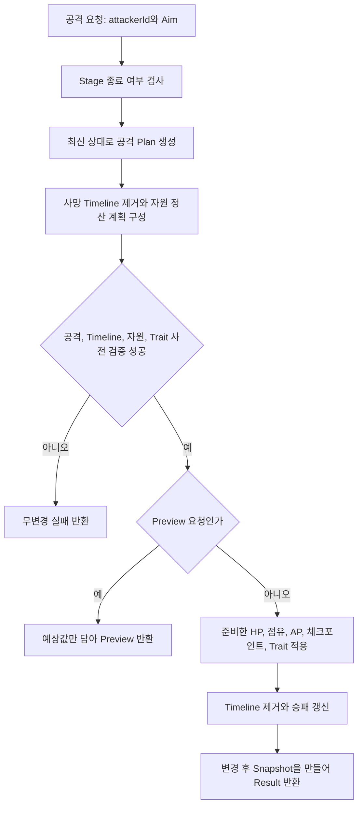

적용 전 검사는 ‘변경 전에 전부 적용할 수 있는지 검사하는 구간’이다([P5](#atomicity)). 공격 대상의 HP뿐 아니라 Timeline revision과 이동 정산 기대값도 여기서 검사합니다. Preview도 이 구간을 통과해야 합니다.

예를 들어 Preview에서 대상 HP가 10이고 예상 HP가 6이었다고 하자. 사용자가 클릭하기 전 다른 정상 행동으로 대상 HP가 바뀌었다면, TryAttack은 옛 Preview의 6을 적용하지 않고 **현재 상태로 새 계획을 만듭니다.**

이 파일에서 제거할 기존 호출은 공격 서비스 Commit 뒤에 별도로 실행하던 `attacker.CommitPendingMovement()`다. 새 공격 정산이 체크포인트를 한 번 적용하도록 연결한 시점에 제거합니다. 그전에 삭제하면 장부 처리가 빠지고, 새 정산과 함께 남기면 중복됩니다.

반환값을 만드는 위치도 구분합니다. Preview에는 예상값, 성공 Result에는 적용 후 실제 Snapshot, 실패 Result에는 변하지 않은 현재 Snapshot을 넣습니다. 이 분기를 잡은 뒤 세부 필드를 연결하면 흐름을 놓치기 어렵습니다.

## Step 9 — StageSessionFactory.cs

**이 파일에서 만들 결과:** 새 계산기들을 기존 Stage 객체에 연결하여 사용할 수 있게 만듭니다.

**수정 파일:** `Assets/Scripts/ProjectL/Core/Application/StageRun/StageSessionFactory.cs`  
**타입:** 기존 static Factory 선언 유지.

### Step 9-1 — 의존 계산기 조립

**이번 단계의 목표:** 새 계산기들을 생성해 서비스에 넘기세요. 같은 Stage의 Map과 Entity 목록을 사용하도록 연결합니다.

기존 AppointRangeCalculator/UnitAttackService 생성 지점에서 새 Selection/Geometry/Target 계산기를 구성하고 필요한 생성자 인자로 전달합니다. 서로 다른 Entity 사전이나 Map을 각 계산기용으로 새로 생성하지 않습니다.

<a id="hint-service-wiring"></a>
#### 힌트 — 새 계산기를 만들고 기존 상태와 연결하는 순서

StageSessionFactory의 기존 UnitAttackService 생성 호출에서 시작하세요. 새 순수 계산기는 그 호출 앞에서 만들고 필요한 서비스 생성자 인자로 넘깁니다. 예를 들어 상태를 갖지 않는 계산기는 다음처럼 준비할 수 있습니다.

```csharp
var geometryCalculator = new AttackGeometryCalculator();
var selectionResolver = new AttackSelectionResolver();
```

위 타입들의 생성자에 추가 인자를 두었다면 그에 맞춰 연결합니다. 이미 있는 Map·Entity 사전을 새 계산기마다 복사해 다른 전투 상태를 만들지 마세요. 생성자를 확장했으면 같은 서비스를 만드는 기존 테스트 보조 코드도 동일한 인자를 넘기도록 바꿉니다.

### Step 9-2 — Catalog 및 Trait 조립 순서

**이번 단계의 목표:** 실제 카테고리 특성 구현이 준비된 뒤 등록과 자동 조합을 연결하세요. 빈 특성 구현으로 등록만 통과시키지 않습니다.

Plan 15절에 따라 실제 Tactical 구현 후 Category 자동 조합을 연결합니다. 임시 no-op Trait로 bootstrap만 통과시키지 않습니다. 기존 UnitFactory와 TraitRegistry를 재사용합니다.

## Step 10 — EnemyAiPolicy.cs

**이 파일에서 만들 결과:** AI가 같은 범위 조회와 미리보기 결과로 AttackAim을 고르게 합니다.

**수정 파일:** `Assets/Scripts/ProjectL/Core/Application/Combat/EnemyAi/EnemyAiPolicy.cs`  
**타입:** 기존 `internal sealed class`, namespace는 경로와 달리 `ProjectL.Core.Application.Combat`입니다.

### Step 10-1 — 공격 후보의 Manhattan 정렬 의존 제거

**이번 단계의 목표:** 공격 후보를 Manhattan으로 정렬하던 부분을 Aim 후보와 Preview 비교로 바꾸세요. 이동용 거리 계산은 유지합니다.

현재 `internal bool TrySelectAttackTarget(..., out EntityId targetId)`에서 InRangeTargetIds를 Manhattan 거리로 정렬하는 공격 선택 부분을 Step 10-2의 Aim 후보 및 공통 Preview 평가로 교체합니다. 이동 추적에서 같은 거리 계산 함수를 호출한다면 그 호출은 유지합니다. 완료 후 공격 선택은 공통 Query/Preview 후보를 사용하고 이동 추적은 기존 거리 정책을 사용해야 합니다.

### Step 10-2 — 선택 결과를 AttackAim으로 변경

**이번 단계의 목표:** Entity 또는 Cell 후보를 평가한 뒤 선택한 AttackAim을 반환하세요. Preview 결과를 받을 입력은 TurnService와 함께 연결합니다.

함수 선언 예시는 다음과 같습니다. 후보 Preview 평가를 어디서 전달할지는 기존 Category AI 계획의 경계를 따릅니다.

```csharp
internal bool TrySelectAttackAim(StageSnapshot stage, EntityId actorId,
    AttackRangeResult attackRange, out AttackAim aim);
```

Entity 공격 설정 조합은 유효 Entity 후보, Cell 공격 설정 조합은 RangeCells의 중심 후보를 사용합니다. 새 방향은 허용 후보로 명시합니다. 피해/비용을 비교할 때 자체 계산하지 않고 gateway의 공통 Preview 결과를 사용합니다. D5의 가까운/먼 타겟 규칙을 AI 휴리스틱으로 대신 확정하지 않습니다.

<a id="hint-ai-selection"></a>
#### 힌트 — AI에는 먼저 후보를 만들고 그 후보의 Preview를 넘긴다

TurnService에서 gateway로 후보별 Preview를 얻고, Policy가 그 결과들을 비교하게 합니다. Entity 후보는 대상 ID로, Cannon 후보는 유효한 중심 셀로 Aim을 만듭니다.

```csharp
AttackAim candidateAim = AttackAim.ForCell(candidateCell);
AttackPreview preview = combat.PreviewAttack(actorId, candidateAim);
```

이 두 줄은 `combat`을 가진 TurnService 쪽의 후보 평가 예입니다. Preview 실패는 선택 후보에서 제외합니다. Cannon은 실제로 깎을 수 있는 HP 합계, 대상 수, y/x 순서로 비교하는 기존 정책을 사용합니다. 방향 공격은 허용 방향을 명시한 Aim을 만들어 평가하세요.

후보 하나를 평가할 때마다 TryAttack을 실행하지 않습니다. 모든 후보를 비교한 뒤 고른 Aim 하나로만 공격합니다. 이동 후에는 앞에서 구한 배열을 그대로 쓰지 말고 다시 조회합니다([AI 흐름도](#flow-enemy-ai)).

### Step 10-3 — 이동 경로 보존

**이번 단계의 목표:** 추적 대상·이동 목적지 함수는 기존 이동 규칙을 유지하게 하세요. 공격 범위만 별도 계산으로 바뀌어야 합니다.

`TrySelectPursuitTarget(...)`, `TrySelectMovementDestination(...)`은 각각 `bool`을 반환합니다. 이동 접근 거리·이동 비용 계산은 유지합니다. 공격 후보는 Query에 있는 셀만 사용하며 Manhattan 반경을 다시 적용하지 않습니다.

## Step 11 — EnemyAiTurnService.cs

**이 파일에서 만들 결과:** AI의 이동 전·후 공격 요청이 AttackAim을 전달하게 바꿉니다.

**수정 파일:** `Assets/Scripts/ProjectL/Core/Application/Combat/EnemyAi/EnemyAiTurnService.cs`  
**타입:** 같은 파일의 `internal interface IEnemyAiCombatGateway`, `internal sealed class EnemyAiTurnService`.

### Step 11-1 — 게이트웨이 계약 변경

**이번 단계의 목표:** 같은 파일의 gateway에 Aim 공격과 Preview 함수를 추가하고 구현체도 맞추세요.

기존 TryAttack EntityId 경로를 보존하고 다음 Aim 호출 및 Preview 호출을 추가합니다.

```csharp
AttackPreview PreviewAttack(EntityId attackerId, AttackAim aim);
AttackResult TryAttack(EntityId attackerId, AttackAim aim);
```

같은 interface를 구현하는 실제 Facade와 테스트 gateway를 함께 갱신합니다. IEnemyAiCombatGateway.cs라는 새 파일을 찾거나 중복 interface를 만들지 않습니다.

### Step 11-2 — Run의 두 공격 지점 교체

**이번 단계의 목표:** Run의 두 공격 지점 모두 새 Aim 선택을 사용하게 하세요. 이동 뒤에는 새 Snapshot과 Range를 조회합니다.

```csharp
internal EnemyAiTurnResult Run(IEnemyAiCombatGateway combat,
    StageSnapshot initialStage);
```

현재 시작 시 공격과 이동 후 공격 두 곳에서 target ID를 고릅니다. 두 곳 모두 Aim을 고르고 전달하게 바꿉니다. 이동 후에는 새 Snapshot/Range를 사용하고, 공격/이동으로 Stage가 끝나면 기존 CompletedByStageEnd를 반환합니다. 기존 한 턴 실행 정책을 무제한 공격 반복으로 바꾸지 않습니다.

<a id="flow-enemy-ai"></a>
#### 부연 설명 — AI의 두 공격 지점에 같은 선택 과정을 연결하기

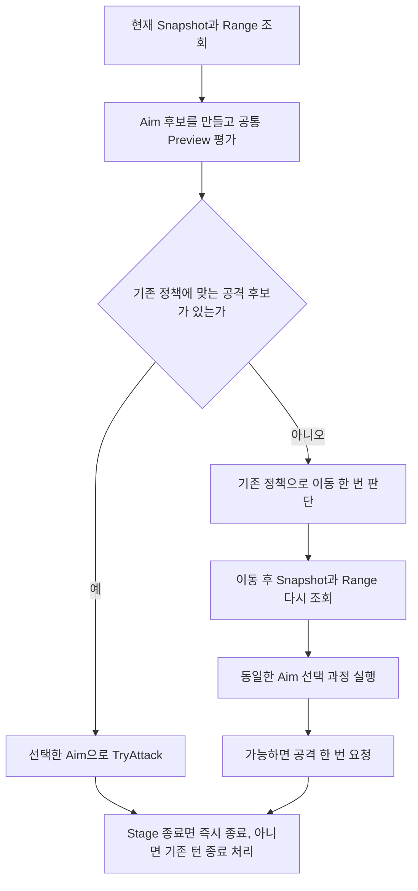

공격/이동 직후 Stage 종료가 확인되면 다음 조회나 공격으로 진행하지 않고 기존 CompletedByStageEnd 경로로 빠집니다. 그림은 기존 한 턴 흐름의 연결 지점을 보여 주며 공격 실패 시의 기존 처리는 유지합니다.

Cannon 후보 중심은 Query가 준 유효 셀에서 만듭니다. 각 중심을 Preview하여 유효 피해량 합계, 피격 대상 수, y/x 순서로 비교하는 기존 Category 계획을 따릅니다. 자체 피해 공식을 AI에 만들지 않습니다.

앞 Step 10-2의 간단한 Policy 함수 선언 형태에는 gateway 인자가 없습니다. 따라서 그 함수 안에서 갑자기 Preview를 호출할 수는 없습니다. **TurnService가 이미 받은 `combat` gateway로 후보별 Preview를 얻고, Policy에는 비교에 필요한 후보·평가 결과를 전달하도록 입력을 보완합니다.** 이는 내부 보조 함수 연결이며 공개 공격 계약을 바꾸지 않습니다. 함수 선언 예시에 입력이 부족하면 이 역할 분담에 맞춰 완성합니다.

이동 전 Range를 이동 후 공격에 재사용하지 않습니다. 시작 시 후보가 없어도 이동 후에는 후보가 생길 수 있기 때문입니다. 반대로 합법 후보가 없다는 이유로 같은 자리에서 Preview를 무한 반복하지 않습니다.

## 완료 체크리스트

- [ ] Entity 호환과 새 Cell/Direction 입력이 한 Plan 경로를 사용합니다.
- [ ] 합법 빈 셀 공격은 성공/비용 소비가 가능하고 Entity 빈 ID는 거부됩니다.
- [ ] Timeline revision 실패가 HP/AP 변경 전에 발견됩니다.
- [ ] 이동 체크포인트와 Rider 환급이 두 번 적용되지 않습니다.
- [ ] Query/Preview/실행/AI가 Method 6 모서리를 동일하게 처리합니다.
- [ ] 기존 `CombatTraitAtomicityTests`, `StageCombatMovementCheckpointTests`, `StageEnemyAiTurnTests`, 승패 통합의 관련 사례를 확인합니다.

전체 흐름: `Facade 요청 → UnitAttackService Plan → 공격+Timeline preflight → Commit → 승패 → Snapshot/Result → AI 또는 View`.

<a id="task7"></a>
# Task 7 — Unity 데이터와 화면 담당자에게 변경 내용 전달

## 이번 Task에서 완성할 것

Plan의 Unity 담당 경계를 따라 변경 내용을 인계합니다. 아래 파일은 **담당자가 수정할 대상**이며 이 가이드가 Core 담당자에게 새 수정 권한을 부여하지 않습니다. Step별로 어떤 데이터를 전달받아 무엇을 연결할지 정리합니다. 공통 외부 경계는 [P2](#snapshot), [P4](#aim)를 참조합니다.

## Step 1 — UnitDefinitionSO.cs

**이 파일에서 만들 결과:** Unity 담당자가 자산별 기존 값을 새 값으로 바꿀 수 있는 표를 전달합니다.

**인계 대상 수정 파일:** `Assets/Scripts/ProjectL/Unity/Data/ScriptableObjects/Unit/UnitDefinitionSO.cs`.

### Step 1-1 — 저장 값 대응표 제공

**이번 단계의 목표:** 자산별 구 값·새 값·방어력·미변환 이유를 적어 전달하세요. 표만 보고 무엇을 바꿀지 알 수 있어야 합니다.

구 enum 숫자, 새 의미, PhysicalDefense, 기본 비용, 기존 local cells를 표로 전달합니다. 구 4/8을 새 enum으로 직접 읽으면 어떤 데이터가 바뀌는지 자산별로 표시합니다. D1에 해당하는 비용 필드는 이름만 바꾸지 않습니다.

### Step 1-2 — 저장/재로드 확인 항목

**이번 단계의 목표:** 저장·재로드 후 값과 공격 모양을 확인할 항목을 전달하세요. 실제 자산 수정 완료 여부는 담당자의 결과로 구분합니다.

필드 rename과 enum 숫자 변경은 별개입니다. serialized 필드 이름 보존만으로 enum 의미가 보존되지 않습니다. 담당자는 매핑 후 기존 자산을 저장/재로드하여 값과 실제 범위 모양을 확인해야 합니다.

## Step 2 — UnitSpecAdapter.cs

**이 파일에서 만들 결과:** SO에서 새 UnitSpec까지 값을 넘기는 Adapter 수정 내용을 인계합니다.

**인계 대상 수정 파일:** `Assets/Scripts/ProjectL/Unity/Adapter/Unit/UnitSpecAdapter.cs`.

### Step 2-1 — 변환 경로 연결

**이번 단계의 목표:** 담당자가 방어력과 변환된 공격 설정을 UnitSpec에 넘기도록 수정 위치·인자를 전달하세요.

담당자는 SO 값 → 구/신 데이터 매핑 → 새 AttackPattern/Impact 설정 → UnitSpec 생성 순서로 Adapter를 수정합니다. UnitSpec 생성 호출에 SO의 PhysicalDefense를 전달하고, 구 CreateDirectionalPattern 입력은 Task 1 Step 2-3에서 확장형 모양을 확인한 뒤 CreateForwardExpanding(range) 입력으로 바꿉니다. 변환이 끝난 Adapter는 옛 셀 배열을 새 AttackPattern에 전달하지 않습니다. 전투 피해 계산을 Adapter에 넣지 않습니다.

<a id="hint-unity-adapter"></a>
#### 힌트 — 인계할 내용을 한 호출의 전후로 적기

이 파일은 Unity 담당자에게 전달할 수정 대상입니다. 인계 메모에는 ‘구 CreateDirectionalPattern에 셀 배열 전달’이 ‘검사한 Range로 CreateForwardExpanding 호출’로 바뀐다고 적으세요.

```csharp
AttackPatternSpec pattern =
    AttackPatternSpec.CreateForwardExpanding(convertedRange);
```

convertedRange는 Task 1 Step 2-3의 검사로 얻은 값입니다. 잘못된 구 셀 데이터는 그 검사에서 수정 대상으로 남깁니다. Adapter는 생성한 pattern과 SO의 PhysicalDefense를 UnitSpec에 넘기면 됩니다. 이 힌트만 보고 구 배열에서 최댓값만 구해 바로 통과시키지 마세요.

## Step 3 — UnitAuthoringValidator.cs

**이 파일에서 만들 결과:** Unity의 입력 검사도 Core의 공통 공격 조합 검사를 사용하도록 인계합니다.

**인계 대상 수정 파일:** `Assets/Scripts/ProjectL/Unity/Data/Validators/UnitAuthoringValidator.cs`.

### Step 3-1 — 중복 지원표 제거

**이번 단계의 목표:** 기존 두 조합 전용 검사를 공통 함수 호출로 바꿀 위치와 오류 표시 기준을 전달하세요.

현재 Radial/DirectionalPattern 전용 검사를 새 공통 공격 조합 검사 호출로 교체할 위치를 인계합니다. enum의 존재 여부, 직접 입력한 데이터 형식, 실제 지원 조합의 오류를 구분해서 표시합니다.

## Step 4 — CombatInput.cs

**이 파일에서 만들 결과:** 드래그로 고른 셀·대상·방향이 미리보기와 실행에 그대로 전달되도록 인계합니다.

**인계 대상 수정 파일:** `Assets/Scripts/ProjectL/Unity/Adapter/Input/Features/Combat/CombatInput.cs`.

### Step 4-1 — 드래그의 세 시점 연결

**이번 단계의 목표:** DragStart·DragEnter·DragEnd에 연결할 조회·Preview·TryAttack 호출을 전달하세요.

DragStart: GetAttackRange 결과 표시. DragEnter: hover 셀/Entity와 선택 Direction으로 AttackAim 생성 후 Preview. DragEnd: 동일한 선택을 TryAttack으로 전달합니다.

### Step 4-2 — 모호한 방향 입력 처리 인계

**이번 단계의 목표:** 방향 후보가 여럿일 때 입력으로 선택한 방향을 다시 보내도록 UI 담당자에게 전달하세요.

복수 후보 Preview에서는 후보 방향을 보여 주고 입력에서 명시 방향을 결정해 다시 전달합니다. 목록의 첫 방향으로 실패를 숨기지 않습니다. UI의 구체 선택 장치 자체는 View 담당 구현입니다.

<a id="flow-input-handoff"></a>
#### 부연 설명 — View 담당자에게 넘길 드래그 처리 흐름

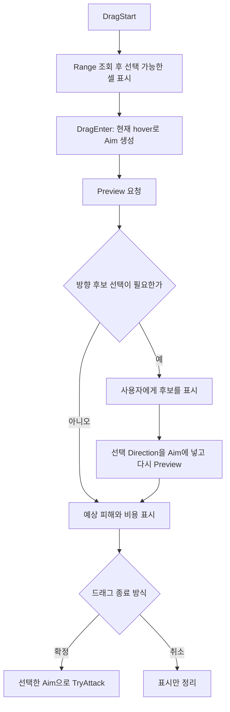

인계할 핵심은 ‘화면에 띄운 선택’과 ‘실제로 보낸 선택’이 같아야 한다는 것입니다. Right를 선택해 Preview했다면 DragEnd에서도 그 Direction을 포함한 Aim을 전달합니다. 최종 성공 여부는 실행 결과로 갱신합니다. 실패하거나 선택이 불완전한 Preview를 이전 성공 표시로 남겨 두지 않습니다.

이 절은 Input/View 담당자의 구현 설명입니다. Core 쪽 완료 여부와 화면 연결 완료 여부는 기존 Task 7 체크리스트에서 따로 기록합니다.

## Step 5 — CombatTargetingInfo.cs

**이 파일에서 만들 결과:** 표시할 셀·피해·비용을 어느 결과에서 읽을지 정리합니다.

**인계 대상 수정 파일:** `Assets/Scripts/ProjectL/Unity/View/Combat/CombatTargetingInfo.cs`.

### Step 5-1 — 표시 데이터 매핑

**이번 단계의 목표:** 화면 항목별 Result·Preview 필드 대응표를 전달하세요. 담당자가 새 계산 없이 받은 값을 표시할 수 있으면 됩니다.

표시 데이터의 출처를 `전체 지정 셀 → AttackRangeResult.RangeCells`, `금지 셀 → AttackRangeResult.BlockedAppointCells`, `선택 효과 셀 → AttackPreview의 효과 셀 배열`로 매핑하여 전달합니다. 마지막 필드명은 Task 6에서 구현한 실제 계약명을 인계 표에 적습니다. 예상 HP와 비용은 AttackPreview에서 읽습니다. UI가 Shape/방어 공식을 중복 계산하지 않게 합니다.

## Step 6 — CombatDebugOverlay.cs

**이 파일에서 만들 결과:** 디버그 화면의 기본 수치와 이번 공격 예상값을 구분해 인계합니다.

**인계 대상 수정 파일:** `Assets/Scripts/ProjectL/Unity/View/Combat/CombatDebugOverlay.cs`.

### Step 6-1 — 기본/실효 값의 표시

**이번 단계의 목표:** 방어력·기본 비용·예상 비용의 출처와 방향 표시 수정 위치를 전달하세요.

UnitStatsSnapshot의 PhysicalDefense와 기본 비용, AttackPreview의 예상 비용을 구분해 표시합니다. 새 방향 enum을 Rotation4로 직접 cast하는 UI 코드를 찾아 인계합니다.

## 완료 체크리스트

- [ ] 파일별 필드/API 변경과 미변환 자산 목록이 제공되었습니다.
- [ ] Core 완료와 Unity 플레이 연결 완료가 구분되어 있습니다.
- [ ] 드래그 취소는 상태를 바꾸지 않고 실행은 원 선택을 전달합니다.
- [ ] 기존 View Boundary 검사에서 Domain 객체 노출이 추가되지 않았습니다.

전체 흐름: `SO → Adapter → UnitSpec → Core → Snapshot/Preview/Result → Input/View`. 실제 구현된 계약만 인계 완료로 표시합니다.

<a id="task8"></a>
# Task 8 — 정리한 Core를 InGame에 연결할 준비

## 이번 Task에서 완성할 것

이 Task는 Plan의 Framework 이전 연결 지점입니다. Task 1~7에서 Framework 기반을 먼저 구현하지 않습니다. B 완료 상태를 기준으로 아래 파일별 인계/연결 준비를 진행하고, 실제 그룹·소유자 생명주기 구현은 Framework 이전 설계 (Git 이력: `2026-09-12-core-ingame-framework-migration-design.md`)의 범위를 따릅니다.

**중요한 현재 차이:** 타입 `FrameworkRuntimeFactory`는 `FrameworkRuntimeFactory.cs`가 아니라 `Factory/RunTime/RunTimeSystemFactory.cs`에 있습니다. 현재 서비스 Reader 이름도 기존 InGame 소스에서는 ISystemReader입니다. 설계의 용어와 실제 API가 다르면 실제 등록 API로 연결하며 별도 Store를 발명하지 않습니다.

## Step 1 — StageSession.cs

**이 파일에서 만들 결과:** Framework가 사용할 기존 Session 함수를 정리합니다.

**Core 공개 경계 확인 파일:** `Assets/Scripts/ProjectL/Core/Application/StageRun/StageSession.cs`.

### Step 1-1 — 외부에 줄 기능과 내부 소유를 구분

**이번 단계의 목표:** 아래 Snapshot·대기 유닛 생성 함수와 기존 Combat Facade를 연결 대상으로 적으세요. View에 State를 직접 반환하는 함수는 추가하지 않습니다.

```csharp
public StageSnapshot GetSnapshot();
public bool TryGetEntitySnapshot(EntityId entityId, out EntitySnapshot snapshot);
public EntitySnapshot CreatePlayerReserveUnit(EntityKey unitKey, int reserveSlotIndex);
```

이 기능을 Stage 서비스가 호출하게 합니다. Session/UnitState 자체를 View에 돌려주는 새 API를 만들지 않습니다. Combat 호출은 현재 Facade를 재사용한다([P6](#framework)).

## Step 2 — InGameCoreOwner.cs

**이 파일에서 만들 결과:** Framework 이전 시 같은 전투 상태를 공유하고 생성·해제하도록 연결합니다.

**이전 단계 신규 예정 파일:** `Assets/Scripts/Framework/RunTimeSystem/InGameSystems/InGameCoreOwner.cs`  
**타입:** 이전 설계의 `internal sealed class` 소유자.

### Step 2-1 — 공유할 상태를 인계한다

**이번 단계의 목표:** Stage 관련 서비스가 같은 Session·Map·Entities·Timeline을 사용하게 구성하세요. 실제 구현은 Framework 이전 단계에서 진행합니다.

Stage 슬롯은 같은 Session/Entities/Map/Timeline을 소유해야 합니다. StageMap과 Architecture는 별도 슬롯입니다. Stage/Deployment/Combat/Timeline용으로 UnitFactory를 각각 호출하여 다른 Stage를 만들지 않습니다.

### Step 2-2 — 생성·해제·종료 시 할 일 연결

**이번 단계의 목표:** Configure 성공 후 슬롯 연결, Release 정리, Shutdown 접근 차단을 이전 설계대로 구현하세요. 이 처리는 UnitState에 넣지 않습니다.

Configure는 임시 객체 그래프 완성 후 슬롯 연결, Release는 슬롯 정리, Shutdown은 모든 슬롯과 캐시된 서비스 접근 차단입니다. 이 생명주기를 UnitState에 구현하지 않습니다. 구체 Configure DTO는 Framework 이전 단계의 입력 계약으로 결정하고 이 가이드에서 새 DTO를 추가하지 않습니다.

## Step 3 — ICombatSystemService.cs

**이 파일에서 만들 결과:** Framework의 공격 서비스가 최신 Core 공격 함수를 호출하도록 연결합니다.

**이전 단계 신규 예정 파일:** `Assets/Scripts/Framework/RunTimeSystem/InGameSystems/ICombatSystemService.cs`  
**타입:** 이전 설계의 `public interface`, Framework 서비스 계약 상속은 해당 설계 준수.

### Step 3-1 — 바뀐 Core 계약을 그대로 전달

**이번 단계의 목표:** 아래 공격 조회·미리보기·실행 함수를 노출하고 같은 Stage의 Facade로 전달하세요. 실제 연결은 Framework 이전 단계에서 진행합니다.

공격 부분은 다음 반환형/입력을 사용합니다.

```csharp
AttackRangeResult GetAttackRange(EntityId attackerId);
AttackPreview PreviewAttack(EntityId attackerId, AttackAim aim);
AttackResult TryAttack(EntityId attackerId, AttackAim aim);
```

구 Entity overload 호환도 같은 Core 변환 경로에 연결합니다. 실행 래퍼는 Owner의 같은 Stage 슬롯에서 Facade를 얻어 호출합니다. 범위 계산을 여기서 복사하지 않습니다.

<a id="hint-framework-forwarding"></a>
#### 힌트 — Framework 서비스는 요청을 기존 Facade로 전달한다

Framework 이전 단계에서 작성할 서비스 본문의 핵심 호출은 다음과 같습니다. `combatFacade`는 Owner가 관리하는 현재 Stage 슬롯에서 가져온 Facade입니다.

```csharp
return combatFacade.TryAttack(attackerId, aim);
```

이 호출 앞에서 현재 Stage가 준비됐는지 기존 생명주기 규칙대로 확인합니다. 반환된 AttackResult는 그대로 전달합니다. 범위 셀을 다시 계산하거나 새 UnitAttackService·StageSession을 매 호출마다 만들지 않습니다. 실제 Owner 조회·해제 후 접근 차단은 Framework 이전 설계에 맞춰 연결합니다.

## Step 4 — InGameSystemGroup.cs

**이 파일에서 만들 결과:** 비어 있는 InGame 그룹에 기능 서비스를 연결합니다.

**이전 단계 수정 파일:** `Assets/Scripts/Framework/RunTimeSystem/InGameSystems/InGameSystemGroup.cs`  
**현재 선언:** 같은 파일에 `public interface IInGameSystemGroupService`, `internal class InGameSystemGroup`.

### Step 4-1 — 빈 그룹을 실제 서비스 그룹으로 연결

**이번 단계의 목표:** Framework 이전 단계에서 서비스 프로퍼티와 Export를 구현하세요. 그룹에서 각 기능 서비스를 조회할 수 있어야 합니다.

Framework 이전 단계에서 현재 빈 인터페이스에 이전 설계의 Stage/Deployment/Combat/Timeline/StageMap/Architecture 서비스 프로퍼티를 추가합니다. 그룹 생성 시 Owner를 공유하는 서비스들을 연결하고 `public override void ExportServices(ISystemWriteSink sink)`에서 기존 등록 API로 그룹 서비스를 내보내도록 작성합니다. 완료 후 그룹 조회로 각 기능 서비스에 접근할 수 있어야 합니다.

### Step 4-2 — 기존 그룹에 초기화와 종료 연결

**이번 단계의 목표:** 기존 InGame 그룹 이름을 유지하고 초기화·종료 전달을 이전 설계대로 연결하세요. UnitState 자체를 서비스로 등록하지 않습니다.

새 CoreSystemGroup으로 이름을 바꾸거나 UnitState를 모듈로 등록하지 않습니다. 이 파일의 초기화/종료 전달 순서는 이전 설계에 맞춰 조립 담당 단계에서 구현합니다. Core 계산 검증만으로 이 단계가 완료됐다고 하지 않습니다.

## Step 5 — InGameSystemFactory.cs

**이 파일에서 만들 결과:** InGame 서비스들을 만들고 같은 Owner에 연결하는 Factory를 작성합니다.

**이전 단계 신규 예정 파일:** `Assets/Scripts/Framework/Factory/RunTime/SystemFactory/InGameSystemFactory.cs`  
**타입:** 기존 Factory 패턴을 따르는 static Factory.

### Step 5-1 — 실제 Factory 예제에 맞춰 조립

**이번 단계의 목표:** 기존 Factory 방식대로 생성·등록·Reader 구성·그룹 반환을 연결하세요. 이 작업은 Framework 이전 단계에서 진행합니다.

현재 UtilitySystemFactory처럼 하위 Builder 준비 → Owner/기능 서비스 구성 → 등록 → 한 번 Build → 그룹 생성 → Export 가능한 결과 반환 순서로 연결합니다. 구체 반환 계약은 실제 `IExportSystemServices` 패턴과 이전 설계를 맞춰 적용합니다.

### Step 5-2 — 게임 데이터 공급과 분리

**이번 단계의 목표:** Factory는 서비스 객체를 만들고 실제 Stage 데이터는 Configure가 받도록 나누세요.

Factory 생성 시 서비스 객체를 등록하고, 실제 Stage 데이터는 Configure로 공급합니다. UnitCatalog를 등록하기 위한 별도 전역 Catalog 서비스는 만들지 않습니다.

<a id="flow-framework-wiring"></a>
#### 부연 설명 — Framework Factory에서 조립하는 것과 Configure에서 받는 것

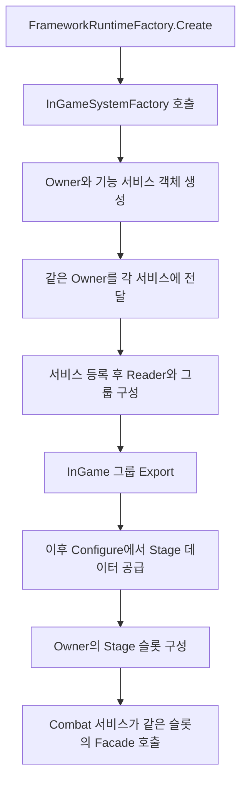

Factory에서는 서비스를 연결하고, Configure에서는 실제 스테이지 데이터를 넣습니다. 예를 들어 Combat과 Timeline 서비스를 만들 때 각각 새 StageSession을 생성하면 서로 다른 전투를 보고 있게 됩니다. 두 서비스는 같은 Owner가 관리하는 Stage 슬롯을 사용해야 합니다.

이 단계에서 새로 작성하는 것은 조립과 호출 연결입니다. 공격 처리 본문은 [Facade 흐름](#flow-facade)을 호출합니다. 실제 생명주기·등록 계약은 Framework 이전 설계의 범위이며, 앞 Task의 UnitState 생성자에 서비스 등록 코드를 넣지 않습니다.

## Step 6 — RunTimeSystemFactory.cs

**이 파일에서 만들 결과:** 전체 Framework 생성 과정에 InGame Export를 추가합니다.

**이전 단계 수정 파일:** `Assets/Scripts/Framework/Factory/RunTime/RunTimeSystemFactory.cs`  
**타입:** 실제 `internal static class FrameworkRuntimeFactory`.

### Step 6-1 — 실제 조립 함수에 연결

**이번 단계의 목표:** 최종 BuildSystemReader 이전에 InGame Export를 호출하세요. 기존 Runtime 생성 흐름에서 그룹이 등록되어야 합니다.

```csharp
public static FrameworkRuntime Create();
```

Framework 이전 단계에서 `Create()`의 Render/Utility/Input/UI Export 다음에 InGameSystemFactory 결과의 Export 호출을 추가하고, 그 다음 기존 BuildSystemReader를 실행하도록 수정합니다. 닫힌 Builder에 뒤늦게 등록하거나 별도 FrameworkRuntime을 만들지 않습니다.

## Step 7 — SystemGroupsService.cs

**이 파일에서 만들 결과:** 등록한 InGame 그룹을 찾을 수 있는 키를 추가합니다.

**이전 단계 수정 파일:** `Assets/Scripts/Framework/SystemBase/SystemKey/SystemGroupsService.cs`  
**타입:** 현재 `public static class SystemGroupsService`.

### Step 7-1 — 그룹 키 추가 위치

**이번 단계의 목표:** 기존 그룹 키들과 나란히 InGame 키를 추가하세요. 하위 키는 이전 설계의 InGameSystemServiceKey를 사용합니다.

현재 Render/Utility/Input/UI와 나란히 InGame 키를 추가합니다. 하위 키는 이전 설계의 InGameSystemServiceKey로 정리합니다. 기존 키 생성자 접근 제한을 넓히지 않습니다.

## 완료 체크리스트

- [ ] 최신 Core 직접 호출과 InGame 호출이 같은 입력에서 같은 Result/Snapshot을 냅니다.
- [ ] 같은 Stage 슬롯을 공유하고 Configure 실패가 불완전 슬롯을 남기지 않습니다.
- [ ] Release/Shutdown 및 캐시 서비스 접근 차단을 이전 설계대로 확인합니다.
- [ ] 기존 Unity Host와 InGame이 동시에 실제 게임 상태를 만들지 않습니다.
- [ ] Framework 문서의 “기존 동작 보존”을 개편된 최신 Core 기준으로 인계합니다.
- [ ] Framework asmdef의 Core 참조와 실제 Factory 경로 검증은 이전 작업 완료 조건에 포함합니다.

전체 흐름: `FrameworkRuntimeFactory → InGameSystemFactory → 공통 Owner/그룹 → Combat 서비스 → 기존 Facade → 새 Core 규칙 → 같은 Result/Snapshot`.

# 구현을 진행하며 표시할 상태

완료 체크리스트를 체크할 때 Task 전체를 완료/미완료 두 개로만 나누지 않아도 됩니다. 예를 들어 Task 5는 “방어 데이터 전달 완료 / 피해 공식 연결 D2 대기”로 기록하면 다음에 돌아올 위치가 명확합니다.

이 문서에서 반복하지 않은 원칙이 필요하면 [공통 절](#common), 기획이 더 필요한 부분은 [P7](#pending), 세부 구현 기준은 원본 Plan (Git 이력: `2026-09-12-unit-state-pre-framework-refactor.md`)을 확인합니다. 이 가이드의 첫머리에 적은 최신 변경 결정은 원본 계획의 해당 설명보다 우선합니다. 나머지 기준은 원본 계획을 따릅니다. 이 문서는 실제 코드 구현을 끝냈다는 기록이 아닙니다.
