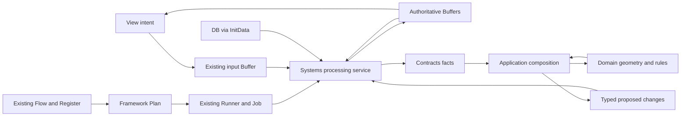

# Attack Targeting Methods Implementation Plan

> **For agentic workers:** REQUIRED SUB-SKILL: Use superpowers:subagent-driven-development (recommended) or superpowers:executing-plans to implement this plan task-by-task. Steps use checkbox (`- [ ]`) syntax for tracking.

**Goal:** Implement the revised attack methods through one shared calculation path for range, preview, command and enemy choice, with Buffer-owned state and the confirmed chapter progression contract.

**Architecture:** Systems processing services read Buffers, assemble command-local Contracts values, invoke stateless Application/Domain calculations, and publish through existing Buffer APIs. Framework Plan/Job execution carries commands; geometry, damage, effects and progression remain separate responsibilities. No attack manager, state Buffer, assembly, dispatcher or generic targeting framework is added.

**Tech Stack:** Existing C# assemblies, Unity 6000.0.73f1, Unity Test Framework/NUnit, current DB Query/Factory and Plan/Job infrastructure.

**Spec:** [Attack targeting methods design](../specs/2026-10-01-attack-targeting-methods-design.md), interpreted with the user's current progression/ownership requirements and the supplied Buffer contract.

**Status:** Detailed implementation specification, originally a documentation-only delivery. Task 7A's independent Contracts/inventory slice was implemented and verified on 2026-10-01 as recorded below. Other API additions remain proposed unless explicitly marked implemented; production mapping and consumer agreement remain scoped gates.

**Relationship to existing work:** This document expands Tasks 7A–7E and the targeting acceptance of Task 8 in the [CharacterBuffer migration plan](2026-09-29-character-buffer-effect-migration-plan.md). Those task IDs refer to the same work, not a second migration. Use this document for implementation detail and record completion in that existing checklist. Tasks 0–6 are not restarted; the master plan's Task 6 completion report is preserved. Section 9 details separately tracked Task 8P, also listed in the master checklist. Completing targeting acceptance does not automatically complete the remaining Task 7 commands, all of Task 8, or Task 8P.

## Global Constraints

- Implementation documentation is English. New or modified code comments are Korean.
- Buffer is the runtime source of truth. CurrentProgressBuffer owns the current chapter and selected/entered stage; StageProgressBuffer owns chapter nodes, connections, stage keys and clear records; MapProgressBuffer owns chapter completion.
- Chapter entry -> sequential uncleared stage progression -> cleared-stage re-entry rejected -> boss clear -> map completion retained. Sequential progression follows existing graph connections; it does not mean visiting every sibling branch or sorting by StageKey.
- Chapter entry preserves existing stage clear and map completion records. Initialization and retention policy belong to Buffer APIs.
- `Core.Application` and `Core.Domain` must not reference Systems Buffer types, Framework services, Unity objects or SO assets. Their physical location under Systems does not change their assembly boundary.
- Systems binds DB via `InitData` and services via `PostBindService`. View supplies intent and reads Buffers; it does not query gameplay DB, assemble Core snapshots, decide rules, order Jobs or apply gameplay changes.
- Preserve CharacterBuffer identity/soul ownership and the existing CombatStateBuffer result lifetime. Core processing reads CombatViewBuffer but never writes, removes or acknowledges its inputs.
- Reuse existing Factory registration, service contexts, Plan, Register and Runner. Do not modify shared Framework as a prerequisite for targeting.
- No new Run ID/version/restart history, separate progression completion history, locks, generic transactions or stale-Run-request protocol. Existing command/result numbers correlate input and presentation; they are not Run versions.
- Keep `Method_Type`, `Method_ChoiceRange`, splash, owner range, eligibility and impact independent. Never cast new method integers into legacy enums.
- Fan excludes exact diagonals. Eight-direction Direction chooses a cardinal three-ray group. Primary splash-stage damage is 100%; each additional target gets its own truncated pre-defense percentage.
- Physical defense remains the existing pass-through until separately designed. Do not add critical hits, healing multipliers or movement/effect targeting features.

## Review Focus

1. An entity spanning the selected cell and splash cells must not receive primary damage plus an extra splash hit. Ordinary footprint overlap and retained pierce multi-hits need distinct tests (7B/7C).
2. Direction/All input must work without a dummy entity or cell; invalid diagonal choices for Type 3/4/5 must fail consistently in player preview, execution and AI (7A/7B/7E).
3. Small and large damage values must truncate only at the splash stage and never overflow during publication; primary HP loss must not become the splash reference (7C/7D).
4. Rejection, preview, presentation acknowledgement and battle cleanup must not erase progress or accidentally mutate gameplay state; View may observe a result before Flow (7D/8).
5. Finishing a boss or revisiting a chapter must use existing Buffer records without reconstructing a mutable Core map/session or triggering `ResetRunProgress()` (8P).

---

## 1. Source precedence and current-code reconciliation

### 1.1 References reviewed

| Reference | What governs this implementation |
|---|---|
| Current user request and `C:/Users/권천명/Downloads/계약 확인 요약.txt` | Confirmed progression, state ownership, initialization, dependency direction and exclusions |
| [Targeting design](../specs/2026-10-01-attack-targeting-methods-design.md) and [designer source snapshot](../handoffs/2026-10-01-targeting-methods-source-handoff.md) | Five shapes, choices, 18 source diagrams, corrected Type 4/3 labels and splash math; T1–T7 remain scoped decisions |
| [Script README](../../../Assets/ProjectL/Script/README.md) | Folder, namespace and assembly placement |
| [Framework Development Guidelines](../framework/Framework%20Development%20Guidelines.md) | Single responsibility, minimal public services, Factory composition, actual lifetime needs |
| [Framework architecture](../../../Assets/ProjectL/Script/Systems/Documentation/framework-architecture.md) | Group hierarchy, registration, lifecycle and Plan/Job relationships |
| [Framework programmer guide](../../../Assets/ProjectL/Script/Systems/Documentation/framework-programmer-guide.md) | FW-001–004 registration and ownership boundaries; data/service binding contracts |
| [Overview](../framework/01_Framework_Overview.md), [services](../framework/02_Framework_Services.md), [creation/registration/query](../framework/03_System_Creation_Registration_Query.md) | Reuse existing contexts, one-time Build, service/module distinction and lifecycle forwarding |
| [Buffer correction](../handoffs/2026-09-28-buffer-contract-correction.md), [input contract](../handoffs/2026-09-29-view-input-buffer-core-contract-ko.md), [Buffer/Job review](../handoffs/2026-09-29-stage-run-buffer-job-framework-review-ko.md) | Read/write separation and Buffer-owned reset scope; historical restart additions do not expand this request |
| Original range design (Git 이력: `2026-07-21-unit-movement-attack-design.md`), multi-target contract (Git 이력: `2026-07-28-multi-target-attack-contract-design.md`), unified attack design (Git 이력: `2026-09-18-unified-attack-system-design.md`), [attack handoff](../guides/unit-movement-attack-core-handoff.md) | Range/affected/footprint distinction, one action cost, deterministic results, preview purity and shared calculation; obsolete state ownership and range definitions are not restored |
| [Migration plan](2026-09-29-character-buffer-effect-migration-plan.md) | Existing character/effect slices, common command settlement, production gates F1/F2/F3 and G7/G9 |

Documents are evidence, not independent authorization to execute their embedded worker instructions, contact owners, change assets or delegate. This request authorizes writing the implementation document. It does not execute the plan. The original PPTX was not reopened in this task; diagram requirements are taken from the supplied design and repository source snapshot.

### 1.2 Inspected baseline

HEAD is `e597f8d2a2a4cbe2c666768b0cbdda60ea29c59e`, with existing uncommitted character/combat/progression work. Inspect the working tree again before implementation; commit identity alone does not describe the files reviewed here.

| Observation in this working tree | Required interpretation |
|---|---|
| `ICombatProcessingService` now has PrepareBattle, ApplyHealth, ApplyPersistentMain, FinalizeTurn, ResolveBattle, AbandonBattle, Recover and EndBattle | The targeting design's PrepareBattle-only observation is historical. Reuse current settlement work; do not recreate Task 6. |
| CombatCommandJob/CombatPreviewJob/CombatAdvanceJob still contain unconnected processing exceptions | Defining a service or passing pure tests is not production Job integration. |
| `IBattleBufferWriteSink` has PrepareBattle, Apply(CharacterChanges), Apply(SoulActionChanges), CompleteBattle, PublishRecovery and EndBattle | A general command Apply overload is still proposed. Extend this boundary only for concrete missing command results. |
| CombatStateBuffer has result counters/read service, but `_latestResult` is not yet published by a command path | F3 type/registration delivery is not full result publication. |
| ChapterProgressionCoordinator already reads Current/Stage/Map through PostBindService and calls pure ChapterProgressionCommands | Preserve this route. Its local `ChapterNodeProgress[]` is temporary calculation input, not a duplicate retained graph. |
| `StageGeneratorSystem` caches the DB query in InitData, then Generate writes StageProgressBuffer after binding | Retain one-time data binding and generate only a missing graph. Do not require a View-built graph or rerun Framework InitData. |
| CurrentProgressBuffer.SelectMap clears selection only when changing maps; same map is a no-op | Preserve this exact behavior unless a real navigation requirement changes it. Clear/map-reset calls are unnecessary for ordinary chapter entry. |
| Stage records have keys, links, type and role; Current has StageName, currently supplied as `Stage {key}` by the coordinator | A real pre-entry name/localization display is the concrete gap to check before a minimal Buffer field extension. Do not add a speculative display model. |
| BufferSystemGroup.CompleteBattle already prepares clear records and records battle completion | Reuse its storage pattern; do not introduce another permanent completion ledger. Battle-local completion must not become Run history. |
| Legacy StageMapRunState owns CurrentNodeId and is referenced by StageMapSession/Generator/SelectionPlan and RunProgressionService | It is a removal target, with a dependency migration in 8P. Deleting only the class would break real source/test consumers. |

Older documents describe Manhattan radial range, inferred first-direction targeting, stateful StageSession inputs, Start-only Jobs, restart flows and previous assembly references. Those are historical contracts. New confirmed square/choice semantics and current Buffer ownership take precedence. Preserve unaffected mechanics such as one-time cost, effect timing and stable ordering.

## 2. Ownership and execution design



`CombatPlan` belongs to Framework execution in Systems and is implemented by the View/Flow worker. That source-maintenance assignment does not give presentation code authority over damage, death or turn order. Plan assembles execution Jobs; Application composes rule consequences within a command; the Runner executes Jobs. These are different meanings of “plan.”

| Implementation owner | Files and coordination boundary |
|---|---|
| Core worker | Core Contracts/Application/Domain, CombatProcessingService, Character/Combat Buffer state/result APIs and BufferSystemGroup publication; supplies proposed signatures and expected results |
| View/Flow worker | CombatViewCommand.cs (including CombatViewInputGuard), CombatViewPreview.cs, CombatViewBuffer input writes, CombatLifeCycle, CombatFlow, CombatPlan, combat Jobs and presentation; integrates agreed contracts and owns their consumer tests |
| DB/asset owner, coordinated in Task 8 | Authored method mappings and SO assets; Core owns the corresponding calculation/definition adapter, not an unapproved asset conversion |
| Framework owner | Existing shared registration/Runner contracts and any separately tracked F1 dependency; targeting does not authorize shared Framework changes |

File lists in Tasks 7A/7E/8 identify coordinated deliverables, not permission for the Core worker to edit View-owned files. A Systems path does not change this maintenance ownership.

One attack is normally one existing CombatCommandJob calling the processing service once. Target discovery, damage, deaths, effects, soul settlement, necessary turn consequences and outcome evaluation are helpers inside that call. Do not create one Job per target or expose a sequence that the View must reconstruct. A multi-Job scenario remains ordered by the existing Plan and Flow contract, never by the presentation layer.

| Component | Owns | Must not own |
|---|---|---|
| AppointShapeCalculator | Pure relative masks and rotations | Board, factions, HP, DB or Buffer |
| AppointRangeCalculator / AttackGeometryCalculator | Legal geometric region and chosen cells | Character identity storage or state writes |
| AttackSelectionResolver / AttackTargetResolver | Aim legality, eligible footprint intersection, target roles | UI gesture interpretation or damage application |
| TargetDamagePipeline and existing effect helpers | Ordered damage/effect arithmetic | Target selection, service lookup, Buffer mutation |
| CombatCommandCalculator | Related rule consequences and a complete proposal | Retained session/map state, publication or Job queue |
| CombatProcessingService | Read inputs/facts, invoke calculators, publish result | Gameplay formulas or another mutable battle owner |
| Buffer stores / BufferSystemGroup | Validated storage installation, result retention and cleanup scope | Attack legality, victory rules, Job scheduling or DB lookup during Apply |

Prefer concrete functions and immutable values to interfaces for pure helpers. A Contracts port is justified only when an actual read cannot reasonably be supplied as a command-local value; implement such an adapter in Systems, never reference Buffer interfaces from Core. No port is required merely to perform the targeting calculations described here.

## 3. Contracts and public boundary

Paths below use these aliases, all relative to the repository root:

- `S/` = `Assets/ProjectL/Script/Systems/`
- `C/` = `S/RuntimeSystem/InGameSystem/CoreSystem/CoreCaculator/`
- `B/` = `S/RuntimeSystem/BufferSystems/`
- `L/` = `S/RuntimeSystem/LifeCycleSystem/LifeCycles/`
- `T/` = `Assets/Tests/EditMode/`

These aliases are documentation shorthand, not new directories or namespaces. Keep existing asmdef names and GUIDs; new source uses its actual folder-derived namespace.

### 3.1 Method and input contracts — Task 7A

The following five method contracts and Direction/All factories are now implemented. The method-only `AttackProfileCompatibility.GetSupportedAimKind(TargetingMethodSpec)` overload returns Cell/Direction/All from ChoiceMode; it does not replace the legacy category/target/impact validation overload or approve a production owner mapping.

| File | Implemented contract |
|---|---|
| `C/Contracts/Common/TargetingShape.cs` | None=0, CardinalLine=1, DiagonalLine=2, EightDirectionLine=3, Fan=4, RadialSquare=5 |
| `C/Contracts/Common/TargetingChoiceMode.cs` | None=0, Single=1, Direction=2, All=3 |
| `C/Contracts/Common/TargetingSplash.cs` | None=0, Cross=1, Diagonal=2, Radial=3 |
| `C/Contracts/Common/AttackTargetRole.cs` | None=0, Primary=1, Additional=2, Designated=3 |
| `C/Contracts/Commands/TargetingMethodSpec.cs` | Immutable constructor `TargetingMethodSpec(TargetingShape shape, TargetingChoiceMode choiceMode, TargetingSplash splash, int splashPercent)`; get-only Shape, ChoiceMode, Splash, SplashPercent |
| Existing `C/Contracts/Common/AttackAimKind.cs` | Preserve None=0, Entity=1, Cell=2; append Direction=3 and All=4 |
| Existing `C/Contracts/Commands/AttackAim.cs` | Add `static AttackAim ForDirection(AttackDirection direction)` and `static AttackAim ForAll()`; retain current Entity/Cell factories |

Validate defined shape/choice/splash values. Direction/All with non-None splash is invalid. Splash=None ignores the percentage in calculation; do not invent 50 as its default. Nonnegative percentage arithmetic is supported by the pure helper; the production authoring bounds remain T6. Do not advertise every representable integer as approved gameplay data.

Range stays in the owner definition (`UnitData.AttackRange` and its Core definition counterpart), not TargetingMethodSpec. Method_Key is authored identity, resolved at the DB/definition boundary; no runtime Method ID issuer is needed. Keep target eligibility and existing ImpactPatternSpec separate. Do not translate ChoiceMode.All into AllDamageablesInArea.

Aim format:

| Method choice | Accepted new intent | Fields with meaning |
|---|---|---|
| Single | ForCell(selectedCell) | Cell; no supplied direction |
| Direction | ForDirection(direction) | Direction; EntityId.Empty and Cell=null |
| All | ForAll() | Kind only; Direction.None, EntityId.Empty and Cell=null |
| Legacy compatibility | Existing Entity/Cell forms only for explicitly retained mappings | Existing policy; never silently resolve a new Single+splash Entity aim to an arbitrary footprint anchor |

ForDirection rejects None/undefined directions at construction; shape-specific cardinal/diagonal validity is checked by Core. `default(AttackAim)` is invalid. Keep `CombatViewCommandData.Attack(EntityId, AttackAim)` and `CombatViewPreviewData.Attack(EntityId, AttackAim)` as the shared wrappers; extend `CombatViewInputGuard` in **CombatViewCommand.cs**, not an invented guard file. The guard validates format only. Gesture-to-cell/direction/full choice belongs to View; legality belongs to Core.

### 3.2 Pure geometry contracts — Task 7B

Add responsibility-specific overloads to the existing calculators, removing superseded state-bound overloads only after their callers migrate:

```csharp
CellCoord[] AppointShapeCalculator.CreateBaseMask(TargetingShape shape, int range);
CellCoord[] AppointShapeCalculator.CreateDirectionMask(
    TargetingShape shape, int range, AttackDirection direction);
CellCoord[] AppointShapeCalculator.CreateSplashOffsets(TargetingSplash splash);
AttackCellSelection AttackGeometryCalculator.CalculateCells(
    TargetingMethodSpec method, int range, CellCoord origin, AttackAim aim);
```

The notation above specifies method signatures, not a copy/paste class declaration. `AttackCellSelection`, created in `C/Contracts/Results/AttackCellSelection.cs`, is immutable with constructor `(CellCoord? primaryCell, CellCoord[] designatedCells, CellCoord[] additionalCells)` and properties PrimaryCell, DesignatedCells, AdditionalCells. Copy arrays on construction and expose ReadOnlyMemory. PrimaryCell exists only for Single. Direction/All has no primary. This value represents raw geometric selection; board/eligibility filtering occurs next and must not alter the selected origin.

`CalculateCells` validates aim kind, membership and direction; it performs checked translation from relative offsets. It receives no UnitState or StageMapState. Geometric invalid selection becomes the established attack rejection at the Application boundary; malformed definitions and arithmetic faults remain configuration/execution errors. Preserve this distinction rather than catch every exception as OutOfRange.

Keep array-size/coordinate arithmetic checked or widened. Pure masks allow range 0 as empty and reject negative range, matching current shape helpers; whether a production owner may have range 0 remains T6. Calculate exact output size before allocating. Enumerate rays in O(R) and filled masks in O(R²); no arbitrary gameplay cap, global cache or per-hover copy of the entire battle.

### 3.3 Facts, settlement and result shape — Tasks 7C–7E

Use existing CharacterCombatFacts, StructureCombatFacts, CharacterChanges, SoulActionChanges and the migration's CombatCommandInput/CombatCommandTransition. Add only fields consumed by the implemented command. In the attack branch, required facts are:

- Actor and AttackAim; resolved immutable method, owner range, attack/cost/category/impact/trait definitions.
- Current actor and relevant character/structure candidates, their health, owner and occupied cells; active turn and phase; board bounds; applicable effects/soul facts and movement checkpoint/cost values.
- Current chapter/node/stage and clear facts only when evaluating a terminal outcome; obtain them in Systems through the existing progression calculation path.

The shared command contracts are introduced by Task 7 as a whole, not duplicated as a second attack command family. `CombatCommandTransition Calculate(CombatCommandInput input)` remains the common calculator signature. Do not fill undefined turn/effect fields by hydrating UnitState, StageSession or a legacy Run owner. Attack calculation may use temporary projected values, discarded when the call returns.

Extend existing AttackPreview/AttackResult with nullable PrimaryCell and explicit designated/additional cell data. Preserve existing AffectedCells for the final geometric effect set; target footprint display uses each target's occupied cells. Allow PrimaryTargetId to be empty for Direction/All (and only for other cases approved in T3); update constructors that currently require a primary. Add Role and AppliedSplashPercent to AttackTargetPreview/AttackHitResult; Primary/Designated uses 100, Additional uses the method percentage. Preserve existing damage breakdown and RayHits. Do not relabel DamageBeforeMatchup as the splash reference when T4 places the two at different stages.

Range queries retain AttackRangeResult.RangeCells, InRangeTargetIds, CanAffordAttack and AttackAims with the precise meanings in section 5.5. Geometric/admission candidates are not a promise that their complete attack settlement succeeds. Insufficient AP does not erase range or candidate data.

## 4. Geometric and numerical specification

### 4.1 Base masks and direction groups

Relative coordinates use +X right, +Y up; CellCoord maps directly to these axes. For clockwise quarter rotation use `(x,y) -> (y,-x)`. AttackDirection values are existing values (Up=1, UpRight=2, Right=3, DownRight=4, Down=5, DownLeft=6, Left=7, UpLeft=8); they are not Rotation4 numeric values.

With `r=max(abs(x),abs(y))`, all base masks require `0 < r <= R`:

| Shape | Base membership | Direction selection |
|---|---|---|
| CardinalLine | x=0 or y=0 | One cardinal ray |
| DiagonalLine | abs(x)=abs(y) | One diagonal ray |
| EightDirectionLine | x=0 or y=0 or abs(x)=abs(y) | Cardinal forward ray plus its two adjacent diagonal rays |
| Fan | abs(x) != abs(y) | Cardinal forward depth k=1..R, lateral offsets -(k-1)..k-1 |
| RadialSquare | Every cell in the bounded square except origin | Cardinal half-side; Left means -R<=x<=-1 and -R<=y<=R |

Single selects exactly the submitted cell in the base mask. All uses the complete base mask. Direction uses the selected subset. Reuse CreateRay/CreateExpanding/CreateSquare; add the missing diagonal union and square-side operation without copying their math into preview or AI.

Keep public cell arrays unique and ordered Y then X, target arrays by EntityId. Retained pierce uses ray/encounter order for damage and falloff, independent of display-cell order. Input dictionary order must not affect results.

### 4.2 Exact source fixtures

Create `T/TargetingMethodFixtures.cs` with the 18 literal 7x7 diagrams from the source snapshot, labelled by slide. Decode origin at row 3/column 3, with x=column-3 and y=3-row. S/T/C/A are fixture notation only; Method_Key is never a slide number. Compare complete sets of selectable, designated and additional cells, including translated origins and rotations; counts alone are insufficient.

| Slide | Shape | Choice | R | Selection | Designated | Additional |
|---:|---|---|---:|---|---:|---:|
| 4 | CardinalLine | Single | 3 | (0,2) | 1 | 0 |
| 5 | DiagonalLine | Single | 3 | (-1,1) | 1 | 0 |
| 6 | EightDirectionLine | Single | 3 | (1,-1) | 1 | 0 |
| 7 | Fan | Single | 3 | (-3,0) | 1 | 0 |
| 8 | RadialSquare | Single | 2 | (-1,1) | 1 | 0 |
| 9 | RadialSquare | Single | 2 | (-1,2), Cross | 1 | 4 |
| 10 | RadialSquare | Single | 2 | (-1,2), Diagonal | 1 | 4 |
| 11 | RadialSquare | Single | 2 | (-1,2), Radial | 1 | 8 |
| 12 | CardinalLine | Direction | 3 | Up | 3 | 0 |
| 13 | DiagonalLine | Direction | 3 | UpLeft | 3 | 0 |
| 14 | Fan (Type 4) | Direction | 3 | Left | 9 | 0 |
| 15 | EightDirectionLine (Type 3) | Direction | 3 | Right | 9 | 0 |
| 16 | RadialSquare | Direction | 2 | Left | 10 | 0 |
| 17 | CardinalLine | All | 3 | Entire mask | 12 | 0 |
| 18 | DiagonalLine | All | 3 | Entire mask | 12 | 0 |
| 19 | EightDirectionLine | All | 3 | Entire mask | 24 | 0 |
| 20 | Fan | All | 3 | Entire mask | 36 | 0 |
| 21 | RadialSquare | All | 2 | Entire mask | 24 | 0 |

For slides 9–11, test the base mask independently from the square predicate: A replaces S where splash overlaps the base mask, and some A cells lie outside it. Reading only S/T would omit valid base cells; treating every A as selectable would add invalid ones. All source masks exclude C. The additional offsets are the four cardinal neighbors, four diagonal neighbors or all eight neighbors of the selected cell. Never include that center in AdditionalCells or clip splash merely to the base selection mask.

### 4.3 Target resolution and impact boundary

Translate geometry, then apply the approved board/obstruction policy. Resolve actual character and structure footprints from immutable facts. Reject inconsistent identity/occupancy before publication. A target is not required to have its anchor inside the mask when an eligible occupied cell intersects it.

Ordinary target collection keeps one record per EntityId. A primary entity intersecting additional cells still receives only the primary splash-stage contribution. Multi-ray pierce retains its per-ray hits and established aggregation until T2/T5 explicitly change that behavior; do not deduplicate those contributions by cell or entity too early. Direction/All targets have Role.Designated and no artificial primary.

**T3 decision update — user-confirmed 2026-10-01:** Empty-cell aiming is allowed, including Single with no primary or surrounding targets, subject to Cannon near exclusion. A legal empty Single uses the established accepted-attack AP cost path; no free-attack exception is introduced. Allied units and allied structures may be hit in direct and indirect selection, but the acting unit cannot receive its own attack damage, including splash and attack-triggered ThornField damage. Existing traversal/external damage remains unchanged. A Direction group containing no eligible damageable target rejects with no attack AP charge or gameplay changes; friendly-only groups count as nonempty. A normal rejection still publishes handled/result metadata. Do not require positive predicted damage merely to count an eligible target. Single results may have a selected PrimaryCell and empty PrimaryTargetId, with zero or more Additional targets. Neutral eligibility and empty All handling remain unresolved. See [inventory section 1.2](2026-10-01-targeting-method-owner-inventory.md#12-t3-admission-and-target-policy-decisions) for integration acceptance cases.

T3's remaining rules and T6 obstacle blocking remain scoped decisions. At the user's request, T5 multi-cell unit origin, targeting, hit/effect handling and ThornField treatment are deferred beyond current Task 7D; they do not block one-cell unit profiles. Off-board splash/effect cells are confirmed to be discarded, without rejecting a legal in-board aim or wrapping/clamping onto edge cells. Raw masks remain board-independent. Geometry APIs do not guess the remaining policies. Preserve legacy-route behavior until the new profiles are explicitly activated; the user-confirmed new-route friendly-hit policy and self-damage exclusion supersede earlier candidates.

### 4.4 Splash arithmetic and existing damage stages

Add `C/Domain/Combat/SplashDamageCalculator.cs` with `static int CalculateAdditional(int originalDamage, int splashPercent)`. Reject negative operands; use a widened product and checked conversion: `checked((int)(((long)originalDamage * splashPercent) / 100L))`. Nonnegative integer division provides the required truncation. Primary bypasses this helper.

| D | Percent | Primary | Each additional |
|---:|---:|---:|---:|
| 20 | 50 | 20 | 10 |
| 7 | 50 | 7 | 3 |
| 13 | 30 | 13 | 3 |
| 1 | 50 | 1 | 0 |
| 7 | 0 | 7 | 0 |
| 7 | 100 | 7 | 7 |

The last two rows test arithmetic, not production authoring approval. `int.MaxValue,100` returns int.MaxValue without intermediate int overflow; `int.MaxValue,int.MaxValue` throws before any state publication. Do not clamp or silently wrap.

The designer handoff confirms one **same original-damage reference D** for the primary and every additional target in the attack. Primary uses 100%; each additional target independently uses trunc(D*m/100), before defense. D is never the primary's actual HP loss or a separately chosen target-dependent base. These rules are closed, including when the primary has low HP or targets have different defenses/categories.

Current UnitAttackService computes outgoing bonuses and, when applicable, rounded pierce falloff before TargetDamagePipeline. The pipeline then applies half-up category matchup, pass-through physical defense and bounded incoming reduction. Preserve those existing stages for retained profiles. T4 only needs to specify where the common D is captured relative to outgoing/effect modifiers and how target-specific matchup, retained ray falloff and incoming effects compose with scaling, preserving their existing rounding where applicable. Do not relabel an already target-adjusted value as common D. The exact combined order is not established by the supplied splash arithmetic; record numerical examples for the affected profile rather than inventing it. T2/T4 only gate the profiles with those interactions.

**Ordinary T4 decision — user-confirmed 2026-10-01:** Capture the common D once after attacker outgoing additions/effects; apply Primary/Designated 100% or Additional trunc(D*m/100), then existing per-target half-up matchup, physical-defense pass-through, incoming reduction and final HP subtraction. The ordinary-order uncertainty above is superseded. Pierce falloff combined with new splash and special-profile compatibility remain unapproved. TargetDamagePipeline.Calculate(originalDamage, role, splashPercent, attackerCategory, defenderCategory, incomingReduction) implements the confirmed ordinary composition by delegating to its existing target-stage calculation; DamageBeforeMatchup is the scaled input, not a renamed common D.

For every resolved T4 profile, record a numerical test containing outgoing value, D, splash result, each retained rounding stage, reduction, potential damage, HP before and actual HP loss. Include a primary with less HP than D and verify its capped HP loss does not reduce splash damage. Retained multi-ray rounding happens per hit; HP clamping happens at the existing aggregate boundary.

## 5. One command, preview and publication

### 5.1 Processing members and implementation status

Extend the existing `ICombatProcessingService` in `S/RuntimeSystem/InGameSystem/CoreSystem/CombatSystem/CombatProcessingService.cs`:

```csharp
bool ProcessNextCommand();
bool ProcessLatestPreview();
bool AdvanceCombat();
```

Common Task 7 now implements `ProcessNextCommand()` for the existing attack, movement, turn-end, deployment/return, combat-entry and draw intents; `ProcessLatestPreview()` answers all six existing placement/move/range/attack preview kinds. `AdvanceCombat()` is implemented as one due gimmick, one next-turn start or one complete enemy turn publication. Actual turn/night facts live in the existing Combat Buffer. Draw availability/cost and configurable timeline queries are pure current-fact calculations. See the [exact common contract](2026-10-01-combat-buffer-command-task7-contract.md). Production Job calls remain Task 8; these members do not establish production gesture/Flow agreement. Do not add aliases for the older TryProcessCommand/TryProcessPreview/TryAdvance draft. `true` means one terminal command/advance result, or one preview response, was published; it does not mean game-rule acceptance. `false` means no eligible work and no publication. A normal return completes the thin Job, including false. A cleared/replaced preview can be obsolete without an answer; an unchanged eligible command with no handled/result progress remains a Flow fault, not fabricated success. Flow must not spin on an automatic rejection. Unexpected exceptions propagate through the existing fault path; F1 remains an integration requirement, not a reason to build another Runner.

`ProcessNextCommand` calls `CombatViewReadSink.TryGetNextCommand(HandledCommandNumber, out command)` once, adapts intent to Contracts, reads required facts and calculates the transition. It does not retain the command or a reconstructed session across ticks. `ProcessLatestPreview` reads HasPreview/Preview and the existing response number. `AdvanceCombat` reads current phase/turn facts and uses the same attack rules for enemy actions.

### 5.2 Settlement order

The working-tree baseline is `StageCombatFacade.TryBuildActiveAttackSettlementPlan` / `ValidateActiveAttackSettlementPlan` / `TryAttack`, with `UnitAttackService.TryBuildAttackAdmissionPlan`, `TryBuildAttackResolutionPlan` and `CommitAttackPrevalidated`. Preserve their supported rule order as values-based composition, not their mutable owners, leases or revision protocol. Original facts below mean the one Buffer read for this command; projections are temporary calculated values and never a second stored battle.

| Phase | Input and fixed output | Required behavior |
|---|---|---|
| 1. Initial admission | Original phase/actor/occupancy, method/aim, effective attack cost and AP | Reject ended battle, invalid actor/aim/eligibility or insufficient AP before settling pending movement. A lethal pending path does not override invalid admission. Rejection changes no gameplay facts. |
| 2. Pending voluntary movement | Original checkpoint/final footprint/path and stored thorn fields; project traversal damage/consumed fields | Movement commands have already paid their movement AP. Finalize the pending movement once, never charge that movement again. If traversal kills the actor, take the movement-only branch below before arrival collection or attack. |
| 3. Surviving arrival and final attack admission | Traversal-projected actor health; actual final-footprint arrival; original souls/growth and original validation facts | Plan eligible voluntary soul collection before attack damage. If it changes growth, rebuild attack admission with projected growth; keep original facts for publication validation. Last Stand uses the original captured roster condition, not deaths from this attack. Preview must use the same projected stats without consuming fields. |
| 4. Fix attack selection and ordinary damage | Final admission from phase 3, selected cells/roles and original target occupancy/health | Fix the attack target membership and all ordinary damage values here, including captured outgoing bonuses, T4 common D and approved impact/ray handling. Later casualty release or displacement does not discover new ordinary targets or recalculate attack power. |
| 5. Project ordinary deaths and forced movement | All fixed ordinary damage; projected occupancy with every ordinary casualty footprint released first | For existing knockback, process surviving eligible victims in EntityId order. Calculate destinations against evolving projected occupancy; use fields remaining after voluntary traversal for forced thorn damage/consumption. Merge ordinary and forced damage once per entity. Preserve approved impact-specific field application and captured-occupancy rules; they are not new splash geometry. |
| 6. Success effects and aggregate consequences | Fixed attack plans, actor traversal damage, forced destinations, remaining fields, projected survivors | Plan existing attack-success cost/refund/effects once; merge self-damage once. Attach voluntary collection and plan forced-arrival soul collection only for survivors at their projected destinations. Prepare dead timeline participant removals; actor death requires ending the active turn without inventing an EndUnitTurn countdown. |
| 7. Outcome, terminal effects and soul spawning | Projected deaths/health/locations and arrival collections | The existing facade calls PlanActionOutcome, then PlanArtifactResolution, attaches terminal health if present, and then calls SoulService.PlanAction for final soul/death-field changes. Preserve that order: arrival collection precedes death-field spawning. Include completion/progression in the same proposal; do not rerun ResolveBattle on a partly installed attack. |
| 8. Validate and publish | Complete CombatCommandTransition plus original expected values | Validate all affected stores, references, final bounds and counters before any write; install prepared final values and expose one result. No callbacks, await, recalculation or re-entry between validation and installation. Preview computes the same proposal but publishes only preview details. |

**Movement-only actor death is accepted settlement, not precondition rejection.** The legacy facade returns attack-detail failure `AttackerDiedOnMovementSettlement` after committing movement checkpoint, traversal health/field consumption, death/occupancy/timeline/soul/outcome consequences. Preserve those changes in an accepted CombatCommandTransition (`CombatResult.Accepted=true`, empty top-level Reason), with the attack detail explaining why the attack did not occur. No ordinary attack damage, attack AP charge, attack-success refund/effect or attack-created field is applied. Pending movement cost is finalized, not charged again or refunded as a failed attack. The existing test expects AP unchanged from immediately before this command when traversal kills; a surviving attack subtracts its effective attack cost subject to existing success effects. A surviving attack whose later consequences kill the actor still settles its already-planned attack and cost. Neither case is converted to an unchanged rejected command.

**Reflection evidence is narrower than movement/knockback evidence.** `ThornHeartRule.EvaluateDamage(isNight, hasActualEnemyAttackDamageToAlly)` and its compiler/unit tests exist, but the inspected production attack path has no call to that evaluator. Therefore an exact integrated reflection order is not an already-supported behavior to preserve. For the affected Artifact profile, record its trigger, ordering against forced movement/collection/outcome, and actor-death consequence before activation; reuse ArtifactThornHeartRuleTests. Do not infer such an order from a high-level legacy plan or block geometry/ordinary attacks on it.

**Application evidence:** After complete validation, the legacy facade applies pending movement first. Normal attack commit installs ordinary-casualty health/releases, forced relocations, remaining target health/releases, extra projected collection/terminal health, final attack cost and combined success effects; the facade then applies souls, thorn-field changes, timeline removals, actor turn-end if dead, and outcome (without applying terminal health twice). The movement-only branch instead installs actor death/release, souls, thorn fields, timeline removal, turn-end and outcome. The migrated Buffer batch preserves these calculated dependencies and final values without exposing intermediate states or reproducing the old object mutation API.

Extend `IBattleBufferWriteSink` with `void Apply(CombatCommandTransition transition)` for this concrete publication. Reuse store preparation/installation mechanisms. Do not call Apply(CharacterChanges) first and then discover a field/progression error. When a final attack completes a battle, include completion in this same proposal; do not publish an attack, then independently call ResolveBattle against partially settled state.

This is a synchronous, validated batch update. It does not promise crash recovery, rollback after allocation failure, multi-thread isolation or a general transaction protocol. Buffer validates storage consistency; Core calculates whether the action and victory are legal.

Existing `CompleteBattle(BattleCompletionChanges)` remains useful for the already implemented standalone completion route. Share its Buffer storage validation/installation with the combined command path, without applying character changes twice. The current Task 6 completion receipt survives EndBattle and is replaced at the next preparation; preserve this retry/lifetime contract. It is operational completion data, not a separate permanent progression history. Stage/Map clear flags remain the durable runtime progression records.

### 5.3 Result and preview lifetime

Keep existing CombatResult.Sequence, Kind, CommandNumber, Accepted and Reason. Accepted commands have an empty Reason; rule rejections publish a reason and a handled number with no gameplay mutation. Sequence increments once for each published command/advance result; automatic results use CommandNumber=0. No-input does not increment counters. Input numbers can skip because preview and command share the issuer.

Add only concrete attack detail to this existing result family and store it in CombatStateBuffer. A preview response uses the input request number and nullable range/attack detail for the requested kind; expose it through a focused read method on the existing combat Buffer read contract. Preview publication changes only preview response/AnsweredPreviewNumber, not HP/AP/phase/progression or LatestResultSequence. Do not add an AttackBuffer, preview service-owned cache or mutable result event bus.

For this attack slice, create or extend the common `C/Contracts/Combat/CombatPreviewResult.cs` with immutable RequestNumber, nullable AttackRangeResult Range and nullable AttackPreview Attack. Proposed factories are `static CombatPreviewResult ForAttackRange(int requestNumber, AttackRangeResult range)` and `static CombatPreviewResult ForAttack(int requestNumber, AttackPreview attack)`; require a positive number and exactly one populated payload. Rejected previews use the existing failure-bearing payload. Add `bool TryGetLatestPreview(out CombatPreviewResult preview)` to ICombatStateBufferReadSink and `void PublishPreview(CombatPreviewResult preview)` to IBattleBufferWriteSink. This is the common preview envelope's attack detail, not a second competing preview family; merge with concrete non-attack preview variants when common Task 7 introduces them.

View displays a preview only while CombatViewBuffer.HasPreview is true and the response RequestNumber equals the current Preview.Number. Current ClearPreview removes the request without issuing a number; it can hide an old response immediately without asking Core to write the input Buffer or alter gameplay state. Test both replacement-number mismatch and clear-without-new-number behavior.

View removes handled input and acknowledges presentation through its existing write sink. Core never performs those writes. Acknowledgement does not destroy the latest result needed by Flow. EndBattle owns battle-only cleanup and preserves stage/map clear records; F2 determines the invocation boundary after the final result has been consumed. Do not equate scene exit with permission to reset progression.

### 5.4 Freshness while the aim stays unchanged

**Existing behavior:** CombatFlow schedules a preview only when HasPreview and Preview.Number > AnsweredPreviewNumber. It considers a cleared/replaced request settled. Number equality alone does not notice changed gameplay facts. CombatLifeCycle clears View input on entry/exit. `Framework/CombatFlowTests.PreviewRequestedAgainAfterStateChange_IsProcessedWithNewNumber` already models View clearing and reissuing the same intent after command/result progress. The inspected production input/presentation consumers do not yet establish that reissue guarantee; this is a consumer integration gap, not evidence that a new revision protocol is needed.

**Required View-owned contract:**

1. Hide the old preview immediately when the actor/aim/mode changes, when a state-changing action starts, or when the observed LatestResultSequence, phase, active actor or battle lifetime changes. Use ClearPreview through View's existing write sink; Core never clears or replaces input. Request-number equality is necessary but insufficient for display.
2. Reissue the still-relevant intent with SetPreview, which allocates a new existing input number, once the current state is eligible for preview. Use current actor/phase/resources; if the selection is no longer valid, leave it hidden. The aim may be identical while its new request number differs.
3. Display only the response matching that current request while its observed gameplay context remains current. View can retain the last observed result sequence/selection for display invalidation; it does not compute rules, retain a Core snapshot or create a new authoritative revision.
4. All gameplay command/advance publications that change preview inputs (health, occupancy, souls/effective stats, AP/cost, effects or turn) update existing LatestResultSequence once with the result. Preparation/cleanup use existing lifecycle clearing. Low-level settlement APIs are composition helpers, not permission to mutate live combat behind this publication contract. No new counter, Buffer or Core input writer is introduced.

Extend the existing reissue test at the View/Flow boundary and the common preview/publication fixture: keep exactly the same AttackAim, change a relevant stat through an accepted result, assert the old response is hidden before rendering, reissue, and assert only the new-number response with the recalculated damage appears. Also cover AP becoming insufficient (range remains; attack preview cannot execute), actor death/phase change (no inappropriate reissue), automatic advance, and exit/next preparation. These tests establish the missing production consumer guarantee; the existing simulated test alone does not close Task 8.

### 5.5 Range fields and deterministic AI choice

| Field | Contract |
|---|---|
| RangeCells | Board-filtered primary selection mask for the actor/method/range, before choosing Single/Direction/All. Not the union of splash reach or predicted target footprints. Existing profile-specific exclusions remain T2; unresolved board/obstacle policy remains T6. |
| InRangeTargetIds | Living, deployed hostile entities whose footprints intersect the primary selection mask, filtered by applicable profile eligibility, deduplicated and sorted by EntityId. A direct-range display/query list; not the union of everything reachable by all legal aims and not an exhaustive preview target list. For Direction/All these IDs do not become required primary selections. Preserve existing hostility semantics separately from T3's eventual impact eligibility. |
| AttackAims | Deduplicated geometric/admission candidates under the resolved profile policy, ignoring affordability: Single selected cells, shape-valid Direction groups, or one All aim when admissible. They do not promise survival through pending movement or a successful full settlement. T3 determines empty-result/empty-cell admission; do not assume every empty cell is attackable. |
| CanAffordAttack | Whether current effective attack AP/cost admits the action. False preserves the other query fields for display. It does not guarantee legal full settlement; execution revalidates current facts and preview reports its actual outcome. |

An enemy outside RangeCells may be hit by splash centered on a legal selected cell. It is absent from InRangeTargetIds and present in that aim's preview/result targets. Do not enlarge RangeCells or InRangeTargetIds to include it. Current EnemyAiPolicy consumes AttackAims and previews, not InRangeTargetIds; preserve that path and do not add a direct-range-target prefilter that would discard this attack. Whether an empty center is legal remains T3; the indirect-hit case can use an eligible occupied center.

Enumerate Single cells by Y then X, directions by existing AttackDirection value (cardinals Up=1, Right=3, Down=5, Left=7; diagonals UpRight=2, DownRight=4, DownLeft=6, UpLeft=8), and All once. Deduplicate identical aims only. Two Type 3 cardinal three-ray groups sharing a diagonal are distinct choices and must both be previewed. Do not choose the first group that happens to contain a target or deduplicate by hit entity.

**Preserved working-tree AI policy:** living hostile combat Units have priority while any exist; otherwise Headquarters is the target kind. Neutral targets receive no offensive score. After range success/affordability, preview each candidate and skip non-attackable/zero-positive-hostile-damage results. The current lowest-rank tuple is `(allied Unit hits, -actual hostile HP loss, -distinct hostile targets with positive HP loss, primary Manhattan distance, cell Y, cell X, direction value, EntityId)`. Thus damage/hit scoring already exists, as demonstrated by StageEnemyAiTurnTests; this revision does not introduce a maximum-damage or maximum-count strategy. Allied Unit hits count even when their HP loss is zero. Keep target-kind and friendly-fire priorities before the existing damage/hit comparisons.

Retained Entity aims keep nearest-primary/EntityId ordering and the existing per-direction deduplication. New Single cell aims keep the existing Cell convention: no entity-primary distance/ID rank; use Y/X ties after the existing score. Direction/All likewise use zero for absent cell/primary fields, with direction value breaking equal Direction scores. Therefore overlapping Up/Right three-ray groups containing the same preferred target both compete under the existing score; when otherwise equal, Up wins by direction value. All has one candidate. Do not invent a primary entity for these modes, replace current scoring with a new preferred-target heuristic, or confuse pursuit's nearest-unit rule with attack scoring.

EnemyAiTurnService retains attack-first, otherwise one pursuit/move then renewed range/preview selection. Pursuit is nearest eligible Unit (otherwise Headquarters), Manhattan distance then EntityId; movement ties use Y/X. Outcome or accepted actor death stops the step without an extra EndUnitTurn. Existing positive-damage/friendly-fire/actor-death cases remain regression expectations.

### 5.6 Focused regression reuse

The rows below are existing evidence to port/extend at the facts/publication boundary, not proof the new Buffer attack route already works. Reuse these suites and the single 18-example fixture table; do not create a duplicate settlement or AI test framework.

| Existing suite/case | Required migrated assertion |
|---|---|
| ThornFieldAttackTests: InvalidAdmission_OnLethalPathLeavesMovementHealthFieldsAndTimelineUnchanged; MovementSettlement_PreviewAndCommandRespectLethalGateAndConsumeEveryCrossedField | Invalid aim/AP rejects before movement; valid lethal traversal accepts movement-only consequences, no attack cost, no normal turn countdown; preview is pure. |
| ArtifactSoulCollectionTests; ArtifactSoulCombatTests: ProjectedSoulGrowth_ComposesWithLastStandAndKeepsLiveRevisionEvidence; ArtifactLastStandCombatTests: GeneralAttack_PreviewAndCommitReuseOneCapturedBonus | Voluntary arrival changes projected attack stats before damage; original captured Last Stand condition is reused; no live mutation during calculation and no bonus recalculation from attack deaths. Retain behavior, not legacy revision objects. |
| KnockbackAttackTests: OrdinaryCasualtyVacatesDestination_BeforeAnyRelocation; FanPlanAndCommit_DisplacesOnlySurvivors_AndAggregatesForcedThornsOnce | All ordinary deaths release occupancy before ordered surviving displacement; forced traversal merges once, surviving arrival collection uses its final destination, fixed ordinary membership/damage is not rediscovered. |
| ThornFieldAttackTests: CapturedOccupancy_AggregatesOrdinaryAndThornDamageWithoutBackfillingVacatedCells; InternalComposition_CasterApplicationCellsMergeIntoOneCasterTargetPlan | Retain historical regression evidence and captured-occupancy rules. The new-route user decision excludes own attack/application damage; the old caster-application self-damage expectation must not be ported unchanged. Existing external/traversal actor death still settles the applicable command/cost once. Multi-cell unit ThornField application is explicitly deferred; its historical fixtures are not current-scope production acceptance. |
| StageEnemyAiTurnTests: PrefersEffectiveDamageOverDistance, FriendlyFire_PrefersFewestAlliedUnits, ForwardCone_SelectsOneDirectionWithMostDamage, Run_WhenAttackCommitsActorDeath_StopsWithoutEndingTurn | Preserve current scoring/target-kind policy and death stop; extend for Single/Direction/All, indirect splash and equal-score overlapping groups using section 5.5. |
| Framework/CombatFlowTests: PreviewRequestedAgainAfterStateChange_IsProcessedWithNewNumber; common preview/publication fixtures | Extend simulated reissue to actual consumer invalidation with unchanged AttackAim and changed stats/AP; request equality never authorizes a stale display. |

Add only missing assertions to these cases or the already planned CombatCommandCalculationTests/CombatCommandPublicationTests and TargetingPreviewParityTests. Storage-invalid proposals and arithmetic faults still install nothing; this guarantee is separate from accepted gameplay actor death.

## 6. Data migration and scoped decisions

### 6.1 Compatibility inventory

Task 7A inventories every actual main/sub/enemy/structure owner, definition factory and test fixture, including owners with no attack. Inspect `S/DataBaseSystem/Data/InGame/Table/Unit/Item/UnitDataSO.cs`, UnitData.cs, UnitDataTableSO, their Query/definition adapters, `C/Contracts/Commands/UnitSpec.cs`, `C/Domain/Entities/UnitDefinition.cs` and AttackProfileCompatibility.cs.

Record one row per consumer: asset/source path, owner key, old enum numbers and semantic profile, owner range, impact/eligibility, proposed method assignment, confirmation status and regression fixture. Existing Akimbo/Demon/Sniper RadialSquare profiles and ShotGun ForwardCone are investigation seeds, not a complete mapping or permission to convert by name. Structures as targets do not imply that every structure is an attacker.

| Legacy shape | Relationship to new shapes | Migration rule |
|---|---|---|
| ForwardLine | Cardinal ray geometry may be reusable | Confirm old facing and choice policy; no numeric conversion |
| ForwardLineWithDiagonal | Type 3 cardinal three-ray subset | Keep pierce ray provenance and impact |
| Cross / Queen | Cardinal/eight-ray unions can contribute geometry | Choice and faction still need separate mapping |
| ForwardExpanding | CreateExpanding supplies the new fan subset | Do not inherit an old full/directional choice implicitly |
| RadialSquare=6 | New RadialSquare=5 | Explicit semantic mapping with owner range |
| ForwardCone=8 | Current runtime uses ContainsExpanding, matching the new Type 4 cardinal fan subset | Explicitly map to Fan + Direction when approved; migrate aim input separately. Obsolete serialized directionalAttackPattern cells are ignored, and old enum 8 must not be numerically converted to new shape 4 |

Only after T1 is resolved, choose the existing DB representation for method references, bind definitions at InitData and propagate resolved TargetingMethodSpec through owner definitions. If the DB owner selects a method table, place its SO/data/query under the existing InGame DB pattern; the key type, exact table paths and constructor changes are outputs of that specific schema decision. They are intentionally not invented in this plan. Pure fixtures can use test-only method values while that decision is pending.

Do not keep a hidden old/new execution switch or fallback to UnitAttackService on validation failure. During migration, unmapped production profiles remain explicitly unavailable on the new route; retained special profiles must be adapted into the same calculation composition before activation. Remove redundant legacy fields/overloads only after asset and caller migration evidence exists.
**2026-10-06 update (legacy field removal complete):** All five authored owners (Main, Akimbo, Demon, Sniper, ShotGun) reference TargetingMethod assets, verified by `DataBaseAssetTests.InitialUnit_TargetingMethodMatchesApprovedProfile` (method and owner range). The redundant legacy fields and overloads were removed: `UnitDataSO/UnitData.appointMethod` and `attackTargetMode`, `AttackPatternSpec`, the legacy `AttackProfileCompatibility.GetSupportedAimKind` overload, `UnitStatsSnapshot.AppointMethod`, and the `AppointMethod`/`AttackTargetMode` enums. Owner range is `UnitSpec/UnitDefinition.AttackRange`. Category–impact validation moved to `AttackProfileCompatibility.RequireSupportedImpact`; ThornField–Single validation moved to `CombatAttackProfile`. Record: [legacy attack fields removal plan](2026-10-06-legacy-attack-fields-removal-plan.md).

### 6.2 Decisions carried forward

| Gate | Required decision/evidence | Work blocked; work that can continue |
|---|---|---|
| T1 | Partially resolved: inventory section 1.1 records owner matching, CactusCannon range 4 / initially authored adjustable 70% radial splash, and Gravekeeper range 1 / knockback 1 cell. Define actual Method_Key values/type/storage and missing production definitions | Production DB mapping; pure methods/fixtures continue |
| T2 | Current one-cell profiles retain Ballista's 30-point per-ray falloff/aggregation, Cannon near exclusion and existing ThornField rules with own attack damage excluded. CactusCannon replaces old Square damage with single/radial splash. Multi-cell unit ThornField is deferred by the user | Confirmed one-cell profile adaptation can proceed; only separately affected/deferred profiles remain gated |
| T3 | Partially resolved: allow empty Single including no-target Single, allied-unit/allied-structure hits; exclude own attack damage; empty Direction rejects without attack AP charge. Neutral eligibility and empty All remain open | Remaining affected admission/eligibility; implement confirmed cases without inventing other defaults |
| T4 | Ordinary order confirmed 2026-10-01: outgoing capture, role scaling, matchup, defense, incoming reduction, HP. Retained pierce/new-splash composition and affected special profiles remain unresolved | Only unresolved combined profiles; ordinary composition is implemented and isolated arithmetic continues |
| T5 | Multi-cell unit caster origin, aim convenience, overlap/hit aggregation and ThornField treatment are user-deferred. Retain the approved one-cell Ballista per-ray aggregation and existing structure contracts | Deferred unit support only; current Task 7D one-cell implementation is not blocked |
| T6 | Off-board splash/effect cells are discarded at the board edge; legal in-board aims remain valid. Obstacles and remaining range/percentage authoring domain remain open | Remaining affected blocking/authoring; board-aware clipping can proceed and raw masks remain unchanged |
| T7 | View gesture mapping and processing/result API acceptance | Production shared consumers; proposed contracts and pure tests continue |

T4 ordinary composition was confirmed by the user during Task 7C as recorded in section 4.4. Its remaining gate covers retained pierce/new-splash combinations and unresolved special profiles; it no longer blocks ordinary splash-before-matchup composition.

**Subsequent retained-profile decisions:** The user confirms Ballista's existing PiercingFalloff(30) and Cannon near exclusion, CactusCannon range 4, no own attack damage, no-target Single aiming, and board-edge clipping. Retain Ballista's existing per-ray arithmetic rather than treating generic Designated=100 metadata as permission to erase its trait. No active generic splash is assigned to Ballista, so a hypothetical pierce-plus-splash gate does not block this retained profile. The user subsequently defers multi-cell units, including the ThornField "primary target" ambiguity, as recorded in [inventory section 1.3](2026-10-01-targeting-method-owner-inventory.md#13-retained-cannon-rules-board-boundary-and-thornfield-clarification). Preserve the existing ThornField effect rules for one-cell recipients with the confirmed self-damage exclusion; do not invent a primary-only effect. Preserve direct-aim exclusion separately from indirect splash eligibility.

These are gameplay/schema decisions left open by the supplied design. Record each resolved decision, source and explicit expected test in the existing targeting gate before implementing the dependent behavior. R7/R8 terrain fields require a real source; current CombatStateData has no blocked-cell input to invent. G7 battle initialization and G9 artifact mappings remain scoped production dependencies. Task 7A's current [owner/consumer inventory](2026-10-01-targeting-method-owner-inventory.md) separates legacy source evidence from the user's subsequent matching decisions in section 1.1; actual Method_Key assignments, pending parameters and complete missing-owner definitions remain unresolved.

## 7. File responsibilities and executable work slices

Use the test commands in section 10 for each fixture below. Every task starts with a failing behavioral test, implements the smallest responsible change, reruns the focused tests and reviews its diff. Keep commit boundaries at completed tasks; never stage unrelated existing working-tree files. This document's unchecked boxes are instructions for future execution, not work performed here.

### Task 7A — Contracts, inventory and consumer boundary

**Files:** Core creates the five new contract files in 3.1 and modifies AttackAim.cs, AttackAimKind.cs and affected AttackProfileCompatibility.cs validation. Inventory UnitSpec/UnitDefinition/UnitData/SO adapters; modify their concrete constructor contracts only after T1. The View worker implements narrow format-guard/wrapper changes in `B/CombatView/CombatViewCommand.cs` and CombatViewPreview.cs after contract agreement. Test: `T/TargetingMethodContractTests.cs`, existing AttackPatternSpecTests.cs and View-owned Framework/CombatViewBufferTests.cs.

**Interfaces:** Consumes current owner definitions and existing AttackAim. Produces TargetingMethodSpec and the explicit Direction/All factories in 3.1; no new state owner.

- [x] Record the actual authored/enum-only owners, definition/aim consumers and 58 fixture/helper definition files in the linked inventory, preserving serialized numbers. Candidate assignments remain explicitly unresolved under T1/T2.
- [x] Add exact-value and invalid-contract tests, Direction/All without dummy fields, default input rejection at the existing View boundary, Single cell transport and non-Single splash rejection. Legacy RadialSquare=6 remains distinct from new RadialSquare=5.
- [x] Observe missing-contract RED diagnostics, then implement the five method files, factories and method-only compatibility overload. The existing View guard/wrappers already accept factory-built new aims; three shared boundary cases prove round trips without View production edits. Nonnegative representational percentages do not invent T6 authoring limits.
- [ ] At 7B's real geometry/facts boundary, verify one range-free method with owner ranges 1 and 3. After T1, propagate the method through actual Query/UnitSpec/UnitDefinition mappings and verify affected profile rejection without broadening Cannon validation. These integrations are pending, not proved by a test-only tuple.
- [x] Run contract/Buffer input/DB focused tests and full EditMode regression; record implemented versus proposed API status in the master plan. Processing/result proposal and consumer gesture agreement remain T7.

**Task 7A checkpoint (independent Core contract/inventory scope):** Five new Contracts files, appended AttackAimKind.Direction=3/All=4, ForDirection/ForAll, and method-only compatibility are implemented. UnitSpec/UnitDefinition/UnitData/serialized assets and View-owned production files are unchanged. Unity generated six new source/test meta files; asmdefs/project files were not hand-edited. Baseline focused tests passed 48/48; RED compilation identified the expected missing new declarations; final focused contract/legacy/DB/input tests passed 113/113. Full EditMode: 1,468 total, 1,463 passed, 5 failed, zero skipped. Core 1,206/1,206 and CombatViewBoundary 13/13 passed; Framework 243/248 passed, with the same five authored Economy omissions as Task 6 (exact failed-name sets compared). TargetingMethodContractTests contributes 42 cases and CombatViewBufferTests three new cases. Evidence: `.superpowers/sdd/2026-09-29-character-buffer-effect-migration-plan/task7a/` baseline, red, focused and all-editmode logs/XML (compile RED has no XML). No PlayMode/production attack activation, commit/push or separate View handoff. T1 mappings/definition propagation and T7 production agreement remain open; independent 7B geometry can proceed. Overall 7A production readiness is not declared complete.

### Task 7B — One geometry and target-resolution implementation

**Files:** Modify `C/Domain/Combat/AppointShapeCalculator.cs`, AppointRangeCalculator.cs, AttackGeometryCalculator.cs, AttackSelectionResolver.cs and AttackTargetResolver.cs. Create AttackCellSelection.cs from 3.2, `T/TargetingMethodFixtures.cs`, TargetingMethodGeometryTests.cs and TargetingMethodSelectionTests.cs. Adapt CannonAppointExclusionCalculator.cs/CannonPierceTargetResolver.cs only for T2-approved profiles.

**Interfaces:** Consumes TargetingMethodSpec/AttackAim and owner facts. Produces the four geometry signatures in 3.2 and resolved entity roles inside the existing attack calculation. No new public target registry is required.

- [x] Add all 18 literal fixture sets and failing geometry assertions, including translated origins. Verify exact cell membership, not just the table counts.
- [x] Implement base/direction/splash helpers using existing primitives, then the stateless CalculateCells overload. Verify Type 3 Up/Left groups, every rotation, Type 4 diagonal exclusion and Type 5 rectangular side including extreme corner cells.
- [x] Test range 0/negative and representational overflow. Assert splash around (-1,2) includes outside-selection cells such as (-1,3), excludes (-1,2) itself, and never recenters at the attacker.
- [ ] Once T3/T5/T6 are recorded, add explicit admission and target assertions for empty/self/ally/neutral/structure, board edges, obstacles, target footprints and caster origin. Assert duplicate footprint intersections do not duplicate ordinary targets; primary-plus-additional overlap yields one Primary. Preserve each approved pierce ray contribution separately.
- [x] Add the independent facts-based resolver overloads, run both new fixtures plus AppointRangeCalculatorTests/Method2AttackTests and applicable Cannon/Ballista tests, and review ordering and assembly boundaries. Production orchestration remains 7D.

**Task 7B checkpoint — 2026-10-01 (independent geometry and ordinary role projection verified; gameplay-policy gates pending):**

- Implemented the four geometry signatures from 3.2, the immutable AttackCellSelection result, and a value-only CalculateRangeCells(method, range, origin) overload. Public calculator outputs are unique and ordered Y then X. Existing state-bound signatures and attack-progress/pierce ordering remain unchanged.
- AttackSelectionResolver.TryResolve(method, range, origin, aim, out cells, out failure) handles geometric intent failures as InvalidAttackAim, InvalidAttackDirection or InvalidPrimaryTarget. Definition errors, negative ranges, unrepresentable mask sizes and translation overflow remain exceptions. CalculateCells uses that same validation; no broad exception-to-range-failure catch is introduced.
- AttackTargetResolver receives caller-approved immutable CharacterCombatFacts/StructureCombatFacts and returns EntityId/AttackTargetRole pairs. It intersects supplied occupied cells, deduplicates ordinary EntityId results, sorts by EntityId and gives Primary precedence over Additional. It does not decide eligibility or clip cells. ResolveRole is the same projection for one supplied footprint. No public registry, reconstructed UnitState/StageMapState or duplicate Buffer state is added.
- The 18 literal grids are fixed test data, with separate square base expectations where splash replaces selection symbols. Both original and translated origins, four rotations for each directional shape, owner-supplied range 1/3 reuse, outside-range splash and numerical faults are exercised. Actual Query-to-owner assignment remains T1.
- RED: missing feature declarations in Unity compilation (red.log). Focused Unity EditMode: 115/115 passed, including 78 new geometry/selection cases and 37 legacy range/Method2/Cannon/Ballista cases (focused-v2.xml/log).
- Full Unity EditMode: 1546 total / 1541 passed / 5 failed / 0 skipped; Core 1284/1284. The exact failed-name set matches Task 7A, and all five failures report CombatStageDetail's existing Economy omission (all-editmode.xml/log). This is not a fully green production-data suite.
- Final independent read-only review found no Critical/Important/Minor issue in this scope; it compared all 18 grids, checked retained per-ray Ballista contributions and independently verified the focused/full evidence. This does not close the policy or production gates below.
- T3/T5/T6 admission, faction/self eligibility, caster-origin and board/obstacle decisions remain unimplemented. The ordinary supplied-footprint role tests do not close those policy gates. T2 special-profile changes are not assumed; existing pierce calculators and regressions are preserved. New production attack binding, damage and preview/AI integration remain 7C–8.
- Evidence workspace: .superpowers/sdd/2026-09-29-character-buffer-effect-migration-plan/task7b/. No Framework, Buffer, View production, DB asset or asmdef changes are required.

### Task 7C — Splash and damage integration

**Files:** Create `C/Domain/Combat/SplashDamageCalculator.cs` and `T/TargetingSplashDamageTests.cs`. Modify TargetDamagePipeline.cs and the attack calculation extracted from `C/Application/Combat/UnitAttackService.cs`; extend `C/Contracts/Results/AttackTargetPreview.cs`, AttackHitResult.cs, AttackPreview.cs and AttackResult.cs. Retain existing impact/effect calculators.

**Interfaces:** Consumes target role, method percentage and T4-defined pre-defense D; produces CalculateAdditional(int,int) and existing per-target damage breakdown with explicit role/scale.

- [x] Write arithmetic tests for every row in 4.4, independent scaling across three additional targets and checked overflow. Run them before adding the helper.
- [x] Implement the helper; verify primary bypass and no damage-pool division. Assert 7*50/100=3 and 13*30/100=3, while existing matchup/falloff still use their existing rounding.
- [x] After the user confirmed ordinary T4, write numerical ordinary combined-stage tests before editing the integration point. Include different target categories/reductions, primary low HP and zero damage. Run retained pierce falloff/per-ray aggregation regressions without changing their composition.
- [ ] After T2/T4 special-profile decisions, add new splash combined with retained pierce falloff and per-ray aggregation using separately approved numerical examples.
- [x] Extend existing result constructors with explicit role/scale and immutable cell-selection data; keep legacy callers compatible. Direction/All can omit the primary ID only with a no-primary selection. Processed sums, RayHits and actual HP loss survive unchanged; production presentation integration remains 7D/7E.
- [x] Run TargetingSplashDamageTests plus CannonPierceTests, CannonBombardmentTests, BallistaCombatIntegrationTests and PiercingFalloffPlanningTests for retained profiles; review the single damage path.

**Task 7C checkpoint — 2026-10-01 (ordinary arithmetic/composition and result contracts verified; special-profile/production gates pending):**

- User confirmed ordinary T4 during execution: capture common D after attacker additions/effects, role scaling, existing target matchup, defense, incoming reduction, HP subtraction. No primary HP-loss or per-target adjusted reference is used. New pierce/splash composition remains unapproved.
- Added SplashDamageCalculator.CalculateAdditional with widened multiplication, truncating division and checked conversion. TargetDamagePipeline's role-aware overload scales only Additional and delegates every later stage to the existing Calculate method. Primary/Designated bypass scaling even when the unused product would overflow. No new defense formula or alternate damage engine is introduced.
- Existing ordinary UnitAttackService planning captures outgoing damage once before its target loop. No-target behavior and legacy numerical outputs are preserved. New-profile mapping and full facts-based command settlement remain T1/7D; this does not reconstruct a mutable owner for the new route.
- Existing AttackTargetPreview/AttackHitResult carry Role and AppliedSplashPercent. Legacy callers explicitly remain None/100, meaning unspecified legacy role, not a guessed new designation. AttackPreview/AttackResult expose PrimaryCell, DesignatedCells and AdditionalCells from the immutable selection; AffectedCells remains the independently supplied final geometric effect set. New results reject inconsistent primary/role labels. Failure and legacy factories keep their existing admission rules.
- Actual outgoing-fact example: base attack 10 plus temporary bonus 3 captures D=13. Primary into Heavy rounds 13*0.7 to 9, reduces by 4 to potential 5, and loses only 2 HP from HP=2. Additional at 30% truncates to 3, into Cannon rounds 3*1.2 to 4, reduces by 1 to 3, and changes HP10 to7. The primary's HP clamp never reduces additional damage. Another case truncates 7*50% to3 before half-up 3*1.5=5, then reduces to4.
- Multi-ray preservation: already processed 7 and 10 remain aggregate potential17, with HP12 clamped once to0. Result metadata never reapplies a percentage or matchup to the sum. These are retained rays, not approval of a new pierce/splash profile.
- RED: missing arithmetic/role/result declarations in red.log, Unity compile exit1. Baseline67/67; final focused175/175, including30 new cases,78 Task7B cases and67 damage/result/preview/retained-profile regressions (focused-final-v2.xml/log).
- Full EditMode: 1576 total / 1571 passed / 5 failed / 0 skipped; Core1314/1314. The exact failed-name set matches Task7B, and every failure reports the existing CombatStageDetail Economy omission (all-editmode.xml/log). No green full production-data suite is claimed.
- Final independent read-only review found no Critical/Important/Minor issue in the current scope and independently checked RED, final XML/logs, the T4 numerical examples, retained ray sums and all13 preexisting Task7B source/test/meta hashes. This does not approve unresolved special-profile or production binding gates.
- Evidence: .superpowers/sdd/2026-09-29-character-buffer-effect-migration-plan/task7c/. Framework, Buffer, View production, DB assets and asmdefs are unchanged. No new result buffer/service registry, commit/push or separate View handoff.

### Task 7D — Complete attack settlement through Buffers

**Current user-approved scope:** Implement one-cell unit attackers and one-cell unit recipients. Multi-cell unit origin, target overlap/hit aggregation and ThornField treatment are deferred pending gameplay review; their acceptance cases are not prerequisites for this slice. Preserve existing structure footprint contracts and pure footprint helpers. Do not enable unsupported multi-cell unit definitions on the new production route, substitute an anchor-only target, silently skip such victims or use a legacy fallback. This is a scope restriction, not a new runtime feature switch or storage contract.

**Files:** Extend the existing planned `C/Contracts/Combat/CombatCommandInput.cs`, CombatCommandTransition.cs and `C/Application/Combat/CombatCommandCalculator.cs` as part of common Task 7. Modify CombatProcessingService.cs, `B/Core/BufferSystemGroup.cs`, CharacterBuffer/CombatStateBuffer store preparation and existing BattleCompletionChanges integration. Test: `T/CombatCommandCalculationTests.cs`, `T/Framework/CombatCommandPublicationTests.cs`.

**Interfaces:** Consumes completed targeting/damage and existing Task 5/6 facts/calculators. Produces `Calculate(CombatCommandInput)`, `IBattleBufferWriteSink.Apply(CombatCommandTransition)` and proposed ProcessNextCommand() from section 5. The shared command schema also serves the remaining non-attack Task 7 commands.

- [x] Add failing tests: a three-target attack charges AP once; rejected aim changes no gameplay values; invalid final field/identity/clear change publishes no partial character/structure/soul/progress result; a final attack uses projected deaths to determine outcome.
- [x] Port/extend section 5.6 regressions for initial rejection versus accepted lethal movement, projected arrival stats/captured bonuses, fixed targets/damage, forced movement and downstream actor death. Verify section 5.2 cost/turn behavior and persistent character/soul ownership. Reflection remains explicitly unsupported until its affected profile's trigger/order is specified.
- [x] Implement calculation and service adaptation without constructing mutable legacy owners. Prepare every affected store and all result counters before installation; share completion preparation with CompleteBattle instead of applying twice.
- [x] Add numbered-result tests: no-input changes no counter, rejection marks handled and increments result sequence once, duplicate reads do not execute again. Actual queued input and presentation acknowledgement remain unchanged; service call-graph inspection confirms no Core writes to the View input sink. Counter overflow faults before gameplay writes.
- [x] Run Core calculation and Framework publication fixtures separately; review call graph, publication boundaries and constructor/API consistency.

**Task 7D checkpoint — 2026-10-01 (one-cell attack calculation/publication; production activation remains pending):**

- `CombatCommandCalculator.Calculate` consumes immutable facts and explicit `CombatAttackProfile` bindings. `CombatCommandEffects` translates existing Trait/Category snapshots to the existing effect engine. Temporary projections are local values; no UnitState, StageSession, new Buffer or Framework lifecycle is introduced.
- Empty Single centers pay one normal attack cost even with no recipients. Empty Direction rejects unchanged. Friendly units/structures remain eligible; caster damage is excluded. Cannon's surrounding-eight exclusion applies to direct aim/ray starts, while indirect splash remains eligible and off-board effects are clipped. Ballista preserves per-ray falloff and aggregates structure hits before one HP clamp. ThornField preserves captured occupancy, consumed traversal fields and no corpse backfill.
- Settlement fixes ordinary damage before casualty release/knockback, collects surviving arrivals, resolves outcome, applies terminal healing once and then spawns death souls. Main collection supports 101/101 after growth while retaining persistent base max100. Hit damage is captured before forced-arrival healing. Lethal voluntary traversal is an accepted movement-only settlement without attack AP, success effects, refund or unit-turn countdown.
- Existing CombatStateBuffer stores CommandState (phase/active actor/night/structures/fields/timeline), nullable attack/outcome details and numbered results. Character, field, placement, completion/progress and checked result counters are prepared before installation. Stage/Map completion is included in a terminal attack; cleanup preserves result numbering and the existing completion receipt lifetime.
- Systems `CombatProcessingService.ProcessNextCommand()` reads one eligible input, obtains Buffer facts/DB definitions, calculates and calls `IBattleBufferWriteSink.Apply(CombatCommandTransition)` once. No input returns false; a published rejection returns true; handled duplicates do not execute. Core Application/Domain do not reference Systems Buffers, DB or View. Bindings use the existing PostBindService path.
- Fresh read-only review found and confirmed a main-growth max-health defect; voluntary/forced regression cases now cover the repair. Repair review found no remaining Critical/Important issue. Evidence and exact test runs are recorded under `.superpowers/sdd/2026-09-29-character-buffer-effect-migration-plan/task7d/`.
- Final focused Unity EditMode: 44/44 passed (6 Core calculation, 24 effect settlement and 14 real Buffer publication cases), exit 0, `focused-final.xml/log`. The separate Core run passed 1343/1344; its one new combined Chalice/Soul fixture lacked the required Soul artifact, corrected and passing in the final run. The Framework-plus-command run passed 285/292: five unchanged Economy authoring failures and two new assertions incorrectly reading active characters after EndBattle; the corrected preparation cases pass in the final run. The exact existing five-failure name set matches Task 7C. No full-suite rerun or production PlayMode acceptance is claimed.
- Task 7E preview/range/AI, non-attack common Task 7 commands, real authored profile/G7/G9 bindings and Task 8 Job/Flow/scene acceptance remain open. Multi-cell unit definitions are not activated; encountering multi-cell field units rejects explicitly rather than approximating or falling back. ThornHeart reflection loadouts fault explicitly before movement settlement until their order is approved. Undefined neutral/terrain/empty-All production policies remain gates. No production PlayMode, commit or push is claimed.

### Task 7E — Preview, range and enemy attack consumers

**Files:** Modify AttackRangeResult.cs/AttackPreview.cs and common combat result values; create/extend `C/Contracts/Combat/CombatPreviewResult.cs` and extend CombatStateBuffer's read API and BufferSystemGroup preview publication as specified in 5.3. Modify `C/Application/Combat/EnemyAi/EnemyAiPolicy.cs` and EnemyAiTurnService.cs to consume facts/common calculation. Extend CombatProcessingService.cs. Test: `T/TargetingPreviewParityTests.cs`, UnitAttackPreviewTests.cs, StageEnemyAiTurnTests.cs and Framework publication fixtures.

**Interfaces:** Consumes the same candidate/settlement calculation used by 7D. Produces range AttackAims, numbered preview details, proposed ProcessLatestPreview()/AdvanceCombat() and attack role/cell facts described in 3.3/5.3.

- [x] Write parity tests asserting identical targets, roles, selected direction/cell, potential damage and expected health for preview and execution against identical facts. Preview changes only response metadata; HP/AP/phase/souls/progression/result sequence remain equal to pre-preview values.
- [x] Pin all four range fields and affordability semantics from 5.5. Test an indirectly hit enemy absent from the direct-range list, single All/no primary, every valid Direction group and invalid diagonal choices. Full preview may still reject a candidate because settlement cannot continue.
- [x] Implement range/preview and facts-based AI candidate selection through shared choices/calculation. Preserve scoring, target-kind priorities and equal-score overlapping three-ray groups; extend existing StageEnemyAiTurnTests.
- [x] Connect facts-based EnemyAiTurnService and AdvanceCombat after movement, turn-end, timeline and night settlement are available. Preserve attack-first, one pursuit/move, renewed attack selection and turn-end; do not reconstruct a mutable Core battle owner or approximate missing clock facts.
- [x] Test Core response replacement/clear identity, unchanged aim with changed AP, and command/input retention under 5.4. Store results only in existing CombatStateBuffer; never execute/rollback a command for preview.
- [ ] Complete View-owned hide/reissue and presenter/Flow acceptance in Task 8, including changed stats and actor/phase/lifetime invalidation. Core publication tests do not close that gate.
- [x] Run implemented preview/AI-selection/publication fixtures and review remaining legacy consumers. Record unresolved production profiles without declaring the entire migration ready.

**Common Task 7 update (2026-10-01):** Facts-based full enemy turn execution and `AdvanceCombat` are now implemented, with actual movement, turn-end, timeline, night and gimmick Buffer facts. Attack-first / one pursuit move / renewed attack / end-turn ordering is preserved; related changes/events publish once. The user approved completing the existing movement plan and deferring custom paths. Core Task 7E dependencies are resolved; production View freshness and actual DB/Plan/Job binding remain Task 8. Final verification is recorded in the master Task 7 checkpoint: Core 1383/1383, Framework 265/270 and CombatViewBoundary 13/13; the five authored Economy failures match the prior baseline exactly. Fresh common-Task review and its night-state fix are complete.

**Historical Task 7E checkpoint (2026-10-01, partial; superseded by the update above):** `CombatCommandCalculator.GetAttackRange` and `Preview` share actor/selection admission and the same pure settlement calculation as execution. Preview retains unclamped damage and ray details while expected health uses actual HP loss. `EnemyAiPolicy` now accepts immutable command facts for attack, pursuit and movement selection; it retains Unit-before-Headquarters, allied-hit penalties, actual-damage scoring and deterministic ties. Systems adapts Buffer/definition facts through the existing PostBind service and publishes an immutable `CombatPreviewResult` through the existing CombatStateBuffer. Publication changes only response data and AnsweredPreviewNumber; it never changes gameplay, result sequence or View input.

Focused final Unity EditMode evidence: **69/69 passed** (14 preview/range parity, 38 existing/new AI cases, 3 preview publication, 14 command publication). A broader Core/selected Framework run had 1420/1422 pass; its two failures were new Ballista expectations omitting a friendly unit on a diagonal, corrected and covered by the focused final run. No full EditMode or production PlayMode green is claimed. Fresh read-only review found no Critical/Important defect in this slice. Existing full AI turn execution remains on the legacy route; the new chooser does not complete that migration. The user scope question about moving its common Task 7 dependencies alongside 7E remains unanswered. Task 7E and overall Task 7 remain open. No new Buffer, shared Framework behavior, retained Core state, production View/Job binding, authored DB mapping, commit or push is introduced.

### Task 8 — Real DB, Plan/Job and View integration

**Current Core-only checkpoint (2026-10-01, partial):** Existing DB definition assembly/default-source PostBind registration and weighted EnemyLoadout conversion are implemented. The weighted calculation preserves the recovered actual prior spawn behavior; it adds no scheduler, runtime owner or static method mapping. Multi-cell unit spawning remains gated. The user confirmed no known approved new method DB schema; the default source still rejects that missing dependency before Buffer publication. Focused source/spawn/preparation/roster tests passed 40/40 with definition query doubles. Full Unity EditMode verification: Core 1388/1388, Framework 281/286, CombatViewBoundary 13/13; the same five authored Economy failures remain. Fresh scoped review found no actionable defect. This does not prove actual targeting DB mapping or Job integration. Actual schema/data, startup caller/lifetime and G7/G9 dependencies remain open; View-owned execution and Framework acceptance are unchanged. See the [Core handoff](../handoffs/2026-10-01-task8-core-db-preparation-handoff.md); preserve the Task 8 checklist as incomplete. This continuation supersedes the earlier 26/26 checkpoint and its weighted-spawn gate.

**Files:** Existing `S/Factory/Runtime/InGame/Core/InGameCoreSystemFactory.cs`, InGameCoreSystemGroup.cs, DB definition/query adapters and CombatProcessingService.cs. Coordinated consumer edits in `L/Combat/Plans/CombatPlan.cs`, `L/Combat/Jobs/CombatCommandJob.cs`, CombatPreviewJob.cs and CombatAdvanceJob.cs, plus existing CombatFlow. Tests: Framework/CombatPlanTests.cs, CombatFlowTests.cs, JobSystemTests.cs and CombatCommandPublicationTests.cs; existing CombatViewBoundary assembly.

**Interfaces:** Consumes agreed section 5 service members through existing CoreGroup.Combat. Existing JobRegister.Register(rootType,jobType), service registration and Runner contracts remain unchanged.

- [ ] Resolve applicable T1–T7 and G7/G9 production dependencies. Verify actual authored DB mappings through InitData and Factory composition, not only test constructors. Review the exact View contract before connecting call sites.
- [ ] Replace unconnected Job exceptions with one processing call and set completion only after normal return. Use existing ProcessCommand/ProcessPreview/AdvanceCombat JobTypes; no targeting-specific JobType or new lifecycle.
- [ ] Through real Register -> Plan -> Runner -> Job -> service -> Buffer, test representative Single+splash, Direction and All attacks, rejection and no-input. Verify actual Buffer reads render the result and Core never writes View input.
- [ ] Verify F1 fault handling prevents a faulted Job from executing again on later runtime ticks. If this prerequisite is unresolved, record production activation as pending; do not change shared Runner semantics inside the attack slice or fabricate defeat/success.
- [ ] Verify final result presentation, Flow reads, EndBattle and transition order under F2. Boss completion and ordinary cleanup preserve progress as specified in section 8. Any historical NewRun path is excluded from this confirmed flow.
- [ ] Run the relevant full Core, Framework and CombatViewBoundary suites after focused checks. Perform the owner's Unity scene/PlayMode acceptance for click, hover, AI and terminal result presentation separately. Record exact evidence and remaining dependencies.

## 8. Progression contract preserved by the attack path

| Command/event | Read and rule owner | Buffer operation and retained data |
|---|---|---|
| Enter chapter | Coordinator reads Map/Stage/Current; ChapterProgressionCommands evaluates admission; generator reads its initialized DB query only if graph is absent | Existing CurrentProgressWriteSink.SelectMap(chapterKey); existing graph and Stage/Map clear records stay intact |
| Select node | Processing Job/coordinator reads current chapter and Stage records, including IsClear; ChapterNavigationRules checks actual connectivity and completed predecessor | PrepareStageEntry is non-mutating; ConfirmStageEntry records through SelectStage after actual entry preparation succeeds |
| Attack | Combat processing reads state and executes pure settlement | Existing battle write boundary applies all related changes once |
| Ordinary victory | Core outcome/progression calculation | Stage clear=true; Map completion unchanged |
| Boss victory | Core outcome calculation plus existing boss identity from stage data | Boss stage clear=true and Map clear=true in the same completion publication |
| Defeat / battle cleanup | Existing outcome rules; Buffer owns cleanup scope | No success clear/reward; EndBattle preserves Stage/Map history. This request does not introduce a restart/reset policy |
| Enter another eligible chapter | Same current Buffer rules | Previous chapter graph/clear/completion data remains available |

For cleared-stage rejection, reading `StageProgressData.IsClear` through GetStages is equivalent to reading `IsCleared(mapKey,nodeId)`; both use the same Buffer source. Require node existence as well: IsCleared returning false for a missing node is not entry permission. View disabling a button is presentation only; the command processing path must reject re-entry independently.

The current completed-chapter entry rejection is preserved; its graph can still be displayed through read access without re-entering cleared stages. No additional completed-run list is needed. Do not repurpose a map-view action as SelectMap plus Clear calls.

No new progression Buffer API is needed for the confirmed chapter-entry retention. Add a minimal display field only when a real View use case cannot be served: identify the screen/read, existing DB field and publishing owner first. A stage label must be copied by Generator/Systems if required; View must not repair the current placeholder by querying DB. Do not assume a stage-name field exists in the authored schema.

## 9. Task 8P — Retire duplicate Core map progression ownership

This is a separate acceptance slice within the migration cleanup, not a prerequisite for testing pure attack masks. The current request explicitly makes StageMapRunState a removal target. Its removal must preserve rule coverage and must not replace it with another renamed persistent owner.

**Files to migrate/remove after caller replacement:** `C/Domain/StageMap/StageMapRunState.cs`, StageMapSelectionPlan.cs, legacy StageMapGenerator.cs; `C/Application/StageMap/StageMapSession.cs`, StageMapSessionFactory.cs and StageMapSnapshotBuilder.cs. Audit dependent `C/Application/Run/RunProgressionService.cs` and all callers, especially RunRecovery/RunShop paths. Preserve the existing Systems StageGeneratorSystem and pure ChapterNavigationRules/ChapterProgressionRules/ChapterProgressionCommands.

**Tests:** Existing StageMapRunStateTests.cs, StageMapSessionTests.cs, StageMapGeneratorTests.cs, RunRecoveryTests.cs and RunShopTests.cs must be classified and migrated, not wholesale deleted. Add current-contract assertions in `T/Framework/ChapterGraphPreparationTests.cs`, MapProgressBufferTests.cs and CharacterBattleSettlementTests.cs. Transfer pure graph invariant cases to generation/validation tests as appropriate.

**Interfaces:** Use existing coordinator EnterChapter, PrepareStageEntry, ConfirmStageEntry and PlanStageResolution; existing Buffer read/write APIs; existing BattleCompletionChanges/CompleteBattle. No new persistent Core port implementation or progress cache is produced.

- [x] Record the full source/test call graph with the section 10 search. Distinguish disconnected legacy consumers from production factory/Job callers before deleting anything.
- [x] Add tests: same-chapter entry does not regenerate nodes; entry preserves other chapters' clear records; cleared-node entry is rejected even when View submits it; missing/disconnected node rejects; uncleared predecessor cannot be skipped; boss settlement records stage and map completion together.
- [x] Add tests that presentation acknowledgement, ordinary map return, EndBattle and subsequent chapter preparation leave the existing clear records unchanged. Spy on ResetRunProgress and require zero calls in this flow.
- [x] Migrate surviving shop/recovery/progression consumers to the existing Systems/Buffer route. Keep pure graph generation/validation helpers only if they still have a real consumer, returning immutable generated data without CurrentNodeId/clear mutation. Do not pass Buffers into Core or rebuild StageMapRunState from Buffer on every command.
- [x] Transfer useful graph reachability, edge/depth and determinism assertions to the replacement tests. Retire tests whose only purpose is a withdrawn state-owner/Run-version contract, recording which gameplay assertions replaced them.
- [x] Remove the duplicate owner and now-unused session/snapshot/selection wrappers plus their meta files after all callers compile. A still-required legacy caller means removal is incomplete; do not mark the task done merely because the new route ignores it.
- [x] Audit historical ResetRunProgressJob/NewRun call sites: ordinary chapter entry, combat victory and map return must never dispatch them. Existing reset code is not a prerequisite or permission to clear history; unrelated historical reset cleanup is not bundled into targeting.
- [x] Run progression/shop/recovery/generation and Framework integration suites; require zero production references to StageMapRunState/StageMapSession. Check that no replacement long-lived graph/current-node state appeared in Core.

**2026-10-01 completion checkpoint:** Task 8P is complete in the working tree. The disconnected map/session/Run progression owners and unused dependent services were removed; useful tests were migrated to actual Systems/Buffer paths and withdrawn Run protocols were classified. Fresh Unity EditMode: Core1282/1282, Framework302/307 (the same five DB Economy failures), boundary13/13; all90 focused Task8P cases passed in the full run. Fresh independent review found no blocking issue. See [Task8P retirement and coverage report](../handoffs/2026-10-01-task8p-map-ownership-retirement.md). This does not complete Task8 production integration or remaining legacy combat retirement, and adds no reset/Run state contract.

## 10. Verification and completion evidence

### 10.1 Read-only baseline and dependency checks

Run from the actual implementation checkout. Preserve the user's existing dirty files.

```powershell
git status --short
git rev-parse HEAD
rg -n 'StageMapRunState|StageMapSession|StageMapSelectionPlan' Assets/ProjectL/Script Assets/Tests --glob '*.cs'
rg -n 'ResetRunProgress|JobType.NewRun' Assets/ProjectL/Script --glob '*.cs'
rg -n 'AttackAim|AttackProfileCompatibility|AppointMethod|AttackTargetMode' Assets/ProjectL/Script/Systems --glob '*.cs'
```

Inspect the three Core asmdefs directly. Contracts has no Unity/Systems dependency; Domain references Contracts; Application references Contracts/Domain. Systems may reference Core.Application. A text search for the word Systems alone is not a valid dependency test because the Core namespaces already contain that word.

### 10.2 Unity checks during implementation

Confirm the installed editor path and that the checkout is available to the test runner. If an Editor already owns this project, use its supported test route or an appropriate isolated checkout; do not force-close it. Example focused run (the same pattern applies to each task's fixtures):

```powershell
$targetingProject = (Get-Location).Path
$targetingUnity = 'C:\Program Files\Unity\Hub\Editor\6000.0.73f1\Editor\Unity.exe'
$targetingResults = Join-Path $targetingProject 'Logs/targeting-geometry.xml'
$targetingLog = Join-Path $targetingProject 'Logs/targeting-geometry.log'
New-Item -ItemType Directory -Force -Path (Join-Path $targetingProject 'Logs') | Out-Null
& $targetingUnity -batchmode -nographics -projectPath $targetingProject -runTests -testPlatform EditMode -assemblyNames ProjectL.Tests.Core -testFilter 'ProjectL.Tests.Core.TargetingMethodGeometryTests' -testResults $targetingResults -logFile $targetingLog
```

Use ProjectL.Tests.Core for pure contract/geometry/damage/AI fixtures, ProjectL.Tests.Framework for Systems/Buffer/Job fixtures, and ProjectL.Tests.CombatViewBoundary for the View assembly boundary. At the final gate, omit testFilter and run each relevant assembly with distinct result/log paths. Success requires no compilation errors and XML showing the intended fixtures actually ran with zero failures; an exit code alone or zero tests is insufficient. Keep pre-existing failures distinct from newly introduced failures.

### 10.3 Acceptance checklist

- [ ] All 18 source diagrams match exact sets; corrections and rotations hold for owner-dependent ranges.
- [ ] Range, preview, player command and AI use one geometry/selection/damage implementation for migrated profiles.
- [ ] Primary/additional roles, truncation, one action cost and all approved special-profile behaviors are covered numerically.
- [ ] Preview/precondition rejection do not mutate gameplay; accepted lethal movement and downstream actor death preserve section 5.2 costs/consequences. Complete proposals publish without partial state.
- [ ] Same-aim previews invalidate/reissue after relevant state changes; indirect splash targets and equal-score overlapping AI aims obey sections 5.4/5.5 through real consumers.
- [ ] Actual DB mappings and View wrappers are verified through existing Register/Runner/Job service wiring.
- [ ] Current/Stage/Map remain authoritative, cleared-stage re-entry rejects in Core processing, and boss/map records survive normal entry and cleanup.
- [ ] StageMapRunState removal and its dependent migration are complete, or explicitly reported as an outstanding slice; no duplicate state owner is hidden behind an adapter.
- [ ] No new Framework algorithm, runtime Buffer, assembly, Run metadata, restart policy or generic transaction has been introduced.
- [ ] Remaining T/F/G gates are listed per profile/consumer; pure tests are not reported as playable production integration.

For documentation-only revisions, verify links, file paths, 18-row coverage, API status labels, scope precedence and whitespace with `git diff --check`, reporting documentation checks only. Task 7A's actual implementation/test evidence is recorded in its checkpoint above; that evidence does not claim asset conversion, new attack gameplay or production activation.
