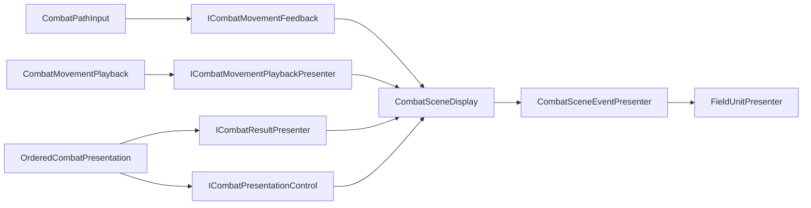

# 전투 View 후속 보완 — 설계 및 구현 계획

- 작성: 2026-10-05. 기준 브랜치 `feature/Yonggeun/Stage`, HEAD `c3bc5ee1`, 최근 생산 코드 `bfe63a27`.
- 상태: **V1~V4b 코드 반영. 관리 코드 회귀 47/47 통과, V1/V3/V4 Unity 표시 검증 대기.** 실행 기록은 [기존 View 계획 §7.27~31](2026-10-01-combat-view-plan.md#730-v4a-소비자별-표시-계약-분리-2026-10-05)다. SOLID 5원칙을 적용한다.
- 범위: Core 없이 가능한 View 내부 책임 분리·반복 할당 개선. 현재 동작·입력·결과 확인·정상 이탈 계약을 유지한다.
- 구조 비교: [변경 전/후 UML 원문](../specs/2026-10-05-combat-view-maintenance-uml-comparison.md) / [비교 화면](../specs/2026-10-05-combat-view-maintenance-uml-comparison.html). 변경 후는 V1~V4b의 현재 로컬 구현이다.
- 시작 인계: [View 전용 인계](../handoffs/2026-10-05-combat-view-next-session-handoff.md). 기존 완료/검증 원본은 [View 계획 §7.21~25](2026-10-01-combat-view-plan.md), 증거의 구분은 [공동 인계 §2](../handoffs/2026-10-05-combat-view-skeleton-session-handoff.md#2-인계-범위와-증거).

## 1. 계획 착수 시 작업 상태와 정적 확인

계획 작성 시작 시 로컬 변경은 `CLAUDE.md`, 공동 인계, 기존 View 계획과 새 View 전용 인계뿐이었다. 아래 표는 V1 착수 전 코드의 관찰이며 이후 구현 상태는 §8과 기존 View 계획 §7을 따른다. 기존 문서 변경은 보존한다. 커밋·push·외부 메시지 전송은 하지 않는다.

기본 View 0~E2·A2/B3, F1·정상 F2 기반, 문서 Phase F는 인수한 완료 범위를 유지한다. 일반 승리 호출자도 연결돼 있다. `bfe63a27`의 관리 회귀/빌드와 `5078ee0e`의 사용자 검증, 병합 시 Unity 전체 통과 기록을 구분하고 이번에 새로 실행한 것으로 기록하지 않는다. 이 계획을 위해 기존 검증을 일괄 재요청하지 않는다.

아래 `C/`는 `Assets/ProjectL/Script/Systems/RuntimeSystem/InGameSystem/ViewSystem/Combat/`, `S/`는 같은 ViewSystem의 `StageInput/`, `T/`는 `Assets/Tests/EditMode/Framework/`다.

| 현재 코드 | 확인한 비용·책임 | 판단 / 연결 Phase |
|---|---|---|
| `C/CombatSceneDisplay.cs` `TryMapPointer` | 호출마다 PointerEventData 생성, 재사용 List의 결과에 LINQ Any. 손패 취소 영역과 GraphicRaycaster 가림을 함께 판단 | EventSystem 수명을 지키며 입력 객체 재사용·직접 순회. V1 |
| `S/MovementDraft.cs` `Snapshot` | 호출마다 MovementPath 생성. Core MovementPath 생성자는 셀 배열과 읽기 전용 래퍼를 만들어 불변 복사 | 변경된 초안의 첫 읽기에서만 복사. Core 계약은 그대로 유지. V2 |
| `C/CombatViewSystem.cs` Tick → `CombatPathInput.OnPreview` → `ShowDraft` | 같은 최신 응답도 Tick마다 전달되고, 초안이 같아도 Snapshot/필드 강조/HUD 표시를 다시 호출 | 응답 유효성 처리는 유지하고 표시 호출만 중복 억제. V3 |
| `C/Display/CombatHud.cs` `ShowMovement`·`ShowReturn` | 같은 견적에도 보간 문자열을 구성. 재화·드로우에는 이미 동일 값 억제가 있음 | 이동/Return 표시 값에 한정해 캐시. V3 |
| `C/CombatSceneDisplay.cs` 사건 처리 | Presenter 연결·집기·UI뿐 아니라 표시용 사실 목록, 이동 시간, 사건 반영을 소유 | 소비자 계약 축소(V4a)와 사건 표시 상태 추출(V4b)을 따로 수행 |
| `C/CombatSceneDisplay.cs` Refresh + `Display/FieldUnitPresenter.cs` Render | 표시 사실 목록을 만든 뒤 Presenter에서 다시 Select/ToArray. CharacterData.ToFacts 자체는 기존 사실 참조 반환 | V4b에서 한 번 구성한 사실 목록을 RenderFacts에도 사용. 사실 객체 자체가 매번 새로 생긴다고 해석하지 않음 |
| 사건마다 `RenderEvents` → `FieldUnitPresenter.RenderFacts` | 개체 검색·전체 목록 순회. 입력보다 빈도가 낮고 실제 병목 수치는 없음 | 측정 후 필요할 때만 증분 갱신. 조건부 M1 |
| `C/CombatViewSystem.cs` Handle / `CombatInteraction.cs` | 입력 분배와 씬/결과 수명의 변경 지점이 가까움. 배치·공격·명령 대기도 한 Interaction에 있음 | 새 입력 확장 시 R1로 분배만 추출. 상태를 한꺼번에 나누지 않음 |

위 내용은 소스에서 확인한 생성·호출 경로다. CPU/GC 시간, 프레임 저하, 목표 기기 병목을 측정한 결과는 아니다.

## 2. 유지할 책임과 외부 경계

정책 원본은 [View 설계 §4·§7·§9·§10.1·§13·§23](../specs/2026-09-30-combat-view-design.md)와 [골격 설계 §4.1·§6.3·§6.4](../specs/2026-09-30-combat-flow-skeleton-design.md)다. 이 계획에서 Flow/전환 순서를 다시 정의하지 않는다.

| 소유자 | 유지할 책임 | 새 보완의 한계 |
|---|---|---|
| Core / Buffer | 규칙, 상태, 미리보기 context, 결과·Completion 원본 | View가 비용·합법성·재화·종료를 계산/기록하지 않음 |
| CombatViewSystem | 씬/서비스 연결, 결과 표시 후처리와 확인 순서, 공유 F1 연결, Completion 통지 | 정상 제출 정지에서 Playback 보존. Core 호출·Manager 전환 추가 없음 |
| CombatResultPlayback | 결과 전체 수명·세대·후처리 토큰 | 다른 객체에 같은 결과 완료 번호/플래그를 만들지 않음 |
| OrderedCombatPresentation / CombatMovementPlayback | 결과 내부 사건 순서 / 이동 단계 완료 관측 | Tick 구동자와 결과 확인 소유권 유지 |
| CombatInteraction / CombatMovementInteraction | 기존 배치·공격·명령 대기 / 경로·견적·Release 대기 | 표시 캐시로 응답 검증·입력 허용을 생략하지 않음 |
| MovementDraft | 수정 가능한 초안과 Revision | Snapshot은 이 초안에서 파생한 불변 객체만 캐시 |
| CombatSceneDisplay / 씬 Presenter | 씬 구성·자원 수명 / 실제 그리기 | 상태 추출 뒤에도 씬 참조·풀 반환은 기존 소유자가 수행 |

생산 변경은 `C/`, `S/MovementDraft.cs`와 관련 테스트 안에 둔다. `CoreSystem/`, `BufferSystems/`, Flow·Plan·Job·LifeCycle·ExitSequence·Manager·FieldCamera·Architecture는 수정 대상이 아니다. V1~V4에는 Bootstrap·Factory·입력 슬롯/Controller·씬·DB 에셋 변경이 필요하지 않도록 설계한다. 실제 구현에서 교차 파일 변경이 필요해지면 필요성과 소유 범위를 먼저 구분한다.

## 3. SOLID 5원칙의 적용·검증 기준

| 원칙 | 이번 설계의 적용 | 완료 시 확인 |
|---|---|---|
| **S — 단일 책임** | V1은 화면 가림 검사 비용, V2는 초안 Snapshot, V3는 표시 중복, V4는 사건 표현 상태를 각각 담당. 결과 수명·규칙·명령 대기는 기존 소유자 유지 | 한 객체가 입력 판단과 연출 완료/결과 확인을 함께 소유하지 않음. 각 Phase의 변경 이유와 상태 소유자를 설명할 수 있음 |
| **O — 개방/폐쇄** | 기존 `ICombatResultPresenter`·`ICombatPresentation`의 교체 경계 활용. 새 비이동 표현이 Draft/입력/골격 수정으로 번지지 않게 V4에서 분리 | 새 효과 확장을 위해 입력 처리나 결과 확인 로직을 수정할 필요가 없음. 현재 유한 사건 분기를 없애려고 범용 등록/이벤트 버스를 만들지 않음 |
| **L — 리스코프 치환** | 기존 인터페이스의 반환·예외·취소·완료 의미 보존. 캐시가 있더라도 오래된 응답은 제출 불가, Cancel은 완료 통지 아님 | 실제 구현과 테스트 대역이 동일 수명 회귀를 통과. 재진입/Detach/부분 정리 실패 뒤 확인 번호를 올리지 않음 |
| **I — 인터페이스 분리** | V4a에서 입력 피드백과 이동 연출 계약을 나누고 소비자는 필요한 쪽만 보관. 기존 묶음은 조립/호환 경계로 유지 | PathInput은 이동 연출/결과 확인을, MovementPlayback은 초안/UI를 호출할 수 없음. 새 작은 계약은 실제 소비자·구현·테스트가 있을 때만 추가 |
| **D — 의존성 역전** | 입력/순서 조정 객체는 좁은 계약과 전달된 사실에 의존. Unity 구현은 씬 연결 시 조립하며 Buffer/전역 서비스 조회를 하지 않음 | 새 전역 조회·Find·서비스 모듈·CoreGroup 전달 없음. Unity 구체 타입 의존은 기존 씬/Presenter 경계에 한정 |

SSOT와 Framework 계약도 함께 적용한다. 새 객체는 씬 연결 수명의 내부 객체이며 서비스/Runner로 등록하지 않는다. 캐시는 표시·복사 비용을 줄이는 파생값이고 Core 상태/판정의 원본이 아니다. 단순 래핑이나 클래스 수 증가 자체를 원칙 준수로 평가하지 않는다.

### 3.1 변경 후 설계 재평가와 보완 결정 (2026-10-05)

- 책임·외부 경계는 개선된다. SceneEventPresenter는 표시 사실과 보간만 소유하며 명령 대기·결과 확인·Completion·풀 전체 반환을 추가하지 않는다. SceneDisplay에는 새 사건 로직을 다시 쌓지 않는다.
- **V4b Mapper 초기화/해제 순서를 보완한다.** 생성 당시에는 FieldView.Mapper가 없을 수 있으므로 Build 성공 후 연결한다. 세부 순서와 재설치/실패 회귀는 V4b 체크리스트를 따른다. V1에서는 이 추출을 구현하지 않는다.
- 유지보수성의 주요 위험은 캐시 무효화다. V2/V3의 기존 context 검증·재진입·취소·재바인딩 조건을 유지하고, 표시 캐시를 명령 허용 판단에 사용하지 않는다. Cancel은 완료/결과 확인이 아니다.
- 확장성은 현재 요구 범위에서 적절하다. 개별 비동기 VFX의 자원 수명이 생기면 해당 연출 담당을 따로 설계한다. 지금 범용 이벤트 버스/등록 체계를 만들지 않는다. O/L 준수는 각각 실제 확장 범위와 기존 계약 회귀를 기준으로 평가한다.
- 성능은 국소 반복 생성·표시 감소가 목표다. Raycast·사건별 전체 개체 순회는 남고, 규모/FPS 개선은 측정 전 확정하지 않는다. 운영 DB·Stage 재화·포기 API 등 외부 미완료도 이번 보완으로 해소된 것으로 보지 않는다.

## 4. 구현 순서

| Phase | 범위 | 선행 조건 | 기대 효과 |
|---|---|---|---|
| **V1** | 포인터 UI 검사 객체 재사용 | 현재 코드 | 같은 EventSystem에서 반복 PointerEventData 생성과 Any 열거 제거 |
| **V2** | 불변 경로 Snapshot 재사용 | 독립 가능, 검증 편의를 위해 V1 다음 | 변경 없는 초안의 반복 경로 복사 제거 |
| **V3** | 초안·견적 표시 중복 억제 | V2 | 동일 응답 Tick의 강조 재적용·HUD 문자열 생성 감소 |
| **V4a** | 소비자별 표시 인터페이스 분리 | V3와 독립 가능 | 입력 피드백·이동 연출·사건 제어의 의존 범위 축소 |
| **V4b** | SceneDisplay의 사건 표시 상태 추출 | V4a | 씬 연결과 사건 표현의 변경 이유 분리, 사실 목록 중복 배열 제거 |

최초 착수는 V1이며, 이후 사용자 지시로 V2 → V3, 이어서 **Mapper 수명 보완을 포함한 V4a → V4b**를 구현했다. 각 Phase의 검증·결과는 분리해서 기록한다. 아래 조건부 R1/M1은 자동 구현하지 않는다. 원래 완료 Phase의 번호·상태는 변경하지 않는다.

### V1 — 포인터 UI 검사

**수정 파일:** `C/CombatSceneDisplay.cs`, `T/CombatDisplayReuseTests.cs` 또는 새 `T/CombatPointerMappingTests.cs`와 meta.

- [x] 현재 EventSystem과 그 EventSystem용 PointerEventData를 씬 연결 객체에 보관한다. `EventSystem.current`가 없거나 교체되면 참조를 갱신/폐기하고 새 EventSystem에 맞는 데이터만 사용한다.
- [x] 매 검사 시 Raycast에 쓰는 입력 필드를 초기 상태로 맞추고 현재 좌표를 넣는다. 재사용 결과 목록은 비운다. GraphicRaycaster 포함 여부는 인덱스 순회로 확인하고 찾으면 종료한다. EventSystem 전체 Raycast를 생략하거나 물리 Raycaster를 UI로 간주하지 않는다.
- [x] 손패 취소 영역과 UI 가림의 OR, 카메라 선택/레이·필드 좌표 변환, 격자 밖 false 의미를 유지한다. 포인터가 같은 좌표라도 카메라·UI가 변할 수 있으므로 결과 좌표나 가림 판정은 캐시하지 않는다.
- [x] Release에서 입력 데이터와 Raycast 결과 참조를 놓는다. 예외·late call은 기존 F1/해제 계약을 따른다.

**검증:** 실제 EventSystem/GraphicRaycaster를 둔 Unity 테스트로 UI 위/밖 왕복, UI와 비UI hit 혼합, EventSystem 없음·교체·파괴, 카메라 변경, 손패 영역·격자 밖을 확인한다. 기존 `CombatDisplayReuseTests.AuthoredCombatScene_DragPlaybackAndReturn_UseActualPresenters`와 `MovementDraftTests.UIReentry_RequiresEndpointOrPredecessor_AndNeverBridgesGap`을 영향 회귀로 사용한다. 워밍업 이후 같은 EventSystem의 반복 검사에서 이 코드의 PointerEventData 생성이 사라지는지 확인한다. Unity Raycaster 내부까지 무할당이라고 주장하지 않는다.

**현재 검증 상태:** 코드 항목은 반영했고 새 `CombatPointerMappingTests` 8건을 작성했다. 현재 소스를 포함한 Framework 테스트 어셈블리/의존 어셈블리 MSBuild 오류 0·변경 파일 경고 0. 기존 UIReentry 1건은 Unity 밖 관리 코드 실행에서 통과했다. 새 8건과 실제 씬 회귀·할당 관찰은 Unity 실행 대기이며 V1 전체 검증 완료로 표시하지 않는다. 열린 동일 프로젝트의 Unity 인스턴스 때문에 batch 실행은 테스트 시작 전에 거절됐다. Test Runner에서 Combat 씬 이외의 씬을 연 상태로 위 필터를 실행한다.

### V2 — 초안 Snapshot의 불변 캐시

**수정 파일:** `S/MovementDraft.cs`, `T/MovementDraftTests.cs`. `MovementPath`와 Core 생산 코드는 그대로 둔다.

- [x] 초안이 활성이고 Revision이 같으면 이전 불변 MovementPath를 반환한다. 변경 뒤 첫 Snapshot에서 기존 생성자를 호출해 복사하고, 이후 읽기만 재사용한다.
- [x] Begin, 실제 Add/Remove, 길이가 줄어든 RetainPrefix, Cancel에서 캐시를 무효화한다. Begin은 행위자·원점이 같아도 새 초안이다. Cancel 뒤에는 기존처럼 Snapshot이 실패한다.
- [x] Suspend/MarkPointerInvalid/끝점 재진입처럼 셀 목록이 안 바뀐 경우 경로 객체는 재사용한다. PointerValid/IsSuspended는 별도로 현재 값을 읽는다. 변경 전 Snapshot은 이후 편집에도 바뀌지 않는다.
- [x] 요청 번호·행위자·battle/lifetime·Revision/context 일치 검사는 기존 Interaction에 유지한다. 같은 경로 참조라는 이유로 검증된 context를 다른 요청/전투에 재사용하지 않는다.

**검증:** 동일 Revision 반복 읽기, 변경 후 새 Snapshot, 이전 Snapshot 불변, 시작/취소/접두 절단/되돌리기·유효성만 변경하는 경우를 추가한다. `MovementDraftTests`의 늦은 응답·동일 actor/path 재진입·Release 전 미응답·Core 거절 회귀를 재사용한다. 워밍업 후 같은 초안 Snapshot 반복의 MovementPath/셀 복사 할당이 없는지 측정하며, 변경 후 첫 불변 복사는 유지한다.

**실행 결과:** `MovementDraftTests`에 4건 추가, 매개변수 사례 포함 29/29 관리 코드 실행 통과. 워밍업 후 동일 Snapshot 1,000회 읽기 관리 힙 할당 0바이트 확인(PowerShell 7/.NET, Unity Player 측정 아님). Core MovementPath·Interaction의 검증 로직은 변경하지 않았다. 기록은 기존 View 계획 §7.28.

### V3 — 같은 초안·견적을 다시 그리는 비용 감소

**수정 파일:** `C/CombatPathInput.cs`, `C/Display/CombatHud.cs`, `T/CombatMovementViewTests.cs`, `T/CombatPathInputCleanupTests.cs`, `T/CombatDisplayReuseTests.cs`. 필요하면 표시 검증을 새 `CombatMovementFeedbackTests.cs`에 분리한다.

- [x] `OnPreview`의 검증·Return 처리·수명 검사는 계속 실행한다. `ShowDraft`에 전달한 경로 Snapshot, **Interaction이 수락해 보관한 응답**, PointerValid가 모두 같을 때만 반복 표시 호출을 생략한다. 전달된 최신 응답을 곧바로 유효 캐시로 삼지 않는다.
- [x] 포인터 유효성 변경, 같은 경로의 새 견적, 접두 절단·경로 변경은 즉시 다시 표시한다. ClearDraft/Cancel/Detach/다음 초안에서 표시 캐시를 무효화한다. 같은 좌표라도 UI 진입·복귀의 유효/무효 색이 갱신돼야 한다.
- [x] 표시 호출이 성공한 뒤에만 적용 값을 기억한다. 호출 중 Cancel/Detach/새 초안으로 재진입하면 이전 호출의 캐시를 다시 유효화하지 않는다. 이 캐시를 명령 제출 가능 여부에 사용하지 않는다.
- [x] CombatHud는 문자열을 만들기 **전** 실제 표시값을 비교한다. Move는 응답 유무·PointerValid·CanMove·거리·비용·실패 사유, Return은 응답 유무·CanReturn·환급 거리/비용·실패 사유를 기준으로 한다. 전체 Core 상태를 HUD에 보관하지 않는다.
- [x] BindReturn·Clear 및 다시 표시되는 수명에서 HUD 캐시를 무효화한다. 같은 환급 값이어도 재바인딩으로 비활성화된 버튼은 다음 유효 표시에서 복구돼야 한다. 기존 문구·버튼 의미·Completion UI는 유지한다.

**검증:** 같은 응답 반복에 표시 호출/문자열 생성 감소, Revision 그대로인 포인터 무효화와 복귀, 같은 경로의 새 비용/거절 응답, 취소 뒤 같은 경로 재시작, 공격 표시 중 오래된 이동 응답, Return 재바인딩/요청/중복 응답을 확인한다. 기존 `CombatMovementViewTests`·`CombatPathInputCleanupTests`의 취소/Return 복구 회귀를 유지한다. 변경이 없는 표시만 생략하고 일반 결과 Refresh·Acknowledge는 생략하지 않는다.

**실행 결과:** 새 `CombatMovementFeedbackTests` 11사례와 V2/기존 정리 회귀를 합쳐 관리 코드 45/45 통과. 실제 UI가 필요한 `CombatDisplayReuseTests.Hud*` 4건은 추가·컴파일 확인했으며 Unity 실행은 대기다. `CombatMovementViewTests`, 실제 씬 Drag/Playback/Return 회귀와 HUD 반복 문자열 할당은 Unity에서 확인할 항목으로 남긴다. HUD는 표시 값의 값 튜플만 보관하고, PathInput의 버전은 표시 호출 재진입 방어에만 사용한다. 기록은 기존 View 계획 §7.29.

### V4a — 소비자가 필요한 표시 계약만 받도록 분리

**수정 파일:** `C/ICombatMovementPresenter.cs`, `C/ICombatBattleDisplay.cs`, `C/CombatPathInput.cs`, `C/CombatMovementPlayback.cs`, `C/OrderedCombatPresentation.cs`. 새 계약 파일과 meta는 아래 실제 소비자 기준으로 추가한다.

| 제안 계약 | 멤버 / 소비자 |
|---|---|
| `ICombatMovementFeedback` | ShowDraft, ClearDraft, SetReturnState / CombatPathInput |
| `ICombatMovementPlaybackPresenter` | BeginStep, ShowReturn, IsMovementComplete, CancelMovement / CombatMovementPlayback |
| `ICombatPresentationControl` | TickPresentation, CancelPresentation / OrderedCombatPresentation |
| 기존 `ICombatResultPresenter` | CanPresent, BeginEvent / OrderedCombatPresentation |

- [x] 기존 `ICombatMovementPresenter`는 두 이동 계약의 묶음으로 유지하고, `ICombatBattleDisplay`는 조립 시 필요한 묶음을 계속 제공한다. 기존 구현자가 가진 메서드·외부 호출 의미를 유지한다.
- [x] PathInput/MovementPlayback은 각 좁은 계약만 보관한다. Ordered는 Attach에서 묶음을 받아 필요한 세 역할(이동 연출·사건 표시·Tick/Cancel)로 나누어 보관한다. `ICombatPresentation.Attach`와 View 서비스·골격 공개 API는 변경하지 않는다.
- [x] 새 런타임 서비스·가짜 기본 구현·no-op adapter를 추가하지 않는다. 테스트 대역도 필요한 계약만 구현할 수 있게 한다. `ICombatPointerMapping`/`ICombatResultPresenter`가 현재 `ICombatMovementPresenter.cs`에 함께 선언돼 있음을 고려해 중복 선언하지 않는다.

**검증:** 현재 구현/대역의 소스 호환 컴파일, `CombatMovementViewTests`, `CombatPresentationCleanupTests`, `CombatViewSystemTests`의 지연 완료·지원하지 않는 사건·중복 취소·늦은 완료·정상 제출 정지 회귀. 이 Phase는 구조 변경이며 성능 개선 수치를 완료 조건으로 삼지 않는다.

### V4b — SceneDisplay에서 사건 표현 상태 추출

**수정 파일:** `C/CombatSceneDisplay.cs`, 새 `C/CombatSceneEventPresenter.cs`와 meta, `T/CombatDisplayReuseTests.cs`, 필요한 사건 순서 테스트. `FieldUnitPresenter`의 기존 RenderFacts를 사용하며 현재 Render 호출자를 일괄 변경하지 않는다.

- [x] 새 내부 sealed 객체가 `_shownCharacters`, `_shownStructures`, `_moving`, `_elapsed`, 이동 시간 설정과 사건 반영/보간을 소유한다. SceneDisplay에서 해당 상태를 제거하여 두 벌로 보관하지 않는다.
- [x] 새 객체는 V4a의 이동 연출·사건 표시·Tick/Cancel 계약을 구현한다. Unity Presenter/현재 Mapper에 대한 접근은 씬 연결 시 명시적으로 제공한다. Buffer, Interaction, Completion 확인, 결과 순번, 풀 전체 반환을 맡기지 않는다.
- [x] **재평가 보완 — Mapper 연결 순서:** FieldView.Mapper는 Install의 Field.Build 성공 후 생성된다. SceneDisplay 생성/Attach 때 Mapper를 캡처하지 않는다. 내부 사건 객체는 Attach당 하나 생성하되, Install에서 Build 성공 → 현재 Mapper 연결 → 표시 사실 동기화 순서로 초기화한다. Clear/Release는 보간·사건 사실·Mapper 연결을 지우고 기존 소유자가 Presenter/필드를 정리한다. 다시 Install할 때 새 Mapper를 연결하며, 연결 전/해제 후 사건 호출은 기존 표시 수명 계약에 맞춰 차단한다. 최초 Install·Clear 후 재설치·Build 실패·Release 뒤 호출을 회귀에 포함한다.
- [x] SceneDisplay는 필드/손패/HUD/고스트·입력 피드백·UI 연결과 Install/Refresh/Release 조정을 유지하고 사건 관련 메서드만 위임한다. 해당 객체는 씬 Attach에 하나 만들며 MonoBehaviour·새 Update·서비스 등록은 없다.
- [x] Install/최종 Refresh에서 전달된 사실로 표시 목록을 한 번 채우고 같은 목록을 RenderFacts에 사용한다. 사건 중간에는 Expected/Final 순서를 보존하고 최종 Core 상태로 미리 덮어쓰지 않는다.
- [x] Cancel은 진행 중 보간만 중단하고 완료를 위조하지 않는다. Clear/Release 때 사건 참조·목록을 놓되 Presenter 풀 반환은 기존 SceneDisplay/Presenter가 수행한다. 예외가 나도 기존의 나머지 정리 시도·집계 경계를 유지한다.
- [x] 이 단계에서는 개체 Dictionary 도입·사건별 증분 렌더링·새 VFX를 함께 넣지 않는다. 전체 순회를 유지해 추출 전후 표시 순서와 대조한다.

**검증:** 이동 → 공격 → 피해/사망의 중간 모습, Return 즉시 반영, Soul/구조물 사건, 마지막 전체 동기화, 값 변화 없는 결과도 확인 1회. `CombatMovementViewTests`·`CombatPresentationCleanupTests`·`CombatDisplayReuseTests`와 `CombatViewSystemTests`의 Detach/정상 제출 정지/Completion 분리 회귀를 사용한다. 사실 목록 중복 배열 제거는 할당 비교로 확인한다. 화면이 같은 순서로 갱신되고 View 재대여/정적 필드 재구성이 늘지 않아야 한다.

**V4b 코드 반영 구조** — [현재 UML](../specs/2026-10-05-combat-current-uml.md)도 갱신했다. 코드 반영과 Unity 표시 검증 완료는 구분한다.

도표는 기존 씬 표시 묶음이 좁은 역할의 호출을 사건 구현에 위임하는 흐름이다. 객체 소유권은 SceneDisplay → SceneEventPresenter이며, 결과 전체 수명과 확인은 기존 Playback/ViewSystem에 남는다.

## 5. 조건부 후속 — 이번 순서에 자동 포함하지 않음

| 후보 | 시작할 조건 | 변경 파일·설계 범위 | 필요한 검증 |
|---|---|---|---|
| **R1 입력 분배 추출 / X1** | (2026-10-06: [VR 설계](../specs/2026-10-06-combat-view-refactor-design.md)의 VR2로 구체화, 코드 미착수) 새 입력/모드 확장에 대비한 사용자 설계 보완 요청 | ViewSystem의 분배와 입력 의도별 순서를 Router로 이동. Receive의 F1·활성/연결 검사, ReadFacts·Layer·Completion·결과 수명은 ViewSystem 유지. Router는 모드·pending·정책을 복제하지 않음. EndTurn 경로 취소는 제출보다 먼저이며 거절 때도 유지 | 기존 입력/오류/RecordInputOnly 회귀, Layer×모드 분배, 성공/거절 취소 순서와 재진입. 입력별 클로저·새 서비스 없음 |
| **M1 사건별 증분 갱신 / X4** | 대표/목표 최대 규모에서 V4b 이후 RenderFacts 비용이 유의미하고 측정 기준을 정했을 때 | `CombatSceneEventPresenter`, `FieldUnitPresenter`, 필요 시 `EntityViewSet`의 변경 개체 적용 경계 검토. 우선 표시 목록 검색·사건별 전체 순회의 비용을 분리 측정. ID 인덱스/dirty 집합은 측정으로 필요성이 확인된 범위만 | 생성/사망/복귀/구조물/정체성 변경, 중간 상태·사건 순서·최종 전체 동기화, 풀 대여/반환, 결과당 확인 1회 |

V1~V4의 원래 범위에서는 CombatInteraction을 동시에 나누지 않았다. 후속 VR 설계에서는 **VR1 Gate → VR2 Router → VR3 배치/공격**으로 나누어 진행하도록 구체화했다. 단일 pending과 현재 취소 순서를 유지하며, VR3는 VR2의 배타적 대상 선택·표시 소유권 전환에 의존한다. 파일별 Task와 실행 상태는 [View 계획 §7.40](2026-10-01-combat-view-plan.md#740-vr-설계-재검토-반영과-task-계획-2026-10-06-문서만)이 원본이다. V1~V4 완료 상태와 VR 코드 미착수를 구분한다.

## 6. 성능 검증과 회귀 범위

**각 Phase의 검증은 바뀐 코드에 대한 새 증거**다. 이전 완료 결정을 취소하는 절차가 아니다. 계획 작성 단계에는 테스트/빌드를 재실행하지 않는다.

1. 변경 전 비교 시나리오와 실행 환경(Unity 버전·Editor/Player·빌드/코드 기준·필드/유닛/경로 길이)을 기록한다. 현재 fixture를 재현 기준으로 쓰되 운영 최대 규모라고 부르지 않는다.
2. V1: 같은 EventSystem에서 UI 안/밖 반복 매핑. V2: 초안 고정 반복 Snapshot과 변경 직후 첫 읽기를 나눠 측정. V3: 고정 포인터/동일 응답 Tick과 초안/견적 변경 Tick을 분리. V4b: 동일 사건 묶음에서 최종 Refresh의 배열 할당을 비교한다.
3. JIT·풀·List 최초 확장 등 워밍업을 분리하고, 반복 구간의 GC.Alloc/발생 타입·호출 수를 확인한다. 테스트 assertion·로그·테스트 데이터 생성은 측정 구간 밖에 둔다. 관리 코드 할당 측정과 Unity Profiler 결과를 구분한다.
4. 목표는 확인한 반복 생성원의 제거와 표시 횟수 감소다. 프레임 전체 무할당이나 FPS 개선률을 사전 약속하지 않는다. CPU 비용이 늘면 원인을 기록하고 변경 범위를 재검토한다.
5. 규모별 M1은 목표 기기·대표/최대 보드·유닛/손패 수·허용 CPU/GC 기준을 정한 뒤 진행한다. 이 정보가 없어도 V1~V4의 동작 보존/국소 할당 검증은 가능하다.

Phase 완료 시 영향받는 어셈블리의 컴파일과 지정한 테스트만 우선 실행한다. Unity UI/씬 확인이 필요한 사례는 실제 Unity 결과를 따로 남긴다. 테스트 이름·실행 환경·성공/실패와 미확인 항목을 기록하고, 빌드 성공을 Unity 재생 성공으로 대신하지 않는다. 새 코드·새 실패·미해결 우려가 없으면 전체 회귀를 반복하지 않는다.

## 7. Core·골격·화면 담당이 필요한 작업

기존 조건의 원본은 [골격 계획 §0.2](2026-09-30-combat-flow-skeleton-plan.md#02-구현-차단-사유와-해소-작업)와 [기존 Core 요청](../handoffs/2026-10-05-combat-core-requests-phase6b.md)이다. 후속 타임라인 요청 초안은 [VR 설계의 VR0](../specs/2026-10-06-combat-view-refactor-design.md)에 별도로 추가했다. 문서 작성은 전달·합의·실제 구현 인수를 뜻하지 않는다.

| 작업 | 필요한 선행 인수 / 소유자 | 이후 View 범위 |
|---|---|---|
| 운영 DB 전투 | Core의 T1/G7 기본 source 조립·정상 반환, 골격/호출자의 유효 로스터·챕터·대상 진입 | 실제 사실의 필드/유닛/공격/미리보기 표시. `useDevBattle=false` 토글만으로 완료 처리하지 않음 |
| Stage 골드 HUD | Core의 Stage/Run 별도 잔액 읽기·SO/DB 초기화·보존 구현 | ReadDisplayValues에서 제공된 Stage 읽기 계약 사용. 초기값 지급/재화 계산은 구현하지 않음 |
| 포기 UI | Core 소유 정산 입력 조립 API와 골격 F2 포기 연결 | 포기 의도와 기존 Completion 표시 연결. View에서 payload·EndBattle·씬 전환 직접 호출 없음 |
| 패배·최종 승리/챕터 완료 화면 | 사용자가 보류한 목적지/표현 결정, 골격 호출 정책 연결 | 정해진 표시·확인 UI. 임의 StageSelect 복귀나 새 Run 생성 없음 |
| StageSelect 다음 전투 선택 | 별도 화면의 범위/담당 결정 | 기존 CombatEntry API 소비. 이번 전투 View 보완 범위에 포함하지 않음 |
| 타임라인 게시 (VR0/VR6) | Core/Buffer 담당의 최초 게시·무효화·전투/상태 버전·빈 값·종료/재진입·예측 범위/절단·게시 빈도 계약과 실제 구현 인수 | ReadDisplayValues를 승인된 Buffer 읽기로 교체. HUD 의미 보존. View 직접 조회 제거와 전체 계산 비용 개선은 별도 검증 |

현재 코드에도 `DatabaseBattleInitializationSource.Read`의 T1/G7 예외, `AbandonBattle(ArtifactLoadoutSnapshot)`, 전투/회복의 공통 Currency 읽기가 남아 있음을 확인했다. 규칙 답변은 이미 받은 상태이며 **실제 구현 인수**가 남은 것이다. V1~V4는 이 조건들을 기다리지 않는다.

## 8. 실행 기록 작성 규칙

구현 상태의 원본은 기존 View 계획 §7이다. 각 신규 Phase가 끝나면 그곳에 기준 HEAD, 수정 파일·공개 계약 영향, 실제 검증 결과, 남은 조건을 적고 이 계획의 체크리스트를 갱신한다. 책임/타입 구조가 바뀌는 V4 완료 시 View 설계와 현재 UML을 실제 코드에 맞춘다. 골격 정책·Core 요청 문서는 해당 계약이 바뀌지 않았다면 수정하지 않는다.

V1~V4b 코드를 반영했고 컴파일·관리 코드 회귀 47/47을 확인했다. V4a는 좁은 계약 대역과 지연 사건/늦은 완료 회귀를 추가했다. V4b는 Mapper 연결·재설치·실패·해제와 실제 사건 표시/할당 비교 9사례를 추가·컴파일했으며 Unity 실행은 대기다. V1/V3의 Unity UI 회귀도 대기 상태를 유지한다. V2 관리 코드의 불변성·캐시 수명·반복 Snapshot 할당은 확인했다. 결과는 기존 View 계획 §7.27~31에 기록한다. R1/M1은 미착수다.

## 9. 사용자 추가 요청 — 드래그 예정 경로 강조 (2026-10-06)

기준 `525e3975`. 이동 취소 동작은 유지하고 예정 경로의 표시만 보완한다. 클릭 목적지 자동 경로는 별도 Core API가 필요한 조사 결과로 구분하며 이번에 구현하지 않는다.

- 설계: 기존 Range와 독립된 MovementDraft 강조 층·청록색을 FieldView에 추가한다. 우선순위는 호버 > 공격 영향 > 예정 경로 > 일반 범위 > 행위자 > 정적 강조다. 초안 색은 제출 후보 경로를 뜻하며 Core 승인 표시가 아니다. 끝점은 응답 대기 노랑, 유효 응답 초록, 포인터 무효/거절 빨강으로 구분한다.
- 책임: SceneDisplay는 받은 path/preview/pointerValid를 표시 의도로 변환, FieldView/FieldHighlightLayers는 색과 우선순위를 담당한다. 경로 탐색·합법성·비용 계산은 추가하지 않는다. 기존 V3 중복 표시 억제를 유지한다.
- 구현 순서: 층/색 추가 → ShowDraft/ClearDraft 연결 → 기존 강조 우선순위 회귀 및 실제 씬의 경로 변경·취소·범위 복원 검증 → 실행 기록 갱신.
- 완료 기준: 경로가 바뀌면 이전 경로색이 지워지고, 취소하면 초안 층/끝점만 해제돼 일반 범위와 행위자·정적 강조가 보존된다. 새 서비스·매 프레임 할당·Core/Buffer 변경 없음.

코드 반영과 컴파일/관리 코드 48건 통과를 확인했다. 실제 씬의 강조 회귀 1건과 색 가독성은 Unity 검증 대기다. 상세 실행 기록은 기존 View 계획 §7.32를 따른다.
