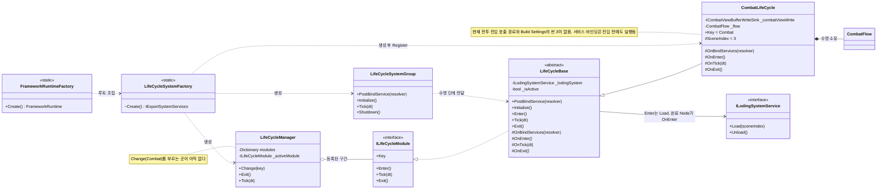
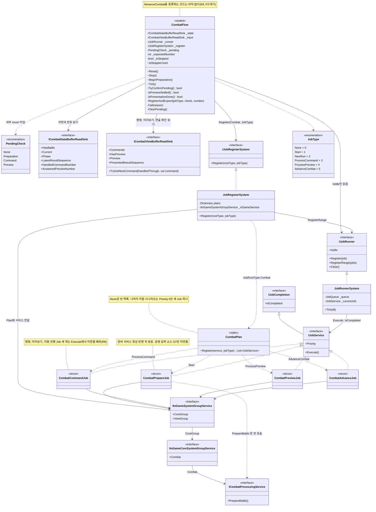
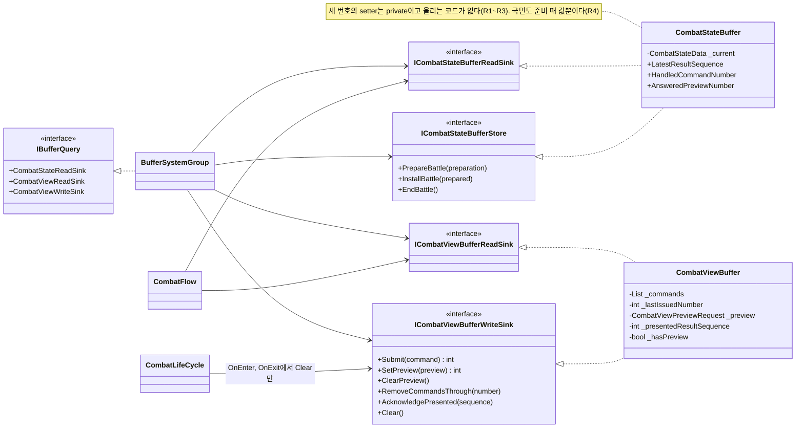
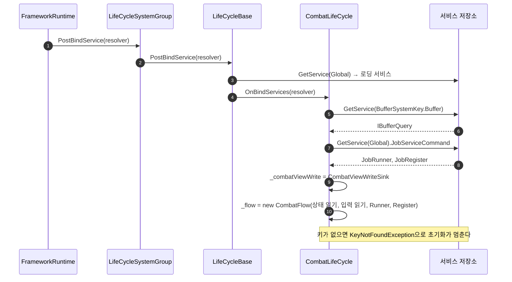
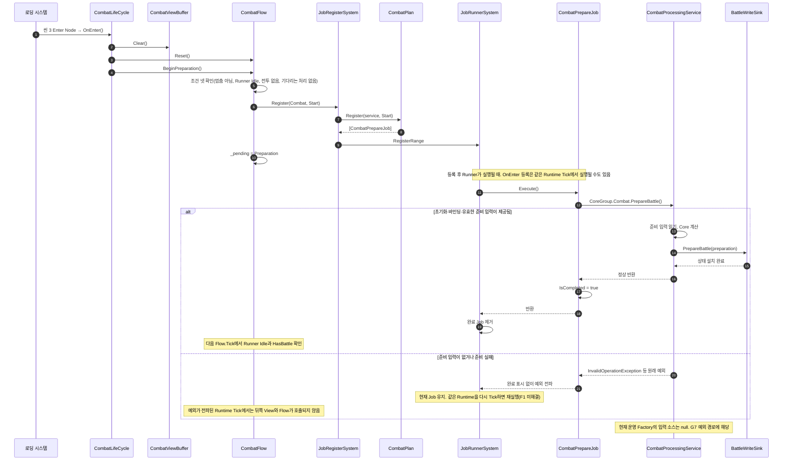
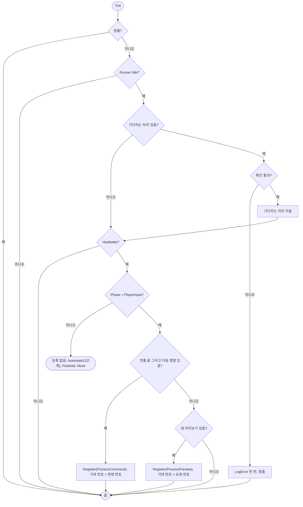
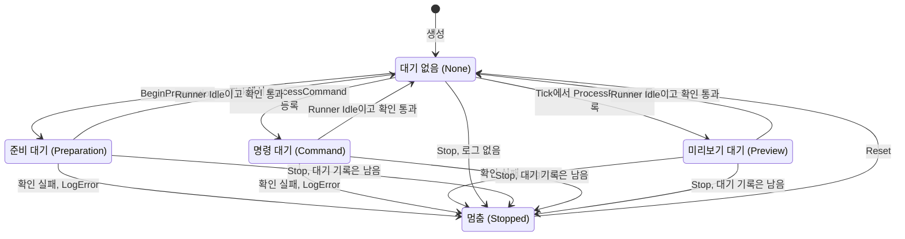
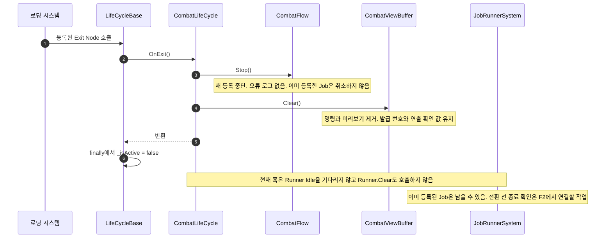

# 전투 진행 골격 — 현재 구조 UML

> **과거 스냅샷 / 현재 구조로 사용하지 않음.** 아래 도표는 작성 당시 기록을 보존한다. 현재 골격·View·경로 이동·Return·F1/F2는 [2026-10-05 통합 UML](2026-10-05-combat-current-uml.md)과 [오프라인 HTML](2026-10-05-combat-current-uml.html)을 따른다.

- 작성일: 2026-09-30
- 기준: `feature/Yonggeun/Stage` HEAD `916c948e`에 `1a51234c`를 통합한 작업 트리(병합 커밋 전). Phase 3 골격과 준비 Job의 Core 호출을 반영했다. 사용자 확인: 병합 후 Unity 컴파일 오류 없음, EditMode 전체 통과(2026-09-30).
- 용도: **지금 코드에 실제로 있는 구조**를 그린다. 합의 뒤의 예상 구조(F1~F3, 나머지 Core 서비스 연결)는 [설계 §12](2026-09-30-combat-flow-skeleton-design.md#12-구현-예상-uml)에 있다. 둘을 섞지 않는다.
- 표기: Mermaid UML. `<<struct>>`는 값 타입 Job, 점선 화살표는 "만든다/부른다", 실선 화살표는 필드로 들고 있는 의존이다. **없는 것**은 노트로만 적는다.
- 접근 표기: `+` public, `#` protected, `-` private. `~`는 이 문서에서 C# internal을 나타낸다. 클래스 멤버는 관련 부분만 표시한다.

## 1. 조립과 수명 — 누가 CombatLifeCycle을 만들고 부르나

- `LifeCycleSystemGroup.PostBindService`는 등록된 모든 구간을 돈다. 그래서 **전투에 들어가지 않아도 `CombatLifeCycle.OnBindServices`는 실행된다.** `FrameworkRuntimeCompositionTests`의 두 테스트가 이 경로를 지난다.
- `OnTick`은 활성 구간에서만 불린다(`LifeCycleBase.Tick`의 `_isActive`).

## 2. Flow·Plan·Job — 진행 한 걸음의 구성

- Flow는 `IJobRegisterSystem.Register`를 호출한다. Plan은 Job 목록을 만들어 반환하고, **JobRegisterSystem이 Runner.RegisterRange로 큐에 넣는다.** Plan은 실행이나 큐 등록을 하지 않는다.
- `CombatFlow`는 서비스 모듈이 아니다. `CombatLifeCycle`이 `OnBindServices`에서 만든다.
- Job은 명령 내용을 들고 있지 않다. 서비스가 실행 시점에 Buffer에서 읽을 예정이다.

## 3. Buffer 쪽 — Flow가 읽는 값의 원본

- 전투 상태(`CombatStateBuffer`)는 Core 측이 쓴다. 입력(`CombatViewBuffer`)은 View가 쓴다. Flow는 둘 다 **읽기만** 한다.
- LifeCycle은 구간 경계에서 입력 Buffer를 비우는 `Clear`만 쓴다. 번호 카운터와 연출 확인 값은 `Clear`해도 남는다.

## 4. 바인딩 — 전투에 들어가지 않아도 실행되는 부분

## 5. 진입 — 지금 코드로 들어온다면 일어나는 일

**지금은 도달하지 않는 경로다.** `Change(Combat)` 호출자와 씬 3이 없다. 코드가 무엇을 하도록 연결됐는지를 보이려고 그린다.

## 6. Flow.Tick 한 번의 판단

확인 통과 조건:

| 기다리는 처리 | 통과 |
|---|---|
| `Preparation` | `HasBattle == true` |
| `Command` | `HandledCommandNumber ≥ 기대 번호` |
| `Preview` | `AnsweredPreviewNumber ≥ 기대 번호`, 또는 현재 미리보기가 없거나 번호가 바뀜 |

## 7. Flow의 상태

- 멈춤에서는 `Tick`이 아무것도 하지 않고, `BeginPreparation`은 예외를 던진다(K11).
- 정상 `Stop`은 대기 기록을 지우지 않는다. `Reset`이 지운다.
- 그림은 주된 진행 경로다. `Reset()`은 멈춤 상태뿐 아니라 준비·명령·미리보기 대기 중에도 확인 기록을 지운다. `Fail()`은 확인 기록을 지우고 정지하며, 정상 `Stop()`과 구분한다.

## 8. 지금 없는 것 (다음 Phase에서 생기는 것)

| 없는 것 | 생기는 Phase | 필요한 외부 조건 |
|---|---|---|
| `AdvanceCombat` 등록과 결과 확인, Flow의 결과 읽기 의존 | 4 | F3 결과 읽기 타입·서비스(천명님) |
| 명령·미리보기·자동 진행 Job의 Core 호출과 처리 번호 갱신 | 5 | R6·R1~R4(천명님). 준비 API와 Job 호출은 반영됨 |
| 운영 전투 준비 입력 소스 | 준비 진입 전 | G7(천명님·진입 경로 협의) |
| 예외 뒤 Runtime 재Tick 중단 | 6 | F1(민형님) |
| 전환 전 새 등록 중단과 기존 Job 종료, 결과·`EndBattle` 수명 | 6 | F2(민형님·천명님·View) |
| `Change(Combat)` 호출자, 전투 씬, 부트스트랩 | 별도 작업 | 인계 §6 결정 1·2 |

## 9. 이탈 — 현재 연결된 훅과 남은 작업

아래는 전투가 활성 상태이고 로딩 종료 콜백이 전달됐다고 가정한 현재 코드 경로다. 정상 이탈의 선행 조건을 보장하는 F2는 아직 없다.

## 10. 코드 대조 위치

- [CombatLifeCycle](../../../Assets/ProjectL/Script/Systems/RuntimeSystem/LifeCycleSystem/LifeCycles/Combat/CombatLifeCycle.cs): Flow 생성, 진입·Tick·이탈 훅
- [CombatFlow](../../../Assets/ProjectL/Script/Systems/RuntimeSystem/LifeCycleSystem/LifeCycles/Combat/CombatFlow.cs): 준비 조건 넷, 등록 뒤 확인 기록, 명령 우선 분기, 정지
- [CombatPlan](../../../Assets/ProjectL/Script/Systems/RuntimeSystem/LifeCycleSystem/LifeCycles/Combat/Plans/CombatPlan.cs): 요청별 Job 구성
- [CombatPrepareJob](../../../Assets/ProjectL/Script/Systems/RuntimeSystem/LifeCycleSystem/LifeCycles/Combat/Jobs/CombatPrepareJob.cs): 준비 서비스 한 번 호출, 정상 반환 뒤 완료
- [CombatProcessingService](../../../Assets/ProjectL/Script/Systems/RuntimeSystem/InGameSystem/CoreSystem/CombatSystem/CombatProcessingService.cs): 준비 입력·계산·Buffer 게시, 운영 입력 G7 검사
- [JobRegisterSystem](../../../Assets/ProjectL/Script/Systems/RuntimeSystem/GlobalSystem/JobSystem/JobRegister/JobRegisterSystem.cs): Plan 호출 뒤 Runner 등록
- [JobRunnerSystem](../../../Assets/ProjectL/Script/Systems/RuntimeSystem/GlobalSystem/JobSystem/JobRunner/JobRunnerSystem.cs): Execute·완료 확인·예외 전파
- [LifeCycleBase](../../../Assets/ProjectL/Script/Systems/RuntimeSystem/LifeCycleSystem/Base/LifeCycleBase.cs): 로딩 콜백, 활성 상태와 훅 호출
