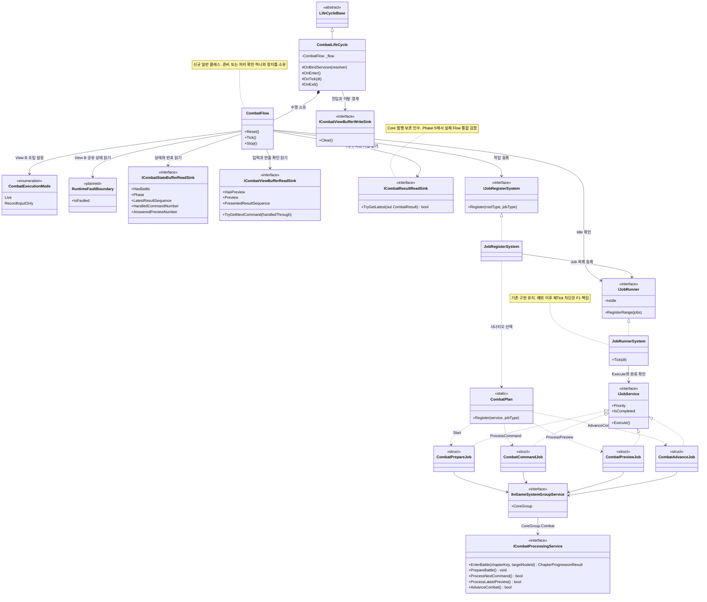
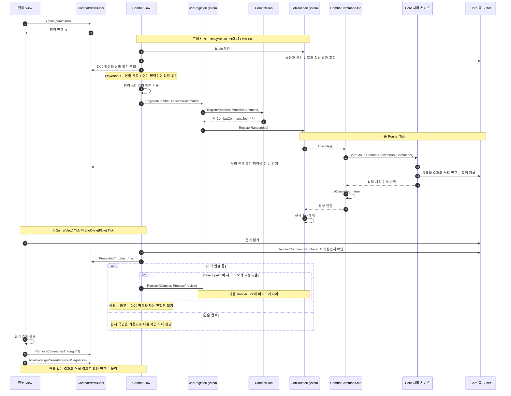
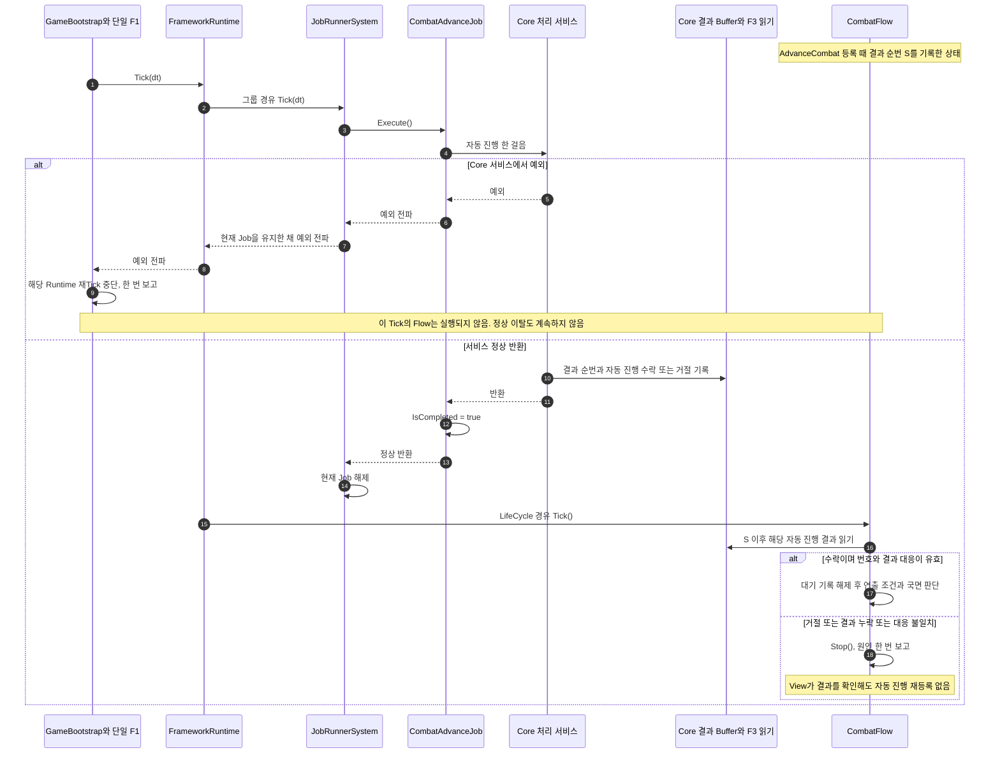
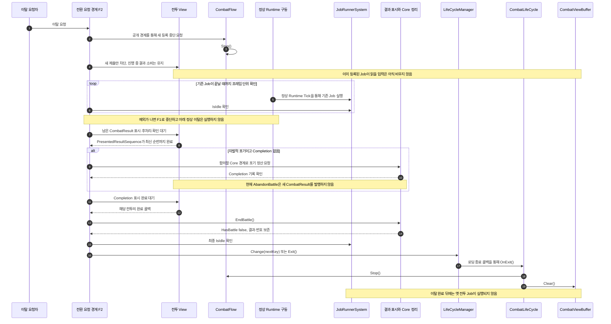
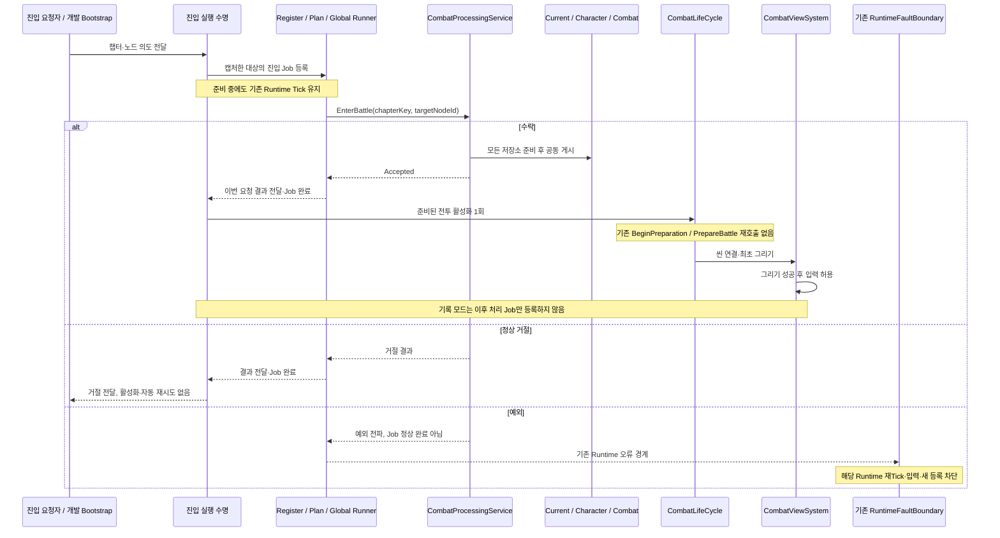

# 전투 진행 골격 설계 — CombatLifeCycle · CombatFlow · CombatPlan · 전투 Job

> **2026-10-05 코드 정렬:** 현재 타입/호출 관계는 [통합 UML](2026-10-05-combat-current-uml.md). Flow §4.1, 진입 §6.3, 이탈 §6.4가 계약 원본이며 초기 가칭 코드·예상 UML은 당시 설계 예시다. 상태는 골격 계획 §6.15를 따른다.

- 작성일: 2026-09-30
- 작성: View 작업(스테이지 내부 담당, Buffer 설계 D6에 따라 전투 Flow 담당)
- 판: **8차(2026-10-03, 명시적 진입 계약 이전).** `EnterBattle`의 대상/결과 전달·한 번의 활성화 계약을 §6.3(K20)에 추가한다. 이전 Phase의 동작은 이력으로 보존하고 신규 진입의 기준은 §6.3으로 통일한다. 구현·검증 상태는 계획 §6, 실행 작업은 계획 6A/6B를 따른다.
- 출발점: [전투 View 설계 인계](../handoffs/2026-09-30-combat-view-design-session-handoff.md) §10.2·§10.3-1
- 이전 후보: [Buffer 설계](2026-09-29-combat-view-buffer-design.md) §12. 참고만 했고 이 문서가 대신한다.
- 구현 예상 UML: [§12 클래스·시퀀스 다이어그램](#12-구현-예상-uml). 현재 존재하는 API와 합의가 필요한 역할을 구분한다.
- 구현 계획: [Phase별 Task·선행 조건·검증](../plans/2026-09-30-combat-flow-skeleton-plan.md). 진행·검증 상태는 이 문서에 적지 않고 계획 §6을 기준으로 한다(현재 Phase 5까지 완료).
- 과거 코드 구조: [Phase 3·준비 연결 당시 UML](2026-09-30-combat-flow-current-uml.md). 현재 목표 진입은 §12.5와 §6.3이며 과거 코드 UML을 수정해 구현된 것처럼 보이게 하지 않는다.

## 0. 요약

- 스테이지 내부 진행과 Combat 진입 실행 경계를 다룬다. StageLifeCycle/StagePlan 전체 개편·비전투 진입은 제외하며 기존 등록 경로의 대상 전달은 §6.3에서 연결한다.
- **진행의 주인은 `CombatFlow` 하나다.** 매 Tick에 Buffer를 읽고, Runner가 비어 있을 때만 다음 작업 하나를 등록한다. 규칙·표시·연출은 소유하지 않는다.
- **연출 대기는 Job이 아니라 Flow의 조건이다(K1).** 연출이 끝나기 전에는 상태를 바꾸는 작업을 등록하지 않는다.
- **연출이 끝났고 실행 명령이 있으면 미리보기보다 명령을 먼저 등록한다.** 연출 중이거나 실행 명령이 없을 때는 미리보기를 처리한다(§4.1).
- **Flow 쪽 파일은 모두 우리가 소유한다(K2).** `CombatLifeCycle`, `CombatFlow`, `CombatPlan`, 전투 Job 전부(전투 준비 `Start` 포함), `JobType` 값. Core는 **처리 서비스만** 제공한다. Core 답변으로 확정됐다(K12). Core는 전투 Plan·Job을 따로 만들지 않는다.
- **준비 Job은 Core에 연결됐다.** 기본 Factory는 `DatabaseBattleInitializationSource`를 등록하지만 지정 방식 DB 스키마가 없어 T1/G7에서 차단한다. 테스트에서는 기존 `IBattleInitializationSource`에 명시적인 정의를 주입할 수 있다. 운영 준비 성공은 Phase 5 완료 조건과 분리한다.
- Core의 `ProcessNextCommand()`·`ProcessLatestPreview()`·`AdvanceCombat()`과 우리 Job 세 개를 연결했다. 네 Job 모두 정상 반환 뒤 완료하고 예외는 그대로 전파한다. **bool false도 정상 반환이다.** Flow는 Buffer의 처리 기록과 자동 진행 수락 여부를 확인하고, 명령 수락/거절의 표현은 View가 맡는다(K15).
- `JobType.ProcessCommand = 3`은 천명님 옛 계획의 이름·값을 따랐다.
- **되묻지 않기(K4):** 정상 종료한 처리가 기대한 상태·번호를 남기지 않거나 자동 진행 결과가 거절이면 Flow가 멈춘다. 자동 진행은 번호 증가만으로 성공을 판단하지 않는다(§4.3).
- **예외와 Flow 정지는 별개다.** 현재 Runner는 예외가 난 Job을 유지한다. 실제 구동 시에는 예외 후 Runtime Tick을 중단하는 경계가 필요하다. 권고안과 합의 조건은 §4.5·F1에 있다.
- **전투 이탈 전에 새 등록을 막고 기존 작업의 종료를 확인한다.** `OnExit`의 `Stop()`만으로 이미 등록된 Job은 취소되지 않는다. 전환 요청 경계의 권고안과 합의 조건은 §6.1·F2에 있다.
- 기존 Bootstrap·Combat 씬·단일 F1을 재사용한다. 새 진입은 `EnterBattle`의 이번 요청 수락을 확인한 뒤 활성화하며 현재 선택을 미리 바꾸지 않는다. 서비스 바인딩은 활성 여부와 관계없이 검증한다. fixture로 개발 진입을 검증해도 운영 DB·F2 이탈 완료를 뜻하지 않는다.

## 1. 범위

| 포함 | 제외 |
|---|---|
| `CombatFlow`(새 클래스): 국면 분기, 명령 우선 등록, 처리 확인, 정지 | Core 처리 서비스와 결과 기록(R5·R6, 천명님 Task 4·7). 단, F3의 최소 읽기 계약은 먼저 합의한다 |
| `CombatLifeCycle`의 `OnBindServices`·`OnEnter`·`OnTick`·`OnExit` | 전투 종료 뒤 결과 반영·맵 복귀(결과 화면 설계 때, §8.1) |
| `CombatPlan`의 JobType 시나리오 | 부트스트랩, 씬 인덱스, 씬 객체 연결(인계 §6 결정 1·2) |
| 전투 Job 네 개 틀(준비·명령·미리보기·진행) | 입력 Layer 전환(View가 결과를 보고 한다. 입력 설계 D4) |
| `JobType` 값 추가(공용 파일) | 전투 View 모듈 |
| `CombatFlowTests`, `JobSystemTests` 표본 교체, 실패·이탈 통합 검증 항목 | Runtime 구동자와 전환 요청 경계의 구현. F1·F2 합의 후 별도 Task로 연결한다 |
| Core 전달 문서에 경계 변경 기록 | |

## 2. 전제 — 지금 코드에서 확인한 것

| 항목 | 사실 | 근거 |
|---|---|---|
| Tick 순서 | 루트 등록 순서대로 Tick한다: Buffer → **Global(JobRunner)** → InGame(View 포함) → **LifeCycle**. Flow가 N 프레임에 등록한 Job은 빨라도 N+1 프레임의 Runner Tick에서 실행된다. 로딩 콜백의 `OnEnter` 등록은 Global 내부에서 일어나므로 같은 Tick에 실행될 수도 있다 | `FrameworkRuntimeFactory`, `FrameworkRuntime.Tick`, `GlobalSystemFactory` |
| Runner와 예외 | Global 하나. Priority 순, 미완료 Job은 다음 Tick에 다시, `IsIdle`. Job이 예외를 던지면 현재 Job으로 남는다. Runtime도 예외를 격리하지 않으므로 그 Tick의 뒤쪽 InGame·LifeCycle은 실행되지 않는다. 다시 Tick하면 같은 Job을 다시 실행한다 | `JobRunnerSystem.Tick`, `FrameworkRuntime.Tick` |
| 완료 계약 | `IJobCompletion.IsCompleted`(`IJobService`가 상속). Runner는 매 Tick 현재 Job을 `Execute`하고 `IsCompleted`가 true일 때만 다음으로 간다. **`Complete()` 같은 완료 함수는 Framework·Systems 어디에도 없다**(develop·main 포함 확인) | `IJobCompletion.cs`, `JobRunnerSystem.Tick` |
| 등록 | `IJobRegisterSystem.Register(JobRootType, JobType)`. enum 두 개만 받는다. Plan은 `Func<IInGameSystemGroupService, JobType, List<IJobService>>` | `JobRegisterSystem` |
| 국면 | `CombatFlowPhase`: `None`·`PlayerInput`(배치 포함)·`Automatic`·`Finished` | Core.Contracts |
| 번호·국면 기록 | `ICombatStateBufferReadSink`의 국면·세 번호를 Core 처리 후 Buffer가 게시한다. 미리보기는 응답 번호만 바꾸고 결과 순번은 유지한다 | `CombatStateBuffer.InstallCommand/InstallPreview` |
| 자동 진행 결과 읽기 | `ICombatResultReadSink.TryGetLatest(out CombatResult)`. 실제 명령·진행 결과 발행 구현이 들어왔다. 상태와 결과 순번이 같고, 최신 결과·번호는 정리와 다음 준비 뒤에도 유지된다 | `83f485d1`, Core Task 7 계약 |
| 입력 | `ICombatViewBufferReadSink`: `TryGetNextCommand(handledThrough)`, `HasPreview`, `Preview.Number`, `PresentedResultSequence` | `CombatViewBuffer` |
| LifeCycle 훅 | `OnBindServices(resolver)`, `OnEnter`(로딩 완료 뒤), `OnTick`(활성일 때만), `OnExit`(로딩 종료 단계) | `LifeCycleBase` |
| 기존 테스트 | 공용 Job 표본은 Lobby다. `CombatPlanTests`는 네 Job의 호출·완료·예외를 검사한다. 실제 Flow→Job→Core→Buffer 통합 테스트를 추가했으며 실행 결과는 계획 §6.8에서 관리한다 | `CombatPlanTests`, `CombatFlowTests`, `CombatFlowIntegrationTests` |
| 실제 처리 계약 | `IInGameCoreSystemGroupService.Combat`의 `ICombatProcessingService`. 명령 하나 또는 자동 진행 한 단위의 계산·기록은 한 번의 동기 호출에서 끝난다 | [Task 7 계약](../plans/2026-10-01-combat-buffer-command-task7-contract.md) |

## 3. 구조

```text
CombatLifeCycle (수명: 들어오고 나갈 때 할 일)
  ├─ OnBindServices : Buffer·Job 서비스 받기 → CombatFlow 생성
  ├─ OnEnter        : §6.3의 수락된 전투 활성화·입력 수명 연결 (중복 준비 없음)
  ├─ OnTick         : Flow.Tick()
  └─ OnExit         : F2의 이탈 사전조건 충족 뒤 Flow 멈춤 → 입력 Buffer 비우기
       │
CombatFlow (진행의 주인 하나: 지금 무엇을 등록할지)
  │  읽기: ICombatStateBufferReadSink, ICombatViewBufferReadSink, IJobRunner.IsIdle
  │        자동 진행 결과 읽기 계약(F3, ICombatResultReadSink)
  │  쓰기: IJobRegisterSystem.Register(Combat, JobType) 뿐
       ▼
CombatPlan (JobType → Job 하나, 서비스 주입)
       ▼
전투 Job (한 걸음: Core 처리 서비스 한 번 호출)
       ▼
Core 처리 서비스 (천명님: 입력 읽기 → 계산 → Buffer 기록 → 번호 올리기)
```

| 타입 | 소유하는 것 | 소유하지 않는 것 |
|---|---|---|
| `CombatLifeCycle` | 전투 구간의 들어오기·나가기 순서, Flow의 수명 | 무엇을 언제 처리할지 |
| `CombatFlow` | 다음에 등록할 작업, 등록한 처리의 확인, 멈춤 | 규칙(Core), 입력 해석(View), 표시·연출(View), Buffer 쓰기 |
| `CombatPlan` | JobType별 Job 구성 | 진행 판단 |
| 전투 Job | 서비스 호출 한 번 | 명령 선택(서비스가 `HandledCommandNumber` 기준으로 고른다), 규칙 |

`CombatFlow`는 서비스 모듈이 아니다. `CombatLifeCycle`이 만들어 들고 있는 일반 클래스다. 쓰는 곳이 하나라 인터페이스를 두지 않는다(지침 §27).

구조 바깥의 수명 경계도 필요하다. **F1은 View 설계 §10.1의 기존 `GameBootstrap`·`RuntimeFaultBoundary` 하나를 사용**하고 골격 6B에서 인수한다. F2는 기존 Job 종료와 결과 표시·정리 후 전환한다. 신규 진입 요청/결과 수명은 §6.3에서 분리하며 Flow에 규칙·화면·전환 책임을 합치지 않는다.

## 4. Flow 분기

### 4.1 한 Tick의 판단 (위에서부터 처음 맞는 줄 하나만)

**Flow의 분기·실행 모드·오류 차단 정책은 이 절이 단일 기준이다.** View 설계·계획·UML은 이 절을 참조하며 별도 순서표를 정의하지 않는다. 아래 0행·4a행은 **View B에서 구현할 확장**이다. Phase 5는 현재 Live 분기와 생성자를 유지하고 세 Job 호출·통합 검증만 수행한다.

| 순서 | 조건 | 할 일 |
|---|---|---|
| 0 (View B2 구현) | 공유 오류 경계의 `IsFaulted` | 등록·확인·로그 없이 반환. 이미 보고된 Runtime 오류를 다시 판단하지 않음 |
| 1 | 멈춤 상태 | 없음 |
| 2 | Runner가 일하는 중(`!IsIdle`) | 없음 |
| 3 | 직전에 등록한 처리가 있다 | §4.3의 준비 상태·번호·자동 진행 수락 여부를 확인. 충족하면 기록을 지우고 계속, 아니면 **멈춤** |
| 4 | 전투 없음(`!HasBattle`) | 없음. 단, 준비 완료 확인 실패는 위 3에서 이미 멈춘다 |
| 4a (View B2 구현) | 실행 모드 `RecordInputOnly` | 반환. 준비 확인은 위 3에서 이미 수행하며 이후 세 처리 Job은 등록하지 않음 |
| 5 | 국면 `PlayerInput` && 연출 완료(`PresentedResultSequence ≥ LatestResultSequence`) && 처리하지 않은 명령(`TryGetNextCommand(HandledCommandNumber)`) | `Register(Combat, ProcessCommand)` |
| 6 | 국면 `PlayerInput` && 새 미리보기 요청(`HasPreview` && `Preview.Number > AnsweredPreviewNumber`) | `Register(Combat, ProcessPreview)` |
| 7 | 연출 대기(`PresentedResultSequence < LatestResultSequence`) | 없음 |
| 8 | 국면 `Automatic` | `Register(Combat, AdvanceCombat)` |
| 9 | 그 밖(`PlayerInput` 대기, `Finished`, `None`) | 없음 |

- **한 Tick에 최대 하나만 등록한다.** 등록하면 Runner가 바빠지므로 다음 판단은 처리가 끝난 뒤다. 같은 명령이 두 번 등록되지 않는다.
- **연출 완료 후 확정 명령을 먼저 처리한다(5가 6보다 앞).** Runner 처리 뒤 View Tick에서 미리보기 요청이 계속 바뀌어도 실행 명령이 무기한 밀리지 않는다. 명령 번호 순서는 Buffer의 `TryGetNextCommand`로 지킨다.
- **미리보기는 연출 중에도 받는다(6이 7보다 앞).** 연출 중에는 5가 성립하지 않는다. 미리보기는 게임 상태를 바꾸지 않고 결과 순번도 올리지 않는다(R3).
- **상태 변경 뒤 미리보기 갱신은 View가 요청한다.** View는 상태 변경 결과를 확인하면 기존 미리보기 표시를 무효화한다. 같은 대상의 미리보기가 여전히 필요하면 `SetPreview()`로 새 번호를 발급하고, 필요 없으면 `ClearPreview()`한다. 포인터가 움직이지 않아도 적용한다. Flow는 요청 번호만 확인하며 상태·선택의 변화를 따로 계산하지 않는다. 변화 없는 매 프레임에 재요청하지 않는다.
- **`Finished`에서는 아무것도 등록하지 않는다.** 전투 종료 처리의 시점은 결과 화면 설계에서 정한다(§8.1).
- **단계 구현(K9):** F3 읽기 타입이 생기기 전의 1단계 Flow는 8행을 "등록 없음"으로 둔다. `Automatic` 국면에서는 기다리기만 하고 `AdvanceCombat`을 등록하지 않는다. 순번 증가만 보는 임시 성공 판정을 두지 않기 위해서다(§4.3.1). F3 타입을 받으면 8행과 §4.3의 `AdvanceCombat` 확인을 함께 더한다. **6차에서 더했다(계획 Phase 4).** 코드에서는 7행을 `PlayerInput` 분기 뒤의 공통 조건으로 두어 `Automatic`도 연출 완료 뒤에만 등록한다.

**실행 설정(View B2 구현)**

- `CombatExecutionMode`는 `Live = 0`, `RecordInputOnly = 1`의 불변 조립 설정이다. Core의 국면이나 처리 결과가 아니다. 기본 조립은 Live이며 RecordInputOnly는 `UNITY_EDITOR || DEVELOPMENT_BUILD`에서만 허용한다. 비개발 조립은 기록 모드를 명시적으로 거부한다.
- 모드·공유 오류 경계는 생성자로 받는다(§6). Reset은 Flow의 pending·로컬 Stop만 초기화하고 모드나 Runtime 오류 상태를 바꾸지 않는다. 같은 Runtime 안에서 실행 모드를 전환하지 않는다.
- 진입 등록도 공유 오류가 있으면 등록하지 않으며 K11의 등록 전 조건을 지킨다. 두 실행 모드 모두 실제 진입 Job의 수락을 거친다. `BeginPreparation`은 이전 구현명이고 새 진입/활성화 분리는 §6.3이 기준이다. 기록 모드의 준비 후 처리 등록 차단은 유지한다.

**왜 F1이 있어도 Flow에서 오류 상태를 읽는가**

일반 Job 예외가 Runtime 밖으로 전파되면 그 Tick은 중단되므로 Flow의 추가 검사 없이도 이후 Flow가 실행되지 않는다. **예외가 입력 콜백 경계에서 처리돼 정상 반환하는 경우는 다르다.** 현재 `FrameworkRuntime.Tick`은 모듈을 순서대로 호출하고 도중의 공유 오류 플래그는 알지 못한다. `UnityInputLayerRuntime.ApplyLayer`는 이전 ActionMap을 끄면서 Canceled를 동기로 전달하며, `StageSelectInput`은 이를 `SelectCanceled`로 보낸다. 계획된 View Tick의 Layer 전환에서 이 콜백이 실패하면 다음 경로가 가능하다.

```text
Runtime.Tick → View.Tick → ChangeLayer → SelectCanceled
  → View 입력 경계가 F1에 최초 오류 보고 → 콜백 정상 반환
  → View는 후처리를 중단 → Runtime은 남은 LifeCycle.Tick → Flow.Tick 호출
```

Bootstrap의 F1 검사는 **다음 Runtime Tick을 막고**, Flow의 0행은 **이미 시작된 Tick 후반의 새 등록을 막는다**. Flow는 오류 플래그를 복제하지 않고 같은 `RuntimeFaultBoundary.IsFaulted`를 읽는다. View의 기존 콜백·후처리와 연결한 실제 경로를 6B F1 인수 및 View E.8에서 검증한다. Runtime이 도중 중단을 직접 보장하도록 바뀌면 이 검사의 필요성도 다시 검토한다.

### 4.2 연출 대기를 Job이 아닌 조건으로 두는 이유 (K1)

Framework의 완료 계약은 `IJobCompletion.IsCompleted` 하나다. Runner는 `IsCompleted`가 false인 Job을 매 Tick 다시 `Execute`한다. 이 계약으로 "연출이 끝날 때까지 기다리는 Job"(`IsCompleted = Presented ≥ Latest`)을 만들 수는 있다. 하지만 그렇게 하지 않는다.

- Runner는 Global에 하나다. 대기 Job이 연출 시간 내내 Runner를 붙잡으면 **미리보기까지 막힌다.**
- Flow는 어차피 매 Tick 같은 두 값을 읽는다. 조건 한 줄이면 되고 타입이 하나 준다.
- 그래서 이 설계에서 `IsCompleted`는 **"서비스 호출이 돌아왔다"는 뜻으로만** 쓴다. 기다림은 Flow가 맡는다.

### 4.3 되묻지 않기 — 등록한 처리의 확인 (K4)

옛 재설계의 교훈이다: **"실패한 진행 명령은 되묻지 않는다."** 되물으면 같은 명령 → 실패 → 같은 명령이 영원히 돈다.

Flow는 등록할 때 "어떤 처리의 어떤 완료 조건을 기다리는가"를 적는다. 동시에 기다리는 처리는 하나다. Runner가 다시 비면 이를 확인한다. **이 검사는 정상 반환한 Job을 대상으로 한다. 예외는 §4.5의 구동 경계에서 처리한다.**

| 등록 | 적는 값 | Runner가 빈 뒤 확인 | 안 움직였을 때 |
|---|---|---|---|
| 진입 `Start` | 이번 요청의 대상과 결과 대기 | 대응하는 `EnterBattle` 결과 수락 + Job 완료 | 정상 거절은 요청자에게 반환·활성화/재시도 없음. 결과 누락/대응 위반은 실행 오류 |
| `ProcessCommand` | 다음 명령의 번호 N | `HandledCommandNumber ≥ N` | 멈춤. 서비스가 명령을 처리하지 않았다 |
| `ProcessPreview` | 요청 번호 P | `AnsweredPreviewNumber ≥ P`, **또는 현재 요청이 더는 P가 아님**(View가 비우거나 바꿈) | 멈춤 |
| `AdvanceCombat` | 등록 때의 `LatestResultSequence` S | `LatestResultSequence > S`이며, 해당 호출의 자동 진행 결과가 **수락**이다(§4.3.1) | 순번 유지·결과 누락·대응 불일치·거절이면 멈춤 |

- 진입 등록과 결과 소비는 §6.3의 실행 수명 안에서 한 번 수행한다. 수락 후 `OnEnter`에서 다시 준비하지 않으며 `HasBattle`·기존 결과 순번으로 이번 진입 결과를 추측하지 않는다.
- **사용자 명령의 거절도 처리다(R1·R2).** 명령 처리 번호가 움직이면 다음 사용자 입력을 받을 수 있다. View는 거절 결과를 보고 알린다.
- **자동 진행의 거절은 Flow 정지다.** 순번이 올랐거나 View가 거절 결과를 확인했어도 같은 자동 진행을 다시 등록하지 않는다. 사용자 명령의 거절과 구분한다.
- **실패를 감지한 경로에서만** `UnityEngine.Debug.LogError`로 원인을 한 번 알리고 멈춘다. 정상 이탈에도 사용하는 `Stop()` 자체는 오류를 기록하지 않는다. 멈춤을 푸는 것은 다음 `OnEnter`의 초기화뿐이다.
- 이 확인 값은 Buffer 사본이 아니다. "Flow가 무엇을 기다리는가"라는 Flow 자신의 상태다(§7.1).

### 4.3.1 자동 진행 결과의 읽기 계약 — F3 인수 완료

Flow가 사건 목록을 해석하지 않더라도 다음 정보와 수명은 필요하다. **아래는 인수한 실제 F3 계약의 요구사항**이다. 사건별 표현은 View 책임으로 남는다.

| 필요한 정보·보장 | 목적 |
|---|---|
| 결과 순번 | 등록 때의 S보다 나중에 생성된 결과인지 확인 |
| 처리 종류(자동 진행에서 나온 결과인지) | 다른 처리 결과를 자동 진행 성공으로 오인하지 않음 |
| 수락/거절 및 거절 이유 | 거절은 즉시 Flow 정지, 이유는 한 번 보고 |
| 자동 진행 한 호출당 종료 결과 하나, 상태·순번과 함께 기록 | 한 번의 동기 호출이 끝난 뒤 모순 없이 읽음 |
| 최신 결과 레코드는 View 확인 후에도 다음 처리 결과로 교체될 때까지 조회 가능 | View Tick이 Flow보다 앞서 실행돼도 Flow가 결과를 확인할 수 있음 |

- **6차 인수(Core Task 4A):** 값 타입은 `CombatResult`(`Sequence`, `Kind`, `CommandNumber`, `Accepted`, `Reason`)와 `CombatProcessingKind`(`Command`, `Advance`)다. 위치는 `CoreCaculator/Contracts/Combat/CombatResult.cs`(`ProjectL.Core.Contracts`)다. 읽기는 `BufferSystems/Combat/CombatStateBuffer.cs`의 `ICombatResultReadSink.TryGetLatest(out CombatResult)`이고, false면 결과 없음이다. 기존 `CombatStateBuffer`가 함께 구현하고 `IBufferQuery.CombatResultReadSink`로 노출한다. 최신 결과 하나만 두며, View가 확인해도 지우지 않는다(인계 §4). Flow는 수락 여부나 거절 이유를 계산하지 않는다.
- **Flow의 판정 순서(6차 구현):** ① `LatestResultSequence > S` → ② 결과가 있음 → ③ `result.Sequence == LatestResultSequence` → ④ `Kind == Advance` → ⑤ `Accepted`. 하나라도 어긋나면 원인을 한 번 보고하고 멈춘다. ③은 결과 순번이 두 곳에 있어서 둔 대응 확인이다. **Core 확정(2026-10-01, [Core 답변](../handoffs/2026-10-01-combat-core-reply-to-task4a-view-reply.md)):** 원본은 `CombatStateBuffer`의 발행 카운터(`LatestResultSequence`)이고 `CombatResult.Sequence`는 그 번호를 담는다. 결과·순번·관련 상태는 함께 반영되며, 결과가 있을 때 두 번호가 다르면 오류다.
- **결과 없음 + 양수 순번은 정상이다(Core 확정).** 소비 뒤 정리해도 발행 번호와 View 확인 번호는 유지된다. 다음 전투의 첫 자동 진행은 유지된 번호를 S로 삼는다. 정리 시점은 F2에서 맞춘다.
- 정상 진행의 전투 상태 변경은 Flow가 등록한 Job을 통해 한 번에 하나씩 처리한다. 외부에서 동시에 전투 처리를 실행해 결과를 덮어쓰는 경로는 허용하지 않는다. F2의 포기 정산은 새 등록 중단·Runner Idle·남은 결과 확인 이후의 별도 이탈 단계다. 동시 호출을 허용하게 되면 호출과 결과의 대응 계약도 다시 정한다.
- 최신 레코드의 수명을 보장하며, Flow에 결과 내용의 가변 사본을 만들지 않는다. 결과 목록의 정리 정책에도 위 보존 조건을 적용한다.
- **F3 없이 자동 진행을 실제 서비스에 연결하지 않는다.** 테스트는 가짜 결과 읽기 구현으로 수락·거절·누락을 확인할 수 있다. 순번 증가만 보는 임시 성공 판정은 두지 않는다.
- **F3 타입 전에는 Flow가 `AdvanceCombat`을 등록하지 않는다(K9).** 결과 읽기 의존성과 자동 진행 등록·확인은 F3 타입을 받은 단계에서 한꺼번에 더한다. 그전의 Flow 생성자에는 결과 읽기 인자가 없다. 6차에서 타입과 실제 등록이 함께 와서 생성자 변경과 LifeCycle 바인딩을 같이 반영했다.
- **자동 진행 거절 = 계속할 수 없는 경우(Core 확정, 2026-10-01).** 활성 유닛 없음처럼 정상적으로 생기는 상황은 처리 완료 + 다음 국면으로 게시한다. 거절은 계속할 수 없다고 정의된 경우에만 쓰며, View가 멈추는 방향에 Core가 동의했다. 예상 밖 예외는 거절로 바꾸지 않고 전파한다(F1 경로). `Timeline.NoActiveUnit`은 테스트 예시일 뿐이다. K4·K8을 그대로 유지한다.
- **타입 확보와 서비스 바인딩 완료를 구분한다.** 타입이 있으면 가짜를 주입하는 Flow 단위 작업을 준비할 수 있다. 생산 코드의 필수 생성자 변경과 LifeCycle 바인딩은 실제 읽기 서비스 구현·등록을 확보한 뒤 함께 반영한다. 결과 생산·보존 검증은 Core 처리 연결 단계에서 확인한다. 빈 서비스나 임시 성공 판정으로 미등록 상태를 숨기지 않는다.

### 4.4 한 명령의 흐름

```text
프레임 N   View     : Submit(Move) → 명령 42
           LifeCycle: Flow — Idle, PlayerInput, 42 > 처리 41 → Register(ProcessCommand), 확인 값 = 42
프레임 N+1 Runner   : CombatCommandJob → CoreGroup.Combat.ProcessNextCommand()
                      → Core: 상태 기록, 결과 118, 처리 = 42 (한 번의 동기 호출) → IsCompleted
           LifeCycle: Flow — Idle, 처리 42 ≥ 42 확인 → 연출 대기(117 < 118) → 없음
프레임 N+k View     : 결과 118 연출 끝 → RemoveCommandsThrough(42), AcknowledgePresented(118)
프레임 N+k LifeCycle: Flow — 연출 끝, 국면을 보고 다음 판단
```

### 4.5 예외가 난 Job을 다시 실행하지 않는 경계 — F1, 기존 View 부트스트랩 인수

`JobRunnerSystem`은 `Execute()` 예외 뒤 현재 Job을 유지하고, `FrameworkRuntime.Tick`은 예외를 호출자에게 전파한다. 그러므로 Flow의 `Stop()`만으로는 예외 재실행을 막을 수 없다. Job 내부에서 예외를 삼키거나 `finally`에서 `IsCompleted = true`로 바꾸는 방식도 쓰지 않는다. 실패를 정상 완료로 표시하면 준비 실패와 부분 처리 여부가 가려진다.

**View 설계 W1의 기존 `GameBootstrap`과 단일 `RuntimeFaultBoundary`를 사용한다.** 예외가 발생한 Runtime에는 다음 Tick을 호출하지 않고 입력·전환·새 등록도 차단한다. 구체 순서와 종료 실패 처리는 [View 설계 §10.1](2026-09-30-combat-view-design.md)을 따른다. 골격 6B는 같은 구현과 실제 입력/표현 정리 증거를 인수한다. 복구는 정리 후 새 Runtime을 만드는 별도 수명이며 재생 검증과 Framework 합의 상태는 계획에 기록한다.

- 현재 골격은 Runner의 공용 완료 계약을 변경하지 않는다. 따라서 F1 구현은 부트스트랩/Runtime 구동자 쪽 선행 작업이다.
- 세 처리 Job은 Phase 5에서 연결했다. 개발 RecordInputOnly는 정적 표시·입력 기록을 분리해 검증하는 경로이며, 실제 Live 처리는 Phase 5·F1·View 소비자·fixture가 갖춰진 뒤 검증한다.
- 실제 구동자가 예외를 로그만 남기고 다음 프레임에 다시 Tick하는 구현은 이 계약을 충족하지 못한다.
- 합의 결과가 Runner의 실패 상태·취소 API 추가라면 이 권고안을 대체하는 설계와 공용 변경 목록을 먼저 갱신한다. 아직 그런 API가 있는 것처럼 사용하지 않는다.

## 5. Plan과 Job

### 5.1 JobType (공용 enum `JobRootType.cs`, K3)

| 값 | 이름 | 쓰는 Plan | 비고 |
|---|---|---|---|
| 0 | `None` | 전부 | 기존 |
| 1 | `Start` | 전부 | 기존. Combat에서는 **전투 준비** |
| 2 | `NewRun` | Stage | 기존 |
| 3 | `ProcessCommand` | Combat | 새 값. 천명님 계획 Task 8의 이름·값과 같다 |
| 4 | `ProcessPreview` | Combat | 새 값 |
| 5 | `AdvanceCombat` | Combat | 새 값 |

기존 숫자는 바꾸지 않는다. 다른 Plan은 모르는 값이면 이미 `ArgumentOutOfRangeException`을 던진다.

### 5.2 CombatPlan 시나리오

| JobType | Job(Priority) | 부를 Core 서비스 |
|---|---|---|
| `None` | 없음 | — |
| `Start` (기존 Register) | `CombatPrepareJob`(0), 두 인자 생성자 | 확정 선택의 `CoreGroup.Combat.PrepareBattle()` 호환 |
| 명시적 진입(별도 enum 없음) | `RegisterCombatEntry` → `CombatPlan.RegisterEntry` → 대상 생성자의 `CombatPrepareJob`(0) | `CoreGroup.Combat.EnterBattle(chapterKey, nodeId)` |
| `ProcessCommand` | `CombatCommandJob`(0) | **연결됨:** `CoreGroup.Combat.ProcessNextCommand()` |
| `ProcessPreview` | `CombatPreviewJob`(0) | **연결됨:** `CoreGroup.Combat.ProcessLatestPreview()` |
| `AdvanceCombat` | `CombatAdvanceJob`(0) | **연결됨:** `CoreGroup.Combat.AdvanceCombat()` |

- 시나리오마다 Job이 하나다. 연출 대기 Job은 없다(K1).
- 기존 Register(root, type) 서명은 유지하고 명시적 진입 메서드로 요청 객체를 전달한다(§6.3). 서비스 내부 Current를 요청 보관소로 쓰지 않는다.
- 세 서비스의 bool은 처리·게시 여부이며 게임 행동의 수락 여부가 아니다. 명령 거절도 결과를 게시하면 true다. false에서 Job을 미완료로 남기거나 재시도하지 않는다. 명령·진행의 기록 누락은 Flow가 정지시키고, 미리보기 교체·해제는 기존 확인 규칙으로 통과시킨다. 예외만 Job 완료를 막는다.
- 번호는 명령·미리보기 사이에서 건너뛸 수 있다(Core 답변 §4). Flow는 번호를 `≥`·`>`로만 비교하며, 매 처리마다 정확히 1씩 오른다고 가정하지 않는다.

### 5.3 Job 틀

네 Job 모두 같은 모양이다. 기존 `StageJob`과 같은 struct 형식이다. 아래는 **Phase 5에 반영한 구현**이다. 준비 Job도 같은 완료 규칙을 쓴다. 서비스 null 검사(`default` 인스턴스 대비)는 유지한다.

```csharp
/// <summary>처리하지 않은 전투 명령 하나를 Core 처리 서비스에 넘깁니다.</summary>
internal struct CombatCommandJob : IJobService
{
    private readonly IInGameSystemGroupService _service;

    public int Priority { get; }
    public bool IsCompleted { get; private set; }

    internal CombatCommandJob(IInGameSystemGroupService service, int priority)
    {
        _service = service ?? throw new ArgumentNullException(nameof(service));
        Priority = priority;
        IsCompleted = false;
    }

    public void Execute()
    {
        if (IsCompleted)
            return;

        if (_service == null)
            throw new InvalidOperationException("CombatCommandJob requires an in-game service.");

        _service.CoreGroup.Combat.ProcessNextCommand();
        IsCompleted = true;
    }
}
```

| Job | 입력 | 출력(서비스가 Buffer에 씀) | 완료 조건 |
|---|---|---|---|
| 진입 Job | 등록 때 캡처한 chapterKey/nodeId | 수락 시 Current/Character/Combat 게시, 수락/거절 결과 전달 | 정상 결과 전달 후 완료. 거절도 완료, 예외는 전파 |
| `CombatCommandJob` | 없음. 서비스가 `HandledCommandNumber` 다음 명령을 고른다 | 상태, 결과(R1·R5), 처리 번호(R2) | 같음 |
| `CombatPreviewJob` | 없음. 서비스가 현재 미리보기 요청을 읽는다 | 미리보기 결과, 응답 번호(R3) | 같음 |
| `CombatAdvanceJob` | 없음 | 상태, 결과(R1·R5), 국면(R4) | 같음 |

- 일반 처리 Job은 서비스 호출을 생략한 채 완료하지 않는다. 진입 Job의 실행 전 취소는 Core를 호출하지 않고 취소 상태로 완료해 Runner에서 배출한다(§6.3). 호출이 정상 반환하면 true/false 모두 완료한다. 서비스 예외를 정상 완료로 바꾸지 않는다.
- 위 코드는 **Job 단독 골격**이다. 예외 뒤 재실행 방지는 이 코드에 들어 있지 않으며, 실제 실행에는 F1의 Runtime 구동 경계가 반드시 함께 필요하다. 예외가 난 Job은 정상 완료로 바꾸지 않는다.
- 기존 명령·미리보기 Job은 Buffer 입력을 실행 시점에 읽는다. 진입 Job의 챕터/노드 의도는 등록 때 캡처해 유지하는 별도 계약이며 나중 클릭으로 바꾸지 않는다.

### 5.4 `CombatJob` → `CombatPrepareJob` (K2에 따른 변경)

`Start`도 우리 소유가 되었으므로 다른 Job과 같은 규칙을 따른다.

- **이름을 바꾼다.** `CombatJob.cs` → `CombatPrepareJob.cs`. `.meta`는 GUID(`87148ad8eb6ab384ca930f4bda0fc576`)를 유지한 채 함께 옮긴다. struct라 `MovedFrom`은 필요 없다.
- **몸통을 바꾼다.** Phase 1에서는 조용한 완료를 미연결 예외로 바꿨다. 그 사이 Core `1a51234c`가 옛 `CombatJob`에 `PrepareBattle()` 호출을 넣었고, 병합(`02b9529a`)에서 Core 답변 §2대로 **그 호출을 `CombatPrepareJob`으로 옮겼다.** 옛 `CombatJob`은 지웠고 두 Start Job을 함께 두지 않는다.
- Core 테스트 `CharacterBattlePreparationTests`의 `CombatJob` 참조는 `CombatPrepareJob`으로 바꿨다(Core 답변 §2에서 허용). 검증 내용은 그대로다.
- **그 결과 `JobSystemTests`가 영향을 받는다.** 이 테스트는 Job 시스템 일반 동작(등록·주입·Tick·Shutdown)을 보려고 Combat `Start`를 표본으로 쓴다. 전투와 무관한 표본이므로 **`JobRootType.Lobby`로 바꾼다**(`LobbyJob`도 `_service` 필드가 있고 조용히 완료한다). `NonStagePlans_…` 테스트는 루트 목록에서 Combat을 뺀다. 테스트 파일은 공용이라 공유 문서에 적는다(§8.2). 병합으로 들어온 Core 쪽 준비 확인용 가짜(`FakeCoreService`·`PreparationProbe`)는 Lobby 표본에서 쓰이지 않아 제거했다(Core 답변 §2-5). 준비 호출 검증은 `CombatPlanTests`가 맡는다.

## 6. CombatLifeCycle

아래 바인딩과 OnExit 수명은 유지한다. 신규 진입의 등록/활성화 분리는 §6.3이 기준이며 OnEnter에서 기존 준비를 반복하지 않는다. `IBufferQuery.CombatResultReadSink`는 실제 API이고 F2 정상 전환 요청의 구체 API는 §6.4를 따른다.

**생성자:** `CombatFlow(state, results, input, runner, register, CombatExecutionMode executionMode, RuntimeFaultBoundary faultBoundary)`를 기준으로 같은 실행 모드·공유 오류 경계를 전달한다. 진입 요청은 §6.3의 LifeCycle 수명에서 보관하며 Flow 생성자에 결과 저장소를 추가하지 않는다. Flow가 자체 오류 경계를 생성하지 않는다.

**아래 표는 초기 두 단계 구현 이력(K10)이다. 현재 신규 진입은 §6.3을 따른다.**

| 단계 | 연결하는 것 | 빠지는 것 |
|---|---|---|
| 1단계(F1~F3 전) | `OnBindServices`: F3 없는 Flow 생성 / `OnEnter`: Clear → Reset → `BeginPreparation` / `OnTick`: `Flow.Tick` / `OnExit`: Stop → Clear | `resultRead` 바인딩, F2 전환 요청 경계. **이탈은 미완성**으로 표시한다 |
| 2단계 | F3 타입 및 실제 읽기 서비스 구현·등록 뒤 `resultRead` 바인딩, F1·F2 뒤 전환 사전조건과 통합 검증 | — |

현재 `Start`는 실제 준비 서비스를 부르고 결과 읽기도 바인딩돼 있다. 기본 DB 소스는 T1/G7에서 차단된다. **OnBindServices는 전투 활성 여부와 관계없이 실행**되므로 조립 회귀를 확인한다. 최초 개발 진입은 View 계획 B~E의 단일 F1·씬·fixture로 제한해 검증할 수 있다. 운영 DB 진입은 G7, 안전한 이탈·재진입은 F2까지 검증한 뒤 연다.

```text
OnBindServices(resolver)
  buffers = resolver.GetService(BufferSystemKey.Buffer)                 // IBufferQuery
  jobs    = resolver.GetService(SystemGroupsService.Global).JobServiceCommand
  _combatViewWrite = buffers.CombatViewWriteSink                        // 필요한 싱크만 보관(ISP)
  resultRead = buffers.CombatResultReadSink
  _flow = new CombatFlow(buffers.CombatStateReadSink, resultRead,
                         buffers.CombatViewReadSink, jobs.JobRunner, jobs.JobRegister,
                          _executionMode, _faultBoundary)

OnEnter
  // §6.3의 이번 요청 수락·Job 완료·Current 대상 일치 확인
  _combatViewWrite.Clear()
  _flow.ActivatePreparedBattle(_entry)
  _entry.Activate()

OnTick(dt)
  _flow.Tick()

OnExit
  // 전제: 전환 요청 경계에서 이미 Stop → Runner Idle → 결과·Buffer 정리를 확인했다(F2)
  _flow.Stop()                           // 반복 호출해도 안전한 수명 정리
  _combatViewWrite.Clear()
```

- K11의 네 조건은 **진입 요청 등록 전** 검사다. 수락 후 활성화에는 준비된 전투가 있으므로 3번을 다시 적용하지 않는다.
  1. 멈춘 상태가 아니다. 정상 `Stop()`이든 실패 정지든 `Reset()`으로만 풀린다.
  2. Runner가 Idle이다(`IJobRunner.IsIdle`).
  3. 이전 전투가 남아 있지 않다(`!HasBattle`).
  4. Flow에 진행 중인 확인 조건이 없다(준비 대기 중복 포함).

  실행 계층의 상태 위반이면 등록하지 않는다. 합법적으로 실행된 `EnterBattle`의 정상 진행 거절과 구분한다. 초기화/등록/활성화의 호출 위치는 §6.3을 따르며 이 검사로 F2 정리 절차를 대신하지 않는다.
- `OnExit`에서 `IJobRunner.Clear()`를 임의 호출하지 않는다. Global Runner에는 다른 구간의 Job도 들어갈 수 있다. 전체 비우기나 전투 Job 취소를 택하려면 D7과 공용 계약을 먼저 정한다.
- `CombatViewBuffer.Clear`는 View 소유 WriteSink다. LifeCycle은 Core 측이 아니라 구간의 수명 주인이므로 경계에서 비우는 것은 V1 위반이 아니다(Buffer 설계 §7이 이 자리를 후보로 두었다).

### 6.1 이미 등록된 Job이 끝난 뒤 이탈 — F2

**씬 전환을 요청하기 전에 기존 작업을 끝낸다.** 전투 Job은 한 번의 동기 호출이므로 새 등록을 막고 정상 반환을 기다린다. 공용 Runner 취소 API를 추가하지 않으며 일반 호출자가 내부 Flow를 직접 찾아 쓰지 않는다. 정상 승패 이탈의 소유자·공개 API는 **§6.4**, 포기 확장은 §6.2를 따른다. 아래는 두 경로의 공통 수명 순서다.

1. **전환 요청 경계**가 이탈 요청을 받는다. 아직 `LifeCycleManager.Change/Exit`를 호출하지 않는다.
2. Flow의 새 등록을 막고, View도 새 입력 제출만 차단한다. 진행 중 결과의 연출·완료 예약은 유지하며 오류·Detach용 StopInput으로 무효화하지 않는다. 이때 **입력 Buffer를 먼저 비우지 않는다.** 이미 등록된 명령 Job이 실행 시점에 읽을 입력을 보존해야 한다.
3. 정상 Runtime Tick을 계속해 이미 등록된 Job이 끝나도록 한다. 전환 요청 경계가 프레임마다 `IJobRunner.IsIdle`을 확인한다. 동기 대기나 스핀 루프를 두지 않는다. 예외가 나면 F1의 실패 경로로 넘어가며 정상 이탈을 계속하지 않는다.
4. 먼저 기존 명령·진행의 마지막 `CombatResult`를 표시·확인한다. 이어 자발적 포기·로비 복귀라면 §6.2의 Core 호출 경계로 패배를 기록한다(K13). 이미 정상 종료된 전투를 포기로 덮어쓰지 않는다. 게임 튕김 복구는 범위 밖이다.
5. 정상 종료는 확인한 결과와 `Completion`의 일치를 확인한다. 정상 종료·자발적 포기 모두 해당 Completion 표시 완료를 확인한 뒤 `EndBattle()`을 한 번 요청한다. **현재 포기 API는 새 CombatResult 순번을 발행하지 않으므로 그 순번 증가를 기다리지 않는다.** Completion 표시를 위해 `PresentedResultSequence`를 위조하지 않는다. 실제 호출자·표시 경계 인수 전에는 이탈을 활성화하지 않는다.
6. 추가 전투 Job이 없고 정리가 끝난 상태에서 `LifeCycleManager.Change/Exit`를 호출한다. 이 시점의 `OnExit`에서 입력 Buffer를 비운다.

- 현재 `OnExit`는 이미 로딩의 종료 콜백 안이다. **이곳에서 예외를 던져 전환을 취소할 수 있다고 가정하지 않는다.** F2는 전환 요청 이전 경계에 있어야 한다.
- 결과 정리에 Job이 필요해지면 그 작업까지 끝난 뒤 최종 Idle을 확인해야 한다. 모든 전환 요청 경로가 같은 사전조건을 거쳐야 한다.
- 중도 이탈의 의미·정리 주체가 정해지지 않은 동안은 해당 경로를 활성화하지 않는다. F1·F2 없이 `OnExit`의 `Stop()`만 연결한 상태를 이탈 구현 완료로 보지 않는다.
- Runtime 전체 종료·치명적 예외 정리는 정상 씬 이탈과 별도다. 그 경로에서는 해당 Runtime을 다시 Tick하지 않는 F1 보장이 우선한다.

### 6.2 포기·정리 API 인수와 현재 코드의 차이 (7차, 포기 부분은 §6.5가 대체)

현재 `CoreGroup.Combat.AbandonBattle(ArtifactLoadoutSnapshot)`은 `BattleWriteSink.CompleteBattle`을 통해 `Completion`·캐릭터·진행을 기록한다. 일반 명령의 `InstallCommand` 경로가 아니므로 **새 `CombatResult` 발행과 `Phase = Finished`를 보장하지 않는다.** F2는 정지한 Flow를 유지하고 `Completion.Outcome.Outcome == Defeat`, `Completion.Outcome.Reason == VoluntaryAbandonment`와 대상 진행을 확인한다. `EndBattle()`은 활성 전투에 Completion이 없으면 예외다.

| 인수 항목 | 설계 기준 / 완료 조건 |
|---|---|
| 포기 입력 | View가 DB에서 ArtifactLoadoutSnapshot을 조립하지 않는다. **Core에 현재 Buffer·DB에서 입력을 읽는 포기 호출 경계를 요청**한다. 무인자 호출을 우선 제안하되 실제 서명은 답변 후 기록하며 임의의 View/Core 스텁을 만들지 않는다 |
| 포기 결과 표시 | 현재 계약 유지 시 F2 요청 하나의 Completion 표시 완료 콜백으로 확인한다. 게임 결과 저장소·전역 완료 번호는 추가하지 않는다. 표시 UI는 후속 범위이며 테스트 대역의 성공을 운영 UI 완료로 표시하지 않는다 |
| API 반환 | false는 새 정산이 없다는 뜻이다. 기존 Completion이 현재 전투의 기대 결과인지 확인하고 중복 정산·중복 표시·중복 EndBattle을 막는다. 포기 전에 정상 종료가 확정됐다면 정상 종료 분기로 간다 |
| 정리 후 보존 | 전환 전에는 HasBattle false·활성 캐릭터 없음·Runner Idle·최신 결과까지 확인됨을 검사한다. 미처리 입력은 OnExit의 Clear까지 보존하며 이탈 완료 뒤에는 입력도 없어야 한다. 확인된 최신 결과와 세 처리 번호가 남는 것은 정상이다. Completion은 정리 뒤 남고 다음 준비에서 비워진다 |
| 실패 | 호출·표시·정리 예외는 공유 F1로 전달해 정상 전환을 중단한다. 실패한 정리를 다음 Tick에 반복하지 않는다 |

Core가 향후 포기를 일반 결과 발행으로 통합하면 결과 종류·번호·보존 계약을 다시 인수하고 위 표시 분기와 테스트를 함께 바꾼다. 이 설계가 Core의 변경 완료나 담당자 합의를 대신하지 않는다.

### 6.3 명시적 전투 진입 계약 (K20)

Core 계약 원본은 [전투 진입 인계](../handoffs/2026-10-03-stage-entry-battle-preparation-handoff.md)다. 이 절은 실행 계층의 책임을 정의한다. 구체적인 대상/결과 전달 API와 활성화 호출자는 아래 6A.0 확정 항목을 따른다.

| 책임 | 소유자 | 경계 |
|---|---|---|
| 챕터/노드 의도 캡처·수명 | 진입을 요청하는 실행 계층 | Current의 확정 선택과 별개. 요청부터 실행까지 같은 대상 유지 |
| Job 구성·실행 | 기존 Register → Plan → Global Runner | 별도 Runner/Core 큐/범용 이벤트 버스 없음 |
| 진입 호출·결과 전달 | 진입 Job | `EnterBattle` 1회. 정상 수락/거절을 대응하는 수신자에게 전달 후 완료. 예외는 F1 |
| 합법성·대상 DB·계산 | Core | StageKey를 Core가 결정. View는 규칙/계산 입력을 조립하지 않음 |
| 공동 게시 | 기존 Buffer 그룹 | Current/Character/Combat 준비 후 설치. View/Flow가 재확정하지 않음 |
| 결과 확인·활성화 | 실행 수명/Flow의 좁은 협력 | 이번 결과와 Job 완료 확인. 씬·입력 활성화는 한 번 |
| 표시·입력 연결 | View B3와 기존 C/E | 수락·최초 그리기 성공 뒤 입력. 결과/진행 상태 사본 없음 |

- 수락은 준비 완료이며 씬 활성화 완료가 아니다. 정상 거절은 요청자에게 반환하고 자동 재시도·활성화·F1 보고를 하지 않는다. 인자/데이터/게시 오류와 보존 전투는 Core 예외 계약을 따른다.
- 준비가 Combat 활성화 전에 실행된다면 결과 수신을 비활성 CombatLifeCycle.OnTick에 의존시키지 않는다. Runtime/Global Runner는 준비 중에도 실행되어야 한다. 씬 선로딩 방식을 택하면 수락 전 입력·명령/미리보기/진행 Job을 차단한다. 구체 호출 지점은 아래 6A.0 확정 항목과 계획 6A.6의 검증을 따른다.
- 요청 결과는 실행 계층의 짧은 수명 값이다. `HasBattle`은 상태 존재 확인일 뿐 이번 진입의 수락 증거가 아니다. 기존 CombatResult/번호/미리보기 슬롯이나 공개 `BattleEntrySelection`을 요청/응답 보관소로 사용하지 않는다.
- 수락 뒤 `ConfirmStageEntry`, `SelectStage`, 구형 `PrepareBattle`을 다시 부르지 않는다. 호환 Prepare는 이미 확정된 선택에만 쓰며 호출자 이전과 함께 제거 여부를 결정한다. 배치→전투 `EnterCombat` 명령은 스테이지 진입과 별개다.
- Live/RecordInputOnly 모두 로스터·유효 챕터·대상을 준비해 동일한 진입 계약을 사용한다. 기록 모드는 수락 뒤 기존 처리 Job 등록만 막고 표시/입력 기록을 유지한다.
- 취소/교체는 등록 전·등록 후·Core 수락 후를 구분한다. 오래된 요청을 재사용하거나 수락된 호출을 조용히 반복하지 않는다. 수락 후 활성화 실패를 임의 reset으로 복구하지 않으며 기존 F1·F2 수명에 연결한다.
- 책임을 Bootstrap/Flow 하나에 집중하지 않는다. 순수 의도/결과 값과 필요한 좁은 계약만 추가하고 구체 View/Boot 의존을 골격에 넣지 않는다. Core 동기 게시를 동시 쓰기나 일반 트랜잭션 보장으로 확대하지 않는다. 대기 중 스핀/동기 대기를 두지 않고 요청별 자료는 취소·종료 시 해제한다.

완료 증거는 계획 6A.5~6A.7과 View B3에 기록한다. 서로 다른 첫/다음 대상, 정상 거절·예외·취소/교체·중복·한 번의 활성화를 실제 등록 경로로 검증한다. fixture의 Core 정리는 운영 F2·씬 재진입 검증을 대신하지 않는다.

#### 6A.0 확정 — 기존 LifeCycle의 진입 수명 (2026-10-04)

- `CombatLifeCycle`이 `ICombatEntryService`를 내보낸다. `RequestEntry(chapterKey, nodeId)`가 요청별 `CombatEntryRequest`를 반환하고 `CancelEntry(request)`가 실행 전 취소를 처리한다. `ILifeCycleSystemGroupService.CombatEntry`로 접근한다. View는 같은 객체의 읽기 전용 `ICombatEntryRead.IsActive`만 받는다.
- 요청 객체는 불변 대상과 해당 호출의 결과·실행 단계만 보관한다. Core 상태 사본이나 전역 요청 번호를 만들지 않는다. 호출자가 보관한 객체로 결과를 읽으므로 외부 콜백의 재진입이 없다. `RegisterCombatEntry(request)` → `CombatPlan.RegisterEntry` → 기존 `CombatPrepareJob`의 명시적 대상 생성자를 사용한다. 인자 없는 Prepare 경로는 이미 확정된 선택의 기존 테스트/호환 경로로만 유지하며 새 LifeCycle/Bootstrap은 사용하지 않는다.
- 진입 Job은 결과를 요청 객체에 기록한 다음 정상 완료한다. LifeCycle은 Global Runner가 Idle인 후속 모듈 Tick에서 결과를 소비한다. **명시적 `ISystemTick.Tick`은 진입 결과만 확인**하고, Manager가 호출하는 기존 `ILifeCycleModule.Tick`은 활성 전투 Flow만 실행한다. 따라서 비활성 Combat에서도 결과를 수신하며 Flow는 두 번 Tick하지 않는다.
- 수락 뒤 `LifeCycleManager.Change(Combat)`를 한 번 요청한다. Scene Enter의 LifeCycle 콜백은 수락·Job 완료를 확인하고 입력 Clear·Flow 활성화를 수행한다. 뒤의 View 콜백은 씬에 Attach하고 첫 Tick의 그리기 성공 뒤 입력을 연결한다. 이번 구현은 수락 후 로딩 방식이며 미수락 씬 진입은 오류다.
- 같은 대상을 중복 요청하면 아직 대기 중인 동일 요청을 반환한다. 다른 대상은 기존 요청을 취소하고 Runner가 취소 Job을 배출한 뒤 새로 요청한다. 실행 중/수락 이후에는 취소를 거절한다. 수락 후 활성화 실패는 F1로 전파하고 재호출·Core reset을 하지 않는다. 이탈 시 요청 참조를 놓으며 정상 EndBattle·재진입은 F2의 후속 범위다.
- B3 Bootstrap의 Combat 직접 시작은 개발 설정의 명시적 대상이 필요하다. 설정이 없으면 Current 선택/기본 노드를 추측하지 않고 요청 부족 오류를 보고한다. 운영 요청자는 로스터·챕터 준비 후 같은 CombatEntry API를 사용한다. 두 모드 모두 로스터·EnterChapter를 수행한 뒤 요청을 전달하고 Runtime Tick을 시작한다. 정상 진입 거절은 요청 결과로 알리고 Runtime을 오류 정지하지 않는다. 기존 비전투 Change 경로는 유지한다.

### 6.4 정상 승패 이탈의 구체 계약 (2026-10-05)

사용자 지시에 따라 Core 포기 API와 독립적인 정상 종료 부분을 먼저 연결한다. F1 인수와 정상 이탈의 실행 증거는 골격 계획 §6.12~§6.14에 기록한다. 이 절은 Flow Tick 분기를 추가하지 않는다. Flow 규칙의 원본은 계속 §4.1이다.

| 책임 | 실제 계약 / 소유자 |
|---|---|
| 외부 요청 | `ILifeCycleSystemGroupService.CombatExit` → `ICombatExitService.RequestNormalExit(LifeCycleKey destination)`. 활성 전투의 확정된 정상 Completion만 받는다. 진행 중·미연결 표시·포기 Completion은 false. 목적지는 호출자가 명시한다 |
| 운영 호출자·복귀 정책 | 사용자 확정(2026-10-05 일반 승리, **2026-10-06 K21**): **승리·패배 모두 StageSelect. Run이 끝난 결과는 새 Run 준비 뒤 StageSelect**(최종 목적지는 Title, 화면이 생기면 목적지만 바꾼다). `CombatLifeCycle.OnTick`이 Flow Tick 후 `RequestStageReturnAfterCompletion()`에서 포기가 아닌 Completion이면 기존 API에 `LifeCycleKeys.Stage`를 전달한다. Live·공유 오류 없음·Flow 정지/확인 대기 없음·이탈 Idle일 때만 요청한다. 기록 모드와 이미 시작한 이탈에는 자동 요청 없음 |
| Run 종료 판정과 새 Run 준비(K21) | `EndBattle` 뒤 `CombatExitSequence`가 판정한다. 보스 승리(`ClearMap`)는 Core `ChapterProgression.CompleteChapter(chapter, bossNode)`를 한 번 부른다: `RunCompleted` → Run 종료, `NextChapterSelected` → 초기화 없이 StageSelect(Core가 다음 챕터를 선택함), **`DefinitionUnavailable` → Run 종료(임시: 이어갈 챕터 정의가 없다)**, 그 밖의 거절 → F1 오류. 그 외 결과는 Core의 `ChapterProgression.Outcome != InProgress`면 Run 종료(패배의 시도 종료 등). Run 종료면 `Register(Combat, NewRun)` → Runner가 Stage와 같은 `NewRunJob`으로 Core `RunStart.StartNewRun(1)`을 한 번 실행(이전 Run 정리·시작 로스터·시작 Run 재화를 Core가 함께 처리, 로드아웃 1은 Title 선택 전 임시 상수. 2026-10-07 정정: 처음의 초기화·로스터 2단계 Job을 대체) → Runner Idle·`Outcome == InProgress`·전투 없음 확인 → Change. 판정·초기화 범위는 Core 값만 쓰고 View가 다시 계산하지 않는다 |
| 요청 수명 | `CombatLifeCycle`이 서비스 경계·Tick·최종 정리를 소유하고, `CombatExitSequence`가 단일 정상 이탈 순서만 소유한다. 같은 목적지 중복 요청은 합치고 다른 목적지는 false. 새 진입에서 이전 확인 콜백 세대를 폐기한다 |
| 새 작업 중단 | 기존 `CombatFlow.Stop()` + `ICombatExitPresentation.SuspendSubmissions()`. View 입력·미제출 표현만 닫고 제출 명령·진행 중 Playback·완료 예약은 유지한다. View는 후처리에서 입력을 다시 열지 않는다 |
| 완료 표시 | 실제 View 서비스가 `ICombatExitPresentation`을 구현. Runner Idle·일반 결과 확인 뒤 `PresentCompletion(completion, completed)`. `CombatSceneDisplay` → `CombatHud`의 전용 승패 확인 버튼. 사용자가 확인한 뒤 한 번 통지. 표시 중 예외·Detach·지난 수명의 콜백은 전환하지 않는다 |
| 결과 대응 | 활성 진입의 chapter/node/stage와 Completion 일치, 최종 일반 결과의 수락·번호·Outcome와 Completion 일치 확인. Completion용 결과 순번이나 별도 게임 결과 저장소 없음 |
| 정리 호출 | `CombatExitSequence`만 기존 `CoreGroup.Combat.EndBattle()` 호출. 표시 확인 전 호출 금지. `HasBattle=false`, 활성 캐릭터 없음, Runner Idle, 최종 결과·번호·Completion 보존을 확인한 뒤 목적지 Change |
| 우회 차단 | `LifeCycleManager.Change/Exit`는 현재 모듈의 `ILifeCycleTransitionGuard`를 로딩 요청 **전** 검사. Combat은 정상 이탈 시퀀스가 실행하는 해당 목적지 Change만 허용. `OnExit`에서 전환을 취소하려 하지 않는다 |
| Runtime 종료 | `Shutdown`은 정상 이탈 대기를 우회하는 F1 종료. 재Tick 없이 기존 자원·입력·참조를 정리. 공용 Runner를 Combat이 Clear하지 않는다 |
| 실패 | 표시/EndBattle/전환 실패는 동일 RuntimeFaultBoundary로 보고하고 자동 재호출하지 않는다. 동기 완료 콜백 뒤 표시가 예외를 던질 수 있으므로 EndBattle은 다음 Tick 이후에 실행 |

관련 파일: `LifeCycles/Combat/CombatExitSequence.cs`, `CombatLifeCycle.cs`, `LifeCycleSystemGroup.cs`, `Base/LifeCycleManager.cs`, `ServiceKeys/SystemGroupsService.cs`, 기존 `CombatViewSystem`·표시 계약·`CombatSceneDisplay`·`CombatHud`·Combat 씬. Framework 기반 계층·Core·재화 Buffer를 수정하지 않는다. 공용 Manager의 사전 검사 추가는 Framework 공유 문서에 기록한다.

**남은 경계:** Core 소유 포기 입력 조립 API와 자발적 포기 연결, Title 화면이 생긴 뒤 Run 종료 목적지 교체(새 Run 준비 Job은 Title의 새 게임 시작에서도 같은 Plan 시나리오를 쓴다), 운영 로드아웃 선택. Run이 이어지는 결과(일반 승리·다음 챕터)는 화면 이동만 담당하며 Run 재시작·재화 지급을 호출하지 않는다. StageSelect의 다음 노드 선택 UI와 Run 종료 화면은 별도 화면 작업이다. 검증 상태는 계획 §6.14를 따른다.

### 6.5 자발적 포기 연결 설계 (S1·K22, 2026-10-07 사용자 확정, 코드 반영)

§6.2의 "포기 입력 조립 API 요청"은 Core `5f2d0381`의 무인자 `AbandonBattle()`로 해소됐다. 이 절이 포기의 현재 설계 원본이며 §6.2의 포기 행을 대체한다. Flow 분기(§4.1)는 바꾸지 않는다.

**인수한 Core 계약(`ICombatProcessingService.AbandonBattle()` → `BattleAbandonResult`)**

| 결과 | Core 의미 | 상태 변화 |
|---|---|---|
| `Abandoned` | 이번 호출로 패배·자발적 포기 Completion 기록. 패배라 Run 결과도 Defeat | Completion·캐릭터·진행만. **일반 `CombatResult`는 게시하지 않음(결과 순번 그대로)** |
| `AlreadyCompleted` | Completion이 이미 있음(승리·패배·포기, `EndBattle` 뒤 포함) | 없음 |
| `RunEnded` | Run이 이미 끝남 | 없음 |
| `NoActiveBattle` | 활성 전투 없음 | 없음 |
| 예외 | DB 정의 오류(정의 없는 배치 Artifact 등) | 없음 |

**지금 이탈 순서와 다른 점:** §6.4의 정상 이탈은 "최종 `CombatResult`가 Completion의 Outcome과 일치"를 확인한다. 포기는 결과를 게시하지 않으므로 이 확인을 그대로 쓸 수 없다. 대신 **포기 직전에 확인한 마지막 결과(없을 수도 있음)와 결과 순번이 포기 뒤에도 그대로인지**를 확인한다.

**제안 순서(같은 `CombatExitSequence`, 새 상태 `Abandoning` 하나)**

```text
View 포기 확인 → ICombatExitService.RequestAbandon()
  조건: 활성 진입·전투 있음·Completion 없음·View 부착·이탈 Idle·Live·오류 없음 (아니면 false)
1 Draining   : Flow.Stop + View.SuspendSubmissions (기존과 같음)
               Runner Idle + 남은 일반 결과 표시 완료까지 대기 (기존과 같음, 입력 Buffer는 비우지 않음)
2 Abandoning : 그 시점의 최신 결과·결과 순번을 기억 → Core AbandonBattle() 한 번
     Abandoned        → Completion(Defeat·VoluntaryAbandonment)·결과 순번 불변 확인 → 3
     AlreadyCompleted → 대기 중 마지막 처리가 이미 승패를 기록함 → 기존 정상 이탈 확인(최종 결과 = Completion)으로 3
     RunEnded / NoActiveBattle → 요청 조건과 모순이므로 F1 오류
     예외             → F1 오류(정상 처리로 바꾸지 않음)
3 Presenting : PresentCompletion(completion) → 사용자 확인 (기존과 같음)
4 Ending     : EndBattle → 정리·보존 확인(포기는 2에서 기억한 결과·순번 기준)
               → K21 Run 종료 판정: Outcome = Defeat → NewRun(StartNewRun(1)) → PreparingNewRun
5 전환       : Run 종료 목적지(현재 StageSelect, Title 화면 생기면 교체)
```

- Core 호출은 `EndBattle`처럼 `CombatExitSequence`가 직접 한다. Runner가 비어 있고 Flow가 멈춘 뒤라 다른 처리와 겹치지 않는다. 새 `JobType`은 만들지 않는다.
- 목적지는 호출자가 고르지 않는다. 포기는 항상 Run 종료라 K21의 Run 종료 목적지를 쓴다(`RequestNormalExit(destination)`과 다르다).
- 진행 중인 자동 진행·연출은 취소하지 않고 끝까지 표시한 뒤 포기한다. 그 사이 승패가 확정되면 `AlreadyCompleted` 경로로 실제 승패를 그대로 보여 준다(포기로 덮어쓰지 않음, §6.1 4).
- 같은 요청이 진행 중이면 `RequestAbandon()`은 true, 정상 이탈이 이미 진행 중이면 false. 자동 정상 이탈 호출자는 이탈 Idle일 때만 요청하므로 포기와 겹치지 않는다.
- 화면의 포기 버튼·확인창은 View 담당(§7.56 4-V)이다. 골격은 `ICombatExitService.RequestAbandon()`까지 공개한다.

**설계 결정(K22, 2026-10-07 사용자가 추천대로 확정)**

| ID | 질문 | 결정 |
|---|---|---|
| A1 | 공개 API 모양 | `bool RequestAbandon()`(목적지 인자 없음). Run 종료 목적지는 K21 한 곳에서 정함 |
| A2 | Core 호출 위치 | 이탈 순서가 직접 호출(`EndBattle`과 같은 방식). Job으로 감싸지 않음 |
| A3 | RecordInputOnly에서 포기 허용 | 허용하지 않음(false). 기록 모드는 처리·결과가 없는 진단 경로이고 자동 이탈도 Live 전용 |
| A4 | 대기 중 승패가 먼저 확정된 경우 | `AlreadyCompleted`로 실제 승패를 표시하고 그 결과 기준으로 이탈(승리면 Run 계속일 수 있음) |
| A5 | 대기 중 입력·미리보기 | 기존처럼 새 제출만 막고 이미 제출된 명령은 Runner가 끝까지 처리. 입력 Buffer는 `OnExit`에서 비움 |

**검증 계획(통합 테스트, 기존 `CombatEntryIntegrationTests` fixture)**

- 배치 국면 포기 → 결과 순번 불변·Completion 포기 → 확인 → EndBattle → `PreparingNewRun` → StageSelect 요청, Run InProgress·새 로스터.
- Runner가 바쁜 중(자동 진행 대기열) 포기 → 처리 완료·표시 뒤에만 `AbandonBattle` 1회.
- 대기 중 승리 확정 → `AlreadyCompleted` → 승리 Completion 표시(포기 기록 없음).
- RecordInputOnly·Completion 있음·이탈 진행 중·View 미부착에서 `RequestAbandon()` false, 중복 요청 true.
- Core 예외 주입 → F1 오류 1회, EndBattle·전환 없음.

## 7. 원칙 점검

### 7.1 SSOT

| 사실 | 원본 | 이 설계에서 |
|---|---|---|
| 국면·처리 번호·결과 순번 | `CombatStateBuffer`(Core 측) | Flow는 매 Tick 읽기만 한다. 사본을 들지 않는다 |
| 명령·미리보기·연출 확인 | `CombatViewBuffer`(View) | Flow·Job 모두 읽기만 한다. 명령 선택은 서비스가 번호로 한다 |
| 처리 중 여부 | `IJobRunner.IsIdle` | Flow에 "처리 중" 플래그를 두지 않는다 |
| 연출이 끝났는가 | `Presented` vs `Latest` | Flow 조건 한 곳에서만 본다. 같은 판단을 Job에 두지 않는다(K1) |
| 명시적 진입의 대상·결과·활성화 단계 | CombatLifeCycle이 소유한 요청 하나 | Job은 호출 결과, LifeCycle은 수명 단계만 기록. View는 `IsActive`만 읽는다 |
| Flow가 기다리는 것 | `CombatFlow` | 준비/명령/미리보기/진행 중 한 처리의 확인 조건과 멈춤. 다른 곳에 없는 Flow 자신의 상태다 |
| 자동 진행 수락·거절 | Core 측 결과 레코드(F3) | Flow는 레코드를 읽어 정지만 결정한다. 규칙 판정을 복제하지 않는다 |
| Runtime 실행 실패와 전환 요청 상태 | 각각 F1 구동자와 F2 전환 요청 소유자 | Flow에 전역 실행 상태나 전환 상태의 가변 사본을 두지 않는다 |
| 규칙 판정 | Core | Flow는 국면 값만 보고 분기한다. 누구 턴인지, 가능한지 계산하지 않는다 |
| 전투 Flow 파일의 소유 | View 작업(K2) | Core 전달 문서에 경계를 적어 두 계획이 같은 파일을 고치지 않게 한다 |

### 7.2 SOLID

| 원칙 | 점검 |
|---|---|
| S | Flow = 등록 판단만. LifeCycle = 수명 순서만. Plan = 구성만. Job = 호출 한 번. Flow에 View·Render 참조가 붙으면 Manager가 되는 신호다 |
| O | 새 진행은 JobType 값 + Plan case + Job 하나 + Flow 표 한 줄로 늘린다. 기존 Job은 바뀌지 않는다 |
| L | Job은 `IsCompleted` 의미를 지킨다(서비스 호출이 돌아온 뒤에만 true). 미연결은 예외로 드러낸다 |
| I | Flow는 입력·상태·결과의 좁은 읽기 계약 + `IsIdle` + `Register`만 받는다. LifeCycle은 조회 컨텍스트에서 필요한 싱크만 꺼내 보관한다 |
| D | Flow는 인터페이스에만 의존한다(테스트에서 가짜로 바꿀 수 있다). Job은 `IInGameSystemGroupService`만 받는다. 조립은 LifeCycle의 `OnBindServices`(PostBindService 경로) |

### 7.3 Framework 계약

| 계약 | 점검 |
|---|---|
| FW-001·002 | 기존 CombatLifeCycle을 모듈로 유지하며 `ICombatEntryService`를 함께 Export한다. 그룹은 타입 키로 조회한다. `CombatFlow`는 LifeCycle 내부 객체다 |
| FW-004 | Runner·Register는 공개 인터페이스로만 쓴다 |
| 지침 §11 | Build 이후 구조 변경 없음. Plan 등록은 기존 `Initialize` 그대로 |
| 지침 §20·21 / DR-008 | 이벤트 구독을 쓰지 않는다. Flow는 폴링만 한다 |
| 지침 §27 | 쓰임이 하나인 Flow 인터페이스를 만들지 않는다. 연출 대기 Job을 따로 만들지 않는다 |
| Job 완료 계약 / DR-001 | `IJobCompletion.IsCompleted`는 서비스 정상 반환 뒤에만 true다. Runner 동작은 그대로 두며 예외 뒤 Tick 중단은 F1에서 보장한다. F1은 기존 Framework 보장이 아니라 추가 합의가 필요한 실행 계약이다 |
| 이탈 수명 / D7 | `Stop()`은 등록 중단일 뿐 취소가 아니다. F2 사전조건을 충족한 뒤 전환하며 공용 Runner를 임의로 비우지 않는다 |

## 8. 남기는 빈칸과 전달

### 8.1 빈칸

**F1~F3는 이 골격 설계의 연결 조건이다. 천명님 이전 계획의 G 번호와 구분한다.** 이 셋은 나중에 알아서 채워지는 빈칸이 아니라 실제 구동 연결의 선행 조건이다.

| 번호 | 합의·구현할 것 | 담당 협의 | 완료 기준 |
|---|---|---|---|
| **F1** | §4.5·View §10.1의 단일 오류 경계 | View B·C·E 구현, Framework 공유 | 예외 후 재Tick·입력·전환·새 등록 차단과 정리 검증. 골격 Phase 6에서 같은 구현 인수 |
| **F2** | §6.1의 전환 요청 소유자·정지 요청 API·기존 Job 종료·결과 수명·정리 순서 | 민형님(D7), 천명님(Core), View | 모든 전환 경로가 사전조건을 거치고 이탈 후 전투 Job이 실행되지 않는 통합 검증 통과 |
| **F3** | §4.3.1의 자동 진행 결과 내용·조회·보존 계약 | Core 제공, View 통합 검증 | `83f485d1`에서 실제 발행·보존까지 인수. Phase 5에서 실제 Core 결과와 Flow 확인·View 확인 이후 보존을 검증 |

권고안이 바뀌면 해당 절·UML·파일 목록·검증 계획을 함께 갱신한다. F3 타입 전에는 기존 상태 읽기 계약의 가짜를 주입하는 Flow 1단계 테스트와 Job/Plan 골격, 기존 서비스만 사용하는 LifeCycle 훅을 진행한다(K9·K10). F3 타입 뒤에는 결과 읽기의 가짜도 주입할 수 있지만 생산 바인딩 완료에는 실제 읽기 서비스 구현·등록이 필요하다. 존재하지 않는 결과 조회 API를 생산 코드에 임시로 꾸며 넣지 않는다.

| 빈칸 | 지금 골격의 모습 | 채우는 쪽 / 조건 |
|---|---|---|
| 전투 준비 | **연결됨**. 기본 `DatabaseBattleInitializationSource`는 T1/G7 계약 부족으로 예외. 명시적 준비 fixture 주입은 가능 | 테스트·개발 첫 진입과 운영 DB 준비를 분리 |
| 명령·미리보기·진행 처리 | Core의 세 API와 Job 연결 완료 | Phase 5 실행 검증은 계획 §6.8 |
| 번호가 실제로 움직임 | 명령·응답·결과 기록 구현 인수 | Phase 5에서 R1~R4·F3 실제 처리 검증 |
| 진행 거절 감지 | **Flow에 구현됨**. Core 결과 발행도 인수 | Phase 5에서 실제 수락 경로와 거절·누락 주입 시 정지 검증 |
| 전투 종료(결과 반영·`EndBattle`·맵 복귀) | `Finished`에서 등록 없음 | 결과 화면 설계 + 천명님 G5 결과 수명. 결과 화면 입력은 StageInputBuffer 쪽(Buffer 설계 D2) |
| 이탈과 기존 Job 처리 | 전환 전 정지·기존 작업 종료. 정상 이탈 API는 §6.4, 포기는 §6.2 인수 대기 | **F2**, D7, 민형님 |
| 중도 이탈 때 Buffer 정리 | 패배·Completion 기록과 `EndBattle`은 있음. 포기 입력 조립 API·호출자·표시 완료 계약은 미정 | **F2**, §6.2. 합의·구현 전 중도 이탈 비활성 |
| 실제 구동 | 개발 Live: Phase 5 + View B·C·E + 유효 fixture. 운영: 여기에 T1/G7·F2·실제 씬 통합 필요 | 모드별 증거를 별도로 기록 |

### 8.2 전달 문서

| 받는 사람 | 문서 | 내용 |
|---|---|---|
| 천명님 | [Core 요청 총정리](../handoffs/2026-09-30-combat-core-requests-consolidated.md), [최신 인수 안내](../plans/2026-09-30-combat-flow-core-intake-guide.md) | Flow·Plan·Job은 View, 처리 서비스는 Core 소유. `ProcessCommand = 3`은 유지하고 서비스 호출은 §5.2의 실제 `CoreGroup.Combat` API로 확정한다. 옛 `CombatCommands.TryExecuteNext()`는 가칭 이력이다. 추가 요청은 F2의 Core 소유 포기 입력 조립·Completion 표시 수명과 운영 T1/G7이다 |
| 민형님 | [Framework 공유 문서](../handoffs/2026-09-30-combat-flow-framework-share.md) | `JobType` 값 3개, `JobSystemTests` 표본 교체, **F1 예외 뒤 Tick 중단**, **F2 전환 전 작업 종료 및 정지 요청 API**를 공유·협의한다. 현재 Runner가 이 보장을 제공한다고 설명하지 않는다 |

Phase 0에서 Framework 공유 문서와 Core 전달 문서 §13을 작성했고, 뒤에 요청 총정리로 모았다. **Core 쪽은 답변을 받았다**(K2 확정, 병합 방식 승인, 게임 규칙 확정, F3 단계 제공 예정). Framework 쪽 F1·F2 답변은 아직 없다. 실제 API·등록·검증 근거는 계획 §3.1의 인수 표에 기록한다.

## 9. 결정 기록

| 번호 | 질문 | 결정 |
|---|---|---|
| **K1** | 연출 대기를 어디에 둘까 | **Flow 조건.** 대기 Job은 Global Runner를 붙잡아 미리보기까지 막는다. Framework의 완료 계약(`IJobCompletion.IsCompleted`)은 "서비스 호출이 돌아왔다"는 뜻으로만 쓴다(§4.2) |
| **K2** | 천명님 Task 4·8과 겹치는 파일을 누가 하나 | **모두 우리가.** Flow·Plan·Job 전부(`Start` 포함)와 `JobType`. Core는 처리 서비스만 제공한다. 전달 문서에 적는다(§8.2). **Core 답변 §1로 확정(K12)** |
| **K3** | 새 JobType 이름 | `ProcessPreview`(4), `AdvanceCombat`(5). 천명님 `ProcessCommand`(3)와 짝을 맞춘다 |
| **K4** | 되묻지 않기를 골격에 넣을까 | **넣는다.** 3차에서 준비 결과 확인과 자동 진행 거절 정지를 보강했다. 예외 재실행은 별도 F1로 다룬다(§4.3·§4.5) |
| **K5** | 명령과 미리보기가 함께 있으면 | **연출 완료 후 명령 우선.** 연출 중이거나 명령이 없으면 미리보기(§4.1, 리뷰 반영) |
| **K6** | 예외 뒤 같은 Job 재실행을 어떻게 막을까 | **Runtime 구동자가 Tick 중단.** 7차에서 View의 단일 F1로 구체화(K16). 기존 Runner의 보장으로 간주하지 않는다 |
| **K7** | 이탈 직전에 등록된 Job은 | **권고안: 전환 요청 전에 새 등록 중단 → 기존 작업 종료 → 결과·Buffer 정리 → 전환.** 담당자·API·정리 수명은 F2 대기 |
| **K8** | 결과 순번만으로 자동 진행 성공을 알 수 있나 | **알 수 없다.** 자동 진행의 수락/거절과 결과 보존을 필수 계약으로 둔다. 구체 읽기·발행 API는 7차 기준 인수 완료 |
| **K9** | F3 타입이 없을 때 Flow를 어떻게 만드나 | **단계 구현.** F3 무관 부분(준비·명령·미리보기 확인, 연출 대기, 정지, Reset)을 먼저 만든다. `Automatic`은 등록 없이 기다리고, `AdvanceCombat` 등록·확인과 결과 읽기 의존성은 F3 타입 뒤 추가한다(§4.1·§4.3.1, 계획 리뷰) |
| **K10** | F1·F2 전에 LifeCycle 훅을 연결하나 | **연결한다.** 실제 진입은 활성화하지 않는다. 서비스 바인딩은 이미 공통 경로에 있으므로 기존 조립 회귀를 확인한다. 이탈은 미완성으로 표시하고 F1·F2 통합 검증은 뒤 단계로 둔다(§6, Phase 0 보완) |
| **K11** | `BeginPreparation` 조건 위반 때 | 등록하지 않고 `InvalidOperationException`. 조건은 멈추지 않음, Runner Idle, 전투 없음, 진행 중 확인 없음 넷이다(§6). 멈춤 조건은 Phase 2 구현 리뷰에서 추가했다 |
| **K12** | Core `1a51234c`와의 소유 충돌·merge 충돌을 어떻게 푸나 | **K2 유지(사용자 결정), Core 승인.** View 구조로 합치고 Core의 준비 호출을 `CombatPrepareJob`으로 옮긴다. 양쪽 테스트 조정 허용. 병합 `02b9529a`, 검증은 계획 §6.5(Core 답변 §1·§2) |
| **K13** | 자발적 포기·로비 복귀는 | **패배 처리**(Core 답변 §3, 사용자 확정). 이탈 순서에서 Core 패배 기록을 정리·전환보다 먼저 둔다(§6.1). 게임 튕김은 별개이며 미확정 |
| **K14** | Core 처리 호출이 "처리할 입력 없음"으로 정상 false를 돌려줄 때(Task 4A 인계 §3·§5-1) | **실행 시점까지 입력 유지를 보장한다(사용자 결정, 2026-09-30).** Job은 bool을 판단하지 않고 완료로 끝내며, 판단은 Flow의 확인 조건 한 곳에 둔다. 명령은 처리 번호를 확인한 뒤에만 지우고 전체 비우기는 진입·이탈에서만 한다. 국면은 Core 처리로만 바뀌고 Runner·Flow는 한 번에 하나씩 처리한다. 그래서 명령·자동 진행의 정상 false는 생기지 않아야 하며, 생기면 번호 미갱신·결과 누락으로 멈춘다. 미리보기는 요청이 바뀌거나 사라지는 것이 정상이며 기존 동작을 유지한다. 전제는 "처리 호출 한 번 = 최종 결과 많아야 하나, 한 처리의 여러 사건은 결과 하나에 담음"이다([View 답변](../handoffs/2026-09-30-combat-result-task4a-view-reply.md) §2). **Core 동의·전제 확정(2026-10-01, [Core 답변](../handoffs/2026-10-01-combat-core-reply-to-task4a-view-reply.md))** |

7차 추가 결정:

| 번호 | 질문 | 결정 |
|---|---|---|
| **K15** | Core 구현 도착 후 Phase 5 착수 조건 | **T1/G7과 분리해 유효한 준비 fixture로 착수.** 실제 API와 정상 false 완료 계약은 §5.2, 실제 Core·Buffer 통합은 계획 Phase 5. 번호만 조작한 가짜 성공은 인수 증거로 쓰지 않는다 |
| **K16** | F1이 골격·View 계획에 중복될 때 | **View B·C·E에서 하나 구현, 골격 Phase 6에서 인수.** Flow의 조건 위반 Stop과 Runtime 예외 정지는 별개 책임이다 |
| **K17** | 포기도 새 CombatResult를 기다리나 | **현재는 Completion 경로.** 기존 결과 확인 뒤 Core 포기 정산, Completion 표시 완료 뒤 EndBattle. 포기 입력 조립은 Core 소유이며 실제 공개 API는 합의 전이다(§6.2) |
| **K18** | 개발 Live와 운영 전투의 완료 기준 | **분리한다.** Phase 5 + View 소비자·F1 + 명시적 fixture로 첫 Live 진입을 검증할 수 있다. 운영 준비·안전한 이탈/재진입은 T1/G7·F2까지 별도 검증한다 |
| **K19** | Flow 실행 정책의 문서 원본 | **§4.1 하나.** View는 용도·조립·실행 Task만 소유한다. 같은 Tick의 콜백 오류 뒤 등록 차단과 다음 Tick 중단을 구분하고 하나의 오류 상태를 읽는다. 실제 확장은 View B이며 Phase 5에는 넣지 않는다 |

K20은 §6.3의 명시적 진입 계약이다. K11의 등록 전 조건과 수락 후 활성화 조건을 분리하고, K4의 정상 결과 확인에 진입 수락/거절 대응을 추가한다. 기존 명령·자동 진행의 완료 규칙은 유지한다.

K21(2026-10-06, 사용자 결정)은 §6.4의 **Run 종료 뒤 새 Run 준비 + StageSelect 복귀**다. 패배·최종 승리의 최종 목적지는 Title이며 그 화면이 생길 때까지 StageSelect를 쓴다. 최종이 아닌 챕터 클리어의 화면 정책은 범위 밖이지만, 최종 여부를 `EndBattle` 뒤에만 알 수 있어 Core가 다음 챕터를 선택한 경우 초기화 없이 StageSelect로 보낸다. 연결 정의가 없는 현재 런타임(`DefinitionUnavailable`)은 임시로 Run 종료로 본다. 새 Run은 Core `StartNewRun(1)`(로드아웃 1은 임시 상수).

K22(2026-10-07, 사용자 결정)는 §6.5의 **자발적 포기**다. 공개 API는 `ICombatExitService.RequestAbandon()`(목적지 인자 없음, Run 종료 목적지 사용, Live 전용). 이탈 순서가 남은 처리·표시를 끝낸 뒤 Core `AbandonBattle()`을 직접 한 번 부르고, 포기는 일반 결과를 게시하지 않으므로 직전 결과·순번 보존을 확인한다. 대기 중 실제 승패가 먼저 기록되면 `AlreadyCompleted`로 그 승패를 표시한다. 이후는 K21과 같다.

## 10. 파일

경로는 `Assets/ProjectL/Script/Systems/RuntimeSystem/` 기준이다(테스트 제외).

| 파일 | 내용 | 영역 |
|---|---|---|
| `LifeCycleSystem/LifeCycles/Combat/CombatFlow.cs` | 명시적 진입의 ActivatePreparedBattle, 호환 BeginPreparation, §4.1의 등록·결과 확인·정지 | 우리 |
| `LifeCycleSystem/LifeCycles/Combat/CombatExecutionMode.cs`, `Common/RuntimeFaultBoundary.cs`, `LifeCycleSystem/LifeCycles/Combat/CombatFlow.cs` | §4.1의 실행 모드·공유 오류 읽기 경계. 전투 실행 설정은 Combat, 공유 오류 객체는 Common에 둠 | View B·골격 통합 |
| `LifeCycleSystem/LifeCycles/Combat/CombatLifeCycle.cs`, 루트·LifeCycle Factory | §6의 실행 모드·단일 오류 경계 전달. 조립 Task는 View B.2 | **View B2 구현**, Phase 5 제외 |
| `LifeCycleSystem/LifeCycles/Combat/CombatLifeCycle.cs` | §6.3의 진입 결과 관측·활성화, Flow Tick, §6.4의 정상 이탈 요청과 ExitSequence 위임 | 우리 |
| `LifeCycleSystem/LifeCycles/Combat/Plans/CombatPlan.cs` | case 3개와 기존 Start 유지. 6A의 `RegisterEntry(service, request)` → 명시적 CombatPrepareJob | 우리 |
| `LifeCycleSystem/LifeCycles/Combat/Jobs/CombatJob.cs` → `CombatPrepareJob.cs` | 이름 변경(GUID 유지). 명시적 요청은 `EnterBattle`, 기존 두 인자 생성자는 확정 선택의 `PrepareBattle()` 호환 | 우리 |
| `LifeCycleSystem/LifeCycles/Combat/Jobs/CombatCommandJob.cs` · `CombatPreviewJob.cs` · `CombatAdvanceJob.cs` | 해당 Core API 호출과 정상 반환 뒤 Job 완료 기록 | 우리 |
| `LifeCycleSystem/LifeCycles/Combat/CombatExitSequence.cs` | 정상 이탈 서비스·표시 계약·대기/정리 수명, 목적지 정책은 §6.4 | 우리, 6B |
| `LifeCycleSystem/Base/LifeCycleManager.cs` | ILifeCycleTransitionGuard의 전환 사전 검사, Shutdown은 별도 | **공용**, 6B |
| `LifeCycleSystem/LifeCycles/Combat/CombatEntryRequest.cs` | 요청별 대상·결과·단계 및 `ICombatEntryService`·View용 `ICombatEntryRead` | 우리, 새 파일·meta |
| `GlobalSystem/JobSystem/JobRegister/JobRegisterSystem.cs` | `RegisterCombatEntry(request)` → Plan → 기존 Runner, 기존 Register 유지 | **공용**, 6A |
| `LifeCycleSystem/LifeCycleSystemGroup.cs`, `Assets/ProjectL/Script/Systems/ServiceKeys/SystemGroupsService.cs` | 그룹 CombatEntry·CombatExit 공개 및 내부 타입 키 | **공용**, 6A |
| `InGameSystem/ViewSystem/Boot/GameBootstrap.cs`, `InGameSystem/ViewSystem/Combat/CombatViewSystem.cs`, `Assets/ProjectL/Script/Tool/Editor/PlayFromBootSettingsWindow.cs` | B3 호출자·입력 활성화·개발 설정 안내 | View B3 |
| `Assets/Tests/EditMode/Framework/CombatEntryIntegrationTests.cs` | 실제 진입 등록부터 두 대상·두 모드·거절·취소·실패·활성화 검증, 씬/연출은 대역 | 테스트, 새 파일·meta |
| `GlobalSystem/JobSystem/JobRegister/JobRootType.cs` | `JobType` 값 3개 추가 | **공용** |
| `Assets/Tests/EditMode/Framework/CombatPlanTests.cs` | Plan 구성·서비스 주입, 네 Job 호출·정상 완료·예외 보존, true/false 뒤 Runner Idle 복귀(§11의 Plan 행) | 테스트(기존 어셈블리) |
| `Assets/Tests/EditMode/Framework/CharacterBattlePreparationTests.cs` | Core 테스트. `CombatJob` 참조만 `CombatPrepareJob`으로 바꿈(병합) | Core 테스트 |
| `Assets/Tests/EditMode/Framework/CombatFlowTests.cs` | 새 테스트(§11). 가짜 결과 읽기는 6차에 추가 | 테스트(기존 어셈블리) |
| `Assets/Tests/EditMode/Framework/CombatFlowIntegrationTests.cs` | Phase 5에 실제 Flow·Register·Plan·Runner·Core·Buffer 통합 테스트와 `.meta` 추가. LifeCycle·F1·F2 수명 경계 검증은 후속 범위 | 테스트(기존 어셈블리) |
| `Assets/Tests/EditMode/Framework/JobSystemTests.cs` | 표본 Combat → Lobby. 병합으로 들어온 쓰지 않는 준비 가짜 제거 | **공용** 테스트 |
| `docs/superpowers/handoffs/2026-09-24-view-core-data-boundary-handoff.md` | 경계 변경 절 추가 | 전달 |
| [2026-10-05 공동 Framework 공유](../handoffs/2026-10-05-combat-view-skeleton-framework-share.md) | 실제 공용 변경과 다른 호출자 영향 | 전달 |

이 골격 작업에서 바꾸지 않는 파일: `JobRunnerSystem.cs`, Buffer 전부, Core 전부. 6A에서는 기존 `JobRegisterSystem`에 명시적 진입 등록만 추가하며 기존 루트 등록 서명·enum 값·Runner 동작을 유지한다.

**선행/연동 작업의 파일은 별도다.** F1의 `GameBootstrap`·`RuntimeFaultBoundary`는 View 계획 B, 입력 정리는 C·E 소유다. F3 생산 타입·Buffer 구현은 인수했으며 수정하지 않는다. F2 정상 이탈 파일·공개 API는 §6.4에 확정했으며 포기 API는 Core 인수 뒤 연결한다. 위 골격 파일만 구현하면 운영 구동까지 끝난다고 해석하지 않는다.

## 11. 확인 방법

Flow 단위 검증은 부트스트랩 없이 EditMode 테스트로 한다. 가짜 `ICombatStateBufferReadSink`(국면·번호를 테스트가 정함), 가짜 `ICombatResultReadSink`, 실제 `CombatViewBuffer`, 가짜 Runner·Register(등록 기록)를 넣는다. Phase 5에서는 별도로 실제 Register·Plan·Runner·Core·Buffer의 통합 경로를 검증한다.

| 확인 | 기대 |
|---|---|
| 국면별 등록 | `Automatic` → `AdvanceCombat`, `PlayerInput`+명령 → `ProcessCommand`, `PlayerInput`+새 미리보기 → `ProcessPreview`, `Finished`·`None`·전투 없음 → 없음 |
| 한 번만 | Runner가 바쁘면 등록하지 않는다. 한 Tick에 하나만 등록한다 |
| 연출 대기 | `Presented < Latest`면 명령·진행을 등록하지 않고, 미리보기는 등록한다 |
| 명령과 미리보기 동시 대기 | 연출 완료면 명령 하나가 먼저 등록된다. 연출 중이면 미리보기만 등록된다 |
| 미리보기 연속 갱신 | Runner 처리 → View 요청 갱신 → Flow Tick 순서를 여러 프레임 반복해도 대기 중인 확정 명령이 먼저 처리된다 |
| 되묻지 않기 | 등록 뒤 번호가 그대로인 채 Runner가 비면 멈추고, 이후 어떤 조건에서도 등록하지 않는다. `Reset` 뒤 다시 등록한다. 미리보기는 요청이 비워지거나 바뀌었으면 멈추지 않는다 |
| 처리됨 | 번호가 움직이면 멈추지 않고 다음 판단으로 간다 |
| 진입 확인 | 이번 요청 결과·Job 완료를 확인한다. 수락만 활성화, 정상 거절은 재시도 없이 전달. HasBattle/기존 결과로 성공 위조 없음 |
| 자동 진행 결과 | 순번 증가 + 수락은 다음 판단으로 간다. 거절·결과 누락·대응 불일치는 멈춘다. View가 거절 결과를 확인한 뒤에도 재등록하지 않는다 |
| 결과 조회 수명 | Runner 처리 → View 결과 확인·정리 → Flow 확인 순서에서도 해당 최신 결과가 남아 있어 수락·거절을 판별한다 |
| 나가기 | `Stop` 뒤 등록하지 않으며 정상 Stop에는 오류 로그가 없다. 실패 감지 경로만 원인을 한 번 보고한다 |
| 상태 변경 뒤 미리보기 | View 역할로 기존 표시를 무효화하고 SetPreview로 새 번호를 발급하면 Flow가 새 요청을 처리한다. 실제 View의 무효화·재요청 구현 검증은 후속 View 작업에서 확인한다 |
| Plan | `CombatPlan.Register`가 JobType마다 맞는 Job 하나를 돌려준다. 네 Job은 해당 Core 메서드를 한 번 부르고 정상 반환(true/false) 뒤 완료하며, Core 예외는 그대로 전파하고 미완료로 남는다. 정상 완료 뒤 재실행은 Core를 다시 호출하지 않는다 |
| 기존 | Lobby 표본으로 바꾼 `JobSystemTests`가 통과한다 |
| 비활성 LifeCycle 바인딩 | Phase 3은 기존 Buffer·Job 조회가 성공해야 한다. Phase 4의 결과 의존성 추가 후에는 실제 읽기 서비스가 등록돼 PostBindService가 성공해야 한다. 기존 FrameworkRuntimeCompositionTests로 회귀 확인 |

실패·이탈의 보장은 가짜 Runner의 Idle 값을 바꾸는 테스트만으로 증명하지 않는다. 다음은 **실제 `JobRunnerSystem`과 F1·F2의 실행 경계를 연결한 통합 검증**으로 추가한다. 아직 없는 구동자·전환 소유자를 테스트용 가짜로 대신했다면 실제 경계의 검증 완료로 보고하지 않는다.

| 통합 확인 | 기대 |
|---|---|
| Job 예외 뒤 다음 프레임 | F1 구동 경계가 해당 Runtime을 재Tick하지 않는다. 실패한 서비스의 호출 횟수는 1이고, 오류 보고도 1회다. Job은 정상 완료로 위장하지 않는다 |
| Job 등록 직후 이탈 요청 | 입력을 보존한 채 새 등록을 막고 기존 Job이 끝난 뒤에만 전환한다. `AdvanceCombat`과 `ProcessCommand`를 각각 확인한다 |
| 이탈 대기 중 예외 | F1 실패 경로로 넘어가며 정상 씬 전환이나 같은 Job 재실행을 하지 않는다 |
| 이탈 뒤 재Tick·재진입 | 정상 이탈 후 옛 전투 Job의 서비스 호출이 늘지 않는다. 다음 진입에 이전 전투 상태나 미확인 결과가 남아 있지 않고 `Start`가 한 번만 등록된다 |
| LifeCycle 훅 | 가짜 로딩 서비스/등록 콜백과 실제 Runner로 `OnEnter`의 준비 등록, `OnTick`의 확인, F2 완료 뒤 `OnExit` 정리를 검증한다. 테스트를 위해 실제 씬을 로드할 필요는 없다 |

기존 `ProjectL.Tests.Framework` 어셈블리를 사용하며 새 테스트 asmdef를 만들지 않는다. 에디터 컴파일도 확인한다. **이 문서는 검증 계획이며 위 테스트를 작성하거나 실행했다는 기록이 아니다.**

## 12. 구현 예상 UML

이 절의 초기 제안 도표와 현재 구현은 구분한다. 현재 진입/이탈 서비스와 View 연결은 [2026-10-05 통합 UML](2026-10-05-combat-current-uml.md) 및 [HTML](2026-10-05-combat-current-uml.html)을 참조한다.

이 다이어그램은 목표 구조다. §12.1의 기존 등록 API에는 진입 payload 확장이 필요하며 구체 서명은 6A.0에서 정한다. 신규 진입 시퀀스는 §12.5, 계약은 §6.3이다. 실제 구현 상태는 계획에 기록하며 F2 공개 전환·포기 경계는 별도 확정한다.

### 12.1 클래스와 의존 관계

그룹 내부의 서비스 조회 과정은 생략했다. Job 네 개는 모두 `IInGameSystemGroupService`를 주입받고 `CoreGroup.Combat`의 `ICombatProcessingService`를 사용한다. `ICombatResultReadSink`는 인수한 실제 인터페이스다.



### 12.2 명령 처리와 연출 대기

명령과 미리보기가 함께 대기하면 명령을 먼저 처리한다. 아래는 명령 한 건이 정상 반환하고 결과 하나를 남기는 예다. 연출 대기 중 미리보기는 매번 **그 요청을 등록한 다음 Runner Tick**에서 실행되며 같은 Flow Tick에서 직접 실행하지 않는다.



### 12.3 예외와 자동 진행 거절은 서로 다른 실패 경로

F1은 View의 기존 `GameBootstrap`·`RuntimeFaultBoundary`다. 실제 입력·Runtime 경로의 검증은 6B에서 인수한다. F3와 세 처리 Job은 기존 계약을 유지하며 Flow의 로컬 Stop을 Runtime 오류 상태로 치환하지 않는다.



### 12.4 정상 이탈 요청과 기존 Job의 종료

F2의 전환 요청 경계가 **전환 전에** 수행할 책임을 그린다. Flow·View에 정지를 요청하는 실제 공개 API와 정리 서비스 호출자는 합의 대상이다. `OnExit`에서 이 순서를 뒤늦게 시작하는 구조가 아니다.



새 제출 차단은 오류·Detach용 `StopInput`과 구분한다. F2의 대기 중에는 진행 중 연출의 세대·완료 예약을 무효화하지 않아야 한다. 입력 해제의 취소 콜백도 이미 처리 중인 결과 소비를 끊지 않도록 한다. 반복 요청은 전환 소유자의 현재 이탈 단계에 합쳐 정산·표시·정리를 중복 실행하지 않는다.

### 12.5 새 전투 진입과 한 번의 활성화

`Entry`는 실행 계층의 진입 수명 역할을 나타내며 새 클래스/서비스 이름을 확정한 것이 아니다. 실제 소유자·결과 전달 방식·씬 로딩 시점은 계획 6A.0에서 결정한다.



위 그림은 수락 후 활성화 순서이며 실제 로딩은 기존 로딩 수명에서 수행한다. 씬 선로딩을 선택해도 수락 전 입력/일반 처리 차단과 활성화 1회는 동일하다.

## 13. 3차 리뷰 반영 기록

| 검토 항목 | 반영 | 남은 합의·검증 |
|---|---|---|
| P1: 예외 Job 반복 실행 | §4.5·F1, §12.3. Flow 정지와 Runtime 실패 중단을 구분 | Framework 담당자 합의와 실제 구동 경계의 검증 |
| P1: 이탈 뒤 기존 Job 실행 | §6.1·F2, §12.4. 전환 전 정지·기존 작업 종료·정리 순서 명시 | 전환 요청 소유자/API, 중도 이탈·결과 수명 합의와 통합 검증 |
| P2: 미리보기에 밀리는 실행 명령 | §4.1·K5. 연출 완료 시 명령 우선 | 연속 미리보기와 명령 동시 대기 테스트 |
| P2: 자동 진행 거절 반복 | §4.3.1·F3·K8. 수락/거절 및 최신 결과 보존을 필수 계약으로 추가 | Core 읽기 계약과 거절 후 재등록 방지 검증 |
| 검증 누락 보강 | 준비 완료 확인 추가, LifeCycle·실제 Runner 통합 검증을 §11에 명시 | 구현 뒤 Unity EditMode에서 실행 |

3차 당시 수정 범위는 이 설계 문서와 그 안의 UML이었다. 이후 Phase 0의 문서 작업은 §13.2에 별도로 기록한다.

### 13.1 4차 — 구현 계획 리뷰 반영

| 검토 항목 | 반영 |
|---|---|
| Flow 본체가 F3 타입에 막힘 | K9: F3 무관 부분을 먼저 구현, 자동 진행 등록·확인은 F3 타입 뒤(§4.1·§4.3.1) |
| LifeCycle 훅이 F1·F2 구현에 막힘 | K10: 도달 불가 상태에서 훅 1단계 연결, 이탈 미완성 표시(§6) |
| `BeginPreparation` 실패 동작 불명확 | K11: 조건 넷(멈춤 조건은 Phase 2 리뷰에서 추가), `InvalidOperationException`(§6) |
| 설계·계획의 테스트 파일 불일치 | §10에 `CombatPlanTests` 추가, `CombatFlowIntegrationTests` 추가 시점을 계획과 맞춤 |

### 13.2 Phase 0 — 기준 확인·전달 문서·연결 조건 보완

| 항목 | 반영 |
|---|---|
| 비활성 LifeCycle은 영향이 없다는 단정 | 실제 진입과 서비스 바인딩을 구분. Phase 3에 기존 조립 회귀 확인 추가 |
| F3 타입만으로 Phase 4 연결 완료처럼 읽힘 | 타입, 읽기 서비스 구현·등록, 실제 결과 기록을 구분. 생성자와 LifeCycle 바인딩은 함께 반영 |
| 4차의 단계 구현과 §8.1 제한 불일치 | F3 전 Flow 1단계·LifeCycle 훅 진행 가능 범위로 정렬 |
| Framework·Core 전달 사항 | Framework 공유 문서 신규 작성, 기존 Core 전달 문서 §13 보충. 외부 전달·합의는 미확인 |
| 기준 검증 | 사용자 확인: 컴파일 오류 없음. 요청한 EditMode 4개 묶음 결과는 미수신. 생산·테스트 코드 변경 없음 |

### 13.3 5차 — Core 병합과 Core 답변 반영

| 항목 | 반영 |
|---|---|
| Core `1a51234c` 병합(`02b9529a`) | 준비 Job을 `CoreGroup.Combat.PrepareBattle()`에 연결(§0·§5.2·§5.4·§6·§8.1). 옛 `CombatJob` 제거, GUID 유지 |
| [Core 답변](../handoffs/2026-09-30-combat-core-response-to-view.md) §1·§2 | K2 확정, 병합 방식 승인(K12). 쓰지 않는 준비 가짜를 `JobSystemTests`에서 제거(§5.4) |
| Core 답변 §3 | 자발적 포기·로비 복귀 = 패배(K13). §6.1 이탈 순서에 패배 기록 단계 추가 |
| Core 답변 §4 | 명령·미리보기·진행 멤버 이름은 Core 후속 계약. 번호 건너뜀 허용을 §5.2에 명시(Flow는 `≥`·`>` 비교라 코드 변경 없음) |
| Core 답변 §5 | F3는 최소 읽기 타입 → 생산 조회 등록 → 처리별 발행 → 연출 상세 순으로 제공 예정. 계획 Phase 4·5의 착수 조건과 맞춘다 |
| 검증 | 병합 뒤 사용자 확인: 컴파일 오류 없음, 관련 EditMode 10묶음 통과(계획 §6.5). `JobSystemTests` 가짜 제거 뒤 재실행도 문제없음(사용자 보고) |

### 13.4 6차 — Core Task 4A 인수와 Phase 4

| 항목 | 반영 |
|---|---|
| [Task 4A 인계](../handoffs/2026-09-30-combat-result-task4a-handoff.md) §1·§2 | F3 최소 타입과 실제 조회 등록을 인수했다(§4.3.1). Core `4c376244`, 병합 `1a95f398` |
| 인계 §3·§5-1 입력 없음 처리 | K14: 실행 시점까지 입력 유지. Flow 코드 변경 없음 |
| Phase 4 | Flow 생성자에 결과 읽기 추가, `Automatic` + 연출 완료에서 `AdvanceCombat` 등록, §4.3.1 판정 순서로 확인, `CombatLifeCycle` 바인딩(계획 §6.6) |
| Core 확인 요청 | [View 답변](../handoffs/2026-09-30-combat-result-task4a-view-reply.md): §2.1 결과 하나 전제, §3.1 결과 순번 두 곳, §3.2 자동 진행 거절이 정상 진행 중에 나오는지. 사용자가 전달함(2026-09-30) |
| [Core 답변](../handoffs/2026-10-01-combat-core-reply-to-task4a-view-reply.md)(2026-10-01) | 세 요청 모두 현재 구현과 일치: 결과 하나 전제 확정, 순번 원본은 발행 카운터, 결과 없음 + 양수 순번 정상, 정상 상황은 거절 대신 처리 완료 + 다음 국면. 코드 변경 없음, 결과 없음 + 양수 순번 테스트 하나 추가. **실제 처리 API는 Core Task 7** → 계획 Phase 5 착수 조건 조정 |

### 13.5 7차 — 83f485d1 병합 후 재설계 (2026-10-02)

| 보완점 | 반영 |
|---|---|
| Core 구현 도착과 Job 미연결을 혼동 | 실제 세 API·반환 의미를 §5.2에 고정. 정상 false도 Job은 완료하고 Flow가 기록을 확인(K14·K15) |
| 운영 DB 준비 실패가 모든 작업을 막음 | Phase 5의 실제 Core 통합과 개발 Live는 명시적 fixture로 수행. T1/G7 운영 경로는 별도 조건(K18) |
| 골격·View의 오류 경계 중복 | View B·C·E의 단일 F1을 골격 Phase 6이 인수(K16) |
| 포기 결과를 새 순번으로 기다릴 위험 | 현재 Completion 계약에 맞춘 이탈 순서, Core 소유 입력 조립 요청, 반복 이탈 방지(K17) |
| 이탈 입력 차단이 남은 연출까지 무효화할 위험 | F2 제출 차단은 결과 소비를 유지하고 오류·Detach 정리와 구분(§12.4) |
| 과거 테스트 결과를 병합 후 증거로 오인 | 사용자 확인: 컴파일 오류 없음, EditMode 미실행. Phase 5 기준 회귀부터 별도 기록 |

문서·UML만 수정했다. Phase 5·View·F1·F2 코드 구현이나 운영 전투 구동 완료를 뜻하지 않는다.

### 13.6 Flow 정책 SSOT 리뷰 보완 (2026-10-02)

사용자 전달 리뷰에 따라 View 문서에만 있던 실행 모드·오류 차단을 §4.1로 모았다. §6의 현재/목표 생성자와 §10의 후속 파일 목록을 보완하고 View 설계 §8.1·계획 B.6·UML의 중복 분기표를 참조로 바꿨다. Flow 오류 검사는 현재 Tick 후반 등록 차단이라는 근거를 명시했다. 구현 시점은 View B이며 Phase 5 범위를 늘리지 않는다.

### 13.7 Phase 5 코드 반영(2026-10-02)

세 처리 Job을 §5.2의 실제 API에 연결하고 Plan 테스트를 갱신했으며 실제 Core·Buffer를 쓰는 통합 테스트를 추가했다. Flow 실행 모드·공유 오류 확장은 포함하지 않았다. 실행 증거와 남은 Unity 검증은 [계획 §6.8](../plans/2026-09-30-combat-flow-skeleton-plan.md#68-phase-5-구현-기록2026-10-02)을 기준으로 한다.

과거 Phase 4 사용자 검증 기록은 계획 §6.6에 보존한다.

### 13.8 8차 — 명시적 진입과 활성화 분리 (2026-10-03)

§6.3 K20과 §12.5를 추가해 Core 진입 수락, Job 완료, 씬/입력 활성화를 구분했다. 등록 전 K11과 활성화 후 전제를 분리하고 Register/Plan 대상 전달, 정상 거절, 두 개발 모드, 취소/교체·실패 수명을 계획 6A와 View B3에 연결했다. 기존 실패·이탈 수명은 6B이며 A2/Core DB 연결과 F2를 독립 조건으로 유지한다. 실제 전달 API는 6A.0에서 확정한다.
