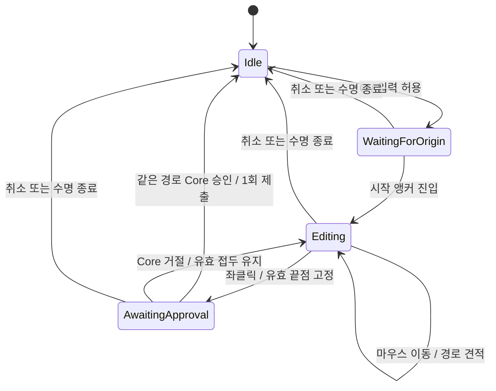

# 전투 View 설계 — 부트스트랩 · 전투 씬 · 상태 표시 · 입력 → 명령

- 작성일: 2026-09-30 (12차 View 내부 책임 분리 2026-10-05)
- 작성: View 작업(스테이지 내부 담당)
- 현재 UML: [골격·View 통합 도표](2026-10-05-combat-current-uml.md) / [HTML](2026-10-05-combat-current-uml.html). [초기 구현 예상 UML](2026-10-01-combat-view-implementation-uml.md)은 당시 설계 이력이다.
- 판: **12차 View 내부 책임 분리**(§24, 2026-10-05). §23의 경로 이동·순서 연출·서비스·정상 이탈 계약 위에 소비자별 표시 계약과 사건 Presenter 수명을 정렬한다. 진행/검증 상태는 계획 §7, Flow 분기는 골격 §4.1, 이탈 정책은 골격 §6.4가 원본이다.
- 진행·검증 상태: 이 문서에 적지 않는다. **[전투 View 계획 §7](../plans/2026-10-01-combat-view-plan.md#7-검증과-실행-기록)이 단일 기록**이다.
- 출발점: [전투 View 설계 세션 인계](../handoffs/2026-09-30-combat-view-design-session-handoff.md) §6, [Core 대기 인계](../handoffs/2026-09-30-combat-flow-core-wait-session-handoff.md) §7-3
- 함께 볼 문서: [전투 진행 골격 설계](2026-09-30-combat-flow-skeleton-design.md)(K1~K19), [입력 사용 안내](../viewDocs/stage-input-guide.md), [옛 View 코드 대응표](2026-09-28-stage-view-buffer-mapping.md), [Framework 조사](2026-09-30-combat-framework-survey.md)

## 0. 요약

- **부트스트랩은 View가 만든다.** DB 생성 → 런타임 조립 → 수명 단계 → 매 프레임 Tick → 종료를 맡는 `GameBootstrap`(MonoBehaviour, 씬을 넘어 유지). 초기화·Tick·View 입력 예외는 같은 오류 경계로 모아, 첫 오류에서 입력과 전환·새 Job 등록을 막고 한 번 보고한다(F1, W1, §10).
- **전투 씬을 새로 만든다.** Boot 0, Stage 1, Combat 2. Lobby 3·Artifact 4는 미등록 씬의 예약 번호다. 모든 LifeCycle이 `SceneIndices`를 사용해 중복을 없앤다(§11).
- **범위는 (b)에서 확장됐다:** 입력 → 명령 기록, Buffer 상태 표시(필드·구조물·유닛·손패·기본 HUD)에 경로 이동·Return과 사건 순서 재생을 포함한다. 시간 기반 이동은 기존 View Tick에서 진행하고, 비이동 VFX·전체 결과 화면은 후속 범위다(§9·§23).
- **View의 조정자는 `CombatViewSystem`이다.** 서비스·씬 연결과 결과 후처리 순서를 조정한다. 재생·완료·취소 수명은 `CombatResultPlayback`, 입력 허용은 `CombatInputPolicy`, 배치/공격 해석·대기는 `CombatInteraction`, 경로/Return은 `CombatPathInput`·`CombatMovementInteraction`, 변경 신호는 `CombatViewRefresh`, 실제 연출은 `ICombatPresentation`, 그림은 Presenter가 맡는다(§4·§9).
- **공유 오류 경계는 런타임 공통 영역에 둔다(W17).** `RuntimeSystem/Common/RuntimeFaultBoundary.cs`를 Bootstrap이 생성·소유하고 View·Flow에 주입한다. 공통 객체는 View·LifeCycle·Unity 구체 타입을 참조하지 않는다.
- **표시 갱신은 기존 View 재사용을 기본으로 한다(W19).** 필드 구성은 전투 설치 때, 동적 값은 결과 후에 반영한다. 결과마다 전체 객체를 반환·재대여하거나 동일 UI 값을 다시 쓰지 않는다(§6.1).
- **화면 상태는 결과를 처리한 뒤에 적용한다.** 새 결과 → Playback의 완료 관측 → View Tick에서 표시 반영 → 입력 정리·`AcknowledgePresented`. 콜백은 완료/실패 사실만 기록하고 실패 관측 시에는 F1으로 정지한다.
- **Live 입력은 Core가 게시한 국면을 따른다(W13·W14).** 밤이 끝나 `StagePhase.Deployment`가 되면 결과를 그린 뒤 배치 Layer로 돌아간다. `Automatic`·미확인 결과·시작/턴 종료 대기 중에는 새 명령을 받지 않는다. 턴 종료는 선행 미처리 명령이 없을 때 한 번만 기록한다.
- **전투 종료는 새 입력만 닫는다(W15).** `Finished` 또는 `Completion`을 관측하면 입력을 해제하되, 마지막 결과의 연출·그리기·확인은 계속한다. 오류 정지용 `StopInput`과 구분한다(§5.6).
- **개발용 상태는 Core의 준비 입력 자리로 넣는다(W7).** 개발 전용 준비 입력(`IBattleInitializationSource` 구현)과 로스터 초기화를 부트스트랩 개발 설정으로 연결하며, **Core가 계산하고 Buffer에 기록**한다. View가 쓰는 Buffer는 `CombatViewBuffer`뿐이다.
- **두 개발 모드는 같은 진입 계약을 사용한다(W12·W23).** 로스터·챕터 준비 후 chapterKey/nodeId를 골격 진입 경계로 전달하고 진입 Job이 `EnterBattle`을 호출한다. 기록 모드도 유효한 대상이 필요하며 수락 후 처리 등록만 막는다. Bootstrap에서 Combat 선택을 선확정하지 않는다(§8.2·§22).
- **개발 진단에는 `RecordInputOnly`를 유지하고, 실제 처리는 별도 `Live`로 검증한다(W8).** Core Task 7은 도착했다. 골격 Phase 5, 단일 F1, View 결과 소비자와 유효 fixture가 갖춰지면 개발 Live 첫 진입을 검증할 수 있다. 기록 모드는 실제 준비 뒤 처리 등록만 차단하며 결과·번호·확인을 위조하지 않는다.
- **선행 작업:** T11의 새 테이블 3개 등록뿐 아니라 기존 `CombatStageDetail.Economy` 참조까지 유효해야 DB 생성이 성공한다. 값의 기준은 DB 계획이다. 이 보완이 운영 준비 T1/G7 완료를 뜻하지 않는다.

## 1. 결정 입력과 범위

| 결정 | 답 |
|---|---|
| 1 부트스트랩 | **View가 만든다**(2026-09-30) |
| 2 전투 씬 | **새 Combat 씬 추가**(2026-09-30) |
| 3 범위 | 초기 결정은 **(b) 상태 표시까지, 연출은 구조만**(2026-09-30). 현재 이동·Return 연출과 최소 Completion 확인 범위는 §23을 따른다 |
| 4 Core 전 확인 수단 | **Core 준비 입력 + 로스터 초기화(W7), 개발용 `RecordInputOnly`(W8)**. 준비된 상태와 입력 기록을 확인하며 규칙 실행은 흉내 내지 않는다 |
| 5 옛 View 코드 가져오기 | W6: L 분류 중 이번 범위에 필요한 것만 |
| 6 연출 사건 경로 | Core 결과의 사건 순서를 OrderedCombatPresentation으로 재생한다. 이동은 시간 기반이고 비이동 사건은 즉시 반영한다. 후속 연출도 같은 완료/실패·Cancel 계약을 사용한다 |

| 포함 | 제외 |
|---|---|
| 부트스트랩, Boot·Combat 씬, 씬 연결 | 스테이지 맵 → 전투 전환(스테이지 맵 쪽), 로비 |
| 필드 셀·레일·배치 구역·구조물·유닛·손패 표시, 기본 HUD(재화·남은 드로우·유닛 체력), Return 견적·최소 Completion 확인 | 전체 결과 화면·턴/밤/필드 효과·타임라인 UI. 데이터/API 도착과 표시 범위 확대는 별개 |
| 입력 → 명령·미리보기 기록, 결과 확인·입력 정리, 배치 ↔ 전투 Layer 동기화, 종료 시 새 입력 차단 | 드래그 중 전체 배치 가능 영역(요청 하나에 응답 하나라 전체를 한 번에 알 수 없음). 미리보기 결과 중 공격·이동 숫자 표시(피해량·비용) |
| 미리보기 응답 사용(9차, W21): 공격 조준, 이동·공격 범위·대상 칸, 호버 가능 여부, 고스트 색, 현재 행위자 칸 | |
| 공격 지정 방식 DB 테이블·UnitDataSO 참조(9차, W22, DB 담당 범위) | Core의 DB → 전투 정의 조립 연결(T1/G7, Core 몫) |
| 결과 전체 수명·사건 순서 재생·시간 기반 이동·Return 표시 | 비이동 애니메이션·이펙트·추가 박자 구현 |
| 개발용 준비 입력과 로스터 초기화(개발 설정) | 전체 결과 화면·포기 버튼(정상 이탈의 최소 확인 UI는 골격 §6.4) |
| T11 새 테이블 3개·기존 스테이지 경제 참조 검증(선행) | FieldCamera, Architecture(다른 작업자) |

## 2. 전제 — 코드에서 확인한 것

| 항목 | 사실 |
|---|---|
| 런타임 수명 | GameBootstrap이 `FrameworkRuntimeFactory.Create(...)` → `BindScene` → `InitData(DB)`(한 번) → `PostBindService` → `Initialize` → 매 프레임 `Tick` → `Shutdown`을 소유한다 |
| DB | `DataBaseFactory.Create(DatabaseCatalogSO)`. CategoryConfig·StageEconomy·RecoveryOption과 A2 지정 방식 테이블까지 등록돼 있다. DB 로드와 Core의 운영 BattleInitialization 조립 성공은 별개다 |
| 씬 | Build Settings는 Boot 0, StageSelect 1, Combat 2. SceneIndices의 Lobby 3·Artifact 4는 미등록 예약 번호다 |
| 로딩 | `LodingSystem.Load(sceneIndex)` → 씬 로드 → `RegisterSceneEnterLoaded/ExitLoaded(sceneIndex, node)`로 등록된 Node 실행. **로드 뒤 `BindScene`은 다시 불리지 않는다** |
| View 그룹 | InGameViewSystemFactory가 CombatViewSystem을 서비스·모듈로 Export하고 OrderedCombatPresentation을 주입한다. InGameViewSystemGroup은 등록된 모듈에 수명을 전달한다 |
| 입력 | `IStageInputReceiver`를 구현해 루트 서비스 `IStageInputReceiverSlot`에 `Bind`. Layer는 `ChangeLayer`/`ClearLayer` |
| 입력 실행 시점 | `UnityInputBridge.OnActionTriggered` → `InputSystem.Submit` → View는 Unity 콜백 경로다. `runtime.Tick`을 멈추는 것만으로 차단되지 않는다 |
| 전투 상태 | `ICharacterBufferReadSink.Characters`(`CharacterData`), `ICombatStateBufferReadSink`(`HasBattle`, `Current`: 보드 크기·손패 용량·드로우 순서·커서·`Structures`·`RailCells`·기믹 정의·배치 깊이, 번호 셋, 국면) |
| **결과 읽기** | `ICombatResultReadSink.TryGetLatest(out CombatResult)`: `Sequence`, `Kind`(Command/Advance), `CommandNumber`(진행이면 0), `Accepted`, `Reason`(거절 사유 **코드**, 표시 문구 아님). Core Task 7의 실제 결과·사건 발행과 EndBattle·재준비 뒤 결과·번호 보존 구현 도착 |
| 입력 Buffer | `ICombatViewBufferWriteSink`: `Submit`, `SetPreview`, `ClearPreview`, `RemoveCommandsThrough`, `AcknowledgePresented`, `Clear` |
| 준비 입력 자리 | `IBattleInitializationSource.Read(database, chapterKey, stageKey)` → BattleInitialization. A2 지정 방식·유닛 참조/query는 제공됐지만 기본 DatabaseBattleInitializationSource는 adapter 조회 후 아직 T1/G7 예외를 던진다. 전체 준비 정의의 조립·반환은 Core 인수 대기다. 명시적 개발 source 주입은 유지한다 |
| 로스터 | `CoreGroup.Characters.InitializeRoster(loadoutKey)`(Core가 DB PlayerLoadout으로 보유 캐릭터를 만든다). `PrepareBattle`은 보유 메인 상태가 있어야 성공 |
| 외형 DB | `IUnitVisualTableQuery`(키 → 프리팹·이름·아이콘), `IStageFieldViewTableQuery.Config`(셀 프리팹·간격·고스트 재질·색·크기) |
| 공용 도구 | Render `ColorScop`·`OutlineScop`, Framework `CustomPool<T>`(FW-014) |
| Tick 순서 | Buffer → Global(Runner) → InGame(Core·**View**) → LifeCycle(Flow) |
| 처리 Job 연결 | 네 Job이 준비·명령·미리보기·자동 진행 Core API를 호출한다. View는 결과를 소비·확인하고 F1은 예외 뒤 실행을 차단한다. Flow 등록 정책은 골격 §4.1을 따른다 |
| 전투 진입 전제 | `EnterBattle`은 로스터·진입한 챕터·유효한 대상 노드를 요구하고 Core가 StageKey를 결정한다. 호환 `PrepareBattle()`도 확정된 맵·선택이 필요하다. 준비 source는 `Read(database, chapterKey, stageKey)` |
| 전투 종료 전제 | 승패 시 Core가 챕터 진행 판정을 한다. `EnterBattle`의 공동 게시로 Current 선택과 전투를 일치시키며 View가 재확정하지 않는다. 실제 대상 Stage 검증(Economy 포함)은 두 모드 모두 적용된다 |
| 재화 | Stage/Run이 공통 CurrencyBuffer를 사용한다. StageEconomySpec.InitialGold의 운영 잔액 설치가 연결되지 않았고 기본 잔액은 0이다. 분리된 잔액·SO/DB 초기화·보존 경로는 Core 요청 3을 따른다 |
| Factory 테스트 | FrameworkRuntimeCompositionTests·ChapterGraphPreparationTests의 리플렉션 호출은 현재 서명에 대응한다(§8.3). 이후 선택 인자를 추가할 때도 호출 배열을 함께 대조한다 |

## 3. 이어받는 규칙

옛 View 문서(`origin/feature/Yonggeun/Combat`의 `docs/superpowers/viewDocs/`)와 전투 진행 골격 결정에서 가져온다.

| 규칙 | 출처 |
|---|---|
| **부르는 쪽은 원하는 표시 상태만 말하고, View를 찾는 일은 그 View를 소유한 Presenter가 한다**(`SetHiddenEntity(id)`, `PlayUnitMotion(id, motion)`) | placement-drag §3, combat-presentation-hooks |
| 유닛 본인에게 붙는 표현은 소유자 API로, 이벤트는 유닛과 무관한 것에만 | combat-presentation-hooks |
| **화면 상태는 결과 처리(연출) 뒤에 적용한다** | stage-redesign 01-design §1·§5 |
| 전역 `EventSystem` 구독을 쓰지 않는다. 전투 표현 통로는 전투 구간이 소유 | combat-presentation-hooks, DR-008 |
| 조립·수명·분배의 주인은 하나, 표현 모듈은 표현만 | stage-combat-integration §1.1·§6.4 |
| 씬 참조는 한 곳에서 한 번 연결. Tick·입력 경로에서 `Find`·`GetComponent`·LINQ 금지. 모듈 목록은 캐시 | stage-combat-integration §6.2·§11 |
| Drag 상태는 한 곳이 소유하고, Drag 자체는 Core 상태를 쓰지 않는다. 처리 결과로 입력 문맥이 바뀌면 이전 Drag·선택을 취소한다 | placement-drag §1·§3, W13 |
| 풀에서 돌려받을 때 콜백·숨김 상태 초기화 | stage-combat-integration §11 |
| **명령은 처리 번호를 확인한 뒤에만 지우고, 입력 전체 비우기는 진입·이탈에서만(LifeCycle 소유)** | 골격 K14 |
| **거절·연출 없는 결과도 확인한다.** 안 하면 Flow가 연출 대기에서 멈춘다 | 골격 K1, 계획 7.4 |
| **상태 변경 결과를 확인하면 기존 미리보기를 무효화**하고, 필요하면 새 번호로 다시 요청 | 골격 계획 7.4 |
| **View는 Core 소유 Buffer에 쓰지 않는다**(View가 쓰는 것은 `CombatViewBuffer`뿐) | CLAUDE.md, 설계 원칙 SSOT |

## 4. 전체 구조

```text
[Boot 씬 · 씬을 넘어 유지]
GameBootstrap (MonoBehaviour)
  ├─ DatabaseCatalogSO → DataBaseFactory.Create
  ├─ RuntimeFaultBoundary 하나 생성 → 런타임 조립에 공유(전역 이벤트 아님)
  ├─ 런타임 생성(준비 입력·CombatExecutionMode·오류 경계) → 수명 단계
  ├─ 개발 Combat: 두 모드 모두 로스터·챕터 준비(Core 공개 서비스) → CombatEntry.RequestEntry(chapterKey, nodeId)
  │   └─ 골격이 요청 수락·Job 완료를 확인한 뒤 Combat 활성화(§8.2·§22). 비전투 시작만 LifeCycle Change
  ├─ Update: 오류 없을 때 Tick · 예외면 오류 경계에 보고(W1)
  └─ 종료: Shutdown 한 번

[Systems · InGameViewSystemGroup]
CombatViewSystem (ICombatViewService 서비스 + 수명 모듈 — 연결·후처리 순서)
  ├─ PostBindService: 필요한 싱크만 보관(상태·결과·캐릭터·재화·입력 확인 번호 읽기, 입력 쓰기), 입력 슬롯, Layer, 로딩 등록, ICombatEntryRead
  ├─ InitData: View DB(UnitVisual·StageFieldView)
  ├─ Initialize: 전투 씬 Enter/Exit Node 등록(W2)
  ├─ Attach(CombatSceneRoot) / SuspendSubmissions / StopInput / Detach / Shutdown
  ├─ Tick: 활성 요청 확인 → 종료 입력 해제 → Refresh(신호) → Playback(재생·완료 관측) → 표시 반영 → 입력 정리·확인
  ├─ CombatResultPlayback(재생 번호·연결 세대·완료/실패·후처리 토큰·취소 수명)
  ├─ CombatInputPolicy(읽은 사실 → 입력 허용·목표 Layer, 무상태)
  ├─ IStageInputReceiver → CombatInteraction(배치·공격·단일 대기)
  ├─ CombatPathInput → CombatMovementInteraction(경로 초안·견적 context·Return)
  ├─ OrderedCombatPresentation → CombatMovementPlayback(사건 순서·이동 단계 완료 관측)
  └─ ICombatExitPresentation(제출 정지·Completion 표시 완료, 정책은 골격 §6.4)

[Combat 씬]
CombatSceneRoot (Inspector 참조·검증, 비활성화 신호)
CombatSceneDisplay (ICombatBattleDisplay 구현, 아래 씬 Presenter에 값 전달)
  ├─ CombatSceneEventPresenter  사건 표시 사실·시간 기반 이동 보간(내부 객체)
  ├─ FieldView      셀 풀·좌표 변환·셀 강조
  ├─ FieldUnitPresenter  ID별 FieldUnitView 재사용·구조물 표시
  ├─ HandPresenter       3D 손패·카메라 기준 위치
  ├─ PlacementGhost Drag 고스트
  ├─ CombatHud      재화·남은 드로우·Return 버튼/견적·Completion 확인
  └─ 개발 Layer 패널 RecordInputOnly 전용 배치/전투 버튼·기록 모드 표시(W20, §8.1)
```

| 타입 | 소유하는 것 | 소유하지 않는 것 |
|---|---|---|
| `GameBootstrap` | 런타임 생성·수명·Tick, 예외 정지, 시작 구간, 개발 설정 연결 | 게임 규칙, 전투 표시 |
| `RuntimeFaultBoundary` | 런타임 공통 영역의 최초 오류·정지 여부, 주입된 정리 콜백 실행·보고 | View/Flow 구체 타입, 전투 상태·규칙 |
| `CombatViewSystem` | 서비스·씬 연결, 담당 객체 호출과 표시/입력 후처리 순서, Buffer 확인·입력 해제 실행 | 재생 번호·세대·완료 상태 소유, 명령별 허용 분기, 규칙·개별 그림 |
| `CombatResultPlayback` | 결과 하나의 재생 수명·토큰, 완료/실패 통지 관측, 후처리 진입·종료, 취소(순수 C#) | Buffer 읽기/쓰기, Presenter·Layer 조작, 오류 전역 상태·보고, 별도 결과 완료 카운터 |
| `CombatViewRefresh` | "어디까지 그렸나" 신호 비교(순수 C#) | 그리기 |
| `CombatInputPolicy` | 현재 사실에 대한 명령별 제출·미리보기 허용, Core 국면 → 목표 Layer 변환(무상태 순수 C#) | 상태 보관, Buffer·Core 서비스 호출, Layer 변경, 규칙상 가능 여부 |
| `CombatInteraction` | 배치 Drag·공격 모드, 시작/턴 종료의 단일 대기 기록 | Core 국면 보관, Buffer 읽기 순서, 허용 조건 중복 구현, 그리기 |
| `CombatPathInput` / `CombatMovementInteraction` | 포인터 매핑, 경로 초안·견적 대응·Release 대기·Return 의도 | Core 이동 비용/경로 규칙 계산, 결과 전체 확인 |
| `OrderedCombatPresentation` / `CombatMovementPlayback` | 결과 내부 사건 순서·이동 단계와 연출 자원 | Core 상태 쓰기, Buffer 확인 번호 |
| `CombatSceneDisplay` | 씬 구성·입력 피드백·UI 연결, Install/Refresh/정리 조정 | 사건 사실 목록·이동 보간 상태, 결과 확인 |
| `CombatSceneEventPresenter` | 표시 중인 사건 사실, 이동 시간/보간, Build 후 Mapper 연결 | Buffer/서비스 조회, 명령 대기, 결과 확인, 씬 풀 전체 반환 |
| `ICombatPresentation` | 결과 하나의 연출과 자기 임시 자원 정리, 완료/실패 통지·취소 | Core 상태 적용, Buffer 확인, 씬 소유 자원의 전체 해제 |
| 씬 Presenter | 자기 View를 찾고 그리기(소유자 API) | Buffer·Core 접근 |
| `CombatSceneRoot` | 씬 참조 모음, 저작 검증, 비활성화 통지 | Tick·입력 해석·Buffer 조회 |

Presenter는 Buffer 인터페이스를 모른다. `CombatViewSystem`이 읽은 값(`CharacterData` 목록, `CombatStateData`)을 넘긴다(ISP·DIP). `CombatExecutionMode`는 조립 때 고정되는 실행 설정이며 Core의 전투 국면이 아니다. Flow 판단은 골격 설계 §4.1을 따른다.

`CombatInputPolicy`는 내부 구체 타입으로 두며 새 서비스·인터페이스를 등록하지 않는다. `CombatViewSystem`이 외부 입력마다 읽은 값과 수명/결과 처리 상태를 호출 범위의 값으로 전달하고, `CombatInteraction`은 자신의 대기 상태를 더해 Policy의 판단에 따라 기록한다. Tick의 종료 판단(`IsTerminal`, 가칭)과 목표 Layer 결정도 같은 Policy를 사용한다. 허용값을 다음 입력까지 캐시하지 않으며, Core 국면을 복제한 View 상태 머신을 만들지 않는다.

`CombatResultPlayback`도 서비스 등록 없는 내부 객체다. 연결 세대·처리 중 번호·완료/실패·후처리 중 여부는 이 객체만 소유하고 ViewSystem은 조회한다. 결과 후처리의 실행 순서는 ViewSystem에 남긴다. Playback에 Presenter나 임의 후처리 델리게이트 목록을 주입해 조정 책임을 옮기지 않는다. 두 객체의 경계는 §9.1의 토큰 계약으로 고정한다.

## 5. 흐름

### 5.1 부팅과 전투 진입

```text
Boot 씬 → GameBootstrap.Awake
  중복 인스턴스 차단, DontDestroyOnLoad, 공유 오류 경계 생성
→ GameBootstrap.Start: 씬 검증, DB 생성
  런타임 생성(준비 입력·실행 모드·오류 경계) → BindScene → InitData → PostBindService → Initialize
    (CombatViewSystem.Initialize가 전투 씬 Node 등록)
  개발 설정(§8.2):
    Live/RecordInputOnly 공통: InitializeRoster → EnterChapter, 각 결과 확인
  Combat 대상 chapterKey/nodeId → 골격 진입 요청 경계
→ 기존 Register → Plan → Runner → 진입 Job → Core.EnterBattle(chapterKey, nodeId)
→ Core가 Current/Character/Combat 공동 게시 → 이번 요청 수락 결과·Job 완료
→ 실행 계층이 준비된 전투를 한 번 활성화 (구체 로딩/결과 수신 위치는 골격 설계 §6.3)
→ CombatLifeCycle은 중복 준비하지 않음, View는 SceneRoot Attach → 최초 전체 그림
→ 수락·활성화·그리기 성공 뒤 Core StagePhase의 Layer와 입력 연결
→ RecordInputOnly: 이후 처리 Job 등록 0, View Tick·입력 기록은 유지
→ Live: 기존 국면·입력·연출 완료 조건에 따라 일반 처리
  정상 진입 거절: 결과 전달, 활성화·자동 재시도 없음 / 예외: 단일 F1
```

Bootstrap에서 개발 대상 없이 Combat을 직접 시작하면 진입 요청 전에 설정 오류로 정지한다. 운영 호출자가 유효한 로스터·챕터·대상으로 요청하더라도, 현재 기본 DB source는 준비 Job에서 T1/G7 예외를 던진다. 두 실패를 구분하며 모두 공유 F1으로 보고한다. fixture 진입은 운영 준비 조립의 성공을 대신하지 않는다.

### 5.2 명령 하나

```text
View  경로 Drag → CombatPathInput/CombatMovementInteraction → Core 견적 응답
      → Submit(Move(unit, path, context)) → 명령 N
Flow  명령 N 등록 → Runner → Core 처리(골격 Phase 5에 연결) → 결과 R(Sequence), 처리 번호 = N
View  다음 Tick: LatestResultSequence 증가 신호
      → 종료 상태면 새 입력만 해제(§5.6), 아래 결과 처리는 계속
      → TryGetLatest(out R) → Playback.Begin(R) → Presentation.Play(R, onFinished)
      → 통지는 Playback에 완료/실패 사실만 저장
      → 실패면 Tick에서 F1, 완료면 Playback.TryBeginFinalization으로 토큰 획득
      → 같은 Tick(즉시 완료) 또는 다음 Tick(비동기 완료)에서 Buffer 상태로 표시 반영
      → 일치하는 시작/턴 종료 대기 해제(§7.2), Core 국면으로 Layer 동기화(§5.5)
      → 미리보기 무효화·현재 입력 문맥에서 허용될 때만 새 번호로 재요청
      → RemoveCommandsThrough(HandledCommandNumber)   (K14: 처리 번호 확인 뒤에만)
      → AcknowledgePresented(R.Sequence)              (위 단계 성공 뒤 마지막, 거절이어도)
      → Playback.CompleteFinalization(token)          (일시적 재생 상태만 해제)
Flow  연출 확인됨 → 다음 판단
```

**시작/턴 종료 대기(W5·W14)는 §7.2, Layer 동기화(W13)는 §5.5가 기준이다.** 대기의 해제는 명령 번호로 결정하고, 적용할 Layer는 현재 Core 국면으로 결정한다. 자동 진행 결과도 Layer를 바꿀 수 있다. 후처리 중 외부 입력은 차단하며 Layer 변경이 만드는 `SelectCanceled`는 표현만 정리한다. 모든 후처리 성공과 마지막 확인 전에는 새 명령을 허용하지 않는다.

### 5.3 변경 신호

Buffer에는 변경 알림이 없다. `CombatViewRefresh`는 전투 표시 여부·확인한 미리보기 응답 번호를 비교한다. **결과 처리 완료의 기준은 `CombatViewBuffer.PresentedResultSequence`**를 읽어 사용하고, 같은 의미의 별도 완료 카운터는 만들지 않는다. `CombatResultPlayback`이 보관하는 처리 중 결과 번호와 완료/실패 표시는 재생 중복 방지를 위한 일시적 상태다. 이를 읽기 위해 `ICombatViewBufferReadSink`도 필요한 싱크에 포함한다.

| 신호 | 뜻 | View가 하는 일 |
|---|---|---|
| (신호 아님) 첫 그리기 | Attach 시점에는 항상 전투가 있다 | **Attach가 전체를 한 번 그린다**(2026-10-09 개선 설계 D13) |
| (신호 아님) 전투가 사라지거나 바뀜 | EndBattle 또는 다른 전투 | **표시를 비우고 씬 연결을 끊는다**(Detach, D9). 같은 씬에 다음 전투를 다시 붙이지 않는다 |
| `LatestResultSequence > PresentedResultSequence` | 미확인 명령·진행 결과 | 처음 관측할 때 종료·포기 가능 여부를 맞춘 뒤(D12) 아래 일관성 검사와 §5.2 |
| `AnsweredPreviewNumber` 증가 | 미리보기 응답 | 현재 요청 번호와 같은 응답이면 Interaction이 조준 목록·범위·가능 여부로 쓴다(9차, §21.1) |

`S = LatestResultSequence`, `P = PresentedResultSequence`로 둔다. [Core 답변](../handoffs/2026-10-01-combat-core-reply-to-task4a-view-reply.md)대로 결과·카운터·관련 상태는 함께 게시된다. 정상적인 불일치 중간 상태를 가정하지 않는다.

| 관측 | 처리 |
|---|---|
| `S == P`, 결과 없음 | 정상. 양수여도 이전에 확인한 결과가 정리된 상태이므로 기다리지 않는다 |
| `S == P`, 결과 있음·`Sequence == S` | 이미 확인한 결과. 재생·삭제·확인을 반복하지 않는다 |
| `S == P + 1`, 결과 있음·`Sequence == S` | 새 결과 하나. 처리 중인 번호라면 재생을 반복하지 않고 완료만 기다린다 |
| `S > P`, 결과 없음 | 미확인 결과 유실. 오류 정지, 확인 번호를 임의로 올리지 않는다 |
| 결과가 있는데 `Sequence != S` | 게시 계약 위반. 재시도하지 않고 오류 정지 |
| `S < P` 또는 `S - P > 1` | 역행·결과 건너뜀. 오류 정지, 최신 결과만 처리해 누락을 숨기지 않는다 |

- K1과 호출 한 번당 결과 하나 계약 때문에 정상 흐름에는 미확인 결과가 최대 하나다. 계약 위반은 `RuntimeFaultBoundary`에 한 번 보고한다.
- 최초 Attach는 기존 표시 이력과 관계없이 현재 전투를 한 번 그린다. 결과 확인 번호는 Buffer의 `P`를 따르며 씬 연결·해제 때 0으로 되돌리지 않는다.
- **2026-10-09 정정(개선 설계 D9·D13):** 원래 이 표는 전투 설치·정리를 Buffer 변화 신호로 감지했다(씬이 먼저 뜨고 준비가 나중에 끝나던 K20 이전 흐름). 지금은 Combat 씬 Enter 노드에서 LifeCycle이 준비된 전투를 먼저 활성화하므로 Attach 때 항상 전투가 있고, 전투가 사라지면 Detach한다. 그래서 설치·정리 신호를 없앴다. 이탈 중 새 Run 준비 동안 필드가 비어 보이는 것은 이 결과이며 의도한 동작이다.
- 전투가 정리되면 표현과 Interaction을 정리한다. 미확인 결과가 남은 상태의 Detach는 정상 전투 이탈로 간주하지 않는다. 재진입은 골격 §6.3~§6.4를 따른다. 중간 전투 복원·포기를 임의로 지원하지 않는다.

### 5.4 미리보기

- 규칙 계산이 필요한 표시는 `SetPreview`로 요청하고, 응답 번호가 현재 요청과 같을 때만 표시한다. 번호가 다르면 버린다.
- 미리보기 응답 계약(R11)은 도착했다. **이번 범위(9차)는 요청 기록과 응답 사용까지다**: 공격 조준 선택, 이동·공격 범위·영향 칸, 호버 가능 여부, 배치 고스트 색(§21.1). 피해량·비용 같은 숫자 표시는 후속 범위다.
- 이동·공격 모드는 범위 응답을 받기 전에는 호버 요청으로 범위 요청을 덮지 않고 기록도 하지 않는다. 받은 범위 응답은 모드 동안만 보관하고 결과 후처리에서 버린 뒤 다시 요청한다. RecordInputOnly는 Core가 답하지 않으므로 응답 없이 칸 기준으로 기록한다.
- 규칙이 필요 없는 표시(호버 칸 강조, 선택 외곽선, Drag 고스트 위치)는 View가 바로 그린다.
- Live의 일반 연출 중에도 §7.1의 국면·대기 조건을 만족하면 미리보기 요청은 가능하다. 자동 진행·시작/턴 종료 대기·전투 종료 중에는 새 요청을 만들지 않는다. 결과 후처리는 기존 요청을 무효화하고 유효한 선택·모드가 남아 있을 때만 재요청한다.

### 5.5 Core 국면과 입력 Layer (W13)

`StagePhase`는 `Current.CommandState.Turn.StagePhase`, 처리 국면은 `ICombatStateBufferReadSink.Phase`에서 읽는다. `Current`의 값은 `HasBattle`이 true일 때만 접근한다. 아래는 **Live의 입력 연결 정책**이며 Core 전환 규칙이 아니다. 초기 전체 그리기와 모든 Command/Advance 결과의 그리기 성공 뒤 적용한다. 종료 차단은 그리기를 기다리지 않고 §5.6을 따른다.

| 현재 Core 사실 | 목표 Layer | 새 명령 |
|---|---|---|
| `!HasBattle`, 준비 표시 전 | 없음 | 금지 |
| `Phase == Finished` 또는 `Completion != null` | 없음(다른 조건보다 우선) | 금지, 결과 소비는 유지 |
| `StagePhase == Deployment` | Deployment | §7.1 조건을 만족할 때 허용 |
| `StagePhase == Combat` | Combat | `PlayerInput`과 §7.1 조건일 때 허용. `Automatic`에서는 금지 |

- 밤 종료 시 Core가 유닛을 회수하고 `StagePhase = Deployment`를 게시한다. 그 결과가 Command든 Advance든 다시 그린 뒤 Deployment로 돌아가 다음 배치·드로우·전투 시작을 받을 수 있어야 한다. 밤/턴 HUD 추가와 별개의 필수 입력 동작이다.
- `IInputLayerService.CurrentLayer`와 목표가 다를 때만 변경한다. 자동 진행이라는 이유만으로 Combat Layer를 다른 Layer로 바꾸지 않는다. 실제 제출 허용은 Policy가 매 입력마다 현재 사실로 판정한다.
- Layer가 바뀌거나 선택/Drag가 현재 `ActiveActorId`·유닛 위치/소속 영역과 맞지 않게 되면 Interaction의 Drag·모드·선택과 고스트·숨김·미리보기를 정리한다. 이전 행위자 대상으로 다음 턴의 미리보기를 자동 재요청하지 않는다. 행위자 국면 사본은 저장하지 않고 선택/Drag가 이미 가진 ID·영역과 현재 값을 비교한다.
- 결과 처리 중 Layer 변경의 재진입에도 §9의 세대·오류 검사를 유지한다. 결과의 `Accepted`만으로 Layer를 강제하지 않는다. 거절 뒤에도 현재 Core 사실을 따른다.

### 5.6 전투 종료의 새 입력 차단 (W15)

종료 판정은 `Phase == Finished || Completion != null`이며 Policy의 한 함수로 정의한다. Core는 종료 후에도 `HasBattle`을 유지하므로 이를 종료 판정으로 쓰지 않는다. 매 외부 입력과 View Tick에서 현재 사실을 읽어 같은 함수를 사용하며 별도 `isFinished` 필드를 만들지 않는다.

1. Tick에서 종료를 관측하면 `SuspendSubmissions`(내부 역할명)를 수행한다. 남아 있는 Drag·모드·선택·고스트·원본 숨김·미리보기를 정리하고, 연결돼 있을 때 슬롯 `Unbind(this)`, Layer가 있을 때 `ClearLayer()`를 수행한다. 정리는 멱등적이며 반복 Tick에서 빈 표현·해제된 연결을 다시 변경하지 않는다. 정리 중 하나가 실패하면 남은 해제도 시도하고 F1으로 보고한다.
2. **정상 종료 차단은 Attach·SceneRoot·Playback의 세대·처리 중 결과·완료 예약·명령 대기를 보존한다.** Playback.Abort·Presentation.Cancel·StopInput·Detach·Shutdown을 부르거나 Tick에서 조기 반환하지 않는다. 외부 콜백은 Tick 전에도 Policy의 종료 검사로 새 Submit/SetPreview를 막는다.
3. 미확인 마지막 결과가 있으면 연출 완료 → 마지막 상태 그리기 → 일치 대기 해제 → 처리 번호까지 삭제 → `AcknowledgePresented`를 한 번 수행한다. 종료 중에는 Layer를 다시 켜거나 미리보기를 재요청하지 않는다. 지연 완료 콜백도 같은 세대로 살아 있다.
4. 새 결과가 없이 종료만 관측된 경우에는 입력만 닫고 `P`를 올리지 않는다. 미처리 명령은 남겨 두며 `Clear`나 임의 삭제로 버리지 않는다. 실제 이탈의 Buffer 정리는 LifeCycle/F2의 책임이다.

| 정리 동작 | 명령 대기 | 연출 세대·완료 예약 | 결과 소비 |
|---|---|---|---|
| `Cancel` / `SelectCanceled` | 보존 | 보존 | 유지 |
| `SuspendSubmissions`(정상 종료) | 일치 결과까지 보존 | 보존 | 유지 |
| `StopInput`(F1·종료 수명) | 로컬 대기 종료, 명령 Buffer 보존 | Playback.Abort로 먼저 무효화한 뒤 실제 연출 취소·자원 정리 | 중단 |
| `Detach` | 로컬 대기 종료, Buffer는 변경하지 않음 | 같은 Abort를 멱등적으로 수행, 이후 씬 참조 해제 | 중단 |

최소 Completion 확인 UI와 정상 이탈의 연결은 골격 §6.4를 따른다. 전체 결과 화면·포기 연결은 별도 범위다. `AcknowledgePresented`는 일반 결과 연출의 확인이며 F2의 Completion 표시 완료를 대신하지 않는다. 정상 종료 입력 차단 자체는 오류가 아니므로 F1을 보고하거나 런타임 Tick을 멈추지 않는다.

## 6. 표시 범위 (b)

| 표시 | 읽는 값 | 외형 |
|---|---|---|
| 필드 셀 | `CombatStateData.BoardWidth·BoardHeight` | `StageFieldView.Config`(셀 프리팹·간격) |
| 레일 칸 | `RailCells` | 셀 강조 색(임시) |
| 배치 구역 | `PlayerDeploymentDepth`·`EnemyDeploymentDepth` | 셀 강조 색 |
| 구조물 | `Structures`(앵커·방향·점유 칸·체력) | `UnitVisual`(구조물 키) 또는 임시 |
| 필드 유닛 | `Characters`의 `Area == Field`: 앵커·방향·점유 칸·진영·체력 | `UnitVisual.Prefab`, `FieldUnitScale` |
| 손패 | `Area == Hand` + `ReserveSlotIndex`, 용량 `ReserveCapacity` | `UnitVisual` |
| HUD | 재화 `CurrencyBuffer`, 남은 드로우 = `DrawOrder.Count − DrawCursor`, 유닛 체력 | UI |
| 현재 행위자 칸(9차) | `CommandState.ActiveActorId`의 점유 칸 | `FieldView` 색(씬 설정) |
| 이동·공격 범위, 공격 영향 칸, 호버 가능·불가(9차) | Core 미리보기 응답(§21.1) | `FieldView` 강조 층: 호버 > 영향 > 범위 > 행위자 > 정적 |
| 배치 고스트 가능·불가(9차) | Core 배치 미리보기 응답 | `StageFieldView`의 유효·무효 고스트 색 |

모두 View가 저장값이나 Core 응답에서 바로 얻는 값이며 규칙을 흉내 내지 않는다(P6·P7). 색·간격·프리팹은 DB나 씬 설정에서 읽고 코드에 박지 않는다.

### 6.1 표시 갱신과 자원 재사용 (W19)

문서의 "다시 그림"은 현재 값을 기존 View에 반영한다는 뜻이다. 모든 GameObject를 다시 만드는 동작이 아니다.

| 시점 | 갱신 단위 | 자원 계약 |
|---|---|---|
| 전투 설치·최초 Attach | 보드 크기·셀 배치·레일·배치 구역 등 정적 필드 구성, 동적 표시 최초 적용 | 필요한 View를 한 번 대여. 정적 필드 설정은 이 전투 수명 동안 유지 |
| Command/Advance 결과 완료 | 유닛·구조물·손패·HUD의 현재 값 반영 | Presenter의 ID → View 연결을 재사용. 새로 보이는 대상만 대여, 사라지거나 표시 영역을 떠난 대상만 반환 |
| 포인터·선택·Drag 변화 | 해당 고스트·호버·선택 강조 | 필드 전체 구성·손패 전체 풀 재생성 없음 |
| 전투 표시 정리·Detach | 각 소유자가 자기 View·Scope 반환 | Playback.Abort로 연출이 씬 참조를 놓은 뒤 반환, 중복 반환 금지 |

- 동일 값의 Transform·텍스트·색을 반복 설정하지 않는다. Presenter는 자기 표시 객체의 적용값과 비교할 수 있지만 Core 상태·판정의 가변 사본이나 새 전투 리비전을 만들지 않는다. ID → View 표는 표현 자원 연결이며 게임 상태의 원본이 아니다.
- 연출·숨김·풀 재사용이 바꾼 속성은 실제 표시값과 비교하거나 해당 적용 캐시를 무효화한다. Core 값이 같다는 이유로 임시 위치·색·숨김을 최종 상태로 복구하는 작업까지 생략하지 않는다.
- 결과마다 동적 대상 목록을 순회하는 단순 구현은 허용한다. 변경 목록·해시·별도 dirty 시스템은 비용 측정 뒤 필요할 때 추가한다. 정적 필드 전체 순회·풀 전체 반환/대여는 결과 처리의 기본 경로에 넣지 않는다.
- 값이 같거나 명령이 거절돼 실제 화면 변경이 없어도 결과 후처리와 `AcknowledgePresented`는 수행한다. 표현 최적화로 K1의 완료 확인을 생략하지 않는다.
- 이후 보드 크기·레일 등 정적 구성이 전투 중 바뀌는 기능을 넣으면 그 기능에서 재구성 신호와 자원 수명을 명시한다. 현재 고정 필드 전제를 몰래 우회하지 않는다.
- 이번 범위의 확인은 구조 검증까지다: 같은 값을 다시 적용할 때 추가 대여·반환·속성 쓰기가 없고, 대상 추가/제거 때 그 대상만 바뀌는지 가짜 표시·풀로 확인한다. 목표 기기·최대 규모·허용 기준을 정한 CPU·GC·UI 갱신 측정은 표시·규모 확장 때(계획 §8 X4) 한다. 측정 전에는 성능 통과로 표시하지 않는다.

## 7. 입력 → 명령

`CombatViewSystem`이 입력을 배치/공격의 `CombatInteraction`과 경로/Return의 `CombatPathInput`으로 전달한다. 번호는 Buffer가 발급한다. 이동 계약 상세는 [Core/View 이동 가이드 §8](../guides/unit-movement-attack-core-handoff.md#8-current-drag-path-movement-integration)을 따른다.

| 입력 | 단계 | 기록 |
|---|---|---|
| 손패 유닛 누름 → 끌기 → 칸에서 뗌 | 배치 | `Submit(PlaceUnit(id, cell, rotation))`. 끄는 동안 칸이 바뀔 때만 `SetPreview(UnitPlacement(...))` |
| 필드 유닛을 끌어 손패 영역에서 뗌 | 배치 | `Submit(ReturnUnit(id))` |
| 메인 캐릭터 최초 배치 | 배치 | `Submit(PlaceMainCharacter(cell, rotation))` |
| 전투 시작 | 배치 | `Submit(EnterCombat())`, 단일 명령 대기(§7.2) |
| 드로우 | 배치 | `Submit(DrawCharacter())` |
| 이동 모드에서 경로 Drag·Release | 전투 | 경로 초안 → `SetPreview(Move(id, path))` → 일치하는 Core 견적의 `MovementContext`로 `Submit(Move(id, path, context))` |
| Return 버튼 | 전투 | Core Return 미리보기 → 현재 견적/context 확인 → Return 명령. 배치의 손패 복귀와 구분 |
| 공격 모드 → 조준 | 전투 | `SetPreview(AttackRange(id))` → 응답의 조준 목록에서 칸·방향·전체 조준 선택(§21.1) → `SetPreview(Attack(id, aim))` → `Submit(Attack(id, aim))`. 개체 조준은 쓰지 않는다 |
| 턴 종료 | 전투 | §7.1의 선행 명령 없음 확인 뒤 `Submit(EndUnitTurn())`, 단일 명령 대기(§7.2) |
| 취소·선택 취소 | 공통 | Drag 해제, 숨김 해제, `ClearPreview`. 명령 확정 금지 |

- 포인터 → 칸 변환은 옛 `FieldGridMapper`·`FieldCellPicker`(L)를 옮긴다. `CombatInteraction`은 좌표 변환·물체 선택을 좁은 인터페이스로 받아 순수 C#으로 둔다(테스트 가능).
- Drag 중 원본 숨김은 `FieldUnitView`·`HandView`의 `SetHiddenEntity`(소유자 API).
- 모든 제출 입구와 결과 후 미리보기 갱신은 아래 Policy를 공유한다. 이는 View 입력 시점 검사이며 배치 가능 여부·행동 비용·승패 같은 Core 규칙 판단을 대신하지 않는다.

### 7.1 입력 허용 정책 (W14)

`CombatInputPolicy`는 현재 읽은 값만 받아 허용 여부와 목표 Layer를 반환한다. 진입 수명은 골격 §6.3의 `ICombatEntryRead.IsActive`로 확인한다. 입력 Policy의 공통 전제는 Attach·최초 그리기 성공·`HasBattle`·오류 없음·종료 아님·명령 대기 없음이다. 외부 입력의 처리 중에는 매 제출 직전에도 이 전제를 확인하며 결과 후처리 중 재진입한 외부 입력은 거부한다. 거부한 입력은 저장하거나 다음 턴으로 예약하지 않는다.

| 동작 | Live의 추가 전제 |
|---|---|
| 모든 `Submit` | `Phase == PlayerInput`, Core StagePhase와 실제 Layer가 해당 명령의 배치/전투 단계에 일치, `S == P`, 처리 중 연출·결과 후처리 없음 |
| `EndUnitTurn` | 위 조건 + Combat 단계 + 비어 있지 않은 `ActiveActorId` + **선행 미처리 명령 없음** |
| 새 `SetPreview`·미리보기를 만드는 모드 선택 | `Phase == PlayerInput`, 해당 단계와 실제 Layer 일치. 일반 연출 중 `S > P`는 허용하지만 결과 후처리 중 외부 입력은 차단 |
| 취소·선택 취소 | 새 명령을 제출하지 않고 표현 정리만 수행. 대기 중·종료 후에도 멱등적으로 가능 |

- 선행 명령은 `ICombatViewBufferReadSink.TryGetNextCommand(HandledCommandNumber, out _)`로 확인한다. 이미 처리됐으나 아직 삭제되지 않은 항목 수와 구분한다. 조회는 EndTurn 입력 시에만 하며 전체 큐 복사·매 프레임 순회를 추가하지 않는다.
- Core의 `EndUnitTurn()`은 행위자 ID가 비어 있으며 **실행 시점의 ActiveActor**를 사용한다. 따라서 버튼 두 번을 막는 것만으로는 부족하다. Move/Attack 등 선행 명령이 남아 있으면 턴 종료를 기록하지 않아, 앞선 처리로 행위자가 바뀐 뒤 종료되는 상황을 차단한다. Core 명령 형식은 바꾸지 않는다.
- 결과 후처리 내부의 미리보기 재요청은 다시 그린 뒤 국면·Layer·대기·선택의 유효성을 같은 Policy로 확인한 경우만 수행한다. 외부 입력 차단을 해제하는 것이 아니며 마지막 확인 전에는 Submit을 허용하지 않는다.
- `RecordInputOnly`는 §8.1의 명시적 진단 예외를 사용한다. Live 규칙을 완화하기 위한 우회 경로로 노출하지 않는다.

### 7.2 시작·턴 종료의 단일 대기 (W5·W14)

`CombatInteraction`은 `PendingInputCommand` 하나(가칭, `EnterCombat` 또는 `EndUnitTurn` 종류와 반환 번호)를 보관한다. 두 개의 대기 플래그나 별도 번호 필드를 만들지 않는다.

- `Submit` 성공 반환 뒤에만 기록한다. 대기 중에는 모든 새 명령·미리보기 제출을 막는다. Drag·모드·고스트·숨김·기존 미리보기는 정리하되 이미 제출된 명령은 보존한다.
- `Cancel`·`SelectCanceled`·Layer 해제로 대기를 지우거나 덮어쓰지 않는다.
- **그리기 성공 뒤** `Kind == Command && CommandNumber == pending.Number`인 결과에서만 대기를 해제한다. 수락·거절 모두 해제하되 다음 입력 허용은 현재 Core 사실과 `P == S` 등 §7.1에 따른다. 다른 명령·Advance 결과는 대기를 해제하지 않는다.
- 턴 종료 수락 후 `Automatic`이면 새 명령을 계속 막고, 밤이 끝났으면 배치로 복귀한다. 종료된 전투이면 입력은 계속 차단한다. 거절 결과도 확인을 마친 뒤에만 현재 국면의 입력을 재개한다.
- `RecordInputOnly`에는 일치 결과가 없으므로 EnterCombat 또는 EndUnitTurn 기록 후 대기가 유지된다. 다음 검증은 새 런타임에서 한다. 개발 도구로 대기·명령·확인 번호를 초기화하지 않는다.

## 8. 개발용 준비와 실행 모드 (W7·W8)

**1차의 문제:** View 도구가 `BattleWriteSink.PrepareBattle`로 직접 설치하면 (1) Core 소유 Buffer를 View가 쓰는 SSOT·경계 위반이고, (2) 전투 씬에 들어가면 `CombatLifeCycle.OnEnter`의 준비 Job이 G7 예외로 런타임을 멈춰 가짜 상태를 볼 수 없다.

**4차:** 기존 준비 입력 자리와 개발 등록 모드를 유지한다. Core Task 7이 도착했으므로 Phase 5·F1·소비자 연결 뒤에는 실제 Core를 쓰는 개발 Live도 검증한다. 운영 DB 준비는 T1/G7의 별도 인수 대상이다.

| 요소 | 내용 |
|---|---|
| 개발용 준비 입력 | `IBattleInitializationSource`의 개발 전용 구현(가칭 `DevBattleInitializationSource`). 테스트할 행위에 필요한 Stage·유닛·구조물·카테고리·공격 프로필·경제 정의를 명시적 fixture로 제공한다. 로스터·진행 선택·재화와 종료 정산에 필요한 전제도 조립에서 준비한다. DB를 읽어 운영 전투를 조립하지 않는다(그건 Core의 G7) |
| 로스터 | 부트스트랩 개발 설정이 `CoreGroup.Characters.InitializeRoster(loadoutKey)`를 부른다. 반환값의 성공을 확인한 뒤 진입하며, 실패 이유를 보고하고 준비를 등록하지 않는다. Core 서비스가 계산·기록한다 |
| 진행 위치(두 모드) | §8.2. 로스터·챕터 준비 후 명시적 대상을 전달한다. Current의 Combat 선택은 진입 Job의 `EnterBattle` 수락 시 Core가 게시한다 |
| 재화 | Core 공개 경로가 없으므로 개발 fixture의 `ManualDrawGoldCost`를 0으로 둔다(현재 Core 전투 계산에서 재화를 쓰는 곳은 수동 드로우뿐). 재화를 Buffer에 직접 쓰지 않는다. 재화 부족 거절 검증은 Core 경로가 생긴 뒤로 미룬다 |
| 연결 | 루트 Factory가 준비 입력은 Core Factory로, 실행 모드는 LifeCycle·View Factory로, 오류 경계는 View·CombatFlow로 전달한다. 새 설정은 생성 시 고정하며 실행 중 바꾸지 않는다 |
| 격리 | fixture와 개발 조작은 `UNITY_EDITOR || DEVELOPMENT_BUILD` 조건. `RecordInputOnly`는 비개발 빌드에서 조립 시 명시적으로 거부한다. 기본 모드는 `Live` |
| 결과 | 실제 준비 성공으로 `HasBattle`이 켜진다. `RecordInputOnly`의 처리 등록 정책은 아래 §8.1의 골격 참조를 따른다. **전투 상태 쓰기는 모두 Core가 한다** |

### 8.1 `CombatExecutionMode`

**모드 정의·허용 환경·Tick 분기 순서·BeginPreparation·Reset 정책은 [골격 설계 §4.1](2026-09-30-combat-flow-skeleton-design.md#41-한-tick의-판단-위에서부터-처음-맞는-줄-하나만)이 단일 기준**이다. Flow 생성자·LifeCycle 전달 계약은 같은 문서 §6을 따른다. 이 절은 View의 사용 목적과 검증만 설명한다.

| 모드 | View에서의 용도 |
|---|---|
| `Live` | 골격 Phase 5 + View F1·결과 소비자 + 유효 fixture + 개발 진행 준비(§8.2)로 실제 처리 검증. 기본 DB 소스의 운영 성공은 T1/G7 별도 |
| `RecordInputOnly` | 상태 표시·Drag·입력 기록의 독립 진단. 처리·결과 확인 성공 증거로 사용하지 않음 |

- 실행 모드 자체의 변경은 View 소유 `CombatFlow`의 등록 경계와 이를 전달하는 LifeCycle·Factory에 한정한다(별도 W23/골격 6A의 진입 Register·Job 확장과 구분). Core 서비스, Buffer, Job 몸통, Runner·Register는 바꾸지 않는다. 연결된 Job의 서비스 호출·정상 완료 계약은 그대로 사용한다.
- 입력 번호는 실제 `CombatViewBuffer`가 발급한다. 결과·처리 번호·미리보기 응답 번호·연출 확인 번호를 개발 도구가 만들어 넣지 않는다. `Clear`나 `RemoveCommandsThrough`로 미처리 명령을 지우지도 않는다.
- 기록은 재생 세션 동안 유지하며, 긴 자동 입력 부하 검증은 이번 범위가 아니다. 다시 시작할 때는 재생을 종료하고 새 런타임·Buffer를 만든다.
- 이동·공격·턴 종료의 기록 확인에는 `RecordInputOnly`에서만 허용되는 개발용 Layer 선택을 사용한다. 시작/턴 종료 대기·오류·종료가 없을 때만 바꾸며 Drag·미리보기를 정리한다. 화면에 입력 기록 모드임을 표시하고, Core 국면 변경이나 W5 수락 검증으로 간주하지 않는다. 새 키 바인딩을 공용 입력 설정에 추가하지 않는다.
- **선택 수단은 Combat 씬 Canvas의 개발 Layer 패널(W20)이다.** 배치·전투 버튼 두 개와 "입력 기록 모드" 표시로 구성하고, 참조는 `CombatSceneRoot`가 묶는다(새 스크립트·서비스 없음).
  - `CombatViewSystem`이 Attach 때 실행 모드가 `RecordInputOnly`일 때만 패널을 켜고 버튼 `onClick`에 자기 개발 Layer 입구를 등록한다. Live에서는 패널을 끄고 등록하지 않는다. Detach·StopInput·Shutdown에서 등록을 해제하고 패널을 끈다(멱등).
  - 버튼 콜백은 Unity UI 콜백이므로 다른 외부 입력과 같이 오류 경계로 감싼다(§10.1). 수명·대기·오류·종료 검사와 결과 후처리 중 차단을 통과할 때만 `IInputLayerService.ChangeLayer`를 호출한다. 판단 조건은 Policy의 RecordInputOnly 예외 한 곳에 둔다.
  - 이는 UnityEngine.UI 버튼 직접 연결이며 Framework 전역 EventSystem 구독이 아니다(DR-008 무관). 비개발 빌드는 RecordInputOnly 조립을 거부하므로 패널이 켜질 경로가 없다. 직렬화 필드에 조건부 컴파일을 걸지 않는다.
  - 버튼은 UI EventSystem으로 들어오므로 입력 Layer와 무관하게 눌린다. 따라서 차단 판단은 Layer가 아니라 위 검사로 한다.
- 기록 모드는 §7.1의 공통 수명·오류·종료·대기 검사를 유지한다. 준비된 Core 상태가 Deployment에 머무르므로 **Live 전용 국면/행위자·S/P·선행 명령 조건 대신 개발자가 고른 실제 Layer로 기록을 허용**한다. 결과 후처리 중 외부 입력 차단은 유지한다. EnterCombat·EndUnitTurn은 각각 한 번 기록하면 단일 대기에 들어가며, 두 기록의 검증은 별도 런타임에서 한다. 이 예외로 Core 상태를 바꾸거나 미처리 명령을 지우지 않는다.
- Live의 선행 조건을 확인한 뒤 새 런타임으로 통합 검증한다. 결과 소비자가 없으면 첫 결과 뒤 연출 대기에 멈추므로 Job 연결만으로 플레이 가능하다고 판단하지 않는다. 실행 중 모드를 바꿔 쌓인 명령을 한꺼번에 소비시키지 않는다.

### 8.2 개발 진행 준비 (W12, 10차 갱신)

호출 API는 골격 설계 §6.3의 `ILifeCycleSystemGroupService.CombatEntry.RequestEntry(chapterKey, nodeId)`다. View에는 같은 수명의 `ICombatEntryRead.IsActive`만 전달한다. Bootstrap의 Combat 직접 시작은 Use Dev Battle과 명시적 개발 대상을 요구하며 설정이 없으면 요청 부족 오류다. 운영 요청자도 로스터·챕터 준비 후 같은 진입 API를 사용한다. 새 Core 진입은 두 모드 모두 로스터·챕터·유효 대상이 필요하다. Bootstrap의 사전 Combat 선택 확정을 없애고 같은 골격 진입 경로로 전달한다. 로스터·지갑·아티팩트 초기화는 `EnterBattle`이 대신하지 않는다.

| 모드 | 부트스트랩 개발 설정이 하는 일 | 이유 |
|---|---|---|
| `RecordInputOnly` | `InitializeRoster` → `EnterChapter` → 골격에 chapterKey/nodeId 전달 | 진입 수락 후 표시·입력 기록을 유지하고 처리 Job 등록만 차단 |
| `Live` | 동일한 초기화·대상 전달 | 수락 후 실제 처리와 전투 종료의 진행 판정 검증 |

- 초기화 결과와 진입 결과를 구분한다. `EnterBattle`의 정상 거절은 요청자에게 전달하고 활성화/자동 재시도하지 않는다. 예외는 F1로 처리한다. Buffer에 맵·노드·재화를 직접 쓰지 않는다.
- 개발 설정 값: `loadoutKey`, `chapterKey`, `nodeId`. 노드는 Core가 진입 가능 여부를 판정한다. 기본 노드를 Buffer 읽기로 고를지 설정값으로 둘지는 계획 B2에서 정한다(읽기는 허용, 쓰기는 금지).
- `EnterBattle`은 fixture source를 사용해도 실제 대상 DB root를 검증한다. 따라서 StageMap/Stage와 Economy 등 유효한 대상 데이터가 두 모드에 필요하다.
- Combat 진입에서 `ConfirmStageEntry`/`SelectStage`를 앞뒤로 추가 호출하지 않는다. 회복/상점 등 비전투 호출은 별도다. 개발 초기화는 `UNITY_EDITOR || DEVELOPMENT_BUILD`로 격리하고 운영 요청자도 동일한 진입 계약을 사용한다.
- **개발 한계(스테이지 정보 두 곳):** 진행 판정은 DB에서 선택한 노드·Stage를, 전투 내용은 개발 fixture의 `BattleInitialization`을 따른다. 둘은 같은 스테이지를 뜻하지 않을 수 있다. 개발 Live의 승패·정산 결과를 운영 스테이지 결과로 기록하지 않는다. 일치시키는 것은 운영 준비 T1/G7의 몫이다.
- 재화는 §8 표대로 수동 드로우 비용 0으로 피한다. `InitialGold`가 재화에 반영되지 않는 점은 Core 전달 후보로 기록한다(계획 0.3). **(2026-10-06 해소: 스테이지 골드 분리·fixture DB 경제, View 계획 §7.54)**

### 8.3 Factory 인자와 기존 호출 호환

현재 인자는 `FrameworkRuntimeFactory.Create(IBattleInitializationSource battleSource = null, CombatExecutionMode executionMode = CombatExecutionMode.Live, RuntimeFaultBoundary faultBoundary = null)`이다. `null` 경계는 Factory가 기본 경계를 하나 생성하며, 이 경우도 로그 콜백을 연결해 오류를 삼키지 않는다. Bootstrap은 자신이 소유한 경계를 명시적으로 넘긴다. 순수 테스트는 로그·정리 콜백을 명시적으로 주입한다.

- 루트에서 확정한 같은 경계를 InGame·View·LifeCycle에 전달한다. 하위 Factory를 독립 호출하는 테스트에서만 기본 경계를 생성할 수 있으며, 같은 런타임 안에 서로 다른 오류 경계를 만들지 않는다.
- InGame Factory는 준비 입력을 기존 `InGameCoreSystemFactory.Create(battleSource)`에 전달한다. 실행 모드와 오류 경계는 Core에 넘기지 않는다.
- 새 `Create` 오버로드를 병렬로 늘리지 않고 각 Factory의 단일 메서드 인자 목록을 명시한다. 기존 C# 무인자 호출의 기본 의미는 `source = null`, `Live`이며 조립 그룹을 임의로 제외하지 않는다.
- 리플렉션은 선택 인자를 자동 보충하지 않는다. `FrameworkRuntimeCompositionTests`는 `{ null, CombatExecutionMode.Live, null }`의 3인자 배열로 호출한다. `ChapterGraphPreparationTests`의 공용 Factory 도우미는 이미 `GetParameters()`의 기본값 배열로 호출하므로(Core Factory의 `source` 포함) 원칙적으로 수정이 필요 없다. 새 enum 기본값 전달까지 B1에서 실행으로 확인한다. `Invoke(null, null)`을 선택 인자 메서드에 쓰지 않는다.
- 기본 조립과 개발 조립을 각각 검증한다. 인자 기본값 유지와 기존 테스트 통과를 같은 사실로 취급하지 않는다.

한계: `RecordInputOnly`에서 확인하는 것은 준비된 정적 상태와 입력 기록뿐이다. **입력 처리 성공, 규칙 미리보기, 전투 시작 수락, 결과 발행·확인은 검증되지 않는다.** 결과 → 다시 그림 → 확인 경로의 단위 검증은 가짜 읽기와 실제 입력 Buffer를 쓰고, 실제 Core 통합은 View 계획 E.9에서 별도로 확인한다.

## 9. 결과 재생 수명과 연출 계약 (W16·W18)

```csharp
/// 결과 하나를 연출한다. 자기 임시 자원을 정리한 뒤 Unity 메인 스레드에서 완료 또는 실패를 알린다.
internal interface ICombatPresentation
{
    void Play(CombatResult result, Action<CombatPresentationOutcome> onFinished);

    /// 진행 중 연출과 자기 임시 자원을 정리한다. 멱등적이며 완료로 보고하지 않는다.
    void Cancel();
}
```

`CombatPresentationOutcome`은 내부 불변 값(가칭)이며 `Completed` 또는 `Failed(Exception)`을 나타낸다. Playback에서 아직 통지가 없으면 nullable 값의 없음으로 구분하며 기본값을 완료로 취급하지 않는다. 취소는 정상 완료가 아니므로 완료 통지나 결과 확인을 만들지 않는다. Play/Cancel의 동기 예외는 호출자에게 전파한다. 임시 자원 정리 도중 실패해도 나머지 해제를 시도하며 실패를 원인과 함께 전달한다.

### 9.1 결과 수명의 단일 소유자: `CombatResultPlayback`

| 동작(가칭) | 책임 |
|---|---|
| `Attach()` | 새 연결 세대 활성화. 이전 재생이 있으면 먼저 Abort로 정리 |
| `Begin(result)` → token | Play **전에** 결과 번호·세대 토큰과 재생 상태 설정. 같은 결과의 중복 Play 차단. 불변 결과 참조만 보관 |
| 완료/실패 콜백 | 같은 세대·번호의 첫 통지만 기록. Buffer·Presenter·Layer·전역 오류 경계를 호출하지 않음 |
| `TryGetFailure(out error)` | 현재 재생의 실패를 읽기만 한다. ViewSystem이 Tick에서 같은 F1 경계로 보고 |
| `TryBeginFinalization(out token)` | 완료된 결과만 후처리 진입을 한 번 허용. 이후 `IsFinalizing` 유지. 실패 상태면 ViewSystem이 Tick에서 F1에 보고하고 후처리 금지 |
| `IsCurrent(token)` | 해당 세대·결과의 활성 수명이 아직 유효한지 확인. 재생/후처리의 외부 호출 재진입 뒤 검사에 사용 |
| `CompleteFinalization(token)` | ViewSystem의 마지막 Acknowledge 성공 뒤 일시적 결과/완료 상태 해제. 영구 완료 번호를 따로 저장하지 않음 |
| `Abort()` | 먼저 세대·토큰·완료 예약을 무효화한 뒤 Presentation.Cancel 호출. 로컬 참조는 finally로 해제. 반복 호출은 멱등적 |

- ViewSystem은 `IsBusy`·`IsFinalizing`·실패·토큰을 조회해 입력 Policy에 전달하고, 그리기 → Interaction/Layer 후처리 → 명령 삭제 → 결과 확인을 실행한다. 재생 상태 필드를 ViewSystem에 복제하지 않는다. Playback은 Buffer 쓰기나 후처리 순서를 소유하지 않는다.
- Play·그리기·Layer 변경처럼 재진입 가능한 호출이 돌아올 때마다 ViewSystem은 공유 오류 여부와 `IsCurrent(token)`을 확인한다. 외부 호출이 정상 반환해도 오류/Detach로 토큰이 무효면 남은 삭제·확인을 중단한다.
- 중복 통지는 후처리를 반복하지 않고 위반 사실을 남겨 Tick에서 진단한다. 콜백 안에서 F1·로그·Buffer를 호출하지 않는다. Abort 뒤 오래된 콜백은 무시한다. 동기 Play가 완료를 알린 뒤 예외를 던져도 F1이 우선하며 결과를 확인하지 않는다.
- `SuspendSubmissions`는 Playback을 유지한다. `StopInput`·Detach·Shutdown은 Abort를 호출한다. Cancel 실패가 다른 입력/씬 정리를 막지 않으며 F1 또는 종료 실패로 모아 보고한다. 결과 확인 번호는 임의로 올리지 않는다.

### 9.2 Presentation 구현의 수명 계약

- Play는 한 번에 결과 하나만 재생한다. 취소되지 않은 정상 재생은 완료 또는 실패를 한 번 알린다. 임시 이펙트·트윈·구독·대여 Scope 등 **연출이 소유한 자원은 통지 전에 정리**한다. 부분 시작 실패도 같은 소유권으로 정리한 뒤 실패 통지/동기 예외로 전달한다.
- Cancel은 진행 중 효과를 실제로 중단하고 자기 임시 자원·콜백 참조를 정리한다. 늦은 콜백을 무시하는 것만으로 취소를 구현하지 않는다. SceneRoot·Presenter가 소유한 필드/유닛 View 전체를 반환하지 않는다. Presenter의 자원 반환보다 연출 취소가 먼저다.
- Play 호출 중 재진입한 Cancel도 안전해야 한다. 구현은 취소 여부를 먼저 고정하고, Play 스택으로 돌아와 추가 효과·자원을 다시 시작하지 않는다. 반복 취소로 같은 Scope를 두 번 반환하지 않는다.
- 자원 해제 자체가 실패하면 나머지 해제를 시도하고 실패 자원·원인을 보고한다. 이 경우 모든 자원이 정상 반환됐다고 간주하지 않는다. 정상 완료·취소·연출 실패 시의 해제 보장과, 해제 동작 자체의 실패 기록을 구분한다.
- 모든 통지는 Unity 메인 스레드에서 전달한다. 향후 백그라운드 작업을 쓰는 구현은 이 경계로 복귀한 뒤 통지해야 하며, Playback에 동시 접근을 허용하는 계약으로 바꾸지 않는다.
- **운영 Factory는 OrderedCombatPresentation을 주입한다.** 결과의 사건을 순서대로 실행하며 CombatMovementPlayback은 이동 단계의 완료를 관측한다. 시간·보간·중간 사실 표시는 SceneDisplay가 위임한 CombatSceneEventPresenter가 맡는다(§24). 비이동 사건은 현재 즉시 사실 반영이고 연출 확장은 같은 완료/실패·Cancel 계약을 따른다. ImmediateCombatPresentation은 남아 있지만 기본 조립이 아니다. 취소는 세대를 먼저 무효화하고, 한 자원 정리가 실패해도 다른 정리를 시도한다. 전체 결과 확인 번호는 ViewSystem만 쓴다. 후속 자원/성능 확장 기준은 계획 §8 X3·X4다.
- 실패를 관측한 Tick은 완료 후처리 대신 F1으로 보고한다. 정상 전투 종료에서는 재생을 취소하지 않고 마지막 결과 확인까지 유지한다. F2의 Completion 표시 완료는 이 일반 결과 계약과 별개다.
- `Reason`은 코드이므로 이번에는 로그로만 남긴다. 거절 문구·사건별 연출·Performer는 해당 표시/연출 확장 때 정의한다.

## 10. 부트스트랩

### 10.0 역할 정의와 Framework와의 관계

**Framework가 정한 것과 비워 둔 것.** Framework는 `FrameworkRuntime`을 구동하는 쪽이 지켜야 할 계약만 둔다.

| Framework 문서 | 내용 |
|---|---|
| [프로그래머 가이드](../../../Assets/ProjectL/Script/Systems/Documentation/framework-programmer-guide.md) §수명 | `FrameworkRuntime`은 일반 C# 객체이며 Create만으로 실행되지 않는다. "연동 담당 코드가 생성·데이터·씬 바인딩·프레임 갱신·종료를 연결해야 한다" |
| FW-016 | 구동 코드는 InitData(non-null) → PostBindService → Initialize → Tick(음수 금지) → Shutdown 순서를 지키고, 성공한 단계를 다시 부르지 않으며 Shutdown 뒤 재사용하지 않는다 |
| 통합 체크리스트 §12 | "Tick·Shutdown 담당자가 하나인가?" |
| DR-001(미해결) | 실제 Unity 부트스트랩, Tick·씬 재바인딩 구동 연결, 초기화 도중 예외의 복구 정책은 별도 확인 대상 |

즉 **구동자를 누가 어떤 형태로 만들지는 Framework가 정하지 않았다.** `GameBootstrap`(MonoBehaviour + Boot 씬 + `DontDestroyOnLoad`)은 이 빈자리를 위 계약대로 채우는 **View 쪽 구현 결정**이다(결정 1 "부트스트랩은 View가 만든다", W1·W3·W17). Framework 담당자의 확인은 [Framework 공유 문서](../handoffs/2026-10-02-combat-view-framework-share.md) Q1로 요청했으며 아직 답이 없다. Framework 쪽 구동자 계획이 생기면 그쪽에 맞춘다.

**GameBootstrap이 맡는 것** (런타임 하나의 수명 주인)

| 번호 | 책임 | 근거 |
|---|---|---|
| B-1 | 런타임 하나를 만들고 소유한다: DB 생성 → `FrameworkRuntimeFactory.Create(준비 입력, 실행 모드, 오류 경계)` | 가이드 "연동 담당 코드" |
| B-2 | 수명 단계를 FW-016 순서대로 한 번씩 부른다: BindScene → InitData → PostBindService → Initialize | FW-016 |
| B-3 | 시작 의도를 **처음 한 번** 전달한다. 개발 Combat은 두 모드 모두 로스터·챕터 준비 후 `CombatEntry.RequestEntry`로 대상만 전달하고, 골격이 수락·Job 완료 후 전환한다. 비전투 시작만 `LifeCycleManager.Change`를 호출한다 | W12·W23, §8.2·§22 |
| B-4 | 매 프레임 `Tick(Time.deltaTime)`을 부르는 유일한 곳이다 | 체크리스트 "담당자 하나" |
| B-5 | 런타임당 오류 경계 하나를 만들고 소유한다. 초기화·전환·Tick 예외를 보고하고, 첫 오류 뒤에는 Tick·전환을 다시 부르지 않는다 | F1, DR-001의 실패 정책 |
| B-6 | 시작 전에 환경을 대조한다: Boot 씬에서 시작했는지, Build Settings의 씬 경로·번호가 `SceneIndices`와 같은지 | W3 |
| B-7 | 씬을 넘어 살아남고(`DontDestroyOnLoad`) 중복 인스턴스를 없앤다. 정적 필드는 중복 방지에만 쓴다 | — |
| B-8 | 종료를 한 번만 한다: 입력 정리 → `Shutdown` 최대 1회 → 소유 참조 정리. 하위 Shutdown 실패는 종료 실패로 기록한다 | FW-016, 체크리스트 |

**GameBootstrap이 맡지 않는 것**

| 맡지 않는 것 | 주인 |
|---|---|
| 게임 규칙·전투 상태 계산과 기록 | Core·Buffer |
| 언제 어떤 Job을 등록할지 | CombatFlow(LifeCycle) |
| 화면 그리기·입력 해석·결과 확인 | View(`CombatViewSystem` 등) |
| 구간 사이 전환(Title → Stage → Combat → Stage …)의 시점과 정리 순서 | F2(골격 Phase 6). Bootstrap은 시작 전환 한 번만 한다 |
| 씬 로드 뒤 씬 오브젝트 연결 | 각 시스템. 로드 뒤 `BindScene`은 다시 불리지 않으므로 View는 로딩 Enter Node에서 직접 연결한다(W2) |
| 서비스 찾기 창구 | 없음. 정적 접근자를 제공하지 않는다. 서비스는 각 모듈이 PostBindService로 받는다 |
| 오류 복구 | 없음. 첫 오류 뒤 같은 런타임을 되살리지 않는다(새 재생 = 새 런타임) |

| 항목 | 설계 |
|---|---|
| 형태 | `GameBootstrap : MonoBehaviour`, Boot 씬에 하나, `DontDestroyOnLoad`, 중복 인스턴스는 스스로 파괴 |
| 입력 | `DatabaseCatalogSO`, 시작 LifeCycle 키, 개발 설정(준비 입력 사용 여부·로드아웃 키·챕터 키·노드 ID·`CombatExecutionMode`) |
| 순서 | DB → 런타임 → BindScene/InitData/PostBindService/Initialize → (개발) 두 모드 공통 로스터·챕터 준비 → Combat 대상 전달 → 골격의 수락/Job 완료 확인 후 활성화. 비전투 시작 경로는 기존 수명 유지 |
| Tick | 초기화 성공·오류 없음·종료 전일 때만 `runtime.Tick(Time.deltaTime)` |
| 예외(F1) | 아래 `RuntimeFaultBoundary` 절차. Tick만 중단하는 구현은 완료로 보지 않는다 |
| 종료 | `OnApplicationQuit`/`OnDestroy` 공통 경로에서 종료 플래그 → View 입력 정리 → 생성된 runtime의 `Shutdown` 최대 한 번. `finally`에서 Bootstrap 소유 참조 정리 |
| 위치 | Bootstrap은 `RuntimeSystem/InGameSystem/ViewSystem/Boot/`, 공유 오류 객체는 `RuntimeSystem/Common/RuntimeFaultBoundary.cs`(네임스페이스 `ProjectL.Systems.RuntimeSystem.Common`). `Common`은 새 폴더이므로 폴더 `.meta`도 함께 만든다(Unity가 생성한 것을 커밋 목록에 포함) |
| 공용 영향 | `FrameworkRuntime`은 호출만. Factory 인자 전달·씬 상수와 View 소유 Flow의 개발 등록 정책을 공유 |

### 10.1 F1: 입력 콜백까지 포함하는 오류 경계

이 경계가 **전투 진행 골격 Phase 6의 F1과 같은 구현**이다. View B1에서 생성·조립하고 C·E에서 입력·표현 정리를 연결한다. 골격 계획은 해당 테스트 증거를 인수하며 두 번째 오류 플래그나 구동자를 만들지 않는다. Flow의 정상 Stop은 처리 확인 실패 시 등록을 멈추는 로컬 정책으로 남는다.

`RuntimeFaultBoundary`는 `ProjectL.Systems.RuntimeSystem.Common`의 순수 C# 보조 객체다(W17). Bootstrap이 한 런타임에 하나 소유하며 최초 예외와 `IsFaulted`를 보관한다. 로그용 콜백과 입력 정리 콜백 하나를 받는다. View Factory가 `CombatViewSystem.StopInput`을 조립 때 연결하며 공통 타입은 View·LifeCycle·Unity 구체 타입을 참조하지 않는다. Flow가 View/Boot를 참조하지 않도록 이 위치를 사용한다. 새 서비스·범용 이벤트·쓰임이 하나인 인터페이스는 추가하지 않는다. Phase B처럼 View가 아직 없을 때도 정리 콜백 없이 동작한다.

**첫 오류 처리 순서**

1. `IsFaulted`를 먼저 고정한다. 재진입한 입력·취소·완료와 Bootstrap 전환 요청은 즉시 거부한다. 현재 Tick 후반의 Flow 등록 차단은 [골격 설계 §4.1](2026-09-30-combat-flow-skeleton-design.md#41-한-tick의-판단-위에서부터-처음-맞는-줄-하나만)의 계약을 따른다. 같은 오류 상태를 전달하며 이 문서에서 Flow 규칙을 추가하지 않는다.
2. `CombatViewSystem.StopInput`이 자체 입력 허용을 끄고 Playback.Abort로 토큰을 무효화한 뒤 실제 연출을 취소한다. Drag·모드·전환 대기를 종료하고 고스트·원본 숨김·미리보기를 정리한다. Cancel이 실패해도 남은 정리를 계속 시도한다. 미처리 명령과 확인 번호는 보존한다.
3. 연결돼 있으면 슬롯 `Unbind`, 설정돼 있으면 `ClearLayer`를 수행한다. 이 과정의 `SelectCanceled`는 표현 정리만 하며 제출하지 않는다. 각 정리는 멱등적으로 작성하고, 하나가 실패해도 남은 해제를 시도한다.
4. 최초 원인과 그 정리 과정의 실패를 모아 한 번 보고한다. 같은 원인으로 다음 프레임마다 다시 보고하지 않는다. 다음 `Update`는 Tick을 호출하지 않는다. 복구는 새 런타임을 만드는 범위 밖 작업이다.

**예외를 받는 입구**

- Bootstrap의 초기화·시작 `Change`·Tick은 `try/catch`에서 경계로 보고한다. 로스터의 거절 반환값도 진입 실패로 처리한다.
- `IStageInputReceiver` 구현의 모든 외부 입력과 개발용 Layer 선택은 같은 경계로 감싼다. Unity 입력 콜백에서 발생한 예외를 Tick의 `catch`가 잡을 것이라고 가정하지 않는다. 정지 뒤 콜백은 무시한다.
- Tick 안의 표시 반영·연출 시작·결과 후처리 예외는 Bootstrap까지 전파한다. 완료/실패 콜백은 §9대로 Playback에 사실만 기록한다. View Tick이 실패를 관측하면 같은 F1으로 보고하며 Buffer 변경·정리는 Tick의 경계 안에서 수행한다.
- 초기 전환은 Bootstrap의 오류 검사를 사용하고, 활성 Combat의 직접 Change/Exit는 골격 §6.4의 Manager 사전 guard를 따른다. F1과 정상 F2는 서로 다른 수명이며 View가 전환 정책을 중복 소유하지 않는다.

오류 즉시 `FrameworkRuntime.Shutdown`을 호출해 진행 중 Tick 스택을 해체하지 않는다. 실제 종료는 Bootstrap이 한 번 수행한다. View의 `Shutdown`은 StopInput·Detach를 멱등적으로 호출하고 오류 경계의 정리 콜백 참조도 해제한다.

초기화 도중 실패하면 완료되지 않은 단계로 진행하지 않는다. 종료 때는 연결된 입력부터 정리한 뒤 생성된 runtime에 Shutdown을 요청한다. 기존 FrameworkRuntime은 하위 Shutdown 예외가 나면 순회를 중단하므로, Bootstrap이 **모든 Framework 자원의 정리를 보장한다**고 가정하지 않는다. 그 예외는 종료 실패로 기록하고 Bootstrap 소유 정리는 `finally`로 보장한다. 예외를 삼키거나 Shutdown을 반복 호출해 복구하지 않는다.

## 11. 전투 씬

- **씬 인덱스는 `SceneIndices` 한 곳에 둔다.** `LobbyLifeCycle`·`StageLifeCycle`·`ArtifactLifeCycle`·`CombatLifeCycle`의 getter 모두 아래 상수를 참조한다. 다른 LifeCycle의 Flow·규칙은 바꾸지 않는다.

| 상수 | 번호 | 이번 Build Settings | 사용 |
|---|---|---|---|
| Boot | 0 | `Assets/Scenes/Boot.unity` | Bootstrap만. LifeCycle을 배정하지 않는다 |
| Stage | 1 | 기존 `Assets/Scenes/StageSelect.unity`(스테이지 맵) | StageLifeCycle |
| Combat | 2 | 새 `Assets/Scenes/Combat.unity` | CombatLifeCycle·CombatViewSystem |
| Lobby | 3 | 없음, 예약 | LobbyLifeCycle의 향후 씬(기존 `Title.unity`가 후보). 현재 시작 대상으로 거부 |
| Artifact | 4 | 없음, 예약 | ArtifactLifeCycle의 향후 씬. 현재 시작 대상으로 거부 |

- **기존 씬과의 대응(8차 정정):** 옛 `Stage.unity`는 이름과 달리 **옛 전투 씬**이고 `StageSelect.unity`가 스테이지 맵이다([옛 View 대응표](2026-09-28-stage-view-buffer-mapping.md)). 그래서 Stage(1)는 `StageSelect.unity`다. Combat(2)는 옛 `Stage.unity`를 이름만 바꿔 쓰지 않고 새 `Combat.unity`를 만든다(사용자 결정 2026-10-02). 옛 씬은 사라진 옛 View 스크립트 참조와 옛 UI를 품고 있고, 다른 브랜치의 같은 파일과 충돌할 수 있기 때문이다. 옛 `Stage.unity`는 삭제하지 않고 Build Settings에서만 빼며, 조명·Volume 등 필요한 설정만 새 씬으로 옮긴다.
- 모든 상수와 등록되는 LifeCycle의 대응에서 중복을 확인한다. 예약 번호에는 이번에 빈 씬을 만들지 않는다. 향후 씬을 넣을 때 이 표와 Build Settings를 함께 갱신한다.
- Bootstrap은 런타임 진입 전에 Boot·Stage·Combat의 활성 Build Settings 경로·번호 및 선택한 시작 씬의 존재를 확인한다. SceneIndex가 예약됐다고 로딩 가능한 것으로 간주하지 않는다. 이번 재생 검증의 시작 LifeCycle은 Combat이다.
- View Enter Node는 priority `100`으로 LifeCycle Enter(`0`) 뒤에 연결한다. View Exit Node는 priority `-100`으로 입력 차단·정리·Unbind·ClearLayer·Detach를 먼저 하고 LifeCycle Exit(`0`)가 입력 Buffer를 비운다. 종료에서도 같은 정리가 멱등적으로 동작한다.
- Combat 씬 구성: `CombatSceneRoot`, Field·Hand 루트, 카메라(FieldCamera는 자리만), Canvas(HUD, 개발 Layer 패널 — 기본 비활성, W20), EventSystem.

## 12. 결정

| 번호 | 질문 | 결정 |
|---|---|---|
| **W1** | F1을 누가 구현하나 | **우리 부트스트랩 + RuntimeFaultBoundary(§10).** 입력 콜백까지 차단하며 FrameworkRuntime 코드는 바꾸지 않는다. 민형님·천명님께 공유 |
| **W2** | 전투 씬 객체 연결 | **`CombatViewSystem`이 전투 씬 로딩 Enter/Exit Node를 등록하고, Enter에서 `CombatSceneRoot`를 한 번 찾아 Attach** |
| **W3** | Boot 씬과 개발 흐름 | **Boot 0·Stage 1(`StageSelect.unity`)·Combat 2(새 `Combat.unity`) + Lobby 3·Artifact 4 예약.** 모든 LifeCycle getter를 상수로 통일. 옛 `Stage.unity`(옛 전투 씬)는 Build Settings에서 뺀다(§11, 8차 정정) |
| **W4** | 다시 그리는 시점 | **변경 신호(§5.3)** |
| **W5** | 전투 시작 명령의 대기 | **단일 대기 기록의 일치 결과를 그린 뒤 해제.** 취소로 대기 삭제 금지. W14의 턴 종료와 같은 대기 계약을 사용하고 Layer는 W13을 따른다(§7.2) |
| **W6** | 옛 View 코드 | **L 분류 중 이번 범위(필드·배치·손패)만.** 옛 Core·SO·옛 풀 의존을 떼고 Buffer 데이터·ViewGroup DB·`CustomPool`로 바꾼다 |
| **W7** | 개발용 상태 주입 경로 | **Core 준비 입력 자리 + 로스터 초기화 성공 확인(§8).** 3차 재설계 기준으로 채택 |
| **W8** | 처리와 분리한 입력 재생 검증 | **개발용 `RecordInputOnly`.** 준비와 확인은 실제 실행, 이후 Job 등록만 차단. 기본은 `Live`이며 Core 도착 뒤에도 진단 옵션으로 유지 |
| **W9** | 결과 일관성 위반 | **미확인 결과 없음·순번 불일치·건너뜀·역행은 오류 정지.** `S == P`의 결과 없음은 정상(§5.3) |
| **W10** | 연출 통지와 결과 확인 시점 | **콜백은 Playback에 완료/실패 사실만, Tick에서 성공 후처리 뒤 마지막으로 확인.** 즉시·비동기 통지와 오래된 콜백을 구분(§9) |
| **W11** | Factory 호환 | **단일 Create 메서드의 선택 인자 + 정확한 리플렉션 호출 갱신.** 기본·개발 조립 각각 검증(§8.3) |
| **W12** | 개발 진행 준비 | 10차: 두 모드 모두 로스터·EnterChapter 후 골격 진입 경계에 대상 전달. Combat 선택은 EnterBattle이 게시. 재화 임시 대응은 유지(§8.2) |
| **W13** | 밤이 끝난 뒤 입력 Layer | **확인 중인 결과의 현재 Core StagePhase로 배치/전투를 동기화.** Command·Advance 모두 적용. 밤 종료 후 Deployment 복귀는 이번 범위(§5.5) |
| **W14** | 자동 진행·중복 턴 종료 입력 | **무상태 Policy로 Live 입력 시점을 검사.** EndTurn은 선행 미처리 명령 없이 한 번만 제출, EnterCombat과 단일 대기 공유(§7.1·§7.2) |
| **W15** | Finished·Completion 뒤 입력 | **새 제출만 막고 마지막 결과 소비는 유지.** 세대·완료 예약을 보존하는 SuspendSubmissions를 StopInput과 구분(§5.6) |
| **W16** | 결과 소비의 책임 집중 | **재생 수명은 CombatResultPlayback 한 곳**, 표시·입력 후처리와 Buffer 확인은 ViewSystem. 토큰으로 재진입 검증(§9.1) |
| **W17** | 공유 오류 객체의 의존 방향 | **RuntimeSystem/Common에 배치**, Bootstrap 생성·소유, View·Flow 주입. 공통 객체의 View/LifeCycle/Unity 구체 참조 없음(§10.1) |
| **W18** | 실제 연출 확장의 수명 | **완료/실패 통지와 멱등 Cancel 계약을 지금 확정.** 임시 자원은 연출이 정리, 마지막 정상 결과는 취소하지 않음. 자원 해제 계약 테스트와 실제 애니메이션은 후속 X3(§9.2) |
| **W19** | 결과마다 표시 갱신하는 비용 | **정적 필드 구성과 동적 값 반영 분리**, ID별 View 재사용·동일 속성 쓰기 생략. 결과 확인은 항상 유지. 이번엔 재사용 구조만 확인, 규모별 측정·증분 최적화는 X4(§6.1) |
| **W20** | RecordInputOnly의 개발 Layer 선택 수단 | **Combat Canvas의 개발 Layer 패널 버튼.** RecordInputOnly일 때만 켜고 등록, 오류 경계로 감싸며 공용 키 바인딩·새 서비스 없음(§8.1) |
| **W21** | 공격 조준과 미리보기 응답 표시 | **Core 미리보기 응답(Buffer)을 쓴다.** 공격 조준은 공격 범위 응답의 `AttackAims`에서 고르고, 그 종류(칸·방향·전체)로 입력 방식을 정한다. 이동·공격 범위·대상·호버 가능 여부·고스트 색·현재 행위자 칸을 표시한다. View는 InGame DB를 읽지 않는다(§21) |
| **W22** | 공격 지정 방식의 DB 표현 | **InGameGroup에 지정 방식 테이블을 두고 UnitDataSO가 참조한다**(Core `TargetingMethodSpec`과 같은 값). 유닛별 값은 Core 인벤토리 §1.1의 사용자 결정. Core 조립 연결은 Core 몫(§21) |

W1~W6의 큰 방향은 유지하고 W5·W10의 세부 계약을 보강했다. W7~W11은 4차, W12는 5차, W13~W15는 6차, W16~W19는 7차, W20과 W18·W19의 검증 범위 조정은 8차 기준이다. 구현 착수와 외부 공유 결과는 구현 계획에 별도로 기록한다.

## 13. 원칙 점검

### 13.1 SSOT

| 사실 | 원본 | 이 설계 |
|---|---|---|
| 전투 상태 | Character·CombatState Buffer(Core가 씀) | View는 읽어서 그리기만. 개발용 상태도 Core가 계산·기록(W7) |
| 결과 | `ICombatResultReadSink` + `LatestResultSequence` | 원본은 발행 카운터. View는 사본을 들지 않는다 |
| 사용자 입력 | `CombatViewBuffer` | View가 쓰고 번호는 Buffer가 발급 |
| 결과 처리 완료 | `CombatViewBuffer.PresentedResultSequence` | View가 완료 기준으로 읽음. Refresh에 같은 완료 카운터를 복제하지 않음 |
| 표시 신호 | `CombatViewRefresh` | HasBattle 표시 이력·미리보기 응답 이력 |
| 미리보기 응답·공격 지정 방식(9차) | Core Buffer의 최신 응답(`TryGetLatestPreview`) | 현재 요청 번호와 같을 때만 쓴다. 지정 방식은 InGame DB가 아니라 공격 범위 응답의 조준 목록으로 판단한다. 범위 응답은 조준 모드 동안의 입력·표시 캐시로만 보관한다(§21.1) |
| 결과 재생 수명 | `CombatResultPlayback` | 처리 중 번호·연결 세대·통지 결과·후처리 상태. ViewSystem에 같은 필드 없음 |
| 시작/턴 종료 대기 | `Submit`이 돌려준 번호 + 제출한 종류 | `CombatInteraction`의 단일 기록. 취소·다른 결과로 지우지 않음 |
| 국면·행위자·종료 | Core의 `Phase`·`Current.CommandState`·`Completion` | Policy에 호출 범위의 값으로 전달. 별도 국면·완료 플래그를 저장하지 않음 |
| 실제 입력 Layer | `IInputLayerService.CurrentLayer` | 목표는 현재 Core 사실에서 계산. 적용 Layer를 View 필드에 복제하지 않음 |
| 외형 | ViewGroup DB, 씬 설정 | 프리팹·색·간격을 코드에 박지 않는다 |
| 씬 인덱스 | `SceneIndices` 한 곳 | LifeCycle과 View가 같이 본다 |
| 런타임 수명 | `GameBootstrap` | 다른 곳에서 Tick·Shutdown 하지 않는다 |
| 오류 정지 여부 | 런타임당 `RuntimeFaultBoundary` 하나 | Bootstrap·View·Flow가 같은 경계를 사용 |
| 실행 모드 | 조립 시 선택한 `CombatExecutionMode` | 런타임 내 불변. Core 국면이나 가짜 처리 상태로 쓰지 않음 |

### 13.2 SOLID

| 원칙 | 점검 |
|---|---|
| S | Bootstrap=수명, Flow=등록 판단, ViewSystem=연결·후처리 순서, Playback=재생 수명, Refresh=신호, Policy=입력 허용, Interaction=입력 해석·대기, Presentation=실제 연출과 자기 자원, Presenter=그림. 재생 상태·입력 정책을 ViewSystem에 복제하지 않음 |
| O | 새 표시는 Presenter, 새 연출은 `ICombatPresentation` 구현으로 추가. 새 입력의 해석은 Interaction, 허용 조건은 Policy에 국한한다. 현재 유한한 명령 집합에는 작은 분기를 허용하며 미리 범용 등록 프레임워크를 만들지 않음 |
| L | `SelectCanceled`는 명령 대기를 삭제하지 않음. 즉시/지연 Presentation 모두 완료 또는 실패 1회, Cancel은 완료를 위조하지 않음. 통지 전 자기 자원 정리·늦은 콜백 무효화·Buffer 직접 쓰기 금지를 같은 계약 테스트로 검증 |
| I | ViewSystem은 필요한 읽기/쓰기 싱크만 보관. Presenter는 표시 값만, Policy는 호출 범위의 사실만, Interaction은 입력 쓰기·좌표/선택 계약만 받음. 전체 Runtime/CoreGroup을 넘기지 않음 |
| D | 기존 서비스 인터페이스와 Presentation 계약에 의존하며 조립은 Factory. 공유 오류 객체는 RuntimeSystem/Common, Flow의 View/Boot 참조 없음. Policy·Playback은 내부 구체 타입으로 검증하며 불필요한 인터페이스를 추가하지 않음 |

지침 §27: 쓰임이 하나뿐인 인터페이스는 만들지 않는다. `ICombatPresentation`은 1단계 구현과 이후 실제 연출 구현, 테스트 가짜가 있어 둘 이상이다. `CombatInteraction`의 좌표 변환 인터페이스는 실제 변환기와 테스트 가짜 두 가지다.

### 13.3 Framework 계약

| 계약 | 점검 |
|---|---|
| FW-001·002 | `CombatViewSystem`은 View 그룹에 서비스·모듈로 등록 |
| FW-003 / 지침 §11 | Build 뒤 구조 변경 없음. 씬 Presenter는 서비스로 등록하지 않고 진입 때 붙였다 뗀다 |
| FW-005~007 | 입력은 수신 슬롯으로만 |
| FW-008·009 | HUD는 이번에 씬 Canvas로 둔다(UISystem의 `BindScene` 재호출 문제 DR-010을 피함). UISystem 화면으로 옮길지는 이후 |
| FW-010~012 | 색은 `ColorScop`, 대여 자원은 Scope로 반환 |
| FW-014 | 셀·유닛 View 풀은 `CustomPool<T>` 계약을 따른다 |
| 지침 §20·21, DR-008 | 전역 EventSystem 구독 없음 |
| DR-001 | 부트스트랩이 푼다. 씬 재바인딩은 W2 |

### 13.4 책임·외부 경계와 변경 비용

| 평가 축 | 설계 기준 | 구현 리뷰에서 확인할 것 |
|---|---|---|
| 책임 집중 방지 | ViewSystem은 읽기 → 담당 객체 호출 → 후처리 순서만 조정 | 명령 조건은 Policy, Drag/대기는 Interaction, 재생 상태는 Playback에 한 곳. ViewSystem에 상태 사본·그림·규칙을 추가하지 않음 |
| 외부 경계 | Core는 상태·규칙·승패, Flow는 Job 등록, View는 의도·표현·결과 확인, LifeCycle/F2는 이탈 | View의 Core 서비스 직접 호출 0(기존 개발 Bootstrap 준비만 예외), Core 소유 Buffer 쓰기 0, 종료 차단에서 EndBattle/Change 호출 0 |
| 유지보수성 | 입력 허용 §7.1, 대기 §7.2, 정상 종료 §5.6, 재생/취소 §9를 각각 기준으로 사용 | 취소·실패·후처리의 단위 검증. `isFinished`·국면 사본·중복 재생/대기 필드 없음 |
| 확장성 | §9의 완료/실패·취소·자원 정리 계약을 지키는 연출로 교체. 표시 추가는 Presenter에서 처리 | 실제 연출 구현도 같은 계약 테스트를 통과해야 함. F2의 Completion 표시와 일반 결과 확인을 합치지 않음 |
| 성능 | 정적 필드 구성·동적 값 반영 분리(§6.1), 큐 조회는 EndTurn 요청 때만 | 매 프레임 복사·LINQ·씬 검색 없음. 결과마다 풀 전체 재대여 없음. 동일 Layer/속성/미리보기 재적용 없음 |

무상태 Policy의 호출 인자는 호출 중만 사용하는 값 묶음으로 전달한다(가능하면 값 타입, 영속 저장·매 입력 힙 할당 불필요). 실제 프레임 비용·할당량의 Profiler 측정은 계획 §8 X4에서 한다. 이 설계 점검만으로 성능 수치를 보장하지 않는다.

## 14. 선행 작업과 연결

| 항목 | 이 설계에서 |
|---|---|
| **T11 DB·에셋**([DB 스키마 정렬 계획](../plans/2026-09-29-db-schema-core-alignment-plan.md)) | 카탈로그·CombatStageDetail.Economy와 명시적 진입 대상 root 검증. 두 모드에 적용하며 임의 경제 값을 만들지 않는다. 운영 T1/G7 완료와 구분 |
| 전투 진행 골격 Phase 5~6 | Core Task 7 인수 완료. Phase 5는 사용자 결정으로 완료(세 Job 연결). 이 계획 E.9에서 실제 View·Core 통합을 검증한다. F1은 이 계획 B·C·E에서 하나 구현하고 Phase 6에서 인수. F2 이탈·포기는 Phase 6의 별도 계약·후속 범위 |
| Core 전달 후보(5차) | 새 Core가 `StageEconomySpec.InitialGold`를 재화에 반영하지 않고 재화를 채우는 공개 경로가 없다. 운영 전투 전 정해야 할 사항으로 기록만 한다(급하지 않음) |
| Core에 보낼 것(Core 답변 §6) | **준비 인덱스·리비전의 쓰임새.** 준비/전투 단계는 현재 `CommandState.Turn.StagePhase`로 읽고(W13), 표시 갱신은 결과 순번 신호로 충분하다. 밤 종료 복귀에도 새 인덱스·리비전 계약은 필요 없다. 턴 표시(R7)를 붙일 때 다시 본다 |
| Framework 공유 | 부트스트랩·F1 경계, Factory 인자와 테스트 호출 변경, 모든 LifeCycle의 씬 상수, Build Settings, View 소유 Flow의 개발 등록 모드 |

## 15. 3차 재설계의 리뷰 대응

| 리뷰 항목 | 결정·수정 위치 | 필수 검증 |
|---|---|---|
| 결과 소비자·F1 완성 전 입력이 실제 처리를 시작 | W8·§8.1의 골격 실행 정책 참조 | RecordInputOnly 진단과 E.9의 Live 통합을 각각 검증 |
| Tick 중단 뒤에도 입력 도착 | W1·§10.1: 공통 오류 경계·StopInput | 입력/그림 예외 뒤 제출 0, Drag·숨김 해제, Layer 없음, 다음 Tick·전환 없음 |
| Combat 2와 Artifact 2 충돌 | W3·§11: 모든 getter 상수 사용 | Combat 로딩 Node에 Artifact/Lobby 훅 없음, 예약 씬 시작 거부 |
| 전투 시작 연속 입력 | W5·§5.2: 단일 대기·제출 차단 | 두 번 요청해도 명령 1개, 취소·다른 결과로 대기 소실 없음, 수락/거절 각각 확인 |
| 순번 불일치 무한 대기 | W9·§5.3: 원자적 게시 검사 | 불일치·유실·건너뜀 오류 1회, 확인값 불변. `S == P > 0` + 결과 없음은 정상 |
| 선택 인자 리플렉션 호출 실패 | W11·§8.3: 테스트 인자 배열 갱신 | 기존 조립·챕터 테스트, 기본·개발 조립 인자 전달 확인 |

문서와 코드 대조 및 선택 인자의 .NET 리플렉션 실패 재현을 근거로 재설계했다. 위 검증은 **구현 후 실행할 항목**이며, 이번 문서 수정으로 Unity 컴파일·EditMode·재생 통과를 주장하지 않는다.

## 16. 4차 — 병합 후 준비 수준과 책임 경계 (2026-10-02)

| 검증 수준 | 필요한 것 | 여기서 보장하지 않는 것 |
|---|---|---|
| 골격 실제 Core 통합 | Phase 5, 테스트 조립·유효 준비 fixture | 실제 View·씬·운영 DB 성공 |
| 개발 정적 표시·입력 | View A~E, W7, RecordInputOnly, F1 | 명령 처리·전투 진행 성공 |
| 개발 Live 첫 진입 | Phase 5 + View B1·B2·C·D·E + 유효 fixture + 개발 진행 준비(W12), E.9 | F2 이탈/재진입·운영 DB 준비 |
| 정상 이탈·재진입 | 골격 Phase 6, Core 포기 입력 조립 API·Completion 표시 계약·전환 소유자 확정 | 운영 T1/G7 성공 |
| 운영 전투 | 위 조건 + T1/G7 기본 소스 + 실제 맵/결과 화면 연동 | 실제 연출·확장 HUD는 별도 범위 |

- `GetTimeline`·`GetDrawAvailability`가 있다는 이유로 View가 Core 서비스를 매 프레임 조회하지 않는다. 타임라인·규칙 기반 드로우 표시를 추가할 때 승인된 읽기 경계부터 정한다. 현재 남은 드로우 HUD는 저장값으로 계산한다.
- 포기 경로는 최신 `CombatResult` 순번을 올리지 않고 Completion을 기록한다. F2는 남은 일반 결과를 먼저 확인하고 Completion 표시 완료를 별도로 기다린다. 그동안 새 제출은 차단하되 연출 완료 예약은 보존한다. 오류·Detach용 StopInput을 그대로 재사용하지 않는다.
- 이 재설계는 문서 수정이며 View·F1·F2 구현 완료를 표시하지 않는다. 검증 상태는 계획 §7을 본다.

## 17. 5차 보완 (2026-10-02)

4차 문서를 코드와 다시 대조해 아래를 보완했다. W1~W11과 범위 (b)는 바꾸지 않았다.

| 보완 | 근거(코드) | 반영 위치 |
|---|---|---|
| Live 개발 설정에 진행 위치 준비 추가(W12) | `CombatProcessingService`의 스테이지 종료가 `PlanStageResolution`을 부르고, 선택된 챕터·노드가 없으면 거절 예외. 통합 테스트는 Buffer에 직접 써서 이를 채웠다 | §0, §2, §5.1, §8, §8.2, §12 |
| 재화는 수동 드로우 비용 0으로 회피 | 재화를 채우는 Core 공개 경로 없음. 전투 계산에서 재화를 쓰는 곳은 `CombatDrawCalculator`뿐 | §2, §8, §14  **2026-10-06 해소(View 계획 §7.54).** |
| A.1a(Economy 참조)가 Live 선행 조건임을 명시 | `ConfirmStageEntry` → `StageServiceManager.ValidateEntry` → `CombatStageDetail.Validate()`가 `EconomyKey < 1`이면 예외 | §8.2, §14 |
| 진행·검증 상태를 계획 §7 한 곳으로 | 4차 문서들에 상태가 여러 번 적혀 Phase 5 실행 결과와 어긋났다(SSOT) | 머리말, §16 |
| 골격 Phase 5 완료로 정렬 | 사용자 결정(2026-10-02): Job 연결 완료, `CombatFlowIntegrationTests` 실패는 테스트 코드 문제로 View 진행을 막지 않는다 | §2, §14 |

계획 쪽에서는 Phase B를 B1(수명·씬)과 B2(실행 모드·개발 준비)로 나눴다. 설계 결정은 바뀌지 않는다.

## 18. 6차 — 입력 국면·턴 경계·종료 처리 (2026-10-02)

| 리뷰 문제 | 재설계 | 구현 후 검증 |
|---|---|---|
| 밤 종료 후 Combat Layer에 남아 다음 배치를 못 함 | W13: 현재 Core StagePhase를 Command/Advance 결과 그리기 후 동기화 | 첫 밤 종료 → Deployment → 재배치·드로우 → 다음 EnterCombat. 결과 종류 모두 확인 |
| EndTurn 중복/자동 진행 중 입력이 다음 행위자에게 이월됨 | W14: PlayerInput·미확인 결과 없음·선행 명령 없음 검사와 단일 대기 | 같은 프레임 두 번 눌러도 1개, 선행 Move/Attack 또는 Automatic이면 0개, 다음 행위자가 자동 종료되지 않음 |
| Finished에서 입력은 쌓이고 Flow는 처리하지 않음 | W15: 새 제출 차단과 마지막 결과 소비의 수명 분리 | 종료를 먼저 관측해도 지연 완료·최종 그리기·확인 1회. 이후 Submit/SetPreview 0, 새 결과 없으면 확인값 불변 |
| 입력 정책을 조정자에 계속 추가할 위험 | 내부 무상태 Policy로 허용 조건 단일화, 단일 대기로 상태 최소화 | §13의 책임·외부 경계·SOLID·성능 기준과 계획 E.6 회귀 검증 |
| R11 미도착 문구가 실제 API와 불일치 | §5.4를 응답 도착·결과 표시 후속 범위로 정정 | 요청/응답 관측 범위와 결과 표시 범위를 구분 |

Core·Buffer·Flow의 정상 처리 규칙 변경은 요구하지 않는다. Phase C는 Policy의 종료/목표 Layer 판단과 결과 수명·정상 종료 차단, Phase E는 Policy의 명령별 조건과 단일 대기·실제 입력 연결을 구현한다. 진행·검증 기록은 계획 §7을 따른다.

## 19. 7차 — 품질 평가 보완과 확장 기준 (2026-10-02)

| 평가에서 남은 문제 | 이번에 확정한 수정 | 연결 계획 |
|---|---|---|
| ViewSystem에 재생 번호·세대·완료·재진입 상태 집중 | W16: Playback으로 수명 상태 분리, ViewSystem은 토큰 검사와 후처리 순서 | C.3a·C.4·C.5 |
| 공유 오류 객체가 View/Boot에 있어 Flow의 의존 방향이 흐림 | W17: RuntimeSystem/Common 위치 확정, Bootstrap 생성·공유 | B1.2·B1.3·B1.5 |
| Play 완료만으로는 실제 연출 취소·실패·자원 정리를 보장하지 못함 | W18: 완료/실패 통지·Cancel 계약, 단일 재생·메인 스레드·자원 소유권 확정 | C.3a·C.5a, 실제 연출 확장 전 계획 §8 |
| 결과마다 전체 표시 갱신 시 재생성·UI 쓰기 비용이 커질 수 있음 | W19: 정적/동적 갱신 분리, 기존 View 재사용, 측정 뒤 추가 최적화 | D.1~D.5·D.6a, 측정은 계획 §8 X4(8차) |

실제 애니메이션·새 입력·타임라인 표시·F2 이탈의 기능 구현 범위는 늘리지 않는다. 해당 확장을 시작할 때 지켜야 할 조건·완료 증거를 구현 계획 §8에 남긴다. 이 문서 수정은 코드 구현·Unity 검증 완료를 뜻하지 않는다.

## 20. 8차 — 검증 범위 정리와 개발 Layer 수단 (2026-10-02)

7차 문서를 코드와 대조한 결과와 사용자 결정을 반영했다. W1~W19의 구조·계약은 바꾸지 않았다. 이후 설계는 고정하고 구현(계획 Phase 0)으로 넘어간다.

| 정리 | 근거 | 반영 위치 |
|---|---|---|
| W18 자원 해제 계약 테스트를 X3로 이동 | 이번 연출은 Immediate 하나(동기 완료, Cancel no-op)라 검증할 실제 자원이 없다. 인터페이스 모양과 Playback 수명 검증은 유지 | §9.2, §12 W18, 계획 C.5a·§8 X3 |
| W19 규모별 측정을 X4로 이동 | 목표 기기·최대 규모·허용 기준이 정해지지 않아 Phase 완료 조건으로 쓸 수 없다. 재사용 구조 확인은 유지 | §6.1, §12 W19, §13.4, 계획 D.6a·§8 X4 |
| W20 개발 Layer 패널 | 사용자 결정: Combat Canvas 버튼. 공용 키 바인딩 금지 조건을 지키며 RecordInputOnly 이동·공격·턴 종료 기록을 확인할 수단 | §4, §8.1, §11, §12 |
| 부트스트랩 구조도에 Live 진행 준비 표기 | W12 누락 | §4 |
| `RuntimeSystem/Common` 새 폴더·네임스페이스 명시 | 현재 폴더 없음 | §10 |
| Bootstrap 역할과 Framework와의 관계 명시(§10.0) | 사용자 질문: Bootstrap 방식이 Framework 의도인가. Framework는 구동 계약(FW-016)만 두고 구동자는 비워 둠(가이드 "연동 담당 코드", DR-001). 맡는 일 B-1~B-8·맡지 않는 일을 표로 고정 | §10.0, `GameBootstrap` XML doc, Framework 공유 문서 §1·Q1 |
| Stage(1) 씬을 `StageSelect.unity`로 정정, 옛 `Stage.unity`는 Build Settings에서 제외 | 옛 `Stage.unity`는 옛 전투 씬(StageScreen·StageResultScreen 등)이고 스테이지 맵은 `StageSelect.unity`다. B1 코드 작성 뒤 사용자 질문으로 발견. Combat은 새 씬(사용자 결정) | §11, §12 W3, `SceneIndices.StagePath` |
| UML 입력 상태도의 실제로 없는 전이 정정 | 전투 시작 수락은 항상 Automatic(`CombatTurnCalculator.cs:45`). 이동·공격 결과는 StagePhase를 바꾸지 않으며 밤은 턴 종료(Command·Advance)로만 끝난다(`CombatCommandCalculator.cs:320`, `CombatTurnCalculator.cs:87`) | UML §8 |

## 21. 9차 — 미리보기 응답 사용과 지정 방식 DB (2026-10-03)

**계기:** E의 Live 재생에서 적을 공격하면 `InvalidAttackAim`으로 거절됐다. View는 "칸에 유닛이 있으면 개체 조준"으로 보냈지만, 새 Core는 지정 방식(ChoiceMode)마다 받는 조준이 정해져 있다(`AttackSelectionResolver`). Single은 칸 조준만, Direction은 방향 조준만, All은 전체 조준만 받으며, 개체 조준은 어느 방식에서도 받지 않는다. 사용자 결정(2026-10-03): 미리보기 응답 사용을 이번 범위에 더하고, UnitDataSO를 Core의 지정 방식과 같게 맞춘다. "항상 칸 조준" 임시 수정은 하지 않는다.

### 21.1 W21 — 미리보기 응답 사용 (View)

**원칙:** View는 InGame DB를 읽지 않는다(P6). 지정 방식은 Core가 공격 범위 미리보기 응답으로 준다. `AttackRangeResult.AttackAims`에는 Single이면 범위 칸들의 칸 조준, Direction이면 가능한 방향 조준들, All이면 전체 조준 하나가 담긴다(`CombatAttackQueries.Range`). 조준 종류가 곧 입력 방식이다.

| 응답 | 쓰는 곳 |
|---|---|
| 일치 판정 | 입력 Buffer의 현재 요청 번호(`Preview.Number`)와 Core 응답 번호(`TryGetLatestPreview`의 `RequestNumber`)가 같을 때만 쓴다(§5.4). 사실 묶음에 "현재 요청의 응답"으로 넣고 따로 저장하지 않는다 |
| 공격 범위(`AttackRangeResult`) | 공격 모드의 조준 목록·범위 칸·범위 안 대상. 모드가 이어지는 동안 Interaction이 보관한다. 이후 호버 요청이 Buffer의 요청을 바꾸므로 응답이 오면 따로 보관한다. 결과 후처리(재요청)·모드 종료 때 버린다 |
| 이동 범위(`MovementRangeResult`) | 갈 수 있는 앵커 칸. 이동 모드 동안 보관하고, 같은 시점에 버린다 |
| 공격(`AttackPreview`) | 호버 조준의 영향 칸(`AffectedCells`)과 가능 여부 |
| 이동(`MovePreview`)·배치(`CombatPlacementPreview`) | 현재 이동은 마우스로 지정한 경로의 견적·끝점 상태(§25), 배치는 호버 가능 여부·고스트 색 |

**공격 입력 (조준 종류별)**

| 종류 | 호버 | 클릭 |
|---|---|---|
| 칸 (Single) | 목록에 있는 칸이면 그 칸 조준으로 공격 미리보기. 없으면 불가 색 | 목록에 있는 칸만 기록 |
| 방향 (Direction) | 행위자 앵커 → 포인터 칸의 각도에 가장 가까운, 목록에 있는 방향(Core 정의: Up = +Y, 8방향) | 그 방향 조준 기록 |
| 전체 (All) | 범위 전체 미리보기 | 필드 안 아무 칸이나 클릭하면 전체 조준 기록 |
| 범위 응답 전 | 호버 미리보기 요청 안 함(범위 요청이 덮이지 않게) | 기록 안 함 |
| AP 부족 (`CanAffordAttack = false`, 2026-10-06) | 범위는 표시하고, 조준 가능한 칸도 미리보기 요청 없이 불가 색 | 기록 안 함(Core가 `ActionCostInsufficient`로 반드시 거절). 판정은 Core 값(특성·효과 할인 반영)만 쓰고 View는 코스트를 계산하지 않는다. 결과 후 범위 재요청의 새 판정을 따른다. RecordInputOnly는 응답이 없으면 막지 않는다 |

- 9차의 이동 앵커 클릭 설명은 §23·§25의 경로 이동으로 대체됐다. 현재 플레이어 이동은 Q 이후 마우스로 지정한 전체 `MovementPath`를 미리보기로 보내고, 좌클릭 확정 후 같은 경로의 Core context와 함께 제출한다. 목적지만 받아 자동 경로를 반환하는 플레이어 공개 API는 현재 없다. MoveRange의 도달 가능 칸/비용 응답은 실행 경로가 아니다.
- 배치 Drag는 범위 요청이 없으므로 기존대로 칸이 바뀔 때 요청하고, 응답으로 고스트와 호버 색을 바꾼다.

**표시(2026-10-06 보완):** FieldView의 칸 강조를 층으로 나눈다. 우선순위는 호버(대기·가능·불가) > 영향(공격 대상 영역) > 이동 예정 경로 > 범위(이동·공격) > 현재 행위자 > 정적(구역·레일)이다. §26에 따라 Core 미리보기로 확인한 유지 경로만 청록색으로 표시하며, 유효 접두 표시 자체는 실행 승인이 아니다. 후보 칸은 응답 대기 노랑·가능 초록·포인터 무효/거절 빨강이다. 경로 변경·취소는 초안 층과 후보 호버를 지워 원래 범위/행위자/정적 색을 복구한다. 현재 행위자 칸은 Buffer의 `ActiveActorId` 점유 칸이며 결과마다 갱신한다. 이동 비용은 HUD에 표시하고 상세 피해량 표시는 후속이다.

**경계:** Interaction은 응답 값을 받기만 하고 Core·Buffer를 직접 읽지 않는다(ViewSystem이 사실 묶음으로 전달). 응답이 거절이면 표시만 비우고 오류로 보고하지 않는다. 정상 Core 결과다.

### 21.2 W22 — 공격 지정 방식 DB (DB 담당)

Core 설계([공격 지정 방식](2026-10-01-attack-targeting-methods-design.md))는 지정 방식을 `TargetingMethodSpec`(Shape·ChoiceMode·Splash·SplashPercent)으로 정했다. 사거리는 유닛 값이다. "Method_Key와 저장 형식은 DB 담당 결정"으로 남아 있고, 그래서 기본 DB 준비가 `T1/G7`로 막혀 있다.

| 항목 | 결정 |
|---|---|
| 테이블 | InGameGroup에 `TargetingMethod` 테이블. 항목 = 지정 방식 키(정수 ≥ 1)·Shape·ChoiceMode·Splash·SplashPercent. Query는 기존 DB Query 규칙(`Get`/`TryGet`) |
| 유닛 연결 | UnitDataSO가 지정 방식 SO를 참조하고 `GetData()`에서 키로 바꾼다(P3). `UnitData.TargetingMethodKey` |
| 검증 | enum은 정의된 값만 허용하고 Shape·ChoiceMode는 None 불가. Splash는 Single에서만 허용(Core Contracts). Splash None이면 퍼센트 0, 아니면 1 이상(상한 없음). 같은 키 중복 불가. AttackPower > 0이면 양수 키 필수, 0이면 미지정 키 0 허용, 음수 키 거부. 양수 키는 Factory 조립 시 테이블 존재를 한 번 검사 |
| 값 | Core 인벤토리 §1.1(사용자 확정): 1 = RadialSquare/Single/None(Akimbo·Demon·Sniper·MainCharacter), 2 = Fan/Direction/None(ShotGun). Ballista·CactusCannon·Gravekeeper는 유닛 에셋이 없어 그 유닛을 만들 때 3~5를 더한다 |
| 옛 필드 | `appointMethod`·`attackTargetMode`는 지우지 않는다. Core가 아직 `UnitSpec`의 옛 공격 패턴을 쓰며, 정리는 Core의 옛 경로 정리 범위다 |
| Core 연결 | `DatabaseBattleInitializationSource`·`BattleDefinitionAdapter`가 키로 프로필을 만들고 T1/G7 예외를 거두는 일은 Core 몫이다. 전달 문서에 요청으로 적는다 |

개발 fixture는 DB와 별개이며 E2에서 ShotGun을 Fan/Direction으로 맞췄다. View는 지정 방식을 InGame DB에서 읽지 않고 Core의 `AttackAims` 응답으로 판단한다. A2 데이터 API와 Core 연결 요청은 [DB 경계 인계 §5.6](../handoffs/2026-09-24-view-core-data-boundary-handoff.md#56-view-a2--공격-지정-방식-db-제공-2026-10-04-미전달), 구현·검증 기록은 View 계획 §7.19를 따른다.

## 22. 10차 — 명시적 진입 계약 대응 (W23)

진입 대상/결과 전달과 활성화 수명의 원본은 [골격 설계 §6.3](2026-09-30-combat-flow-skeleton-design.md#63-명시적-전투-진입-계약-k20), 실제 Core 계약은 [인계 문서](../handoffs/2026-10-03-stage-entry-battle-preparation-handoff.md)다. 이 절은 View가 지킬 경계다.

- **W23:** Bootstrap은 개발 초기화와 진입 의도 전달만 맡는다. Register/Plan/Job·진입 결과의 수명·활성화 호출자는 골격이 소유한다. ViewSystem/Interaction이 Core를 직접 호출하거나 규칙 입력을 조립하지 않는다.
- 수락은 상태 게시이고 입력 허용과 다르다. 이번 요청 수락·Job 완료·활성화·최초 그리기 성공 뒤 입력을 연결한다. 씬 선로딩을 택해도 같은 전제를 지키고 HasBattle만으로 입력을 열지 않는다. 전달 API와 최소 읽기/통지 경계는 골격 6A.0에서 확정한다.
- 구형 `OnEnter → BeginPreparation → PrepareBattle`을 수락 후 반복하지 않는다. 진입 등록 전에는 이전 전투 정리를 검사하고 수락 후에는 준비된 전투를 사용한다. 기존 CombatResult/명령 대기/미리보기 번호는 진입 응답으로 재사용하지 않는다.
- 요청 취소/교체·수락 후 씬 실패는 골격 수명을 따른다. View는 오래된 완료 콜백으로 입력을 재활성화하거나 임의 reset·진입 재호출을 하지 않는다. 기존 F1 하나를 사용하고 F2가 필요한 정리는 그 경계에 연결한다.
- View 작업은 계획 B3, 실행 작업은 골격 6A다. 이후 E/E2와 F1 검증, A2/Core T1/G7 및 F2, 실제 DB·씬 인수로 이어진다. A2와 F2는 독립 조건이며 fixture 진입을 실제 DB 성공으로 보고하지 않는다. 상태·검증 기록은 각 계획에만 남긴다.


## 23. 11차 — 현재 코드와 문서 정렬 (2026-10-05)

현재 구조 도표는 [통합 UML](2026-10-05-combat-current-uml.md)이다. 초기 설계와 달라진 구현 결정을 아래에 명시하며 실행/검증 상태는 View 계획 §7.24와 골격 계획 §6.15에만 둔다.

| 초기 설명 | 현재 계약 |
|---|---|
| View 모듈만 등록 | ICombatViewService와 수명 모듈 함께 Export. 좁은 ICombatExitPresentation으로 F2 표시 연결 |
| Interaction 하나가 모든 입력 담당 | 배치·공격/명령 대기는 Interaction, 경로·Return은 PathInput/MovementInteraction. 정책·규칙은 중복 계산하지 않음 |
| 칸을 바로 Move로 제출 | 경로 초안과 Core 견적의 context로 제출. 비용·가능 여부·Return 환불을 View가 생성하지 않음 |
| Immediate 연출만 있음 | OrderedPresentation + MovementPlayback, 기존 Tick에서 사건 순서와 시간 기반 이동 처리 |
| View가 씬 Presenter에 직접 분배 | ICombatBattleDisplay / CombatSceneDisplay에 값 전달. Presenter는 Buffer/Core 호출 없음 |
| 종료 입력 차단까지만 지원 | F2의 최소 Completion 확인 UI 제공. 호출자·정리·목적지 규칙은 골격 §6.4만 참조 |

SSOT: Core 사실/응답은 Buffer, 입력 번호/결과 확인은 CombatViewBuffer, 결과 전체 수명은 Playback이다. Ordered의 사건 인덱스·Movement의 이동 단계·Interaction의 초안은 각자의 표현/입력 수명이며 게임 상태 복제가 아니다. 새 전역 큐·Runner·오류 소유자를 두지 않는다. 같은 값을 캐시하는 Presenter는 표현 비용을 줄일 뿐 원본이 되지 않는다.

현재 전투 HUD의 공통 Currency 읽기는 운영 재화 분리 전의 한계다. View는 SO/DB 초기값을 읽거나 잔액을 지급/초기화하지 않으며 [Core 요청 3](../handoffs/2026-10-05-combat-core-requests-phase6b.md#11-요청-3-상세--두-재화의-원본초기화보존)의 읽기 계약을 인수한 뒤 바꾼다. 데이터·화면·확장 대기는 골격 계획 §0.2와 View 계획 §8을 따른다. **2026-10-06 해소:** Core가 스테이지 골드(`CombatStateData.StageGold`, 드로우 전용)와 Run 재화(`CurrencyBuffer`, 상점·회복)를 나눴고 전투 HUD는 스테이지 골드를 읽는다. 개발 fixture는 요청 스테이지의 DB 경제를 쓴다(View 계획 §7.54).

## 24. 12차 — 표시 계약과 사건 상태의 책임 분리 (2026-10-05)

V1~V4b의 범위·검증은 [후속 계획](../plans/2026-10-05-combat-view-maintenance-plan.md)과 기존 View 계획 §7.27~31에 둔다. 외부 Core/골격 계약은 그대로이며 새 객체는 씬 Attach당 한 번 생성하는 내부 객체다.

| 소비자 | 보관하는 표시 계약 |
|---|---|
| CombatPathInput | ICombatMovementFeedback: 초안·이동 견적·Return 견적 |
| CombatMovementPlayback | ICombatMovementPlaybackPresenter: 확정 이동/Return·완료 관측·취소 |
| OrderedCombatPresentation | 위 이동 계약, 기존 ICombatResultPresenter, ICombatPresentationControl: 사건·Tick·취소 |

ICombatMovementPresenter는 Feedback/PlaybackPresenter 묶음이고 ICombatBattleDisplay는 조립·호환 계약으로 남는다. Attach 서명과 View 서비스는 유지한다. SceneDisplay는 사건 관련 호출만 CombatSceneEventPresenter에 위임한다. 내부 객체가 실제로 사용하는 Unity 구체 의존은 FieldUnitPresenter와 FieldGridMapper이며 별도 전역 조회·서비스·범용 등록기는 없다.

**Mapper 수명:** SceneDisplay 생성 시에는 Mapper가 없을 수 있다. Install 시작에 이전 사건 연결을 해제하고 Field.Build 성공 후 Bind → Refresh한다. 설치 실패·Clear·Release는 사건 목록/보간/Mapper를 비우며 풀 반환은 기존 SceneDisplay/Presenter가 수행한다. Clear 후 Install은 새 Mapper를 사용한다. 연결 전·해제 후 사건 시작은 상태 예외, 유휴 Tick과 Cancel은 안전한 무동작이다. 반환 중 실패는 나머지 정리를 시도한 뒤 집계한다.

**사건 순서:** BeginStep은 Expected를 표시하고 기존 View Tick으로 Final까지 보간한다. Return은 Final을 즉시 적용하고, 비이동은 사건 스냅샷 순서대로 반영한다. 완료 후 전체 Refresh는 전달된 사실 목록을 한 번 채워 RenderFacts에 넘긴다. Cancel은 완료를 통지하지 않는다. Unity 표시 중 취소 재진입은 내부 표시 버전으로 이전 동기 호출의 완료만 차단하며 결과 전체 세대·순번·확인 토큰을 소유하지 않는다.

**SOLID·성능:** 씬 조정과 사건 상태의 변경 이유를 나누고(S), 사건 확장은 기존 연출 계약에 국한한다(O). 기존 취소/완료 의미와 묶음 호환을 지키며(L), 소비자는 필요한 계약만 보관한다(I). 조정 객체는 계약에, Unity 구현은 명시적으로 전달받은 Presenter에 의존한다(D). V1~V3의 캐시는 표시 비용만 줄이고 Core context 검증을 생략하지 않는다. V4b는 Refresh의 중복 배열만 제거하며 사건별 전체 순회·검색은 유지한다. M1 증분 갱신은 측정 후 별도 범위다. 비이동 VFX의 독립 자원 수명이 생기면 담당 연출과 취소/해제 계약을 먼저 정의한다.

## 25. 13차 — 명시적 경로 지정과 클릭 확정 (2026-10-06)

사용자 승인으로 이동 조작을 변경했다. 이전에는 활성 유닛에서 좌클릭 누름 → 누른 채 경로 수집 → 놓기로 확정했다. 이제는 Q → 시작 앵커에 커서 진입 → 버튼 없이 마우스로 경로 수집 → 좌클릭 누름으로 확정한다. 우클릭은 미제출 경로 취소, R은 이미 실행한 이동의 체크포인트 복귀다. 기본 이동 모드는 경로 지정 시작을 의미하지 않는다.



승인이 이미 도착했다면 클릭 시 바로 제출한다. UI/필드 밖 클릭은 확정하지 않고, 포인터 재진입은 기존 끝점/직전 칸 규칙을 따른다. 유효하지 않은 끝점에서 확정을 시도하면 제출하지 않고 초안을 유지한다(§26). 제출 성공·취소 후 다음 지정에는 Q가 필요하며 Q를 다시 누르면 현재 초안을 버리고 시작 칸 대기로 돌아간다. E·턴/행위자 변경·포커스 상실·입력 해제 시 수명을 끝낸다.

책임은 `CombatPathInput`의 시작 칸 대기/행위자 수명, `CombatMovementInteraction`의 경로 편집/견적/확정, Core의 규칙 검증/실행으로 나눈다. `CombatViewSystem`은 기존 Q/포인터/클릭을 전달한다. `SelectReleased`는 이동에서 무동작이며 배치·공격 의미는 유지한다. 입력 계층·Core 계약·표시 계약 확장은 없다. 기존 불변 경로 및 표시 중복 생략 캐시를 재사용하고, 매 포인터 입력마다 경로 탐색이나 새 서비스/컬렉션을 만들지 않는다. 실행 증거는 View 계획 §7.34를 따른다.

## 26. 14차 — 유지 경로와 후보 표시 분리 (2026-10-06)

- `CombatMovementInteraction`의 편집 후보는 Core 미리보기 요청용이며 아직 이동 가능한 경로가 아니다. `RetainedPath`는 승인 응답 또는 거절 응답의 유효 접두로 확인한 표시 경로다. 접두 길이만으로 실행을 승인하지 않는다.
- `ICombatMovementFeedback.ShowDraft`에 선택적 후보 칸을 추가했다. PathInput은 유지 경로/후보/견적/포인터 유효성을 전달하고, SceneDisplay는 유지 경로만 경로 층에 넣고 후보는 별도 호버 층으로 표시한다. 후보 위치도 표시 중복 생략 키에 포함한다.
- 거절 시 불가 칸 이후는 후보에서 잘라내고 첫 거절 칸을 빨강으로 표시한다. 그 상태에서 같은 칸을 가리키면 재요청하지 않으며, 마지막 유효 끝점에 인접한 다른 칸이면 바로 새 전체 경로 견적을 요청한다. 떨어진 칸은 자동 연결하지 않는다. UI/필드 밖 이탈은 응답 도착 전후 모두 기존 끝점/직전 칸 재진입을 요구한다.
- 불가 클릭은 유지 경로를 실행하거나 지우지 않는다. 클릭 후 대기 중 Core 거절이 와도 대기를 풀고 재지정을 허용한다. 실행은 현재 요청·행위자·수명·경로에 맞는 최신 Core context가 있을 때만 한다. Q/취소/해제는 유지 경로와 후보 상태를 함께 비운다.
- 경로를 되돌리거나 분기하면 기존 유지 경로와 공통인 부분만 표시한다. 변경 없는 후보 Snapshot은 그대로 재사용하고 접두 비교를 생략한다. 새 규칙 계산·자동 경로 탐색·전역 서비스는 추가하지 않는다. Core/Buffer·골격 변경 없이 기존 견적 계약을 사용한다.

§25의 조작은 유지하되, 표시/거절 이후 동작은 이 절을 우선한다. 구현과 검증 기록은 View 계획 §7.35를 따른다.

## 27. 15차 — 스테이지 배경 프랍 (2026-10-06)

- 배경 프랍은 View DB `StageViewProp`(스테이지 키 → 프리팹·필드 기준 위치/회전 보정·크기 배율, 설계 D4)에서 고른다. View는 InGame DB를 읽지 않으며, 스테이지 키는 진입 때 Core가 전투와 함께 게시한 Current 선택(`CurrentStage.StageKey`)에서 읽는다(P6).
- `ScaleOffset`은 프리팹 원본의 `localScale`에 축별로 곱한다. 기본값 `(1, 1, 1)`은 기존 크기를 유지하며 `(0.5, 0.5, 0.5)`는 절반 크기다. 생성된 인스턴스에만 적용하므로 프리팹 원본은 바뀌지 않는다. 기존 위치/회전처럼 설치 시 반영하며 같은 키의 인스턴스에 매 프레임 누적 적용하지 않는다.
- `CombatViewSystem`이 Current 읽기를 받아 `CombatDisplayValues.StageKey`로 넘긴다. 선택이 없으면 0이다. `CombatSceneDisplay`가 Install 때 내부 `StageViewPropPresenter`로 셀 기준 Transform(`FieldView.CellsRoot`) 아래에 프랍 하나를 세우고, Clear/Release 때 없앤다. 같은 키로 재설치하면 기존 인스턴스를 유지한다. 키에 맞는 프랍이 없으면 두지 않는다(오류 아님).
- 프랍은 장식이며 게임 상태·입력과 무관하다. 칸 집기는 평면 계산이라 프랍 콜라이더가 입력을 가리지 않는다. `ICombatBattleDisplay` 계약은 바꾸지 않았다.
- 현재 데이터: 전투 스테이지 11개 모두 옛 develop-4week `Map` 프리팹(사용자 결정, 스테이지별 차등은 후속). 구현·검증 기록은 View 계획 §7.37.

## 28. 셀 크기 배율 (2026-10-06)

- View DB `StageFieldViewData.CellOffsetSize`는 필드 로컬 축 기준 Vector3 배율이다. 기본값 `(1, 1, 1)`은 기존 셀 크기를 유지하며 각 성분은 유한한 양수여야 한다.
- 기본/교대 프리팹을 담는 셀 Anchor에 배율을 설정한다. 프리팹 자체의 크기·회전은 유지하고, 풀 재사용 때 기존 배율에 다시 곱하지 않는다.
- 풀은 원본 프리팹의 X/Z 크기를 한 번 측정한다. FieldView는 두 프리팹 중 큰 원본 크기에 X/Z 배율을 적용한 뒤 기존 1% 틈과 CellPaddingX/Y를 더해 중심 간격을 계산한다. Y 배율은 셀 높이에 적용한다.
- 같은 간격으로 FieldGridMapper를 생성하므로 셀 배치·유닛 위치·이동 표시·평면 클릭 판정이 같은 좌표계를 쓴다. 유닛 자체 크기는 기존 FieldUnitScale 설정을 유지한다.
- 적용 시점은 필드 Build다. 같은 크기의 필드는 중복 Build를 생략하는 기존 계약을 유지하므로 설정 변경 후 전투 재진입/필드 재설치가 필요하다. Core의 논리 격자와 이동 비용은 바꾸지 않는다.

## 29. Play From Boot 개발 필드 설정 (2026-10-06)

- `ProjectL > Play From Boot 설정...`에서 GameBootstrap 덮어쓰기·Use Dev Battle·Combat 시작을 선택하면 필드 가로/세로와 아군/적군 배치 깊이를 설정할 수 있다. 기존 EditorPrefs 경로로 이 PC에만 저장하며 다음 재생부터 적용한다. Boot 씬과 DB 에셋을 수정하지 않는다.
- GameBootstrap이 값 네 개를 `DevBattleInitializationSource` 생성자에 전달한다. 덮어쓰기 비활성 시 Bootstrap 인스펙터의 개발 필드 값을 사용한다. 공용 기본값은 fixture 상수 8×7·깊이 2/2이며 EditorPrefs와 Bootstrap이 같은 상수를 참조한다.
- fixture는 양수·배치 깊이 합 < 세로·적군 구역 최소 2칸을 검증한다. 메인 캐릭터는 아군 첫 행 중앙, 적은 적군 첫 행 중앙, 본부는 마지막 행에 둔다. 적군 깊이가 1이면 본부를 옆 칸에 두며 기본값에서는 기존 (3,0)·(3,5)·(4,6)을 유지한다.
- 설정 창은 잘못된 조합에 오류 안내를 표시하고, 실제 source 생성도 잘못된 값을 거부한다. Core가 fixture를 받아 계산·Buffer 게시하고 View가 그 값을 읽는 흐름은 유지한다. 런타임 전투 중 필드 크기를 바꾸는 기능이 아니다.
