# 전투 View — 구현 계획 기준 UML

> **과거 스냅샷 / 현재 구조로 사용하지 않음.** 아래 도표는 작성 당시 기록을 보존한다. 현재 골격·View·경로 이동·Return·F1/F2는 [2026-10-05 통합 UML](2026-10-05-combat-current-uml.md)과 [오프라인 HTML](2026-10-05-combat-current-uml.html)을 따른다.

- 현재 코드의 객체 관계와 호출 순서는 별도 [현재 코드 기준 UML](2026-10-03-combat-view-current-uml.md)을 참조한다.
- 작성일: 2026-10-01 (10차 진입 계약 정렬 2026-10-03)
- 기준: [전투 View 설계 10차](2026-09-30-combat-view-design.md)(W1~W23), [구현 계획](../plans/2026-10-01-combat-view-plan.md)(B3 추가), [골격 설계 8차](2026-09-30-combat-flow-skeleton-design.md)(K20 진입 계약).
- 성격: **계획을 구현했을 때의 목표 구조**다. 진행·검증 상태는 적지 않으며 [계획 §7](../plans/2026-10-01-combat-view-plan.md#7-검증과-실행-기록)이 단일 기록이다. 옛 [진행 골격 UML](2026-09-30-combat-flow-current-uml.md)은 Phase 3 시점 구조라 현재 기준이 아니다.
- 범위: §7의 실제 처리는 **연결된 골격 Job + View의 단일 F1·결과 소비자 + 명시적 fixture + 개발 진행 준비(W12)**를 갖춘 개발 Live 목표다. RecordInputOnly 진단과 운영 T1/G7·F2 인수는 별도로 기록한다.
- 기준 문서의 규칙을 도식화하며, 새로운 게임 규칙이나 Core 처리 API 이름을 정의하지 않는다. 신규 클래스의 필드·내부 메서드는 역할을 표현한 제안명이며 구현 때 확정한다.

## 0. 표기와 읽는 순서

| 도표 | 확인할 것 | 구현 Phase |
|---|---|---|
| §1 런타임 클래스 | 수명과 오류 경계를 누가 소유하는가 | B1 |
| §2 View 클래스 | Policy·단일 대기·Playback의 단일 소유권과 연출 수명 계약 | C·E |
| §3 씬 표현 클래스 | Presenter가 Buffer를 모르고 값을 받는 구조 | D·E |
| §4 부팅 시퀀스 | DB·조립·서비스 수명·로스터·챕터 준비와 진입 의도 전달 | A·B1·B3 |
| §5 진입 시퀀스 | 이번 요청 수락·Job 완료·한 번의 활성화와 기록 모드 | 골격 6A + View B3 |
| §6 입력 시퀀스 | Unity 콜백 → 의도 → 명령·미리보기 기록 | E |
| §7 결과 시퀀스 | 연출 완료 후 마지막에 확인하는 순서 | C·E. 실제 통합은 E.9 |
| §8 입력 상태도 | 시작/턴 종료 대기·자동 진행 차단·밤 종료 복귀·정상 종료 | E |
| §9 오류 시퀀스 | Tick 밖의 입력 오류도 같은 경계에서 정지 | B1·C·E |
| §10 씬 경계·검증 | 번호, Enter/Exit 순서, 소유권과 검증 연결 | B1~F |
| §11 실행 조건 | 개발 Live와 F2·운영 경로를 구분 | 골격 Phase 6 + View 0·A~F |

Mermaid 클래스도의 `*--`는 수명 소유, `o--`는 보관하는 참조, `-->`는 사용하는 의존, `..>`는 생성·호출 의존, `<|..`는 인터페이스 구현이다. 그룹의 포함 관계는 내부 Reader/Store를 생략해 그렸다. `+`는 public, `-`는 private, `~`는 이 문서에서 C# internal을 뜻한다. 시퀀스의 한국어 메시지는 동작 설명이며 실제 메서드 이름으로 확정한 것이 아니다.

## 1. 런타임의 수명과 조립

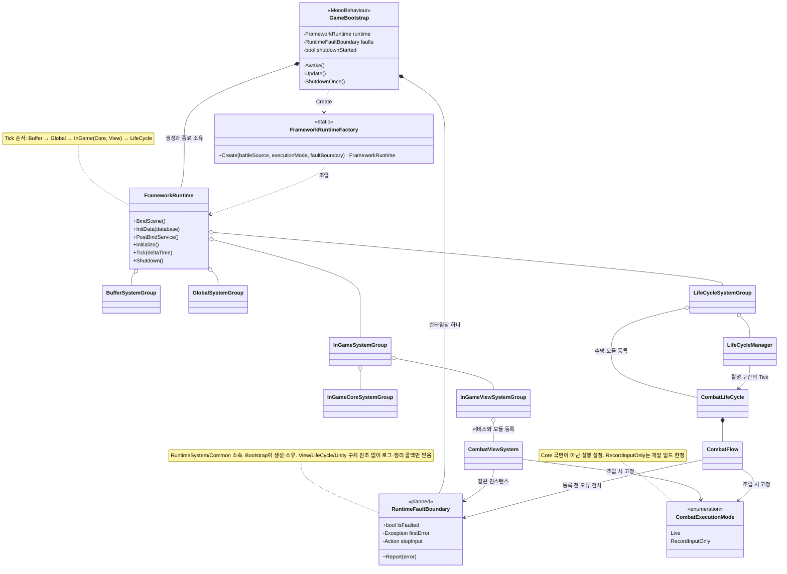

### Factory별 전달값

| 조립 위치 | 전달·생성 책임 |
|---|---|
| `GameBootstrap` | 개발 fixture, 실행 모드, 오류 경계 하나를 루트 Factory에 전달 |
| `FrameworkRuntimeFactory` | 입력 슬롯·Controller·그룹 조립. `faultBoundary == null`이면 로그가 연결된 기본 경계 생성 |
| `InGameSystemFactory` → Core Factory | `IBattleInitializationSource`만 전달. 실행 모드·오류 경계는 Core에 전달하지 않음 |
| `InGameSystemFactory` → View Factory | 실행 모드와 같은 오류 경계를 전달. `CombatViewSystem.StopInput`을 경계에 연결 |
| `LifeCycleSystemFactory` → `CombatLifeCycle` → `CombatFlow` | 같은 실행 모드·오류 경계를 전달 |

루트 Factory의 기본값은 `battleSource = null`, `executionMode = Live`, `faultBoundary = null`이다. 각 Factory는 단일 `Create` 메서드로 유지한다. 리플렉션 호출은 정확한 시그니처와 인자 배열을 제공한다(W11). 기본값이 있다고 `Invoke(null, null)`로 호출하지 않는다.

W17의 공유 오류 타입은 `ProjectL.Systems.RuntimeSystem.Common`에 둔다. Flow가 View/Boot의 타입을 참조하지 않으며, 기존 실행 모드의 소유 위치와 Core 전달 경계는 유지한다. 공통 객체를 새 서비스로 등록하거나 공통 영역에서 View를 찾는 코드를 추가하지 않는다.

## 2. CombatViewSystem과 읽기·입력 계약

```mermaid
classDiagram
    direction TB

    class IStageInputReceiver {
        <<interface>>
        +PointerMoved(x, y)
        +SelectPressed(x, y)
        +SelectReleased(x, y)
        +SelectCanceled()
        +Cancel()
        +EnterCombatRequested()
        +DrawRequested()
        +EndTurnRequested()
        +MoveModeRequested()
        +AttackModeRequested()
    }
    class StageInputReceiverSlot {
        +Bind(receiver)
        +Unbind(receiver)
    }
    class CombatViewSystem {
        <<planned>>
        +PostBindService(resolver)
        +InitData(viewDatabase)
        +Initialize()
        +Tick(deltaTime)
        +Shutdown()
        ~Attach(root)
        -SuspendSubmissions()
        ~StopInput()
        ~Detach()
    }
    class CombatResultPlayback {
        <<pure CSharp>>
        -int attachGeneration
        -int presentingSequence
        -Nullable~CombatPresentationOutcome~ pendingOutcome
        -bool isFinalizing
        ~bool IsBusy
        ~bool IsFinalizing
        ~Attach()
        ~Begin(result) PlaybackToken
        ~TryGetFailure(outError) bool
        ~TryBeginFinalization(outToken) bool
        ~IsCurrent(token) bool
        ~CompleteFinalization(token)
        ~Abort()
    }
    class CombatPresentationOutcome {
        <<immutable value>>
        Completed
        Failed
        Exception error
    }
    class CombatViewRefresh {
        <<pure CSharp>>
        -bool displayedBattle
        -int observedPreviewNumber
        ~Observe(hasBattle, issued, presented, result, answered)
    }
    class CombatInteraction {
        <<pure CSharp>>
        -DragState drag
        -InteractionMode mode
        -PendingInputCommand pendingCommand
        ~ResolvePending(result)
    }
    class PendingInputCommand {
        <<value>>
        +Kind kind
        +int number
    }
    class CombatInputPolicy {
        <<stateless pure CSharp>>
        ~IsTerminal(facts) bool
        ~CanSubmit(facts, pending, commandKind) bool
        ~CanPreview(facts, pending) bool
        ~GetDesiredLayer(facts)
    }
    class ICombatPresentation {
        <<interface>>
        +Play(result, onFinished)
        +Cancel()
    }
    class ImmediateCombatPresentation {
        +Play(result, onFinished)
        +Cancel()
    }
    class ICombatStateBufferReadSink {
        <<interface>>
        +bool HasBattle
        +CombatStateData Current
        +CombatFlowPhase Phase
        +Completion
        +int LatestResultSequence
        +int HandledCommandNumber
        +int AnsweredPreviewNumber
    }
    class ICombatResultReadSink {
        <<interface>>
        +TryGetLatest(outResult) bool
    }
    class ICharacterBufferReadSink {
        <<interface>>
        +Characters
    }
    class ICurrencyBufferReadSink {
        <<interface>>
    }
    class ICombatViewBufferReadSink {
        <<interface>>
        +int PresentedResultSequence
        +TryGetNextCommand(handledThrough, outCommand) bool
    }
    class ICombatViewBufferWriteSink {
        <<interface>>
        +Submit(command) int
        +SetPreview(preview) int
        +ClearPreview()
        +RemoveCommandsThrough(handledNumber)
        +AcknowledgePresented(sequence)
        +Clear()
    }

    IStageInputReceiver <|.. StageInputReceiverSlot
    IStageInputReceiver <|.. CombatViewSystem
    StageInputReceiverSlot --> IStageInputReceiver : Bind된 수신자
    CombatViewSystem *-- CombatViewRefresh
    CombatViewSystem *-- CombatInteraction
    CombatViewSystem *-- CombatResultPlayback
    CombatViewSystem --> CombatInputPolicy : 종료와 목표 Layer 판단에 값 전달
    CombatViewSystem ..> CombatInteraction : 매 입력의 현재 사실 전달
    CombatInteraction --> CombatInputPolicy : 허용 정책 호출
    CombatInteraction *-- PendingInputCommand : 최대 하나
    CombatResultPlayback --> ICombatPresentation : 재생과 취소
    ICombatPresentation ..> CombatPresentationOutcome : 완료 또는 실패 통지
    ICombatPresentation <|.. ImmediateCombatPresentation
    CombatViewSystem --> ICombatStateBufferReadSink
    CombatViewSystem --> ICombatResultReadSink
    CombatViewSystem --> ICharacterBufferReadSink
    CombatViewSystem --> ICurrencyBufferReadSink
    CombatViewSystem --> ICombatViewBufferReadSink : P와 선행 미처리 명령 읽기
    CombatViewSystem --> ICombatViewBufferWriteSink : 처리된 명령 삭제와 결과 확인
    CombatInteraction --> ICombatViewBufferWriteSink : Submit과 Preview

    note for CombatViewRefresh "결과 완료 기준은 Buffer의 P. 같은 완료 카운터를 복제하지 않음"
    note for CombatInteraction "대기는 EnterCombat 또는 EndUnitTurn의 종류와 번호 하나. 취소·다른 결과로 지우지 않음. 좌표 변환·선택은 좁은 계약으로 주입"
    note for CombatInputPolicy "상태·Buffer·Core 서비스·Unity 참조 없음. 호출 범위의 사실로 판정하며 허용값을 캐시하지 않음. 새 서비스/인터페이스 등록 없음"
    note for CombatViewSystem "연결·표시/입력 후처리·Buffer 확인 순서. 재생 상태를 복제하지 않고 Playback 토큰을 검사"
    note for CombatResultPlayback "번호·세대·통지·후처리 상태의 단일 소유자. Buffer·씬·Layer를 모름. 정상 종료는 유지, 오류/Detach는 Abort"
    note for ICombatPresentation "통지 전 자기 임시 자원 정리. 메인 스레드 통지. Cancel은 실제 중단·정리하며 완료를 위조하지 않음"
    note for ICombatViewBufferWriteSink "Clear는 CombatLifeCycle 진입/이탈만 호출. View는 호출하지 않음"
```

입력 슬롯·Layer·로딩 등록 서비스도 `PostBindService`에서 받아 보관한다. View의 서비스 등록용 인터페이스·키 이름은 구현 단계에 확정하며, 이 도표는 새 공용 서비스 이름을 임의로 추가하지 않는다.

`facts`는 매 호출에 읽은 수명·국면·StagePhase·행위자·실제 Layer·S/P·선행 명령 유무의 값 묶음이다. Core 국면 사본을 보관하는 서비스가 아니다. EndTurn의 큐 조회는 해당 입력 시에만 수행한다. `GetDesiredLayer`는 판단만 하고 실제 Bind/Layer 변경은 ViewSystem이 실행한다. `ResolvePending`도 대기 기록만 갱신하며 그리기·Layer·결과 확인을 하지 않는다. 책임·외부 경계·SOLID·성능 기준은 [설계 §13](2026-09-30-combat-view-design.md#13-원칙-점검)을 따른다.

**9차(설계 §21.1) 추가 계약:** facts에 "현재 요청의 응답"(`PreviewAnswer`)이 들어간다. `CombatInteraction`은 조준 모드의 범위 응답(공격 조준 목록, 이동 앵커)을 모드 동안 보관하고 `PreviewAnswered`로 받는다. 표시 의도는 `ICombatInteractionFeedback`(고스트·원본 숨김·호버 상태·범위·영향 칸)으로 전한다. 구현은 `CombatSceneDisplay`와 테스트 가짜다. 실제 클래스·파일 목록은 계획 §7.13·§7.14에 있고, 이 도표 전체의 갱신은 계획 F.1에서 한다.

`PlaybackToken`은 연결 세대와 처리 중 결과를 식별하는 호출용 값이며 별도 완료 카운터가 아니다. ViewSystem은 재생 상태를 Playback에서 조회한다. 콜백은 Playback에 사실만 기록하고, 실패 보고·그리기·입력 후처리·Acknowledge는 ViewSystem의 Tick에서 실행한다. Playback에 임의 후처리 델리게이트 목록을 넘기지 않는다. 계약의 원본은 [설계 §9](2026-09-30-combat-view-design.md#9-결과-재생-수명과-연출-계약-w16w18)이다.

## 3. 씬 참조와 Presenter

```mermaid
classDiagram
    direction TB

    class CombatViewSystem
    class CombatSceneRoot {
        <<MonoBehaviour>>
        -OnValidate()
    }
    class FieldView
    class FieldGridMapper
    class FieldCellPool
    class CombatCellHighlight
    class FieldUnitPresenter {
        ~Render(characterValues, structureValues)
        ~SetHiddenEntity(entityId)
        ~ClearHiddenEntity()
    }
    class FieldUnitView
    class HandPresenter {
        ~Render(characterValues, capacity)
        ~SetHiddenEntity(entityId)
        ~ClearHiddenEntity()
    }
    class HandUnitView
    class PlacementGhost
    class CombatHud {
        ~Render(currency, remainingDraws)
    }
    class DevLayerPanel {
        <<Canvas 개발 패널>>
        배치 버튼
        전투 버튼
        기록 모드 표시
    }
    class IUnitVisualTableQuery {
        <<interface>>
    }
    class IStageFieldViewTableQuery {
        <<interface>>
        +Config
    }

    CombatViewSystem --> CombatSceneRoot : Attach 시 참조 수집
    CombatSceneRoot o-- FieldView
    CombatSceneRoot o-- FieldUnitPresenter
    CombatSceneRoot o-- HandPresenter
    CombatSceneRoot o-- PlacementGhost
    CombatSceneRoot o-- CombatHud
    CombatSceneRoot o-- DevLayerPanel : 참조만
    CombatViewSystem ..> DevLayerPanel : RecordInputOnly일 때만 켜고 onClick 등록
    CombatViewSystem ..> FieldView : 읽은 보드 값 전달
    CombatViewSystem ..> FieldUnitPresenter : 캐릭터와 구조물 값 전달
    CombatViewSystem ..> HandPresenter : 손패 값 전달
    CombatViewSystem ..> PlacementGhost : Drag 표시 의도 전달
    CombatViewSystem ..> CombatHud : 재화와 남은 드로우 전달
    CombatViewSystem --> IUnitVisualTableQuery
    CombatViewSystem --> IStageFieldViewTableQuery
    FieldView *-- FieldCellPool
    FieldView --> FieldGridMapper
    FieldView --> CombatCellHighlight
    FieldUnitPresenter o-- FieldUnitView : 풀에서 빌린 View
    HandPresenter o-- HandUnitView : 풀에서 빌린 View

    note for CombatSceneRoot "참조 묶음과 저작 검증만. Core 호출이나 입력 해석 없음"
    note for FieldView "정적 필드는 최초 설치에 구성. 포인터·결과 갱신마다 셀 전체 재생성 없음. CustomPool·ColorScop 반환 계약"
    note for FieldUnitPresenter "ID별 기존 View를 재사용하고 추가/제거 대상만 대여/반환. 동일 속성 쓰기 생략. Core와 Buffer 싱크를 모름"
```

`DevLayerPanel`은 새 스크립트가 아니라 Canvas 위 버튼 두 개와 표시 텍스트를 묶은 이름이다(W20). 참조는 SceneRoot가 갖고, 등록·해제와 오류 경계 감싸기는 ViewSystem이 한다. Live에서는 꺼져 있고 등록하지 않는다. 버튼은 입력 Layer와 무관하게 눌리므로 차단은 수명·대기·오류·종료 검사로 한다([설계 §8.1](2026-09-30-combat-view-design.md#81-combatexecutionmode)).

`Render`는 값을 받는 표시 호출의 가칭이다. `FieldView`·`PlacementGhost`는 이식되는 표현 묶음의 대표명이다. `CombatSceneRoot`의 참조 화살표는 Presenter를 서비스로 등록하거나 동작을 Root에 넣는다는 뜻이 아니다.

W19의 Render는 기존 객체에 현재 값을 적용하는 호출이다. ID → View 연결은 표현 자원 관리이며 Core 상태 사본이 아니다. 정적 구성·동적 값·호버 갱신의 구분과 측정 기준은 [설계 §6.1](2026-09-30-combat-view-design.md#61-표시-갱신과-자원-재사용-w19)을 따른다. 시각적 변경이 없어도 결과 확인은 생략하지 않는다.

## 4. 부팅과 서비스 수명

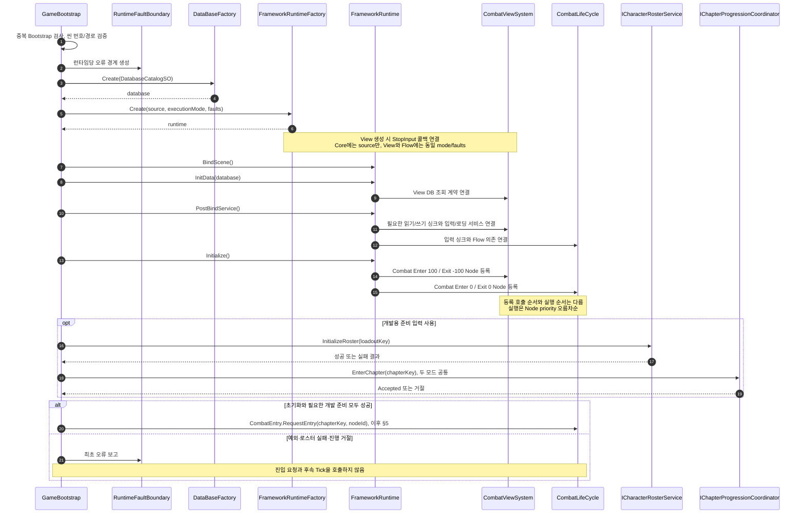

두 모드 모두 [설계 §8.2](2026-09-30-combat-view-design.md#82-개발-진행-준비-w12-10차-갱신)의 로스터·챕터 전제를 준비한다. Bootstrap은 Combat 선택을 확정하지 않고 좁은 진입 경계에 의도를 전달한다. 요청자와 결과 수신·활성화 호출자의 구체 API는 골격 §6.3의 6A.0 확정 항목을 따른다. 정상 진입 거절은 아래 §5에서 다루며 초기화 실패와 구분한다.

이 시퀀스의 초기화 호출 중 예외가 발생하면 나머지 단계는 실행하지 않고 §9로 이동한다. `Initialize`가 View 객체를 씬에서 찾거나 즉시 입력을 Bind하는 단계는 아니다. 씬 참조 연결은 Combat 로딩 Enter에서 수행한다.

## 5. Combat 진입·실제 준비·실행 모드

6A에서 확정한 API와 수명이다. 규칙 원본은 [골격 설계 §6.3](2026-09-30-combat-flow-skeleton-design.md#63-명시적-전투-진입-계약-k20)이다. 진입 요청은 기존 CombatLifeCycle이 소유하고 View는 활성화 사실만 읽는다.

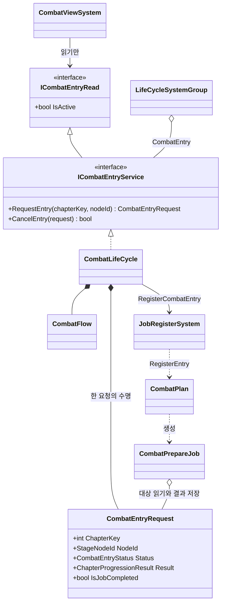

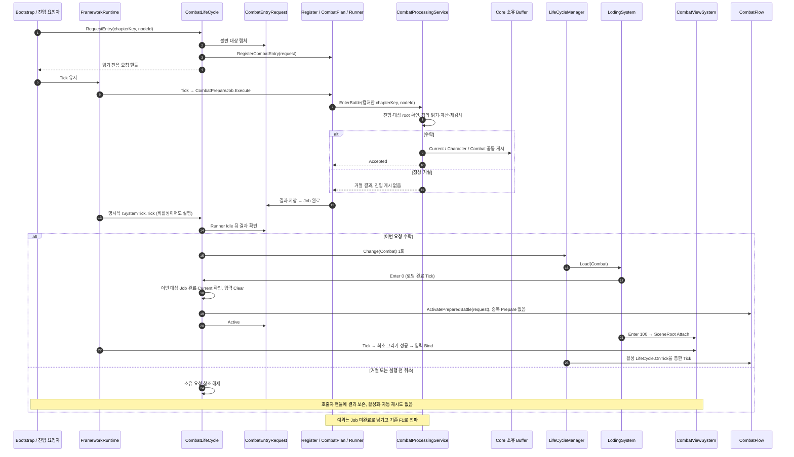

취소된 요청은 Runner에서 배출할 때 Core를 호출하지 않는다. 대기 중 같은 대상은 동일 요청을 반환하고 다른 대상은 취소·배출 후 요청한다. 활성화 실패는 F1로 전파하며 Core를 재호출하거나 reset하지 않는다. 위 Load는 실제 Runtime Global Tick의 기존 로딩 수명이다. LifeCycle 모듈 Tick은 진입 결과만 확인하고 활성 Flow Tick은 Manager가 한 번 호출한다.

Flow 분기의 유일한 기준은 [골격 설계 §4.1](2026-09-30-combat-flow-skeleton-design.md#41-한-tick의-판단-위에서부터-처음-맞는-줄-하나만)이다. `RecordInputOnly`는 수락된 전투의 View Tick·입력 기록을 유지하며 처리 Job만 등록하지 않는다. 실행 모드 변경은 새 런타임으로 한다. 개발 fixture와 테스트용 EndBattle 정리는 운영 DB·F2 성공을 뜻하지 않는다.

## 6. Drag 입력 → 미리보기·명령 기록

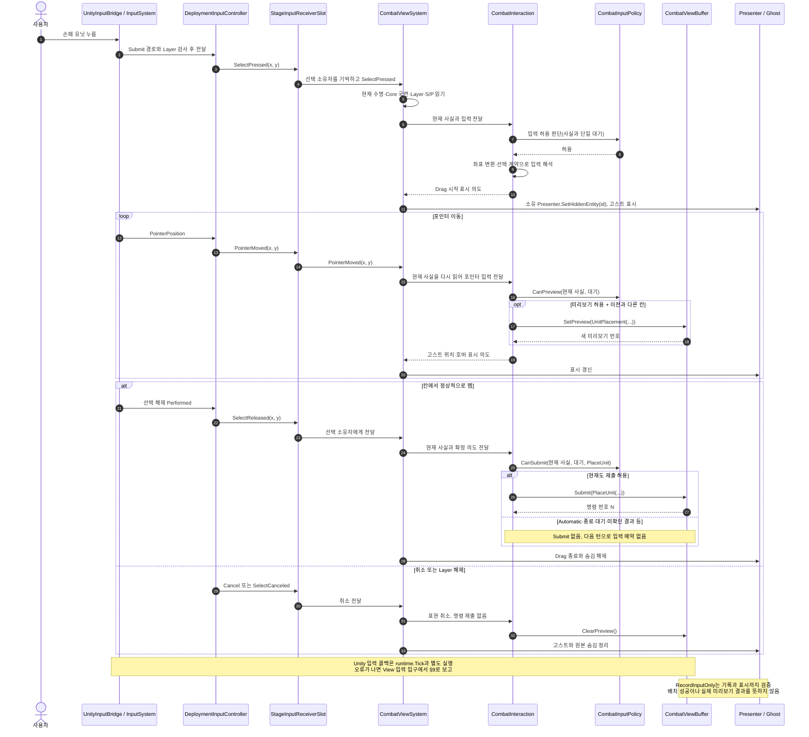

이동·공격도 같은 경로로 의도를 해석해 명령·미리보기를 기록한다. 화면 좌표가 유효한지 확인하는 것과 배치·이동·공격이 규칙상 가능한지 판단하는 것을 구분한다. 후자는 Core의 책임이다.

이 그림의 Drag 시작은 허용된 경우다. 실제 모든 외부 입력은 같은 Policy를 거친다. 취소는 표현만 정리하고 단일 대기를 보존한다. 제출 시점과 결과 후처리의 조건은 [설계 §7.1](2026-09-30-combat-view-design.md#71-입력-허용-정책-w14)이 기준이다.

**9차(설계 §21.1): 응답을 쓰는 이동·공격**

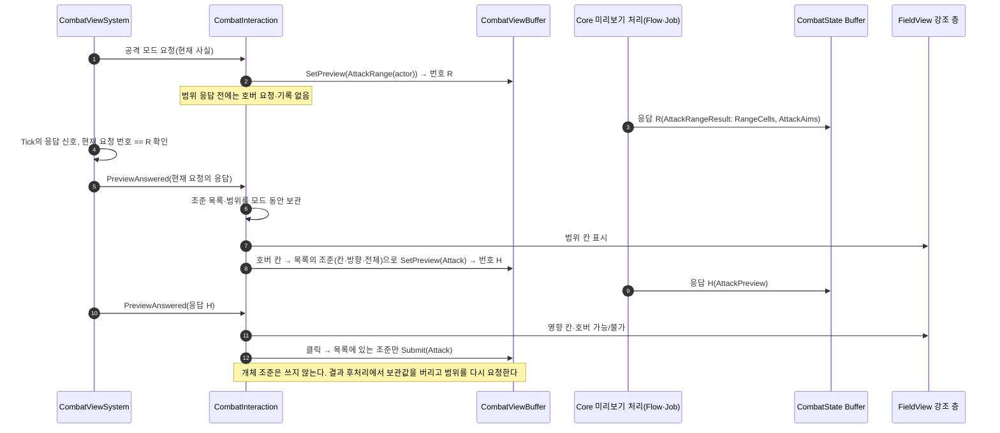

이동은 범위 응답의 앵커 칸만 같은 방식으로 다룬다. RecordInputOnly는 Core가 답하지 않으므로 응답 없이 칸 기준으로 기록한다. 현재 행위자 칸은 표시 갱신(설치·결과)마다 `CombatSceneDisplay`가 Buffer 값으로 그린다.

## 7. 결과 하나의 발행·연출·확인

**실제 Core 발행 구현은 인수됐다.** Phase C·E 단위 검증은 가짜 읽기를 사용하고, E.9는 골격 Phase 5의 Job과 실제 Core·Buffer를 사용한다. 아래의 `ProcessNextCommand()`는 실제 API이며 정상 false도 Job은 완료한다. 예상 기록이 없으면 Flow의 확인 조건에서 멈춘다. 그림의 정상 결과 경로는 결과가 발행된 경우다.

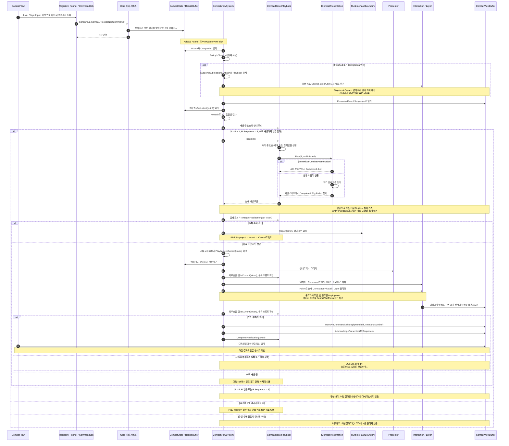

`S = LatestResultSequence`, `P = PresentedResultSequence`다. 판정은 [설계 §5.3](2026-09-30-combat-view-design.md#53-변경-신호)의 표가 기준이다. `S == P > 0`에서 결과가 없는 상태는 이미 소비한 결과가 정리된 정상 상태다. 미확인 결과인 `S > P`에서 결과가 없는 상태와 혼동하지 않는다.

자동 진행 결과도 View의 처리 순서는 같다. `Kind == Advance`는 시작/턴 종료 대기를 해제하지 않지만 현재 Core StagePhase에 따라 Layer는 바꿀 수 있다. 동일 결과가 재생 중이면 새로 Play하지 않는다. 미확인 결과 동안 상태 변경 Job은 K1로 차단된다. Live의 일반 연출 중에는 현재 PlayerInput·단계·대기 조건에 맞는 미리보기만 기존 Flow 계약으로 처리될 수 있다.

도표의 완료 후처리는 Playback이 완료 토큰을 한 번 발급하고 공유 오류/토큰 검사가 통과한 경우에만 진행한다. Play·그리기·Layer 전환의 예외나 오류/Detach 재진입이면 남은 단계를 중단한다. 완료를 동기 통지한 뒤 Play가 예외를 던져도 F1이 우선한다. 비동기 연출이 아직 끝나지 않았으면 다음 Tick에서 같은 실패 관측·완료 후처리 경로를 사용한다.

정상 종료는 매 입력/Tick의 `Finished || Completion != null`로 판정한다. 입력만 해제하고 Playback.Abort·Presentation.Cancel을 부르지 않아 마지막 그리기·확인까지 유지한다. 종료 뒤에는 미리보기 재요청·Layer 재활성·입력 Buffer Clear가 없다. 일반 결과 확인은 F2의 Completion 표시 완료와 별개다([설계 §5.6](2026-09-30-combat-view-design.md#56-전투-종료의-새-입력-차단-w15)).

## 8. Live의 입력 허용·대기·종료 상태

아래는 **현재 Core 사실·결과 소비 상태·단일 명령 대기에서 도출한 입력 상태**다. 같은 이름의 View 국면 enum이나 별도 상태 머신을 저장하라는 뜻이 아니다. 결과에 의한 일반 전이는 그리기·후처리·확인이 끝난 시점이며, 정상 종료 입력 차단만 그 전에 즉시 적용한다.

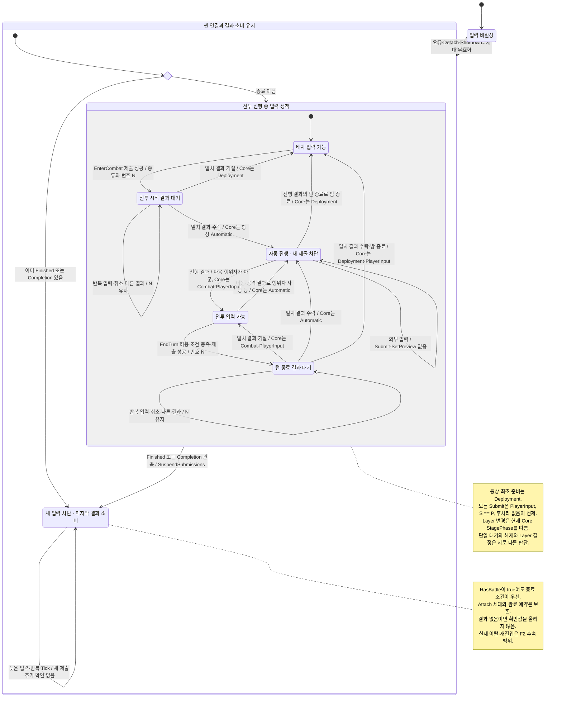

전이는 현재 Core 계산 기준이다. 전투 시작 수락은 항상 자동 진행으로 넘어간다(`CombatTurnCalculator.cs:45`). 이동·공격 결과는 배치/전투 단계를 바꾸지 않으므로 밤은 턴 종료(내 EndTurn 명령 또는 자동 진행 안의 턴 종료)로만 끝난다(`CombatCommandCalculator.cs:320`, `CombatTurnCalculator.cs:87·103`). 다만 View는 이 도표를 코드로 옮기지 않고 매 결과 뒤 현재 Core 값을 읽어 Policy로 판단하므로, Core 전이가 바뀌어도 입력 동작은 그 값을 따른다.

`RecordInputOnly`는 이 Live 상태도의 별도 진단 모드다. 공통 수명·오류·종료·단일 대기 검사는 유지하고, Live의 국면/행위자·S/P·선행 명령 조건 대신 개발자가 고른 실제 Layer를 사용한다. 개발 Layer 선택은 Combat Canvas의 개발 Layer 패널 버튼(W20)으로 하며 대기·오류·종료가 없을 때만 허용한다. Core 상태·처리 번호·확인값은 바꾸지 않으며 EnterCombat 또는 EndUnitTurn 하나를 기록한 뒤에는 결과가 없어 대기가 유지된다. 다음 검증은 새 런타임에서 시작한다.

대기 기록은 `Submit` 성공 반환 뒤에만 저장한다. 대기 중 새 명령·미리보기는 막고 취소는 표현만 정리한다. `Kind == Command && CommandNumber == pending.Number`를 그린 뒤에만 대기를 해제하며, 이후 실제 재개는 현재 Core 국면과 결과 확인 상태를 따른다. 앞서 제출된 미처리 명령은 그대로 보존한다.

### 8.1 턴 종료가 다음 행위자에게 넘어가지 않는 조건

| 순서/경우 | View의 동작 | 경계 이유 |
|---|---|---|
| Core가 Combat·PlayerInput, 표시 완료, 활성 행위자 있음 | 다른 공통 조건과 선행 명령 유무 검사 | 규칙상 가능 여부는 Core가 판정 |
| `TryGetNextCommand(HandledCommandNumber, out _)`가 true | EndTurn 제출 0, 나중에 자동 제출하지 않음 | 선행 Move/Attack 처리로 행위자가 바뀔 수 있음 |
| 선행 명령 없음, 첫 EndTurn 입력 | Submit 반환 번호를 단일 대기로 저장 | Core의 빈 행위자 명령은 실행 당시 ActiveActor를 대상으로 함 |
| 같은 프레임의 두 번째 입력·대기 중 취소 | 추가 Submit 0, 대기 번호 유지 | 처리 전 중복 입력 방지 |
| 일치 결과를 그린 뒤 대기 해제 | Layer는 현재 StagePhase, 입력은 결과 확인 뒤 현재 Phase로 판단 | 수락만으로 입력을 즉시 열지 않음 |
| Automatic 또는 S > P 또는 결과 후처리 | 새 Submit 0 | 다음 행위자의 입력으로 이월되는 큐를 만들지 않음 |

단일 대기의 구체 타입명은 제안이며, 별도의 pendingEnter/pendingEnd 플래그 쌍을 두지 않는다. 입력 Policy가 조건을 판단하고 Interaction이 기록하며, ViewSystem은 사실 읽기·결과 소비 순서만 조정한다.

## 9. 입력 오류도 같은 경계에서 정지

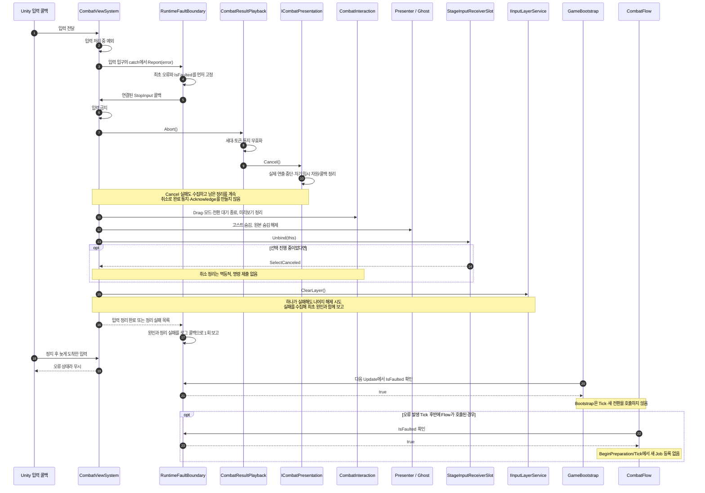

초기화·Tick·시작 전환 예외와 Tick에서 관측한 연출 Failed도 같은 Report 경로를 따른다. 오류 보고 중 재진입해도 정지·로그를 반복하지 않는다. 외부 호출이 정상 반환했어도 Playback 토큰이 무효하거나 공유 오류가 있으면 §7의 확인을 진행하지 않는다. Detach도 먼저 Playback.Abort로 실제 연출을 정리한 뒤 Presenter 자원·씬 참조를 해제한다.

오류 시점에는 실행 중인 Tick 스택에서 `FrameworkRuntime.Shutdown`을 바로 호출하지 않는다. 실제 종료는 Bootstrap의 공통 종료 경로에서 **종료 플래그 → 입력 우선 정리 → runtime.Shutdown 최대 1회 → finally로 소유 참조 정리** 순서다. 하위 Shutdown이 실패하면 이를 종료 실패로 기록하며 전체 Framework 정리를 보장했다고 간주하지 않는다.

## 10. 씬 경계·소유권·검증

### 10.1 씬 번호와 Node 순서

| 구분 | 번호/우선순위 | 동작 |
|---|---|---|
| Boot 씬 | 0 | Bootstrap만. LifeCycle 미배정 |
| Stage 씬 | 1 | 기존 StageLifeCycle |
| Combat 씬 | 2 | CombatLifeCycle·CombatViewSystem |
| Lobby·Artifact | 3·4 | 예약 번호. 이번 Build Settings에는 없으며 시작 대상으로 거부 |
| Combat Enter | LifeCycle 0 → View 100 | 입력 Buffer Clear·Flow Reset·준비 등록 → SceneRoot Attach. 입력 Bind는 준비 후 최초 그리기 성공 때 |
| Combat Exit | View -100 → LifeCycle 0 | 표현·입력 정리·Unbind·ClearLayer·Detach → Flow Stop·입력 Buffer Clear |

모든 LifeCycle getter가 같은 `SceneIndices`를 사용한다. Exit Node의 정리 순서를 정한 것이 **전투 중 안전한 이탈(F2)**까지 구현했다는 뜻은 아니다. Runner 종료 대기·전투 상태 해제·결과 보존을 포함한 이탈과 재진입은 별도 작업이다.

### 10.2 상태의 단일 소유자

| 사실 | 원본/소유자 | UML에서 확인할 경계 |
|---|---|---|
| 전투·캐릭터 상태와 결과 | Core가 쓰는 Buffer | View에는 읽기 싱크만 연결 |
| 사용자 명령·미리보기 번호 | CombatViewBuffer | Interaction이 기록하며 직접 번호 발급 안 함 |
| 결과 발행 / 연출 확인 | LatestResultSequence / PresentedResultSequence | Refresh에 별도 완료 카운터 없음 |
| 시작/턴 종료 대기 | CombatInteraction의 단일 종류·번호 기록 | 일치 Command 결과를 그린 뒤 해제, 취소·다른 결과로 지우지 않음 |
| 국면·행위자·전투 종료 | Core Buffer의 Phase·CommandState·Completion | 호출 시 읽어 Policy로 전달, 별도 상태 머신·종료 플래그 없음 |
| 실제 Layer | IInputLayerService.CurrentLayer | 목표는 Policy로 계산, View에 적용 Layer 사본 없음 |
| 재생 번호·세대·완료/실패·후처리 상태 | CombatResultPlayback | ViewSystem에 상태 사본 없음, 토큰으로 오래된 콜백/재진입 차단 |
| 연출 임시 자원 | 각 ICombatPresentation 구현 | 통지 전 정리, Cancel은 실제 중단·해제, Presenter 전체 자원 소유권과 구분 |
| 오류 정지 | RuntimeSystem/Common의 RuntimeFaultBoundary | Bootstrap이 생성·소유, View·Flow 같은 인스턴스 주입 |
| 실행 모드 | Factory 조립 시 고정 | Live와 RecordInputOnly 사이 런타임 전환 없음 |
| 외형 | ViewGroup DB·씬 설정 | Presenter에 표시 값으로 전달 |
| 런타임 생성·Tick·종료 | GameBootstrap | SceneRoot나 Presenter가 실행하지 않음 |

### 10.3 구현 후 검증 연결

| 검증 | 대응 도표 | 계획 항목 |
|---|---|---|
| 기본/개발 Factory 조립, 정확한 리플렉션 인자 | §1·§4 | B1.2·B1.5 |
| 실제 준비 확인 유지, 기록 모드에서 이후 등록 0 | §5 | B2.1·B2.4·E.7 |
| Live 개발 설정의 로스터·챕터·노드 준비, 거절 시 진입 없음 | §4 | B2.3·B2.5 |
| 씬 충돌 없음, Attach 후 준비 전 입력 없음 | §4·§5·§10.1 | B1.1·C.2·C.5 |
| 정상 해제만 명령 제출, 취소는 표현 정리 | §6 | E.2·E.6 |
| 전투 시작 두 번 요청해도 명령 1개, 취소·다른 결과로 대기 소실 없음 | §8 | E.1·E.6 |
| EndTurn 중복/선행 명령/자동 진행 입력으로 다음 행위자가 종료되지 않음 | §2·§8.1 | E.1·E.1a·E.6·E.9 |
| Command/Advance의 밤 종료 뒤 Deployment 복귀·다음 밤 시작 | §7·§8 | E.3·E.4·E.6·E.9 |
| 정상 종료 후 새 입력 0, 지연 마지막 연출·확인 1회, 새 결과 없으면 확인 불변 | §7·§8 | C.4a·C.5·E.5·E.6·E.9 |
| 즉시/지연 완료, 후처리 실패 시 확인 금지, 유실·순번 위반 정지 | §7 | C.3~C.5 |
| 입력 예외 뒤 Drag·숨김 복구, 제출·Tick·새 등록 0 | §9 | C.6·E.8 |
| 실제 Core 수락/거절·미리보기·진행·전투 종료와 View 확인 | §7·§11 | View E.9 |
| Detach/오류 후 늦은 완료가 새 씬에 적용되지 않음 | §7·§9·§10.1 | C.5 |
| Playback 단일 상태, 실패 후 확인 0, 중복/늦은 통지·Abort | §2·§7·§9 | C.3a·C.4b·C.5a |
| 실제 연출의 Cancel 자원 해제·통지 전 정리·부분 실패 | §2·§9 | 계획 §8 X3(실제 비동기 연출 도입 때) |
| RecordInputOnly 개발 Layer 버튼: 기록 모드에서만 활성, 대기·오류·종료 중 무시, Detach 때 해제 | §3·§8 | E.4·E.7 |
| 공유 오류 객체의 공통 위치·같은 인스턴스, Flow의 View/Boot 참조 0 | §1 | B1.3·B1.5 |
| 정적 필드 재구성 없음·ID별 View 재사용·동일 속성 쓰기 생략 | §3 | D.5·D.6a |
| 규모별 CPU·GC·UI 비용 측정 | §3 | 계획 §8 X4(표시·규모 확장 때) |

이 문서는 UML 작성 결과다. 위 항목은 구현 후 실행할 검증이며, 현재 코드·테스트·재생 완료 상태는 구현 계획 §7에서 관리한다.

새 기능을 추가할 때의 책임·공통 오류·실제 연출·표시 규모·읽기 계약·F2 점검은 [계획 §8](../plans/2026-10-01-combat-view-plan.md#8-확장-시-주의사항과-필요한-작업)에 연결돼 있다. 실제 애니메이션과 F2 구현은 후속 범위이며, 7차는 그 수명 계약과 현재 표시 구조를 보완했다. 8차는 자원 해제 계약 테스트(X3)와 규모별 측정(X4)을 확장 시점으로 옮겼다.

## 11. 병합 후 실행 조건

화살표는 코드 의존이 아니라 **검증을 완료하기 위한 선행 조건**이다. F1은 View가 한 번 구현하고 골격 Phase 6이 인수한다. F2의 상세 이탈 시퀀스는 [골격 설계 §12.4](2026-09-30-combat-flow-skeleton-design.md)를 따른다.

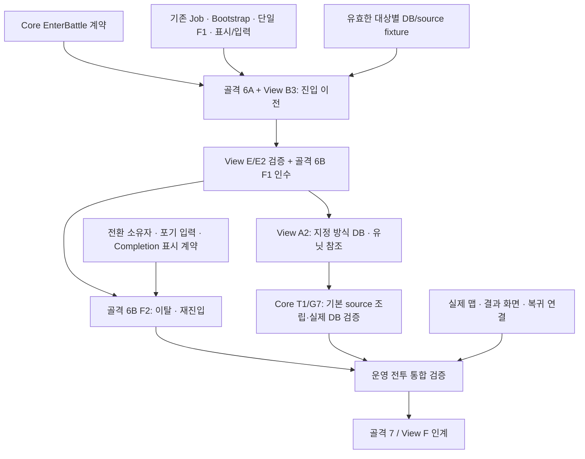

- 개발 Live 성공은 운영 DB 준비·이탈/재진입 성공과 다르다.
- A2와 F2는 서로의 전체 완료를 기다리지 않는다. 완료 범위의 부분 인계는 가능하며 실제 진행 상태는 각 계획에서만 기록한다.
- 포기는 현재 `Completion`을 기록하며 새 `CombatResult` 순번을 발행하지 않는다. F2는 남은 일반 결과 확인 뒤 포기 정산, Completion 표시 완료, EndBattle, 전환 순서를 지킨다.
- F2의 입력 제출 차단 중에는 진행 중 연출 완료를 보존한다. 오류·Detach용 StopInput의 세대 무효화를 그대로 쓰지 않는다.
- W15의 정상 종료 입력 차단은 이번 범위이며, F2의 Completion 표시·EndBattle·씬 전환을 완료하는 것은 아니다. 설계·계획·UML은 입력 차단과 일반 결과 확인에 같은 계약을 사용한다.
