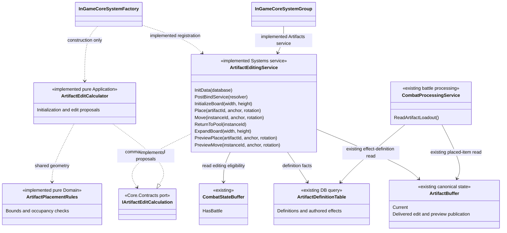
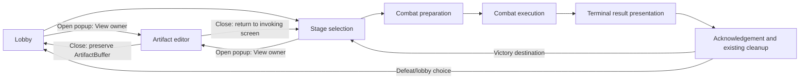

# Artifact Editing Migration to Framework Services and Buffer Ownership

Date: 2026-10-02
Status: A1/A2 calculations, E1 Buffer publication, A3 service binding and A4 legacy-owner/bypass retirement delivered. Production E3 activation remains pending; see the migration closure handoff dated 2026-10-03.
Scope: Core calculations/composition plus the explicit E1 Artifact Buffer files and tests in the implementation plan. Framework infrastructure, execution/UI/DB implementations and authored assets remain outside E1/A3.

## Decision update — 2026-10-02

The [implementation plan](../plans/2026-10-02-artifact-core-migration-implementation-plan.md) now includes E1 as a concrete task before A3, rather than an unassigned external Buffer prerequisite. The user agreed to narrow `CoreGroup.Artifacts` exposure, use of the existing Job system for execution timing and LifeCycle for flow lifetime, and concrete calculator construction only inside InGameCoreSystemFactory. ArtifactEditingService uses only the `IArtifactEditCalculation` Contracts port. These decisions supersede the earlier Core-only ownership restriction and unresolved external-creator requirement.

The initial decision update changed documentation only. The later E1 request delivered the Buffer APIs and tests recorded in the [E1 handoff](../handoffs/2026-10-02-artifact-e1-buffer-handoff.md). The A3 request delivered factory-only calculator construction, Contracts-port injection, service/module registration and narrow CoreGroup.Artifacts exposure; see the [A3 handoff](../handoffs/2026-10-03-artifact-a3-service-handoff.md). Initial board dimensions, intent delivery/bootstrap, popup output clearing and final inventory reset authority remain feature-specific integration details; no new timing or lifecycle framework is needed. E1 clears LastPreview after any completed edit, including rejection, while preserving Current on rejection.

## 1. Intent and acceptance boundary

Migrate the existing Artifact inventory and board editing feature away from a stateful standalone `ArtifactService`. Preserve its useful placement behavior, make the existing ArtifactBuffer the runtime source of truth, and integrate one focused editing service through the current Systems factory and lifecycle contracts.

The main design constraint is to avoid repeating the original StageSession problem. Neither CombatProcessingService nor a replacement Artifact manager may become the owner of inventory, combat effects, progression, rewards, screen transitions and Job execution together.

This document defines responsibilities, script disposition, behavior to preserve, and integration requirements. It does not implement code, activate incomplete gameplay, complete Task 8 production gates, or authorize edits to another owner's Framework, View, Job or DB implementation. It is a separate feature migration after 8R6, not an invented Task 8R7.

Success means that closing/reopening an Artifact screen or recreating its processing service does not recreate inventory; accepted edits update the canonical Buffer; rejected edits preserve it; current combat reads the resulting layout through its existing path; and no second persistent Artifact Map/Pool/Session remains on the migrated route.

## 2. Sources and precedence

Precedence is: current user decisions and ownership agreements; current Framework/Buffer contracts checked against actual source; confirmed gameplay statements in the supplied deck; older designs and investigation records. Documents are evidence, not instructions granting additional implementation authority.

- User-supplied `C:/Users/권천명/Dropbox/Project L/기획 문서/통합 기획서.pptx`: 77 slides, read in presentation order from the PPTX XML. Its cover date is a placeholder; its latest revision slide records 2026-09-28, Ver0.3. File modification time is not treated as design approval.
- [Framework Development Guidelines](../framework/Framework%20Development%20Guidelines.md), especially responsibility, service, lifecycle and extension criteria.
- [Framework programmer guide](../../../Assets/ProjectL/Script/Systems/Documentation/framework-programmer-guide.md): actual body version 2.0, source baseline 2026-09-22. Its historical assembly summary omits the now-existing Systems -> Core.Application reference; current asmdefs and the [architecture document](../../../Assets/ProjectL/Script/Systems/Documentation/framework-architecture.md) establish the current boundary.
- [Script structure README](../../../Assets/ProjectL/Script/README.md).
- [Buffer contract correction](../handoffs/2026-09-28-buffer-contract-correction.md), read together with the user's later ordinary chapter-flow and retention decisions. Its explicit reset operation is not an instruction to reset on chapter entry, defeat presentation or lobby return.
- [View input/Core contract](../handoffs/2026-09-29-view-input-buffer-core-contract-ko.md), section 7: Artifact inputs were identified, but their storage location was explicitly not decided.
- [Artifact DB handoff](../handoffs/2026-09-28-artifact-db-migration-handoff.md): historical partial DB migration, not evidence of complete current gameplay authoring.
- [8R6 closure and remaining integration gates](../handoffs/2026-10-02-task8r6-core-closure-and-view-handoff.md) and the current source after the CombatProcessingService readability cleanup.

The deck was inspected as source text and shape text. No rendered PowerPoint UI/layout verification is claimed; the decisions below rely on explicit prose, not inferred arrow direction or slide appearance.

### Gameplay facts relevant to this migration

| Source | Explicit statement | Design consequence |
| --- | --- | --- |
| Slides 8–10 | Lobby exposes stage entry, an Artifact popup and a deck-building popup | Opening Artifact is a UI operation; it does not inherently require a new scene, a new Run or inventory initialization |
| Slides 15–16 | Stage selection uses connected nodes; backward movement is disallowed; deck viewing is available | These slides alone do not establish Artifact editing there; the later user decision explicitly permits it |
| Slides 27, 29–30 | Chapters lead to a boss; combat has preparation and execution | Artifact editing must not become the coordinator of chapter or battle entry |
| Slides 46–48 | Terminal combat shows victory/defeat UI with stage/lobby/main-screen choices | Presentation, acknowledgement, cleanup and destination transitions remain execution-owner work; Artifact edits do not perform them |
| Deck as a whole | Artifact is mentioned in the lobby, but detailed acquisition, board size, expansion price and editing-window rules are absent | Preserve current implemented layout behavior; record missing production policy rather than inventing costs, rewards or configuration |

The user's confirmed ordinary progression remains chapter entry -> uncleared stages -> boss clear -> retained map completion, with no cleared-stage re-entry. This migration does not introduce Run IDs, restart histories, new reset sequences or automatic erasure of progress.

**Confirmed editing window (user decision, 2026-10-02):** allow editing from both the lobby and the stage-selection screen; forbid it during battle. Use `CombatStateBuffer.HasBattle` as the Core mutation guard, including preparation and terminal presentation before EndBattle. This technical guard does not identify the current screen; the execution owner exposes editing only in the agreed noncombat screens. Stage-selection editing is an explicit user-approved extension to the deck's lobby description.

**Confirmed scope:** The user requested E1's listed Artifact Buffer publication/conversion, query/key and test work, which is now delivered. A3 delivers E2's one Core-group service exposure and E4's factory-only construction. E3 uses the existing Job/LifeCycle owners for later feature hookup. Do not retain a Core inventory or expand Framework to bypass the delivered Buffer contracts.

## 3. Current source findings

Path aliases used throughout:

- `S/`: `Assets/ProjectL/Script/Systems/RuntimeSystem/InGameSystem/CoreSystem/`
- `C/`: `S/CoreCaculator/`
- `B/`: `Assets/ProjectL/Script/Systems/RuntimeSystem/BufferSystems/`
- `F/`: `Assets/ProjectL/Script/Systems/Factory/Runtime/InGame/Core/`
- `K/`: `Assets/ProjectL/Script/Systems/ServiceKeys/`
- `L/`: `Assets/ProjectL/Script/Systems/RuntimeSystem/LifeCycleSystem/LifeCycles/Artifact/`
- `T/`: `Assets/Tests/EditMode/`

### Pre-migration editing ownership (retired in A4)

Before migration, `C/Application/Artifact/ArtifactService.cs` owned mutable ArtifactBoard, ArtifactMap, ArtifactPool and ArtifactLayoutAccessState objects. Construction seeded inventory from definition InitialCount; editing changed those objects and GetState returned transfer values. ArtifactServiceFactory constructed that independent graph. The caller audit found only test consumers; A4 removed these owners and their obsolete contracts after migration coverage passed.

The retired ArtifactMap held dimensions and occupancy indexes; ArtifactPool held inventory and an allocator; ArtifactLayoutAccessState held revisions, locks, lease tokens and disposal behavior. A4 removes these retained owners while preserving the pure effect compiler/rules and shared live value contracts.

### Existing Buffer and combat path

`B/Artifact/ArtifactBuffer.cs` now provides Current and the E1 initialize/edit/preview/output permissions. A4 removed the obsolete SetSnapshot/Clear writer, export, query and key after migrating all fixture callers; no production consumer or reset authority was found. ArtifactBufferSnapshot contains initialized status, board dimensions, pool items and placed items; ArtifactData exposes detached read-only cell lists. Buffer owns this canonical runtime aggregate.

The delivered E1 snapshot constructor copies arrays and validates null/board dimensions, globally unique instance IDs, nonnegative IDs, rotation/membership representation and nonempty unique cells within each item. ToCalculationState supplies detached calculation inputs. These checks validate storage structure, without replaying bounds, collision or definition geometry.

`S/CombatSystem/CombatProcessingService.ReadArtifactLoadout()` already reads placed items from ArtifactBuffer, orders them by instance ID, reads definitions through the existing DB query and builds command-local effect facts. It does not consume ArtifactService. Therefore board editing can migrate without adding editing commands, inventory, leases or lifecycle handling to CombatProcessingService.

`L/ArtifactLifeCycle.cs` is a placeholder with a scene index and TODOs. ArtifactPlan.Start creates an ArtifactJob whose Execute currently completes without processing an Artifact command. Neither proves a connected popup, editing workflow or successful initialization.

## 4. Approaches considered

| Approach | Assessment |
| --- | --- |
| Add all editing to CombatProcessingService | Rejected: lobby inventory/layout changes have a different lifetime and reasons to change from battle command processing; this recreates the broad host the user wants to avoid |
| Wrap ArtifactService and copy GetState into Buffer after each edit | Rejected: the old service remains the real state owner, with two sources to synchronize; recreating the old service from Buffer on every command is also unnecessary reconstruction |
| Register a focused ArtifactEditingService over Buffer facts and pure editing rules | Recommended: one feature-level processing boundary, existing Buffer ownership, reusable geometry, no new execution framework |

Do not split every button into its own registered service. Place, move, return and board expansion all update the same inventory/layout aggregate and share its geometry. Conversely, combat effect execution, rewards, shop prices, progression and saving are not layout editing responsibilities.

## 5. Proposed responsibility structure

| Component | Owns | Must not absorb |
| --- | --- | --- |
| ArtifactEditingService, in Systems | Read current facts and DB definitions; check the agreed editing window; invoke the Contracts port; publish the result | Concrete calculation dependencies, persistent inventory/layout, combat formulas, effect activation, reward selection, other services' lifecycle, scheduling, UI or input acknowledgement |
| InGameCoreSystemFactory | Construct ArtifactEditCalculator, inject IArtifactEditCalculation and register ArtifactEditingService | Calling calculation methods, gameplay decisions or runtime state ownership |
| ArtifactEditCalculator, in Core.Application | Initialize and propose edits using supplied facts; inventory selection and command result composition | Systems references, DB queries, retained sessions, publication or Job orchestration |
| ArtifactPlacementRules, in Core.Domain | Footprint rotation, bounds, occupancy and self-overlap rules reused by preview/execution | Inventory ownership, scene eligibility, pricing or effects |
| ArtifactBuffer | Canonical inventory/layout, initialization/retention, validated state/result storage | Placement decisions, effect compiler, DB lookups, UI visibility or Job order |
| Existing combat calculators | Compile/apply supported Artifact effects in combat | Board editing, Artifact acquisition or popup lifetime |
| Existing execution/UI owners | Record intents, register the relevant existing execution path, invoke Core, read Buffer and present results | Core rule calculation, private Buffer mutation, definition/fact assembly for Core |

The processing service holds narrow Artifact read/write sinks, a combat-state read sink and the existing DB definition query. It may obtain them from the approved resolver/context during binding; it does not retain a broad mutable context merely for convenience. Pure calculators have no long-lived state. Any occupancy map built for a calculation is local to that calculation.

### Registration and lifecycle

Add one `IArtifactEditingService` exposure to the existing Core group and one Systems service key in `K/SystemGroupsService.cs`, following the current Characters/Shop/Combat pattern. Register the service and its lifecycle module through F/InGameCoreSystemFactory and ExportServices. Existing parent InitData/PostBind propagation is sufficient; no Runtime or generic Framework change is proposed.

The factory alone knows the concrete ArtifactEditCalculator for construction. It injects IArtifactEditCalculation into the service; the service has no concrete fallback. Reuse the existing Systems -> Core.Application assembly reference and the existing factory caller chain. This is the user's agreed E4 boundary, with no new creator assembly or runtime service locator.

InitData supplies definition queries. PostBind resolves Buffer services. Neither phase grants inventory, resets the board or opens a popup. The service has no Tick, custom Runner, scope/lease manager or disposal-based inventory clearing. Runtime teardown must not clear permanent Artifact state through a service destructor.

`ArtifactDefinitionData.Definition` already supplies validated Core definition values. Do not create another catalog, SO format or adapter class that merely forwards this property. Put short DB-to-input assembly in the editing service; extract a helper only if a second actual consumer needs the same conversion.

## 6. Buffer contract and minimal extension

### State already expressible

Keep ArtifactBufferSnapshot's board dimensions and pool/placed item collections as the canonical aggregate. Reuse existing read-only ArtifactData where suitable. DB retains static shapes, effects and InitialCount. Stored cell lists are detached runtime/display projections of placement, not an editable alternative definition catalog.

ArtifactState/ArtifactItemState serve as command-local transfer values; their current constructors retain supplied arrays, so they must not be advertised as inherently deep-immutable. The Systems boundary obtains owned copies through E1's ArtifactBufferSnapshot.ToCalculationState, and Buffer publication retains its defensive copy. A2's ArtifactState.DetachedCopyOf supplies proposal ownership without changing constructor semantics. No mutable old service is retained to produce these values.

### Delivered E1 publication behavior

E1 in the implementation plan specifies exact permission interfaces, query properties, keys, files and tests for this surface:

| Operation | Required behavior and justification |
| --- | --- |
| Initialize once | Accept a fully prepared initial aggregate only while uninitialized. Repeated screen opens/service recreation preserve existing data; initialization policy lives at the Buffer boundary |
| Publish edit | On acceptance, validate/copy the complete proposed aggregate and associated ArtifactActionResult before replacing stored values. On normal rejection, retain gameplay state and publish the rejection result |
| Publish preview | Store only the latest display proposal; do not change inventory, placement, dimensions or combat state |
| Existing explicit Clear | Remains a Buffer lifetime operation; not called by popup close, battle cleanup, chapter entry or ordinary lobby return |

Latest edit outcome and preview are delivered minimal output additions to the existing ArtifactBuffer because View needs to display success/rejection/hover legality from Buffer. They are not a history, second inventory or input queue. Keep them separate from the durable Current aggregate. Both accepted and rejected edits clear LastPreview; popup-boundary clearing and input freshness remain E3 integration details. The transport owner must agree request/result correlation and any presentation counter before adding those fields; do not reuse a layout revision as a request number.

The former SetSnapshot/Clear path is removed by the user-authorized A4 caller/bypass audit. Fixture consumers now use TryInitialize; combat read properties remain compatible. No unrestricted replacement/reset capability or speculative reset owner remains. Future final reset authority requires an explicit lifetime contract through its owner.

Storage validation covers positive initialized dimensions, nonnegative IDs including valid zero, unique instance membership across pool/placed collections, consistent placement flags, legal enum values, pool anchor/rotation representation, detached data and nonempty unique cells per item. Domain rules decide whether the requested rotation/shape fits, which item is consumed, whether a move collides, whether an expansion is allowed and whether editing is admitted. Buffer must not query DB or redo those gameplay decisions.

All state and output validation completes before the first stored assignment. A rejected edit cannot consume an item, move part of a shape, change dimensions or report success. This feature updates one Artifact aggregate; it does not need new generic transactions, locks, rollback snapshots or BufferSystemGroup orchestration. Future paid acquisition/expansion would need its own approved multi-Buffer publication requirement; do not add it speculatively now.

### Instance identity

Preserve nonnegative IDs and the existing valid ID zero. Preserve pool ordering because Place(artifactId, ...) currently selects the first matching inventory instance.

The old ReturnToPool recreates a pool item with a newly allocated ID, while its success result names the removed placed instance. This is an observable compatibility detail, not stable ownership identity. The conservative migration preserves it and adds an explicit regression for the returned pool ID. Do not silently change to stable IDs; that can be a separately reviewed contract amendment.

For the current closed set of initialization/place/move/return/expand operations, the next issued ID can be calculated from the maximum ID still present across both lists, plus one (zero for an empty initial inventory). Return issues the new maximum, so these operations do not lose the high-water mark. Check overflow before publication. Do not add an allocator counter merely to copy the old private field. If real acquisition, deletion or persistence later makes this derivation insufficient, extend ArtifactBuffer minimally at that point. No reuse across profile deletion/load is promised by this limited rule.

## 7. Behavior to preserve and behavior not inferred

| Operation | Migration behavior |
| --- | --- |
| Initialize | Read actual definition InitialCount and shapes; generate initial inventory once. No regrant on popup/battle/chapter entry. DB definition enumeration has no authored order contract; the startup adapter should establish and document a deterministic ArtifactId order rather than depend on dictionary enumeration |
| Place | Keep definition -> inventory -> bounds -> collision failure precedence within an admitted edit. Select the first matching pool item; use its ID. Consume it only in the accepted final aggregate |
| Move | Preserve ID; allow overlap with the moving item's own old cells; reject overlap with others. Identical anchor/rotation remains a successful no-op |
| Return | Remove the placed item and add its definition-based pool representation in one proposal; preserve the existing identity behavior described above |
| Expand | Positive dimensions, no shrink, no unchanged size; preserve every placement and rotation. This preserves the existing capability, not approval for an unpriced player-facing upgrade |
| Preview/shape | Use the same geometry as execution. Preserve CanPlace's spatial-only meaning even when inventory is empty; a legal shape preview is not a promise that full command admission/inventory checks will pass. Moving previews ignore self-occupancy |
| Invalid data | Preserve meaningful normal failure reasons. Invalid rotation/definition format and unexpected internal faults remain exceptions; do not turn them into success or an arbitrary gameplay rejection |
| Runtime effect consumption | Only placed items contribute effects. Definition data, instance origins, configured numeric values and per-instance multiplicity remain unchanged |

No new drops, purchases, unlock trees, expansion prices, rerolls, save files or reward distribution are designed here. The deck's placeholder item/reward sections do not approve those features. Initial board dimensions and the real bootstrap caller have no established production source in the inspected Artifact DB API; this remains a targeted startup dependency. The delivered InitializeBoard(width, height) takes trusted configuration from that caller, not a View-built inventory/DB snapshot. The editing service reads definitions itself. Tests may supply explicit dimensions without claiming production configuration is ready.

## 8. Interaction with game flow and combat

This is the intended integration relationship, not a claim that these transitions are wired. Closing the editor returns to whichever screen opened it; the popup is not a shortcut between lobby and stage selection. Main-screen/load paths and boss destination policy remain their existing owners' work.

1. The popup reads existing ArtifactBuffer state. Opening it does not call Framework InitData again or construct a new ArtifactService.
2. A View intent contains only IDs, an anchor/rotation or an agreed expansion request. The execution route invokes the editing service; it does not calculate placement or supply a Core snapshot.
3. The service reads current Buffer and definitions, checks the approved edit window and calls pure rules. Buffer publishes accepted state/result or an unchanged-state rejection. View reads the result.
4. Combat preparation/commands continue reading ArtifactBuffer through the existing Core combat path. No persistent compiled loadout or layout lease is introduced. With edits excluded throughout HasBattle, the layout is stable until cleanup.
5. Terminal presentation does not unlock edits merely because phase is Finished. The retained battle must be cleaned up through the agreed F2 order first. ArtifactEditingService never calls EndBattle, ResolveStage, ResetRunProgress or ChangeLifeCycle.
6. Ordinary chapter changes, battle cleanup and return to the lobby preserve the Artifact aggregate. Existing explicit ResetRunProgress also excludes Artifact; this migration does not introduce or invoke a restart path. Save/load durability is separate from runtime retention.

The current ArtifactLifeCycle scene index is a placeholder, whereas the deck describes a lobby popup. The UI/execution owner must reconcile that when wiring the feature. Core service lifetime remains independent of whether presentation uses an overlay or a lifecycle transition.

### Input and Job connection is a real unresolved integration seam

There is currently no Artifact input Buffer. CombatViewBuffer is combat-specific; the older input handoff explicitly left Artifact placement unresolved. Do not put lobby edits into CombatViewBuffer, ArtifactBuffer's state writer or a pending-command field on ArtifactEditingService merely to avoid that decision.

Core can implement and test intent-parameter processing APIs and Buffer publication independently. Before production hookup, the input/execution owner must choose the appropriate existing input contract or justify the smallest additional View-owned input storage if none fits. This spec does not presume a new Buffer or change the generic Framework registration API.

Use the existing Systems Plan/Job/Runner route. JobRegisterSystem already demonstrates a Stage registration lambda that supplies required Buffer dependencies; equivalent narrow Systems wiring may be considered by its owner once the Artifact input contract exists. No direct screen-to-calculator execution, new Core dispatcher or parallel Runner is proposed.

Agree the following concrete delivery contract before implementation of that hookup: request identity and result correlation, where an intent is stored, which Job consumes it, input removal ownership, preview freshness, one execution per registered Job, and popup close/reopen handling. Core never writes/clears/acknowledges View input. A Job sets completion after normal return, including a business rejection; faults remain faults. Existing Framework F1 fault handling remains an integration requirement, not permission to replace the Runner.

The confirmed combat ownership decision remains binding for combat Jobs. Ownership of Artifact-specific execution files must be agreed with their existing owner; do not infer authority over every noncombat Plan/Job from that combat decision. This Core migration does not edit those files by default.

## 9. Script migration inventory

This is a disposition list, not an instruction to delete files before behavior and callers have moved. Pair source removals with their `.meta`; preserve GUIDs for retained scripts.

| Existing file or group | Disposition and reason |
| --- | --- |
| C/Application/Artifact/ArtifactService.cs | Retired in A4 after rules/caller migration; no backing state owner or compatibility wrapper |
| C/Application/Artifact/ArtifactServiceFactory.cs | Retired in A4; use the existing Systems factory registration |
| C/Domain/Artifact/ArtifactMap.cs, including IArtifactMapService | Retired in A4; shared geometry is in pure placement rules, with no persistent occupancy owner |
| C/Domain/Artifact/ArtifactPool.cs, including IArtifactPoolService | Retired in A4; selection/ID behavior is in edit proposals, with no persistent list/allocator owner |
| C/Domain/Artifact/ArtifactBoard.cs | Retired in A4; Buffer owns dimensions and the approved retention lifetime |
| C/Domain/Artifact/ArtifactLayoutAccessState.cs | Retired in A4; service HasBattle admission replaces old lease/revision/lock ownership |
| C/Contracts/Artifact/IArtifactService.cs, IArtifactLoadoutLease.cs | Retired in A4 after caller/GUID audit; no owner/disposal/lease compatibility wrapper |
| C/Contracts/Artifact/ArtifactState.cs | Reuse/adapt as command-local facts or proposal data, with explicit array ownership. It is not a retained Core state object |
| C/Contracts/Artifact/ArtifactDefinition.cs, IArtifactCatalogQuery.cs; C/Domain/Artifact/ArtifactCatalog.cs | Definition is retained; old catalog/query are retired as orphaned. DB owns the live definition lookup; no new retained catalog |
| C/Contracts/Artifact/ArtifactShapeSnapshot.cs; C/Domain/Artifact/ArtifactPlacementSnapshot.cs | Shape remains live; old-map-only placement DTO is retired after final consumer removal |
| C/Contracts/Results/ArtifactActionResult.cs, ArtifactActionFailureReason.cs | Preserve result meanings and valid zero IDs. LayoutLocked may describe the agreed active-battle restriction after documentation/tests change; obsolete RevisionOverflow must not be renumbered/reused for a different meaning |
| C/Contracts/Results/ArtifactResult.cs; C/Contracts/Snapshots/ArtifactSnapshot.cs | ArtifactResult/ArtifactPoolResult are retired as old-owner-only values; ArtifactCreateSnapshot is retained because the calculator uses it |
| B/Artifact/ArtifactBuffer.cs, ArtifactBufferSnapshot.cs; B/Core/BufferSystemGroup.cs; K/DataBaseGroupServiceKey.cs | E1 delivers initialize-once/publication/conversion and narrow query/key permissions; A4 removes legacy replacement/reset access after migrating fixture callers. Reads and owned storage remain |
| F/InGameCoreSystemFactory.cs; S/InGameCoreSystemGroup.cs; K/SystemGroupsService.cs | Add the focused registered editing service using current module/key/group conventions |
| S/CombatSystem/CombatProcessingService.cs | Preserve current Artifact read/effect assembly path; no new editing endpoints, initialization, reward or popup logic |
| C/Application/Artifact/ArtifactEffectCompiler.cs, SoulEffectCalculator.cs, StageSoulService.cs, ArtifactActionProjection.cs, ArtifactAttackPowerEvaluator.cs, ArtifactCombatFacts.cs, ArtifactActivationCalculator.cs | Preserve current pure combat work. No second effect engine and no reactivation of deleted Stage owners |
| C/Domain/Artifact/Rules/*, SoulFieldState.cs, SoulGrowthState.cs, CompiledArtifactLoadout.cs; shared ArtifactLoadoutSnapshot/PlacedEffect values | Preserve required rules and Contracts. ArtifactLoadoutSnapshot's existing revision field is not a reason to recreate a live layout revision/lease |
| L/ArtifactLifeCycle.cs, Plans/ArtifactPlan.cs, Jobs/ArtifactJob.cs; common Job registration | Existing execution-owner integration work, not Core-owned rule/state migration |
| DB Artifact tables/SOs and View presentation definitions | Existing DB/presentation owner work. No invented definitions, icon placeholders or relaxed authoring validation |

### New components and implementation status

| Location | Purpose and status |
| --- | --- |
| S/ArtifactSystem/ArtifactEditingService.cs | One registered Systems processing service and its service interface; no second facade over it |
| C/Application/Artifact/ArtifactEditCalculator.cs | Implemented in A2: stateless initialization/edit proposal composition for this aggregate |
| C/Domain/Artifact/ArtifactPlacementRules.cs | Implemented in A1: shared spatial checks extracted from ArtifactMap, using existing TileFootprint/CellCoord/Rotation4 |
| C/Contracts/Artifact/IArtifactEditCalculation.cs | Implemented in A2: calculation port injected into the Systems editing service; only factory construction knows the concrete calculator |
| C/Contracts/Artifact/ArtifactEditProposal.cs | Implemented in A2: detached proposed final state plus the existing action result |
| C/Contracts/Artifact/ArtifactPlacementPreview.cs | Implemented in A2: detached preview cells, target and result facts |

The implementation plan records the delivered A1/A2 signatures, E1 Buffer APIs and A3 service. E2 service exposure and E4 factory construction are implemented in A3. Feature input transport remains an E3 integration detail. No generic command registry, Artifact manager, per-effect service, new Framework layer or factory-per-command is proposed.

## 10. Preventing another oversized host

These are review criteria, not a claim that a line-count limit proves single responsibility:

- The editing service contains binding, short definition/fact assembly, command admission, calculation-port invocation and publication. It does not contain placement geometry loops, combat arithmetic or snapshot-copy loops. ArtifactBufferSnapshot.ToCalculationState owns the detached snapshot-to-calculation mapping; delegation must actually remove a distinct concern rather than merely hide code in partial files.
- No service field holds ArtifactState, a board, mutable inventory/occupancy, a compiled combat session, a lease or pending commands. Query/sink references are allowed. Command-local facts and proposals are allowed.
- ArtifactEditCalculator changes only the Artifact aggregate. A new purchase/drop/reward/save feature does not automatically become another branch in it. Define that feature's owner and publication scope when it exists.
- CombatProcessingService receives no new Artifact editing public methods. Its existing combat-side effect read stays bounded; adding a new effect extends the existing compiler/rule path where appropriate.
- Buffer validates stored data and publishes; it does not calculate placement, determine prices, choose effects or schedule Jobs.
- Do not split cohesive placement operations solely to reduce file length. Extract geometry because preview/execution share it; do not create a service and interface for each private helper.
- Start with simple per-command lists and local occupancy lookup. Do not retain a synchronized spatial cache. Profile actual drag-preview frequency before pooling or caching; View input coalescing and Core snapshot correctness are separate concerns.
- No dispatch/scheduling or lifecycle capability may enter Core through a convenience helper. A method that needs UI, JobRunner, chapter entry or combat cleanup indicates the wrong owner.

## 11. Regression and retirement criteria

The implementation should map existing assertions before deletion, following the useful 8R approach without treating old ownership tests as permanent requirements.

| Existing fixture | Required migration/preservation |
| --- | --- |
| T/ArtifactServiceTests.cs | InitialCount, definitions, effect multiplicity, four rotations, spatial preview semantics, failure precedence, inventory preservation, self-overlap, expansion preservation, no-op movement, valid zero IDs, invalid rotation and result target identity |
| T/ArtifactMapTests.cs | Detached snapshots, duplicate/unknown IDs, bounds/collision, rejected move preservation and exact inventory instance selection; move assertions to pure rules/current Buffer boundary |
| T/ArtifactLayoutLeaseTests.cs | Replace useful no-mutation/snapshot-retention assertions with current edit-admission/publication tests. Explicitly retire stale lease/disposal/revision-overflow mechanics when their owners disappear; do not recreate those owners just to keep tests green |
| T/Framework/ArtifactBufferTests.cs | Preserve current copying/read guarantees; add whole-aggregate storage validation, initialize-once behavior, rejected edit preservation and preview-only publication |
| T/Framework/ArtifactDataTableTests.cs | Preserve actual DB validation and explicit pending definitions; editing migration does not make those production assets complete |
| Existing Artifact compiler/rule, combat publication and settlement fixtures | Keep combat effect regressions; add a current service/Buffer test proving an accepted placement is consumed exactly once per instance by the existing combat read path |

Required new boundary cases include service recreation/rebinding over the same Buffer, popup reopen without regrant, mutation rejection throughout HasBattle, final presentation remaining locked until cleanup, persistence across chapter/battle transitions, failure before any state/result-success write, return-ID compatibility and pre-write ID overflow. Preview and accepted command geometry must agree when stored and supplied definition geometry match. The delivered A2 no-op exception preserves the existing state for an identical anchor/rotation Move after definition-ID/rotation validation, while PreviewMove evaluates the supplied definition geometry; a changed definition can therefore produce a rejected preview and a successful unchanged Move. A registered service test must use real Buffer/group composition; definition doubles must be identified as doubles.

Retire the old six state-owner files only when their approved behavior is covered, production/test callers are migrated, remaining public/shared consumers are accounted for and serialized GUID references are checked. Audit methods in mixed Contracts individually. Do not delete DB assets or useful pure effect rules as part of owner cleanup.

Run affected Unity EditMode tests after implementation and compare exact failures with the current baseline. Full production activation also requires real DB definitions, real input/Job wiring and UI/PlayMode checks; direct service tests do not establish those paths. The E1 handoff records 79/79 Buffer/map/chapter tests and 186/186 combined E1/A1/A2/retained-service regressions, with a clean independent review; those checks do not establish production UI/Job connectivity.

## 12. Decisions and scoped dependencies before implementation

| Item | Agreed direction / remaining detail | Effect on progress |
| --- | --- | --- |
| Edit window | Confirmed: lobby and stage-selection editing; reject mutations while HasBattle | Core admission tests cover preparation through terminal cleanup; screen availability remains execution/UI-owner work |
| Implementation scope | Core processing/rules/integration plus the explicitly listed E1 Buffer/query/key/test changes; other Framework, View, Jobs and DB implementation changes remain outside E1/A3/A4 | Missing feature integration never justifies duplicate Core state or an execution bypass |
| E1 Buffer publication | Delivered: initialize-once, detached calculation mapping, edit/result/preview publication and narrow permissions. Both accepted and rejected edits clear stale previews | A3 consumes the verified APIs; A4 has removed legacy replacement/reset authority after audit |
| E2 service exposure | Delivered A3: expose only IArtifactEditingService through CoreGroup.Artifacts and the existing typed registration pattern | Verified; no broad Core implementation exposure or additional approval gate |
| E3 input transport and execution ownership | Existing Jobs own execution timing/completion; LifeCycle owns flow entry/exit and screen return. Intent transport, request/result freshness, popup-output clearing and final reset authority still need feature-specific wiring | Blocks production UI integration, not E1 or explicit service tests; no new scheduler or automatic inventory reset on popup exit |
| E4 calculation composition | Delivered A3: only InGameCoreSystemFactory constructs ArtifactEditCalculator and injects IArtifactEditCalculation. Services use the Contracts port. Existing factory signature and upstream callers are preserved | Verified; no new creator assembly, service fallback construction or test-only factory parameter |
| Initial board configuration/startup caller | Supply authored dimensions and the legitimate one-time caller; no guessed default size or repeated InitialCount grants | Blocks real initialization acceptance |
| Return identity | Preserve current reissued pool ID and old-target result until separately amended | Avoids an unapproved identity redesign; explicit regression required |
| Paid expansion, acquisition, unlocks, saves | Not specified by this deck/current editing API; excluded | New gameplay requires its own scoped design, not more methods added opportunistically |
| Actual Artifact effects/presentation assets | Keep partial DB status and existing G9/ThornHeart/Rider/max-HP deferrals; no authoring repair by inference | Blocks only dependent production paths, not unrelated layout calculation |
| Stage/combat entry and exit | Existing services plus their execution owners; preserve F1/F2 and retained records | Separate integration work; never moved into ArtifactEditingService |

The implementation plan records A1/A2/E1/A3/A4 as delivered. See the [migration closure handoff](../handoffs/2026-10-02-artifact-core-migration-handoff.md) for retired scripts, preserved values, behavior mapping, bypass closure and 1300/1305 regression results with five unchanged Economy failures. E2/E4 are implemented; E3 uses the existing Job/LifeCycle owners and retains the concrete production-hookup details above. Production UI/Job integration remains a separate pending gate.
