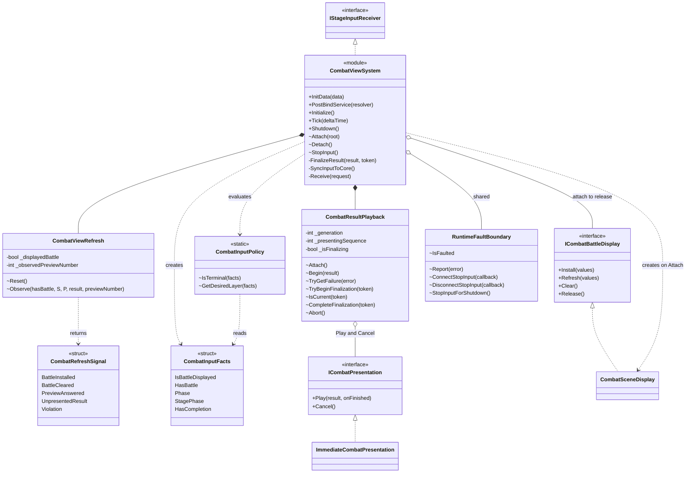
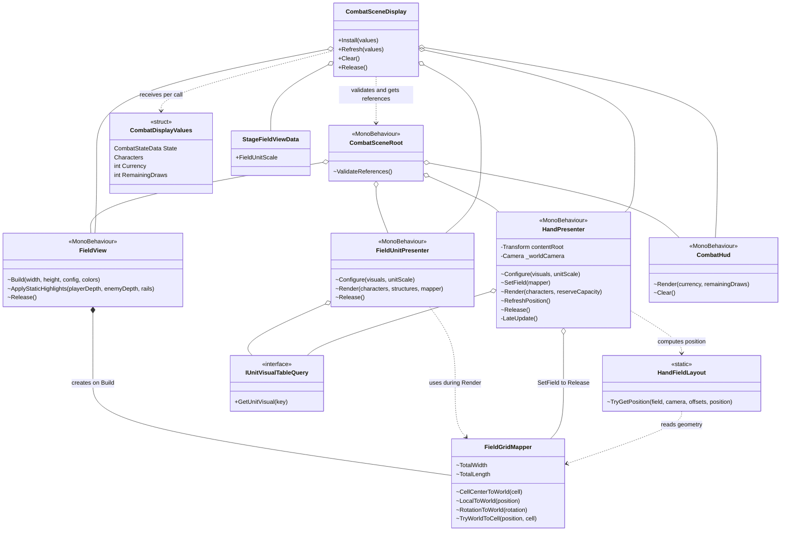
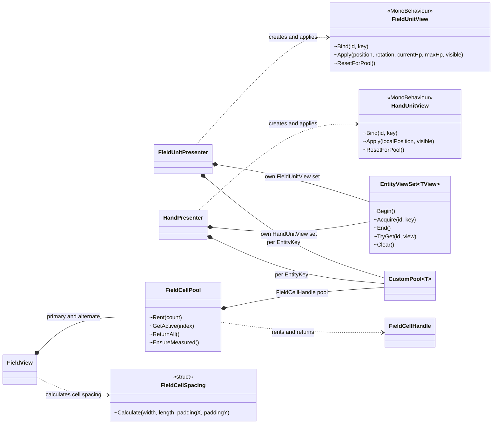
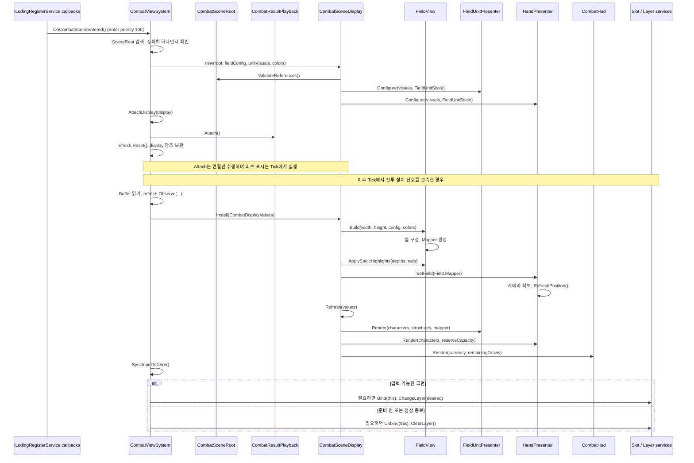
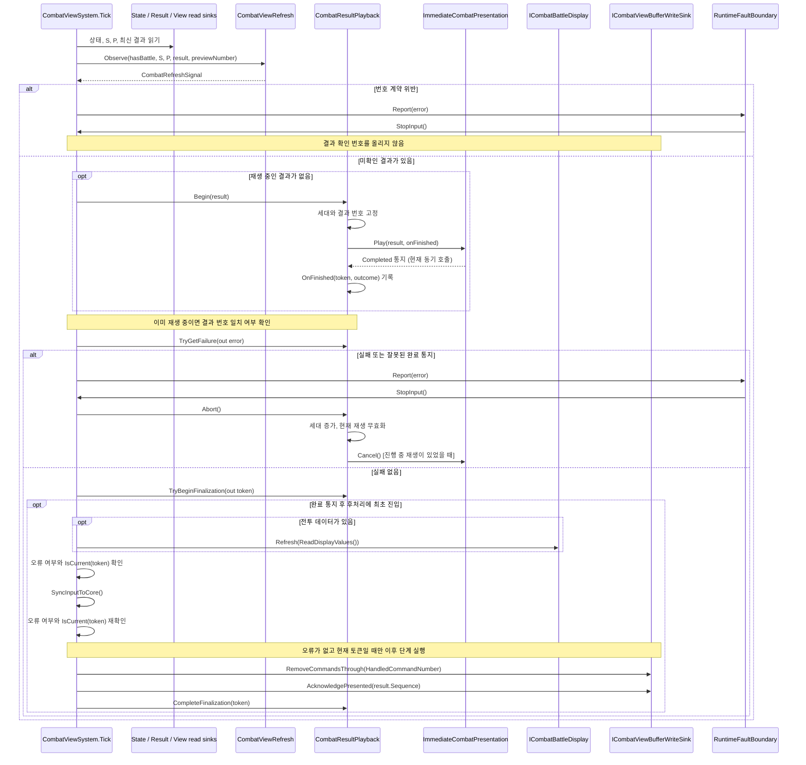
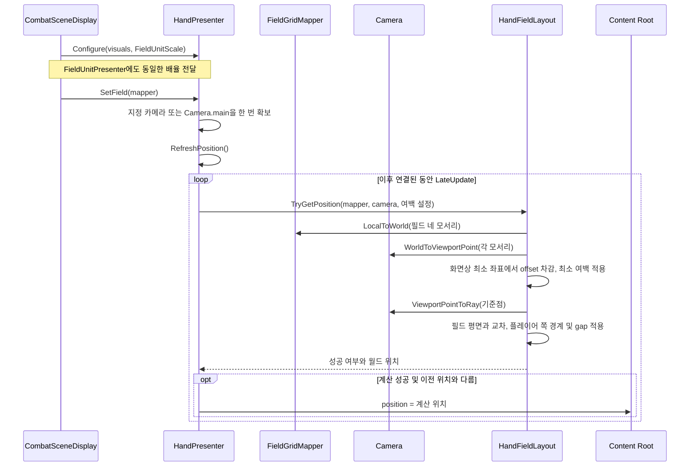

# 전투 View — 현재 코드 기준 UML

> **과거 스냅샷 / 현재 구조로 사용하지 않음.** 아래 도표는 작성 당시 기록을 보존한다. 현재 골격·View·경로 이동·Return·F1/F2는 [2026-10-05 통합 UML](2026-10-05-combat-current-uml.md)과 [오프라인 HTML](2026-10-05-combat-current-uml.html)을 따른다.

- 기준일: 2026-10-03, 확인한 코드 기준 커밋 `dcab8e53`.
- 목적: 현재 코드의 객체 관계와 호출 순서를 설명한다. 주요 멤버만 표시하며, 계획상의 클래스를 구현된 클래스처럼 포함하지 않는다.
- 목표 구조는 [구현 계획 기준 UML](2026-10-01-combat-view-implementation-uml.md), 설계 원칙은 [전투 View 설계](2026-09-30-combat-view-design.md)를 참조한다. 진행·검증 상태의 단일 기록은 [구현 계획 §7](../plans/2026-10-01-combat-view-plan.md#7-검증과-실행-기록)이다.

`*--`는 생성·수명 관리, `o--`는 보관하는 참조, `..>`는 호출·값 전달 의존, `<|..`는 인터페이스 구현이다. `+`는 public, `-`는 private, `~`는 C# internal이다. 메서드 매개변수와 타입 표기는 읽기 쉽게 축약했다. 씬의 MonoBehaviour 수명은 Unity가 관리한다. 아래에서 Display가 Presenter를 참조하는 관계는 씬 오브젝트의 생성·파괴 소유권을 뜻하지 않는다.

## 1. 조정자와 외부 경계

`CombatViewSystem`은 호출 순서를 정한다. 변경 감지, 재생 상태, 입력 Layer 판단, 실제 표시는 각각 별도 객체가 맡는다.

`CombatResultPlayback`만 연결 세대·재생 번호·완료/실패 통지·후처리 진입 상태를 보관한다. 완료 기준 번호 `P`는 Buffer에서 읽으며 Playback에 영구 복제하지 않는다. 연출 콜백은 Playback에 통지만 기록한다. 표시 갱신과 결과 확인은 `CombatViewSystem.Tick()`에서 수행한다.

현재 Factory가 주입하는 연출은 `ImmediateCombatPresentation`이다. `Play()` 안에서 즉시 완료를 통지하므로 결과 하나의 재생과 후처리가 같은 Tick에 끝날 수 있다.

### 외부 접근 범위

| 외부 계약 | 현재 View의 사용 범위 |
|---|---|
| `ICombatStateBufferReadSink` | 전투 유무·상태·최신 결과 번호·처리 명령 번호·미리보기 응답 번호·종료 정보 읽기 |
| `ICombatResultReadSink` | `TryGetLatest()`로 최신 결과 읽기 |
| `ICharacterBufferReadSink`, `ICurrencyBufferReadSink` | 캐릭터와 재화 표시값 읽기 |
| `ICombatViewBufferReadSink` | 표시 확인 번호 `PresentedResultSequence` 읽기 |
| `ICombatViewBufferWriteSink` | 현재 호출은 `RemoveCommandsThrough()`와 `AcknowledgePresented()` |
| `IStageInputReceiverSlot`, `IInputLayerService` | 수신자 연결/해제, 현재 Core 국면에 맞춰 Deployment/Combat Layer 선택 |
| `ILodingRegisterService` | Combat 씬 Enter `100`, Exit `-100` 콜백 등록 |
| `IHasViewQuery` | 필드 외형 설정과 `IUnitVisualTableQuery` 확보 |
| `IColorSystemService` | Field 셀의 색 표현에 전달 |

`PostBindService()`는 `IBufferQuery`에서 위의 필요한 Sink만 꺼내 보관한다. Presenter와 `CombatSceneDisplay`는 Buffer 조회 서비스를 받지 않고, 전달된 데이터와 View 외형 Query를 사용한다. Core 계약의 `EntityKey`, `EntityId`, `Rotation4` 등을 쓰는 것은 Core 처리 API 호출과 구분한다.

### 전투 골격과 연결되는 위치

`GameBootstrap.Awake()`가 공통 `RuntimeFaultBoundary`를 만들고, `Start()`가 DB와 런타임을 조립한 뒤 `BindScene → InitData → PostBindService → Initialize`를 수행한다. `InGameViewSystemFactory`는 View를 **모듈로만 등록**하고 `StopInput` 콜백을 공통 오류 경계에 연결한다.

`CombatFlow`는 같은 오류 경계와 실행 모드를 받으며 Job 등록을 담당한다. View는 Flow나 Core를 직접 실행하지 않는다. 골격의 Job이 Core를 실행해 기록한 상태·결과를 View가 Buffer로 읽고, 표시를 마친 번호를 CombatViewBuffer에 확인한다. Buffer 전체 `Clear`의 소유자는 `CombatLifeCycle`이다.

## 2. 씬 표시와 데이터 전달

| 담당 | 책임 범위 |
|---|---|
| `CombatSceneRoot` | Inspector 참조와 연결 검증. Tick·입력 해석·Buffer 조회 없음 |
| `CombatSceneDisplay` | 받은 값을 필드·배치 유닛·손패·HUD에 배분. 씬 연결 하나당 생성되며 Release 후 재사용하지 않음 |
| `FieldView` | 셀 구성, 정적 배치 영역·레일 색, 셀 풀과 좌표 변환기 관리 |
| `FieldGridMapper` | Core 셀 좌표와 필드 로컬/월드 좌표 변환. 필드 중앙이 원점이며 Core Y는 로컬 Z에 대응 |
| `FieldUnitPresenter` | 필드 캐릭터·구조물의 위치·회전·체력·가시성 반영 |
| `HandPresenter` | 플레이어 손패를 `ReserveSlotIndex`에 배치하고 Content Root 위치 반영 |
| `HandFieldLayout` | 필드 크기·카메라·여백으로 위치만 계산. Transform을 직접 변경하지 않음 |
| `CombatHud` | 재화·남은 드로우 표시. 같은 값의 텍스트 재설정 생략 |

`CombatDisplayValues`는 호출마다 전달하는 값 묶음이다. `RemainingDraws`는 `DrawOrder.Count - DrawCursor`에서 계산한다. Display에 별도 전투 상태 저장소를 만들지 않는다.

## 3. 개체 재사용과 셀 풀

제네릭 노드는 타입을 나타낸다. 두 Presenter가 같은 `EntityViewSet`이나 풀 인스턴스를 공유하는 것은 아니다.

`EntityViewSet`은 `EntityId`별 View를 재사용한다. `Begin → Acquire → End`로 이번 표시 대상에 없는 View를 반환하며, 같은 ID의 외형 키가 바뀌면 기존 View를 반환하고 해당 키의 View를 빌린다. Presenter는 `EntityKey`별 풀의 생성·대여·반환을 맡는다.

`FieldView`는 두 셀 프리팹의 실제 표시 크기를 측정해 간격을 계산한다. 필드 설치와 결과별 개체 갱신을 나누므로 결과마다 셀 전체를 다시 생성하지 않는다. 개체 목록은 갱신 시 순회하지만, 기존 View는 유지하고 변경된 Transform·체력·가시성만 적용한다.

## 4. 씬 연결과 최초 표시 순서

씬 진입 시 Root 검색은 한 번 수행한다. 최초 표시가 성공한 뒤 수신자를 연결한다. 결과 처리 뒤에도 현재 Core 국면을 다시 읽어 Layer를 맞춘다.

## 5. 결과 재생과 표시 확인 순서

`S = LatestResultSequence`, `P = PresentedResultSequence`다. `CombatViewRefresh`는 `S < P`, `S - P > 1`, 결과 번호 불일치, 미확인 번호에 대응하는 결과 누락을 계약 위반으로 돌려준다. 미확인 결과는 `S = P + 1`인 한 개만 소비한다.

거절된 결과도 사유를 로그로 남긴 뒤 같은 표시·확인 순서를 따른다. 후처리 중 오류나 Detach로 토큰이 무효화되면 이후 확인으로 진행하지 않는다. `Abort()`는 취소 호출보다 먼저 세대를 바꾸므로 취소 중 늦게 도착한 이전 콜백을 무시한다.

예상한 계약 위반과 연출 실패는 View가 오류 경계에 보고한다. Tick에서 전파된 다른 예외는 `GameBootstrap.Update()`가 같은 경계에 보고하고, Tick 밖의 입력 콜백 예외는 `Receive()`가 보고한다.

## 6. 손패 위치와 배율

- `HandFieldLayout`은 필드 총 너비·길이와 카메라 투영으로 위치를 계산한다. 모서리가 카메라 뒤에 있거나 평면 교차가 실패하면 기존 위치를 유지한다.
- `HandPresenter`는 `contentRoot.position`만 바꾼다. 부모, 회전, 스케일은 유지하며, 슬롯은 Content Root 로컬 X축에 배치한다.
- 슬롯 위치는 `(ReserveSlotIndex - (max(ReserveCapacity, 1) - 1) × 0.5) × slotSpacing`이다. 실제 손패 개수 대신 전체 용량으로 가운데를 정한다.
- 현재 `StageFieldView_Default.asset`의 `FieldUnitScale`은 **0.5**다. 배치 유닛과 3D 손패가 같은 값을 받으며, 프리팹 인스턴스를 처음 만들 때 기존 `localScale`에 한 번 곱한다. 풀에서 다시 빌릴 때는 곱하지 않는다.
- `LateUpdate()`에서는 네 모서리를 기준으로 위치만 계산한다. 손패 개체 전체 Render는 최초 설치와 결과 표시 갱신 때 수행한다. `Release()`가 필드·카메라 참조를 해제하면 위치 갱신도 중단된다.

## 7. 정상 종료·오류·씬 해제의 차이

| 진입 경로 | 입력 | Playback | 씬 표시와 Buffer |
|---|---|---|---|
| 정상 종료: `Phase == Finished` 또는 Completion 존재 | `SuspendSubmissions()`로 수신자와 Layer 해제 | 유지하여 마지막 결과 소비 가능 | 표시를 유지하고 마지막 결과도 정상 확인 |
| 오류 경계 → `StopInput()` | 수신자와 Layer 해제 | `Abort()`, 진행 중이면 연출 Cancel | Display 연결은 유지. 확인 번호와 명령 Buffer를 임의로 변경하지 않음 |
| 씬 Exit `-100` → `Detach()` | 수신자와 Layer 해제 | `Abort()` | Display 참조 해제, Refresh 감지 상태 초기화, `Release()`로 풀 반환 |
| `Shutdown()` | Detach 경로 사용 | Detach 경로 사용 | `finally`에서 오류 경계의 StopInput 콜백 연결 해제 |

`CombatSceneDisplay.Clear()`는 전투 데이터가 사라졌을 때 유닛·손패·HUD·필드를 비우고 표시 객체를 유지한다. `Release()`는 씬 해제 경로이며 유닛·손패·필드를 반환하고 객체를 사용 종료 상태로 만든다. 이 경로에서는 `HUD.Clear()`를 호출하지 않는다. 씬 오브젝트 자체는 Unity의 씬 수명을 따른다.

## 8. 현재 입력 연결의 범위

`IStageInputReceiver` 콜백은 `CombatViewSystem.Receive()`까지 연결되어 있다. 여기서 오류 정지와 수신 연결 여부를 확인하고, `Handle()`에서 취소·종료·후처리 중 입력을 걸러낸다.

현재 `Handle()`의 동작 해석 부분은 주석으로 남아 있다. 좌표를 받는 콜백도 지금은 요청 종류만 `Receive()`에 넘긴다. 따라서 위 UML에는 `CombatInteraction`, 드래그·선택·고스트, 명령 대기 객체, 명령 `Submit()` 및 미리보기 `SetPreview()` 호출을 실제 연결로 그리지 않았다. 미리보기 응답 번호 관측은 있지만 그 응답을 화면에 반영하는 연결은 없다. 손패는 현재 3D 유닛 표시이며 카드 표시 클래스도 없다.

## 9. 코드 찾아보기

아래 링크에서 위 도표의 호출 순서와 소유 필드를 확인할 수 있다.

| 구분 | 코드 |
|---|---|
| 런타임 조립 | [GameBootstrap.cs](../../../Assets/ProjectL/Script/Systems/RuntimeSystem/InGameSystem/ViewSystem/Boot/GameBootstrap.cs), [InGameViewSystemFactory.cs](../../../Assets/ProjectL/Script/Systems/Factory/Runtime/InGame/View/InGameViewSystemFactory.cs) |
| 조정·결과 처리 | [CombatViewSystem.cs](../../../Assets/ProjectL/Script/Systems/RuntimeSystem/InGameSystem/ViewSystem/Combat/CombatViewSystem.cs), [CombatResultPlayback.cs](../../../Assets/ProjectL/Script/Systems/RuntimeSystem/InGameSystem/ViewSystem/Combat/CombatResultPlayback.cs), [CombatViewRefresh.cs](../../../Assets/ProjectL/Script/Systems/RuntimeSystem/InGameSystem/ViewSystem/Combat/CombatViewRefresh.cs) |
| 표시 조립 | [CombatSceneDisplay.cs](../../../Assets/ProjectL/Script/Systems/RuntimeSystem/InGameSystem/ViewSystem/Combat/CombatSceneDisplay.cs), [CombatSceneRoot.cs](../../../Assets/ProjectL/Script/Systems/RuntimeSystem/InGameSystem/ViewSystem/Combat/CombatSceneRoot.cs) |
| 필드·배치 유닛 | [FieldView.cs](../../../Assets/ProjectL/Script/Systems/RuntimeSystem/InGameSystem/ViewSystem/Combat/Display/FieldView.cs), [FieldUnitPresenter.cs](../../../Assets/ProjectL/Script/Systems/RuntimeSystem/InGameSystem/ViewSystem/Combat/Display/FieldUnitPresenter.cs) |
| 손패 자동 위치 | [HandPresenter.cs](../../../Assets/ProjectL/Script/Systems/RuntimeSystem/InGameSystem/ViewSystem/Combat/Display/HandPresenter.cs), [HandFieldLayout.cs](../../../Assets/ProjectL/Script/Systems/RuntimeSystem/InGameSystem/ViewSystem/Combat/Display/HandFieldLayout.cs), [FieldGridMapper.cs](../../../Assets/ProjectL/Script/Systems/RuntimeSystem/InGameSystem/ViewSystem/Combat/Display/FieldGridMapper.cs) |
| View 재사용 | [EntityViewSet.cs](../../../Assets/ProjectL/Script/Systems/RuntimeSystem/InGameSystem/ViewSystem/Combat/Display/EntityViewSet.cs) |
| 오류 경계·골격 | [RuntimeFaultBoundary.cs](../../../Assets/ProjectL/Script/Systems/RuntimeSystem/Common/RuntimeFaultBoundary.cs), [CombatFlow.cs](../../../Assets/ProjectL/Script/Systems/RuntimeSystem/LifeCycleSystem/LifeCycles/Combat/CombatFlow.cs) |
| 공통 배율 설정 | [StageFieldView_Default.asset](../../../Assets/ProjectL/DataBaseSO/ViewGroup/StageFieldView/Item/StageFieldView_Default.asset) |
