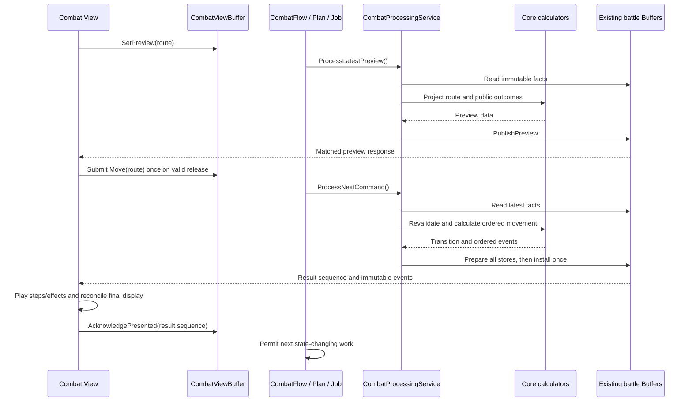

# Drag Path Movement and Conditional Checkpoint Return

- Date: 2026-10-04
- Status: Gameplay decisions confirmed in conversation; technical design ready for review. Implementation has not started.
- Source baseline: working tree at `7c9f724a`, inspected on 2026-10-04.
- Scope: ordinary player/enemy movement, route preview, traversal effects, destination effects, conditional checkpoint return, Buffer publication, and View integration.
- Language: design and implementation documents are written in English; new code comments are written in Korean.

## 1. Purpose and decision authority

Players must choose both the destination and the cells traversed. A safe detour must remain the same route when executed. This prevents an automatically reconstructed route from taking a character across a hazard the player intended to avoid.

The latest user decisions in this conversation supersede conflicting recommendations in `drag_movement_programmer.md` version 0.1 and the endpoint-based movement sections of the older checkpoint design. The original external document is reference material, not an instruction to implement all its recommendations. The confirmed decisions are recorded in Section 2 so this design does not depend on access to the attachment.

Framework references:

- [Framework Development Guidelines](../framework/Framework%20Development%20Guidelines.md)
- [Framework architecture](../../../Assets/ProjectL/Script/Systems/Documentation/framework-architecture.md)
- [Framework programmer guide](../../../Assets/ProjectL/Script/Systems/Documentation/framework-programmer-guide.md)
- Previous checkpoint design (Git 이력: `2026-08-29-movement-checkpoint-cost-design.md`)
- [Combat View design](2026-09-30-combat-view-design.md)
- [Combat Flow design](2026-09-30-combat-flow-skeleton-design.md)

The general Framework documents contain a 2026-09-22 snapshot. Current source takes precedence for implementation status, registrations, and API names. In particular, a Combat Flow and command/preview/result Buffers now exist; their presence does not prove that every Job or scene connection is complete.

This document selects a technical approach for the confirmed behavior. Proposed type names and integration details below are design choices, not claims that those APIs already exist or that implementation has been approved.

## 2. Confirmed gameplay contract

| ID | Confirmed rule |
|---|---|
| G01 | Press and hold a movable character, drag to edit an ordered route, and release to execute it. No separate movement confirmation button exists. |
| G02 | Dragging is preview only. It changes no authoritative position, HP, ActionCost, movement range, Object, soul, trait, or battle state. |
| G03 | Actual movement uses orthogonally adjacent cells. Every intermediate cell participates in validation and applicable effects. |
| G04 | ActionCost and movement-range consumption accumulate according to the actual selected route, including detours and successive executed drags. |
| G05 | Ordinary player movement remains refundable through an explicit checkpoint-return operation until a settlement boundary. Ordinary movement toward the checkpoint is still paid movement. |
| G06 | A return-blocking event seals the pending movement through the actual final stop of that command. A surviving character starts its next refundable interval at that stop. |
| G07 | A successful attack and turn end seal pending movement. Entering or canceling attack selection does not. |
| G08 | Damage, healing, death, actual soul collection, Object consumption/acquisition, and gameplay-changing gimmick events block return to the preceding checkpoint. Effects on other entities also count. |
| G09 | A position-dependent temporary destination modifier does not by itself block return. It applies only at the actual destination, never merely while passing through or pausing during animation. |
| G10 | Thorn damage and mine activation resolve when the executed route reaches their cells. Souls are collected only at the actual final destination. |
| G11 | Surviving damage does not automatically stop movement. Death, inability to move, or forced relocation stops the remaining selected route. Only entered voluntary steps are charged. |
| G12 | Cell resolution order is hazards, death check, healing/acquisition for survivors, then destination-only modifiers when applicable. A living interruption location is the actual destination. |
| G13 | A temporary maximum-HP tile increases maximum HP only. On removal, current HP is capped to the restored maximum. This cap is not damage and does not itself block return. |
| G14 | Player and enemy ordinary movement share traversal, obstruction, and cell-effect rules. Enemies have no checkpoint return/refund operation. |
| G15 | Enemies avoid known mines, may detour within their budget, and may take a safe prefix toward a farther goal. If no safe approach route exists, they do not move; an available attack remains possible. |
| G16 | Living allies, enemies, and blocking structures cannot be traversed. The moving character's own current occupancy is excluded from collision checks. |
| G17 | Pointer samples are connected in traversal order. Exact corner ties use the X step first. Blocked intermediate cells stop route construction; the editor does not choose another route. |
| G18 | Entering the immediately preceding route cell deletes one step. Entering an older route cell is rejected. Invalid drops cancel the entire draft instead of executing the last valid prefix. |
| G19 | Return uses a button, restores the checkpoint immediately without reverse traversal, and does not activate intermediate effects. An occupied or invalid checkpoint rejects the return. |
| G20 | Movement-success traits run once per executed drag with actual movement, not once per cell. Return does not restore prior trait state or trigger another ordinary movement-success event. |

G05 restores both the outstanding movement ActionCost and outstanding movement distance. It does not restore attack expenditure, sealed movement, damage, healing, consumed Objects, or trait state. Position-dependent modifiers are recomputed for the returned location.

## 3. Scope and delivery boundaries

Included work consists of route authoring, route contracts, common movement calculation, traversal/destination settlement, checkpoint return, enemy safe-route selection, Buffer validation/publication, result playback, and regression coverage.

The following remain separate from this movement change:

- A full battle Undo, command-history restoration, or reversal of consumed Objects and deaths.
- A new general combat scheduler, Core-owned runtime session, or per-cell command queue.
- Changes to knockback and other forced-movement distance, collision, or effect semantics.
- A broad tactical AI redesign, mine discovery system, or fog-of-war system.
- New mine damage values, blast shapes, healing values, or unrelated tile content balancing.
- General support for arbitrary multi-cell ordinary movers; the inspected movement calculator currently accepts single-cell occupancy only.
- Unrelated Framework cleanup or implementation of every unfinished View feature.

Mine and destination-modifier runtime definitions were not found in the inspected ordinary movement path. Their data and Core effect adapters are required integration work, not existing features to call by name. Existing thorns provide a concrete traversal-hazard case. Use typed fixture effects to verify mine avoidance, effect ordering, and return barriers without inventing production content values. Delivery must distinguish a tested extension point from a fully authored, playable mine/tile feature.

## 4. Current implementation and migration points

All paths in this table are relative to `Assets/ProjectL/Script/Systems/`.

| Current code | Observed behavior | Required change |
|---|---|---|
| `RuntimeSystem/BufferSystems/CombatView/CombatViewCommand.cs` and `CombatViewPreview.cs` | Move contains an entity and one target cell. | Carry an immutable ordered route; add a distinct return command/query. |
| `RuntimeSystem/InGameSystem/CoreSystem/CoreCaculator/Contracts/Combat/CombatCommandInput.cs` | Move consumes `TargetCell`. | Carry the route and its origin/context preconditions through all copy/composition paths. |
| `CoreCaculator/Application/Combat/CombatMovementCalculator.cs` under CoreSystem | Checks the endpoint and charges checkpoint-to-target Manhattan-distance differences; projects movement traits. | Validate every route edge and compute an ordered movement/effect proposal shared by preview and execution. |
| `CoreCaculator/Domain/Movement/MovementPathCalculator.cs` | Reconstructs a path from two anchors, potentially changing X and Y together. | Remove its use for voluntary route reconstruction; preserve forced-movement behavior separately. |
| `CoreCaculator/Application/Combat/CombatCommandCalculator.cs` and `CombatTurnCalculator.cs` | Settle voluntary thorn traversal and destination soul collection at attack/turn-end boundaries. | Resolve these during movement and remove their deferred duplicate application. Preserve unrelated attack, forced-arrival, and turn-end effects. |
| `CoreCaculator/Application/Artifact/SoulEffectCalculator.cs` | Voluntary collection requires already-settled movement. | Introduce an explicit resolved-arrival contract; do not falsely mark ordinary movement as forced arrival to bypass the guard. |
| `CoreCaculator/Contracts/Combat/CharacterCombatFacts.cs` | Stores checkpoint anchor, committed distance, and pending movement cost; pending distance is inferred geometrically. | Store actual pending route distance and separate position modifiers from unrelated bonuses. |
| `RuntimeSystem/BufferSystems/Core/BufferSystemGroup.cs` | Prepares character, field, command, and completion changes before installing them. | Extend the same publication boundary and all expected/final comparisons. |
| `CoreCaculator/Application/Combat/EnemyAi/EnemyAiPolicy.cs` | Selects a destination by Manhattan proximity; rejects moves that do not immediately get closer. | Select a safe orthogonal route and allow a detour that initially increases geometric distance. |
| `RuntimeSystem/InGameSystem/ViewSystem/StageInput/StageSelectInput.cs` | Forwards pointer, press, release, and cancellation. | Reuse it; place route-editing state in the combat View interaction owner. |
| `RuntimeSystem/LifeCycleSystem/LifeCycles/Combat/CombatFlow.cs` | Schedules work, tracks pending confirmations, and waits for presentation acknowledgement before further state-changing work. | Preserve this ownership and the result acknowledgement gate. |
| `RuntimeSystem/LifeCycleSystem/LifeCycles/Combat/Jobs/` | Prepare calls Core; Command, Preview, and Advance still throw connection errors. | Wire the existing Jobs to the registered processing service as an integration prerequisite. |
| `Factory/Runtime/InGame/View/InGameViewSystemFactory.cs` | Builds an empty View group. | Integrate with the agreed combat View owner; do not assume the scene/drag presenter is already implemented. |

The Framework documents are architectural references, while these observations describe the source baseline. Service-level tests are not evidence that the full player input-to-animation loop works in Unity.

## 5. Framework ownership and assembly boundaries

### 5.1 Responsibility table

| Owner | State and responsibility | Prohibited responsibility |
|---|---|---|
| Combat View interaction | Draft route, pointer sampling, cancellation state, request numbers, presentation progress | Authoritative HP, movement cost, checkpoint eligibility, or effect execution |
| `CombatViewBuffer` | Numbered user intents, latest preview request, presentation acknowledgement | Calculation of gameplay validity or a second battle-state copy |
| Existing `CombatFlow` / `CombatPlan` / Jobs | Decide when processing may run, register existing work, and confirm completion | Gameplay calculation, per-cell battle state, or a competing movement scheduler |
| `CombatProcessingService` in Systems | Read current Buffer facts, call Core, publish through the battle write sink | Own mutable combat truth or drive animation |
| Core Contracts / Domain / Application | Immutable requests/results, traversal and effect rules, pure command-local projection | Unity objects, Framework services, Buffer writes, Jobs, or animation callbacks |
| `CharacterBuffer` | Authoritative character facts, resources, movement ledger, traits, position modifiers | View draft paths or animation timing |
| `CombatStateBuffer` | Authoritative board/effect facts, phase, souls, latest result/preview and processed numbers | A duplicate character store |
| `IBattleBufferWriteSink` | Validate and publish the complete multi-store proposal | Partially install a route before all proposal validation succeeds |
| View presenters | Lift/ghost, route display, ordered movement and effect playback | Apply gameplay effects when a clip or tween finishes |

View-owned orchestration means the existing LifeCycle/Flow/Plan/Job path, despite its physical location outside the `ViewSystem` folder. It does not authorize a second executor inside Core or the movement calculator.

### 5.2 Composition and lifetime

- Keep game-specific types in Systems and the existing Core assemblies. Framework must not gain a Systems/Core dependency.
- Keep the current `ProjectL.Core.Contracts`, `ProjectL.Core.Domain`, and `ProjectL.Core.Application` boundaries. Folder placement is not assembly membership.
- Construct runtime modules in the existing Factory. Export narrow `IServiceModule` interfaces, register necessary lifecycle modules, and finish registration before Build.
- Use the existing InGame Core context for `ICombatProcessingService`. Access Input, Render, UI, and Jobs through the Global context, not through invented root registrations.
- Bind scene references once per attachment, obtain DB configuration through queries, and retain runtime state in Buffers rather than ScriptableObjects.
- A route editor is a small View-owned object, not automatically a new System, singleton, Scope, or service hierarchy.
- Release ghost/route resources through their owning Render Scope/Handle APIs. Do not assume every scope implements `Dispose`, or that global event subscriptions have per-subscriber removal.
- Scene detach and input cancellation clear the local draft, preview, and callback ownership. They do not roll back a published movement result.

### 5.3 Selected processing architecture



One route is one gameplay command. Core computes each step on private projected facts and returns one transition. The authoritative Buffers are updated once; View playback shows the intermediate history afterward. Logical cell-entry effects therefore occur during route resolution, not at a later attack and not in animation callbacks.

Preserve `CombatFlow`'s command priority, preview handling, and `PresentedResultSequence >= LatestResultSequence` gate. A preview may be calculated during playback, but it must not enable another movement draft against a character still being presented. The Job runner's queue order must not replace the Flow's explicit dependencies.

## 6. Route input and editor behavior

### 6.1 Origins and route ownership

`DragOrigin` is the character's authoritative anchor when this drag begins. `CheckpointAnchor` is the origin of the current refundable interval, possibly established several drags earlier. These are different values.

A route includes its origin: `[A, B, C]` means two movement steps. The View owns the mutable draft. Buffer requests and Core contracts defensively copy it. Later backtracking must not mutate a queued request or a previously published preview.

The allowed route has at least one edge, no repeated cells, and Manhattan distance one between every consecutive pair. A player may revisit a cell in a later drag; those steps are paid normally. The no-revisit rule applies within one draft, not to the entire turn.

### 6.2 Interaction states

| State/event | Result |
|---|---|
| Idle + press eligible character | Capture actor/origin/context; draft contains origin; show lifted character. |
| Editing + accepted adjacent new cell | Append, request a refreshed preview, and update the path display. |
| Editing + immediate predecessor | Pop one cell and refresh; no resources change. |
| Editing + older draft cell | Reject that addition; show the reason. |
| Editing + blocked/nonadjacent/over-budget continuation | Keep the valid draft, mark the pointer invalid, and suspend further additions. |
| Suspended + pointer returns to endpoint/predecessor | Resume editing or remove one step. Do not connect across the invalid gap. |
| Board exit / cancel-area hover | Preserve the draft but stop sampling board segments. |
| Return from UI/outside | Reset sampling continuity; resume from endpoint/predecessor. |
| Release at valid endpoint | Freeze and submit the exact route once. |
| Release at origin, cancel area, invalid cell, or outside board | Discard the entire draft without a movement command. |
| Focus/capture loss, scene detach, or input cancellation before submission | Discard draft and clear preview. |
| Submission/result playback | Disable further move/return submission until the result is handled and presentation completes. |

If the latest route preview has not returned at release, freeze that exact draft and complete its validation before submitting automatically. This is a short validation wait, not another confirmation button. An obsolete preview must never authorize a different route; cancellation or context loss during this wait discards the unsubmitted draft.

### 6.3 Pointer sampling

Use board-space segment/grid crossings between valid pointer samples. Enumerate crossed boundaries in increasing segment order. At an exact corner, emit the X-adjacent cell and then the Y step, making both cells part of the route. Test the first intermediate cell before accepting the second; do not switch to Y-first to avoid a blocker.

Use an inner-cell acceptance threshold to reduce boundary jitter. Its numeric value belongs to input configuration and Unity usability testing. It must not remove crossed gameplay cells from a fast segment. UI/outside-board segments are excluded, and crossing an invalid area never creates a hidden shortcut.

View handles geometry and gesture editing. Core remains authoritative for traversal, occupancy, affordability, and effects. A range highlight is only an indication that some route exists; it is not permission to ignore the actual draft length or execute a substitute route.

## 7. Movement ledger and checkpoint return

### 7.1 Authoritative character facts

Extend character facts within the existing `CharacterBuffer`; do not add a separate authoritative movement store.

| Fact | Meaning |
|---|---|
| `MovementCheckpointAnchor` | Anchor to which the current pending interval may return. |
| `CommittedMoveDistance` | Entered voluntary steps sealed earlier in this turn. |
| `PendingMoveDistance` (new) | Entered voluntary steps since the checkpoint that remain refundable. |
| `PendingMoveActionCost` | Actual paid ActionCost still refundable through checkpoint return. |
| Position modifier contribution (new) | Source-specific destination modifiers currently applied to this character. |
| `AttackRefundEligibleMoveCost` (approved compatibility adapter) | Independent attack-effect refund basis described in Section 7.4. |

Do not infer pending distance or cost from checkpoint-to-current displacement. The character can stand at the checkpoint after a paid loop across multiple drags and still have outstanding refundable expenditure.

For the current fixed-per-step cost model, a route with `n` edges quotes `n * MoveCost`. Use checked arithmetic and validate nonnegative resources. Future effects that alter movement prices require an explicit per-step cost policy; this design does not silently introduce dynamic tariffs or a new terrain-cost feature.

```text
remainingMoveRange = MoveRange - CommittedMoveDistance - PendingMoveDistance

On an entered voluntary step:
    CurrentActionCost -= quotedStepCost
    PendingMoveDistance += 1
    PendingMoveActionCost += quotedStepCost

Seal pending movement:
    CommittedMoveDistance += PendingMoveDistance
    PendingMoveDistance = 0
    PendingMoveActionCost = 0
    MovementCheckpointAnchor = actual final anchor

Accepted checkpoint return:
    CurrentActionCost += PendingMoveActionCost
    PendingMoveDistance = 0
    PendingMoveActionCost = 0
    Anchor = MovementCheckpointAnchor
    recompute RemainingMoveRange and position modifiers
```

Sealing does not charge a second time. Returning does not refill the entire turn budget. Turn start resets the movement ledger through the existing turn-resource path.

For a living ordinary mover, committed and pending distances are nonnegative, their sum cannot exceed `MoveRange`, and `CurrentActionCost` remains within its valid limits. Refund the stored amount actually paid, not a recomputation using the current destination or current price. Keep the attack-effect refund basis synchronized with charges/returns as described below. No full path history is needed in authoritative character state: the ledger supports Return, while immutable command results retain routes for presentation.

### 7.2 Boundaries

During an ordinary player route, accumulate a command-local `ReturnBarrierOccurred` flag from actual effect results. It is sticky even if later effects restore the original HP or the final tile is safe. Do not derive it from final HP differences alone.

After the route and eligible arrival effects complete:

- No barrier: retain the previous checkpoint and accumulate pending steps/cost across drags.
- Barrier: seal the entire pending interval, including earlier safe drags, through this command's actual final stop.
- Death/removal: retain the final stop in the result for presentation; disable return. Do not fabricate an occupied anchor for an excluded character.
- Enemy: settle its actual movement immediately; expose no return command or return eligibility.

A successful attack seals the outstanding interval; a failed attack does not. Turn end seals it without charging again. Attack-selection mode is not a settlement boundary.

### 7.3 Explicit return

Introduce a separate `ReturnToCheckpoint` command and a query/preview exposing `CanReturn`, refund amounts, and a reason when unavailable. The View must not emulate return with an ordinary route, direct transform movement, or a series of reverse commands.

Core checks current battle/turn/actor validity, player ownership, outstanding pending movement, and the checkpoint's current validity/occupancy. A rejected return changes nothing. A same-anchor return can still refund outstanding paid movement from earlier drags; it is not rejected solely because displacement is zero.

An accepted return atomically restores occupancy, refunds the recorded pending resources, clears the pending ledger, and reconciles position modifiers. It triggers no traversal hazards, soul collection, ordinary arrival acquisition, or new movement-success trait event. Returning must not undo HP caps that already occurred or restore a previous HP snapshot.

### 7.4 Existing movement-related effects

Keep movement-success effects once per command that actually enters at least one cell. Supply actual entered distance and actual paid movement cost. A rejected/zero-step move and a checkpoint return do not count as another success. Existing Focus and MoveAttackDiscount state is not rewound by return.

The existing ManeuverRefund category reads `PendingMoveActionCost` during attack resolution. An environmental return barrier introduces a new settlement boundary, so this dependency must be explicitly preserved or adapted, not accidentally erased by clearing the return ledger.

Approved compatibility contract: give attack-refund rules a separate, narrowly scoped `AttackRefundEligibleMoveCost` fact. It records paid ordinary movement since the preceding successful attack, less checkpoint refunds; an environmental return barrier does not clear it. A successful attack captures it for the existing category rule and then clears the interval; turn end/start also clear it. Apply existing category caps and once-per-turn rules. This preserves attack-triggered refund behavior separately from the checkpoint-return restriction and avoids refunding the same returned movement twice. It does not make a barrier-crossing route eligible for the Return button.

This approved adapter preserves existing attack effects separately from checkpoint refunds; it does not change category balance. Scenario tests must verify that integration before implementation is considered complete. Its approval is not reopened by earlier review wording.

## 8. Tile effects, interruption, and final arrival

### 8.1 Effect categories

| Category | When evaluated | Return consequence |
|---|---|---|
| Passage hazard | Entering each executed route cell | Actual damage, mine activation/consumption, or gimmick mutation creates a barrier. |
| Passage healing/acquisition, if a content rule defines it | After hazards and survival validation | Actual healing/acquisition creates a barrier. |
| Soul collection | Once at the actual final destination, if alive and eligible | A consumed soul creates a barrier, including when HP cannot increase further. |
| Position-dependent destination modifier | Remove the old location contribution on departure; apply the actual destination contribution at final arrival | The modifier alone and maximum-HP normalization do not create a barrier. |
| Movement-success trait/category | Once per executed movement command | Preserve existing behavior; do not classify every internal state transition as a barrier. |

A callback name such as `OnTriggerEnter` does not determine effect semantics. Typed effect outcomes should state what happened: HP damage/healing, death, Object consumption/acquisition, gimmick mutation, or position-modifier normalization. The moving character is not the only possible affected entity.

No-op healing with no consumption or other mutation does not create a barrier. A mine that is consumed while damage is prevented still does. A permanent/stat-changing consumable buff is not covered by the reversible position-modifier exception.

### 8.2 Ordered route calculation

1. Validate the entire submitted route against current public traversal rules and its full movement budget. Reject malformed, stale, blocked, or unaffordable submissions before publishing any movement.
2. Start a private projection from authoritative facts. On actual departure, remove the prior destination-only contribution and normalize maximum/current HP.
3. For each edge, verify the next cell and remaining resources against the projected state, pay its step cost, and update projected occupancy/anchor. If an earlier executed effect made the next step impossible, stop before that step without charging it.
4. Emit a movement fact for that step. Resolve its hazard effects in deterministic order, including changes to other entities and Objects.
5. Resolve deaths and existing battle-outcome rules. Do not heal or collect for a dead mover. If the battle terminates, do not execute the remaining route.
6. For surviving entities, apply eligible healing/acquisition. Soul collection remains deferred until the mover's actual final arrival.
7. If the mover can no longer move or is forcibly relocated, stop the selected route. Never resume its remaining suffix from another origin.
8. At the living final stop, provided the battle has not already terminated, collect eligible souls once, then apply the destination-only modifier. Recheck terminal consequences of arrival effects. A forced-relocation handler that already resolved arrival must not cause a second collection; share an explicit arrival-resolution marker within the projection. After a terminal outcome, preserve facts required for final presentation but do not start further gameplay effects.
9. Apply one movement-success effect evaluation for the actual entered prefix, using current projected facts; do not resurrect a dead mover or overwrite HP/effect changes with the original actor snapshot.
10. Seal or retain pending movement as specified in Section 7. Return the complete transition and ordered facts.

Within each effect category, use explicit priority and stable content/instance identity as the technical tie-break; do not depend on dictionary enumeration. Retain an existing content rule's explicit internal ordering where it already defines one. Hazard resolution and the death boundary precede healing, so healing does not rescue an entity that already died in that cell.

Entry-contract clarification: a rule evaluates the Hazard or Recovery phase from current mover facts, copied target HP/occupancy and same-cell source facts; it cannot receive or return a complete combat command/state. Hazard requests cannot contain healing, and Recovery requests cannot contain damage/forced movement. The coordinator executes the existing thorn category from ThornFields, then typed source hazards in priority/ID order, then surviving Recovery. Selected source changes preserve identity and presentation/visibility metadata, updating only that source's actual gameplay state. Successful externally requested displacement and a changed existing movement-method field are gameplay/gimmick mutations; blocked/no-op requests are not barriers. This does not classify ordinary route steps or location normalization as gimmick events. Actual source/HP changes and deaths remain sticky evidence even if later effects restore HP.

Public-dependency clarification: `TargetIds(tile, mover)` declares the supported rule's candidate identities from its typed source and mover. Evaluation receives only those candidates' latest projected HP/occupancy, and its requests cannot change an undeclared target. The same composition supplies Preview, public expected-fact capture and execution. Destination-only sources are excluded from entry-rule input. New content must identify any additional consumed facts and extend the explicit comparison alongside its concrete adapter; this is not a generic target selector or mutation framework.

Known route invalidity at admission rejects the entire command. A legal route interrupted by an effect during projection is an accepted command with a partial executed prefix and a stop reason. Its spent resources and effects are real. Keep this distinct from `CombatResult.Accepted == false`, which currently requires no gameplay mutations or events.

### 8.3 Position-dependent modifiers and maximum HP

Store destination contributions separately from base stats, soul growth, artifact bonuses, and other temporary effects. The existing `TemporaryAttackBonus` and `TemporaryMaxHealthBonus` are already used by artifact/soul calculations and must not be repurposed as an undifferentiated tile-buff slot.

Contract clarification: the actor's `PositionModifier` records applied source provenance and signed contributions; it is not the tile definition. The existing stat snapshot carries its separate `PositionAttackBonus`, included in effective attack and preserved by stat recalculation. `ResolveAt(actualStop, currentEnvironment)` produces the contribution from active typed destination-source facts; `Replace` reconciles it without changing permanent, soul, or other temporary bonuses. Existing effective-stat constraints still apply (nonnegative effective attack, positive maximum HP, checked arithmetic); invalid values and overlapping active sources without an authored combination policy remain gated. Current-HP caps for the Main character publish its persistent current-HP update in the same proposal, leaving persistent base stats unchanged. `HealthNormalized` presentation facts are distinct from damage.

Example: `8/10` HP on a `+5 maximum HP` destination becomes `8/15`, not `13/15` or `12/15`. After a separate heal produces `14/15`, leaving the tile restores maximum HP to 10 and caps current HP to 10. The cap emits a typed normalization/presentation fact if needed, not a damage effect: no retaliation, damage-trigger trait, lifesteal, or return barrier may be caused by the cap alone. The separate heal already created its own barrier.

Removal occurs on departure, before subsequent route hazards; destination application occurs after arrival healing/acquisition. Intermediate animation stops do not activate modifiers. Returning reconciles the current location's contribution without restoring old HP, consumed effects, or unrelated temporary bonuses. Recomputing the same contribution is idempotent.

Relocation integration clarification: attack knockback uses the same departure normalization and living, nonterminal destination reconciliation. Returning a unit to Hand/EnemyWaiting removes its location contribution; placement/redeployment resolves the contribution at the new occupied cell without dispatching entry hazards or acquiring souls. These operations reuse the existing calculators and prepared publication. Attack hit/preview payloads carry a separate `HealthNormalizationLoss` so HP caps do not inflate damage or AI damage scoring; their death flags still reflect the resolved attack/traversal HP. Public attack previews filter destination sources by the acting observer, while execution reads real sources.

### 8.4 Attack, turn-end, souls, and forced movement

Remove deferred voluntary traversal damage and voluntary movement-arrival collection from attack and turn-end calculators. Preserve field lifetime countdown, turn effects, attack effects, forced-arrival collection, and existing death/outcome settlement.

Replace the soul collector's old requirement that voluntary movement must already have zero pending cost with explicit validated-arrival input. Resolve collection and the resulting barrier in the same command-local projection, then seal the ledger. Do not seal every safe move merely to satisfy the old collector guard.

`SoulCollectorInput.ArrivalKind` distinguishes `SettledVoluntary`, `ResolvedPath`, and `Forced`. The settled entry retains its zero-pending-ledger guard. `ResolvedPath` is a coordinator assertion made only after a command-local movement calculation has established the living actual final stop and checked the terminal boundary; it is not permission for an intermediate-cell rule to acquire souls. Forced callers explicitly select `Forced`. A local arrival marker shares collection and destination reconciliation between ordinary and forced movement. Attack/turn-end only seal the recorded pending distance, without replaying entry or arrival effects; turn-end/start also clear the independent attack-refund interval. Turn-end admission does not require that the living actor can still move.

Ordinary routes no longer use `ResolvePathCells(checkpoint, destination)`. Forced-movement callers may retain their existing helper until separately redesigned. Shared low-level changes must have forced-movement regression tests; a player-route constraint must not silently change a knockback rule.

When an entry effect displaces another entity, settle that entity's pending interval and renew its checkpoint at the forced destination without charging displacement or clearing its separate attack-refund eligibility. The route actor still seals at its actual final stop through the route coordinator. This prevents a stationary displaced target from appearing to have unsettled voluntary movement to subsequent attacks.

## 9. Contracts, preview, and authoritative publication

### 9.1 Proposed contract changes

These names express required data, not mandatory one-class-per-row implementation.

| Contract area | Required content |
|---|---|
| Move intent | Actor, immutable path including drag origin, expected battle/turn context, and preview-context identity. |
| Return intent | Actor and expected context; Core derives target and refund from current authoritative facts. |
| Route preview | Validation/failure reason, route, full quoted cost/range, projected entered prefix and final stop when knowable, public effects, projected resources/modifiers/return eligibility. |
| Movement execution result | Requested route, entered prefix, actual final stop, actual paid cost/distance, interruption reason, checkpoint/ledger outcome. |
| Return result | Prior/final anchor, actual refunded resources, final position modifiers; distinguish it from normal movement. |
| Ordered events | Step positions, source/cell of effects, affected entities, health normalization, deaths, soul consumption, and arrival/return facts sufficient for playback. |

Keep `CombatResult`, `CombatCommandTransition`, and their existing ordered-event transport. Extend or replace the movement payload where necessary; do not force a multi-step result into the old `MovementDestination` endpoint/displacement fields. Migrate every constructor, copier, `CombatCommandComposition`, attack-query input copy, Buffer conversion, and test fixture together. Retain explicit meaning for any temporarily supported legacy fields; do not relabel Manhattan distance as actual path length.

### 9.2 Preview purity and freshness

Preview and execution share traversal/cost/effect projection logic, with a public-knowledge filter for preview. Preview returns projected data; it does not publish a gameplay transition, consume RNG, mutate Buffers, consume an Object, or dispatch gameplay callbacks.

The View accepts a response only for its current request number, route revision, actor, and battle context. A latest-preview slot is not an execution token. Command execution recalculates from current facts and never trusts a View-supplied price or HP result.

Use an immutable preview context containing the relevant published actor/resources, occupancy, turn, and visible field facts (or an equivalent Buffer-owned version that covers all those mutations). `LatestResultSequence` alone is not sufficient: existing APIs such as direct health settlement can change character facts through another publication path. Prefer value-based expected-fact validation at this migration boundary; add a revision only if every relevant writer advances it consistently.

If relevant visible state changed before drop processing, reject with a stale-context reason and require a new draft. Do not silently change the price, reroute, or shorten the command. Runtime interruption from an actual entered-cell effect is a different case and uses the partial-result contract.

Unknown hazards must not change preview validity, quoted public cost, warnings, expected stop, or return eligibility in a way that reveals their presence. An undiscovered mine can still activate during actual execution. Do not run an omniscient simulation and merely hide its mine icon while leaking its projected HP or stop cell.

Implementation contract: the [T07 capture/comparison table](../plans/2026-10-04-drag-path-movement.md#t07-publish-route-intents-pure-previews-and-stale-context-rejections) lists the exact supported expected fields. `Capture/Matches` takes the required composed movement rules and determines source/target/arrival dependencies through the filtered public projection. Occupancy compares canonical living membership/owner/cells; an unrelated living blocker's HP amount is not a public dependency. Return selects checkpoint modifier facts without selecting entry hazards or acquisition inputs. Mover movement-success state and eligible effect/collector facts use concrete comparisons; immutable cached battle definitions may retain references within the same battle instance. Timeline ordering, result/preview/handled/answered counters and presentation acknowledgements are excluded from gameplay freshness.

`BattleInstanceId` advances only on successful battle installation; preparation checks its next value before installation, and ending a battle does not reset it. The processing service rejects a delayed preview response if the installed battle or latest request changed. View-local draft and scene attachment correlation remains a separate input responsibility. Actual execution reads real hidden sources and separately validates its original read dependencies during the existing prepared publication; hidden-only changes since Preview do not invalidate the public context.

### 9.3 Buffer transaction and numbers

Extend `CharacterCombatFactsComparer`, `CharacterData.ToFacts`, character copy paths, state equality, and `PrepareChanges` validation for every new authoritative field. A stale new field must fail publication just as a stale HP or anchor does.

`IBattleBufferWriteSink.Apply` continues to prepare all character, field, command/result, and completion changes before installing any of them. Additional field-state and modifier changes belong to that same validation boundary. Command-local projected dictionaries are disposable calculation data, not a retained second battle store.

Validate the relevant expected read set, including entities/effect cells read to validate traversal even when they are not changed by the proposal. Calculation and application remain a synchronous operation in the existing processing service; never suspend between them for animation.

Preserve monotonic command/preview numbers, handled/answered numbers, result sequences, and the existing duplicate-command guard. View also closes the gesture on first submission: issuing the same release twice with two different command numbers is not prevented by replay protection for a single number.

Rejected commands publish a rejection result and advance processing bookkeeping without gameplay changes. View handles and acknowledges rejected results too. Repeated Job execution must not submit, calculate/apply, or acknowledge the same operation twice.

## 10. Enemy route selection

Retain existing target and attack selection policy. Change the ordinary movement portion to choose an explicit route using the same Core orthogonal traversal/occupancy rules as the player.

Build a policy-specific search graph that excludes mines known to that enemy. This is an AI preference constraint, not a physical prohibition: player routes and an uninformed actor's execution can still enter a mine cell.

For the current uniform step-cost model, a deterministic breadth-first search is sufficient. Search toward legal attack positions for the existing pursuit target, then execute the longest affordable prefix of a selected safe route. If already able to attack, retain the attack-first behavior. Search may extend beyond the current turn's budget to identify a safe detour; execution may not.

Do not retain the old requirement that every chosen endpoint be closer by Manhattan distance. Use deterministic ties, for example route length followed by stable goal-cell and neighbor ordering. If no safe approach route exists, do not move or oscillate between arbitrary safe cells. Re-evaluate attack availability and end the turn through the existing AI flow.

Enemy perception input contains only known mine locations. No new global omniscience or discovery system is implied. The live visibility provider is a content/integration dependency; tests must distinguish known and unknown mines. Thorn avoidance beyond normal passability is not newly required by the mine policy.

Implemented data contract: `MovementTileFact.IsMine` supplies immutable authored classification within the existing environment payload. Exclude only active classified sources visible to the actor; inactive and unknown mines remain normal passable cells for planning. Rule-key names and damage amounts do not determine classification, and source consumption cannot change it. Typed content payloads and visibility providers remain gated. Goal queries reuse existing attack selection geometry independently of current AP; zero-percent additional splash cannot establish a goal. Existing target ranking and actual attack admission/damage remain unchanged.

For piercing attacks, a geometric candidate establishes a goal only when the existing bounded ray collection includes the pursuit target. Planning and execution share the existing impact-range/falloff target budget calculation; friendly interceptors can exhaust that budget. This pure query does not apply damage, spend AP, resolve entry effects or choose a different pursuit target.

The current-cell query retains the actor's current contribution. For a hypothetical different cell, remove the departure contribution and resolve that cell's enemy-visible destination modifier before evaluating the damage-dependent pierce budget. Hidden destination sources do not establish or suppress a planning goal. This is position-only projection, not entry-hazard or soul-arrival simulation.

Enemy execution uses the same ordered step/effect calculator. Death, forced relocation, or a battle-ending effect must prevent the AI from attacking afterward. `EnemyAiTurnService` and `CombatCommandComposition` must retain movement events when composing the existing automatic-turn proposal. No separate Core tick loop is introduced.

## 11. View playback and lifecycle integration

Use the already agreed combat View owner to connect the input receiver, route editor, and presenters. The inspected Factory is empty, so scene attachment and a minimal functioning View owner are dependencies to integrate explicitly, not functionality to assume.

During drafting, render the lifted character/ghost separately from authoritative occupancy. Show the origin, accepted route, proposed endpoint, current draft cost, resulting remaining resources, and known danger/collection information. Invalid-pointer feedback must remain visible even when the accepted route prefix is valid.

During execution, capture the result sequence and immutable events. Play each entered step and its following effects in order. Do not snap the unit to Buffer-final position before those events finish. Final reconciliation reads authoritative Buffers, removes handled commands, and acknowledges that exact result sequence. A return result snaps immediately and reconciles modifiers without reverse traversal playback.

Animation callbacks may report presentation completion only. They cannot deduct cost, trigger a mine, collect a soul, or choose whether the character survived. The result stream must include the stop/death location even if the final character facts have no anchor because the character is excluded.

Wire the existing Jobs to `CoreGroup.Combat.ProcessNextCommand`, `ProcessLatestPreview`, and `AdvanceCombat`; set Job completion only after normal processing return, preserving Flow's bookkeeping verification. Preparation already has a service call. This wiring is a prerequisite for the route feature, not a replacement scheduler.

On lifecycle exit, stop new registration through the existing owner, discard unsubmitted drafts, detach presenters, and invalidate callbacks for the old battle. Existing `CombatFlow.Stop` does not cancel queued Jobs. Do not clear the global runner opportunistically or pretend an applied movement was canceled; coordinate outstanding processing/presentation with the existing scene-exit boundary. If that boundary is incomplete, record it as an integration prerequisite rather than implementing a second teardown path.

## 12. Affected scope and dependency order

| Slice | Main locations | Expected work |
|---|---|---|
| Contracts and ledger | Core `Contracts/Combat`, `Contracts/Results`, `BufferSystems/Character`, `BufferSystems/CombatView` | Route/return payloads, actual-distance ledger, modifier provenance, result detail, conversions and equality. |
| Core movement | `Application/Combat/CombatMovementCalculator`, `Domain/Movement` | Route validation, shared projection, partial execution, return, reachable-route queries. |
| Environment and settlement | `CombatCommandCalculator`, `CombatTurnCalculator`, `Application/Artifact/SoulEffectCalculator`, field contracts | Passage/arrival split, barriers, maximum-HP normalization, death/outcome integration, removal of deferred duplicates. |
| Buffer publication | `BufferSystems/Core/BufferSystemGroup`, Character/Combat stores | Complete expected/final validation, atomic publication, sequencing, preview isolation. |
| Enemy policy | `Application/Combat/EnemyAi`, `CombatCommandComposition` | Safe route selection, prefix execution, perception input, composed event preservation. |
| View and scheduling integration | `ViewSystem/StageInput`, agreed combat View owner/presenters, InGame View Factory, existing Combat Jobs | Gesture editing, preview rendering, return button, ordered playback, service wiring and acknowledgement. |
| Verification and handoff | Existing Core/Framework EditMode suites, targeted Unity interaction checks, movement/View guides | Updated contracts, regression scenarios, implementation evidence and integration limitations. |

This is a cross-layer movement redesign rather than a preview-only branch addition. It reuses the current Framework and Buffer publication structure. The largest risks are checkpoint accounting, arrival-effect migration, and incomplete View/Job wiring; a new generic runtime framework is not required.

Implementation dependency order: agree the route/ledger/result contracts, complete pure movement/return calculation, integrate environment and publication, adapt enemy route selection, then connect View editing/playback through the existing Jobs and verify the full loop. This is a design-level dependency order, not a task-by-task implementation plan or authorization to start coding.

When implementation begins, update current movement/View handoff documentation to describe the new API. Keep dated historical specifications intact and identify superseded rules by linking this design. Avoid rewriting unrelated Framework status claims as part of the movement implementation.

## 13. Acceptance and regression matrix

| ID | Scenario | Required result |
|---|---|---|
| V01 | Drag over thorns, mines, and souls, then cancel | No authoritative change, consumption, RNG advancement, or gameplay event. |
| V02 | Four-step detour to a two-cell-displacement destination | Four steps of ActionCost and range; execution matches the draft exactly. |
| V03 | Two safe drags of four and two steps, then Return | Refund six paid steps and their recorded cost; restore checkpoint occupancy. |
| V04 | Walk toward or onto the old checkpoint using ordinary movement | Charge actual route length; no implicit refund. Same-anchor Return can clear an outstanding ledger. |
| V05 | Earlier safe movement followed by a mine route ending on a safe cell | Seal both pending segments; new checkpoint is the final stop, not the mine. |
| V06 | New safe move after V05, then Return | Return only to the new checkpoint and refund only the later safe interval. |
| V07 | Movement heals/damages/kills another character | Return barrier records that event even if the mover's own HP is unchanged. |
| V08 | Mine consumed with zero damage; no-op healing with no consumption | First creates a barrier; second does not. |
| V09 | Pass through a buff tile; stop on a buff tile; Return | Intermediate tile applies nothing; destination applies once; Return recomputes modifiers. |
| V10 | Maximum HP changes from 10 to 15 with current HP 8 | Current HP stays 8. |
| V11 | Leave a +5 maximum-HP tile at 14/15 | Become 10/10; no damage-trigger effect or new return barrier from normalization. |
| V12 | Same-cell lethal hazard and healing | Death precedes healing; no resurrection or collection by the dead mover. |
| V13 | Nonlethal hazard followed by more route cells | Continue unless another stop condition applies; barrier remains sticky. |
| V14 | Death, immobilization, forced relocation, or battle end during a route | Stop at the actual event; no remaining voluntary steps/cost/effects; preserve actual stop in result. |
| V15 | Living interruption on a destination-effect/soul cell | Resolve eligible final arrival once, with no duplicate forced-arrival collection. |
| V16 | Pass through a soul, then stop elsewhere; later stop on a soul | First does not collect; second collects and seals the pending interval. |
| V17 | Attack or end turn after a traversal hazard/soul collection | No replay of already-resolved voluntary traversal/arrival effects. |
| V18 | Successful attack, failed attack, attack-mode cancellation | Success seals; failure and mode cancellation preserve pending movement. |
| V19 | Return after attack/turn settlement or with a blocked checkpoint | Cannot refund sealed movement; invalid return is mutation-free. |
| V20 | A-B-C-D then C; then an older cell without retracing | First removes one step; second is rejected without mass truncation. |
| V21 | Fast diagonal input, exact corner tie, and blocked first intermediate cell | Deterministic orthogonal sequence, X first on tie, no alternate auto-route. |
| V22 | Over-budget pointer or outside-board release with a valid prefix | Cancel all; never silently execute the prefix. |
| V23 | UI crossing, board re-entry, focus loss, and scene detach | No sampling across gaps, no unintended movement submission. |
| V24 | Old preview response or changed visible context before submission | Ignore old response or reject stale command; no repricing/rerouting. |
| V25 | Same public state with different undiscovered mine placement | Identical public preview admission/cost/warnings; actual execution may differ. |
| V26 | Duplicate release, duplicate command application, repeated Job execution | At most one accepted movement and one set of effects/resource charges. |
| V27 | Mutate View draft after enqueue; attempt stale ledger/modifier publication | Queued data stays unchanged; stale publication installs nothing. |
| V28 | Multi-entity/multi-store effect proposal fails validation | No partial character/field/resource/result installation. |
| V29 | Preview and execution from the same fully known deterministic state | Same route effects, cost, stop, modifiers, and checkpoint outcome; only execution publishes. |
| V30 | Movement-success traits and Return | Once per actual moved drag; no per-cell multiplication and no trait rollback on Return. |
| V31 | Existing attack-refund category across safe move, Return, barrier, and attack | Preserve the reviewed category basis; no double refund and no accidental loss due to ledger clearing. |
| V32 | Enemy safe detour initially increases Manhattan distance | Choose and execute a valid affordable safe prefix. |
| V33 | Enemy has no safe approach; known versus unknown mine | No known-mine crossing or aimless movement; perception does not become omniscient. |
| V34 | Enemy dies during route or route ends battle | No subsequent attack or inappropriate turn-end action. |
| V35 | Result playback delayed, rejected result, immediate Return | State-changing Flow waits for acknowledgement; all result kinds eventually acknowledge correctly. |
| V36 | Existing knockback/forced-arrival tests | Behavior unchanged unless explicitly required for shared duplicate-arrival protection. |

Extend the existing `CombatCommonCommandTests`, `CombatCommandCalculationTests`, `CombatCommandEffectTests`, `ThornFieldDomainTests`, `ArtifactSoulBufferCalculationTests`, and Framework `CombatViewBufferTests`, `CombatCommandPublicationTests`, `CombatPreviewPublicationTests`, `CombatFlowTests`, `CombatPlanTests`, and `StageInputTests` where their responsibilities match. Add focused route/return tests where no existing suite owns the behavior.

Unity checks cover drag sampling at different zoom/frame rates, boundary jitter, UI overlap, input cancellation, ghost cleanup, step/effect timing, HP-cap presentation, and the Return button. Managed calculation tests cannot prove these presentation properties.

## 14. Completion criteria and review boundary

The implementation is complete only when the approved gameplay rules, Core/Buffer invariants, existing Plan/Job path, and real View interaction loop have evidence from the appropriate tests. A source compile or service-level test pass is not a substitute for Unity integration verification.

This design has no remaining question about release-to-execute, orthogonal movement, conditional return, effect timing, maximum-HP capping, or known-mine avoidance. Technical review should focus on contract boundaries, verification of the approved attack-refund compatibility adapter, content/visibility inputs, and integration with the current View work. These are explicitly separated from confirmed gameplay decisions.

Exact route visual style, animation speed, and jitter-threshold tuning remain presentation choices. Content values and missing scene assets must be supplied through the existing authoring/DB pipeline and tracked as implementation dependencies. This document does not claim those dependencies are implemented.

Next artifact after review is an English implementation plan with concrete files, dependency checks, and validation steps. No product code, asset, Framework runtime, or Buffer implementation is changed by this design document.
