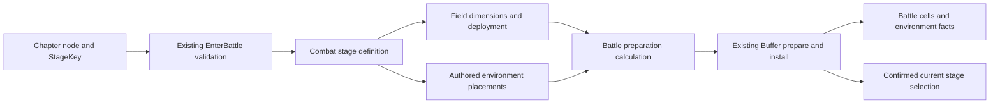
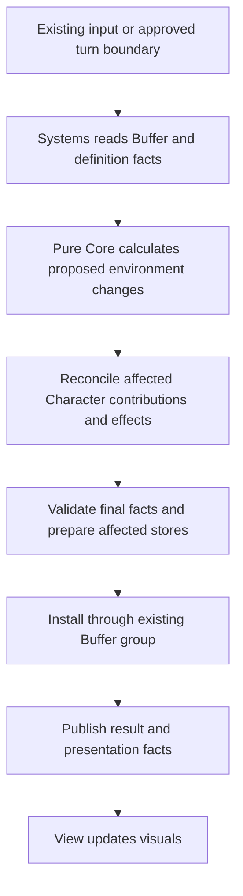

# Cell Environment and Stage Integration Design

Date: 2026-10-05

Status: Design draft for review. The user authorized this document following a source review. Architectural recommendations below are proposals; unresolved gameplay decisions are not approved by this document. This is not an executable implementation plan or a report of implemented features.

Audience: Core, Buffer, DB, and View/Flow contributors implementing Terrain, Obstacle, and Object in ProjectL.

## 1 Purpose and design direction

Support changing environment state on combat cells while preserving the project's Framework composition, Buffer authority, and pure Core calculation boundaries. A stage selects its authored battle layout; cells relate characters and environment elements; one accepted combat transition publishes all related changes before presentation reads them.

The recommended design extends existing combat state and calculation paths with focused definitions, cell queries, and rules. It does not make a Cell object responsible for movement, damage, timing, storage, and rendering. Flexibility comes from separating independent meanings and replacing immutable facts through existing publication boundaries, rather than adding a field for every named terrain or creating a second combat framework.

The immediate architectural priorities are:

1. Connect stage definitions to environment placement without mixing chapter navigation with combat coordinates.
2. Establish one authoritative representation for each environment fact and derive cell queries from it.
3. Recalculate affected character contributions when a cell's environment changes, including when no character moves.
4. Reuse movement and combat extension points only within their verified capabilities.
5. Keep uncertain gameplay rules and production data dependencies local to the features they block.

## 2 Authority and protected scope

The source analysis is [Terrain Obstacle Object analysis and design handoff](<D:/My_ProjectWork/학교 관련 문서/졸업작품_프로젝트L/2학기 내용/AI 관련 문서/2026-10-04-terrain-obstacle-object-analysis-and-design-handoff.md>). Its requirement IDs are retained for traceability. Its embedded Codex prompt is source material, not additional authority. Its original PPT transcript remains unchanged in that file; the PPT was not independently re-rendered for this design.

Apply evidence in this order: explicit user decisions in this conversation, verified current source behavior, and historical documents interpreted within their stated scope. Current code establishes compatibility constraints, not answers to unapproved future gameplay questions.

### 2.1 Later designer decision on stacked Objects

R04 and R05 were present in the original PPT and were subsequently deferred by the designer. Both are outside the current implementation scope. This also defers Object + Object coexistence, O07, same-tile Object insertion-order storage, stacked-Object sequential resolution, Q11, and the stacked-Object part of Q16.

The same-tile multiple-Object policy is unresolved and postponed. This document does not establish a one-Object limit, later-Object overwrite, first-only activation, or Priority/instance-ID gameplay order. Do not encode any of those alternatives in a schema constraint, helper, acceptance test, or authoring default. A collection used for storage or a cell query does not approve gameplay multiplicity or order. Production content requiring that decision remains outside the supported feature slice; fixtures avoid those scenarios without claiming they are forbidden game states.

The external analysis still contains historical wording that presents these requirements as current. This document records the later decision for future work; it does not edit the source analysis or its transcript. Stacked-Object implementation is not a prerequisite for any stage below.

### 2.2 Protected existing work

This request creates only this design document. It does not modify runtime code, movement tests, completed movement documents, the historical drag-path implementation plan, Framework, Buffers, assets, or scenes.

Preserve the completed movement implementation, generic sequential environment-effect processing, route-cell ordering, intermediate state evaluation, damage/death settlement, return/checkpoint behavior, and existing tests. Generic ordering is separate from deferred stacked-Object gameplay order. Existing Priority and Id sorting is not a substitute for a future Object policy.

Later implementation must first use existing contracts. Where a requirement exceeds them, this design records an integration gap. Such a gap requires a separately reviewed, narrowly scoped contract change; it is not permission to refactor or reinterpret completed movement behavior.

### 2.3 Current requirements and unresolved details

| Source | Current requirement | Design consequence |
| --- | --- | --- |
| R01 | Terrain + Object coexistence is allowed | Environment layers cannot share one exclusive occupant slot. |
| R02, R03, R06 | Special Terrain + Obstacle and Obstacle + Object are prohibited; obstacle knockback into an Object cell is blocked | Share placement constraints across supported initialization and relocation paths. Ordinary floor is not special Terrain. |
| R04, R05, O07 | Original PPT requirements, subsequently deferred | No stacked-Object storage/order work or current acceptance criterion. |
| R07, R08 | Effect targets require content definitions; Terrain is not freely manipulated by the player | Do not invent target filters or player terrain-edit commands. |
| T01–T05, T09–T10 | Terrain is initially placed, enterable, affects characters on its cell, and is not an attack target | Separate cell existence, presence effects, character occupancy, and damage eligibility. |
| T06–T08 | Terrain can have Turn-triggered behavior and can disappear | Prepare a timing integration boundary; clock and disappearance semantics remain open. The tornado example does not define production balance. |
| B01–B06, B11 | Obstacle occupies a tile, has HP, blocks movement, cannot overlap another obstacle, and may be indestructible with authored HP 99 | Reuse structural occupancy/health where compatible; model destruction policy separately from the HP number. |
| B07–B10 | An obstacle can have hit and destruction effects; a destroying hit can trigger both | Model both reaction eligibilities. Their order and destruction commitment are not yet decided. |
| O01–O04, O06 | Object is placed on a tile, cannot be directly attacked or damaged/triggered by AoE, activates on the approved arrival condition, and is removed after activation | Use environment identity and arrival rules, not a zero-HP structure or animation-owned removal. |
| O05 | Movement cost spent to activate an Object is not returned | Preserve the requirement; settle its precise relationship to existing movement accounting before production integration. |

Terrain/Object immunity does not automatically make their cell unaimable. A Character on that cell remains independently eligible under existing attack rules. Terrain disappearance does not automatically delete the board cell or its occupants.

## 3 Verified implementation baseline

The following was inspected on 2026-10-05. Paths use the source catalog in section 16. No compile, Unity execution, or test run was performed for this document.

| Existing component | Verified behavior | Consequence for this design |
| --- | --- | --- |
| `StageProgressData`, `MapProgressData` | Store node connections/stage identity and map completion respectively | Chapter progress is not a storage location for Cell HP, terrain, or Objects. |
| `CombatProcessingService.EnterBattle` | Validates the requested node, reads the target definition, revalidates, and prepares battle plus selection | Environment data must participate in the same preparation boundary. |
| `FieldData`, `CombatStageDetail`, `BattleDefinitionAdapter` | Field data describes dimensions/deployment; stage data describes encounter placement; the adapter builds initialization without supplying environment facts | Add an explicit authored environment input through the existing DB conversion path. |
| `DatabaseBattleInitializationSource.Read` | Calls the adapter, then throws the existing T1/G7 error for unavailable targeting authoring/query schema | A working environment fixture cannot establish default DB battle readiness. |
| `BattleInitialization`, `BattlePreparationCalculator` | Initialization accepts `Environment`, and preparation passes it into combat state | There is already an environment preparation seam. |
| `CombatCommandState`, `CombatStateData` | Expose board dimensions, Structures, ThornFields, and Environment; `IsInside` checks rectangular bounds | Retain the rectangular board. Holes, cell deletion, and topology changes are not approved requirements. |
| `MovementEnvironmentFacts`, `MovementTileFact` | Immutable copied collection with unique source IDs, cells, rule keys, activity, visibility, Priority, and value comparison | Reuse these source facts where their semantics fit; their names do not make every source a PPT Terrain or Object. |
| `IMovementTileRule`, `MovementEnvironmentCalculator` | Rule injection, candidate targets, Hazard/Recovery phases, source updates, and sequential settlement already exist | Add compatible rules through composition; preserve coordinator responsibilities and ordering. |
| `InGameCoreSystemFactory` | Registers only `ThornMovementTileRule` in the production movement rule list | A test-only rule is not automatically available in production. |
| `MovementStepEffects`, `MovementProjection.ChangeSource` | Require paired expected/final source values and preserve identity, cell, type, and rule key; projection also protects visibility, Priority, and IsMine | These are not arbitrary create/delete/relocate operations. |
| `DestinationTileModifierFact`, `PositionTileModifierCalculator` | Support attack/max-health position contributions; the source type is sealed; multiple active destination modifiers on one cell are rejected | This is a concrete capability, not a general Terrain lifecycle model or a new Terrain cardinality rule. |
| `StructureCombatFacts`, `StructureSpec` | Store physical identity/health/occupancy and require a Player/Enemy owner; `IsAttackable` is coupled to outgoing attack power | Reusing structures requires an explicit obstacle behavior/targeting assessment. Do not interpret the flag as generic damage immunity. |
| `CombatStateBuffer.PrepareCommand` | Checks expected state and final occupancy; currently preserves structure count, identity, position, definition, and max HP | HP changes fit existing boundaries; obstacle creation/relocation/removal from the collection is not already supported. |
| `BufferSystemGroup.Apply` | Prepares affected stores before installation, then publishes command state/result | Environment changes must participate here, never through a separate write callback. |
| `MovementContextCalculator` | Captures relevant visible environment/occupancy and compares preview facts at execution | New facts must participate in comparison and visibility without leaking hidden information. |
| `FieldView`, `FieldCellHandle` | Provide grid construction, hit mapping, and highlighting | Environment visuals require a presentation mapping, not a second gameplay store. |

## 4 Architectural alternatives

| Approach | Benefit | Cost or risk | Decision |
| --- | --- | --- | --- |
| Put terrain, obstacle, effects, and runtime ownership on Cell MonoBehaviours | Local editor interaction looks convenient | Unity lifetime and presentation become gameplay authority; preview and atomic publication become difficult | Reject. |
| Introduce a new BoardWorld, environment Buffer, scheduler, and trigger bus | Offers a uniform new subsystem | Duplicates existing state and execution, expands Framework work, and makes migration the prerequisite | Reject for current scope. |
| Keep canonical facts in existing Buffers; compose cell queries and focused rules over them | Preserves current ownership and allows independent content/effect additions | Requires explicit adapters and acknowledgement of existing capability gaps | Recommend. |

Extract a responsibility when it has distinct inputs, invariants, and consumers. A helper with one owner can remain an internal pure function. An independently registered System is justified only by a real service/lifecycle responsibility, not by the presence of a new noun in the design. Do not introduce per-content methods such as `ApplyHighGround` or flags such as `IsFlagTile` into the central combat service.

## 5 Stage map and combat Cell boundaries

### 5.1 Identity and definition flow



The chapter graph chooses the encounter. It does not own the resulting battle cells. `StageProgressData.Depth/WidthIndex` are navigation layout coordinates, not `CellCoord.X/Y`. `FieldId` identifies a field definition, not an individual cell or battle instance.

A runtime cell is interpreted within the active battle and its existing `BattleInstanceId`. Do not add StageKey or terrain behavior to `CellCoord`, or equate the same coordinate in different battles. Do not create a global cell-ID service. Runtime environment IDs are identities within their existing source namespace; IDs have no Object insertion-order meaning.

### 5.2 Authoring proposal

Keep three concepts separate:

- **Field definition:** dimensions, deployment zones, and existing board geometry settings.
- **Environment definition:** semantic kind, authored effect parameters, and approved lifecycle/interaction settings. Terrain, Obstacle, and Object have distinct typed payloads.
- **Encounter placement:** definition reference and cell/anchor for this Combat stage.

The first authoring slice should compose an environment placement value into `CombatStageDetail` and convert it in `BattleDefinitionAdapter`. This is a proposed addition, not an existing field. If two real encounters need the same layout, extract a referenced layout definition through the existing DB/Query pattern. Do not require a new reusable-layout registry before that reuse exists.

Authoring assets remain immutable definitions, never live HP or consumed-Object records. View visual definitions reference the same semantic definition identity through the View DB. Do not introduce ad hoc string lookups in combat calculations or store Prefabs in Core contracts. New definition-key shapes must follow the DB schema agreement; do not use an existing unit/HQ key to impersonate a new obstacle.

### 5.3 Preparation and lifecycle

Resolve environment definitions for the explicitly requested stage, validate them together with character/structure placements, and produce one complete battle preparation. Invalid bounds, missing definitions, unsupported enabled content, or prohibited coexistence fail before battle and selection installation. Do not drop invalid entries and continue.

Use the existing `PrepareBattle(preparation, selection)` boundary. Do not select the next stage first and attempt rollback if its environment cannot load. Existing completed-stage result retention and `EndBattle` ownership remain in place. Battle-local environment state ends with the battle; retaining a consumed Object across revisits, save/load, or crashes requires a separate persistence requirement. Never reset the run or chapter graph to clear a battle layout.

## 6 State ownership and cell queries

### 6.1 Canonical facts

| Fact | Owner and proposed representation | Boundary |
| --- | --- | --- |
| Character identity, position, HP, AP, position contribution | Existing CharacterBuffer | No independent Character position or HP inside a Cell. |
| Board bounds and combat environment source records | Existing CombatStateBuffer through CombatCommandState | No second mutable EnvironmentWorld or scene-owned state. |
| Obstacle physical HP and blocking occupancy | Prefer existing Structures when the compatibility gate in section 9 is satisfied | Never duplicate HP/position in an Obstacle store. |
| Terrain/Object source activity, cell association, required runtime effect/lifetime facts | Extend immutable environment facts only for approved behavior | Do not mirror a source into another writable terrain/object collection. |
| Authored definitions and immutable compiled rule bindings | Existing DB and processing-service calculation dependencies | Can be retained as immutable configuration, not as live runtime state. |
| Per-cell lookup/index | Derived from canonical facts for a command or Buffer read projection | Rebuild or update with the owning publication boundary; no independent setters. |
| Activation, removal, and visual transition facts | Existing combat result publication | Retain enough event data to display a removed element without resurrecting it. |

`MovementEnvironmentFacts` remains the first extension candidate for compatible cell sources. Do not rename it or migrate all existing field types as preparatory work. A future type that genuinely cannot fit it requires a focused schema proposal with one canonical owner and explicit mapping; it does not justify keeping two equivalent runtime worlds.

New semantic definitions identify Terrain versus Object explicitly. Do not infer classification from `IsMine`, display names, arbitrary rule-key spelling, or collection position. A legacy `DestinationTileModifierFact` remains a generic source unless an authored definition explicitly identifies its environmental role. Such an immutable binding may supply semantic metadata; it must not duplicate mutable activity, lifetime, or position.

**Clarified 2026-10-06 (post-E10 review): the type is content, the binding is classification.** `EnvironmentSemanticBindings` is the single authority for Terrain/Object/Obstacle classification. A typed source fact (`StaticTerrainFact`, `TornadoSourceFact`, `ObjectSourceFact` subclasses) describes only its content payload and behavior; its runtime type is never read as a substitute classification. Agreement between type and binding (for example, a typed Object must be bound as an Object) is validated once at preparation and, for sources created during a command, by the binding/allocation check at publication. Other consumers read classification from the binding and content from the type without re-deriving one from the other.

### 6.2 A cell is a composed read view

The proposed internal role `CellEnvironmentQuery` derives a short-lived view from the input facts and immutable definition bindings:

```text
Cell view
  board validity at CellCoord
  special Terrain associations and applicable source facts
  blocking structural occupancy
  Object presence and associated source facts
  Character occupancy derived from Character facts
```

This is a query result, not a new mutable `CellState` aggregate and not necessarily a public interface. Consumers request facts needed for placement, presence contribution, targeting, or presentation. Prefer a straightforward scan initially; introduce an index only for demonstrated repeated lookup cost. Do not expose mutable collections.

Object presence can answer the approved Obstacle + Object exclusion without deciding how multiple Objects share a cell. A read view must not silently return `First()` as a gameplay resolution policy. Likewise, special Terrain associations do not establish single- or multi-Terrain gameplay support.

### 6.3 Spatial invariants

The proposed pure role `EnvironmentPlacementRules` evaluates a candidate against the final proposed cell facts, excluding its own old placement when appropriate. It is shared by supported initial placement and approved relocation/creation paths.

| Combination | Current policy |
| --- | --- |
| Ordinary floor + Obstacle | Not prohibited by the special-Terrain restriction; existing board/deployment rules still apply. |
| Special Terrain + Character | Allowed, subject to ordinary occupancy/deployment validity. |
| Special Terrain + Object | Allowed. Relative effect order remains Q10. |
| Special Terrain + Obstacle | Prohibited. |
| Obstacle + Object | Prohibited regardless of which element is placed first. |
| Obstacle + Obstacle | Prohibited on the same tile. |
| Character entering an Obstacle cell | Blocked. |
| Object + Object | Deferred and unresolved; no replacement policy. |
| Multiple Terrain associations or multi-cell Character contact | Unresolved expansion under Q17. |

Core decides whether an action is allowed. Buffer validation independently protects final storage consistency, identity, bounds, and cross-store agreement before installation. It does not evaluate effects or choose alternative legal destinations. There must be no partial publication followed by a placement correction.

## 7 Environment change calculation and publication

### 7.1 One action with all consequences



The conceptual role `EnvironmentChangeCalculator` coordinates only an approved environment change and its consequences. It may be an internal Application helper returning ordinary command changes. It is not a new System, public arbitrary mutation endpoint, transaction engine, or persistent simulation session.

The change includes its expected source facts, proposed final facts, touched cells, and resulting character/effect/event changes. Reuse `CombatCommandTransition.FinalState`, `CharacterChanges`, and the existing result envelope where sufficient. Do not add another whole-state DTO merely to wrap them. If creating an instance requires allocation, the owning Buffer validates allocation through its established conventions; Core does not retain a mutable ID generator. Initial deterministic identities do not imply gameplay order.

Within a command, later calculations observe the relevant intermediate state. Validate the complete final set before live writes. An effect that successfully causes death is an accepted gameplay result and must use existing death/outcome settlement, not be misreported as a rejected request. This generic property does not authorize a stacked-Object chain.

### 7.2 Reconcile characters when terrain changes beneath them

Movement is one cause of changed environmental contribution. Terrain activation, replacement, or removal under a stationary Character is another, once that change is approved.

For an approved source change:

1. Identify affected cells from its expected and final associations.
2. Read affected Character facts from the command's projected final occupancy.
3. Resolve the applicable presence contribution from the proposed environment facts.
4. Replace only the environment contribution using existing stat/health normalization rules.
5. Combine any resulting health/death/outcome changes with source changes in the same transition.
6. Publish source and Character changes together, then present them.

Do not subtract an old terrain bonus from a total that also contains artifact, soul, or temporary effects. Reuse the existing source-separated position contribution where its supported stats match. Initial placement and actual relocation must produce the same contribution for the same approved state; preview never writes it.

An illustrative fixture may remove a source with a test-only maximum-health bonus while its Character remains still. It should verify that the source contribution and health normalization change together. This is an architectural test, not approval that any named Terrain disappears or provides that bonus. Q15 still determines production disappearance behavior.

### 7.3 Equality, visibility, and stale requests

Every new runtime field that can change an outcome must participate in immutable copying, equality, and expected-state validation. Do not omit a lifetime/consumption field from `SameValues`. Retain observer filtering for public previews; no hidden-source details should enter public events or display queries unless their reveal condition is approved.

Use the existing relevant-fact preview validation. Ensure environment publication is visible to it; do not add a global version counter just to invalidate every preview. If new behavior reads facts outside the captured dependency set, list that as an integration gap and test the extended dependency contract before enabling the behavior. A preview is advice, never authorization to apply stale source facts.

## 8 Terrain and Object effect integration

### 8.1 Terrain presence and timing

The existing position modifier supports attack and maximum-health contributions at an occupied destination. Use it for an approved effect that exactly matches that capability. It is not a general effect payload or a Turn clock. New stats should use the appropriate existing effect path rather than accumulating optional fields on every Character or Cell.

Timed Terrain evaluates at an approved existing combat turn boundary. Its definition describes the agreed time unit, start condition, repeat/expiry semantics, and effect; its runtime source records only facts actually needed to evaluate that rule. Do not create a per-cell Update loop, independent global counter, or generic scheduler.

The existing `CompletedUnitTurnCount` is a possible input only after Q01 confirms its meaning. Simulating timeline previews does not advance Terrain. Unknown timing or expiry behavior blocks that content binding, not static placement or unrelated Object/Obstacle work.

### 8.2 Object arrival and consumption

An Object rule receives the approved arrival context and declares its candidate targets. It returns effects and consumption intent; it does not mutate Buffers, choose movement routes, settle costs itself, or wait for animation completion. Use `IMovementTileRule` only when the approved condition matches its actual step/phase contract.

Current capability limits require explicit handling:

| Required behavior | Existing seam | Integration condition |
| --- | --- | --- |
| Damage, healing, supported forced move, or movement-method request on entry | `IMovementTileRule` and `MovementStepEffects` | Respect candidate targets and Hazard/Recovery separation; register the rule through the existing factory. |
| Source becomes inactive after an approved trigger | Expected/final source update | Preserve current identity/cell/type restrictions; repeated processing must not reactivate it. |
| Object removed after activation | No null final source is supported by the step contract | Define an explicit consumption result and canonical removal at the enclosing transition boundary. An inactive retained fact alone is not proof that O06 is implemented. This compatibility work needs a separate contract review. |
| Destination-only, forced-arrival, teleport, initial-placement, or underfoot creation trigger | Not all are represented by `MovementStepInput` | Q03 and a cause-aware integration contract are required; do not manufacture movement commands to trigger effects. |
| General timed Terrain or combined presence/entry behavior | Sealed destination source and concrete phase processing | Requires a concrete representation and mapping review; inheriting from the sealed source or adding inert dummy entry rules is not a solution. |
| Arbitrary source creation or relocation | Step contract preserves source identity and cell | Outside the currently verified movement-rule seam. |

Source changes currently produce a return barrier. This is useful evidence for Q04, but it does not prove that every part of the Object non-refund requirement is satisfied, including attack-related refunds. Compare the approved cost examples with the existing movement ledger before binding production Objects. Do not charge twice or introduce costs for otherwise free forced movement.

Terrain and Object are never supplied as damageable structure candidates. Same-cell Characters remain separate targets. Names such as mine, flag, badge, high ground, or tornado do not authorize effect values, faction filters, explosion geometry, or visibility policy.

### 8.3 Preserve generic ordering

Keep the completed Hazard/Recovery coordination, ThornField handling, route order, damage/death boundaries, and command-local state evaluation. Terrain/Object interaction order under Q10 must be agreed before mixed content is enabled if it changes outcomes. Do not move generic effect processing to View, Buffer, or a new Object queue.

Q11, initial same-tile Object order, insertion-order fields, and stacked-Object acceptance cases remain deferred. Encounters on different route cells are a separate question under the approved arrival contract and preserve existing route order.

## 9 Obstacle integration and compatibility gate

Prefer reusing `StructureCombatFacts` for an obstacle's physical HP and blocking occupancy, with a typed obstacle definition/reaction binding that distinguishes it from existing combat buildings. This is a conditional recommendation: the current owner and targeting contracts must represent the approved obstacle policy without pretending every obstacle is an Enemy actor.

Before adopting that representation, verify these boundaries against an approved example:

- `Owner` currently permits only Player/Enemy; obstacle faction and attack-target policy are not specified by the PPT.
- `StructureSpec.IsAttackable` requires outgoing attack power. Do not set it to encode whether an obstacle can receive damage.
- Targeting, pierce/splash eligibility, and damage source attribution must support the approved non-character target without changing unrelated HQ behavior.
- Destruction removes blocking occupancy under the existing dead-structure convention. This does not require immediate removal from the structure collection.
- `CombatStateBuffer` currently rejects structure count/anchor/definition changes during command publication. Obstacle knockback requires an explicit validated relocation change; it is not already supported because movement code can calculate a destination.

If the owner/definition contract cannot express the required behavior, propose a narrow physical-structure versus behavior separation before implementation. Do not force invalid owner values into current facts or solve the problem by creating a duplicate Obstacle HP/occupancy store. Neutral targeting is a gameplay question, not an automatic enum addition.

The proposed `ObstacleReactionRules` consumes damage facts, source/caster identity, and the typed definition. It determines hit/destruction reaction eligibility and emits existing effect changes. One destroying hit can qualify for both reactions. Preserve this fact while leaving their execution order and destruction commitment to Q07. Consider all approved damage paths, including environmental damage; attaching reactions only to an attack button misses B03.

HP 99 remains an authored instruction for indestructible obstacles, not an implicit immortality test. Q05 determines HP evolution; Q06 determines zero-damage and multi-hit behavior; Q08/Q09 determine recipients when the damage source is absent or gone. Do not assign soul drops, Character death rewards, independent turns, sight blocking, or projectile blocking by association with the structure implementation.

## 10 Framework and assembly responsibilities

| Layer | Responsibility | Must not own |
| --- | --- | --- |
| Existing Factory/composition | Construct approved rule dependencies and register existing services/modules | Live battle state or runtime mutation of the service graph. |
| Systems processing service | Read authoritative facts/definitions, invoke pure calculation, coordinate existing publication | A second board session or effect gameplay inside Buffer wrappers. |
| Core.Contracts | Immutable inputs, definitions, changes, and presentation facts | Unity objects, Framework services, Buffer references. |
| Core.Domain | Focused spatial and gameplay rules | Service resolution, scheduling, live writes. |
| Core.Application | Compose command-local calculations and settlement | Long-lived mutable environment state or combat Jobs. |
| Existing Buffer group/stores | Own canonical state, prepare/validate/install, identity consistency, lifetime cleanup | Effect selection, damage formulas, gameplay scheduling. |
| View/Flow | Input capture, Plan/Jobs, presentation sequence, lifecycle calls | Damage/arrival decisions or deletion of gameplay entities on callbacks. |

The inspected asmdefs keep Core.Contracts independent, Core.Domain dependent on Contracts, and Core.Application dependent on Contracts/Domain with no engine references. Systems integrates through the existing Application/Contracts boundaries. Preserve assembly names and GUIDs; this feature does not require Framework to reference Core or Systems. No assembly merge is proposed.

Follow Factory/Builder construction and `PostBindService` binding. A new internal pure rule does not need a service key or lifecycle interface. View/Flow remains the owner of combat Plan/Jobs; expose only the required calculation/result contract for later caller work. No new generic event bus, scriptable trigger language, dynamic plugin registry, or transaction framework is a prerequisite.

## 11 Presentation contract

Separate static cell geometry and interaction mapping from environment presentation. `FieldView`/`FieldCellHandle` should keep their grid/highlight responsibilities. A proposed environment presenter in the existing Combat View reads Buffer projections and result events and uses View DB definitions to create/update/remove visuals.

The required information is semantic identity, runtime identity, cell/anchor, visible state, and the before/after activation/removal facts needed for playback. Do not require the View to query a deleted runtime record to learn which effect to show. Existing result sequence and acknowledgement/lifetime conventions apply; do not build another event replay store.

Terrain appearance and Object overlays must support the allowed Terrain + Object combination. Obstacle presentation follows physical occupancy. Route/selection highlights remain distinct from base terrain appearance so an environment refresh does not erase input feedback. Collider and Transform are display/input aids, not evidence that a gameplay source exists.

A pooled visual is reset when reused. Gameplay removal occurs in accepted state publication; animation completion releases presentation resources. Hidden source information follows existing visibility rules. No prefab, scene, renderer, or pool change is made by this document.

## 12 Extension decisions

| New request | Preferred extension | What should remain stable |
| --- | --- | --- |
| Another content item with existing effect semantics | New typed definition/placement and visual mapping | CellCoord, Framework, command settlement, Buffer ownership. |
| A new arrival effect compatible with current phases | Focused rule implementation and factory registration | Route editing, damage/death coordinator, publication boundary. |
| A new Terrain presence statistic | Existing effect/stat contribution path with explicit source attribution | Character position authority and unrelated bonuses. |
| Approved timed Terrain | A timing rule and minimal runtime timing facts using an existing turn boundary | Global execution ownership and chapter navigation. |
| Layout reused by actual encounters | Extract a DB layout reference from the composed stage placement value | Runtime source ownership and stage-entry atomicity. |
| A new relocation, removal, or reaction capability beyond current contracts | Separate focused contract proposal and integration evidence | Existing accepted movement behavior and unrelated tests. |
| Board holes, resizing, persistent layouts, stacked Objects, or multi-cell environmental contact | Separate gameplay and architecture decision | No speculative implementation in this scope. |

Keep type count proportional to independent behavior. Small fields are appropriate for real immutable facts; a new function is appropriate for a cohesive pure calculation. Prefer extracting a responsibility when callers would otherwise reproduce rules or when one coordinator starts owning unrelated lifecycles. Do not abstract all terrain into a universal component system in anticipation of unknown content.

## 13 Open decisions and local blockers

These are deliberate gameplay boundaries, not missing implementation tasks. They must remain visible until answered. An unresolved rule should not silently become a production default; enabling content that depends on it requires the relevant decision.

| Source question | Decision needed | Blocks | Independent work remains possible |
| --- | --- | --- | --- |
| Q01–Q02 | Terrain time unit, starting point, phase, repetition, empty-cell behavior | Timed content | Definitions, static placement, presence calculation boundaries. |
| Q03 | Which arrival causes activate an Object | Activation on each undecided cause | Placement, immunity, identity, visibility contracts. |
| Q04 | Non-refundable cost segment, checkpoint relationship, refund interactions | Production cost integration | Effect and publication boundary review. |
| Q05–Q07 | Indestructible HP behavior, hit qualification/count, hit/destruction order | Corresponding obstacle reactions | Structural occupancy and placement constraints. |
| Q08–Q09 | Recipients and absent/dead caster behavior | Recipient-dependent reactions | Damage fact/source plumbing design. |
| Q10 | Terrain + Object relative effects | Outcome-sensitive combined content | Coexistence support and isolated effect slices. |
| Q11 | Later stacked Objects after death/movement/removal | Deferred, outside current scope | All current slices; not a prerequisite. |
| Q12 | Consumption when condition/target/effect result is absent | Conditional Object consumption | Approved unconditional examples. |
| Q13–Q14 | Attack/faction/AI eligibility, sight/pierce blocking, movable obstacles, occupied destinations | Related targeting and relocation | Existing Character movement blocking. |
| Q15 | Terrain replacement after disappearance and occupant consequences | Production disappearance | Atomic source-change and contribution-reconciliation contracts. |
| Q16 | Order of simultaneous Terrain triggers or damage targets | New outcome-sensitive simultaneous behavior | Existing generic ordering is retained. Initial same-tile Object order is deferred. |
| Q17 | Multiple Terrain and multi-cell Character interaction | Those expansions | Existing single-cell Character scope and structural footprint preservation. |
| Q18–Q20 | Content effects/values, Object faction restrictions, exact stage identity | Production content authoring | Framework integration and fixture-backed architecture. |
| Technical T1/G7 | Existing default DB targeting schema and activation route | Default DB-driven battle readiness | Environment fixture preparation and pure calculations. |

Do not infer balance or mechanics from content names. Review only the decisions required by the next slice rather than blocking all structural work on the entire table.

## 14 Incremental adoption and completion conditions

This is a sequence of reviewable capabilities, not permission to start implementation or edit completed movement work.

| Stage | Deliverable | Exit condition |
| --- | --- | --- |
| A Spatial and ownership contracts | Definition/placement separation, composed Cell queries, and current coexistence rules | No duplicated state owner; chapter coordinates and combat cells are distinct; deferred multiplicity is not encoded as a rule. |
| B Stage preparation integration | Proposed authored environment input mapped through the existing explicit-target entry boundary | Valid fixture installs matching selection and layout; invalid preparation installs neither. Production DB readiness is reported separately. |
| C Approved presence behavior | One supported presence contribution and proposed environment-change reconciliation | Moving or changing a source cannot leave stale contribution; unrelated contributions remain intact. |
| D Approved Object behavior | One approved arrival effect, immunity, consumption/removal, and cost mapping | Relevant Q03/Q04/Q12 decisions and removal compatibility review are closed; no generic processing redesign. |
| E Approved obstacle behavior | Compatible physical structure mapping, damage reactions, and placement constraints | Owner/targeting compatibility and applicable Q05–Q09 decisions are closed; HQ semantics preserved. Relocation requires its own publication contract. |
| F Approved timing and compound cases | Terrain clock/expiry and Terrain + Object interactions | Applicable Q01/Q02/Q10/Q15/non-Object Q16 decisions are closed. |
| G Content and View integration | Valid DB definitions, rule registration, visible state/result consumption, and actual caller wiring | Fixture behavior, production data readiness, and in-scene playback are demonstrated separately. |

Track Core calculation, Buffer publication, DB authoring, View/Flow integration, and production activation as separate completion conditions. Passing a calculation fixture does not close T1/G7, prove factory binding, or validate scene visuals. Stacked Objects, insertion-order storage, and stacked-order acceptance tests are absent from every current stage.

## 15 Acceptance and verification design

Use focused new environment tests and existing fixtures as references. Do not rewrite completed movement tests or duplicate the entire combat suite. Generic existing ordering tests remain valid and unchanged. The cases below are proposed future verification, not tests executed for this document.

| Boundary | Meaningful evidence |
| --- | --- |
| Stage identity and preparation | Two encounter definitions using the same field can prepare their own different environment layouts without altering chapter graph topology. Failed preparation leaves selection and battle-related stores unchanged. |
| Spatial invariants | Terrain + Object succeeds; special Terrain + Obstacle, Obstacle + Object, and overlapping obstacles fail symmetrically in supported placement paths. No Object + Object gameplay expectation is introduced. |
| Single authority | A published change is visible through cell queries and presentation reads without synchronizing an independent runtime store. |
| Stationary occupant | An approved test source change reconciles its Character contribution and any required health normalization in the same accepted transition. |
| Contribution provenance | Leaving/changing Terrain removes only its contribution, preserving artifact, soul, and unrelated temporary contributions. |
| Attack filtering | Direct/splash damage does not damage, consume, or activate Terrain/Object; a Character sharing that cell follows its own targeting rules. |
| Object lifecycle | Approved arrival consumes/removes the source once; preview, failed movement, stale request, and repeated command publication do not consume it again. Result facts still permit playback after removal. |
| Object cost | Approved non-refund examples remain non-refundable through applicable return and attack settlement without duplicate charges or invented forced-movement costs. |
| Obstacle reactions | An approved destroying hit can produce both reactions, with the agreed order and source; structural occupancy updates without Character-only rewards or spurious victory. |
| Relocation capability | If enabled later, a blocked obstacle relocation preserves expected state; accepted relocation satisfies final coexistence and publication constraints. |
| Timing and disappearance | Only the approved real turn boundary advances timing; preview/rejected input does not. Approved disappearance reconciles affected occupants without assuming cell deletion. |
| Visibility and stale input | Public preview/result facts do not reveal unknown sources; changing relevant visible facts invalidates stale expectations. |
| Failure and cleanup | Validation failure leaves gameplay stores unchanged; accepted death uses existing settlement; EndBattle clears local environment after required result retention without clearing run progression. |
| Composition and presentation | Production rule bindings exist for enabled definitions; visuals consume state/results, coexist with highlights, and do not own gameplay removal. |

Compare saved document scope, source references, and preservation constraints before delivery. Implementation verification must later report its own commands and results; no historical test count establishes this feature's correctness.

## 16 Source catalog and implementation handoff

Repository sources below were used to identify existing seams. Names introduced as proposed roles elsewhere in this document are not claimed to exist. Paths are relative to the repository root for source lookup.

| Area | Sources |
| --- | --- |
| Framework guidance | `docs/superpowers/framework/Framework Development Guidelines.md` |
| Ownership and battle-entry decisions | `docs/superpowers/specs/2026-09-29-character-buffer-effect-migration-design.md`; `docs/superpowers/plans/2026-09-29-character-buffer-effect-migration-plan.md`; `docs/superpowers/specs/2026-10-03-stage-entry-battle-preparation-contract-design.md` |
| Chapter state | `Assets/ProjectL/Script/Systems/RuntimeSystem/BufferSystems/Map/MapProgressData.cs`; `Assets/ProjectL/Script/Systems/RuntimeSystem/BufferSystems/Stage/StageProgressData.cs` |
| Authoring | `Assets/ProjectL/Script/Systems/DataBaseSystem/Data/InGame/Table/Field/Item/FieldData.cs`; `Assets/ProjectL/Script/Systems/DataBaseSystem/Data/InGame/Table/Stage/Combat/CombatStageDetail.cs`; `Assets/ProjectL/Script/Systems/DataBaseSystem/Data/InGame/Table/Structure/Item/StructureData.cs` |
| Systems boundary | `Assets/ProjectL/Script/Systems/RuntimeSystem/InGameSystem/CoreSystem/CombatSystem/CombatProcessingService.cs`; `BattleDefinitionAdapter.cs`; `DatabaseBattleInitializationSource.cs` in the same directory |
| Publication | `Assets/ProjectL/Script/Systems/RuntimeSystem/BufferSystems/Core/BufferSystemGroup.cs`; `Assets/ProjectL/Script/Systems/RuntimeSystem/BufferSystems/Combat/CombatStateBuffer.cs`; `CombatStateData.cs` in the same directory |
| Composition | `Assets/ProjectL/Script/Systems/Factory/Runtime/InGame/Core/InGameCoreSystemFactory.cs` |
| Pure Core root | `Assets/ProjectL/Script/Systems/RuntimeSystem/InGameSystem/CoreSystem/CoreCaculator/` |
| Contracts under Core root | `Contracts/Common/CellCoord.cs`; `Contracts/Commands/StageConfig.cs`; `Contracts/Commands/StructureSpec.cs`; `Contracts/Combat/BattleInitialization.cs`; `CombatCommandState.cs`; `CombatCommandTransition.cs`; `StructureCombatFacts.cs`; `MovementEnvironmentFacts.cs`; `IMovementTileRule.cs`; `MovementStepInput.cs`; `MovementStepEffects.cs` under `Contracts/Combat/` |
| Application under Core root | `Application/Combat/BattlePreparationCalculator.cs`; `MovementEnvironmentCalculator.cs`; `MovementProjection.cs`; `PositionTileModifierCalculator.cs`; `MovementContextCalculator.cs`; `CombatCommandCalculator.cs`; `CombatPlacementCalculator.cs`; `BattleOutcomeCalculator.cs` in the same directory |
| Domain under Core root | `Domain/Movement/MovementRouteValidator.cs`; `Domain/Combat/AttackTargetResolver.cs` |
| Presentation | `Assets/ProjectL/Script/Systems/RuntimeSystem/InGameSystem/ViewSystem/Combat/Display/FieldView.cs`; `FieldCellHandle.cs` in the same directory |

Before implementation planning, review this document's recommended ownership, Cell query, and stage-definition boundaries. Resolve only the gameplay decisions and capability gaps needed for the first selected slice. Record any necessary Buffer/DB/View contract work with its actual owner. Preserve the completed movement implementation and its historical documents; do not turn source limitations into an unsolicited movement rewrite.

The next implementer must treat R04/R05/O07, same-tile Object coexistence and insertion-order storage, stacked resolution, Q11, and stacked Q16 as deferred historical requirements. Preserve unrelated Object rules and generic effect processing. Do not copy the external handoff's older stacked-Object tasks or tests into the implementation plan. This document authorizes neither a replacement multiplicity policy nor automatic implementation of unresolved content.
