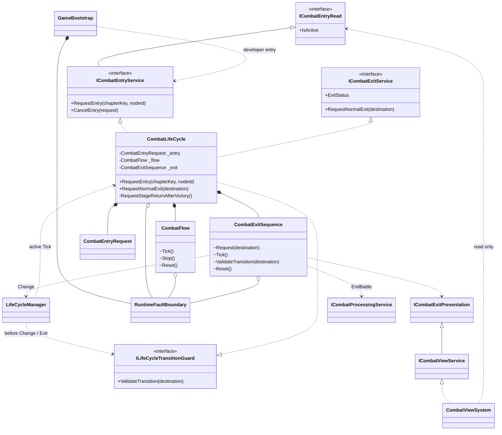
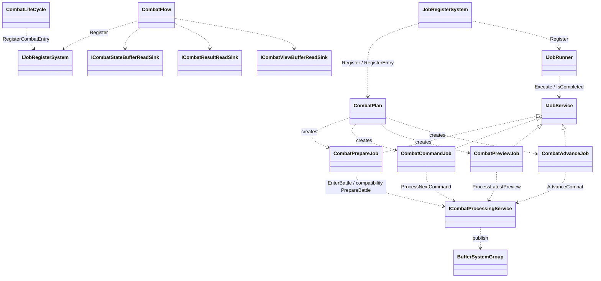
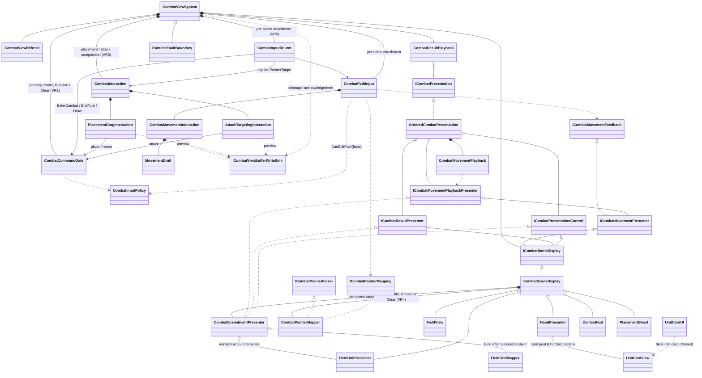
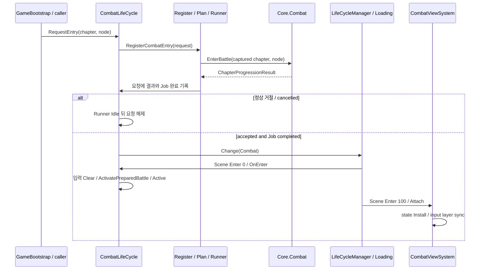
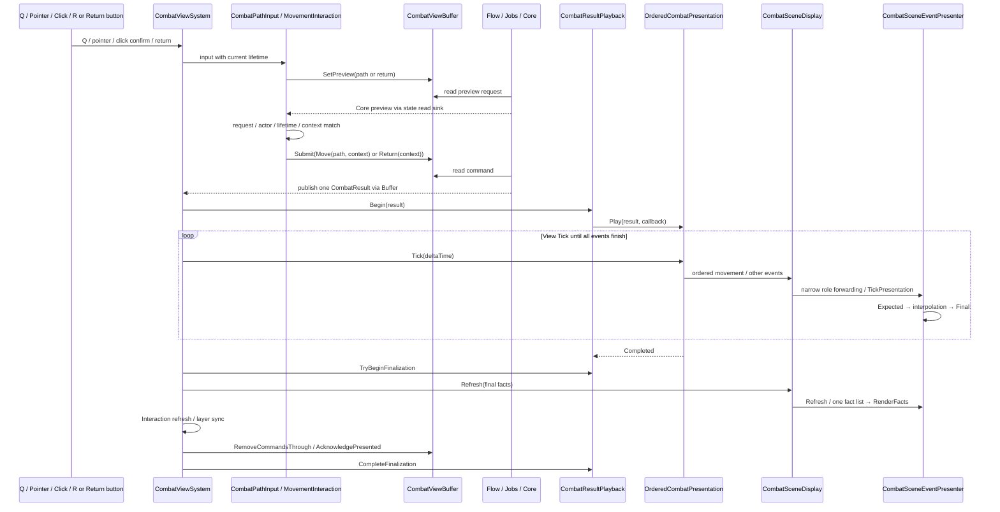
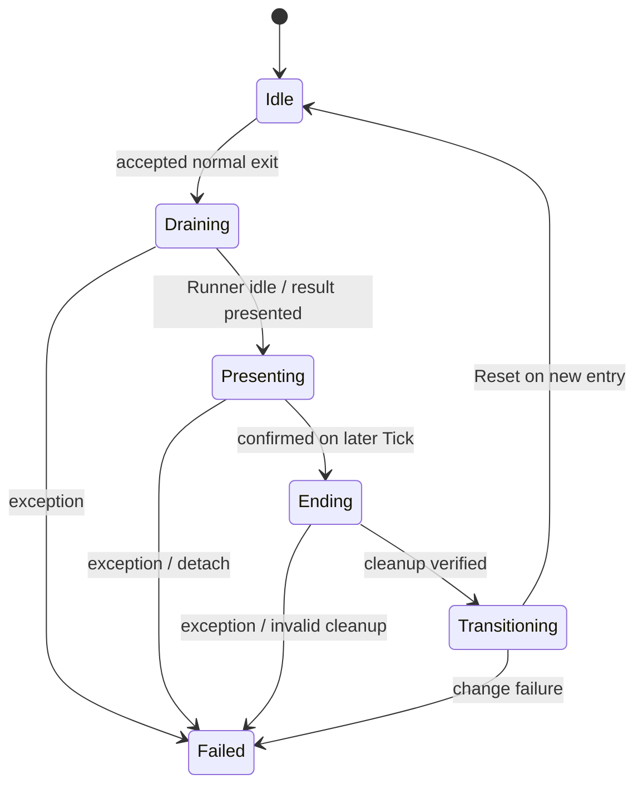

# 전투 골격·View — 현재 코드 기준 UML

- 기준: 2026-10-05, `feature/Yonggeun/Stage`, 골격 `bfe63a27` + 현재 로컬 View V1~V4b. 커밋 전 코드 구조이며 Unity 표시 검증 대기는 실행 기록을 따른다.
- [오프라인 HTML 도표](2026-10-05-combat-current-uml.html). HTML은 이 코드 기준의 시각화이며 별도 정책 원본이 아니다.
- Flow 판단은 [골격 설계 §4.1](2026-09-30-combat-flow-skeleton-design.md#41-한-tick의-판단-위에서부터-처음-맞는-줄-하나만), 진입은 §6.3, 정상 이탈은 §6.4가 원본이다. View 책임은 [View 설계 §4·§23](2026-09-30-combat-view-design.md)을 따른다.
- 구현·검증 상태는 [골격 계획 §6.15](../plans/2026-09-30-combat-flow-skeleton-plan.md#615-phase-7view-f-공동-문서-인계-2026-10-05)와 [View 계획 §7.24·§7.27~31](../plans/2026-10-01-combat-view-plan.md#731-v4b-사건-표시-상태-추출과-mapper-수명-보완-2026-10-05-코드-완료unity-검증-대기)에만 기록한다.

`*--`는 객체 생성/수명 소유, `o--`는 참조 보관, `..>`는 호출 의존, `<|..`는 인터페이스 구현, `<|--`는 상속이다. 주요 멤버만 표기하며 씬 Presenter 참조는 GameObject 생성·파괴 소유권을 뜻하지 않는다. 모든 도표는 실제 타입을 사용하고 Core 대기 API를 구현된 것처럼 그리지 않는다.

## 1. 골격·외부 경계



`LifeCycleSystemGroup.CombatEntry`와 `.CombatExit`는 동일한 CombatLifeCycle의 좁은 서비스다. 비활성 시에도 실행되는 명시적 `ISystemTick.Tick`은 진입 결과만 확인한다. 활성 구간의 `OnTick`은 Flow → 일반 승리 복귀 요청 → ExitSequence 순서다. View에는 요청을 변경하는 EntryService 대신 EntryRead가 전달된다.

## 2. 등록·구성·실행·기록



네 Job은 `struct : IJobService`, Priority 0이다. 순서는 Flow와 진입 조건이 보장한다. 정상 반환 뒤 Job 완료, 예외는 미완료로 전파하며 재실행 차단은 F1이 맡는다. Core가 처리 여부·수락 결과를 기록하고 View가 입력 삭제·일반 결과 확인 번호를 쓴다. 글로벌 Runner를 Combat 이탈에서 Clear하지 않는다.

## 3. View의 책임 분리



- Factory는 `OrderedCombatPresentation`을 만들어 View에 주입한다. View는 **ICombatViewService 서비스와 수명 모듈**로 등록된다. `ImmediateCombatPresentation`은 존재하지만 운영 Factory의 기본 구현이 아니다.
- `CombatResultPlayback`은 결과 전체의 세대·완료·후처리 토큰을 소유한다. OrderedPresentation의 사건 인덱스와 MovementPlayback의 이동 단계는 그 결과 안의 연출 진행이다. 어느 연출 객체도 Buffer 확인 번호를 쓰지 않는다.
- 이동 입력은 Q 시작 칸 대기·마우스 경로 초안·클릭 확정·견적 context 대기, 배치/공격 입력은 기존 Interaction이 맡는다. View는 Core 규칙이나 국면의 가변 사본을 만들지 않는다(2026-10-06 조작 변경: View 설계 §25).
- **입력 분배(2026-10-06, View 구조 개선 VR1~VR3):** 외부 입력은 `CombatViewSystem.Receive`(F1·연결 검사) → `CombatInputRouter`가 입력 의도별 순서로 나눈다. 포인터 대상은 `ResolvePointerTarget`(배치 Layer → Placement, 전투 Layer → 공격 모드 또는 RecordInputOnly면 Attack 아니면 Path) 한 곳에서 정한다. 시작·턴 종료 대기의 원본은 `CombatCommandGate` 하나(ViewSystem 소유), 경로 편집 허용은 `CombatInputPolicy.CanEditPath`다. 배치·공격은 각자 호버·미리보기 번호를 갖고 자기 요청만 지운다. 설계 원본은 [구조 개선 설계](2026-10-06-combat-view-refactor-design.md).
- Display/Presenter는 호출로 받은 값과 View DB를 사용한다. 현재 재화 읽기는 공통 CurrencyBuffer이며 분리 전 Stage 골드 전용 계약으로 표기하지 않는다.
- SceneDisplay는 씬 연결·입력/UI·정리 조정, 화면 좌표 집기·UI 가림 Raycast는 `CombatPointerMapper`(VR4: 생성→Bind→Unbind/재설치→Release, 연결 전·해제 뒤 Try는 false), SceneEventPresenter는 사건 사실 목록·이동 보간을 소유한다. Install 전에 사건 연결을 비우고 Build 성공 뒤 Mapper를 Bind한다. 설치 실패·Clear·Release에서 목록/Mapper/보간을 해제하며 재설치에서는 새 Mapper를 받는다. Bind 전 사건 시작은 거절하며 Cancel은 완료 통지가 아니다.
- V1 포인터 입력 객체, V2 불변 Snapshot, V3 표시값 캐시는 각 기존 소유자에 남는다. V4b Refresh는 같은 사실 목록을 RenderFacts에 넘긴다. [전후 비교](2026-10-05-combat-view-maintenance-uml-comparison.md)에 상세 계약과 반복 비용 경로를 표시했다.
- **손패 카드(2026-10-06, 손패 카드화 H1~H2):** `HandPresenter`는 Combat Canvas 아래 `cardRoot`에 `UnitCard.prefab`(표시 전용 `UnitCardView`)을 풀로 빌려 슬롯 순서로 그린다. 배치 단계(Core 국면)에서만 보이고 패널 버튼은 숨긴다. 집기·Drop 영역은 화면 좌표(`TryPickUnit(Vector2)`·`ContainsDropPoint(Vector2)`)이며 입력은 기존 Router → PlacementDragInteraction 경로다. 덱 정보 카드는 Variant `UnitCardUI.prefab`의 `UnitCardUI`(조회만, UIBase)가 같은 `UnitCardView`에 값을 넘긴다. 설계 원본은 [손패 카드화 설계](2026-10-06-hand-card-design.md).

## 4. 명시적 진입



개발 Bootstrap은 두 모드에서 InitializeRoster → EnterChapter → RequestEntry를 호출한다. 운영 StageSelect 노드 호출자는 별도 화면 연결 범위다. 진입 수락은 준비 완료이지 씬 표시 완료가 아니다. Entry가 Active가 되기 전 View 입력은 열리지 않는다.

## 5. 경로 이동·Return과 결과 소비



응답과 결과는 직접 통지받지 않고 Buffer에서 읽는다. 도표의 응답 화살표는 그 읽기 경로를 축약했다.

현재 요청에 대응하는 Core 견적만 제출에 사용한다. View가 비용·경로 합법성·이동 context를 생성하지 않는다. RecordInputOnly에서는 context가 필요한 경로 Move/Return을 꾸며 기록하지 않는다. 연출 중에는 최종 위치로 미리 스냅하지 않고 모든 사건이 끝난 뒤 결과 하나를 한 번 확인한다.

2026-10-06 후보 표시 보완: MovementInteraction은 유지 경로와 검증 후보를 구분하고, PathInput → `ICombatMovementFeedback.ShowDraft(path, preview, pointerValid, candidate)` → SceneDisplay로 전달한다. 경로 층에는 확인된 접두만 들어가고 후보는 별도 색으로 표시한다. Core 거절 뒤에는 유지 끝점의 다른 인접 후보로 즉시 재지정할 수 있다. 접두는 실행 승인이 아니며 최종 전체 경로의 context가 필요하다(View 설계 §26).

## 6. 정상 승리 이탈과 오류 경계

```mermaid
sequenceDiagram
    participant L as CombatLifeCycle
    participant X as CombatExitSequence
    participant V as CombatViewSystem
    participant H as CombatHud
    participant C as Core.Combat
    participant M as LifeCycleManager
    L->>L: Flow.Tick / observe Completion
    L->>X: RequestNormalExit(Stage)
    X->>L: Flow.Stop
    X->>V: SuspendSubmissions
    Note over X,V: wait Runner Idle and latest result presentation
    X->>V: PresentCompletion(completion, confirmed)
    V->>H: ShowCompletion
    H-->>V: user confirms once
    V-->>X: confirmation callback
    Note over X,C: next Tick or later; never cleanup inside callback
    X->>C: EndBattle
    X->>X: verify cleanup and retained result / Completion
    X->>M: Change(Stage) with transition authorization
    M->>L: ValidateTransition(Stage)
    Note over M,V: loading exit: View -100 detach, LifeCycle 0 cleanup
```

자동 목적지 정책은 골격 설계 §6.4를 따른다. 패배·챕터 완료(최종 승리 포함)는 자동 Completion 확인/정리/이동을 시작하지 않는다. 포기는 아직 Core 소유 payload 조립 공개 API 인수 전이므로 이 시퀀스에 추가하지 않는다.



위 상태는 ExitSequence의 상태다. 외부에서 이미 공유 오류가 기록되면 상태 값을 반드시 Failed로 바꾸는 것이 아니라 Tick 자체를 중단한다. `RuntimeFaultBoundary` 하나가 최초 오류와 정리 실패를 보존한다. Bootstrap은 다음 Runtime Tick을 막고, Flow·View는 같은 Tick 후반의 새 작업을 차단한다. Runtime Shutdown은 정상 F2 대기를 거치지 않으며 Job 완료/승패로 위장하지 않는다.

## 7. 코드 찾아보기

| 책임 | 파일 |
|---|---|
| 조립·공유 F1 | [GameBootstrap](../../../Assets/ProjectL/Script/Systems/RuntimeSystem/InGameSystem/ViewSystem/Boot/GameBootstrap.cs), [RuntimeFaultBoundary](../../../Assets/ProjectL/Script/Systems/RuntimeSystem/Common/RuntimeFaultBoundary.cs), [Runtime Factory](../../../Assets/ProjectL/Script/Systems/Factory/Runtime/RunTimeSystemFactory.cs) |
| 수명·진입·이탈 | [CombatLifeCycle](../../../Assets/ProjectL/Script/Systems/RuntimeSystem/LifeCycleSystem/LifeCycles/Combat/CombatLifeCycle.cs), [EntryRequest](../../../Assets/ProjectL/Script/Systems/RuntimeSystem/LifeCycleSystem/LifeCycles/Combat/CombatEntryRequest.cs), [ExitSequence](../../../Assets/ProjectL/Script/Systems/RuntimeSystem/LifeCycleSystem/LifeCycles/Combat/CombatExitSequence.cs), [Manager](../../../Assets/ProjectL/Script/Systems/RuntimeSystem/LifeCycleSystem/Base/LifeCycleManager.cs) |
| 처리 등록 | [CombatFlow](../../../Assets/ProjectL/Script/Systems/RuntimeSystem/LifeCycleSystem/LifeCycles/Combat/CombatFlow.cs), [CombatPlan](../../../Assets/ProjectL/Script/Systems/RuntimeSystem/LifeCycleSystem/LifeCycles/Combat/Plans/CombatPlan.cs) |
| View 조정 | [CombatViewSystem](../../../Assets/ProjectL/Script/Systems/RuntimeSystem/InGameSystem/ViewSystem/Combat/CombatViewSystem.cs), [View Factory](../../../Assets/ProjectL/Script/Systems/Factory/Runtime/InGame/View/InGameViewSystemFactory.cs) |
(../../../Assets/ProjectL/Script/Systems/RuntimeSystem/InGameSystem/ViewSystem/Combat/CombatInputRouter.cs), [PlacementDrag](../../../Assets/ProjectL/Script/Systems/RuntimeSystem/InGameSystem/ViewSystem/Combat/PlacementDragInteraction.cs), [AttackTargeting](../../../Assets/ProjectL/Script/Systems/RuntimeSystem/InGameSystem/ViewSystem/Combat/AttackTargetingInteraction.cs), [CommandGate](../../../Assets/ProjectL/Script/Systems/RuntimeSystem/InGameSystem/ViewSystem/Combat/CombatCommandGate.cs), [CombatPathInput](../../../Assets/ProjectL/Script/Systems/RuntimeSystem/InGameSystem/ViewSystem/Combat/CombatPathInput.cs), [MovementInteraction](../../../Assets/ProjectL/Script/Systems/RuntimeSystem/InGameSystem/ViewSystem/Combat/CombatMovementInteraction.cs) |
| 연출·표시 | [OrderedPresentation](../../../Assets/ProjectL/Script/Systems/RuntimeSystem/InGameSystem/ViewSystem/Combat/OrderedCombatPresentation.cs), [ResultPlayback](../../../Assets/ProjectL/Script/Systems/RuntimeSystem/InGameSystem/ViewSystem/Combat/CombatResultPlayback.cs), [SceneDisplay](../../../Assets/ProjectL/Script/Systems/RuntimeSystem/InGameSystem/ViewSystem/Combat/CombatSceneDisplay.cs) |

이 도표는 fixture 개발 Live와 운영 DB 전투 준비를 동일하게 취급하지 않는다. 기본 source·재화·화면 연결의 잔여 조건은 [통합 인계](../handoffs/2026-10-05-combat-view-skeleton-session-handoff.md)에 연결했다.
