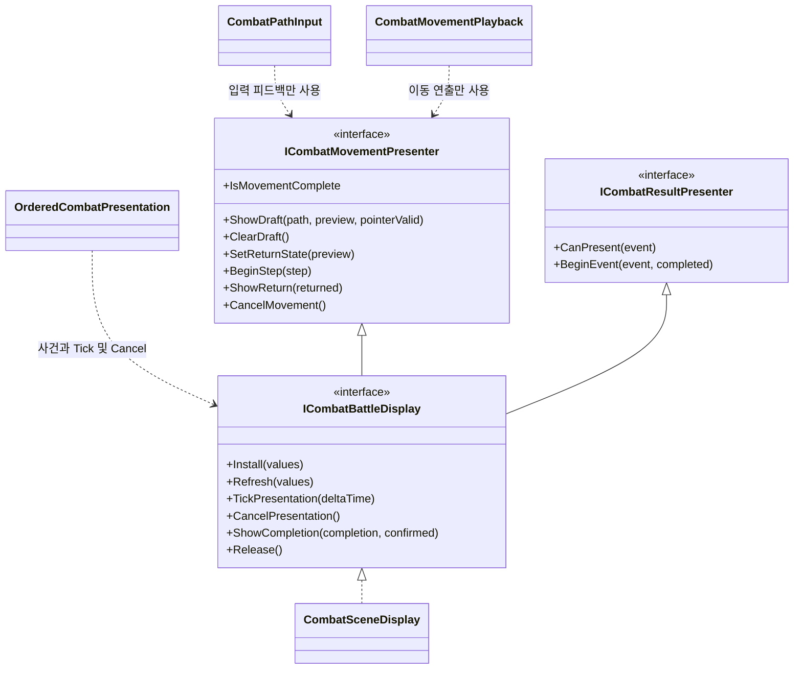
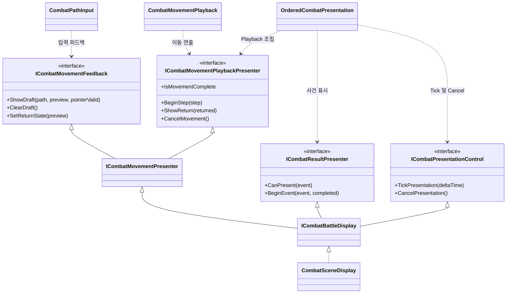
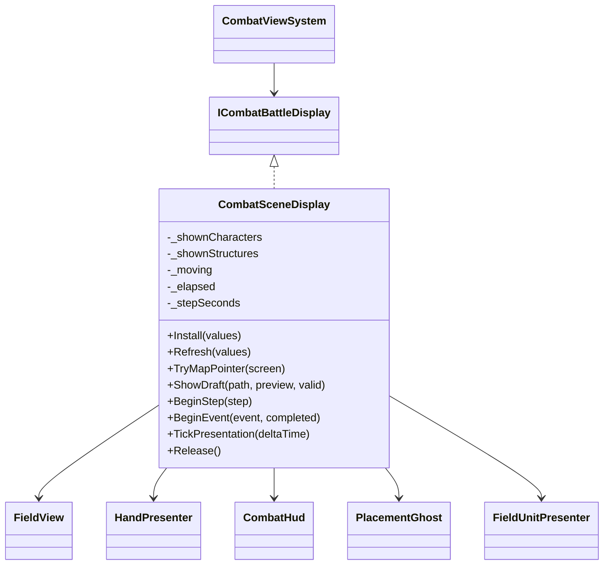
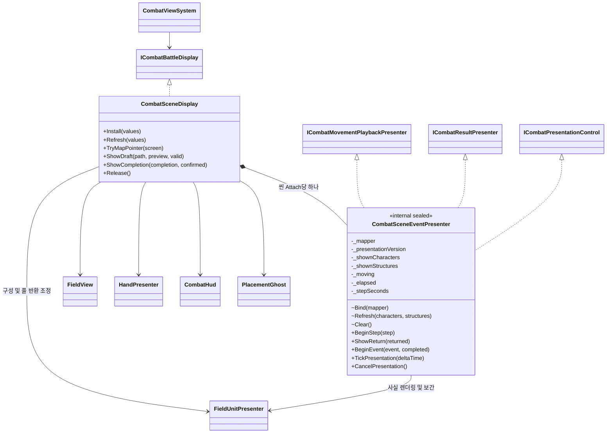
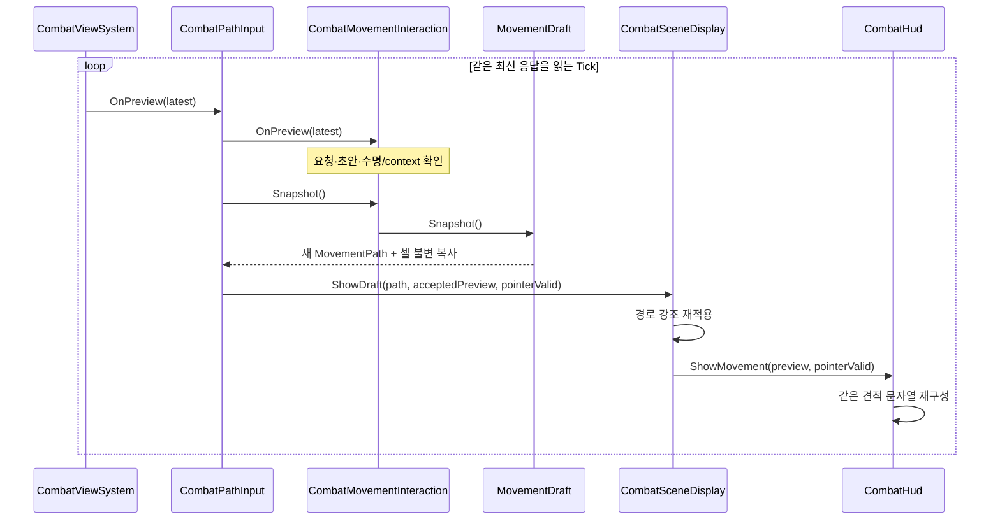
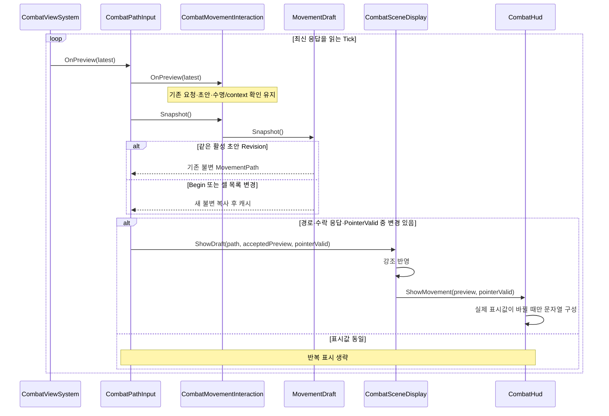
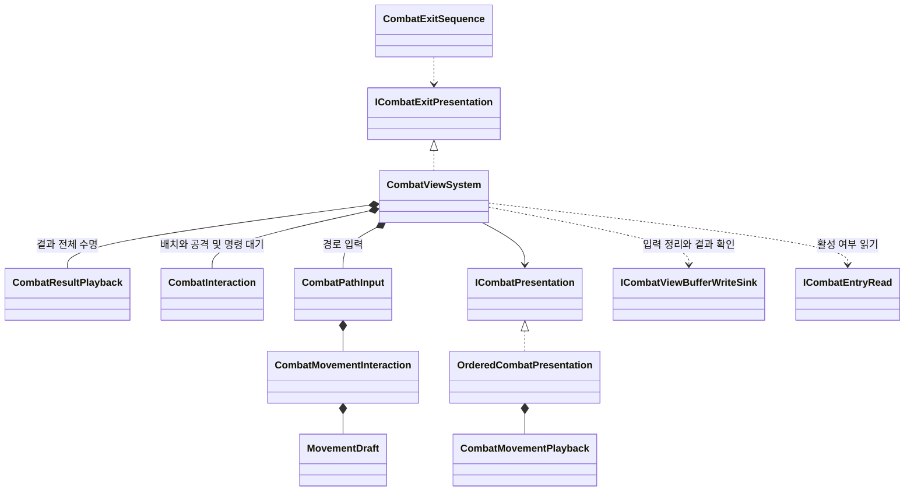

# 전투 View 후속 보완 — UML 전후 비교

- **변경 전:** 보완 착수 전 `c3bc5ee1` 스냅샷. 생산 코드 기준 `bfe63a27`.
- **변경 후:** [후속 계획 V1~V4b](../plans/2026-10-05-combat-view-maintenance-plan.md)를 반영한 현재 로컬 구현. **관리 코드 47/47 통과, V1/V3/V4 Unity 표시 검증 대기**다. 실행 기록은 기존 View 계획 §7.27~31를 따른다.
- [전후 비교 화면](2026-10-05-combat-view-maintenance-uml-comparison.html) / [현재 전체 UML](2026-10-05-combat-current-uml.md).
- R1 입력 Router, M1 사건별 증분 렌더링은 조건부 후보라 변경 후 도표에 포함하지 않는다.

`*--` = 생성·수명 소유(합성), `-->` = 참조 보관(연관), `..>` = 호출 의존, `<|--` = 인터페이스 상속, `<|..` = 구현. 주요 관련 멤버만 표시한다. 변경 후도 현재 코드의 타입·메서드 관계다. 코드 반영과 Unity 표시 검증 완료를 구분한다.

## 1. V4a — 입력과 연출 소비자가 받는 인터페이스

### 변경 전

입력과 연출이 서로 쓰지 않는 메서드까지 받는다. Ordered는 필요하지 않은 입력 피드백·Completion·씬 수명 기능이 포함된 전체 표시 계약을 보관한다. `ICombatBattleDisplay`의 집기·좌표 매핑·입력 피드백 상속은 이 도표에서만 생략했다.

### 변경 후 — V4a 코드 반영

기존 두 묶음 인터페이스는 조립·호환 경계로 남는다. `ICombatPresentation.Attach(ICombatBattleDisplay)`는 유지하고, Ordered는 Attach 때 받은 묶음을 좁은 역할별 참조로 나누어 보관한다. 모든 계약의 실제 호출 대상은 SceneDisplay이며 V4b 이후에는 사건 관련 호출만 내부 객체로 위임한다. `ICombatPointerMapping`과 배치/공격 피드백 계약은 그대로다.

## 2. V4b — 사건 표시 상태의 소유권

### 변경 전

### 변경 후 — V4b 코드 반영

SceneDisplay의 사건 메서드는 삭제되지 않고 내부 객체로 위임하므로 기존 계약을 만족한다. 새 객체가 갖는 것은 **화면에 현재 표시 중인 사건 사실과 보간 진행**이다. Core 상태·결과 확인·Completion·명령 대기를 소유하지 않는다. Presenter 참조는 GameObject/풀의 생성·파괴 소유권을 뜻하지 않는다.

Mapper는 SceneDisplay 생성 때 캡처하지 않는다. Install 시작에 기존 사건 연결을 끊고 Field.Build 성공 후 사건 객체에 연결하고 사실을 동기화한다. Build나 후속 설치 단계가 실패해도 연결을 해제한다. Clear/Release는 보간·사건 사실·Mapper 연결을 해제하며 재설치에서는 새 Mapper를 연결한다. 세부 수명과 실패 회귀는 후속 계획 V4b가 원본이다.

Refresh에서는 사건 표시 목록을 한 번 구성해 기존 RenderFacts에 전달한다. 사건마다 전체 순회하는 방식은 유지한다. M1의 Dictionary/변경 개체 전용 갱신을 이미 적용한 것으로 보지 않는다.

## 3. V1~V3 — 반복 입력과 표시 비용

### 변경 전: 같은 초안·응답도 반복 복사·표시

반환 화살표는 Interaction을 통한 반환을 축약했다. Return 견적도 같은 응답이 반복되면 HUD 문자열을 다시 구성한다.

### 변경 후: 유효성은 계속 확인하고 표시 비용만 억제

| Phase / 소유자 | 변경 전 | 변경 후 | 캐시 무효화·보존 조건 |
|---|---|---|---|
| V1 / SceneDisplay | 매 TryMapPointer에서 PointerEventData 생성 + Any | 같은 EventSystem용 데이터 재사용 + 직접 순회 | EventSystem 교체/없음/Release에 갱신·해제. Raycast·좌표 변환은 매번 수행 |
| V2 / MovementDraft | Snapshot마다 MovementPath·셀 배열/래퍼 생성 | 같은 활성 Revision의 불변 Snapshot 재사용 | Begin·셀 추가/삭제·접두 절단·Cancel. 이전 Snapshot의 불변성 유지 |
| V3 / PathInput | 동일 응답에도 ShowDraft | 마지막으로 성공한 표시와 다를 때 호출 | PointerValid만 바뀌어도 표시. Cancel/Detach/다음 초안에 해제, 재진입 뒤 낡은 캐시 복원 금지 |
| V3 / CombatHud | 동일 Move/Return 견적의 문자열 반복 구성 | 문자열 생성 전 화면에 쓰는 값 비교 | BindReturn/Clear/새 표시 수명에서 초기화. 버튼 활성 상태 복구 |

캐시 필드가 늘어나지만 Core 상태의 새로운 원본은 생기지 않는다. 유효성·context·명령 제출 판단과 표시 캐시를 분리한다. V2의 변경 없는 Snapshot 1,000회는 관리 코드 실행에서 할당 0바이트를 확인했다. Unity/HUD 할당·프레임 성능은 미측정이며 전체 프레임 무할당이나 FPS 개선을 뜻하지 않는다.

## 4. 그대로 유지되는 결과 수명과 외부 경계

- 결과 하나의 수명·세대·토큰: CombatResultPlayback. 사건 순서: OrderedCombatPresentation. 실제 이동 시간/보간: 새 SceneEventPresenter.
- 마지막 표시·후처리 성공 뒤 일반 결과 확인: CombatViewSystem. Completion 확인과 별개다.
- 정상 제출 정지는 Playback을 보존한다. 오류/Detach는 기존 Cancel·부분 정리 실패·늦은 콜백 방어를 따른다.
- Core 계산/Buffer 기록, 골격 Flow/Job/진입/이탈, RuntimeFaultBoundary는 변경하지 않는다. T1/G7·Stage/Run 재화·포기 API·보류 목적지는 이번 UML의 신규 구현에 포함하지 않는다.

## 5. SOLID와 도표의 대응

| 원칙 | 도표에서 달라지거나 유지되는 점 |
|---|---|
| S | 씬 연결/UI와 사건 표현 상태를 분리. 초안·명령 대기·결과 수명은 기존 소유자 유지 |
| O | 사건 표현 교체/확장은 기존 ICombatResultPresenter·ICombatPresentation 경계 활용. 입력·골격까지 확장 변경을 전파하지 않음 |
| L | 기존 묶음 계약과 반환/예외/취소 의미 유지. 캐시 적용 후에도 같은 유효성·늦은 통지 회귀 필요 |
| I | PathInput, MovementPlayback, Ordered가 실제 사용하는 역할만 보관 |
| D | 조정 객체는 작은 계약, 씬 구현은 명시적으로 받은 Presenter/Mapper에 의존. 새 전역 조회나 서비스 없음 |

도표는 [구현 계획](../plans/2026-10-05-combat-view-maintenance-plan.md)의 설명 자료다. 구현·검증 상태의 원본은 기존 View 계획 §7이며 이 비교 문서 작성으로 Phase가 완료되지는 않는다.
