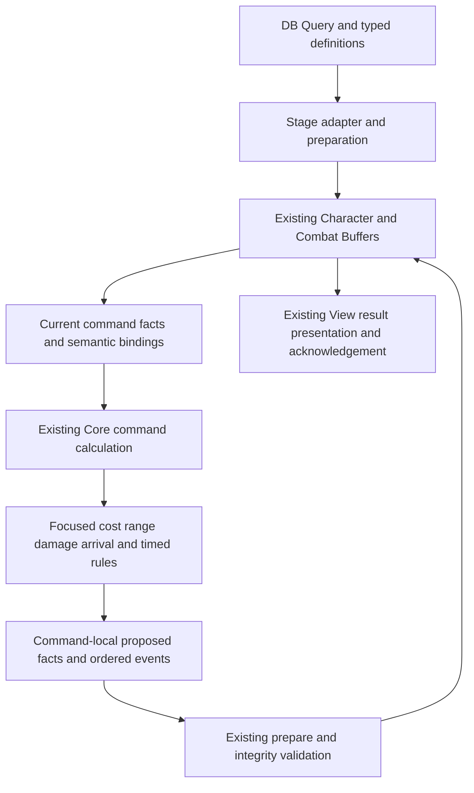

# Environment Content Follow Up Design

Date: 2026-10-05

Status: Design with user-confirmed gameplay decisions and subsequent execution updates recorded below. E1–E9 are implemented for the authorized Core/Buffer system/fixture scope; E9 is complete for Core/Buffer fixtures, including verified fresh review fixes (focused 280/280; full 2664/2680 with 16 inherited failures); E10 and production activation remain pending. Latest E8 evidence is recorded in the completion update below. The document itself does not authorize further implementation or settle remaining policies. Latest E7 verification: focused 245/245; full EditMode 2607/2623 with the same 16 failures reproduced at unchanged HEAD.

Scope update on 2026-10-05: the user's latest reading of the revised PPT is that Object stacking logic resumes while visual presentation remains deferred. This design adopts that direction for follow-up scope; it is not a claim of separate designer confirmation of every stacking edge case.

Audience: Core, Buffer, DB and View contributors extending the completed Cell environment foundation.

## 1 Purpose and source authority

Add the eight revised environment contents to the existing combat architecture: High Ground, Sandstorm, Tornado, Powder Barrel, Supplies, Flag, Sheriff Badge and Mine. Keep Wall as a separate draft. Reuse completed drag-path movement and Foundation P1–P5, extending their concrete contracts only where a new requirement needs it.

The recommended approach places typed content facts in existing authoritative stores and connects focused calculations to existing movement, targeting, damage, turn and death boundaries. A Cell remains a coordinate and a derived view of its participants. It does not acquire a manager that owns combat execution or mutable copies of those participants.

Sources:

- [Revised content analysis and Codex handoff](<D:/My_ProjectWork/학교 관련 문서/졸업작품_프로젝트L/2학기 내용/AI 관련 문서/2026-10-05-environment-content-analysis-and-codex-handoff.md>), including its transcript and visual notes. The user explicitly identified this MD as the requested work; section 13 requests a new design document only.
- [Revised gameplay PPT](<C:/Users/권천명/Dropbox/Project L/기획 브레인스토밍/안재령의고뇌/Terrain, Obstacle, Object 기획서.pptx>), identified as 20 slides in the handoff. Its SHA-256 was independently checked: `585e1a460f71795019d69603b75fb4c5dd02e0d1abdfecffa3412ae3d6cfe793`, matching the handoff. Slide text and visual interpretation below use the handoff; this review did not independently render the slides.
- [Foundation plan](../plans/2026-10-05-cell-environment-foundation-implementation-plan.md), SHA-256 `440b332461d2cb47a5a47f7cf696d9830fa937e25b46c47769f915b20ed05441`, also matching the handoff; [original foundation design](2026-10-05-cell-environment-terrain-obstacle-object-design.md); [movement design](2026-10-04-drag-path-movement-design.md).
- [Framework development guidelines](../framework/Framework%20Development%20Guidelines.md), particularly sections 20–23 and 26–28; [DB and View boundaries](../handoffs/2026-09-24-view-core-data-boundary-handoff.md); current source paths listed in section 12. Historical boundary documents provide context; verified current code resolves old API descriptions.

Code inspection baseline: commit `0b7e4a07` on `feature/Cheon/refactor/core-system`. The completed implementation is the starting point even where historical plans still say draft or contain unchecked tasks. The older foundation design's hit-plus-destruction and HP-99 statements are superseded for future content by revised PPT P06; historical documents remain unchanged.

Evidence labels used below: **Source** means explicit revised PPT text or handoff visual notes; **Confirmed** means the user's subsequent answer in this conversation; **Verified** means inspected current code; **Proposed** means an architectural choice for review; **Open** means an unresolved gameplay decision. Later user decisions govern this follow-up when an older source is ambiguous. A gameplay decision is not automatically implementation approval.

This task creates only this file. It changes no runtime code, tests, assets, scenes, Framework infrastructure, assembly references or historical plans, and performs no commit, push, compilation, test run or play verification. Earlier test evidence belongs to the completed foundation, not to these new contents.

## 2 Requirement changes and preserved rules

| Source | Updated requirement or uncertainty | Consequence for this follow-up |
| --- | --- | --- |
| P04 | Special Terrain + Object is allowed; special Terrain + Obstacle and Object + Obstacle are prohibited | Reuse semantic cell composition. Ordinary board cells are not all special Terrain. |
| P04 + user answer 8 and ordering clarification | Multiple Objects coexist and resolve in tile-entry order; death during resolution stops the remaining effects | Logic resumes; visuals remain deferred. Damage/death is settled before advancing to the next Object, not used to sort damage Objects ahead of earlier pickups. Unprocessed Objects remain unactivated and unconsumed. |
| P05 | Terrain permits Character occupancy, cannot be targeted or damaged, and has presence or turn-based behavior | Separate presence queries from time-triggered actions. Terrain disappearance does not delete the board cell. |
| P06 + E5 confirmation | Destruction runs only the destruction effect, not hit plus destruction | Select mutually exclusive reactions per hit. Zero damage causes no reaction. |
| P06 | Effects may benefit the causing Character | Keep an explicit credited Character distinct from the physical damage origin. Do not infer all effect recipients from one global attacker. |
| P06–P07 | HP 99 text is struck through; Wall is under revision and excluded, with no attack-blocking diagram | No HP sentinel or Wall activation. Wall does not block work on destructible Obstacles. |
| P06 | One Obstacle per tile; occupied tiles block Character movement | Preserve structural occupancy, full-footprint checks and semantic coexistence. |
| P08 | Object activates on approved arrival, is consumed, and cannot be targeted, damaged or triggered by attacks/AoE | Consumption is a real change even without HP loss. Attack effects cannot detonate Mine sources. |
| P09–P12 | High Ground, Sandstorm and Tornado are the Terrain contents | No automatic migration from the old Ashen Ground name; no mapping from “stage 1” to a numeric StageKey. |
| P10 + user answers 1–2 | Additional 2 AP only for low-to-high entry, one step of range; High Ground reduces damage from every non-High-Ground origin by 30%, including environmental damage | No extra cost for descent or high-to-high travel. Originless-damage classification remains open; low-to-high knockback prohibition is preserved. |
| P11 | AppointRange minus 1 only when above 1; received damage minus 20% | Separate effective targeting range from received-damage arithmetic. |
| P12 + user answer 6 | Tornado repeats every three completed individual unit turns, regardless of faction | Reuse completed-unit-turn clock semantics; start/reset timing, candidates and empty-cell behavior still need decisions. |
| P14–P15 + user answers 5, 7 | Barrel/Mine blasts hit allied and enemy Characters and structures with HP; Barrel chains are allowed. Supplies attack expires before night-to-day recall | Keep exclusive destruction reactions and one reaction per destruction; Supplies lifetime ends at the combat-interval boundary, not eventual stage clear. Values remain open. |
| P17–P18 | Flag and Badge survive day recall to hand | Character-held state survives location changes. Cross-stage persistence is not specified. |
| P19 + E7 replacement answer | Mine applies the same explicit N raw damage to the center and all eight neighbors, clipped to the board | The user confirmed the full 3x3 (nine cells), replacing the prior reduced additional damage interpretation. Existing tile-arrival activation remains. |
| P20 + user answer 9 | Object consumption blocks rollback; attack blocks rollback after execution, not attack-mode entry | Preserve the completed successful-attack checkpoint and mode-cancellation behavior. The unfinished Terrain line does not block Return for all Terrain. |

Generic sequential effect processing, route-cell order and damage/death settlement remain useful and preserved. They do not by themselves implement same-tile Object entry order. Both isolated Object behavior and ordered multiple-Object behavior are now required for the resumed logical scope; combined visual layout remains deferred.

### 2.1 User-confirmed decisions on 2026-10-05

| Answer | Confirmed rule | Remaining boundary |
| --- | --- | --- |
| 1 | Low-to-high edge costs base AP plus 2 and one movement step. Descent and high-to-high movement have no surcharge. | AI route preference and detailed knockback cases are separate. |
| 2 | A Character on High Ground reduces all damage originating outside High Ground by 30%; this includes environmental damage. | Preserve physical origin separately from credited Character. Damage without a spatial origin needs explicit classification. |
| 3 | Multiple percentage reductions apply successively, not by adding their percentages. | For example, 10 × 0.8 × 0.7 = 5.6 before integer settlement. Rounding point/mode and placement relative to other arithmetic are not yet specified. |
| 4 | One Badge invalidates one whole attack, including all three hits of a three-hit attack. Acquiring another while one is held does not stack protection. | E6 confirms zero-damage consumption, separate Mine/Barrel explosion and stepped-Thorn groups, duplicate field consumption, Railway instant-death bypass and terminal Badge cleanup. Actual Object sources remain E7. |
| 5 | Supplies attack gain lasts through the current combat interval, ending before the night-to-day unit recall. | This does not answer Flag Priority operation or Flag/Badge cross-stage persistence. |
| 6 | Each completed allied or enemy unit turn counts as one Tornado turn. | Initial due point, reset across day/night and empty/no-candidate behavior remain open. |
| 7 | Mine and Barrel affect allies, enemies and HP-bearing structures; Barrel chain explosions are enabled. | Terrain/Object damage immunity remains. The later E7 answer confirms full 3x3 Mine geometry and uniform explicit N raw damage; see section 5.5 and the latest E7 execution update. |
| 8 + ordering clarification | Resolve Objects in tile-entry order: earlier Flag then later Mine means Flag first. Settle each effect's damage/death before advancing; if the Character dies, remaining Objects stay unactivated and unconsumed. | No damage-first reordering. E7 confirms initial authored-list order and voluntary/forced/deployment/enemy-redeployment arrival. |
| 9 | Attack execution blocks rollback; merely entering target selection does not. | Existing successful-attack behavior is retained. The unfinished Terrain-specific rule remains unspecified. |

These decisions update only this follow-up design. Original transcripts and completed plans remain historical records.

### 2.2 E5 confirmations and implementation boundary — 2026-10-06

The user subsequently authorized E1–E5 execution. E5 confirms both-faction direct Obstacle targeting, per-hit exclusive reactions with no zero-damage reaction, once-per-entity blast damage, separate attacks for each Barrel explosion and original Character credit across chains. Barrel still explodes only on destruction. Initial HP/explosion values are undecided and supplied explicitly in tests; production authoring/placement remains gated. E5 establishes typed placement/profile propagation, command-local chain settlement and atomic existing-Buffer publication. Supplies acquisition/expiry and Badge protection remain E6. The document's initial design-only statement above records its original authoring scope; current execution evidence is in implementation-plan section 10.

## 3 Verified reuse and concrete gaps

### 3.1 Cell and publication APIs

| Existing API | Verified capability | Minimal extension or boundary |
| --- | --- | --- |
| [CellEnvironmentQuery][cell] `Read`, internal `ReadSpatial`, `CheckPlacement` | Joins current active sources, living structures and living field Characters; no Cell cache. Out-of-board queries return empty composition. | Reuse over command-local final facts for spawn/relocation validation. Internal `ReadSpatial` is not a new public service contract. |
| [EnvironmentSemanticBindings][bindings] | Immutable Terrain/Object source IDs and Obstacle EntityIds; initial reference validation | Keep classification only. New source IDs require an explicit expected/final binding change; consumed historical bindings need not be live references forever. |
| `EnvironmentPlacementRules.Evaluate` | Outside-board, Terrain/Obstacle, Obstacle/Object and overlapping-Obstacle violations | Reuse; no Object/Object decision or Terrain/Terrain composition policy is supplied by these predicates. |
| [StageEnvironmentAdapter][adapter] `Read` | Converts `TerrainPresencePlacementData` into attack/max-HP `DestinationTileModifierFact` and Terrain bindings | Add typed content definitions and placement conversion by approved capability. The current DTO is not a universal content schema. |
| [BattleEnvironmentPreparation][prepare] `Prepare` | Validates sources, references and composition; accepts bound Terrain only as destination modifiers; rejects initial Object/Obstacle execution | Replace each unsupported capability guard only with its implemented validation. Do not evade the guard with unclassified sources. |
| [EnvironmentPresenceReconciler][presence] `Calculate` | Pure affected-cell attack/max-HP contribution replacement; can propose persistent Main HP correction | Keep it focused on presence. It is not a trigger, random selection or turn executor. Initial preparation still rejects an unsupported Main current-HP change. |
| [CombatStateData][state] `EnvironmentBindings` | Initial installation and ordinary command copies preserve the binding object | Default preservation remains correct. Dynamic classification replacement is a new explicit proposal, not an existing feature. |
| [CombatStateBuffer][combatbuffer] `PrepareCommand` | Checks expected state, placement and results; structures retain count, identity, position, definition and max HP | HP-zero destruction already fits. Do not require collection deletion for destruction. Obstacle relocation needs a separately bounded extension. |
| [BufferSystemGroup][publication] `Apply(CombatCommandTransition)` | Prepares affected stores before installation, then installs command/result | Extend its existing transaction for new facts. No additional environment Buffer, event-driven writer or presentation callback installation. |

**Additional verified input gap:** `CombatProcessingService` captures `battle.CommandState` and battle facts, but currently does not pass `battle.EnvironmentBindings` into `CombatCommandInput`. The binding is stored on `CombatStateData`, outside `CombatCommandState`. New semantic content calculations therefore need an explicit read-only binding input captured alongside the current command state. Calling `CellEnvironmentQuery.Read` is not enough if that input is absent.

### 3.2 Gameplay calculation APIs

| Existing code | Verified behavior | Follow-up consequence |
| --- | --- | --- |
| [MovementRouteValidator][route] and [CombatMovementCalculator][movement] | Route admission, requested preview cost, range and per-step execution use uniform `MoveCost` | Introduce one directional edge-cost calculation used by all these callers. Existing paid-cost and step-distance ledgers remain separate. |
| [EnemyMovementPathfinder][ai] | BFS finds an attack position, then takes an affordable prefix using AP divided by uniform cost; known active `IsMine` cells are excluded | Shared weighted pricing must reach AI search and prefix selection, including zero base MoveCost. Keep its mine knowledge rules. |
| [CombatAttackQueries][range] | Both selection and range use `actor.Stats.AttackRange`, an AppointRange alias; AI calls the same attack queries | Resolve effective AppointRange at these common query boundaries, including hypothetical AI positions. Do not rewrite attack shapes or splash data. |
| [TargetDamagePipeline][damage] and `CombatCommandCalculator.Damage` | Character attack path applies splash/pierce scaling, category matchup and incoming reductions; PhysicalDefense is currently a pass-through stage | Extend arithmetic explicitly. A complete physical-defense formula must not be claimed or invented for this feature. |
| [MovementProjection][projection] `ChangeHealth` and direct thorn handling in `CombatCommandCalculator` | Environmental requests currently carry target/amount and apply HP changes without using the attack damage wrapper | Source-aware terrain reduction and Badge consumption need a shared damage-resolution boundary; adding only an attack modifier misses these paths. |
| [CombatCommandEffects][effects] `Capture` / `Apply` | Bridges Trait and Category definitions/states to the existing `CombatEffectEngine` | There is no ready generic held-content store. Extend supported bindings and state transitions where necessary; do not encode a Badge as an unrelated Trait. |
| [CharacterCombatFacts][character] and [CharacterCombatFactsComparer][compare] | Carry immutable Character stats, temporary bonuses and position modifier; comparer enumerates expected values | Add a typed held-effect snapshot when its first approved consumer is implemented, and include it in equality, copies and prepared changes. |
| [CombatPlacementCalculator][placement] `Location`, `RecallForNight` | Clears position contribution when leaving field; preserves Character identity and existing temporary bonuses; Main is excluded from automatic recall | Keep held effects through the existing field/hand transition. Do not extend which Characters are recalled just for this content. |
| [CombatTurnCalculator][turn] and [CombatTimelineScheduler][timeline] | Gameplay Priority is stored in participants; opening turns sort higher Priority first; later interval is `ceil(100 / Priority)`, minimum 1 | Flag must update the applicable participant facts as well as Character effective Priority. Updating only Stats leaves scheduled order stale. |
| [CombatGimmickCalculator][gimmick] and turn forecast | Due clock is completed unit turns; implementations and forecast currently accept Railway only; Railway directly sets HP to zero | The user-confirmed Tornado clock matches completed unit turns, but Tornado is still a new timed action. E6 confirms Railway instant death bypasses Badge. |

Seeded enemy spawn and timeline tie hashing exist, but the inspected command state has no reusable mutable gameplay RNG cursor. Tornado and random Flag fallback need a deliberate deterministic random-state contract, not a claim that a complete random service already exists.

## 4 Architecture and ownership

### 4.1 Chosen approach

| Approach | Trade-off | Decision |
| --- | --- | --- |
| Per-content Manager, Buffer and combat Job | Easy local prototypes, but duplicate HP, occupancy, scheduling and publication | Reject. |
| Encode all content in destination attack/max-HP modifiers or movement rules | Few initial types, but wrong lifetimes and no sound damage/time ownership | Reject. |
| Typed content facts with focused calculations at current combat boundaries | Requires small explicit contract extensions while preserving one authoritative state and execution path | Recommend. |

Use internal pure helpers until a real external service/lifetime need appears. Register actual rules through existing factories and typed services. No Framework Tick scheduler, global trigger bus, per-content Plan/Job, generic effect scripting language or second effect engine is proposed. Existing Framework lifecycle and View-owned combat scheduling remain authoritative.

### 4.2 Fact ownership

| Fact | Authoritative owner | Consumers and lifetime |
| --- | --- | --- |
| Static rule values, content key and placement | Existing DB Query / pure in-game data | Adapter reads immutable definitions; no live SO lookup in calculation. |
| Terrain/Object position, active state and content payload | `CombatCommandState.Environment` in Combat Buffer | Cell query, movement, damage, preparation, display. Preserve current source identity semantics. |
| Obstacle HP, pose and occupancy | Existing `StructureCombatFacts` in Combat Buffer | Attack and reaction calculation; zero HP removes live occupancy without inventing Character death. |
| Terrain/Object/Obstacle classification | `CombatStateData.EnvironmentBindings` | Explicit input to Core; no duplicate position or HP in bindings. |
| Object order within its current tile | Proposed entry ordinal on immutable Object runtime source facts in Combat Buffer | Assigned on approved tile entry; preserved by consumption/copy as appropriate. Separate from source ID, rule Priority and Character-held multiplicity. |
| Badge charge, held Flag reference, Supplies contribution | Proposed immutable held-effect snapshot on `CharacterCombatFacts`, stored by Character Buffer | Flag/Badge survive day recall; Supplies expires before that recall. E6 confirms Badge terminal cleanup; Flag terminal lifetime remains E8. |
| Effective range, positional damage contribution, effective Priority | Derived calculation over current facts | Avoid a second mutable cache. If a published projection is needed, compute it from the same inputs. |
| Tornado due facts, deterministic RNG progression and new source allocation | Existing Combat state, extended only for approved dynamic content | Captured and proposed with the command; no consumption during Preview or failed publication. |
| Historical effect origin, target, before/after and display position | Immutable ordered `CombatEvent` / result facts | Existing View owner presents the accepted result once, even after a source becomes inactive. |

New type names in this document are proposed responsibilities, not asserted APIs. In particular, a held-effect snapshot is a small typed extension, not a new Character store or arbitrary buff engine. Start with the concrete values required by approved Badge/Flag/Supplies semantics. Keep contribution origin and lifecycle explicit so location normalization cannot erase acquisition state.

### 4.3 Shared damage boundary

Extend the existing application-level damage calculation and existing effect engine instead of copying arithmetic into every content rule. A damage request needs the raw amount, target, physical origin cell, optional credited Character, cause kind, applicable damage policy and an attack-group identity for whole-attack Badge protection. Keep category eligibility optional: a Barrel does not gain a fake attacker category merely to call the current pipeline.

The shared calculation returns the damage breakdown plus any held-state consumption. Character HP/death assembly stays in the current Character command path; Obstacle HP and mutually exclusive reactions stay in the structure path. Attacker self-exclusion and hostile targeting are caller policies, not universal damage arithmetic. An allowed environmental blast can include the causing Character without inheriting player-attack self-immunity.

Percentage reductions compose multiplicatively, as confirmed by the user. Do not add a 20% and 30% reduction into 50%. **Confirmed during E4:** apply Terrain percentages after existing matchup/PhysicalDefense/Heavy settlement, preserve decimal intermediates across received percentages, and floor the final result: 10 × 0.8 × 0.7 = 5.6 → 5. Existing category/splash/pierce rounding remains unchanged. E6 confirms zero-final-damage attacks consume Badge. Reuse existing incoming-effect evaluation where it fits, adding a narrow planned state change for consumption; pure evaluation alone cannot persist a spent charge. Preserve existing category/splash/pierce behavior for old content. Routing thorn damage through a shared helper must not silently start applying formerly inapplicable category rules. Specify applicable policies per cause explicitly.

**Proposed whole-attack implementation:** consume the held Badge once and record the protected target/attack-group pair in command-local calculation state. Every later hit from that same attack against that target is also blocked even though the held charge is already consumed. Subsequent independent attacks are not blocked. Do not equate an entire combat command, actor turn or explosion chain with one attack: a command can include unrelated damage events. Environmental events need an explicit grouping policy; causal attribution and protection grouping are separate meanings. This uses the existing command/effect calculation and does not create a long-lived protection manager.

The physical-defense pass-through remains unchanged unless a separate formula is provided. HP normalization when a max-HP contribution changes, authored instant kill and ordinary damage are distinct causes. Do not consume Badge charge simply because any HP decrease occurred, or infer instant death from a large damage number.

### 4.4 Command publication and dynamic sources

Proposed extension to the current command contract:

1. Capture current semantic bindings together with the current Combat and Character facts. Preserve this input through helper copies and relevant preview contexts.
2. An ordinary command keeps existing bindings. A command that creates or reclassifies a source supplies an explicit expected/final immutable binding change alongside final environment facts. Compare the expected binding state in prepare, because `CombatCommandState.SameValues` does not currently cover it.
3. Newly created source IDs must be unique, positive and not reuse a retired identity. Add a battle-local source allocation fact when creation is implemented; do not borrow Character `NextEntityId` or assume numeric identity across the two namespaces. Same-source Tornado relocation avoids allocating another ID if that technical representation is chosen.
4. Validate newly introduced references, final source bounds, supported capability, final semantic coexistence and affected Character contribution results before installation. Do not run the initial live-reference check blindly against all historical consumed bindings.
5. Prepare held state, HP, death effects, source/binding changes, RNG/allocator progress, turn state and results before any install. Failure preserves all stores and counters. No setter on a View callback can complete a partially published environment command.

`MovementStepEffects` currently only replaces the selected source with the same ID, cell, rule key and runtime type. `MovementProjection.ChangeSource` additionally protects visibility, Priority and mine identity. Keep this narrow selected-source consumption path. Spawn, removal or relocation belongs to an explicitly validated command change, not relaxed validation allowing a tile rule to replace the environment arbitrarily.

For consumption, marking a source inactive is compatible with current query and barrier behavior; inactive facts are not visible gameplay objects. Physical compaction is not required. Whether to compact later is a technical concern and must preserve identity and historical event data.

Initial presence calculation does not synthesize Object arrival. E7 confirms Object activation for normal route entry, existing forced arrival/knockback, player deployment and enemy night redeployment. Creation under a Character and the future Tornado relocation adapter remain their own later consumers. The existing forced-movement handler supports one-cell displacement and thorn settlement; it is not a ready general teleport-and-trigger API.

### 4.5 Resumed Object stacking logic

The scope is multiple Objects on one tile, resolved in the order those Objects entered the tile. The user explicitly confirmed Flag then Mine when the Flag entered first, and stopping remaining effects if the Character dies during resolution. Damage does not reorder the Object sequence. Visual composition, resource overlap and how stacked Objects are drawn remain deferred. Logical result events still need to identify every processed Object for verification and eventual presentation.

**Proposed representation:** keep an entry ordinal with each Object's immutable runtime source facts. Allocate ordinals through a battle-local monotonic value in existing Combat state, atomically with source creation or approved tile entry. A source ID identifies the Object; the ordinal identifies its relative entry order and must not be derived from that ID. Semantic bindings remain classification-only. Copy and rejected commands do not advance ordinals. Initial same-tile placements need an explicit authored order; incidental collection enumeration must not become an undocumented gameplay decision.

The existing coordinator sorts generic sources by Priority/ID inside Hazard/Recovery phases. Merely sorting Object IDs before that loop would still allow the phase split to reorder Object effects. The implementation plan must express entry-order Object resolution within the existing coordinator, preserving generic non-Object processing and existing death/settlement ownership. Hazard/Recovery grouping must not move a later Mine ahead of an earlier Flag or Badge. Evaluate each next eligible Object against current command-local state, only after settling the current Object's effects and checking the arriving Character's survival. Do not create a second runner or silently change every environment source's order.

Confirmed examples: Flag then Mine grants/consumes the Flag before resolving the Mine. Mine then Flag settles Mine damage first; if it kills the arriving Character, the Flag remains active and unconsumed. More generally, death stops this Character's remaining Object sequence without consuming its unprocessed sources. Previously completed effects are not retroactively undone; a held Flag's subsequent death drop follows its own lifecycle. The earlier phrase “damage has first priority” means settling damage/death before the next Object, not globally sorting damage Objects first.

E7 user decisions: initial simultaneous Object order follows the authored placement list. Voluntary entry, forced arrival, player deployment and enemy night redeployment activate Objects; route origin and checkpoint return do not. Existing Hazard processing precedes ordered Objects, and existing Recovery follows them. Death, battle end or relocation interrupts the previous-cell sequence. Existing non-Object arrival behavior is preserved; the additional approval is Object activation, not a new general trigger policy. Whether Objects created during resolution join the sequence remains an E8 decision; E7 creates no sources. Badge then Mine versus Mine then Badge remains an essential test. Held Badge protection is non-stacking; held Flag multiplicity is still separate from field coexistence.

## 5 Content design

### 5.1 High Ground

**Source P10 and confirmed answers 1–3:** a Character on High Ground reduces damage from any non-High-Ground origin by 30%, including environmental sources. Low-to-high movement costs an additional 2 AP but still one step; descent and high-to-high travel have no surcharge. Percentage reductions apply successively. **Confirmed during E4:** unknown physical origin does not qualify for this reduction; transit damage uses the current cell; only low-to-high one-cell knockback is blocked, while plateau/descent are allowed. Return is exempt. Multi-cell displacement remains unsupported; no new multi-cell policy is inferred. Damage-stage and final-floor rules are recorded in section 4.3.

**Proposed:** a typed Terrain fact identifies High Ground. A pure directional edge rule receives from/to cells, movement cause and current environment. All route admission, requested preview cost, execution, movement range and AI callers use `base MoveCost + 2` for each low-to-high edge and base cost otherwise. Distance increments by one per edge. `RecordEnteredStep` already accepts actual step cost; Return refunds the recorded pending cost and preserves the separate attack-refund ledger. Do not subtract extra AP after movement.

For AI, replace the uniform-cost assumption only as far as needed. **Confirmed during E2:** minimize AP expenditure first, then movement steps. Retain nondominated AP/step states per cell when both budgets matter, with deterministic ties and existing known-mine exclusions; one cheapest label per cell can discard a route needed by the step limit. Select the best attack-position route within the current AP and step budgets. When no attack position fits this turn, select an approach route with the same objective and walk only its affordable prefix. Equal AP/step goals retain the existing Y/X tie and Right/Up/Left/Down traversal order.

Pass the same directional prohibition into existing attack knockback and movement-rule forced displacement when their cause is explicitly Knockback. Unclassified legacy forced movement retains its existing behavior. Do not apply this restriction automatically to Return or Tornado. Damage reduction reads physical origin and the receiver's current cell, including during route effects, rather than credited-Character position or the planned destination.

### 5.2 Sandstorm

**Source P11:** reduce AppointRange by 1 only above 1, and incoming damage by 20%. **Confirmed during E4:** read current AppointRange after other contributions, apply defense at the current transit cell and also to originless ordinary damage, and use the final-floor damage policy in section 4.3.

**Proposed:** derive range through a shared effective-range calculation called by `CombatAttackQueries.Selection` and `Range`, also used for AI's hypothetical attack position. The approved local operation is `R > 1 ? R - 1 : R`; isolated inputs 0/1/2/4 give 0/1/1/3. `max(1, R - 1)` incorrectly increases zero range. Keep authored definition range, geometry and unrelated acquired contributions intact.

Apply received-damage reduction through section 4.3. Presence is queried from current facts; leaving, Return, initial placement and dynamic Terrain changes must produce the same effective result. These range/damage properties need not be stored in the old attack/max-HP position modifier or force extra stat copies on every move. This is the recommended first vertical content slice once its range stage and damage policy are agreed.

### 5.3 Powder Barrel

**Source P06/P14:** destruction alone triggers n damage to eight adjacent cells, including diagonals and excluding the center. **Confirmed answer 7 and E5 answers on 2026-10-06:** all HP-bearing allies, enemies and structures in the blast are recipients; Barrel-to-Barrel chains are enabled. Both factions may directly attack Obstacles. Reactions run per hit; zero damage has no reaction; a lethal hit selects destruction only. One explosion damages each entity once even if several footprint cells overlap. Each Barrel explosion is a separate attack group, and the original credited Character remains credited throughout the chain. Terrain/Objects remain immune. **Open:** n, initial HP and production authoring. No new elemental damage type is inferred; E5 uses the shared environmental damage boundary and approved Terrain defense.

**Implemented in E5:** keep health/pose/occupancy in structure facts and associate each EntityId with an immutable ObstacleContentProfile. InitialObstaclePlacementSpec carries an explicit structure definition, kind, anchor, rotation and explosion amount; existing preparation assigns runtime IDs and builds semantic bindings. Resolve each hit against current HP, select one reaction and capture the pre-destruction anchor. Enumerate the clipped eight-neighbor mask and resolve each living overlapping entity once against updated projected facts. Explicit fixture values verify these contracts; neither HP nor explosion damage has a production default.

E5 adds distinct Structure_PowderBarrel and Structure_Supplies contract keys and narrowly permits the existing Owner.Neutral value for those keys. Headquarters retains its existing identity and ownership constraints. Direct targeting includes semantic Obstacles for both factions; IsAttackable continues to describe the structure's own attack ability. HP-zero structures retain their records and full pose but cease blocking cells. A command-local queue and alive-to-dead checks terminate converging chains without duplicate explosions. Damage origin carries each Barrel's physical anchor, its separate command-local attack group and the original credited Character. Existing Combat Buffer preparation compares the captured profiles before installing HP/results. Actual Badge protection remains E6.

### 5.4 Supplies

**Source P06/P15:** the causing Character receives attack power on qualified damage or destruction; destruction does not also grant the hit bonus. **Confirmed answer 5, E5 and E6 answers:** rewards accumulate on each exclusive Hit/Destroyed reaction, zero damage has no reaction, and only the living original credited Character receives chain rewards. Missing/dead credit receives no reward. The contribution expires before night-to-day recall, including Main and Characters already off-field, and is cleared at terminal battle end. **Open:** actual hit/destruction reward values and production authoring; fixtures supply both explicitly. E6 enables typed initial Supplies placement with explicit values and shares existing Obstacle settlement.

**Proposed:** reuse Barrel's reaction selector and damage provenance. Emit only the selected acquisition contribution for the credited, eligible Character. Store it as a distinct combat-interval contribution, never as `PositionAttackBonus`, soul count or permanent Main attack. Remove that contribution at the night-to-day boundary before recall and redeployment, preserving unrelated Flag/Badge/trait contributions. Use the boundary rather than whether a particular Character changed location, since Main is not automatically recalled. Terminal battle cleanup must not carry Supplies into another battle. Rebuild effective attack from contributions so repeated application and removal remain exact. A missing/dead credited Character must follow a chosen policy, not a global last-attacker fallback.

The two n values remain independent unresolved parameters. Do not revoke an earlier hit contribution merely because a later hit destroys Supplies. The lethal hit grants only its destruction contribution.

### 5.5 Mine

**Source P08/P19/P20 and E7 replacement answer:** approved arrival consumes Mine; the center and all eight diagonal-inclusive neighbors receive the same explicit N raw damage, clipped to the board. The user explicitly confirmed all nine cells and retaining existing tile-arrival activation on 2026-10-06. This replaces the former reduced additional damage proposal. Direct/AoE damage cannot activate Mine, and consumption prevents checkpoint rollback. **Confirmed answers 7–8:** allies, enemies and HP-bearing structures are eligible damage recipients; lethal Mine damage prevents subsequent Flag pickup. E6 confirms one attack group for each Mine explosion; E7 confirms arrival causes. Ordinary Terrain defense and Badge remain applicable at each recipient; final damage uses the existing final-floor calculation. Actual N remains an explicit authored input, with fixture values only until G7.

**Proposed:** use the existing ordered route-entry coordinator and selected-source deactivation, with damage provenance and content-specific target discovery. Current `IMovementTileRule.TargetIds(tile, actorId)` has no board/occupant input: dynamic area victims need a narrow context-aware target query or coordinator-side resolution before constructing the rule input. Do not hard-code occupant IDs into a static Mine definition or let the rule mutate undeclared targets.

Every eligible live field Character or structure whose current footprint overlaps the 3x3 receives one N damage application per Mine, regardless of its faction or contact count. Dead and off-field Characters are excluded. There is no center/additional damage split or half-damage step. Mine includes the center whereas Barrel excludes it, so their masks remain distinct. Explicit authored visibility and `IsMine` feed existing Preview/AI knowledge; Object classification alone supplies neither.

Consumption sets the existing return barrier even if Badge blocks all HP loss. Preserve current path stopping and settlement boundaries; do not introduce a second refund mechanism or silently change attack-category refunds. Terrain/Object sources are not blast victims and cannot create Mine-to-Mine detonation chains by taking damage.

### 5.6 Sheriff Badge

**Source P18 and confirmed answers through E6:** grants one whole-attack invalidation, including every hit, and consumes even on zero final damage. Defense runs after the existing damage formula and Terrain reductions. Explicit instant death, including Railway HP assignment, bypasses it. Each Barrel explosion, Mine explosion and stepped Thorn cell is a separate attack. Duplicate pickup consumes the field Object without adding a charge. Day recall retains the current held state; terminal battle end clears it. Actual field pickup/Mine integration is E7; no production Object source is enabled in E6.

**Proposed:** consume the field Object and install a typed held-effect state on the Character in the same accepted command. The state records its content reference and remaining use according to the approved acquisition policy. Source inactivity and held-state existence are different facts; do not maintain two live copies of the item.

The shared damage resolution plans single-charge consumption with HP results and retains the command-local protected attack group through all its hits, as described in section 4.3. A second held Badge does not add another charge or extend protection to a later attack. Integrate ordinary direct attack and relevant environmental damage explicitly; a large damage amount is not instant death. `Location`, turn resets, movement copies, Character comparisons and completion paths must preserve or clear the state according to lifecycle, never reconstruct a full charge from its definition during redeployment. Railway explicitly bypasses Badge; a large ordinary damage number remains shieldable.

### 5.7 Flag

**Source P17 and E8 user confirmation:** grants additive Priority N, persists through day recall, and drops once at death. Only one Flag may be held; terminal battle cleanup removes the held Flag. The current action continues, and its next action interval uses the increased Priority immediately, allowing A → A when the new interval is shortest. A death drop prefers its death cell; when unavailable, choose a closest valid unoccupied cell. Avoid creating under a living Character, but acquire immediately if that occurs. Actual N remains an explicit fixture/authoring value.

Character held state owns the acquired Flag payload/contribution. Effective gameplay Priority, the corresponding `CombatTurnParticipant` and forecast use the same updated facts. The current action is not interrupted, and an existing scheduled time is not retroactively replaced; ending that action schedules its next interval with the new Priority. Framework Job priority is unrelated. Core and existing Buffer additions/modifications are explicitly authorized; their ownership and atomic prepare/install relationship remain intact.

Use recorded pre-death anchors from the existing command/movement death paths to build one drop proposal and remove the held state exactly once. Include the new source, source allocation and Object binding in the same publication. Do not spawn from a death animation callback. For non-tile death, require a location representation and agreed distance/candidate policy; do not invent off-board gameplay or use a stale movement checkpoint as proof of death location.

An existing Object alone does not reject or relocate a Flag drop: append it with a new source ID and later entry ordinal, preserving existing Objects. Execution rulings for the remaining details: compare squared Euclidean distance (no diagonal-only placement rule), choose randomly among equally nearest valid empty cells, and remove the held Flag without source allocation or RNG advance when no candidate exists. Living Characters and structures block ordinary drop candidates; Terrain and existing Objects do not. A duplicate held pickup leaves the extra field Flag active. New drops do not restart an arrival's captured Object sequence; explicit creation under an eligible Character immediately acquires that new Flag only. These implementation rulings are distinguished from the user's explicit rules above.

### 5.8 Tornado

**Source P12 and confirmed answer 6:** random placement, repeat every three completed individual unit turns regardless of faction, relocate the occupying unit to a random field location without Character/Obstacle occupancy, then respawn randomly. The user authorized E9 alone on 2026-10-06 and approved the complete G6 policy below; E10 was explicitly canceled before any implementation.

**Historical proposal, superseded by the E9 confirmed policy below:** integrate due calculation with existing turn advancement and forecast using the confirmed completed-unit-turn clock. Use `CompletedUnitTurnCount` with an explicit due value; define its start/reset relationship to existing combat-entry resets before enabling production. Do not count Preview calls, frames or path cells, or increment both an independent Tornado clock and the existing clock for the same event.

Plan forced relocation through an explicit destination operation, not a manufactured drag path or the current one-cell knockback request. Apply approved occupancy and arrival rules, then reconcile old/new positional effects. Candidate validation still respects all existing blocking structures, even where the PPT names only Characters and Obstacles. Unit destination and new Tornado position are separate choices; neither candidate set defines the other.

Recommended technical representation is relocation of the same source with updated due state, if accepted gameplay permits it; replacing it with a newly allocated source is also possible under section 4.4. Neither representation decides whether existing Terrain is replaced or restored. Any approved random operation uses explicit seed/progression and deterministic candidate ordering inside the command proposal; Preview leaves real progression unchanged and must not publish hidden future destinations. No-candidate and empty-cell behavior must be specified before that production path is enabled.

### 5.9 Wall draft

**Source P06/P07:** indestructible, blocks movement and attacks, immune to knockback, under revision and excluded from implementation. The attack-blocking mask is absent.

Preserve these draft statements without adding HP-99 logic, a fake Character, C# inheritance mandate or inferred ray/splash/diagonal rules. Wall activation is a separate decision and not an acceptance prerequisite for the eight contents above.

## 6 Blocking decisions with local impact

The handoff's Q01–Q28 are the historical detailed question register. Section 2.1 records the user's answers and supersedes answered portions. The six groups below contain only remaining decisions; they must not be used to re-open confirmed cost units, multiplicative reductions, whole-attack Badge protection, non-stacking Badges, Supplies expiry, Tornado turn units, blast recipients/chains or executed-attack rollback.

| Decision | Question to resolve | Blocks |
| --- | --- | --- |
| D1 — remaining ordering details | Do Objects created during resolution join that same arrival? What replaces P20's unfinished Terrain line, if anything? | E7 confirms initial list order, eligible arrivals, Hazard → Objects → Recovery and death/terminal/relocation interruption. Dynamic creation remains E8. No additional Terrain barrier is inferred. |
| D2 — Terrain calculation | Resolved for supported one-cell behavior during E4: current range after bonuses, current transit-cell protection, originless policy and plateau/descent knockback. Multi-cell displacement remains unsupported. | No remaining E4 gate. Directional +2 AP and one-step range remain settled. |
| D3 — damage and reactions | E7 replacement confirmed: the full 3x3, including center, applies the same N raw damage to each overlapping live entity once | Mine geometry/arithmetic is settled; actual N remains G7. E6 closes zero-damage Badge consumption, independent environmental grouping and living-original-credit Supplies eligibility. E5 reaction/targeting/chain decisions remain unchanged. |
| D4 — acquisition details | Actual Supplies/Flag values remain authoring gates; E8 closes additive Flag Priority, next-interval timing, one held Flag and terminal removal. | Supplies stacking, duplicate Badge consumption and terminal Badge cleanup are confirmed in E6. Actual values remain explicit fixtures; E8 decisions and execution rulings appear in section 5.7. Recall retention and pre-recall Supplies expiry stay settled. |
| D5 — random and time policy | E9 closes Tornado timing, both candidate sets, empty/no-candidate behavior, arrival settlement and ordering. E8 closes Flag behavior with its documented execution rulings. | G6 is closed for Core/Buffer fixture execution. Initial production placement/authoring and visuals remain separate G7/E10 work. |
| D6 — authored activation data | What are each independent n, initial Obstacle HP, content keys, stage placements, visibility and approved authoring/query mappings? | Real content data and activation. Explicit fixture values can still verify contracts after behavioral policies are settled. |

The user's direction resolves the scope-level stacking question: logic resumes and visuals stay deferred. The external handoff's Q01 is superseded for planning scope; Q02 is partially resolved by entry-order processing and death stopping later effects without consumption. Damage does not override Object order. Wall needs its own approval and geometry. Blast multi-cell contact is settled once per entity; other unanswered local cases remain gated.

## 7 Phased implementation outline

This is a dependency outline for future plans, not a replacement for completed P1–P5 or authorization to run new tasks. Review each slice's contracts and policy decisions before creating its executable implementation plan.

| Slice | Deliverable | Existing ownership and necessary extension | Exit evidence |
| --- | --- | --- | --- |
| C0 — decisions and contracts | Apply section 2.1 and resolve only the next slice's remaining questions | Current decisions, resumed stacking logic and capability boundaries; historical documents preserved | Explicit supported scenarios and remaining local blockers. |
| C1 — Sandstorm vertical slice | Typed Terrain, effective range and received-damage contribution | Adapter/preparation capability, shared range query, minimal damage-context extraction; no held-state or dynamic-source scaffolding yet | Initial/move/Return/query/AI agreement and approved damage arithmetic, using fixtures. |
| C2 — High Ground | Directional price, conditional damage and knockback restriction | Common edge evaluation in validation/preview/execution/range/AI; existing paid-cost ledgers | Weighted-route and dual-budget cases, actual-cost refunds and directional displacement tests. |
| C3 — destructible Obstacles | Barrel chains, Supplies and exclusive reactions | Existing structure HP and faction-independent blast eligibility; command-local chain settlement; Supplies contribution with pre-recall expiry | Friendly/enemy/structure hits, exact-once chain reactions, correct beneficiary and Supplies-only expiry. |
| C4 — consumable Objects | Mine, whole-attack non-stacking Badge and same-tile entry-order sequence | Entry target context, order facts/ordinal publication, selected-source consumption, held state and target/attack-group protection | All hits of one attack blocked, next attack unprotected, no duplicate charge, earlier pickup before later damage, lethal Mine leaves later Flag, hand retention and immunity. |
| C5 — Flag and dynamic publication | Effective Priority, death drop, source allocation and binding replacement | Character state, participants/forecast, existing death facts and prepared Combat publication; reuse C4 entry-order publication | Exact-once drops appended to existing Objects, stale-state rejection, RNG-neutral previews, no partial state installation. |
| C6 — Tornado | Three-completed-unit-turn cycle, relocation, respawn and reconciliation | Existing completed-unit-turn/gimmick calls, approved start/reset timing, explicit dynamic source change and deterministic random progression | Both factions advance one clock, due/no-candidate policies, destination settlement and consistent publication. |
| C7 — per-content production activation | Approved authoring/query input and View execution | Existing DB pipeline and presentation owner; data/assets handled in separately authorized work | Actual authored data through preparation, command, Buffer, View and acknowledgement. |

C3 can precede C1/C2 if its policies are available first. C4 and C5 share only the held-state and publication pieces they actually need. C7 is a readiness track that can run for each completed content; it need not wait for Tornado. Stacking logic is part of C4/C5; combined stacking visuals remain deferred. Wall remains separate opt-in work.

Useful review checkpoints are after C1 establishes shared calculation boundaries, after C4 establishes held-state/consumption semantics, and after the first C5 dynamic publication path. Avoid a separate speculative infrastructure phase that creates all possible fields before a real content consumer.

## 8 Essential verification cases

These are proposed behavioral cases, not tests executed by this document. Reuse existing fixture builders and relevant integration suites; add parameterized cases where they express distinct outcomes rather than duplicating a file per content.

| Area | Essential cases |
| --- | --- |
| Foundation compatibility | Initial presence, binding identity for ordinary copies, empty-cell/source validation, cleanup and failed battle-entry state preservation remain valid. New classified content passes only its implemented capability checks. |
| Sandstorm | Isolated range 0/1/2/4 becomes 0/1/1/3; departure/Return/initial placement/hypothetical AI positions agree; other range contributions survive. Damage follows an approved composition/rounding example. |
| High Ground | Base AP 1 becomes 3 only on low-to-high entry while distance stays one; descent/high-to-high remain 1. Direct and environmental damage from non-High-Ground origins reduces by 30%; High-Ground origins do not. Admission/Preview/actual cost and Return agree; AP/step trade-offs and zero base cost are covered. |
| Shared damage | Successive 20% and 30% reductions preserve pre-rounding damage 5.6 from 10 and floor final damage to 5. Direct attack and thorns reach Terrain logic in E4; later Mine/Barrel/Badge integrations remain their own tasks. Old content keeps prior results; HP clamp/instant kill remain distinct. |
| Obstacles | Qualified nonlethal hit versus destruction, never both for a destroying unit. Barrel center excluded/eight neighbors/board edges; allied/enemy Characters and structures receive damage. Barrel chains terminate without duplicate explosions even with multiple incoming paths. Structure death creates no Character soul reward. |
| Supplies | Attack contribution persists during its combat interval, expires before night-to-day recall and stays removed on redeployment; expiry is boundary-based for Main too. Unrelated Flag/Badge/trait values are retained. |
| Mine | Full 3x3 including center, clipped to the board, uniform explicit N raw damage per live field Character or overlapping living structure, once per entity; ordinary Terrain/Badge settlement applies. Object sources cannot take blast damage; hidden-only changes do not leak into public Preview; AI recognition uses authored visibility/mine identity. |
| Badge and acquisition | All three hits of one attack are blocked; a subsequent independent attack deals damage. Acquiring a second held Badge does not add protection. Pickup/consumption are atomic; unused/spent state survives recall without recharge. Zero-damage/environmental-group/instant-death cases use their explicit policies. |
| Stacked Objects | Multiple active Objects coexist and order facts survive copies/dynamic additions. Flag before Mine grants/consumes Flag first; lethal Mine before Flag leaves Flag active. Death stops remaining Object activation/consumption. Priority/ID and Hazard/Recovery grouping cannot reorder them. Failed publication preserves the ordinal counter. |
| Flag | Effective Character Priority and participant/forecast agree at approved timing; death anchor retained before removal; one drop per held item under approved multiplicity; fallback uses only closest valid candidates; unresolved collision cases are not assigned an invented expected result. |
| Dynamic publication | New source and matching binding installed together; rejected expected-state/placement leaves HP, held effects, RNG, IDs, environment, result sequence and progression unchanged; consumed historical bindings do not resurrect sources or fail unrelated commands. |
| Tornado | Three completed turns count even across mixed allied/enemy actors; no increment from Preview/move queries. Approved start/reset, independent unit/spawn candidates, empty/no-candidate behavior and arrival settlement; consistent old/new-cell reconciliation and battle-end handling. |
| Attack rollback | Enter/cancel attack targeting preserves existing Return eligibility; successful attack execution seals the existing checkpoint. No new blanket Terrain barrier. |
| Presentation | One accepted immutable event sequence supports movement, consumption, block, damage/death and drop as applicable; no content independently acknowledges; source visuals use captured origin after disappearance. |
| Lifetime and unsupported scope | Recall is distinct from battle completion; no automatic cross-stage persistence; no Wall activation, HP-99 sentinel or stacked-Object order hidden inside generic ordering. |

Use focused pure and real Buffer integration tests for each slice, then relevant movement/attack/turn/View-boundary regression suites. Do not assert a total count in advance. Production activation needs separate authored-data and scene evidence; fixture success does not close that gate.

## 9 Readiness boundaries

| Layer | Current evidence | Required before claiming readiness |
| --- | --- | --- |
| Foundation | P1–P5 implemented at the inspected commit; this design verifies relevant source contracts | Preserve the completed behavior while extending supported capabilities. |
| Gameplay | Eight source descriptions and the proposed boundaries above; missing policies remain explicit | Approved per-content decisions plus implemented calculations and integration tests. No content is marked implemented here. |
| Production data | `TerrainPresencePlacementData` is a typed in-memory seam | Real content definitions, values, SO conversion/query input, StageKey placement and visibility. |
| Default battle source | `DatabaseBattleInitializationSource.Read` still throws T1/G7 after adapter read; unbound Buffer service is G7 | Resolve the existing targeting authoring/query gate separately. Environment work must not silently remove it. |
| View and execution | Existing View owner reads Buffer results and acknowledges presentation | Content visuals, deleted-source event data and complete result scheduling demonstrated through that owner. |
| Activation | No scene or authoring modification performed | Explicit enabled content list and end-to-end evidence for each stage/configuration. |

Stacking readiness is split explicitly: logical coexistence and entry-order resolution are planned gameplay requirements; combined visual presentation remains deferred and must not be reported as completed by logical tests.

## 10 Preserved contracts and implementation constraints

- Keep historical movement/foundation plans as records. Their past no-movement/no-CharacterBuffer allowlists constrained those slices, not all future features; every new extension above needs its own justified scope and regression obligations.
- Keep Chapter/Stage progress distinct from combat Cell coordinates. A StageKey chooses the encounter definition; it does not become a runtime environment store.
- Core calculates; existing Buffers validate and install; View reads accepted facts/results and owns presentation execution. Do not expose Core cell polling as a second View state source.
- Keep generic effect order and command-local projections. Do not reinterpret Priority or source IDs as tile-entry order for stacked Objects.
- Do not infer valid content from synthetic foundation bonuses, fake neutral ownership, unknown n defaults or unclassified source insertion.
- No broad Framework, scheduler, assembly or store redesign is required by this proposal. Inspect concrete consumers before adding an interface, service, field or generic abstraction.

## 11 Recommended next decision

E4 now has confirmed range, transit-defense, originless-damage, one-cell knockback and final-floor policies. The static Terrain slice exercises source typing, targeting, damage, preparation and existing publication with little new lifecycle state, providing a basis for later content without waiting for all dynamic policies. Entry-order Object resolution with death interruption and P20 attack execution remain confirmed for later tasks.

### 11.1 Readiness for an implementation document

The feature list, intended responsibilities, existing integration points and phased direction are concrete enough to write a follow-up implementation plan. They are proposed architectural decisions, not a claim that the entire design is approved or every gameplay result is determined.

The implementation plan can name exact files, input/output contracts, narrow Buffer changes, callers, dependency order and regression obligations. For each slice it must use the confirmed decisions in section 2.1 and distinguish executable tasks from tasks gated by the remaining decisions in section 6. In particular, attack-wide Badge protection, pre-recall Supplies expiry, Terrain percentage settlement and the completed-unit-turn clock are no longer unknown. Unresolved content-specific arithmetic, environmental attack grouping, Flag lifetime or clock start/reset cannot become executable expectations through arbitrary defaults. Missing balance values alone may use clearly labeled fixtures where behavior is settled.

Accordingly, this document is ready to serve as the basis for a scoped implementation plan, but not an unconditional execution order for all eight contents. Implementation planning does not require reopening completed P1–P5, and this scope update does not authorize runtime edits.

## 12 Source code catalog

Links identify the inspected code at the baseline commit. Proposed new contracts do not exist at these paths yet.

- Cell and preparation: [CellEnvironmentQuery][cell], [EnvironmentSemanticBindings][bindings], [StageEnvironmentAdapter][adapter], [BattleEnvironmentPreparation][prepare], [EnvironmentPresenceReconciler][presence].
- State and publication: [CombatStateData][state], [CombatStateBuffer][combatbuffer], [BufferSystemGroup][publication], [CharacterCombatFacts][character], [CharacterCombatFactsComparer][compare].
- Movement and targeting: [MovementRouteValidator][route], [CombatMovementCalculator][movement], [EnemyMovementPathfinder][ai], [CombatAttackQueries][range], [MovementProjection][projection].
- Effects and lifetime: [TargetDamagePipeline][damage], [CombatCommandEffects][effects], [CombatPlacementCalculator][placement], [CombatTurnCalculator][turn], [CombatTimelineScheduler][timeline], [CombatGimmickCalculator][gimmick].

[cell]: ../../../Assets/ProjectL/Script/Systems/RuntimeSystem/InGameSystem/CoreSystem/CoreCaculator/Application/Combat/CellEnvironmentQuery.cs
[bindings]: ../../../Assets/ProjectL/Script/Systems/RuntimeSystem/InGameSystem/CoreSystem/CoreCaculator/Contracts/Combat/EnvironmentSemanticBindings.cs
[adapter]: ../../../Assets/ProjectL/Script/Systems/RuntimeSystem/InGameSystem/CoreSystem/CombatSystem/StageEnvironmentAdapter.cs
[prepare]: ../../../Assets/ProjectL/Script/Systems/RuntimeSystem/InGameSystem/CoreSystem/CoreCaculator/Application/Combat/BattleEnvironmentPreparation.cs
[presence]: ../../../Assets/ProjectL/Script/Systems/RuntimeSystem/InGameSystem/CoreSystem/CoreCaculator/Application/Combat/EnvironmentPresenceReconciler.cs
[state]: ../../../Assets/ProjectL/Script/Systems/RuntimeSystem/BufferSystems/Combat/CombatStateData.cs
[combatbuffer]: ../../../Assets/ProjectL/Script/Systems/RuntimeSystem/BufferSystems/Combat/CombatStateBuffer.cs
[publication]: ../../../Assets/ProjectL/Script/Systems/RuntimeSystem/BufferSystems/Core/BufferSystemGroup.cs
[character]: ../../../Assets/ProjectL/Script/Systems/RuntimeSystem/InGameSystem/CoreSystem/CoreCaculator/Contracts/Combat/CharacterCombatFacts.cs
[compare]: ../../../Assets/ProjectL/Script/Systems/RuntimeSystem/BufferSystems/Character/CharacterCombatFactsComparer.cs
[route]: ../../../Assets/ProjectL/Script/Systems/RuntimeSystem/InGameSystem/CoreSystem/CoreCaculator/Domain/Movement/MovementRouteValidator.cs
[movement]: ../../../Assets/ProjectL/Script/Systems/RuntimeSystem/InGameSystem/CoreSystem/CoreCaculator/Application/Combat/CombatMovementCalculator.cs
[ai]: ../../../Assets/ProjectL/Script/Systems/RuntimeSystem/InGameSystem/CoreSystem/CoreCaculator/Application/Combat/EnemyAi/EnemyMovementPathfinder.cs
[range]: ../../../Assets/ProjectL/Script/Systems/RuntimeSystem/InGameSystem/CoreSystem/CoreCaculator/Application/Combat/CombatAttackQueries.cs
[projection]: ../../../Assets/ProjectL/Script/Systems/RuntimeSystem/InGameSystem/CoreSystem/CoreCaculator/Application/Combat/MovementProjection.cs
[damage]: ../../../Assets/ProjectL/Script/Systems/RuntimeSystem/InGameSystem/CoreSystem/CoreCaculator/Domain/Combat/TargetDamagePipeline.cs
[effects]: ../../../Assets/ProjectL/Script/Systems/RuntimeSystem/InGameSystem/CoreSystem/CoreCaculator/Application/Combat/CombatCommandEffects.cs
[placement]: ../../../Assets/ProjectL/Script/Systems/RuntimeSystem/InGameSystem/CoreSystem/CoreCaculator/Application/Combat/CombatPlacementCalculator.cs
[turn]: ../../../Assets/ProjectL/Script/Systems/RuntimeSystem/InGameSystem/CoreSystem/CoreCaculator/Application/Combat/CombatTurnCalculator.cs
[timeline]: ../../../Assets/ProjectL/Script/Systems/RuntimeSystem/InGameSystem/CoreSystem/CoreCaculator/Domain/Combat/CombatTimelineScheduler.cs
[gimmick]: ../../../Assets/ProjectL/Script/Systems/RuntimeSystem/InGameSystem/CoreSystem/CoreCaculator/Application/Combat/CombatGimmickCalculator.cs

## E4 policy decisions confirmed during implementation

The user approved G1: apply Terrain reductions after the existing matchup/PhysicalDefense/incoming-reduction stages, preserve exact intermediate values and floor only after all received percentages (10 × 0.8 × 0.7 = 5.6 → 5). Sandstorm reduces current effective AppointRange after other contributions; 0/1 remain unchanged. Transit damage uses the Character's current cell. Unknown physical origin does not trigger High Ground reduction, but Sandstorm still reduces ordinary incoming damage. One-cell knockback rejects only low-to-high edges; plateau/descent are allowed. Existing multi-cell displacement rejection remains; this decision does not enable it. Return is not knockback. Generic legacy forced requests require an explicit Knockback cause before receiving this restriction.

## E6 execution update — 2026-10-06

The user authorized and completed E6: immutable held state, whole-attack Badge protection (including zero damage), explicit instant-death bypass, independent environmental groups, cumulative Supplies rewards for living original credit, pre-recall expiry and terminal cleanup. Existing Core/Buffer publication owns the changes; no generic buff manager or new state owner was added. Three same-attack damage applications, real attacks/previews, copying, night-end Main state, Railway, reaction chains and stale publication are covered. Final full regression passed 2497/2497; implementation-plan section 12 records evidence and exact boundaries. Real Badge/Mine tile-entry sources and stacked Object resolution remain E7; production values/assets/visuals remain gated.

## E7 execution update — historical checkpoint, superseded below

The confirmed portion is implemented: immutable Object order/progress, authored initial list conversion, one-at-a-time latest-state resolution, selected-source consumption, Sheriff Badge field acquisition and duplicate consumption, voluntary and existing forced arrival, player placement and immediate enemy night redeployment. Existing hazards and recovery retain their own trigger eligibility and relative ordering. The same pure projection continues attack/placement facts into existing atomic publication without a new runtime owner or Buffer. Visible movement context captures Object dependencies at forced destinations without exposing hidden sources or the global ordinal progress.

Full EditMode regression passed 2519/2519 with no failures/skips. Implementation-plan section 13 records RED/GREEN evidence and scope. E7 remains incomplete because the user rejected the proposed Mine geometry/arithmetic and has not yet supplied the replacement. Fixture damage Objects validate ordering and death interruption but are not production Mine or Flag behavior. Mine source/targets/immunity/chain/hidden-victim tests remain pending. E8–E10, production balance/assets/stage activation and visuals remain unexecuted or gated.

## E7 completion update — 2026-10-06

The user authorized the remaining E7 work and confirmed a full 3x3 (nine cells) with the same explicit N raw damage throughout, retaining tile-arrival activation. Typed immutable Mine source/placement facts, current-board target discovery, preparation support and Factory registration are implemented. Only live field Characters and living overlapping structures receive requests, once per entity; ordinary Terrain defense and Badge protection still settle them. Ordered Badge/Mine acquisition, death interruption, separate explosion groups, Barrel chains, attack/blast immunity, hidden prediction and every approved arrival connection use the existing projection and atomic publication.

A fresh review found that a Barrel-chain recipient whose damage was zero or Badge-blocked could be omitted from visible movement expected facts, even though its Badge was consumed. Command-local blast recipient tracking now includes every consulted target without changing positive-damage accounting. Both new stale held-state regression cases failed before the correction and passed afterward.

Final focused Unity EditMode verification passed **245/245**, zero failures/skips, exit 0. The final full run was **2623 total, 2607 passed, 16 failed, zero skipped**: Core 1294/1294, CombatViewBoundary 6/6, Framework 1307/1323. Unchanged HEAD at `3d7b8103` independently reproduced the same 16 failure names in 2599 tests; all 24 added tests passed. The full suite remains non-green. These Framework View/EventSystem/flow/bootstrap failures are outside E7; fixture evidence does not establish PlayMode, visuals or production activation. Implementation-plan section 14 records persisted XML paths and scope rulings. E8–E10 remain unexecuted; no commit or push was performed.

## E8 completion update — 2026-10-06

The confirmed Flag rules and section 5.7 execution rulings are implemented through Core and the existing Combat Buffers. The user explicitly allows necessary Buffer additions/modifications while preserving Framework ownership. Additive Priority, current-action continuity with immediate next-interval effect, non-stacking held Flag, recall retention, one death drop, terminal removal, nearest empty-cell fallback and exceptional immediate pickup are covered. Typed Flag sources, creation events, monotonic source/ordinal allocation, deterministic local RNG and optional expected/final binding changes share the existing atomic prepare/install boundary. A fresh review's Object type-replacement validation issue was reproduced and corrected.

Final focused EditMode: **304/304 passed**, zero failures/skips, exit 0. Final full EditMode: **2646 total, 2630 passed, 16 failed**, zero skipped: Core 1307/1307, CombatViewBoundary 6/6, Framework 1317/1333. The 16 failure names exactly match both the retained E7 run and unchanged HEAD baseline; all 23 added E8 tests passed. Implementation-plan section 15 records XMLs, implementation rulings and validation limits. The full suite remains non-green. E9–E10, production data/values, scenes, assets and visual/PlayMode readiness remain outside this completed slice. No commit or push was performed.

### E9 confirmed Tornado policy — 2026-10-06

The first activation is immediately after the third completed unit turn of this battle, including either faction, and recurs every three completions. Keep the count and each source's due fact across day/night. Resolve due Tornados after turn completion, before Supplies expiry and night recall. Railway retains its existing automatic boundary and relative-to-new-night first due point.

An empty Tornado cell still respawns. Unit destinations exclude its current cell, living field Characters and all living structures, including full footprints. Terrain and Objects remain eligible unit destinations. Replace positional contributions before damage, then use the approved existing arrival/death/Soul/Flag-drop boundary. Tornado destinations independently exclude its current cell, all other active special Terrain and all living structures; Characters and Objects are allowed. No Terrain is overwritten and spawning under a unit does not create a second arrival. Both selections use deterministic row-major candidates and existing battle-local RNG. A single candidate requires no draw; zero candidates skip only that choice with no draw and advance the due point by three.

Process due sources in ascending source ID against current projected facts. Stop remaining unit/source operations when arrival settlement ends battle. Preserve the source identity and its Terrain binding; store the next due only on immutable `TornadoSourceFact`. Captured `CombatTornadoEvent` and `Relocated` Character facts describe the logical result without callbacks. Forecast uses the same due facts, includes a due Tornado before night-end at the terminal night boundary, excludes hidden sources from player knowledge, and never chooses destinations or consumes RNG.

The typed Core adapter supports explicit Tornado source fixtures and preparation validates classification/coexistence. This adds no production DB/SO schema, values, default source bypass, stage placement, View playback or Framework scheduler. T1/G7 remain intact. Multi-cell unit teleport remains rejected until its contact/rotation policy is supplied.
## E9 completion update — 2026-10-06

The user authorized E9 alone and confirmed the Tornado policy above. Core now resolves same-source unit relocation/respawn on the existing completed-unit-turn boundary, with positional reconciliation before arrival effects, current-projection death/Flag drop, exact deterministic RNG, persistent night/day count, source-ID order, terminal interruption and immutable captured result facts. Existing Combat Buffer prepare/install validates and publishes Character, source, turn, binding and random progression atomically. Railway retains its relative new-night start and existing automatic execution boundary; player forecast reads visible due facts without random draws or future destination disclosure.

A fresh read-only review found two publication gaps: arbitrary RNG was accepted during valid timed action, and a source could remain at its original cell despite available respawn candidates. Both were reproduced as behavioral RED and fixed with ordered occupancy/candidate and exact selection/RNG validation, including interleaved Flag drops, zero/single candidates and terminal interruption. Final focused EditMode passed **280/280**, zero failures/skips. Final full EditMode was **2680 total, 2664 passed, 16 failed, zero skipped**: Core 1326/1326, CombatViewBoundary 7/7, Framework 1331/1347. All **34 new E9 cases passed**; the failure-name list exactly matches retained E8 and unchanged HEAD. Implementation-plan section 16 records persisted evidence and execution rulings. The full suite remains non-green.

E10 was explicitly excluded and remains unexecuted. No View implementation, production DB/SO schema, stage activation, balance values, assets, scenes, Framework rewrite, commit or push was added. Default T1/G7 guards remain. This completes the Core/Buffer fixture slice and does not establish visual playback or PlayMode readiness.
## E10 completion update — 2026-10-06

After completing E9 alone, the user explicitly requested E10. Existing Scene presentation now accepts the five new captured logical environment record types without another scheduler, state mutation callback or per-content acknowledgement. Real Core/Buffer/View tests verify ordered movement/pickup/damage/death/drop, consumed-source facts, delayed Flow blocking and exactly one acknowledgement; rejected commands retain an empty-event rejection result. Actual Scene EditMode tests verify the five record types and direct captured Tornado relocation. Targeting enter/cancel retains Return while a successful attack seals it.

Final focused EditMode passed **85/85**, zero failures/skips. Final full EditMode was **2692 total, 2676 passed, 16 failed, zero skipped**: Core 1326/1326, CombatViewBoundary 9/9, Framework 1341/1357. All **12 new E10 cases passed**; failure names exactly match retained E9 and unchanged HEAD. The full suite remains non-green. Plan section 17 records test paths, reviewed scope and revision.

The [activation handoff](../handoffs/2026-10-05-environment-content-activation-handoff.md) covers all eight contents, actual DB/SO owners and production gates. E1–E10 fixture rules/publication/logical result compatibility are complete. G6 gameplay decisions are closed; production authoring/balance/visibility/placement, default T1/G7 targeting activation, dedicated/stacked visuals and PlayMode remain separate work. The earlier E9 paragraph excluding E10 records that task's historical scope, not current status. No production assets/scenes, Framework rewrite, commit or push was added.

## Post-E10 review decisions — 2026-10-06

A read-only structural review of E1–E10 against the Framework guidelines, the Buffer ownership contract and the SSOT/SOLID checklist found that E8/E9 publication validation had moved gameplay rule replay into `CombatStateBuffer`. The user accepted the reviewer's recommended direction for every open choice. These decisions refine, not reopen, the confirmed gameplay rules above; no gameplay outcome changes.

1. **Buffer validates storage, Core validates rules.** Section 4.4 item 4 requires supported capability, final coexistence and affected contributions to hold "before installation". Core satisfies them by construction when it builds the proposal (Flag drop candidates exclude living structures; only implemented Objects are created; contributions are derived, see 2). `CombatStateBuffer.PrepareCommand` keeps expected-value comparison, binding reference integrity, allocation continuity, identity/type preservation, Object ordinal uniqueness and the existing placement invariants. It no longer replays Tornado due/candidate/RNG selection, Flag drop selection or the Priority formula, and it no longer depends on Core Application types. Core determinism tests own RNG progression and candidate correctness.
2. **Effective Priority is derived.** As section 4.2 already states, effective Priority is a calculation over current facts. The held Flag bonus stays only in Character held state; `UnitStatsSnapshot.Priority` remains the base value. Turn participants and timeline forecast read `base + held Flag bonus`. The held payload becomes a held-only value (bonus and visibility) instead of a full field source fact. Scheduling behavior confirmed in section 5.7 (A → A, preserved scheduled times) is unchanged.
3. **Classification stays in bindings.** Option A: `EnvironmentSemanticBindings` remains the classification authority and typed facts describe content (recorded in the Foundation design section 6.1). No migration to type-derived classification.
4. **One place per content-kind decision.** Whether a source triggers generic arrival rules is a property of its fact type. The currently supported initial/creatable content set is one Core predicate, not repeated type lists. `IMovementTileRule.TargetIds` receives the current command input so area rules such as Mine need no special-case downcast; held acquisition through `MovementStepEffects` is deferred as a separate contract change.

Execution steps, verification and stop points are in the implementation plan section 18.
