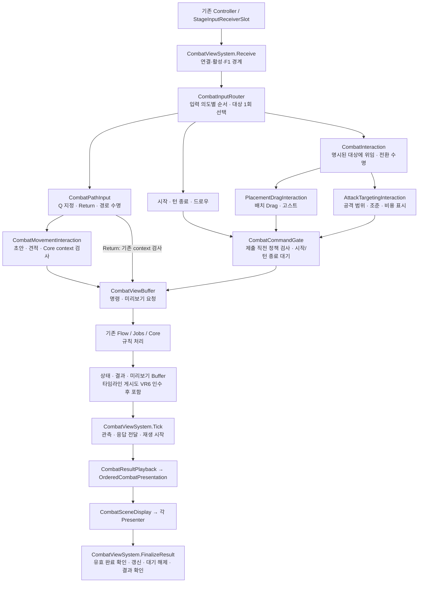
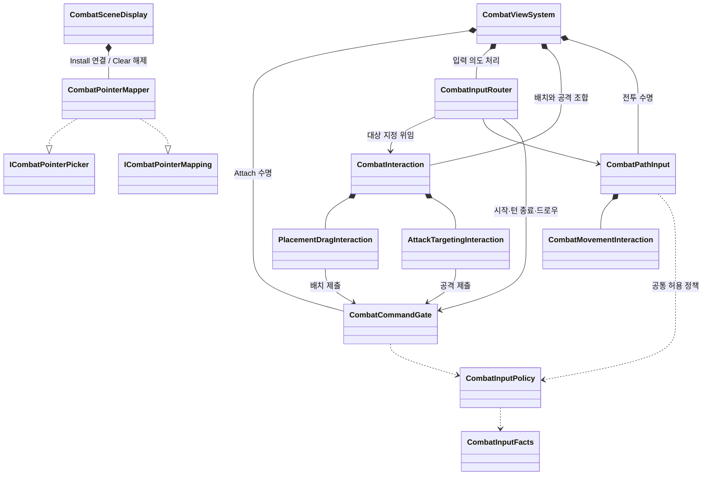

# 전투 View 구조 개선 설계 (VR, 2026-10-06)

- 출발점: [현재 코드 구조 평가](2026-10-06-combat-view-structure-review.md), 기준 HEAD `b23758ac`.
- 기준: [설계 세션 인계 §4](../handoffs/2026-09-30-combat-view-design-session-handoff.md), [View 문서 규칙](../viewDocs/), [후속 보완 계획 §2~3](../plans/2026-10-05-combat-view-maintenance-plan.md)의 SSOT·SOLID·Framework 계약.
- 이 문서는 **목표 설계**다. 아래 타입·메서드의 신규 이름은 구현 예정이며 현재 API가 아니다. 실행 상태와 Task 체크는 [View 계획 §7.39~7.40](../plans/2026-10-01-combat-view-plan.md)에만 기록한다.
- 이번 보완은 허용 조건·취소 순서·표시 소유권·Mapper 수명·타임라인 게시 계약을 명시한다. 현재 코드 UML은 구조 평가 문서에 보존한다.

## 0. 목표와 범위

동작과 외부 계약을 유지하면서 입력 허용 정책, 입력 의도별 처리 순서, 배치/공격 상태, 화면 좌표 변환의 변경 이유를 분리한다. 타임라인 예측은 Core가 게시한 Buffer를 읽는 경계로 바꾸되 Core 계약 인수 이후에만 연결한다.

- View 범위: `ViewSystem/Combat/**`, 필요한 `ViewSystem/StageInput/MovementDraft.cs`, 관련 EditMode 테스트와 문서.
- 제외: Core·Buffer 생산 코드, 골격 Flow·Plan·Job·LifeCycle, FieldCamera, Framework Architecture, 씬·DB 에셋. 외부 변경은 요청 초안과 인수 조건만 준비한다.
- 유지: 키·조작 순서·표시 색·명령 내용, 기존 V1~V4 개선, Core가 승인한 경로만 제출하는 계약. Q로 지정 시작 → 시작 칸 진입 → 마우스 이동으로 경로 편집 → 좌클릭 확정, 우클릭 취소, R 복귀를 보존한다.
- 새 이벤트 버스·DI 컨테이너·입력 등록 체계·서비스·Runner를 만들지 않는다. 인터페이스는 실제 소비자 경계가 필요할 때만 추가한다. 구현체 개수만으로 ISP 적합성을 판정하지 않는다.
- 새 구체 클래스는 원칙적으로 `internal sealed`다. Attach 수명과 전투별 Install 수명을 구분하며 전투 인스턴스를 넘겨 상태를 재사용하지 않는다.
- 클래스 분리 자체를 성능 개선으로 보고하지 않는다. M1은 측정 후 별도 범위다.

## 1. 문제와 개선 근거

| 항목 | 현재 문제 | 개선 근거 |
|---|---|---|
| A | 이동 허용 조건이 ViewSystem·MovementInteraction·PathInput에 분산 | 공통 정책과 대상/수명 검사를 구분한 뒤 중복만 제거 |
| B | 시작/턴 종료 대기를 배치·공격 Interaction이 소유 | Gate 하나로 소유권 이동. 다른 객체 상태를 읽는 것 자체가 DIP 위반은 아님 |
| C | ViewSystem이 입력 종류별 분배·취소 순서까지 담당 | Router에 입력 의도 처리 순서와 대상 선택을 모음 |
| D | 배치 Drag와 공격 조준이 한 클래스에서 변경 | 서로 다른 변경 이유로 분리. 줄 수 자체는 SRP 위반 기준이 아님 |
| E | SceneDisplay가 좌표 변환·Raycast와 Presenter 수명을 함께 담당 | Mapper 추출과 Bind/Clear/Release 계약 명시 |
| F | View가 `ICombatProcessingService.GetTimeline` 직접 호출 | 프로젝트의 Core → Buffer → View 경계 준수. VR6는 외부 인수 필요 |
| G | 필수 의존성 기본값, 매직 넘버, 스타일 차이 | 의존성 누락을 명시적으로 드러내고 읽기 비용 감소. 자동으로 LSP 위반이라 단정하지 않음 |
| H | 입력 사실 주입과 Buffer 직접 읽기가 혼재 | 허용 정책의 사실 수집을 통일하되 경로 context·요청 번호·전투 정체성 검사는 보존 |

## 2. 목표 구조와 세로 UML

### 2.1 입력부터 결과 표시까지

아래는 **실행 흐름**이다. 화살표가 객체 소유권을 의미하지는 않는다. Move/Return은 Core context 검사 경로를 유지하므로 Gate를 모든 명령의 관문으로 만들지 않는다.

표시의 즉시 완료와 지연 완료 모두 기존 Playback 토큰·세대 검사를 거친다. 화살표 순서를 이유로 결과 확인 시점이나 정상 종료 정지 순서를 바꾸지 않는다.

### 2.2 소유권과 좌표 변환

`CombatPathInput`은 Gate나 CombatInteraction을 직접 참조하지 않는다. ViewSystem이 수집한 사실과 대상 판정 결과를 받는다. SceneDisplay는 기존 묶음 계약을 유지하고 좌표 관련 호출만 Mapper에 위임한다.

### 2.3 책임과 상태 소유권

| 객체 | 소유하는 책임·상태 | 맡기지 않는 책임 |
|---|---|---|
| ViewSystem | 씬/전투 수명, 사실 수집, Gate 조립·Resolve·Clear, 결과 소비·Layer 동기화·Completion·F1 | 입력 종류별 처리, 게임 규칙, 예측 계산 |
| Router | 입력 의도 분배와 명령별 처리 순서, 현재 Layer/모드에서 대상 계산 | 모드·pending 원본, 정책 계산, 표시 내용 |
| Gate | 시작/턴 종료 pending 하나, 일반 제출의 최종 정책 검사 | 표시 취소, 모드, 경로 context 검사, 결과 재생 |
| Policy | 상태 없는 공통 허용 판단 | Buffer 접근, 객체 수명·요청 소유권 관리 |
| Interaction 조합 | 배치/공격 객체 조립, 명시된 대상 전달, 전환 시 기존 소유자 정리 | 별도 라우팅 분기, 명령 제출 중복, 게임 규칙 |
| Placement | Drag·선택·고스트·배치 호버와 해당 요청 번호 | 공격 조준·pending |
| Attack | 공격 모드·행위자·범위/조준 응답·공격 호버·기록용 행위자 | 배치·경로·공격 비용 재계산(Core 응답만 사용) |
| PathInput / MovementInteraction | 지정 수명·Return / 초안·견적·승인 context | 배치/공격 모드 원본, Gate 상태 원본 |
| PointerMapper | 카메라·필드/손패 집기 참조, UI Raycast 재사용 데이터 | Presenter 표시·명령 제출 |
| SceneDisplay | Presenter 묶음 조립·수명과 표시 의도 위임 | 좌표 변환 알고리즘 |

### 2.4 SOLID 확인 기준

| 원칙 | 적용 | 완료 확인 |
|---|---|---|
| S | 변경 이유로 분리하고 pending·모드·초안 원본을 하나씩 유지 | 상태와 정리 소유자를 설명할 수 있으며 파일 줄 수만으로 완료 판정하지 않음 |
| O | 새 입력은 입력 계약·Router·해당 기능에, 새 연출은 Presenter 경계에 국한 | 기존 결과 수명과 무관한 수정이 퍼지지 않음. 새 기능을 항상 한 줄로 추가한다는 보장은 하지 않음 |
| L | 반환·예외·취소·완료·해제 계약 보존 | 실제 구현과 대역이 같은 행동 회귀 통과. 모든 메서드에 동일 no-op을 강요하지 않음 |
| I | 기존 Picker/Mapping/Movement 계약 유지 | VR3의 넓은 InteractionFeedback은 잔여 결합으로 명시. 소비자별 변경 이유가 갈리면 분리 검토 |
| D | 사실·좁은 읽기/쓰기 계약으로 연결, VR6에서 Core 직접 조회 제거 | 전역 조회·서비스 등록 추가 없음. Buffer 읽기 자체를 DIP 위반으로 보지 않음 |

## 3. Phase 설계와 구현 조건

| Phase | 범위 | 선행 | 외부 경계 |
|---|---|---|---|
| VR0 | 타임라인 게시 계약 요청 초안 | 없음 | Core·Buffer 담당의 합의/구현 필요. 초안 작성과 전달은 구분 |
| VR1 | Gate 추출, 이동 허용 정책과 수명 검사 정리 | 없음 | View만 |
| VR2 | Router 추출, 명령별 순서와 대상 선택 단일화 | VR1 | View만, 기존 R1 구체화 |
| VR3 | 배치/공격 분리와 표시 소유권 | **VR2** | View만. VR2의 배타적 분배에 의존 |
| VR4 | Mapper 추출·Bind/Clear/Release | 없음 | View만. 다른 Phase와 독립적인 순서로 수행 가능 |
| VR5 | 필수 의존성·상수·스타일 | VR1~VR4 | 공동 파일 최신 변경 확인 |
| VR6 | Buffer 타임라인 소비로 교체 | VR0 계약 합의와 실제 Core 게시 구현 인수 | View에서 Core/Buffer 구현을 대체하지 않음 |
| M1 | 사건별 증분 렌더 | 측정으로 필요성 확인 | 기존 후속 계획 §5·§6 유지 |

각 Phase를 작게 구현하고 영향 회귀를 통과한 뒤 결과를 기록한다. 아래는 구현 계획이며 이번 문서 수정으로 구현 완료를 뜻하지 않는다.

### VR0 — 타임라인 게시 요청

요청 초안의 원본은 이 절이다. 담당자에게 전달할 때는 이 절을 링크하고 실제 API·합의·구현 증거를 별도로 인수한다. 미합의 이름으로 Buffer 필드나 가짜 응답을 만들지 않는다.

| 계약 | 요청·인수 기준 |
|---|---|
| 최초 게시 | 전투 준비/최초 상태가 View에 보일 때 유효 예측 또는 명시적 unavailable을 제공. 설치 첫 프레임 의미 확정 |
| 갱신/무효화 | 턴 전환, 행동 순서에 영향을 주는 명령·자동 진행·상태 변화의 전체 목록을 Core가 정의. 결과 종류만으로 View가 추측하지 않음 |
| 일관성 | 전투 식별자와 기준 상태/결과 버전을 식별할 수 있어야 함. 해당 상태와 일관된 읽기 snapshot으로 게시하고 이전 전투/버전을 섞지 않음 |
| 빈 값 | 예측 불가·미게시와 유효한 빈 목록을 구분. 표시를 비우거나 보류하는 기존 HUD 의미와 대조해 합의. 임의 순서 fallback 없음 |
| 종료/재진입 | EndBattle 뒤 유지/제거 시점과 다음 전투 초기화 책임 확정. 이전 전투 타임라인 표시 금지 |
| 길이/절단 | 현행 `Math.Max(10, count * 4)`와 같은 표시를 제공할 예측 범위·상한·절단 의미를 합의. Core는 계산 한도, View는 게시된 목록의 표시 범위를 담당 |
| 비용 | 무효화 시 계산·재사용·게시 빈도를 명시. Core로 위치를 옮긴 것만으로 계산 횟수가 줄었다고 보지 않음 |
| 제공 증거 | 실제 읽기 타입/필드·등록 경로, 최초/갱신/종료/재진입 테스트, 상태 버전 일치와 계산 횟수 측정 |

View 직접 조회를 없애는 이유와 소비 지점 `ReadDisplayValues`를 전달 메모에 포함한다. 발송은 사용자가 하며 문서 작성은 담당자 합의를 의미하지 않는다.

### VR1 — Gate와 이동 허용 조건

**Gate 수명:** ViewSystem이 Attach 때 만들고 Interaction에 주입한다. VR2에서 기본 명령 제출을 Router로, VR3에서 배치/공격 제출을 하위 객체로 옮긴다. pending 원본은 Gate 하나다. `TrySubmit`, `SubmitPending`, `Resolve`, `Clear`는 예정 API다.

- 일반 명령 성공으로 pending을 만들지 않는다. 시작/턴 종료 Submit이 유효 번호를 반환하면 pending을 먼저 기록하고 표시 정리는 호출자가 수행한다.
- 결과를 그린 뒤 `Command && 번호 일치`인 경우에만 수락/거절 모두 Resolve한다. 다른 번호·자동 진행은 유지한다.
- `StopInput`·Detach에서는 Clear한다. **정상 종료의 `SuspendSubmissions`는 pending을 Clear하거나 Playback을 Abort하지 않는다.** 마지막 결과 확인을 보존한다.
- 호환 속성이 필요하면 Gate 값에 위임만 한다. 테스트 편의로 두 번째 상태나 제출 구현을 남기지 않는다.

**허용 조건 보존표:** 공통 정책, 입력 대상, 수명·정체성은 서로 다른 책임이다. `AllowsPathInput`을 지우기 전에 아래 항목의 이전 경로를 모두 연결한다.

| 현재 조건 | 새 소유자/판정 | 적용 입구 |
|---|---|---|
| `_isInputBound && !_faults.IsFaulted && _entry.IsActive` | ViewSystem이 현재 입력 가용 사실 제공. Receive와 PathInput이 같은 사실 사용 | 외부 입력, Tick 응답/Return 갱신, 제출 직전 |
| `IsMoveMode` 및 실제 Combat Layer | Router의 단일 대상 판정 결과. PathInput은 자신이 대상인지 확인 | 포인터, Q/R, Tick 응답/Return 갱신 |
| `!HasPendingPresentation` | 기존 display 존재·HasBattle·Playback busy·S/P 의미를 보존한 사실 | 경로 편집/견적/제출 |
| `!HasPendingCommand` | Gate → Facts → Policy | 경로 입력·개발 패널·일반 제출 |
| 미처리 명령 없음 | 필요한 경우 `ReadFacts(includeUnhandledCommand: true)`로 읽고 Policy 평가 | 경로 허용 및 기존 EndTurn 검사 |
| 기존 `CanSubmit(..., Move)` | Policy의 기존 공통·실제 Layer·실행 모드 조건 | `CanEditPath` 공통 부분 |
| 전투·행위자·요청 번호·Core context 일치 | PathInput/MovementInteraction의 기존 수명·정체성 검사 | 응답 반영과 실제 명령 제출 |

`CanEditPath(facts)`의 공통 부분은 기존 `CanSubmit(Move) && !IsPresenting && !HasUnhandledCommand`다. **이 식만으로 입력을 허용하지 않는다.** PathInput 입구는 최신 입력 가용성·대상·전투 일치까지 확인한 뒤 호출한다. 모드는 facts에 관측값으로 전달하며 Router 외에 대상 판정식을 복제하지 않는다. VR1에서는 기존 모드 판정 공급을 유지하고 VR2에서 공급원만 Router로 바꾼다.

- `CombatInputFacts`는 판단 시점의 일시적 snapshot이다. pending·presenting·필요한 queue 정보와 입력 가용/대상 정보를 수집하되 원본을 별도 보관하지 않는다.
- `ReadFacts(includeUnhandledCommand)`는 이미 있는 인자다. 경로 판단에서도 필요한 값이 채워지도록 사용 범위를 늘린다.
- PathInput은 사실 공급자를 한 번 주입받는다. MovementInteraction에 전달하는 `allowed`는 매 호출에 새로 평가하며 Q/Begin 때의 값을 저장하지 않는다.
- Tick의 `OnPreview`·`RefreshReturnPreview`는 Receive를 거치지 않으므로 독립적으로 같은 가용성·대상 검사를 실행한다. 공격 중 Return 미리보기가 공격 요청을 덮어쓰지 않아야 한다.
- 외부 표시/취소 콜백 후 재진입이 가능하면 세대·연결을 재검사하고 facts를 다시 읽거나 처리를 중단한다. Gate의 pending만 최신으로 읽는 것으로 충분하지 않다. 최종 Submit 직전에는 최신 facts와 Gate 상태를 검사한다.
- 중간 외부 호출이 없는 한 번의 판단에는 같은 snapshot을 쓴다. 불필요한 queue 중복 조회·입력별 delegate 할당을 추가하지 않는다.
- RecordInputOnly의 기존 CanSubmit/CanPreview 예외를 유지한다. 경로의 기존 연출/queue/수명 제한은 유지하며 Core 이동 context를 View가 꾸미지 않는다. CanPreview를 CanSubmit과 동일 조건으로 바꾸지 않는다.

**확인:** Policy 표 테스트, Gate 일치/불일치/거절/중복 제출, 외부 콜백 재진입, Tick 중 공격 모드·Unbind·비활성·오류·미처리 명령, 정상 종료 pending 유지, 늦은 경로 응답. 기존 이동 회귀의 사용자 동작 기대값은 보존한다.

### VR2 — 입력 의도 분배와 순서

Router는 **누구에게 보낼지와 입력 의도별 처리 순서**를 담당한다. 기본 명령 데이터 생성과 Gate 제출도 이 책임에 포함한다. 게임 규칙·pending·모드를 소유하지 않는다. ViewSystem에는 Receive의 F1·연결 검사, ReadFacts, 결과/Layer/Completion 수명이 남는다.

대상 판정은 `ResolvePointerTarget` 한 곳이다. 유효한 실제 Layer를 먼저 확인하고 Deployment는 Placement, Combat은 공격 모드이면 Attack, 그 외에는 Path다. 지원하지 않는 Layer는 None이다. 모드 None에서도 Combat 포인터는 Path로 가는 기존 동작을 보존한다. **예외(2026-10-06 사용자 결정, View 계획 §7.48):** RecordInputOnly의 Combat 포인터는 모드와 관계없이 Attack이다. 기록 모드는 Core 행위자·이동 응답이 없어 경로 지정이 시작되지 않고(W20), 공격 전 클릭으로 기록용 행위자를 골라야 한다(§8.1). 중립 호버 같은 표시만의 기존 동작은 배치/공격 소유자가 담당한다. 정리 요청은 대상 None이어도 실행할 수 있다.

| 입력 | 보존할 순서와 거절 의미 |
|---|---|
| EnterCombat | Gate 제출 시도 → 성공 시 pending 기록 → Interaction 표시 정리. 거절 시 추가 정리 없음. Path 취소를 임의로 추가하지 않음 |
| EndTurn | **PathInput.CancelInputs → Gate 제출 시도** → 성공 시 pending 기록 후 Interaction 표시 정리. 거절되어도 경로 취소는 이미 수행됨 |
| Draw | 일반 Gate 제출만. pending 생성·일괄 표시 취소 없음 |
| Q | 기존 Interaction 표시 정리 → 새 가용 사실 확인 → PathInput.BeginPlanning |
| E | PathInput.CancelInputs → 최신 사실로 Attack 진입 시도. 진입 거절 시 기존 공격 처리 의미 보존 |
| FocusLost / SelectCanceled | 경로 정리 → Interaction 표시 정리. 명령 생성 없음 |
| Cancel | Interaction 취소 → PathInput 취소. 명령 생성 없음 |
| R | 최신 경로 가용성·대상·context 검사 → 기존 Return 경로 |

내부 `EnterCombatRequested`·`EndTurnRequested`·`DrawRequested` 테스트는 Router/Gate 테스트로 옮긴다. 호환을 이유로 제출·정리 로직을 양쪽에 남기지 않는다. 내부 API 이동은 허용하되 실제 동작 기대값을 바꿔 통과시키지 않는다.

**확인:** Layer × 모드 × 요청 표, 입력별 성공/거절/중복 요청의 순서 기록, Router 예외의 F1 1회 보고, RecordInputOnly, 정상 종료·Unbind 취소 재진입. 입력별 새 클로저를 만들지 않는다.

### VR3 — 배치/공격 분리와 미리보기 소유권

VR2의 단일 대상 판정을 사용한다. Router → Interaction의 명시적 대상 위임 → Placement 또는 Attack을 **유일한 포인터 전달 경로**로 정한다. Router가 하위 객체를 직접 호출하면서 facade도 다시 판단하는 이중 경로를 만들지 않는다.

- Placement는 Drag·고스트·원본 숨김·배치 호버/요청을, Attack은 모드·행위자·Core 범위/조준/AP 응답·공격 호버/요청을 갖는다. 비용·유효 경로 규칙은 계산하지 않는다.
- Gate는 ViewSystem이 생성하고 하위 객체에 전달한다. 하위 객체는 Resolve/Clear하지 않는다.
- 모드/Layer 전환: **기존 소유자의 요청 번호 무효화·표시 정리 → 전환 → 새 소유자의 요청/표시** 순서다. 활성 여부는 기존 모드/Drag/지정 수명에서 도출하며 별도 전역 모드를 만들지 않는다.
- inactive 객체의 Cancel/AfterResult가 새 소유자의 ClearHover/ClearPreview를 호출하지 않아야 한다. Buffer의 최신 요청이 자신의 번호인지 확인하고, 자기 표시를 소유한 동안에만 비운다. 전체 종료 정리는 새 소유자를 활성화하지 않는 별도 경로다.
- 늦은 PreviewAnswered는 전투·행위자·요청 번호·현재 대상 일치 확인 후만 적용한다. AfterResult도 활성 소유자에 필요한 재요청만 한다. Path/Return과 배치/공격 사이에서도 같은 원칙을 적용한다.
- 기존 내부 포인터 API의 테스트 호출부는 명시적 대상 위임 경로로 옮긴다. 이전 메서드를 임시로 남기더라도 같은 단일 분배 경로를 사용하고 별도 switch/정리 로직을 두지 않는다.

`ICombatInteractionFeedback`의 14개 메서드는 이번 분리에서 유지한다. 변경 범위를 수명/분배에 집중하기 위한 선택이며 **ISP를 완전히 달성한 상태는 아니다.** 배치와 공격에 필요한 멤버가 다르므로 잔여 결합이 있다. 독립적인 피드백 변경, 불필요한 테스트 대역 구현, 묶음 전달 확장이 발생하면 소비자별 계약으로 분리한다. 구현체 개수가 적다는 것은 분리를 금지할 근거가 아니다.

**확인:** 배치/공격 전환·늦은 응답·AfterResult·inactive Cancel·요청 번호 교체·재진입 정리 사례. 기존 Interaction 테스트를 책임별로 이동하고 같은 행동의 중복 테스트는 피한다. 파일 크기는 참고 지표다.

### VR4 — PointerMapper 수명

`TryGetRay`, `TryPickCell`, `TryPickHandUnit`, `IsOverHandDropZone`, `TryMapPointer`, `InnerCellInset`과 UI Raycast 재사용 데이터를 Mapper로 옮긴다. SceneDisplay는 기존 Picker/Mapping 계약을 위임한다. 소비자의 공개 계약과 V1 캐시·V4b 사건 Presenter 연결 계약을 유지한다.

| 상태/전이 | 계약 |
|---|---|
| 생성 / Unbound | 카메라·Field mapper가 아직 유효하지 않을 수 있음. Try 계열은 false. 생성 시 null mapper를 캡처하지 않음 |
| Install / Bind | Field.Build 성공 뒤 이번 설치의 유효 mapper를 연결. 사건 Presenter도 현재 mapper를 사용 |
| Clear | 전투 참조·UI 재사용 참조 해제, 사건 Presenter Unbind. 객체는 다음 Install 허용 |
| 부분 설치 실패 | 연결됐던 대상까지 Unbind/Clear. 남은 정리를 계속하고 기존 오류 집계 의미 보존 |
| Release | 최종 해제. EventSystem·PointerEventData·Raycast 결과·카메라·필드/손패 참조 해제. 재설치로 되살리지 않음 |

EventSystem 교체와 카메라 변경 시 V1의 캐시 갱신 동작을 보존한다. UI 메서드의 released guard가 내부 HUD 구독 해제나 `BindReturn(null)` 같은 정리 콜백까지 생략하게 만들지 않는다. 외부 늦은 표시 호출의 no-op, Try의 false, 연결 전 사건 시작의 계약 위반은 서로 구분한다. LSP는 동일 행동 계약 준수이며 모든 메서드의 동일 no-op이 아니다.

**확인:** 생성 전 호출·Install·Clear/재설치·부분 실패·Release·이중 해제, EventSystem/카메라 교체, 해제 중 재진입과 나머지 정리 지속. 기존 PointerMapping·SceneEventPresenter·DisplayReuse 회귀 및 Unity 실제 Drag/Playback/Return을 유지한다.

### VR5 — 의존성·상수·스타일

- 필수 `ITraitVisualTableQuery`의 기본값을 제거하고 호출부가 실제/명시적 빈 테이블을 제공하도록 한다.
- `CombatDisplayValues.timeline` 선택 인자는 VR6 계약 확정 전 유지한다. null을 숨긴 임의 fallback으로 바꾸지 않고 운영 제공 여부를 검증한다.
- `stageKey = 0`의 선택 없음 의미는 유지한다. 타임라인 길이 숫자는 VR6 전 이름 있는 상수로 정리하고 VR6에서 합의된 예측 범위 계약으로 대체한다.
- 이동 파일·ViewSystem의 스타일은 기능 diff와 분리한다. Allman·멤버 간격 등 프로젝트 기준을 따른다. 이 작업에서 커밋·push·타 작업자 메시지를 자동 실행하지 않는다.
- 공동 파일 변경을 먼저 확인한다. 형식 정리만 한 파일에 새 행동 테스트를 만들지 않고 의미 변경 없음과 영향 컴파일을 확인한다.

### VR6 — Buffer 타임라인 소비

VR0의 계약과 실제 게시 구현을 인수한 뒤 `ReadDisplayValues`를 교체한다. `_combatQueries`, `PostBindService`의 `CoreGroup.Combat` 조회, Core 네임스페이스 using을 제거한다. HUD 표시 계약과 표시 개수는 합의 없이 바꾸지 않는다.

**확인:** 최초 표시·순서 변경·거절/자동 진행·빈/미게시·같은 버전 반복·EndBattle·재진입·길이 절단 사례, 상태/타임라인 버전 일치, FrameworkRuntimeCompositionTests. View 직접 호출 제거와 전체 예측 계산 횟수/할당 감소 여부는 별개로 기록한다.

## 4. 확장 시 변경 범위와 성능 기준

| 확장 | 주 변경 지점 | 확인할 경계 |
|---|---|---|
| 스킬 입력 | 입력 계약·Controller·Router·해당 Interaction·Policy | 기존 배치/공격/경로와 결과 수명을 불필요하게 수정하지 않음. 단일 pending 적용 여부는 별도 계약 |
| 공격 범위 회전 | Attack과 필요한 입력/피드백 계약 | 배치 Drag에 영향 없음, Core 조준 계약 준수 |
| 기믹 연출 중 이동 차단 | 사실 공급과 Policy | 수명/대상/요청 일치 검사는 제거하지 않음 |
| 터치 좌표 보정 | Mapper 및 필요한 입력 어댑터 | 화면/UI 가림·필드/손패 좌표와 카메라 교체 회귀 |
| 타임라인 확대 | Core 예측 범위 계약과 HUD 표시 범위 | 게시 길이를 넘는 예측을 View가 만들지 않음 |

확장성은 수정 파일 수보다 변경 이유에 맞는 경계와 회귀 범위로 평가한다. 현재 남는 결합은 넓은 InteractionFeedback, 조립용 Display 묶음, Router의 명시적 분기다. 실제 확장 요구 없이 등록 체계로 바꾸지 않는다.

성능은 미측정이다. VR1에서는 Tick/포인터당 facts·queue 조회 횟수와 할당, VR4에서는 Raycast 횟수와 재사용, VR6에서는 계산/게시 빈도와 예측 할당을 전후 비교한다. 같은 씬·유닛 수·입력 시나리오·워밍업 조건을 사용한다. 새 클래스/조립 객체는 수명 시작에 생성하고 입력별 불필요한 할당을 만들지 않는다. 비용 순위나 FPS 개선을 코드 읽기만으로 확정하지 않는다.

## 5. 완료 기준과 문서 연결

1. Phase별 변경 파일·유지 계약·영향 회귀는 View 계획 §7.40에서 추적한다. 기존 V1~V4 완료와 Unity 미검증 항목을 VR 완료로 덮어쓰지 않는다.
2. 내부 타입 이동에 따른 테스트 조립 수정은 허용한다. 사용자 동작·취소·오류·결과 확인 기대값을 완화해 성공 처리하지 않는다.
3. 영향 어셈블리 컴파일과 의미 있는 관리 코드 회귀를 우선 실행하고, Unity가 필요한 UI/씬 검증은 별도 결과로 남긴다. 컴파일 성공은 Unity 재생 성공이 아니다.
4. 코드 변경과 제안 UML을 구분한다. 실제 구현 뒤에만 현재 코드 UML을 갱신한다.
5. Core 요청 초안 작성, 전달, 합의, 코드 인수는 별도 단계다. 문서에 계약을 적었다고 외부 구현이 준비된 것으로 처리하지 않는다.
