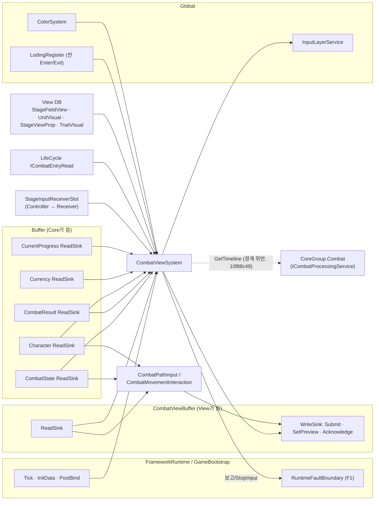
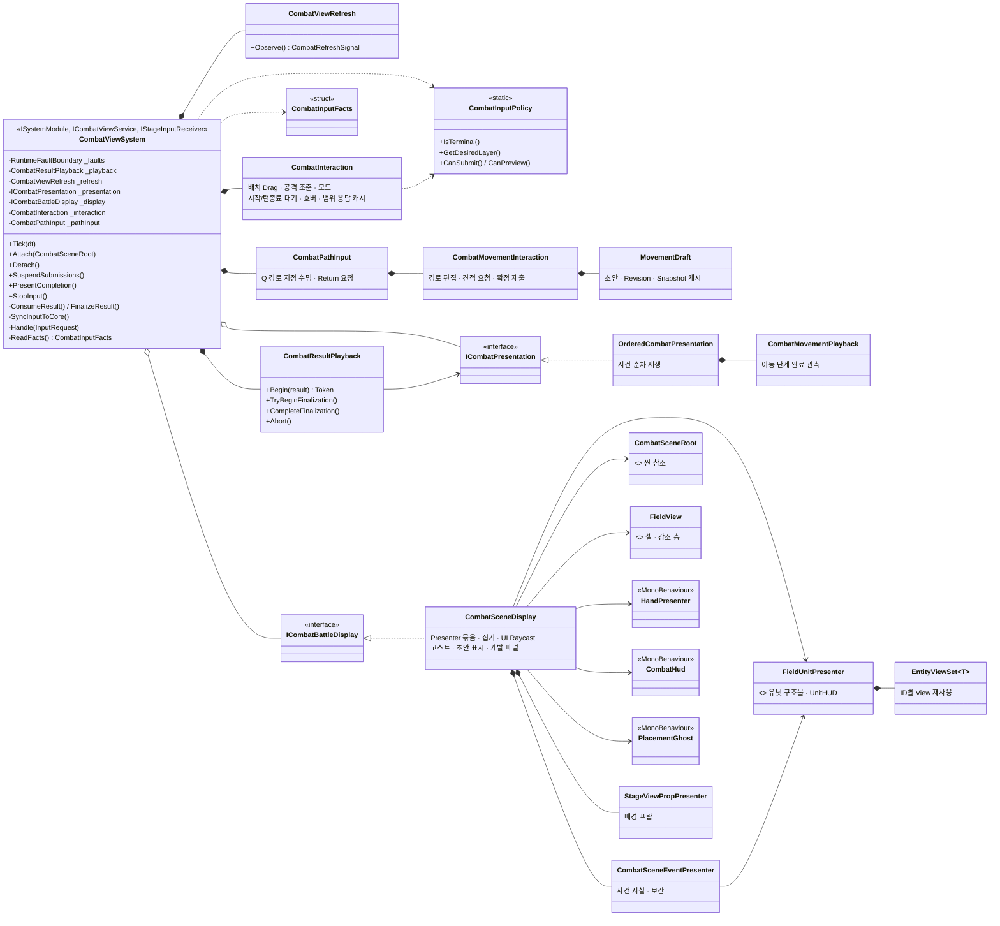
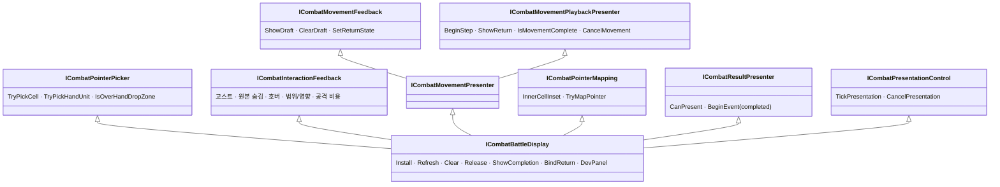
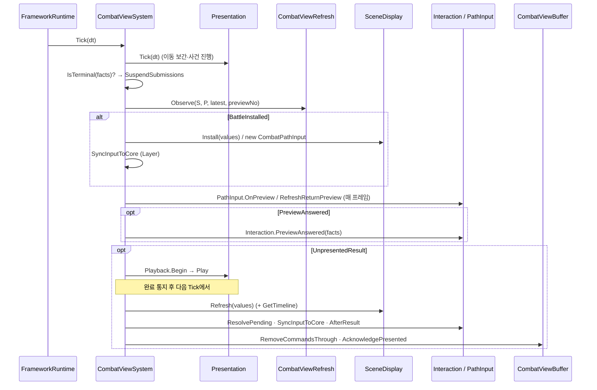

# 전투 View 구조 UML과 평가 (2026-10-06)

- 기준: `feature/Yonggeun/Stage` HEAD `b23758ac`(eae4a64 병합 `bf045646` 이후). 코드를 읽어 정리했고 실행·측정은 하지 않았다.
- 범위: 사용자(Droute)가 커밋한 전투 View 코드. `ViewSystem/Combat/**`(43개), 전투가 쓰는 `ViewSystem/StageInput/**`, 주변 연결(`Boot/GameBootstrap`, `Dev/DevBattleInitializationSource`, `RuntimeSystem/Common/RuntimeFaultBoundary`, `InGameViewSystemFactory`).
- 같은 파일 안에 다른 작업자가 더한 부분이 있다. 현강님 `10f88c49`(HUD·타임라인: `_combatQueries`·`GetTimeline`·`UnitHUD`·`SetHudTimeline`·공격 비용 HUD), 천명님 이동 개편(`87348b86`). 평가에는 포함하되 출처를 표시한다.
- 현재 상태의 기록 원본은 View 계획 §7이다. 이 문서는 구조 평가이며 결정·구현 완료를 뜻하지 않는다.
- 재검토에서 발견한 조건 누락·전환 순서·수명 계약 문제는 [구조 개선 설계](2026-10-06-combat-view-refactor-design.md)에 반영했다. 아래 UML은 현재 코드 기준이며 목표 구조와 구분한다.

## 1. 한눈에 보기

| 축 | 평가 | 한 줄 요약 |
|---|---|---|
| 책임 경계 | **보통** | 재생·신호·정책·초안·표시 Presenter는 잘 나뉨. `CombatViewSystem`(895줄)·`CombatInteraction`(828줄)·`CombatSceneDisplay`(475줄)에 책임이 몰림 |
| 외부 경계 | **보통(1건 위반)** | Buffer 읽기·CombatViewBuffer 쓰기·오류 경계는 일관됨. **View가 Core 서비스를 직접 호출**(타임라인), 입력 허용 규칙이 Policy 밖 2곳에 중복 |
| 유지보수성 | **보통** | 한국어 주석·설계 참조·테스트가 충실. 이동 입력 파일의 코드 스타일 불일치, 필수 의존성의 선택 인자화, 큰 파일 |
| 확장성 | **양호(연출) / 보통(입력)** | 연출은 `ICombatResultPresenter` 교체로 확장 가능. 새 입력 종류는 enum·switch·Interaction·Policy 4~5곳 수정 |
| 성능 | **측정 전 판단 보류** | V1~V3에 재사용·중복 표시 억제 경로가 있음. 결과마다 Core 예측 계산·전체 유닛 갱신이 남음. 이번 평가의 런타임 측정치 없음 |

## 2. UML

### 2.1 외부 경계 (컴포넌트)

### 2.2 클래스 구조

### 2.3 표시 계약의 조합 (V4a 이후)

소비자별로 받는 계약: `CombatInteraction` ← Picker·InteractionFeedback, `CombatPathInput` ← PointerMapping·MovementFeedback, `OrderedCombatPresentation` ← MovementPlaybackPresenter·ResultPresenter·PresentationControl, `CombatViewSystem` ← 전체 묶음.

### 2.4 Tick 순서

## 3. 평가

### 3.1 책임 경계 (한 객체에 많은 책임이 있는가)

**잘 된 점**

- 결과 수명은 `CombatResultPlayback` 하나만 소유하고(세대·토큰·후처리), `CombatViewRefresh`는 신호만 만들며 그리지 않는다. 같은 완료 번호를 두 곳에 두지 않는다(SSOT).
- `CombatInputPolicy`는 상태 없는 정적 판단이라 테스트가 쉽고 재사용된다.
- 경로 초안(`MovementDraft`) → 편집·견적(`CombatMovementInteraction`) → 수명·표시 중복 억제(`CombatPathInput`)로 이동 입력이 계층화돼 있다.
- 표시 쪽은 Presenter(필드·유닛·손패·HUD·고스트·프랍)로 나뉘고, 사건 사실·보간은 `CombatSceneEventPresenter`로 뽑혔다(V4b). `EntityViewSet`이 대여·반환만 맡는다.

**책임이 몰린 곳**

| 클래스 | 크기 | 맡은 일 | 판단 |
|---|---|---|---|
| `CombatViewSystem` | 895줄, 의존 필드 약 20개 | Framework 모듈 수명, 씬 Attach/Detach, 결과 소비·후처리, Layer 동기화, **두 입력 객체로의 분배**(`Handle`·`IsMoveMode`·`AllowsPathInput`), Completion 표시, 개발 패널, 타임라인 조회 | 조정자로서 순서 결정은 맞는 자리. 그러나 입력 분배와 이동 입력 허용 판단이 섞이며 커지는 중. 다음 입력 기능부터 **입력 분배 객체(R1)** 분리가 필요 |
| `CombatInteraction` | 828줄, 5개 region | 배치 Drag, 공격 조준(Cell/Direction/All), 모드, 시작/턴 종료 대기, 호버, 범위 응답 캐시, AP 판정 | 배치와 공격은 변경 이유가 다르다. `PlacementDrag`·`AttackTargeting`으로 나누고 대기(`PendingInputCommand`)만 공유하는 구성이 적합 |
| `CombatSceneDisplay` | 475줄, 계약 6개 구현 | Presenter 수명, 카메라 Ray 집기, UI Raycast, 고스트, 이동 초안, HUD 비용 미리보기, 개발 패널, 사건 위임 | 대부분 위임이라 실질 로직은 적다. 집기·포인터 매핑(`TryGetRay`·`TryMapPointer`·UI Raycast)은 별도 `CombatPointerMapper`로 뽑을 만하다 |

**대상 판정과 지정 수명의 구분**: 공격 모드는 `CombatInteraction.Mode`, 이동 경로 지정 수명은 `CombatPathInput`이 가진다. 서로 다른 상태이므로 그 자체가 SSOT 위반은 아니다. 라우팅은 `IsMoveMode => Mode != Attack`(`CombatViewSystem.cs:79`)이어서 **모드가 None일 때도 Combat Layer의 포인터는 경로 입력으로 간다**. 개선 대상은 이 대상 판정의 분산과 암묵성이다. 별도 전역 모드를 만들어 기존 상태를 복제하지 않는다. 클래스 줄 수도 SRP 위반의 단독 근거가 아니다.

### 3.2 외부 경계

**지켜지는 것**

- 타임라인 직접 조회를 제외한 Core 출력은 Buffer ReadSink로 읽고, View가 쓰는 곳은 `CombatViewBuffer`뿐이다(명령·미리보기 요청·확인). 입력 Buffer 전체 비우기는 LifeCycle 몫으로 남겼다.
- 배경 프랍 키는 Core가 게시한 Current 선택에서 읽고 InGame DB를 읽지 않는다(P6). 공격 지정 방식도 Core 응답(`AttackAims`)으로 판단한다.
- Unity 콜백(입력·비활성화·Completion 버튼) 예외는 모두 `RuntimeFaultBoundary.Report`로 모인다. 씬 탐색은 `OnCombatSceneEntered`에서 한 번뿐이다.
- 진입·활성화는 `ICombatEntryRead.IsActive`만 읽고 준비를 중복하지 않는다.

**문제**

1. **View → Core 서비스 직접 호출** (`CombatViewSystem.cs:155`, `:559`, 출처 `10f88c49`). `PostBindService`에서 `InGame.CoreGroup.Combat`을 잡아 `ReadDisplayValues`마다 `GetTimeline`을 부른다. "View는 Buffer로만 규칙 값을 받는다"(P6, 데이터 흐름 원칙)와 어긋나고, View가 `CoreSystem.CombatSystem` 네임스페이스에 의존한다. 타임라인 예측은 Core가 Buffer에 게시하고 View는 읽기만 하는 형태가 맞다(Core 요청 사항).
2. **입력 허용 규칙의 중복**. 설계는 "입력 허용 조건은 Policy 한 곳"이라고 하지만, 이동 경로는
   - `CombatViewSystem.AllowsPathInput`(`:851`): 연출 대기·로컬 대기·미처리 명령·`CanSubmit`
   - `CombatMovementInteraction.PresentationAllowsInput`(`:201`): P ≥ S, 미처리 명령
   - `CombatPathInput.AllowsInput`(`:48`): 전투 인스턴스 일치 + 위 함수

   공통 조건은 한 곳으로 모으되 세 검사를 통째로 합치면 안 된다. `AllowsPathInput`의 연결·오류·활성·모드 조건과 PathInput의 전투 일치 조건도 보존해야 한다. 특히 Tick 응답/Return 갱신은 Receive를 거치지 않는다. 구체적인 이전 표는 개선 설계 VR1에 있다.
3. **경계 스타일 불일치**. `CombatInteraction`은 ViewSystem이 만든 `CombatInputFacts`를 받는 반면, `CombatPathInput`·`CombatMovementInteraction`은 Buffer ReadSink를 직접 붙잡고 읽는다. 읽기 계약에 의존하는 것 자체는 DIP 위반이 아니다. 공통 정책의 사실 수집은 통일하되 경로 context·요청 번호·전투 정체성 검사는 남겨야 한다.

### 3.3 유지보수성

**좋은 점**: 거의 모든 public/internal 멤버에 한국어 XML 주석과 설계 절 참조가 있다. 테스트가 넓다(`CombatInteractionTests`, `CombatViewSystemTests`, `CombatInputPolicyTests`, `CombatResultPlaybackTests`, `CombatViewRefreshTests`, `CombatMovementFeedbackTests`, `CombatSceneEventPresenterTests`, `CombatPointerMappingTests`, `CombatDisplayReuseTests`, `MovementDraftTests` 등). 정리 경로가 `errors` 집계로 일관된다.

**개선할 점**

- **코드 스타일 불일치**: `CombatPathInput`·`CombatMovementInteraction`·`CombatViewSystem` 일부(`:221`, `:331`, `:375`, `:849~857`)는 한 줄 여러 문장, 중괄호 없는 블록, 빈 줄 없는 멤버 나열이라 프로젝트 규칙(Allman, 멤버 구분)과 다르다. 이동 개편 병합에서 들어온 형태로 보인다. 같은 폴더 안에서 읽기 비용 차이가 크다.
- **필수 의존성의 선택 인자화**: `CombatSceneDisplay(..., ITraitVisualTableQuery traitVisuals = null)`은 필수 제공 여부를 호출부에서 드러낼 필요가 있다. `CombatDisplayValues`의 `timeline = null`은 미게시/빈 값 계약과 대조하고, `stageKey = 0`은 선택 없음 의미를 보존한다. 모든 선택 인자를 일괄 제거하지 않는다.
- **매직 넘버**: `GetTimeline(Math.Max(10, count * 4))`(`:559`).
- **해제 후 호출 방어 불일치**: `CombatSceneDisplay`의 대부분 메서드는 `_isReleased`를 확인하지만 `ShowDraft`·`ClearDraft`(`:418~439`)는 확인하지 않는다.
- **파일 크기**: 800줄대 두 파일은 리뷰·충돌 비용이 크다(이번 eae4a64 병합 충돌 3건 모두 이 묶음에서 발생).

### 3.4 확장성

| 확장 | 바꿔야 할 곳 | 판단 |
|---|---|---|
| 비이동 연출(공격 이펙트·피격·사망) | `ICombatResultPresenter.BeginEvent`의 완료 콜백을 연출 끝에 호출. 순서·확인은 `OrderedCombatPresentation`·Playback이 유지 | **양호**. 입력·결과 확인 수정 없음. 단 `CanPresent` 목록과 `BeginEvent`의 타입 분기가 한 클래스에 고정돼 있어, 연출이 늘면 사건 종류별 Presenter 분배가 필요 |
| 새 표시 요소(타일 효과·지형) | Presenter 추가 + `CombatSceneDisplay` 연결 + 필요하면 `ICombatBattleDisplay` 확장 | 보통. 묶음 계약과 `CombatSceneDisplay`가 같이 커진다 |
| 새 입력(스킬·아이템 사용 등) | `InputRequest` enum, `Handle` switch, `IStageInputReceiver`, Controller, `CombatInteraction` 또는 새 객체, `CombatInputPolicy` | **약함**. 4~6곳을 함께 고쳐야 한다. 입력 분배 객체(R1)와 모드 소유자 단일화가 먼저 필요 |
| 스테이지별 배경 | `StageViewProp` 데이터만 추가 | 양호(데이터 주도) |
| 운영 DB 전투(T1/G7) | View 변경 없음 | 양호 |

### 3.5 성능

다음은 정적 코드에서 확인한 호출·생성 경로다. 이번 평가에서는 실행·프로파일링하지 않았으므로 현재 규모의 성능 적합성, 병목 순위, 무시 가능한 비용을 확정하지 않는다(계획 §8 X4). 기존 V1~V3의 국소 검증 증거와 전체 프레임 비용을 구분한다.

| 빈도 | 경로 | 비용 | 판단 |
|---|---|---|---|
| 매 프레임 | `Observe`, `IsTerminal(ReadFacts())`, `PathInput.OnPreview`·`RefreshReturnPreview` | 값 비교·사실 수집. Draft 표시 캐시(V3)로 동일 표시 생략 | facts·queue 조회 횟수와 할당 측정 필요 |
| 포인터 이동 | `AllowsPathInput`, `TryMapPointer`의 UI `RaycastAll`, 평면 Ray 계산 | V1 이벤트 데이터 재사용은 있으나 Raycast 비용은 남음 | UI 규모별 호출 횟수·CPU 측정 필요. 최대 병목이라고 단정하지 않음 |
| 미리보기 응답 | `AttackAims`·`RangeCells`·`AffectedCells`의 `ToArray`, `SamePath` 비교 | 응답 크기·빈도에 따른 복사·열거 비용 | 총 할당과 빈도 측정 전 허용 여부 미판정 |
| 결과 1건 | `Refresh` → **`GetTimeline` 예측·배열 생성**, `RenderFacts`, `HandPresenter.Render` | 전체 개체 갱신 + 예측 비용 | Buffer 게시 이전만으로 비용 감소 보장 없음. 무효화·캐시·게시 빈도와 전후 계산 횟수 확인 필요 |
| 사건 1건 | `BeginEvent` → `RenderEvents` 전체 순회 | 사건 수 × 유닛 수 | 규모가 커지면 변경 개체만 갱신(M1) |
| 정리 | `RunAll(params Action[])` 배열·람다 할당 | 입력 반복 경로와 빈도가 다름 | 실제 정리 빈도와 할당 측정 후 필요성 판단 |

## 4. 개선 권고 (우선순위)

| 순위 | 항목 | 이유 | 담당·범위 |
|---|---|---|---|
| 1 | 타임라인을 Core가 Buffer에 게시하고 View는 읽기만 | 외부 경계 위반 해소. 계산 빈도 개선은 별도 검증 | 개선 설계 VR0의 게시 계약 요청 초안 + VR6 소비자 교체. 외부 합의·구현 인수 필요 |
| 2 | 이동 입력 허용 조건을 `CombatInputPolicy`로 모으기 | `AllowsPathInput`·`PresentationAllowsInput`·`AllowsInput` 중복 제거(SSOT) | View 내부. 기존 이동 회귀 테스트로 검증 |
| 3 | 입력 분배 객체(R1)와 대상 판정 단일화 | `Handle`·`IsMoveMode`의 암묵적 라우팅 정리, 명령별 성공/거절 취소 순서 보존 | View 내부. 공개 계약(`IStageInputReceiver`) 유지 |
| 4 | `CombatInteraction`을 배치 Drag / 공격 조준으로 분리 | 828줄, 변경 이유 2개 | View 내부. 대기(`PendingInputCommand`)는 공유 하나 |
| 5 | `CombatSceneDisplay`에서 포인터 매핑·집기 분리, `ShowDraft`류 해제 방어 명시 | 좌표 처리 책임 분리. 묶음 계약은 유지하며 메서드별 행동 계약 준수 | View 내부 |
| 6 | 이동 입력 파일 스타일 정리, 선택 인자로 숨은 필수 의존성 명시 | 가독성·조용한 기능 누락 방지 | 다른 작업자 코드와 겹치므로 병합 시점 조율 |
| 7 | 측정 후 사건별 증분 렌더(M1) | 규모 확장 시 | 계획 §8 X4 조건 충족 때 |

1번은 Core·다른 작업자 영역에 닿으므로 실제 계약 합의와 구현 인수가 필요하다. 2~5번은 개선 설계 VR1~VR4에서 구체화한다. 문서 보완과 생산 코드 구현은 별개다.

## 5. 개선안 재검토에서 보완한 사항

- VR1: 공통 정책만 합치다가 빠질 수 있는 연결·활성·오류·모드·전투 일치를 보존한다. Tick 경로와 재진입 후 제출 직전도 최신 사실을 확인한다.
- VR2: Router는 대상 선택과 입력 의도별 순서 조정자다. EndTurn 거절 시에도 경로를 먼저 취소하는 현재 동작을 유지한다.
- VR3: VR2 이후 진행한다. 단일 전달 경로와 기존 표시 소유자 정리 → 새 소유자 활성 순서로 늦은 응답·inactive Cancel의 덮어쓰기를 막는다. 넓은 피드백 계약의 ISP 한계는 남는다.
- VR4: 생성/Bind/Clear/부분 실패/Release를 구분하고 최종 해제 guard로 내부 정리를 건너뛰지 않는다. LSP는 각 메서드의 행동 계약으로 확인한다.
- VR0/VR6: 최초 게시·무효화·전투/상태 버전·빈 값·종료/재진입·예측 범위·게시 빈도까지 인수한다. Core 이동과 성능 향상을 같은 것으로 평가하지 않는다.

보완 후에도 성능 측정과 실제 수명 회귀는 남는다. 설계의 안전 조건을 추가한 것이며 검증 완료 평가는 아니다.
