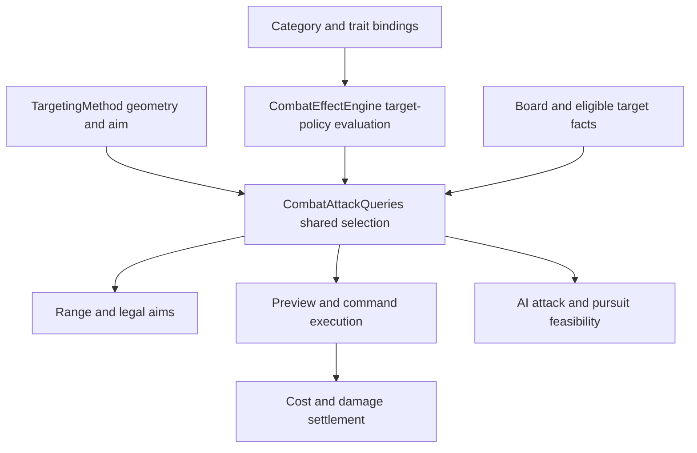

# Attack Target Policy Design

Status: Gameplay requirements confirmed on 2026-10-07. Tasks 1-4 are implemented and verified: Unity full Core 1,490/1,490 and affected Framework 250/250 passed, including automated Core-to-View hover/preview/command smoke checks. Real-scene manual/PlayMode acceptance was not run.

## Intent and authority

Only Cannon may attack empty ground and damage allies. Base, Rider, and Heavy may attack hostile units, hostile structures, and explicitly attackable obstacles. These user-confirmed requirements supersede the universal empty-Single and friendly-fire permissions in the [2026-10-01 owner inventory](../plans/2026-10-01-targeting-method-owner-inventory.md#12-t3-admission-and-target-policy-decisions).

The design must preserve existing targeting geometry and reuse the combat effect engine. Range queries, previews, execution, and AI must not implement separate faction or empty-target rules. Implementation documentation is English; new code comments are Korean. Commits and pushes remain user-owned.

## Observed implementation before this change

Paths below are relative to `Assets/ProjectL/Script/Systems/RuntimeSystem/InGameSystem/CoreSystem/CoreCaculator/` unless specified otherwise.

- `Application/Combat/CombatAttackQueries.cs`: Selection admits every living field character except the actor, admits every living structure, and permits empty Single. Range separately applies hostility to target IDs.
- `Application/Combat/CombatCommandCalculator.cs`: execution repeats candidate collection; CollectPierce applies Cannon near exclusion unconditionally. Attack-triggered ThornField damage has another occupant path.
- `Application/Combat/EnemyAi/EnemyMovementPathfinder.cs`: pursuit feasibility repeats unfiltered pierce candidate collection.
- `Application/Combat/CombatCommandEffects.cs`: Capture binds trait effects and Heavy/Rider rules, but does not bind Cannon's existing SafeBombardment rule.
- `Domain/Categories/Rules/SafeBombardmentCategoryRule.cs`: the registered rule is currently an empty ICombatEffectRule implementation.
- `Domain/CombatEffects/CombatEffectEngine.cs`: already supports pure, origin-tracked capability evaluation. `StatelessEffectStateSnapshot.Instance` already exists.

## Approach selection

| Approach | Tradeoff | Decision |
| --- | --- | --- |
| Extend the existing effect engine with target-policy evaluation | Reuses category rules, bindings, origin validation, and deterministic evaluation; adds one capability | Recommended |
| Add targeting permissions to CombatAttackProfile or each DB targeting method | Simple data access, but repeats category facts across units and mixes geometry with eligibility | Reject for this change |
| Introduce a strategy class per category or a general rule graph | Can express many future behaviors, but duplicates common attack flow and adds unnecessary configuration | Reject for this change |

A category-to-rule mapping is still necessary at the composition boundary. The objective is to remove category decisions from attack consumers, not eliminate every conditional statement. Keep the existing factory/registration conventions; do not introduce reflection, a plugin loader, or a second policy registry.

## Gameplay contract

| Situation | Base / Rider / Heavy | Cannon |
| --- | --- | --- |
| Single on a living hostile unit | Allowed | Allowed outside the near exclusion |
| Single on a hostile structure or explicitly attackable obstacle | Allowed | Allowed outside the near exclusion |
| Single on empty ground or a dead unit's empty cell | Reject before settlement | Allowed outside the near exclusion; pay the normal attack cost once |
| Empty Single center with a valid splash neighbor | Reject: the primary cell must contain an eligible target | Allowed |
| Single on an ally; ally in splash or pierce | Reject primary selection; exclude from damage candidates | Allowed |
| Direction containing only allies | Reject with NoEligibleTargets | Allowed if a valid ray/group contains a target |
| Direction with no eligible targets | Reject with NoEligibleTargets | Preserve the existing rejection |
| All with no eligible targets | Preserve UnresolvedEmptyAll rejection | Preserve UnresolvedEmptyAll rejection |
| Actor hit by its own direct, splash, pierce, or immediate ThornField application | Excluded | Excluded |
| Eligible hostile target with zero predicted HP loss | Allowed | Allowed |

Single remains a cell aim. Direction and All remain group aims; a ShotGun does not become entity-targeted. For those groups, require at least one eligible target after spatial restrictions. Friendly occupants cannot make a non-Cannon group executable.

Compatibility choices, not new user-confirmed mechanics:

- Preserve Cannon's existing neutral-target eligibility. Non-Cannon excludes neutral characters and ordinary neutral structures; explicitly attackable obstacles remain eligible regardless of faction.
- Preserve the footprint-expanded one-cell Cannon exclusion and apply it only to direct designated cells / pierce encounters, never to legal indirect splash cells.
- Preserve independent environmental damage: pre-existing thorn fields, movement hazards, and obstacle explosions are not converted into actor attack damage. An attack that triggers an explosive obstacle can still cause environmental collateral damage. Immediate attack-triggered ThornField occupant damage must obey the actor's attack eligibility policy.
- Preserve KillChainAttack's stricter hostile-character-only selection; Cannon permission must not widen that special effect to allies or structures.
- Multi-cell units remain deferred. Existing structure footprints and structure ray blocking remain supported.

## Architecture and responsibilities

### Effect policy

Add an internal immutable `AttackTargetingPolicy` in `Domain/Combat/`. Its four boolean properties are `AllowsEmptySingle`, `AllowsFriendlyTargets`, `AllowsNeutralTargets`, and `ExcludesAdjacentDirectCells`. The default value has all four false. Living hostile targets and explicitly attackable obstacles are part of the common baseline, not optional grants.

Add `IEffectAttackTargetingRule` to `Domain/CombatEffects/Rules/CombatEffectCapabilities.cs`:

`EffectAttackTargetingContribution EvaluateAttackTargeting(in EffectRuleInput input)`.

Add `EvaluateAttackTargeting(IReadOnlyList<EffectRuleBinding> bindings)` to the engine and its interface. Return `EffectAttackTargetingEvaluation`, containing the resolved Policy plus sorted Contributions and Expectations. Each contribution contains its Origin and an immutable Policy value. Combine each boolean with OR, starting from the restrictive baseline. This is an additive capability model; it does not claim to support revocation or arbitrary rule precedence. Origin mismatches and duplicate binding origins fail using existing engine conventions. Evaluation never produces a state transition or spends resources.

Make `SafeBombardmentCategoryRule` implement the capability, granting all four properties. Bind it through Capture with its CategoryEffectOrigin and `StatelessEffectStateSnapshot.Instance`. Use `CategoryRuleFactories.CreateRule` with the existing definition. Keep category association in Capture/composition; do not add CategoryKey checks to queries, damage calculation, AI, or View. Heavy/Rider mutable snapshots remain unchanged.

### Target eligibility and resolved selection

Add an internal pure `AttackTargetEligibility` in `Domain/Combat/` with character and structure predicates:

- Character: living, on field, not the actor, and hostile or allowed by the friendly/neutral policy.
- Structure: living and either explicitly attackable through `EnvironmentBindings.ObstacleEntityIds`, hostile, or allowed by the friendly/neutral policy. Mere Owner.Neutral is not evidence of an attackable obstacle. Continue existing obstacle-profile validation.

Use an internal immutable `ResolvedAttackSelection` in `Application/Combat/` to carry Cells, Targets, EligibleCharacters, EligibleStructures, Policy, and IsPiercing. It is a per-calculation value, never Buffer state. Defensive copies/read-only views prevent consumers from changing validated facts.

CombatAttackQueries.Selection evaluates geometry and map bounds, applies policy-driven direct-cell exclusion, collects candidates once, and validates admission. For a restrictive Single, an eligible Primary role is required; eligible Additional roles cannot rescue an empty or friendly center. Use InvalidPrimaryTarget for an empty/dead/ineligible center and NonHostile for a living friendly/neutral non-obstacle center. Keep bounds/geometry and AppointCellRejected precedence before occupancy validation.

Range uses the same policy, predicates, and admission function. RangeCells remain the geometric range after direct-cell exclusion, even where occupancy prevents Single selection. AttackAims contain only admissible aims. InRangeTargetIds contain direct eligible IDs within that range; they do not absorb out-of-range indirect splash victims. CanAffordAttack stays separate so AP shortage does not hide geometry or legal aims.

### Execution, pierce, and effects

Calculate and Preview consume the resolved selection. Do not reconstruct unfiltered target arrays after admission. All rejection happens before pending movement sealing, attack cost spending, damage, success effects, refunds, or turn advancement. Keep the existing handled-command rejection metadata contract.

CollectPierce receives policy and eligible target facts explicitly. All callers, including AI movement feasibility, pass the same resolved policy/candidates. Use policy-controlled near exclusion rather than a Cannon-specific unconditional call. Maintain physical structure blocking independently of damage eligibility: a living allied structure can stop a non-Cannon ray without taking damage; it must not vanish from occupancy because it was filtered out. Ineligible characters do not consume a damage encounter or falloff budget. Eligible characters/structures retain existing encounter order, per-ray falloff, aggregation, and target budgets.

Reuse CannonAppointExclusionCalculator as the spatial helper when the policy requests exclusion. Renaming the helper or rewriting its geometry is unnecessary.

Immediate ThornField occupant damage uses the same character predicate. Keep the special hostile-only KillChainAttack logic and environmental settlement distinct. Audit these paths explicitly instead of assuming all damage comes through CollectCandidates.

### Public and authoring boundaries

Do not change AttackAim, TargetingMethodSpec, AttackRangeResult, View command payloads, or DB assets. Do not store policy flags in CharacterBuffer or unit authoring. Category facts are the source; policy is derived through the engine. View continues submitting only returned AttackAims and displaying Core preview results. AI retains tactical scoring and ally penalties independently of attack legality.

## Acceptance and migration

1. For Base, Rider, and Heavy, Single on empty/friendly cells is absent from AttackAims, Preview rejects, and Calculate rejects without gameplay mutation. Enemy units, hostile structures, and authored attackable obstacles remain valid.
2. Cannon empty Single succeeds with zero hits and one normal AP charge. Cannon can hit allies; near exclusion and self exclusion still hold.
3. Non-Cannon splash, direction, All, pierce, and immediate ThornField application cannot damage allies. Direction-only friendly groups reject; mixed groups damage only eligible targets.
4. Range, preview, execution, AI selection, and AI pursuit feasibility agree on eligibility for both Player and Enemy actors.
5. Rejected attacks leave pending movement/checkpoints, AP, HP, trait states, refunds, and timeline unchanged. Accepted attacks preserve current cost and damage formulas.
6. Existing tests that assert universal empty Single/friendly fire must split into explicit Cannon-positive and non-Cannon-negative fixtures. Do not silently change the shared fixture's default category to Cannon.

Run focused Unity EditMode tests first, then ProjectL.Tests.Core and affected Framework input tests. A temporary .NET harness is useful for pure-Core feedback but does not replace Unity assembly and View verification. See the [implementation plan](../plans/2026-10-07-attack-target-policy.md) for task ownership and checks.
