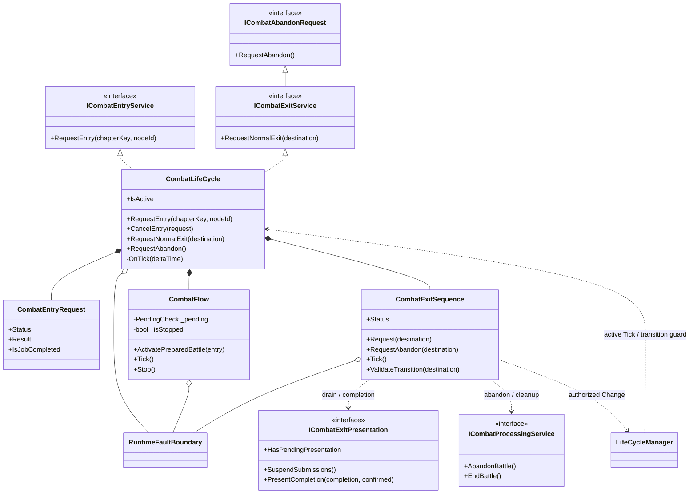
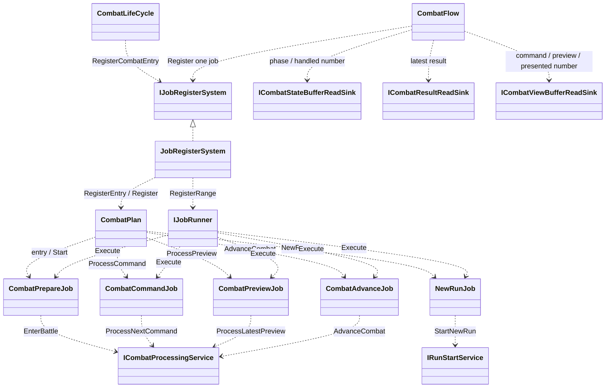
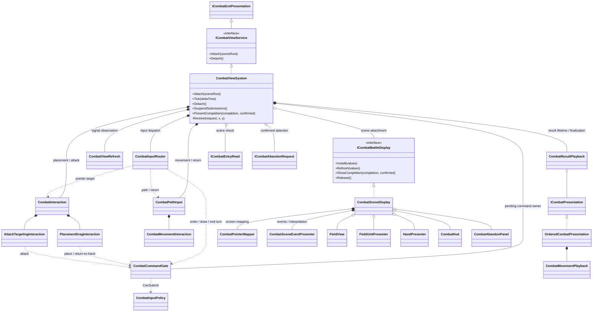
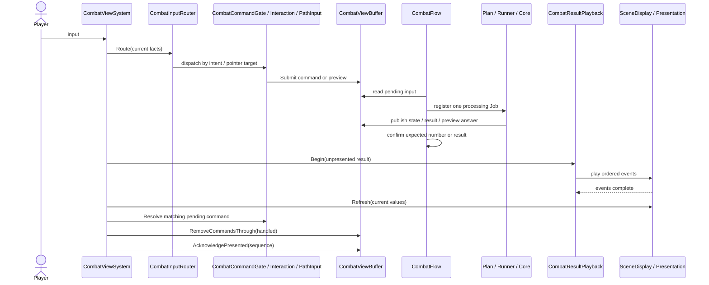
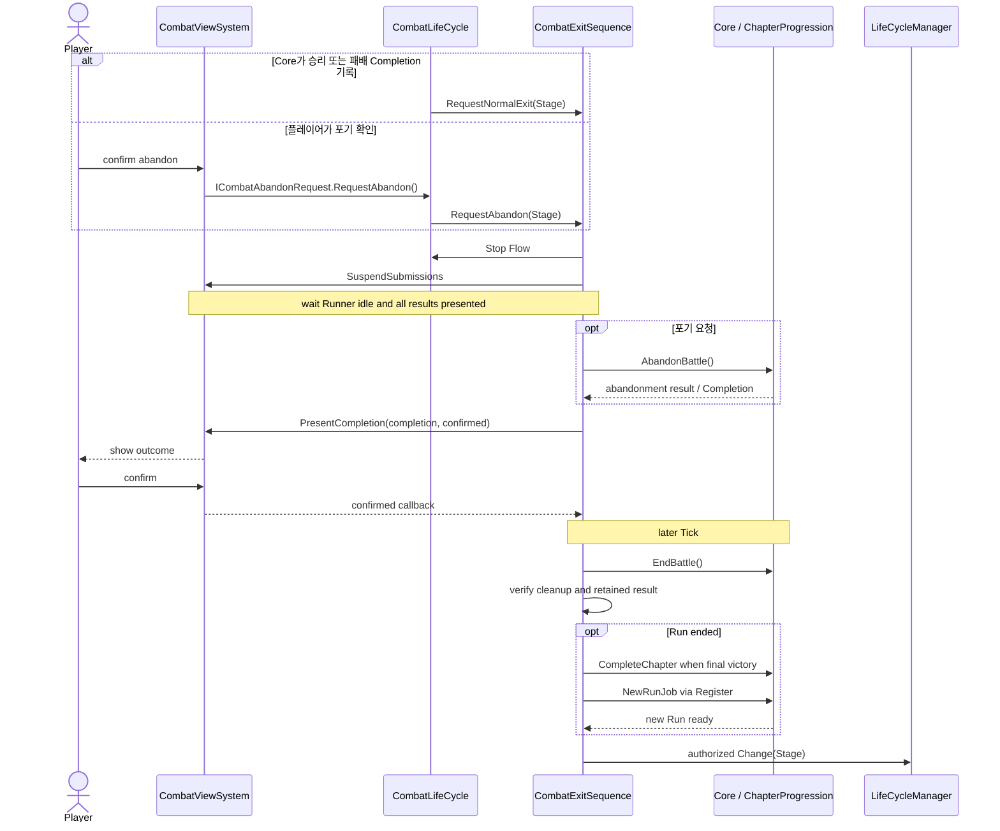
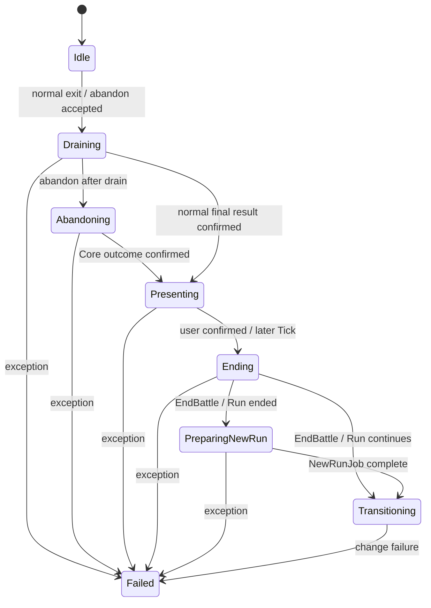

# 전투 골격·View — 현재 구현 UML

- 기준: 2026-10-07, `feature/Yonggeun/Stage`의 `8408a787`. 구현된 코드 관계만 그린다.
- [오프라인 HTML 도표](2026-10-07-combat-view-skeleton-current-uml.html)에서 주요 관계와 흐름을 볼 수 있다.
- 정책 원본: [골격 설계](2026-09-30-combat-flow-skeleton-design.md) §4.1·§6.3~6.5, [View 설계](2026-09-30-combat-view-design.md). 이 문서는 코드 구조의 스냅샷이다.

표기: `*--`는 객체 생성·수명 소유, `o--`는 참조 보관, `..>`는 호출·등록 의존, `<|..`는 인터페이스 구현이다. 씬 Presenter 참조는 GameObject 생성 소유를 뜻하지 않는다.

## 1. 골격과 외부 경계

`CombatLifeCycle`의 활성 Tick 순서는 **Flow → Completion 감지 및 이탈 요청 → ExitSequence**다. 비활성 `ISystemTick`은 진입 Job의 결과를 확인한다. Flow는 버퍼의 국면·번호를 매번 읽고 다음 Job **하나**만 등록한다. ExitSequence는 결과 표시가 끝나고 사용자가 Completion을 확인한 다음 Core 정리·새 Run 준비·씬 전환을 순서대로 실행한다.

## 2. Plan·Job·Buffer

`CombatPlan`은 JobType별 Job 목록을 조립한다. `CombatFlow`가 등록 조건과 순서를 정하므로 Priority가 전투의 시나리오 순서를 정하지 않는다. Core 처리 결과는 Buffer로 돌아오고 Flow가 처리 번호·결과를 확인한다. `RecordInputOnly`는 준비 확인 후 처리 Job을 등록하지 않는다.

## 3. View 내부 책임

`CombatViewSystem`은 씬 연결, Buffer 관측, 결과 후처리, 입력 차단을 조정한다. Router는 입력 대상만 고르고, Gate는 시작·턴 종료 대기 번호를 소유한다. 배치·공격·경로 입력은 각각의 객체가 수명과 미리보기를 관리한다. `CombatSceneDisplay`는 Buffer를 직접 읽지 않고 View가 전달한 표시값과 View DB를 사용한다. HUD의 재화는 `CombatDisplayValues.StageGold → CombatStateData.StageGold`에서 읽는다.

## 4. 입력부터 결과 표시까지

결과 연출이나 후처리가 실패하면 View는 확인 번호를 올리지 않는다. Flow는 확인되지 않은 최신 결과를 덮을 상태 변경 Job을 등록하지 않는다. 입력 Buffer는 View가 쓰고 Core가 읽는다. 상태·결과 Buffer는 Core가 쓰고 View·Flow가 읽는다.

## 5. 승패·포기 이탈

현재 `RunEndDestination`도 `Stage`다. 이는 **임시 목적지**이며 Title 화면 도입 시 바꾸도록 코드에 표시돼 있다. 일반 승리·패배·최종 승리의 Completion은 모두 정상 이탈 요청 대상이다. 포기는 Completion이 없을 때만 받을 수 있으며 Core의 `AbandonBattle()`가 결과를 확정한다. View는 재화·승패를 계산하거나 초기화하지 않는다.

공유 `RuntimeFaultBoundary`가 보고된 오류를 보존하고 다음 Runtime Tick을 막는다. `ExitSequence`의 `Failed`는 그 시퀀스 자체에서 잡은 예외의 상태이며, 외부 오류가 생겼다고 반드시 `Failed`로 바뀌는 것은 아니다.

## 코드 위치

| 구역 | 구현 |
|---|---|
| 골격 | [CombatLifeCycle](../../../Assets/ProjectL/Script/Systems/RuntimeSystem/LifeCycleSystem/LifeCycles/Combat/CombatLifeCycle.cs), [CombatFlow](../../../Assets/ProjectL/Script/Systems/RuntimeSystem/LifeCycleSystem/LifeCycles/Combat/CombatFlow.cs), [CombatExitSequence](../../../Assets/ProjectL/Script/Systems/RuntimeSystem/LifeCycleSystem/LifeCycles/Combat/CombatExitSequence.cs), [CombatPlan](../../../Assets/ProjectL/Script/Systems/RuntimeSystem/LifeCycleSystem/LifeCycles/Combat/Plans/CombatPlan.cs) |
| View 조정·입력 | [CombatViewSystem](../../../Assets/ProjectL/Script/Systems/RuntimeSystem/InGameSystem/ViewSystem/Combat/CombatViewSystem.cs), [CombatInputRouter](../../../Assets/ProjectL/Script/Systems/RuntimeSystem/InGameSystem/ViewSystem/Combat/CombatInputRouter.cs), [CombatCommandGate](../../../Assets/ProjectL/Script/Systems/RuntimeSystem/InGameSystem/ViewSystem/Combat/CombatCommandGate.cs), [CombatInteraction](../../../Assets/ProjectL/Script/Systems/RuntimeSystem/InGameSystem/ViewSystem/Combat/CombatInteraction.cs), [CombatPathInput](../../../Assets/ProjectL/Script/Systems/RuntimeSystem/InGameSystem/ViewSystem/Combat/CombatPathInput.cs) |
| View 표시 | [CombatResultPlayback](../../../Assets/ProjectL/Script/Systems/RuntimeSystem/InGameSystem/ViewSystem/Combat/CombatResultPlayback.cs), [OrderedCombatPresentation](../../../Assets/ProjectL/Script/Systems/RuntimeSystem/InGameSystem/ViewSystem/Combat/OrderedCombatPresentation.cs), [CombatSceneDisplay](../../../Assets/ProjectL/Script/Systems/RuntimeSystem/InGameSystem/ViewSystem/Combat/CombatSceneDisplay.cs) |
