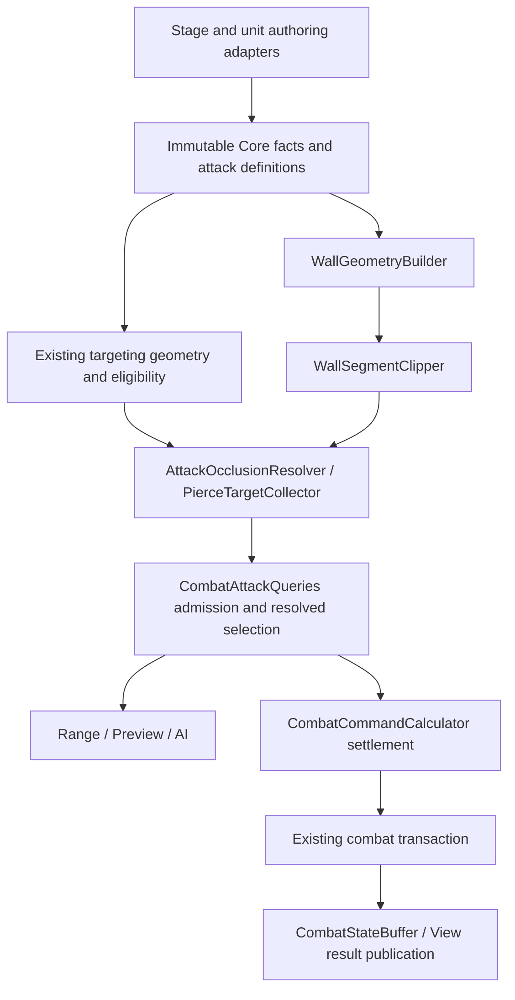

# Wall Attack Blocking and Attack Contract Cleanup

Date: 2026-10-08

Status: Implementation planning authorized on 2026-10-08; no gameplay implementation is included. Section 2 records the planning defaults explicitly.

Source baseline: working tree at `680f309f`.
Documentation language: English. New or changed code comments: Korean.

## 1. Intent, authority, and scope

Add deterministic wall obstruction to the existing cell/direction/all attack system without weakening its target eligibility rules. Keep mathematical geometry, attack permissions, attack settlement, and Buffer publication under separate owners. A reviewer must be able to reject a misplaced special case using this document, rather than relying on a general request to follow SOLID.

The external `Wall_Attack_Blocking_Spec.md` dated 2026-10-07 supplies the direct-attack geometry requirements. It is source material, not authorization to implement every future extension mentioned in it. Its source location is `D:/My_ProjectWork/학교 관련 문서/졸업작품_프로젝트L/2학기 내용/AI 관련 문서/Wall_Attack_Blocking_Spec.md`.

The [attack target policy design](2026-10-07-attack-target-policy-design.md) remains authoritative for empty targeting, factions, self exclusion, and environmental damage. The [targeting methods design](2026-10-01-attack-targeting-methods-design.md) supplies geometry, subject to that newer policy design. This document does not revert to entity-based aim or revive legacy Cannon impact shapes.

Confirmed requirements:

- Use tile centers and the finite segment from the attacker to the target/selected cell.
- Block only when the segment passes through the interior of the wall blocking region. Tangency and boundary-only contact are allowed.
- Merge connected straight walls before cutting their outside corners. Movement still treats the entire occupied tile as blocked.
- Preserve ordinary attacks' rejection of empty/friendly primary cells and their exclusion of friendly splash victims. Preserve Cannon's existing explicit permissions and near exclusion.
- Reject blocked attacks before resource settlement or gameplay mutation. Re-evaluate against current facts on execution.
- Share the wall calculation across queries, previews, execution, and AI. Core must remain independent of Unity.
- Keep coordinators small in responsibility; put new behavior in its actual owner. Avoid a generic rule framework for this feature.

Initial scope: static, publicly visible, non-destructible walls made of one-cell-wide horizontal or vertical runs; existing single-cell characters; existing multi-cell structure targets; direct attacks, current piercing, and the explicitly proposed secondary-effect rules below.

Outside scope: concave wall unions, two-dimensional solid wall blocks, diagonal-only wall contact, hidden or destructible walls, runtime wall editing, height, projectile physics, multi-cell characters, arbitrary curved trajectories, and a general collision engine. Unsupported wall topology must fail preparation with source IDs; it must not be approximated silently.

## 2. Decisions proposed for this review

These were presented as concrete proposed defaults before the user requested implementation planning. They are the baseline used by the linked implementation plan, not additional mechanics inferred from the external wall document. They remain visible here for review; changing one should affect the owner identified below.

| Decision | Proposed rule | Owner / reason |
| --- | --- | --- |
| Corner allowance | `CornerCut = 0.125` for initial content, editable as exact multiples of `1/1024` tile | Stage `WallBlockingSpec`; preserves the supplied example while allowing balance changes |
| Direct delivery | Require a clear attacker-to-selected/target-cell segment by default; explicit attack definition can ignore walls | `AttackOcclusionSpec`; never inferred from Cannon category or a unit key |
| Splash | Require delivery to the selected center, then independently test center-to-additional-cell propagation | `AttackOcclusionResolver`; represents a local impact, not a second shot from the attacker |
| Immediate ThornField application | Use the same impact-to-cell propagation rule, exclude wall-occupied cells, then apply existing occupant eligibility | Thorn application owner delegates geometry; existing persistent fields remain environmental effects |
| KillChainAttack | Preserve its existing special hostile-character selection and wall-independent reach in this first version | Existing special-effect definition/owner; explicit compatibility exception, not an accidental bypass |
| Environmental explosions and hazards | Preserve current environmental behavior; ordinary attack occlusion does not automatically change them | Existing environment owners; a blocked direct attack cannot trigger them |
| Pierce target cap | Preserve current cap values by moving the legacy range into an explicitly named per-ray `MaxTargetsPerRay` on the piercing trait | Trait spec/definition and its existing evaluation path; removal of the cap is a separate gameplay change |
| Pierce directions | Preserve the existing three-ray EightDirectionLine direction mask and stable ray identity | Targeting geometry owner; remove the unused authoring claim that one ray can be selected |

No broad exemption for Cannon, no automatic wall piercing for PiercingFalloff, and no new archetype-specific checks in attack consumers are permitted. Future exceptions must be authored as attack behavior or contributed by the existing effect system when a real runtime modifier requires it.

## 3. Current code and integration risks

Core paths below are relative to `Assets/ProjectL/Script/Systems/RuntimeSystem/InGameSystem/CoreSystem/CoreCaculator/`.

| Current location | Observation and required integration |
| --- | --- |
| `Application/Combat/CombatAttackQueries.cs` | `Selection` already owns shared admission. `Range` separately produces geometric cells, direct in-range IDs, and valid aims; preserve those distinctions. |
| `Application/Combat/CombatCommandCalculator.cs` | Preview invokes the same calculator as execution. Selection runs before movement sealing and attack settlement. `CollectPierce` is also invoked again during settlement. |
| `Application/Combat/EnemyAi/EnemyMovementPathfinder.cs` | Attack-position feasibility calls selection and separately collects piercing hits. Updating only the player path is insufficient. |
| `Domain/Combat/AppointShapeCalculator.cs` | Already defines the three rays of EightDirectionLine. The collector duplicates the ray construction. Share the geometry definition without changing observable ordering. |
| `Application/Combat/KillChainAttackCalculator.cs` | Chooses special-effect victims without ordinary selection. Its compatibility behavior must be explicit. |
| `Application/Combat/CombatCommandCalculator.cs`, Thorn application | Generates effect cells independently of ordinary target collection. Clipping only normal damage targets would still spawn/damage through walls. |
| `Contracts/Combat/MovementEnvironmentFacts.cs`, `StaticTerrainFact.cs` | Existing immutable environment/terrain source mechanism can represent wall cells; do not create a parallel wall repository. |
| `Domain/Movement/MovementRouteValidator.cs` and placement/displacement callers | Current entry checks rely on units/structures. Wall occupancy must also reach placement, movement, AI movement, and forced displacement. |
| `Contracts/Commands/ImpactPatternSpec.cs` and `PierceTargetBudget` | Legacy impact shape is unused for normal hit geometry, but its range still limits per-ray target count. Migrate this live dependency before removal. |

## 4. Architecture and dependency direction

Arrows describe data/call flow, not permission for lower layers to import higher layers. Domain receives narrow immutable values. Domain must not depend on Application, Buffer, DB, View, service locators, or Unity. Contracts must not expose Domain implementation types. Application composes pure calculations; the existing Buffer transaction validates and installs results.

### 4.1 Responsibility and visibility table

The following are the intended owners, not a requirement to create one interface per row. Prefer internal sealed/static implementations for stateless calculations. Public types are limited to actual assembly-boundary contracts.

| Owner | Owns | Must not own |
| --- | --- | --- |
| `WallBlockingSpec` / `AttackOcclusionSpec` in Contracts | Validated immutable configuration, exact tick values, direct/splash policy | Scene references, runtime repositories, permissions such as friendly fire |
| `WallGeometryBuilder` in Domain | Wall source validation, cardinal components, straight-run bounds, outer corner boundaries, source IDs, occupied-cell set | Actor/category decisions, AP, damage, publication |
| `WallSegmentClipper` in Domain | Exact segment-versus-open-convex-region test and entry parameter | Unit facts, target policy, effect dispatch, stage access |
| `AttackOcclusionResolver` in Domain | Select origin for an authored delivery/propagation mode, filter cells/target contacts, retain blocker evidence | Faction rules, HP/AP changes, content-key exceptions, Buffer access |
| `PierceTargetCollector` in Domain, extracted from the command calculator | Ordered encounters, wall/structure stopping, eligible victim lookup, encounter indices, pure per-ray truncation of collected encounters | Attack damage formulas, category detection, resource settlement |
| `CombatAttackQueries` / `ResolvedAttackSelection` | Compose geometry, existing eligibility, obstruction, and admission; carry immutable results | Clipping equations, flood fill, duplicate faction rules, damage application |
| `CombatCommandCalculator` | Existing command orchestration, cost/damage/effect settlement using resolved inputs | Wall construction/intersection, new traversal algorithms, per-unit exceptions |
| Existing movement/placement owners | Apply wall occupancy alongside their other spatial restrictions | Attack segment tests as a substitute for movement collision |
| Existing combat transaction and `CombatStateBuffer` | Expected-state validation, atomic installation, lifecycle and result publication | Wall legality, target selection, new combat formulas |
| View | Submit Core aims; render valid/blocked cells and identified wall sources | Reconstructing geometry or deciding that a wall can be ignored |

`WallGeometry` and clipping parameter values are internal immutable implementation values. Result DTOs crossing to View expose cells/source IDs and reasons, not half-plane internals or arbitrary callbacks. Read-only collection wrappers must not retain externally mutable arrays.

### 4.2 Concrete SOLID constraints

- **Single responsibility:** a class may own one reason for gameplay change. Adding a different traversal or wall topology must not enlarge the settlement or Buffer coordinator.
- **Open/closed at useful seams:** new content using an existing policy changes data; a genuinely new policy adds handling at the one resolver/registration boundary and contract tests. Do not repeat its discriminator checks in query, preview, AI, and execution.
- **Substitution:** an alternative geometric implementation must preserve the exact clear/blocked contract, boundary semantics, blocker ordering, and determinism. It may not approximate unsupported shapes and return success.
- **Interface segregation:** use existing narrow read/write sinks. Do not pass `IBufferQuery`, a DB context, or the complete `CombatCommandInput` into a geometry helper for convenience. No one-method interface whose only purpose is wrapping a pure static calculation.
- **Dependency inversion:** adapters supply Core facts, not live Unity objects. Runtime rule variation uses the established effect capabilities where needed; static content policy does not require a second rule registry.

Conditionals are allowed for mathematical cases (`v == 0`), bounds checks, enum validation, and a single explicit policy dispatcher. They are prohibited as scattered content behavior such as `if (Category == Cannon) ignore wall`, `if (UnitKey == Ballista) use three rays`, or key/string-based exceptions. Moving those branches into a large generic `CombatRules` helper is not an acceptable fix.

## 5. Wall facts, preparation, and lifecycle

Reuse `StaticTerrainFact` by appending a `Wall` kind with an explicit new enum value. Its existing source ID, cell, Active, and KnownTo fields remain the source of truth. Require Terrain semantic binding. Initial wall sources are active and known to both owners; wall mutation and visibility changes are rejected for this version. Walls are not damageable structure targets.

Carry a single immutable stage `WallBlockingSpec` through stage input, battle initialization/preparation, `CombatCommandState`, projection/copy paths, and Buffer state comparison. It contains `CornerCutTicks`, with `TicksPerTile = 1024` and the proposed initial value 128. Existing no-wall callers can use the explicit default configuration; malformed supplied settings must fail, not silently fall back.

Use the existing environment source storage. Build `WallGeometry` once for a top-level range/selection/preview operation and reuse it across aim candidates and AI position checks where the environment is identical. It is operation-local derived data, not a second authoritative Buffer, a global cache, or a long-lived attacker/target visibility matrix. An independently executed command constructs its context from its current input snapshot.

Preparation must:

1. Validate source IDs, bounds, Terrain binding, public visibility, and corner settings.
2. Find four-neighbor connected components of wall cells. Each must have one constant X or one constant Y with no gap. Merge touching collinear source runs even if authoring named them separately.
3. Reject bent, branched, thick, overlapping, or diagonal-only touching components for this release. Report involved source IDs and cells. Do not use an enclosing rectangle for a concave component.
4. Produce one clipped rectangle per run and retain all original source IDs for View highlighting. Use the minimum source ID as a stable component key; source ordering must not change the result.
5. Enforce exclusive occupancy: walls cannot share cells with characters, structures, deployment placements, rail traversal, or other exclusive terrain/object content. Hook the existing placement validation rather than adding a Buffer-side alternative validator.

Extend movement/placement spatial checks with the same wall occupied-cell set: voluntary movement, deployment/redeployment, AI paths, knockback, and relevant gimmick placement. Normal attacks with an explicit ignore-walls policy still cannot place a character/effect into a wall cell. This feature adds no movement-wall-ignore ability. An exceptional future movement ability needs its own movement rule.

All `CombatCommandState` creation, copy/projection, preparation, rejection, `SameValues`, and Buffer publication paths must preserve the setting. Audit those callers together. No-wall compatibility must not conceal a missing configuration copy. Stage end clears wall sources through the existing combat lifetime.

## 6. Exact geometry algorithm

### Direction vocabulary

An aim direction selects an existing targeting mask; a four-way representative facing feeds existing result/effect contracts; a wall segment connects two exact cell centers. These are different values. Wall APIs take start/end `CellCoord` values, never `AttackDirection`, `Rotation4`, a normalized heading, or an angle bucket. A delta such as `(5,3)` stays `(5,3)` throughout clipping. Direction/All groups test each relevant contact; impact propagation starts at the impact cell. Existing aim-mask restrictions remain unchanged.

The current `AttackRotation` maps non-cardinal direction aims to R0 and All has no intrinsic facing. This is a separate existing representative-facing limitation, not a definition of the wall segment. Preserve it explicitly for this feature rather than silently redesigning Heavy/effect facing semantics. Add tests proving diagonal target geometry and wall obstruction do not depend on this representative value; resolve that facing policy in a separate change if its gameplay meaning is revised.

Use convex segment clipping in the Cyrus-Beck form supplied by the source specification. No Physics API, sampled ray points, percentage overlap, pathfinding, or per-tile corner cutting is used.

For tile-center endpoints A and B:

\[
P(t) = A + t(B-A), \qquad 0 \le t \le 1.
\]

A run from cell extrema has bounds `xMin = minX - 1/2`, `xMax = maxX + 1/2`, and similarly for Y. For corner cut k, its open interior satisfies all eight inequalities `n dot P < h`:

| Boundary | n | h |
| --- | --- | --- |
| Left | (-1, 0) | -xMin |
| Right | (1, 0) | xMax |
| Bottom | (0, -1) | -yMin |
| Top | (0, 1) | yMax |
| Bottom-left cut | (-1, -1) | -xMin-yMin-k |
| Top-left cut | (-1, 1) | -xMin+yMax-k |
| Bottom-right cut | (1, -1) | xMax-yMin-k |
| Top-right cut | (1, 1) | xMax+yMax-k |

Require `0 <= k < min(width,height)/2`; the initial one-cell-wide runs therefore require `0 <= CornerCutTicks < 512`.

For each plane, let `u = n dot A - h` and `v = n dot (B-A)`. Intersect the permitted parameter intervals with `[0,1]`:

- `v > 0`: upper bound `t < -u/v`.
- `v < 0`: lower bound `t > -u/v`.
- `v = 0, u < 0`: no restriction from this plane.
- `v = 0, u >= 0`: no interior intersection.

Initialize enter to 0 and exit to 1. After clipping, block exactly when enter is less than exit. Equal endpoints mean tangent-only contact and are clear. A segment along a boundary fails that plane's strict interior condition and is clear. A wall beyond B cannot leave an interval inside `[0,1]`.

### 6.1 Numeric representation and deterministic evidence

Scale cell centers by 1024, half-cell bounds by 512, and use integer corner ticks. Convert authoring decimals exactly; reject values not representable at this resolution rather than rounding differently across adapters. The scale is a representation choice, not an epsilon or extra gameplay allowance.

Store coordinates, dot products, and rational numerators/denominators in checked `long` operations. Promote cell integers before multiplication/subtraction. Compare rational bounds by cross multiplication using standard-library `System.Numerics.BigInteger` intermediates, with positive denominators. This prevents overflow for valid int cell coordinates without imposing an arbitrary small-board limit. No third-party math package, floating division, GCD normalization, or general public rational-number framework is required. Keep the comparison value private/internal to geometry. Confirm the existing Unity Core assembly can resolve this standard library during implementation.

If multiple walls block, the diagnostic primary blocker is the one with the smallest exact entry parameter, then stable component key. Reversing A/B must preserve the boolean result, but can legitimately change the first blocker. Return the component's source IDs for highlighting. A same-cell propagation query is clear when the cell is not wall-occupied; normal target validation still excludes self attacks. Wall-occupied endpoints are invalid attack/effect cells, not a loophole in the clipping rule.

Preparation costs O(W) with hashed neighbors plus deterministic output ordering. A query costs at most eight plane tests per wall run per segment. Start with a simple run loop and optional bounding-box rejection. Do not add a BVH, spatial service, visibility cache, or job system without measurements demonstrating a need.

## 7. Attack policy, admission, and results

### 7.1 Definition and selection ownership

Add immutable `AttackOcclusionSpec` to the attack definition/profile path, separate from `TargetingMethodSpec` and category eligibility. It has two small, closed choices: direct path `RequireClear` or `IgnoreWalls`; splash propagation `FromImpact` or `IgnoreWalls`. The initial default is RequireClear/FromImpact. Explicit ignores affect only their stage, not occupancy, faction eligibility, range, cost, or structure ray-stopping. Do not add unused trajectory modes or per-unit strategy subclasses.

`CombatAttackQueries.Selection` remains the admission coordinator. It calls the existing shape resolver and target eligibility policy, delegates obstruction to the dedicated resolver/collector, and returns the final immutable `ResolvedAttackSelection`. Keep geometry/near-exclusion/primary eligibility checks before wall failure so a friendly/empty primary does not become valid because a wall test was added.

An explicitly selected wall-occupied cell is rejected as `AppointCellRejected`, before empty-cell permission is considered. This is an occupancy restriction and still applies to attacks that ignore wall crossing. Group masks may geometrically include wall cells, but those cells cannot host a victim or a newly placed effect.

Selection carries raw geometric cells separately from resolved reachable cells, candidate roles, ordered pierce encounter facts, and blocked-cell evidence. Do not overwrite a geometric set and later reuse it as if it still contained the full mask. Ordinary target resolution happens from the reachable contacts. Mathematical clipping and graph construction must not be private methods added to the coordinator.

| Attack path | Admission and wall handling |
| --- | --- |
| Restrictive Single | Require eligible primary as today, then clear delivery to the selected cell. A blocked primary rejects the entire attack; splash cannot rescue it. |
| Cannon empty Single | Retain the empty-cell permission; test delivery to that selected cell even without an EntityId. A clear empty shot still costs one normal attack. |
| Direction / All | Filter contacts independently. If wall filtering removes all otherwise eligible targets, reject with BlockedByWall; genuinely empty groups retain existing reasons. |
| Splash | After accepted delivery, test selected center to each additional cell. Blocked additional cells are excluded; a valid primary/allowed empty center still permits the attack. |
| Pierce | Collect near-to-far per ray. Stop at a wall crossing even when no entity occupies the wall cell. A block on one ray does not cancel the other rays. |

For multi-cell structures, Single uses the selected occupied cell as the contact. Group/splash selection tests each geometrically included occupied cell and hits the structure if at least one eligible contact is clear; deduplicate ordinary damage by EntityId and preserve Primary precedence. Pierce uses each ray's actual contacted cell and preserves existing per-ray aggregation. Never arbitrarily use a structure anchor outside the targeted cells.

### 7.2 Range, preview, execution, and failure evidence

Preserve `RangeCells` as the geometric direct range after existing near exclusion; it can include cells that occupancy or walls make unselectable. Preserve `InRangeTargetIds` as direct eligible occupants in that geometric range, not a promise of reachability and not a union of splash victims. `AttackAims` remains the source of admissible user inputs. AP affordability remains a separate flag.

Extend result contracts with a narrow read-only blocked-contact collection: segment origin, contact cell, direct/propagation phase, blocking component source IDs, and its occupied wall cells. Include wall cells so View can highlight the result without a new environment lookup service or rebuilding run geometry. Range diagnostics cover direct range contacts; aim-specific preview diagnostics also cover propagation from its selected impact center. Propagate the same structured failure evidence through rejected command results instead of retaining only a reason string. View can shade geometric range, actionable aims, and blocked contacts distinctly. Direction/All can be accepted with some blocked contacts; a diagnostic does not automatically mean the whole aim failed.

Append `BlockedByWall` without renumbering existing failure values. All-wall-blocked groups use it only if at least one candidate passed pre-wall eligibility. A group with no eligible candidates retains `NoEligibleTargets` / `UnresolvedEmptyAll`. Insufficient AP does not hide spatial diagnostics in range queries. Preview and execution apply the same admission ordering and resource checks.

Execution rebuilds/reuses only an operation-local context from current command facts. Reject before movement sealing, AP expenditure, damage, success effects, refunds, randomness consumption, or timeline advancement. Existing rejection bookkeeping may remain; it must not change gameplay state. Public walls ensure preview and execution use identical wall sources for identical snapshots despite existing `VisibleTo` filtering.

### 7.3 Piercing and secondary effects

Extract traversal from `CombatCommandCalculator.CollectPierce` into `PierceTargetCollector`; all its callers use that owner. The spatial operation gets the origin, ordered ray steps, board limits, all live structure occupancy, eligible victims, and wall geometry. A separate pure operation truncates its collected encounter sequence using a supplied per-ray budget. Neither operation queries repositories or infers policy from category/key names.

Expose ordered ray geometry from the existing targeting geometry owner and use it both for mask generation and traversal. Preserve legacy observable ray identity: forward, left diagonal, right diagonal, even if mask presentation order is different. Verify this with expected encounter/ray fixtures; do not rebuild rays from an unordered set of cells.

Wall checks precede counting an encounter. Blocked or ineligible victims consume no encounter index. Preserve physical structure stopping even when the structure is not damage-eligible. Stop independently on each ray; keep encounter indices and damage aggregation unchanged on no-wall maps.

Stopping at a wall means stopping hit collection. Within the same traversal, a diagnostic scan may continue only as far as the first physical structure/range boundary to identify otherwise eligible victims hidden by that wall. It must not produce hits, consume falloff, or count targets beyond an earlier physical structure. This supplies precise all-blocked failure evidence without a second spatial traversal.

Selection retains the ordered spatial encounters without a damage budget, matching current range/admission behavior. Execution and AI apply the same pure budget calculation to that sequence; they must not perform a second independent spatial collection. Extract `PierceTargetBudget` into the existing piercing calculation owner with explicit common-damage/trait inputs if needed, keeping soul/effect evaluation composition in Application. Preserve the current zero-damage/budget semantics rather than silently redefining valid aims as positive-damage hits.

Immediate ThornField generation must request reachable application cells through the occlusion resolver before placing fields or applying occupant damage. Its footprint remains owned by its existing effect definition and need not equal the targeting splash mask. A shadowed cell is skipped without removing an existing field. Existing fields/hazards do not re-evaluate attacker LOS when later triggered.

KillChainAttack remains explicitly wall-independent for this first release under the proposal in Section 2. Document that policy at its current special-effect owner and test it. If review instead requires wall blocking, filter candidates before random selection using the shared resolver and current projected positions; do not add a failed random shot and consume randomness differently by accident. Environmental explosions remain outside ordinary attack admission.

## 8. Cannon and obsolete aim migration

Treat this as contract cleanup with behavior preservation, separate from introducing walls.

1. Move `ImpactPattern.Range`'s live piercing cap into `PiercingFalloffTraitSpec` and its runtime definition/evaluation as `MaxTargetsPerRay`. Copy values exactly for existing piercing definitions and authored/test fixtures, including any existing zero cap; validate it as nonnegative. Do not reinterpret the number as distance or splash radius. Raising a zero cap is a separate content change, not a migration default.
2. Keep piercing activation in the existing trait path and geometry in the current supported targeting method. Remove the old `cannonAreaType`, `cannonAreaRange`, and `pierceRayCount` inputs only after their adapters, validation, constructors, and live cap consumers are migrated. Remove obsolete Category-impact validation and Cannon minimum-impact-range requirements; preserve category target policy.
3. Remove unused `ImpactPatternSpec`/impact enums only after a repository-wide consumer and serialized-data audit confirms closure. Do not delete a live public dependency based solely on the absence of one gameplay caller.
4. Remove only entity-based aim: `AttackAimKind.Entity`, `ForEntity`, aim's `EntityId`, and the unused resolver overload. Actual character/structure EntityIds, result target IDs, and damage identity remain. Preserve `Cell=2`, `Direction=3`, `All=4`; leave the retired numeric slot unused.
5. Audit `ForCell(cell, direction)` and obsolete preview comments as part of that boundary cleanup. Reject unsupported input kinds at Buffer input validation; Core still validates untrusted/stale commands independently.
6. Update DB adapters, authoring, fixtures, View contracts, and the DB handoff requirements together. Do not leave removed fields advertised as required content, or add silent defaults that hide a missed piercing migration.

The existing untracked [DB requirements handoff](../handoffs/2026-10-08-db-runtime-data-requirements.md) is reference material for the later migration; this design-writing task does not edit it. Walls do not require restoring `ForEntity` and do not grant ordinary characters Cannon's empty/friendly permissions.

## 9. Buffer and extension rules: mandatory review gates

The user's established Buffer transaction split applies without exception:

- `BufferSystemGroup` remains composition and forwarding only. Do not add wall preparation, target filtering, combat transaction bodies, or another set of resource checks there. Preserve its class responsibility comment.
- Put publication changes in the matching existing transaction. A new storage bundle or independent transaction family requires a separate focused transaction assembled in the Group constructor, not additional Group methods containing transaction logic.
- Keep common transaction entry guards in `BufferGuards`. Shared preparation/installation belongs in an existing focused helper such as `BattleCompletionTransaction`, or an equivalently justified helper. Wall mathematics belongs in neither place.
- This feature reuses the existing combat/environment store and transaction. It does not justify a WallBuffer, WallManager singleton, global event bus, or independent wall publication transaction.

Extension examples:

| Future change | Correct first owner | Changes that would fail review |
| --- | --- | --- |
| Another unit with the same wall behavior | Unit attack data | Unit-key branch in query/AI/calculator |
| A balance change to corner cut | Stage wall settings | New epsilon in each caller |
| A different supported wall topology | Geometry construction plus explicit union/interior contract | Bounding-box shortcut or geometry code in settlement |
| A temporary wall-ignore buff | Existing effect capability/binding convention resolving the attack policy | Checking a trait directly in View and repeating it in execution |
| Destructible/hidden walls | Source lifetime/visibility and projection design first | Reusing stale compiled geometry or consulting a scene Collider |
| A new attack traversal | Focused traversal owner using common eligibility and clipping | Enlarging the command calculator with another nested algorithm |

No arbitrary class-count or line-count quota substitutes for responsibility review. A small function containing the wrong policy is still misplaced. Conversely, do not split one coherent eight-plane loop into interface/decorator chains. New abstractions need a current call site, a clear owner, and a concrete variation or invariant.

## 10. Acceptance evidence

### Geometry

Reproduce the supplied wall `(4,5), (5,5), (6,5)` with k=0.125. Treat coordinates below as geometry fixtures, independent of Core's zero-based board bounds; `(8,9)` is not a valid cell on a zero-based 9x9 board. Integrated versions must translate the entire fixture or use a board large enough, without changing the geometry.

| Case | A | B | Expected |
| --- | --- | --- | --- |
| W01 | (5,3) | (6,6) | Blocked |
| W02 | (3,5) | (6,6) | Blocked |
| W03 | (3,4) | (6,6) | Blocked |
| W04 | (4,4) | (2,7) | Blocked |
| W05 | (3,6) | (6,6) | Clear |
| W06 | (3,5) | (4,6) | Clear, original-corner contact |
| W07 | (3,5) | (8,9) | Clear, clipped-corner contact |
| W08 | (3,5) | (8,9) | Blocked with k=0 |
| W09 | (5,4) | (5,6) | Blocked |

Also cover boundary-aligned and tangent segments, internal tile seams, vertical/single-cell runs, multiple blockers and ties, walls behind the target, exact nearby tick thresholds, large int-coordinate arithmetic, invalid topology/settings, and same-cell propagation. Check reversal symmetry, integer translation/90-degree rotation, source-order invariance, and monotonicity: increasing k cannot turn a clear segment into a blocked one.

Use an independent exact reference implementation/oracle for exhaustive small-board comparison; do not merely copy the production clipping loop into tests. The external document's reported 3,003-pair check is historical source evidence, not a test run of this implementation.

### Integration and regression

- Base/Rider/Heavy still reject empty/friendly Single and exclude friendly splash; Cannon preserves its explicit exceptions and near exclusion. Self remains excluded.
- Primary-wall rejection, empty-Cannon delivery rejection, partially blocked splash/groups, all-blocked groups, and multi-cell structure contacts have the specified reasons and targets.
- Three piercing rays stop independently; walls with no target still stop traversal; allied structures still block; excluded victims do not consume falloff; migrated caps and ray indices match the no-wall baseline.
- Query aims, preview targets, executed direct hits, AI attack choice, and AI attack-position feasibility agree for the same facts and resource assumptions. Range geometry is not confused with actionable targeting.
- Failed wall attacks preserve AP, HP, pending movement/checkpoint, trait/category states, refunds, environment, random state, and timeline. Preview does not mutate input. Ordinary new commands after movement use the new coordinates.
- Thorn application cannot spawn or damage through a blocked propagation path. Existing fields and proposed wall-independent special/environmental effects retain their explicitly scoped behavior.
- Preparation, state copies, simulated AI positions, command rejection, Buffer expected-state comparison, battle exit, and re-entry preserve/reset wall data and settings correctly.
- Placement, normal movement, forced movement, and AI cannot enter wall cells. An attack wall-ignore flag cannot change that.
- DB content migration and enum compatibility checks pass; View receives blocker evidence without recomputing geometry.

Run focused pure-Core tests, then affected Unity Core and Framework boundary tests. Validate Core assembly references remain engine-independent and the exact arithmetic library resolves. Perform a View integration smoke check for valid/blocked hover, rejected click, and highlighted source IDs. Record actual commands/results; distinguish automated checks from unperformed manual playtesting.

### Architecture checklist for the implementation review

- [ ] No wall equations or topology construction in query, settlement, Buffer, AI, or View.
- [ ] No new category/unit/string-key wall exceptions outside definition/composition owners.
- [ ] One ordered ray definition and one spatial pierce collector; all consumers delegate.
- [ ] Existing eligibility engine retained; target identity not removed with entity aim.
- [ ] No alternate wall store, global cache, service locator, generic rule graph, or one-class-per-unit hierarchy.
- [ ] Domain APIs accept narrow facts; boundary DTOs are immutable; internal implementation details remain internal.
- [ ] Coordinators compose results; Buffer Group contains no transaction bodies.
- [ ] Every special attack/effect path is covered by an explicit rule and test, including deliberate ignores.
- [ ] Unsupported content fails validation with actionable evidence, rather than silently approximating or defaulting.
- [ ] No-wall regression tests demonstrate behavior preservation through legacy-field cleanup.

## 11. Delivery boundaries

The later implementation plan should keep these reviewable changes separate: (1) obsolete aim cleanup, (2) piercing data migration and shared traversal, (3) wall facts/topology/exact geometry plus occupancy, (4) shared attack obstruction and secondary-effect policies, and (5) result/View/AI integration with regression evidence. These are dependency-oriented work packages, not authorization to create multiple frameworks or new repositories.

This document does not change gameplay code, rewrite the external source document, run gameplay tests, or claim the mechanics are already implemented. See the [implementation plan](../plans/2026-10-08-wall-attack-blocking.md) for task boundaries and verification.
