# 전투 골격·View 상세 UML (2026-10-09)

- **기준 코드:** `feature/Yonggeun/Stage` HEAD `88c845d0`(2026-10-09). 작업 트리의 `Combat.unity` 수정은 반영하지 않았다(씬 YAML은 읽지 않음).
- **주의(2026-10-09 추가):** 이 문서는 **필드 격자 아웃라인 이전 기준**이다. 그 뒤 `FieldView`의 강조 상태·그리기가 `FieldHighlightState`·`IFieldHighlightRenderer`(`FieldCellColorRenderer`·`FieldOutlineRenderer`)로 나뉘었다([격자 아웃라인 설계](2026-10-09-field-grid-outline-mode-design.md), View 계획 §7.62). §4.6의 `FieldView` 클래스도와 표시 관련 설명은 그 변경을 반영하지 않았다. 현재 View 평가는 [SOLID·SSOT 평가](2026-10-09-combat-view-solid-ssot-evaluation.md)를 따른다.
- **범위:** Boot → 전투 진입 → 배치·전투 입력 → Core 처리 → 결과 표시 → 승패·포기 이탈 → 다음 구간 전환. Core 내부 계산(`CoreCaculator`)은 경계까지만 그린다.
- **이 문서의 역할:** 코드가 실제로 어떻게 흐르는지의 스냅샷이다. 정책의 원본은 [골격 설계](2026-09-30-combat-flow-skeleton-design.md) §4.1·§6.3~6.5, [View 설계](2026-09-30-combat-view-design.md), [구조 개선 설계](2026-10-06-combat-view-refactor-design.md)다. 코드와 설계가 다르면 이 문서는 **코드**를 따른다.
- **함께 읽을 문서:** 평가는 [구조 평가](2026-10-09-combat-skeleton-view-evaluation.md), 직접 고칠 사람을 위한 안내는 [프로그래머 인계](../handoffs/2026-10-09-combat-skeleton-view-programmer-handoff.md). 이전 요약판은 [10-07 UML](2026-10-07-combat-view-skeleton-current-uml.md)이다.

**경로 약어** (모두 `Assets/ProjectL/Script/Systems/RuntimeSystem/` 아래)

| 약어 | 폴더 |
|---|---|
| `LC/` | `LifeCycleSystem/LifeCycles/Combat/` |
| `V/` | `InGameSystem/ViewSystem/Combat/` |
| `VD/` | `InGameSystem/ViewSystem/Combat/Display/` |
| `BUF/` | `BufferSystems/` |
| `JOB/` | `GlobalSystem/JobSystem/` |

**UML 표기:** `*--` 생성·수명 소유, `o--` 참조 보관(소유 아님), `..>` 호출·의존, `<|..` 구현, `<|--` 상속. 멤버 앞 `+`는 public/internal 진입점, `-`는 private.

---

## 0. 한 화면 요약

```text
          [Unity 콜백]                 [Framework Runtime.Tick, 프레임마다 한 번]
 입력·버튼·포커스 ─► View(기록) ──► CombatViewBuffer ──► Flow(등록 판단) ──► Runner(실행) ──► Core(계산)
                      ▲                                                                       │
                      └──── View(표시·확인) ◄── CombatStateBuffer / CharacterBuffer ◄─────────┘
```

- **세 주체:** 골격(`CombatLifeCycle`·`CombatFlow`·`CombatExitSequence`·Plan·Job)은 **언제** 처리할지, Core는 **무엇이** 일어나는지, View는 **입력을 기록하고 결과를 보여 주는 일**을 맡는다.
- **번호 계약 네 개로 동기화한다.** 별도 이벤트나 콜백을 쓰지 않는다.

| 기호 | 값 | 쓰는 곳 | 뜻 |
|---|---|---|---|
| N | 명령·미리보기 번호 | `CombatViewBuffer`가 발급(공용 카운터 하나) | View가 기록한 요청의 번호 |
| H | `HandledCommandNumber` | Core | Core가 처리를 마친 마지막 명령 번호 |
| A | `AnsweredPreviewNumber` | Core | Core가 응답한 마지막 미리보기 번호 |
| S | `LatestResultSequence` | Core | Core가 게시한 마지막 결과 순번 |
| P | `PresentedResultSequence` | View(`AcknowledgePresented`) | View가 연출·후처리를 끝낸 마지막 결과 순번 |

- **한 번에 하나씩:** Runner에는 Flow가 등록한 Job이 하나만 있다. 확인 안 된 결과는 최대 하나(`S ≤ P + 1`)다. 시작/턴 종료 대기도 하나다(`CombatCommandGate`).
- **오류는 한 곳으로 모인다:** 예외가 나면 `RuntimeFaultBoundary.Report` → 입력 정리 → 로그 한 번 → 런타임 Tick 정지. 복구하려면 재생을 다시 시작해야 한다.

---

## 1. 컴포넌트와 외부 경계

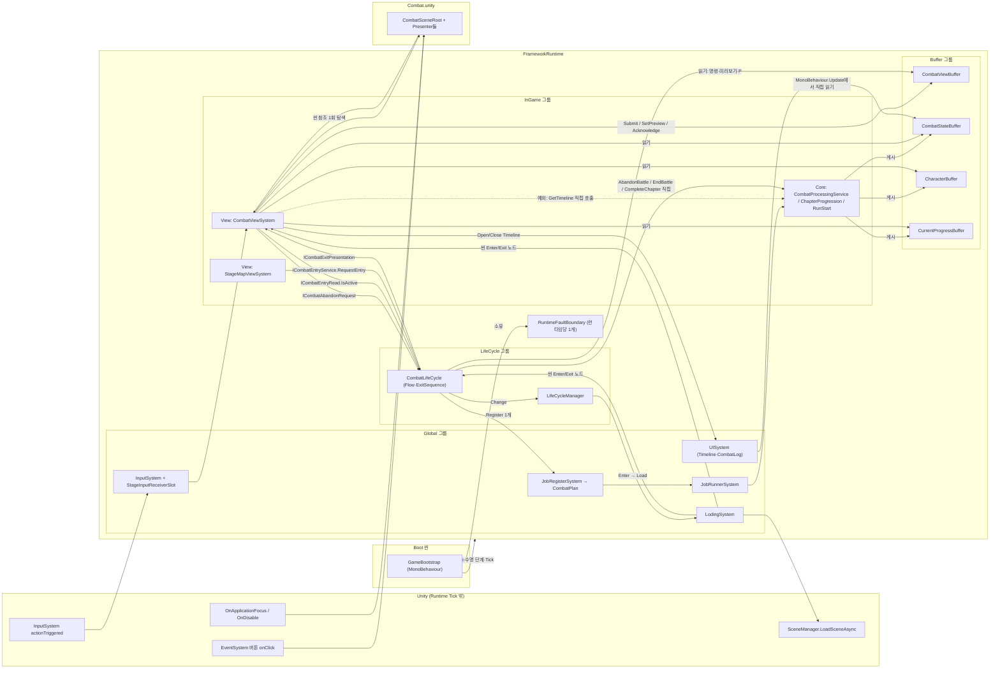

### 1.1 경계 목록

| # | 호출하는 쪽 → 받는 쪽 | 계약 | 방향·데이터 | 코드 |
|---|---|---|---|---|
| B1 | View → 입력 Buffer | `ICombatViewBufferWriteSink` | 명령·미리보기 기록, 처리 번호까지 삭제(`RemoveCommandsThrough`), 결과 확인(`AcknowledgePresented`) | `V/CombatViewSystem.cs:597-598`, Gate·Interaction·PathInput |
| B2 | 골격·Core → 입력 Buffer | `ICombatViewBufferReadSink` | 다음 명령·현재 미리보기·P 읽기 | `LC/CombatFlow.cs:160-186` |
| B3 | Core → 상태 Buffer | `ICombatStateBufferStore`(internal) | 전투 설치·명령 결과·미리보기 응답·완료 게시 | `BUF/Combat/CombatStateBuffer.cs` |
| B4 | View·골격 → 상태 Buffer | `ICombatStateBufferReadSink`·`ICombatResultReadSink` | 국면·S·H·A·Completion·최신 결과 | View `ReadFacts`, Flow, ExitSequence |
| B5 | 골격 → Core(Job 경유) | `ICombatProcessingService` | `EnterBattle`·`ProcessNextCommand`·`ProcessLatestPreview`·`AdvanceCombat` | `LC/Jobs/*.cs` |
| B6 | 골격 → Core(직접) | `ICombatProcessingService`·`IChapterProgressionCoordinator` | `AbandonBattle`·`EndBattle`·`CompleteChapter`·`Outcome` | `LC/CombatExitSequence.cs:210·250·289` |
| B7 | **View → Core(직접, 예외)** | `ICombatProcessingService.GetTimeline` | 결과마다 타임라인 예측 계산 요청 | `V/CombatViewSystem.cs:162·630` |
| B8 | 골격 → View | `ICombatExitPresentation` | 새 제출 정지, 연출 대기 여부, Completion 표시·확인 콜백 | `LC/CombatExitSequence.cs:40-46` |
| B9 | View → 골격 | `ICombatEntryRead`·`ICombatAbandonRequest` | 활성 여부 읽기, 포기 요청 | `V/CombatViewSystem.cs:177-178` |
| B10 | StageMap View → 골격 | `ICombatEntryService` | 진입 요청·취소 | `ViewSystem/StageMap/StageMapEntryFlow.cs:66` |
| B11 | 골격 → Framework | `IJobRegisterSystem`·`IJobRunner`·`ILifeCycleManager`·`ILodingSystemService` | Job 등록·유휴 확인·전환·로딩 확인 | `LC/CombatLifeCycle.cs:62-90` |
| B12 | Unity 입력 → View | `IStageInputReceiver`(슬롯 경유) | 화면 좌표·키 의도 | `ViewSystem/StageInput/*` |
| B13 | Unity UI 버튼 → View | `Action` 콜백(포기·복귀·Completion·개발 패널) | `CombatSceneDisplay`가 버튼에 연결 | `VD/CombatAbandonPanel.cs`, `VD/CombatHud.cs` |
| B14 | View → 씬 | `CombatSceneRoot`(참조 묶음) | 씬 로드 때 한 번 탐색 | `V/CombatViewSystem.cs:510` |
| B15 | View → DB | `IHasViewQuery`(View DB 표 4개) | 필드 설정·유닛 외형·배경 프랍·특성 외형 | `V/CombatViewSystem.cs:140-153` |
| B16 | UI 화면 → 상태 Buffer | `ICombatStateBufferReadSink` 등 | `TimelineUI`·`CombatLogUI`가 `Update()`에서 직접 읽음 | `GlobalSystem/UISystem/Screens/Stage/*` |
| B17 | 모두 → 오류 경계 | `RuntimeFaultBoundary.Report` | 최초 오류 고정·입력 정리·로그 | `Common/RuntimeFaultBoundary.cs` |

---

## 2. 조립과 수명 단계

### 2.1 조립 순서

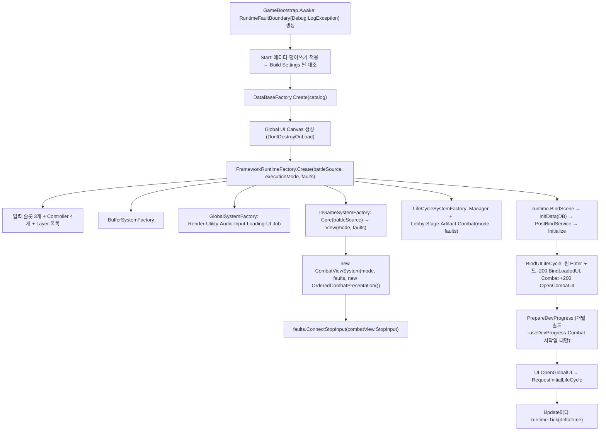

- 실행 모드(`CombatExecutionMode`)와 오류 경계는 **같은 인스턴스**가 View와 LifeCycle에 전달된다(`Factory/Runtime/RunTimeSystemFactory.cs:64-65`).
- `battleSource`는 Core에만 간다. null이면 운영 `DatabaseBattleInitializationSource`가 쓰인다(`Factory/Runtime/InGame/Core/InGameCoreSystemFactory.cs:38-43`).
- 비개발 빌드에서 `RecordInputOnly`로 조립하면 `CombatFlow` 생성자가 예외를 던진다(`LC/CombatFlow.cs:66-70`).

### 2.2 수명 단계별로 전투 모듈이 하는 일

| 모듈 | InitData | PostBindService | Initialize | Tick | Shutdown |
|---|---|---|---|---|---|
| `CombatViewSystem` | View DB 표 4개 보관 | Buffer 싱크 6개, 입력 슬롯·Layer, 로딩 등록, 색, UI, Core `Combat`, `CombatEntry`·`CombatExit` | Combat 씬 Enter(100)·Exit(-100) 노드 등록 | §4.4 | `Detach` → `DisconnectStopInput` |
| `CombatLifeCycle` | — | Buffer 싱크, Runner·Register, Manager, 로딩, `CombatFlow`·`CombatExitSequence` 생성 | Combat 씬 Enter(0)·Exit(0) 노드(Base) → `_ready = true` | 활성일 때 `OnTick`, 항상 `ISystemTick`(진입 확인) | 요청 취소·실패, Flow 정지 |
| `JobRegisterSystem` | — | InGame 그룹·Buffer | 루트별 Plan 사전 등록 | — | Plan 비움 |
| `JobRunnerSystem` | — | — | — | 큐 실행(Tick당 최대 32개) | 큐 비움 |
| `StageMapViewSystem` | (다른 작업자) | `CombatEntry` 보관 | — | 노드 명령 → `RequestEntry` | — |

---

## 3. 프레임 순서와 지연

### 3.1 한 프레임 안의 순서

`FrameworkRuntime.Tick`은 그룹을 등록 순서대로 돈다. 각 그룹 안도 등록 순서다.

| 순서 | 위치 | 전투 관련 동작 |
|---|---|---|
| ① | **Unity 입력 갱신**(Update 전) | `actionTriggered` → `InputSystem` → 현재 Layer가 허용하면 Controller → 슬롯 → `CombatViewSystem.Receive` → Router. **Runtime Tick 밖**이다 |
| ② | `GameBootstrap.Update` → `Runtime.Tick` 시작 | |
| ③ | Global: Render·Utility·Audio·Input | |
| ④ | Global: **Loading** | 씬 로드가 끝났으면 Enter 노드를 우선순위 순서로 실행: -200 UI 바인딩 → 0 `CombatLifeCycle.OnEnter` → 100 `CombatViewSystem.Attach` → 200 CombatLog UI 열기 |
| ⑤ | Global: UI | |
| ⑥ | Global: **JobRunner** | 지난 프레임에 Flow가 등록한 Job 실행 → Core 계산 → Buffer 게시 |
| ⑦ | InGame: Core 그룹 | |
| ⑧ | InGame: **CombatViewSystem.Tick** | 연출 진행 → 포기 버튼 동기화 → 종료면 제출 정지 → 변경 신호 관측 → 설치/정리 → 경로 미리보기 갱신 → 미리보기 응답 반영 → 결과 재생·후처리·확인(P 증가) |
| ⑨ | InGame: StageMapViewSystem 등 | StageSelect에서 진입 요청 |
| ⑩ | LifeCycle: Manager → 활성 구간 `OnTick` | Combat이면 `Flow.Tick`(확인·등록 1개) → Completion 감지 → `Exit.Tick` |
| ⑪ | LifeCycle: `CombatLifeCycle`의 `ISystemTick` | 진입 Job 결과 확인 → `Manager.Change(Combat)` |
| 별도 | `EventSystem.Update`(Unity UI) | 포기·복귀·Completion·개발 패널 버튼 콜백. `GameBootstrap.Update`와의 선후는 Script Execution Order로 정해지지 않았다 |
| 별도 | `TimelineUI.Update`·`CombatLogUI.Update` | Buffer를 직접 읽는다. `TimelineUI`는 매 프레임 다시 그리고, `CombatLogUI`는 기록 수가 그대로면 바로 반환한다 |

### 3.2 입력 하나가 화면에 반영되기까지

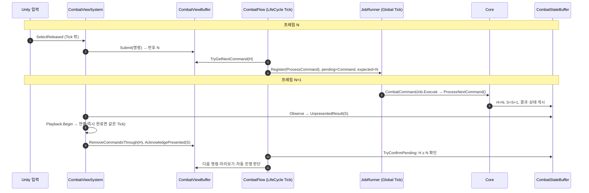

- **최소 지연:** 입력 → Core 처리 → 화면 반영은 **1프레임**이다(등록 프레임 N, 실행·표시 프레임 N+1). 연출 시간이 있으면 그만큼 늘어난다.
- **자동 진행(적 턴 등):** `AdvanceCombat` 한 걸음마다 등록(프레임 k) → 실행(k+1) → 연출 완료 → 다음 등록이다. 걸음당 최소 1프레임에 연출 시간이 더해진다.
- **미리보기:** 연출 중에도 등록된다(상태를 바꾸지 않으므로). 명령은 연출이 끝난 뒤(`P ≥ S`)에만 등록된다.

---

## 4. 클래스 상세

### 4.1 골격: 진입·진행·이탈

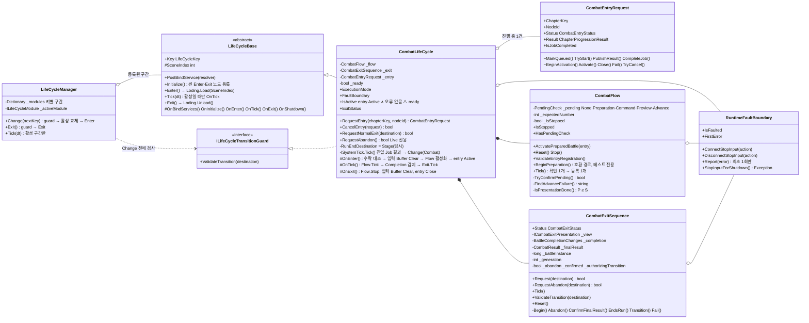

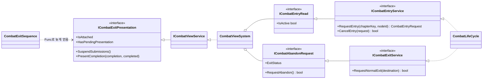

`CombatExitSequence` 생성자는 13개 인자를 받는다: Buffer 읽기 4개, Runner, Core 서비스 2개, 오류 경계, 그리고 **대리자 5개**(`_entry`·`_getView`·`_stopFlow`·`_registerNewRun`·`_change`). 이 대리자 덕분에 ExitSequence는 LifeCycle·View 구체 타입을 모른다(`LC/CombatLifeCycle.cs:86-89`).

### 4.2 Plan·Job·Runner

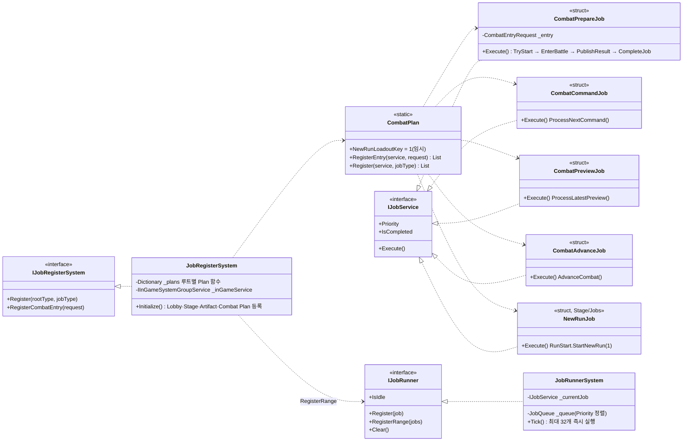

| `JobType` | 등록하는 곳 | 만드는 Job | Core 호출 | Flow의 확인 조건 |
|---|---|---|---|---|
| (진입 전용) | `CombatLifeCycle.RequestEntry` → `RegisterCombatEntry` | `CombatPrepareJob(entry)` | `EnterBattle(chapter, node)` | LifeCycle `ISystemTick`이 `IsJobCompleted`·`Status` 확인 |
| `Start` | `CombatFlow.BeginPreparation`(**테스트에서만 호출**) | `CombatPrepareJob()` | `PrepareBattle()` | `HasBattle` |
| `ProcessCommand` | `CombatFlow.Tick` | `CombatCommandJob` | `ProcessNextCommand()` | `H ≥ 기대 번호` |
| `ProcessPreview` | `CombatFlow.Tick` | `CombatPreviewJob` | `ProcessLatestPreview()` | `A ≥ 기대 번호` 또는 요청이 바뀜/비워짐 |
| `AdvanceCombat` | `CombatFlow.Tick` | `CombatAdvanceJob` | `AdvanceCombat()` | 등록 때 S보다 커졌고, 최신 결과가 Advance이고 수락됨 |
| `NewRun` | `CombatExitSequence`(대리자) | `NewRunJob(1)` | `RunStart.StartNewRun(1)` | ExitSequence가 `Outcome == InProgress ∧ !HasBattle` 확인 |

- Job은 반환값을 해석하지 않는다. `false`도 정상 완료다. 결과 판단은 Flow가 Buffer로 한다(설계 K14).
- Job은 `struct`지만 `IJobService`로 상자에 담겨 큐에 들어가므로 `Execute`가 바꾼 `IsCompleted`가 유지된다.
- Job이 예외를 던지면 Runner의 현재 Job이 남는다. `GameBootstrap.Update`가 잡아 오류 경계에 보고하고 이후 Tick을 멈춘다(`ViewSystem/Boot/GameBootstrap.cs:174-178`).

### 4.3 Buffer 계약

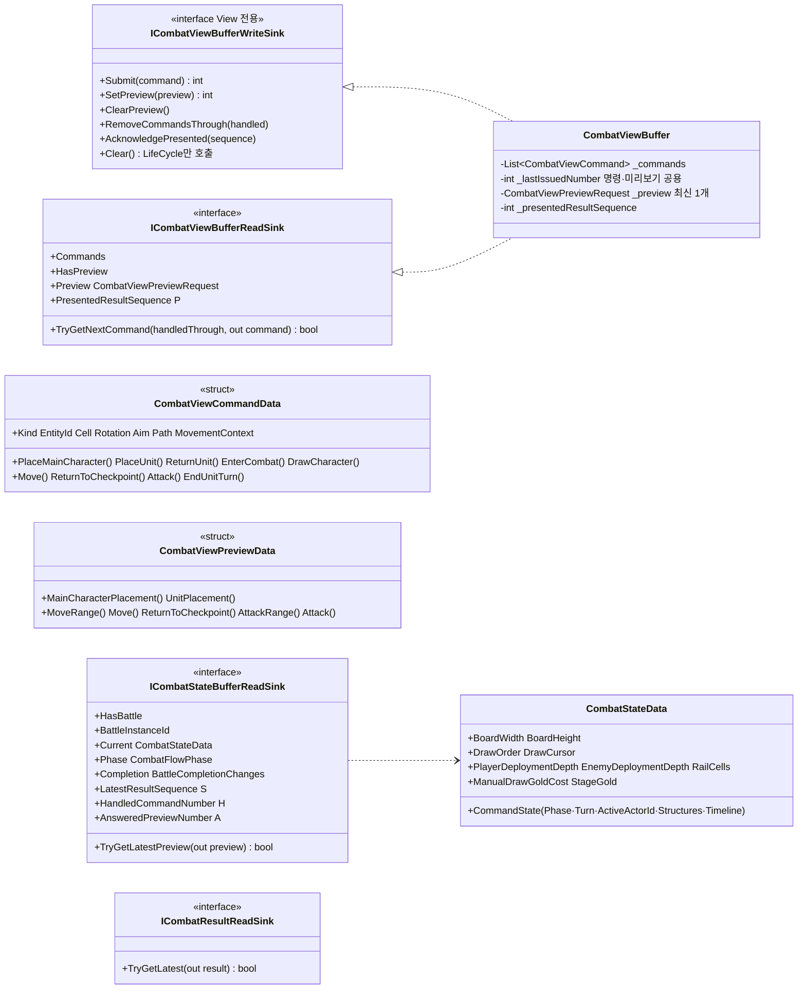

- 명령과 미리보기는 **같은 번호 카운터**를 쓴다. 그래서 번호만으로 명령과 미리보기의 앞뒤를 비교할 수 있다.
- 미리보기 요청은 **최신 하나**만 있다. 새 요청이 이전 요청을 덮는다. 그래서 각 입력 소유자는 "Buffer의 현재 요청 번호 == 내가 받은 번호"일 때만 자기 요청을 지운다(`ClearOwnedPreview` 패턴).
- `Clear()`는 명령과 미리보기만 비운다. 번호 카운터와 P는 유지한다. 호출자는 `CombatLifeCycle.OnEnter`·`OnExit`뿐이다.

### 4.4 View 조정자: `CombatViewSystem`

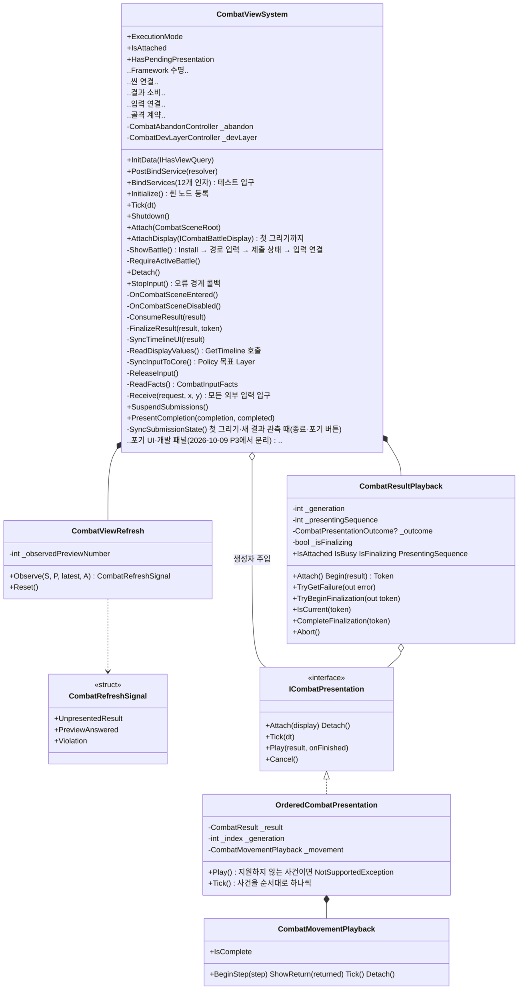

`CombatViewSystem.Tick` 순서(2026-10-09 P4 반영: 첫 그리기는 Attach, 포기·종료 동기화는 이벤트 시점, 개선 설계 D9·D12·D13):

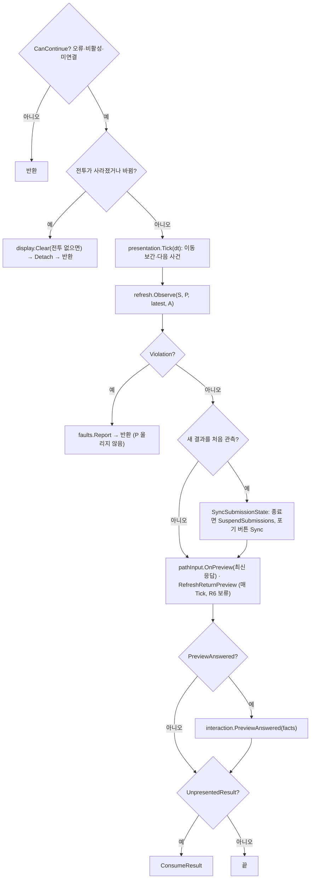

첫 그리기(`ShowBattle`)는 `AttachDisplay` 끝에서 한다: Install → 경로 입력 생성 → `SyncSubmissionState` → `SyncInputToCore`. 포기 버튼은 첫 그리기·새 결과 관측·`SuspendSubmissions`(골격 이탈 시작)·`StopInput`에서만 맞춘다.

`ConsumeResult` → `FinalizeResult` 순서(`V/CombatViewSystem.cs:535-602`). 외부 호출에서 돌아올 때마다 토큰을 다시 확인하고, **모두 성공했을 때만** P를 올린다.

```text
Playback 유휴?  ─예→ pathInput.CancelInputs → Playback.Begin(result) → Presentation.Play
                └아니오→ 재생 중 번호 ≠ result.Sequence 이면 오류
실패 통지?      ─예→ 오류 보고(확인 안 함)
완료 통지?      ─예→ TryBeginFinalization(token)
  1 display.Refresh(ReadDisplayValues())   ← Buffer 값 + GetTimeline
  2 SyncTimelineUI(result)                 ← 시작이면 Timeline UI 열기, 종료·배치 복귀면 닫기
  3 gate.Resolve(result)                   ← 같은 번호의 시작/턴 종료 대기 해제
  4 SyncInputToCore()                      ← 현재 Core 단계로 Layer 맞춤
  5 interaction.AfterResult(facts)         ← 무효가 된 Drag·모드 정리, 남은 것은 새 번호로 재요청
  6 inputWrite.RemoveCommandsThrough(H)
  7 inputWrite.AcknowledgePresented(S)     ← P = S
  8 playback.CompleteFinalization(token)
```

### 4.5 View 입력

```mermaid
classDiagram
    direction LR
    class IStageInputReceiver {
        <<interface>>
        +PointerMoved SelectPressed SelectReleased SelectCanceled
        +Cancel EnterCombatRequested DrawRequested
        +EndTurnRequested MoveModeRequested AttackModeRequested RequestReturn
    }
    class StageInputReceiverSlot {
        -IStageInputReceiver _receiver
        -IStageInputReceiver _selectOwner
        +Bind(receiver) Unbind(receiver) SelectCanceled 1회
    }
    class CombatInputRouter {
        +enum Request 12종
        +enum PointerTarget None·Placement·Attack·Path
        +ResolvePointerTarget(layer, attackActive, mode)$
        +SetPathInput(path)
        +Route(request, x, y, characters)
        -RoutePointer()
    }
    class CombatInputFacts {
        <<struct, 매번 새로 읽음>>
        +IsBattleDisplayed HasBattle Phase StagePhase HasCompletion
        +ExecutionMode CurrentLayer S P IsFinalizing ActiveActorId
        +HasUnhandledCommand PreviewAnswer HasPendingCommand
        +IsPresenting IsInputAvailable IsPathTarget
    }
    class CombatInputPolicy {
        <<static, 무상태>>
        +IsTerminal(facts)
        +GetDesiredLayer(facts)
        +CanSubmit(facts, pending, kind)
        +CanPreview(facts, pending, kind)
        +CanEditPath(facts)
        +CanRequestAbandon(facts, exitIdle)
        +CanChangeDevLayer(facts, pending)
        +StageOf(kind) LayerOf(stage)
    }
    class CombatCommandGate {
        -PendingInputCommand? _pending
        +HasPending Pending
        +TrySubmit(facts, command) int
        +SubmitPending(facts, command) bool
        +Resolve(result)
        +Clear()
    }
    class CombatInteraction {
        +IsAttackActive Drag Mode HasRangeAnswer
        +PointerMoved/SelectPressed/SelectReleased(target, facts, ...)
        +SelectCanceled() Cancel()
        +AttackModeRequested(facts)
        +PreviewAnswered(facts, characters)
        +AfterResult(facts, characters)
        +CancelPresentation() Stop()
    }
    class PlacementDragInteraction {
        -bool _dragging
        -EntityId _dragEntity
        -bool _dragIsMain _dragFromField
        -int _previewRequestNumber
        -CombatHoverTracker _hover
        +PointerMoved SelectPressed SelectReleased
        +PreviewAnswered(answer) bool
        +AfterResult() Cancel() CancelPresentation()
    }
    class AttackTargetingInteraction {
        -bool _active
        -EntityId _actor _recordActor
        -int _rangeRequestNumber _hoverRequestNumber
        -AttackAim[] _attackAims
        -bool _rangeAnswered _canAffordAttack
        +CanEnter(facts, out actor) Enter(facts, actor) Exit()
        +PointerMoved SelectPressed SelectReleased
        +PreviewAnswered(facts, characters) bool
        +AfterResult(facts) ClearRecordActor()
        -AimFor() NearestDirectionAim()
    }
    class CombatPathInput {
        -CombatMovementInteraction _interaction
        -long _battle
        -EntityId _pathActor
        -bool _waitingForOrigin
        -int _returnRequest
        -bool _returnWanted
        +BeginPlanning() Q
        +PointerMoved SelectPressed SelectReleased(빈 동작)
        +OnPreview(preview) RefreshReturnPreview() RequestReturn()
        +Cancel() CancelInputs() Detach()
        -AllowsInput() IsInputAvailable ∧ IsPathTarget ∧ CanEditPath
    }
    class CombatMovementInteraction {
        -MovementDraft Draft
        -int _requestNumber _submittedNumber
        -bool _frozen
        -MovementPreviewContext _context
        +Begin(actor, origin, grid, allowed) bool
        +PointerMoved(grid, cancel, allowed)
        +OnPreview(result, allowed)
        +Confirm(cell, cancel, allowed)
        +Cancel() Attach() Detach()
    }
    IStageInputReceiver <|.. StageInputReceiverSlot
    IStageInputReceiver <|.. CombatViewSystem
    StageInputReceiverSlot o-- IStageInputReceiver : 연결된 View
    CombatViewSystem *-- CombatInputRouter : Attach 수명
    CombatViewSystem *-- CombatCommandGate : Attach 수명
    CombatViewSystem *-- CombatInteraction : Attach 수명
    CombatViewSystem *-- CombatPathInput : 전투 설치 수명
    CombatInputRouter o-- CombatInteraction
    CombatInputRouter o-- CombatCommandGate
    CombatInputRouter o-- CombatPathInput
    CombatInteraction *-- PlacementDragInteraction
    CombatInteraction *-- AttackTargetingInteraction
    PlacementDragInteraction o-- CombatCommandGate
    AttackTargetingInteraction o-- CombatCommandGate
    CombatPathInput *-- CombatMovementInteraction
    CombatCommandGate ..> CombatInputPolicy
    PlacementDragInteraction ..> CombatInputPolicy
    AttackTargetingInteraction ..> CombatInputPolicy
    CombatPathInput ..> CombatInputPolicy
```

**Router 분배표**(`V/CombatInputRouter.cs:89-142`)

| 요청 | 처리 순서 | 제출 경로 |
|---|---|---|
| `FocusLost` | 경로 입력 취소 → Interaction 표시 정리 | 없음 |
| `SelectCanceled` | 경로 입력 취소 → 배치 Drag 취소 | 없음 |
| `Cancel` | Interaction 취소(Drag 우선, 없으면 공격 모드 종료) → 경로 취소 | 없음 |
| `Return` | `PathInput.RequestReturn` | 복귀 미리보기 → 응답이 가능이면 `ReturnToCheckpoint` 직접 제출 |
| `EnterCombat` | Gate `SubmitPending` 성공 시 Interaction 표시 정리 | Gate(대기 기록) |
| `Draw` | Gate `TrySubmit` | Gate |
| `EndTurn` | 경로 취소 → **사실을 다시 읽고** Gate `SubmitPending` → 성공 시 표시 정리 | Gate(대기 기록) |
| `MoveMode`(Q) | Interaction 표시 정리 → `PathInput.BeginPlanning` | — |
| `AttackMode`(E) | 경로 취소 → `AttackModeRequested(facts)` | — |
| 포인터 3종 | `ResolvePointerTarget` → Path면 `PathInput`, 아니면 `Interaction`(Placement·Attack) | 배치·공격은 Gate, 이동은 직접 |

**포인터 대상 판정**(`ResolvePointerTarget`, `V/CombatInputRouter.cs:69`)

| 실제 Layer | 공격 모드 | 실행 모드 | 대상 |
|---|---|---|---|
| Deployment | — | — | Placement |
| Combat | 켜짐 | — | Attack |
| Combat | 꺼짐 | RecordInputOnly | Attack(기록용 행위자 선택 때문) |
| Combat | 꺼짐 | Live | Path |
| 없음·기타 | — | — | None |

**명령 제출 경로는 두 갈래다.**

| 경로 | 명령 | 마지막 검사 |
|---|---|---|
| Gate(`CombatCommandGate.TrySubmit`) | 배치·손패 복귀·전투 시작·드로우·공격·턴 종료 | `CombatInputPolicy.CanSubmit(facts, gate.HasPending, kind)` |
| 경로 입력 직접(`CombatMovementInteraction.SubmitFrozen`, `CombatPathInput.HandleReturnPreview`) | `Move`, `ReturnToCheckpoint` | `AllowsInput()` = 입력 가용 ∧ 경로 대상 ∧ `CanEditPath`(내부에서 `CanSubmit(Move)`) + Core가 준 `MovementPreviewContext`의 전투·행위자·의도·경로 일치 |

### 4.6 View 표시

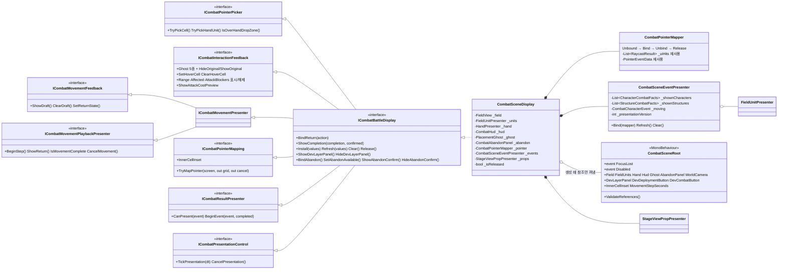

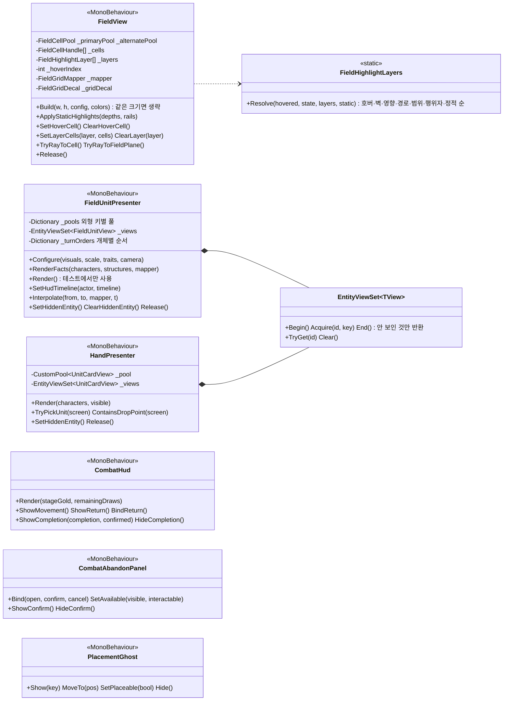

---

## 5. 시나리오별 시퀀스

### 5.1 Boot에서 개발 전투로 바로 시작

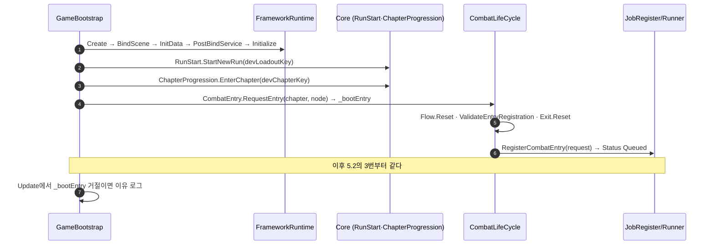

- `useDevProgress`가 꺼져 있고 Combat으로 시작하면 예외로 시작이 멈춘다(`ViewSystem/Boot/GameBootstrap.cs:313`). Stage로 시작하면 `Manager.Change(Stage)`만 한다.
- `devBattleDefinition = Fixture`면 `DevBattleInitializationSource`, `Database`면 null(운영 DB 소스)이 Core에 들어간다.

### 5.2 StageSelect 노드 → 전투 활성화

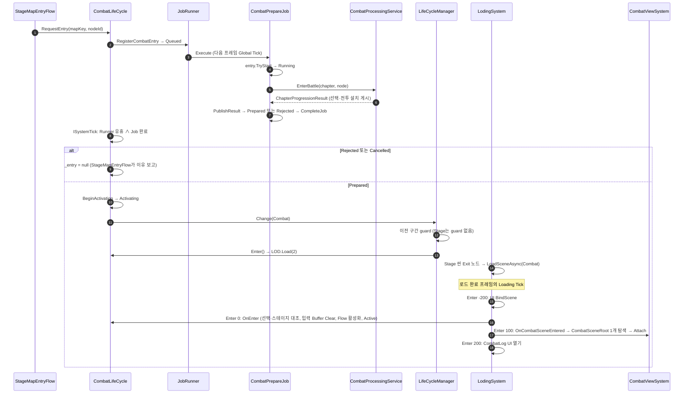

- `RequestEntry`가 거부하는 조건: 초기화 전(예외), 오류 상태(Faulted로 반환), 다른 요청이 진행 중(같은 대상의 Queued면 그 요청 반환, 아니면 예외), Runner·로딩·Flow 확인이 진행 중(예외).
- `OnEnter`의 대조 조건: 요청이 수락됐고 Activating이며 Job 완료, `Current`의 맵·노드·스테이지 키가 요청·결과와 같음(`LC/CombatLifeCycle.cs:193-212`).

### 5.3 씬 연결 → 첫 표시 → 입력 연결

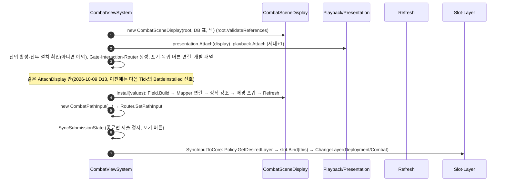

입력은 **처음 그리기에 성공한 뒤에만** 연결된다. 그 전에 들어온 입력은 `Receive`의 `_isInputBound` 검사에서 버려진다.

### 5.4 배치 Drag(미리보기 왕복 + 명령)

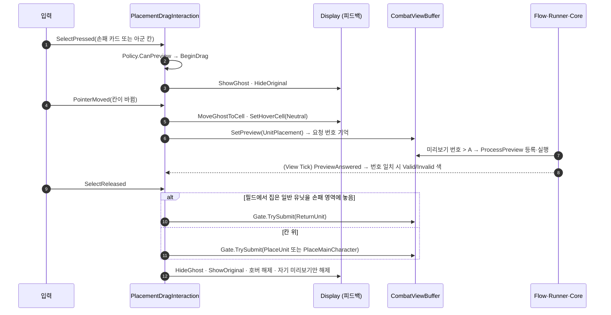

- 5픽셀 안에서 떼면 클릭으로 보고 집은 채로 다음 누름·뗌에서 놓는다(`ClickMovementThreshold`).
- 결과 후처리(`AfterResult`)에서 집은 유닛이 사라졌거나 위치 영역이 바뀌면 Drag를 끝내고, 남아 있으면 같은 칸으로 새 번호를 다시 요청한다.

### 5.5 공격 조준

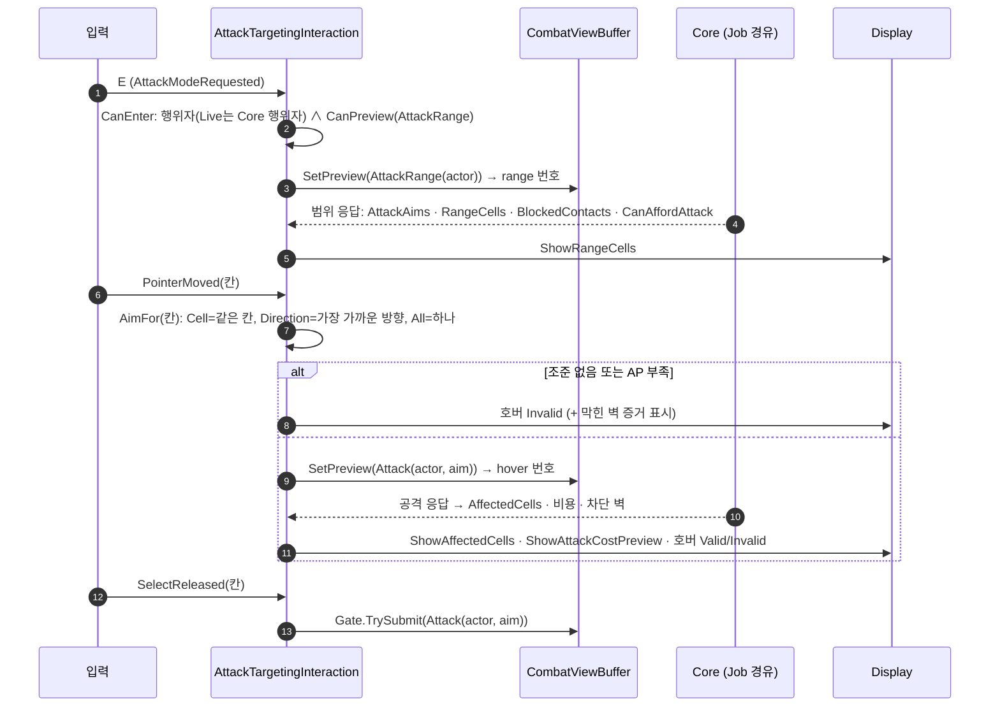

- 범위 응답을 받기 전에는 호버 요청·제출을 하지 않는다. RecordInputOnly는 Core가 응답하지 않으므로 칸 조준으로 바로 기록한다.
- 결과 후처리 때 행위자·Layer가 그대로면 범위를 버리고 **새 번호로 다시 요청**한다. 바뀌었으면 모드를 끝낸다.

### 5.6 이동 경로와 체크포인트 복귀

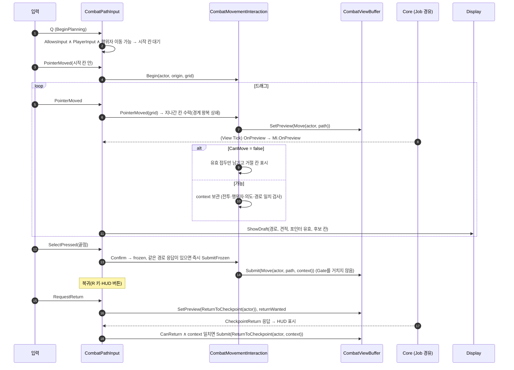

- 매 Tick `RefreshReturnPreview`가 대기 중인 이동이 있는 행위자의 복귀 가능 여부를 미리보기로 갱신한다(복귀 버튼 표시용).
- 결과를 재생하기 시작할 때(`ConsumeResult`) 경로 입력은 모두 취소된다.

### 5.7 전투 시작·턴 종료 대기와 자동 진행

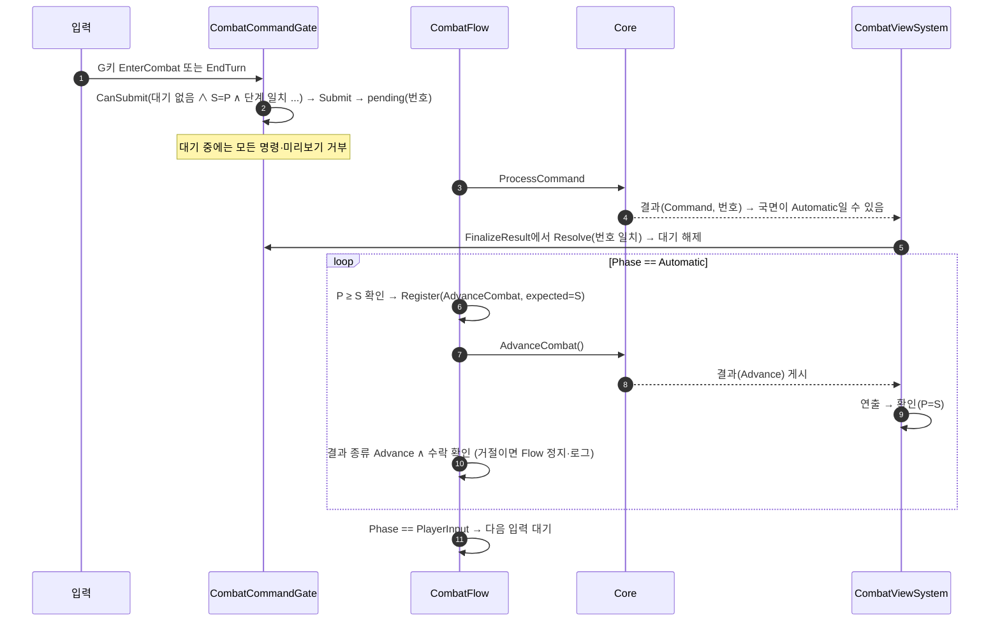

### 5.8 결과 하나의 연출 내부

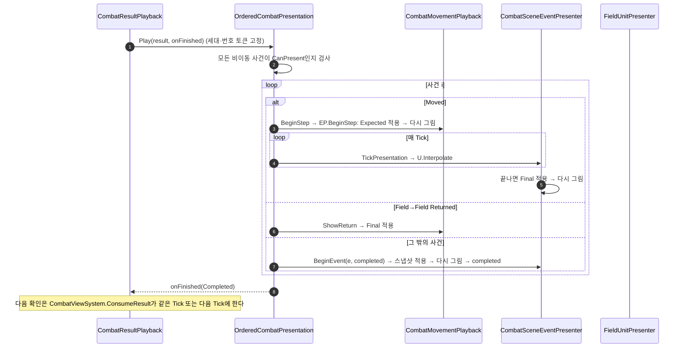

비이동 사건은 지금 **즉시 완료**된다(애니메이션 없음). 비이동 연출을 넣으려면 `BeginEvent`의 `completed`를 연출이 끝날 때 부르면 된다. 순서·확인 코드는 바꾸지 않는다.

### 5.9 승패 결정 → 정상 이탈

```mermaid
sequenceDiagram
    autonumber
    actor Player
    participant LC as CombatLifeCycle
    participant X as CombatExitSequence
    participant V as CombatViewSystem
    participant Core as Core
    participant RUN as Runner
    participant MGR as Manager/Loading
    Core-->>LC: Completion 게시 (일반 결과 처리 중)
    LC->>LC: OnTick: Flow 확인 끝 ∧ Exit Idle ∧ Completion ≠ 포기
    LC->>X: RequestNormalExit(Stage) → Request
    X->>X: entry Active ∧ HasBattle ∧ View 연결 ∧ 대상 일치
    X->>LC: stopFlow()
    X->>V: SuspendSubmissions() → Draining
    Note over X: Runner 유휴 ∧ 연출 대기 없음 ∧ P ≥ S 까지 매 Tick 대기
    X->>X: ConfirmFinalResult: 최신 결과 수락 ∧ 순번 일치 ∧ Outcome == Completion
    X->>V: PresentCompletion(completion, 콜백) → Presenting
    V-->>Player: HUD "승리/패배 · 결과 확인"
    Player->>V: 버튼
    V-->>X: 콜백 → _confirmed (같은 세대일 때만)
    Note over X: 다음 Tick
    X->>Core: EndBattle() → Ending
    X->>X: 정리 확인: 전투 없음 ∧ 캐릭터 0 ∧ Runner 유휴 ∧ Completion·최종 결과·S·P 보존
    alt Run 종료 (보스 승리면 CompleteChapter 결과, 아니면 RunOutcome)
        X->>RUN: Register(Combat, NewRun) → PreparingNewRun
        RUN->>Core: StartNewRun(1)
        X->>X: Runner 유휴 ∧ Outcome InProgress ∧ 전투 없음
    end
    X->>MGR: Transitioning → authorizing → Change(Stage)
    MGR->>LC: ValidateTransition(Stage) 통과
    MGR->>MGR: Stage Enter → Load(1) → Combat Exit 노드: -100 View.Detach, 0 LC.OnExit
```

- EndBattle 뒤 `HasBattle == false`가 되면 **View는 다음 Tick에서 스스로 `Clear` → `Detach`** 한다(`V/CombatViewSystem.cs:229-235`). Run이 끝나 `NewRunJob`을 기다리는 동안에는 전투 화면이 빈 상태로 1프레임 이상 보일 수 있다. 의도한 동작인지 Unity에서 확인이 필요하다.
- 이탈 목적지는 `Stage`·`Lobby`·`Artifact`만 허용한다(`LC/CombatExitSequence.cs:300-304`). Run 종료 목적지(`RunEndDestination`)도 지금은 `Stage`다(임시).

### 5.10 포기

```mermaid
sequenceDiagram
    autonumber
    actor Player
    participant V as CombatViewSystem
    participant LC as CombatLifeCycle
    participant X as CombatExitSequence
    participant Core as Core
    V->>V: 포기 버튼 Sync(첫 그리기·새 결과·이탈 시작 때): Live ∧ 전투 표시됨 ∧ 종료 아님 ∧ Exit Idle
    Player->>V: 포기 버튼 (EventSystem)
    V->>V: 다시 검사 → Drag·조준·경로 정리 → 확인창 (열린 동안 입력 무시)
    Player->>V: 확인
    V->>V: 확인창 닫기 → 다시 검사
    V->>LC: ICombatAbandonRequest.RequestAbandon()
    LC->>X: RequestAbandon(RunEndDestination) (Live만)
    X->>X: Completion 없음 확인 → Begin(abandon) → Draining
    Note over X: 남은 Job·연출이 끝날 때까지 대기
    X->>Core: AbandonBattle()
    alt Abandoned
        X->>X: Completion = 패배·VoluntaryAbandonment, 결과·S 그대로인지 확인
    else AlreadyCompleted
        X->>X: 대기 중 실제 승패가 났음 → 그 결과로 정상 이탈(ConfirmFinalResult)
    else 그 밖
        X->>X: 예외 → Failed
    end
    Note over X: 이후 5.9의 Presenting부터 같다 (HUD 문구 "포기 · 결과 확인")
```

### 5.11 오류 정지(F1)

```mermaid
sequenceDiagram
    autonumber
    participant Any as 어디서든 (Tick·Unity 콜백·Job)
    participant FB as RuntimeFaultBoundary
    participant V as CombatViewSystem
    participant GB as GameBootstrap
    Any->>FB: Report(error)
    FB->>FB: 이미 오류면 무시 / IsFaulted = true, FirstError 고정
    FB->>V: StopInput(): 재생 Abort → 연출 Cancel → 입력 정리 → Gate Clear → 슬롯 Unbind·ClearLayer → 패널 숨김
    FB->>FB: 로그 1회 (정리 실패가 있으면 AggregateException)
    GB->>GB: 다음 Update부터 Tick 호출 안 함
    Note over Any: Flow·Exit·View·LifeCycle은 IsFaulted를 보고 아무것도 하지 않는다
```

| 오류가 나는 곳 | 잡는 곳 |
|---|---|
| Tick 안(Runner Job, Flow, View Tick, Loading 노드) | `GameBootstrap.Update`의 catch → `Report` |
| View 입력 콜백(`Receive`)·포기·개발 패널·Completion 확인 | 각 입구의 try/catch → `Report` |
| 씬 비활성화(`CombatSceneRoot.OnDisable`) | `OnCombatSceneDisabled` → `Report` |
| `CombatExitSequence` 내부 | `Fail` → `Status = Failed` + `Report` |
| `CombatFlow` 확인 실패(예상한 계약 위반) | **예외 아님.** `Debug.LogError` 후 Flow만 정지(`IsStopped`) |
| View 결과 계약 위반·연출 실패 | `Report`(P를 올리지 않음) |

---

## 6. 상태 기계

### 6.1 `CombatEntryStatus`

```mermaid
stateDiagram-v2
    [*] --> Created
    Created --> Queued: RegisterCombatEntry
    Created --> Cancelled: TryCancel
    Queued --> Cancelled: TryCancel (실행 전)
    Queued --> Running: Job TryStart
    Running --> Prepared: EnterBattle 수락
    Running --> Rejected: EnterBattle 거절
    Prepared --> Activating: ISystemTick (Job 완료)
    Activating --> Active: OnEnter 성공
    Active --> Closed: OnExit
    Created --> Faulted: 오류
    Queued --> Faulted: 등록 실패
    Running --> Faulted: Job 예외
    Activating --> Faulted: OnEnter 예외
    Rejected --> [*]: LifeCycle이 놓음
    Cancelled --> [*]: LifeCycle이 놓음
```

### 6.2 `CombatFlow`

```mermaid
stateDiagram-v2
    [*] --> Stopped: 생성 직후 Stop
    Stopped --> Idle: ActivatePreparedBattle (Reset)
    Idle --> WaitCommand: 명령 등록 (P ≥ S)
    Idle --> WaitPreview: 미리보기 등록 (번호 > A)
    Idle --> WaitAdvance: Automatic ∧ P ≥ S
    WaitCommand --> Idle: Runner 유휴 ∧ H ≥ 기대
    WaitPreview --> Idle: A ≥ 기대 또는 요청 교체
    WaitAdvance --> Idle: S 증가 ∧ Advance 수락
    WaitCommand --> Stopped: 확인 실패 (LogError)
    WaitPreview --> Stopped: 확인 실패
    WaitAdvance --> Stopped: 확인 실패·거절
    Idle --> Stopped: Stop (이탈 시작·OnExit)
```

한 Tick에는 확인 하나와 등록 하나까지만 한다. RecordInputOnly는 Idle에서 아무것도 등록하지 않는다.

### 6.3 `CombatExitStatus`

```mermaid
stateDiagram-v2
    [*] --> Idle
    Idle --> Draining: Request / RequestAbandon
    Draining --> Abandoning: 포기, 대기 끝
    Abandoning --> Presenting: AbandonBattle 확인
    Draining --> Presenting: 최종 결과 확인
    Presenting --> Ending: 사용자 확인 뒤 다음 Tick
    Ending --> PreparingNewRun: EndBattle ∧ Run 종료
    Ending --> Transitioning: EndBattle ∧ Run 계속
    PreparingNewRun --> Transitioning: NewRunJob 완료
    Draining --> Failed: 예외
    Abandoning --> Failed: 예외
    Presenting --> Failed: 예외
    Ending --> Failed: 예외
    PreparingNewRun --> Failed: 예외
    Transitioning --> Failed: Change 실패
    Transitioning --> Idle: 다음 진입의 Reset
```

### 6.4 `CombatResultPlayback`

```mermaid
stateDiagram-v2
    [*] --> Detached
    Detached --> Idle: Attach (세대+1)
    Idle --> Playing: Begin(result)
    Playing --> Completed: 완료 통지 (토큰 일치)
    Playing --> Failed: 실패 통지·중복 통지·잘못된 통지
    Completed --> Finalizing: TryBeginFinalization
    Finalizing --> Idle: CompleteFinalization (P = S 뒤)
    Failed --> Detached: 오류 경계 → StopInput → Abort
    Playing --> Detached: Abort
    Finalizing --> Detached: Abort
    Idle --> Detached: Abort (Detach·StopInput)
```

### 6.5 입력 소유자

```mermaid
stateDiagram-v2
    state "배치 Drag" as PD {
        [*] --> NotDragging
        NotDragging --> Dragging: 누름 ∧ CanPreview
        Dragging --> Dragging: 칸 변경 → 미리보기 재요청
        Dragging --> NotDragging: 뗌(제출) / 취소 / 결과 후 무효
    }
    state "공격 모드" as AT {
        [*] --> Off
        Off --> AwaitRange: E ∧ CanEnter
        AwaitRange --> Ready: 범위 응답
        Ready --> Ready: 호버 → 공격 미리보기
        Ready --> AwaitRange: 결과 후 재요청
        AwaitRange --> Off: 취소 / Layer·행위자 변경
        Ready --> Off: 취소 / Layer·행위자 변경
    }
    state "경로 입력" as PI {
        [*] --> None
        None --> WaitOrigin: Q ∧ 허용
        WaitOrigin --> Drafting: 시작 칸에서 이동
        Drafting --> Frozen: 끝점 누름
        Frozen --> Submitted: 같은 경로 응답 → Submit
        Drafting --> None: 취소·허용 깨짐
        Frozen --> None: 취소
        Submitted --> None: 결과 재생 시작(CancelInputs)
    }
```

### 6.6 `CombatViewSystem` 연결 상태

| 상태 | 조건 | 입력 | 결과 소비 |
|---|---|---|---|
| 미연결 | `_display == null` | 무시 | 안 함 |
| (없음) 연결·미표시 | 2026-10-09 D13부터 첫 그리기는 Attach 안에서 끝난다. Install 실패 시에만 표시 연결만 남고 입력은 연결되지 않는다 | 연결 안 됨 | 안 함 |
| 입력 중 | 설치 뒤, Layer 연결 | Router로 | 함 |
| 제출 정지 | `_submissionsSuspended`(종료·이탈) | Layer 해제 | **계속 함** |
| 포기 확인창 | `_abandonConfirmOpen` | FocusLost·SelectCanceled만 | 함 |
| 오류 정지 | `faults.IsFaulted` | 무시 | 안 함 |

---

## 7. 데이터 소유권(SSOT)

| 사실 | 원본 | 쓰는 곳 | 읽는 곳 | 비고 |
|---|---|---|---|---|
| 명령 목록·번호 | `CombatViewBuffer` | View(Gate·경로 입력) | Flow, Core | 삭제는 View가 H까지 |
| 미리보기 요청(최신 1개) | `CombatViewBuffer` | View(소유자별) | Flow, Core | 자기 번호일 때만 해제 |
| P | `CombatViewBuffer` | `CombatViewSystem.FinalizeResult`만 | Flow, ExitSequence, View | 줄어들면 예외 |
| H·A·S·국면·Completion·전투 상태 | `CombatStateBuffer` | Core | View, Flow, ExitSequence, UI | |
| 캐릭터 | `CharacterBuffer` | Core | View, ExitSequence, UI | |
| 현재 맵·선택 | `CurrentProgressBuffer` | Core | LifeCycle(대조), View(배경 프랍) | |
| 스테이지 골드 | `CombatStateData.StageGold` | Core | `CombatDisplayValues.StageGold`(계산 속성) | 중복 정리 완료(§7.60) |
| 시작/턴 종료 대기 | `CombatCommandGate._pending` | Gate | Facts(사본) | |
| 결과 재생 중 번호·세대 | `CombatResultPlayback` | Playback | ViewSystem | 영구 완료 번호는 두지 않음(P가 원본) |
| 전투 표시 여부 | `CombatViewSystem._battleShown`(2026-10-09 D13) | 첫 그리기 성공 시 true, Detach 시 false | Facts | |
| 공격 범위 응답 캐시 | `AttackTargetingInteraction` | 공격 소유자 | 공격 소유자 | 모드 수명, 결과 후 폐기 |
| 진입 요청·결과 | `CombatEntryRequest` | Job·LifeCycle | StageMap, Bootstrap, View(IsActive) | |
| 이탈 단계 | `CombatExitSequence.Status` | ExitSequence | View(포기 버튼) | |
| **턴 순서(타임라인)** | **둘로 나뉨** | Core | HUD는 `GetTimeline()` 예측(직접 호출), `TimelineUI`는 `CommandState.Timeline`(Buffer) | 평가 문서 E1 |
| 실행 모드 | 조립 때 고정 | Factory | Flow, View, LifeCycle | 런타임 중 불변 |
| 최초 오류 | `RuntimeFaultBoundary` | `Report` | 모든 모듈 | 되돌리지 않음 |

## 8. 코드가 지키는 불변식

| # | 불변식 | 지키는 곳 |
|---|---|---|
| I1 | 한 Tick에 Flow는 Job을 하나만 등록한다 | `CombatFlow.Tick` 반환 위치 |
| I2 | Runner가 일하는 동안 Flow는 확인·등록하지 않는다 | `CombatFlow.Tick:147` |
| I3 | 상태를 바꾸는 Job은 `P ≥ S`일 때만 등록한다(최신 결과가 확인 전에 덮이지 않게) | `IsPresentationDone` |
| I4 | 확인 안 된 결과는 최대 하나(`S - P ≤ 1`). 어기면 오류 | `CombatViewRefresh.FindViolation` |
| I5 | P는 Refresh·대기 해제·Layer·재요청·명령 삭제가 모두 성공한 뒤에만 오른다 | `FinalizeResult` |
| I6 | 시작/턴 종료 대기 중에는 새 명령·미리보기를 받지 않는다 | `CombatInputPolicy.PassesCommon` |
| I7 | 입력은 첫 표시 뒤에만 연결된다 | `ShowBattle`이 Install 성공 뒤 `SyncInputToCore` 호출 |
| I8 | 종료(Finished 또는 Completion) 뒤 새 입력은 받지 않지만, 남은 결과는 끝까지 확인한다 | `IsTerminal` → `SuspendSubmissions` |
| I9 | Combat 이탈은 ExitSequence가 허가한 `Change`로만 가능하다 | `ILifeCycleTransitionGuard` |
| I10 | 포기는 Completion이 없을 때만, Live에서만 받는다 | `RequestAbandon`, `CanRequestAbandon` |
| I11 | 씬 오브젝트 탐색은 씬 로드 때 한 번뿐이다 | `OnCombatSceneEntered` |
| I12 | 오류는 런타임당 한 번만 보고·정리한다 | `RuntimeFaultBoundary.Report` |
| I13 | 늦게 온 연출 통지·Completion 확인은 세대·토큰으로 버린다 | Playback 토큰, ExitSequence `_generation`, `PresentCompletion` 클로저 |

## 9. 코드 위치

| 구역 | 파일 |
|---|---|
| 골격 | [CombatLifeCycle](../../../Assets/ProjectL/Script/Systems/RuntimeSystem/LifeCycleSystem/LifeCycles/Combat/CombatLifeCycle.cs), [CombatEntryRequest](../../../Assets/ProjectL/Script/Systems/RuntimeSystem/LifeCycleSystem/LifeCycles/Combat/CombatEntryRequest.cs), [CombatFlow](../../../Assets/ProjectL/Script/Systems/RuntimeSystem/LifeCycleSystem/LifeCycles/Combat/CombatFlow.cs), [CombatExitSequence](../../../Assets/ProjectL/Script/Systems/RuntimeSystem/LifeCycleSystem/LifeCycles/Combat/CombatExitSequence.cs), [CombatPlan](../../../Assets/ProjectL/Script/Systems/RuntimeSystem/LifeCycleSystem/LifeCycles/Combat/Plans/CombatPlan.cs), [Jobs](../../../Assets/ProjectL/Script/Systems/RuntimeSystem/LifeCycleSystem/LifeCycles/Combat/Jobs/) |
| Framework 연결 | [LifeCycleBase](../../../Assets/ProjectL/Script/Systems/RuntimeSystem/LifeCycleSystem/Base/LifeCycleBase.cs), [LifeCycleManager](../../../Assets/ProjectL/Script/Systems/RuntimeSystem/LifeCycleSystem/Base/LifeCycleManager.cs), [JobRegisterSystem](../../../Assets/ProjectL/Script/Systems/RuntimeSystem/GlobalSystem/JobSystem/JobRegister/JobRegisterSystem.cs), [JobRunnerSystem](../../../Assets/ProjectL/Script/Systems/RuntimeSystem/GlobalSystem/JobSystem/JobRunner/JobRunnerSystem.cs), [RuntimeFaultBoundary](../../../Assets/ProjectL/Script/Systems/RuntimeSystem/Common/RuntimeFaultBoundary.cs) |
| Boot·조립 | [GameBootstrap](../../../Assets/ProjectL/Script/Systems/RuntimeSystem/InGameSystem/ViewSystem/Boot/GameBootstrap.cs), [FrameworkRuntimeFactory](../../../Assets/ProjectL/Script/Systems/Factory/Runtime/RunTimeSystemFactory.cs), [InGameViewSystemFactory](../../../Assets/ProjectL/Script/Systems/Factory/Runtime/InGame/View/InGameViewSystemFactory.cs) |
| Buffer | [CombatViewBuffer](../../../Assets/ProjectL/Script/Systems/RuntimeSystem/BufferSystems/CombatView/CombatViewBuffer.cs), [CombatStateBuffer](../../../Assets/ProjectL/Script/Systems/RuntimeSystem/BufferSystems/Combat/CombatStateBuffer.cs), [CombatStateData](../../../Assets/ProjectL/Script/Systems/RuntimeSystem/BufferSystems/Combat/CombatStateData.cs) |
| View 조정 | [CombatViewSystem](../../../Assets/ProjectL/Script/Systems/RuntimeSystem/InGameSystem/ViewSystem/Combat/CombatViewSystem.cs), [CombatViewRefresh](../../../Assets/ProjectL/Script/Systems/RuntimeSystem/InGameSystem/ViewSystem/Combat/CombatViewRefresh.cs), [CombatResultPlayback](../../../Assets/ProjectL/Script/Systems/RuntimeSystem/InGameSystem/ViewSystem/Combat/CombatResultPlayback.cs), [OrderedCombatPresentation](../../../Assets/ProjectL/Script/Systems/RuntimeSystem/InGameSystem/ViewSystem/Combat/OrderedCombatPresentation.cs) |
| View 입력 | [CombatInputRouter](../../../Assets/ProjectL/Script/Systems/RuntimeSystem/InGameSystem/ViewSystem/Combat/CombatInputRouter.cs), [CombatInputPolicy](../../../Assets/ProjectL/Script/Systems/RuntimeSystem/InGameSystem/ViewSystem/Combat/CombatInputPolicy.cs), [CombatCommandGate](../../../Assets/ProjectL/Script/Systems/RuntimeSystem/InGameSystem/ViewSystem/Combat/CombatCommandGate.cs), [CombatInteraction](../../../Assets/ProjectL/Script/Systems/RuntimeSystem/InGameSystem/ViewSystem/Combat/CombatInteraction.cs), [PlacementDragInteraction](../../../Assets/ProjectL/Script/Systems/RuntimeSystem/InGameSystem/ViewSystem/Combat/PlacementDragInteraction.cs), [AttackTargetingInteraction](../../../Assets/ProjectL/Script/Systems/RuntimeSystem/InGameSystem/ViewSystem/Combat/AttackTargetingInteraction.cs), [CombatPathInput](../../../Assets/ProjectL/Script/Systems/RuntimeSystem/InGameSystem/ViewSystem/Combat/CombatPathInput.cs), [CombatMovementInteraction](../../../Assets/ProjectL/Script/Systems/RuntimeSystem/InGameSystem/ViewSystem/Combat/CombatMovementInteraction.cs) |
| View 표시 | [CombatSceneDisplay](../../../Assets/ProjectL/Script/Systems/RuntimeSystem/InGameSystem/ViewSystem/Combat/CombatSceneDisplay.cs), [CombatPointerMapper](../../../Assets/ProjectL/Script/Systems/RuntimeSystem/InGameSystem/ViewSystem/Combat/CombatPointerMapper.cs), [CombatSceneEventPresenter](../../../Assets/ProjectL/Script/Systems/RuntimeSystem/InGameSystem/ViewSystem/Combat/CombatSceneEventPresenter.cs), [CombatSceneRoot](../../../Assets/ProjectL/Script/Systems/RuntimeSystem/InGameSystem/ViewSystem/Combat/CombatSceneRoot.cs), [Display 폴더](../../../Assets/ProjectL/Script/Systems/RuntimeSystem/InGameSystem/ViewSystem/Combat/Display/) |
