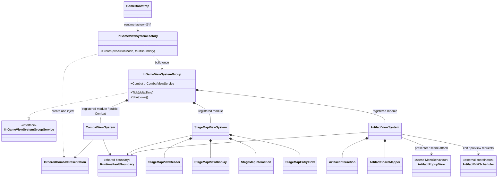
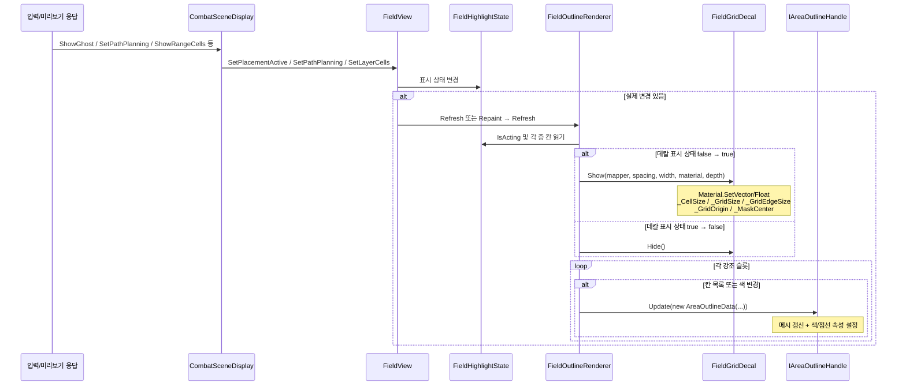
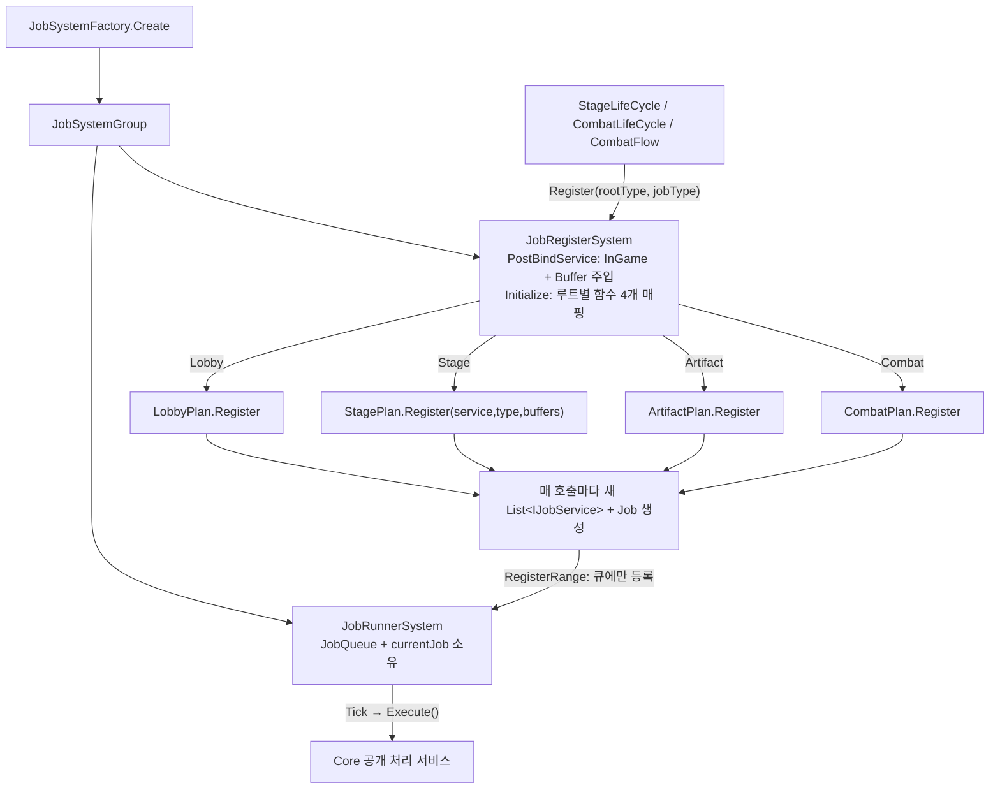
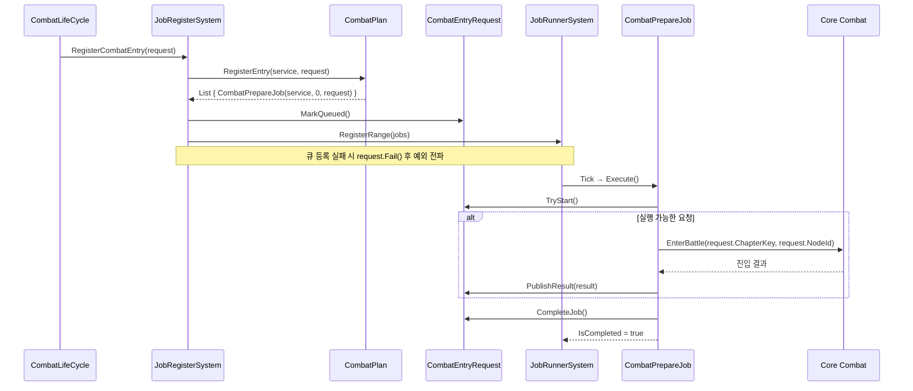
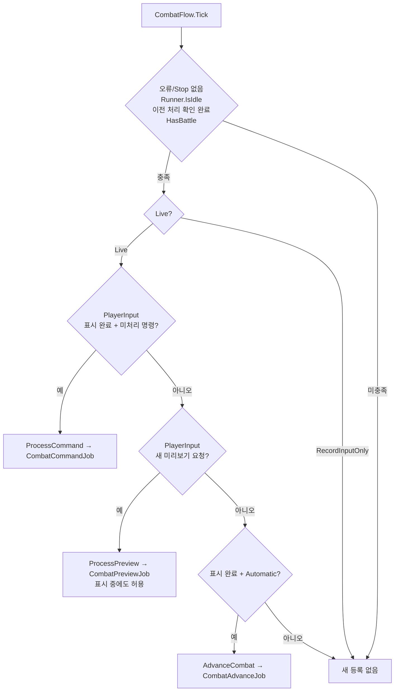
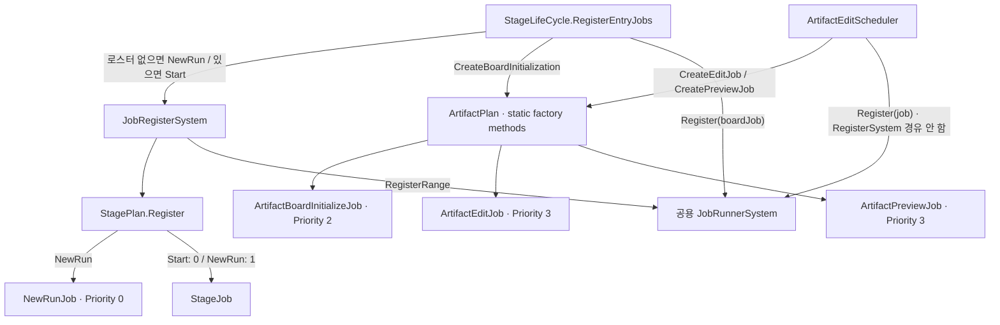
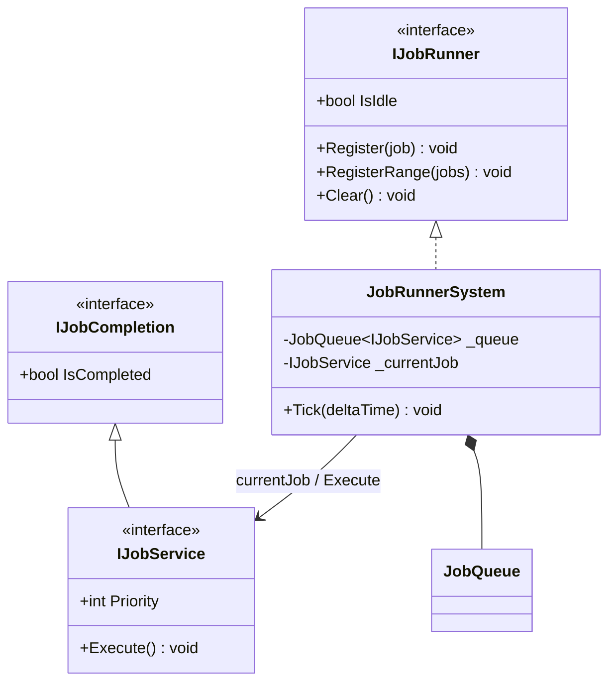

# View 현재 구조 UML — 2026-10-10

코드 스냅샷: `feature/JMH/RenderSystemViewRefactoring`, HEAD `38c199dc`와 현재 작업 트리. `FieldOutlineRenderer.cs`의 미커밋 상태도 읽었다. 실행 검증 결과가 아니라 현재 코드의 정적 관계를 그린 문서다.

범위: `InGameSystem/ViewSystem`의 등록 그룹과 Combat 상세. Global Input/UI/Render, Buffer, LifeCycle, Core는 외부 경계로 표시한다. Boot는 조립 진입점, Dev는 개발 정의 공급자다. FieldCamera·Architecture의 내부는 생략한다.

`*--`는 해당 객체의 생성·수명 소유, `-->`는 참조·위임, `..>`는 호출·데이터 의존, `..|>`는 인터페이스 구현이다. 씬 MonoBehaviour에 대한 참조는 객체 생성 소유와 구분한다.

## 1. 전체 View 그룹과 조립

Factory는 Combat을 서비스와 모듈로 등록한다. StageMap·Artifact는 모듈만 등록한다. Group은 등록된 모듈에 Framework 수명 호출을 전달하며 Combat 서비스만 명시적으로 노출한다. StageMap·Artifact는 StageSelect 진입/이탈, Combat은 Combat 진입/이탈 로딩 노드에 연결된다.

## 2. Combat 조정·입력·결과 재생

```mermaid
classDiagram
    direction TB
    class ICombatViewService {
        <<interface>>
    }
    class CombatViewSystem {
        +Attach(root)
        +Tick(deltaTime)
        +StopInput()
        +Detach()
        -ReadFacts()
        -ReadDisplayValues()
        -FinalizeResult(result, token)
    }
    class CombatInputReceiver {
        +Bind()
        +Unbind()
    }
    class IStageInputReceiverSlot {
        <<Global Input boundary>>
    }
    class CombatInputRouter {
        +Route(request, position, characters)
        +ResolvePointerTarget(layer, mode)
    }
    class CombatInputPolicy {
        <<static>>
        +CanSubmit(facts)
        +CanPreview(facts)
        +CanEditPath(facts)
    }
    class CombatInputFacts {
        <<value>>
    }
    class CombatCommandGate {
        +TrySubmit()
        +SubmitPending()
        +Resolve(result)
    }
    class CombatInteraction
    class PlacementDragInteraction
    class AttackTargetingInteraction
    class CombatPathInput
    class CombatMovementInteraction
    class CombatAbandonController
    class CombatDevLayerController
    class CombatViewRefresh {
        +Observe()
    }
    class CombatResultPlayback {
        +Begin(result)
        +TryBeginFinalization()
        +CompleteFinalization(token)
    }
    class ICombatPresentation {
        <<interface>>
    }
    class OrderedCombatPresentation
    class CombatMovementPlayback
    class ICombatBattleDisplay {
        <<interface>>
    }
    class CombatSceneDisplay
    class CombatViewBuffer {
        <<input and acknowledgement boundary>>
    }
    class CoreReadBuffers {
        <<CombatState / Result / Character / CurrentProgress>>
    }
    class ICombatProcessingService {
        <<Core query boundary>>
        +GetTimeline(count)
    }
    class ICombatAbandonRequest {
        <<LifeCycle boundary>>
        +RequestAbandon()
    }
    CombatViewSystem ..|> ICombatViewService
    CombatViewSystem *-- CombatInputReceiver
    CombatViewSystem *-- CombatInputRouter
    CombatViewSystem *-- CombatCommandGate
    CombatViewSystem *-- CombatInteraction
    CombatViewSystem *-- CombatPathInput
    CombatViewSystem *-- CombatAbandonController
    CombatViewSystem *-- CombatDevLayerController
    CombatViewSystem *-- CombatViewRefresh
    CombatViewSystem *-- CombatResultPlayback
    CombatViewSystem *-- CombatSceneDisplay : create on Attach
    CombatViewSystem --> ICombatPresentation : injected
    CombatViewSystem ..> CoreReadBuffers : read
    CombatViewSystem ..> CombatViewBuffer : read / remove / acknowledge
    CombatViewSystem ..> ICombatProcessingService : GetTimeline currently
    CombatViewSystem ..> CombatInputFacts : assemble fresh facts
    CombatInputReceiver --> IStageInputReceiverSlot : bind receiver
    CombatInputReceiver ..> CombatInputRouter : callback via ViewSystem
    CombatInputRouter --> CombatInteraction
    CombatInputRouter --> CombatPathInput
    CombatInputRouter --> CombatCommandGate
    CombatInteraction *-- PlacementDragInteraction
    CombatInteraction *-- AttackTargetingInteraction
    CombatPathInput *-- CombatMovementInteraction
    PlacementDragInteraction --> CombatCommandGate
    AttackTargetingInteraction --> CombatCommandGate
    CombatCommandGate ..> CombatViewBuffer : submit numbered command
    PlacementDragInteraction ..> CombatViewBuffer : preview request
    AttackTargetingInteraction ..> CombatViewBuffer : preview request
    CombatMovementInteraction ..> CombatViewBuffer : movement command / preview
    CombatCommandGate ..> CombatInputPolicy
    CombatPathInput ..> CombatInputPolicy
    CombatInteraction ..> ICombatBattleDisplay : picker / feedback
    CombatPathInput ..> ICombatBattleDisplay : mapping / movement feedback
    CombatAbandonController ..> ICombatAbandonRequest
    CombatAbandonController ..> ICombatBattleDisplay : abandon display facet
    CombatDevLayerController ..> ICombatBattleDisplay : dev layer display facet
    CombatResultPlayback --> ICombatPresentation
    OrderedCombatPresentation ..|> ICombatPresentation
    OrderedCombatPresentation *-- CombatMovementPlayback
    OrderedCombatPresentation ..> ICombatBattleDisplay : result / movement / control facets
    CombatSceneDisplay ..|> ICombatBattleDisplay
```

`CombatViewSystem`이 사실·표시 값을 모아 입력과 결과 소비를 조정한다. Router는 입력 대상을 선택하고 Interaction은 배치/공격을 나눈다. 시작·턴 종료 대기는 Gate, 경로 초안은 MovementInteraction, 결과 재생 토큰·후처리 상태는 ResultPlayback이 소유한다. Presentation은 사건 순서와 이동 보간을 수행한다.

현재 타임라인은 `ReadDisplayValues()`에서 `ICombatProcessingService.GetTimeline()`으로 읽는다. 아직 모든 표시 값이 Buffer만을 통해 들어오는 구조는 아니다.

## 3. 씬 표시와 Presenter

```mermaid
classDiagram
    direction TB
    class CombatSceneRoot {
        <<scene MonoBehaviour>>
        +ValidateReferences()
    }
    class CombatSceneDisplay {
        +Install(values)
        +Refresh(values)
        +Release()
        +ShowGhost(key)
        +ShowRangeCells(cells)
        +SetPathPlanning(planning)
    }
    class ICombatBattleDisplay {
        <<interface aggregate>>
    }
    class ICombatPointerPicker {
        <<interface>>
    }
    class ICombatPointerMapping {
        <<interface>>
    }
    class ICombatInteractionFeedback {
        <<interface>>
    }
    class ICombatMovementPresenter {
        <<interface>>
    }
    class ICombatResultPresenter {
        <<interface>>
    }
    class ICombatPresentationControl {
        <<interface>>
    }
    class ICombatAbandonDisplay {
        <<interface>>
    }
    class ICombatDevLayerDisplay {
        <<interface>>
    }
    class CombatPointerMapper
    class CombatSceneEventPresenter
    class StageViewPropPresenter
    class FieldView {
        <<scene MonoBehaviour>>
    }
    class FieldUnitPresenter {
        <<scene MonoBehaviour>>
    }
    class HandPresenter {
        <<scene MonoBehaviour>>
    }
    class CombatHud {
        <<scene MonoBehaviour>>
    }
    class PlacementGhost {
        <<scene MonoBehaviour>>
    }
    class CombatAbandonPanel {
        <<scene MonoBehaviour>>
    }
    class EntityViewSet {
        <<generic ID reuse>>
    }
    class FieldUnitView
    class UnitCardView
    CombatSceneDisplay ..|> ICombatBattleDisplay
    ICombatBattleDisplay --|> ICombatPointerPicker
    ICombatBattleDisplay --|> ICombatPointerMapping
    ICombatBattleDisplay --|> ICombatInteractionFeedback
    ICombatBattleDisplay --|> ICombatMovementPresenter
    ICombatBattleDisplay --|> ICombatResultPresenter
    ICombatBattleDisplay --|> ICombatPresentationControl
    ICombatBattleDisplay --|> ICombatAbandonDisplay
    ICombatBattleDisplay --|> ICombatDevLayerDisplay
    CombatSceneRoot --> FieldView
    CombatSceneRoot --> FieldUnitPresenter
    CombatSceneRoot --> HandPresenter
    CombatSceneRoot --> CombatHud
    CombatSceneRoot --> PlacementGhost
    CombatSceneRoot --> CombatAbandonPanel
    CombatSceneDisplay --> FieldView
    CombatSceneDisplay --> FieldUnitPresenter
    CombatSceneDisplay --> HandPresenter
    CombatSceneDisplay --> CombatHud
    CombatSceneDisplay --> PlacementGhost
    CombatSceneDisplay --> CombatAbandonPanel
    CombatSceneDisplay *-- CombatPointerMapper
    CombatSceneDisplay *-- CombatSceneEventPresenter
    CombatSceneDisplay *-- StageViewPropPresenter
    CombatPointerMapper --> FieldView : grid mapping
    CombatPointerMapper --> HandPresenter : card picking / drop region
    CombatSceneEventPresenter --> FieldUnitPresenter : event facts / interpolation
    FieldUnitPresenter *-- EntityViewSet
    HandPresenter *-- EntityViewSet
    FieldUnitPresenter --> FieldUnitView : pooled visuals
    HandPresenter --> UnitCardView : pooled UI cards
```

SceneRoot는 씬 참조 묶음이다. SceneDisplay는 값을 받은 뒤 Presenter에 나눠 주며 Buffer를 직접 읽지 않는다. 손패는 현재 `UnitCardView` 카드 방식이다. UML의 집계 계약에는 별도 이동 피드백 계약의 상속 관계 등 세부 멤버를 생략했다.

## 4. 필드·타일 아웃라인 구조

```mermaid
classDiagram
    direction TB
    class FieldView {
        +Build(width, height, config, colors, outlines)
        +SetLayerCells(layer, cells)
        +SetHoverCell(cell, state)
        +SetPlacementActive(active)
        +SetPathPlanning(planning)
    }
    class FieldHighlightState {
        +IsActing : bool
        +SetLayerCells()
    }
    class IFieldHighlightStateReader {
        <<interface>>
    }
    class FieldGridMapper
    class IFieldHighlightRenderer {
        <<interface>>
        +Build(mapper, state)
        +Repaint(changedCells)
        +Refresh()
        +Release()
    }
    class FieldCellColorRenderer
    class FieldCellPool
    class FieldOutlineRenderer {
        +Refresh()
        -Apply(slot, heightIndex, color)
        -SetDecalVisible(visible)
    }
    class FieldGridDecal {
        +Show(mapper, spacing, lineWidth, material, depth)
        +Hide()
        +Dispose()
    }
    class IAreaOutlineSystemService {
        <<Global Render boundary>>
        +Create() IAreaOutlineHandle
    }
    class IAreaOutlineHandle {
        <<rented handle>>
        +Update(AreaOutlineData)
        +Dispose()
    }
    class AreaOutlineHandle
    class AreaOutlineData {
        <<value DTO>>
        +Cells
        +GridOrigin
        +CellSize
        +Thickness
        +Color
    }
    class IMeshRenderHandle {
        <<Global Render boundary>>
    }
    class IColorHandle {
        <<Global Render boundary>>
    }
    class DecalProjector {
        <<Unity URP>>
    }
    class StageFieldViewData {
        <<View DB configuration>>
        +DisplayMode
    }
    FieldView *-- FieldHighlightState : highlight SSOT
    FieldView *-- FieldGridMapper
    FieldView --> IFieldHighlightRenderer : selects and owns concrete renderer
    FieldView ..> StageFieldViewData : CellPrefab / GridOutline
    FieldHighlightState ..|> IFieldHighlightStateReader
    FieldCellColorRenderer ..|> IFieldHighlightRenderer
    FieldOutlineRenderer ..|> IFieldHighlightRenderer
    FieldCellColorRenderer *-- FieldCellPool
    FieldOutlineRenderer --> IFieldHighlightStateReader : read only
    FieldOutlineRenderer --> FieldGridMapper
    FieldOutlineRenderer *-- FieldGridDecal
    FieldOutlineRenderer --> IAreaOutlineSystemService : Create slots on Build
    FieldOutlineRenderer --> IAreaOutlineHandle : rents per layer / disposes on Release
    FieldOutlineRenderer ..> AreaOutlineData : Apply builds DTO
    AreaOutlineHandle ..|> IAreaOutlineHandle
    AreaOutlineHandle --> IMeshRenderHandle : Update mesh DTO
    AreaOutlineHandle --> IColorHandle : material property overrides
    FieldGridDecal *-- DecalProjector : runtime GameObject
    FieldGridDecal ..> StageFieldViewData : source material / dimensions via renderer
```

강조 상태의 원본은 `FieldHighlightState`다. GridOutline은 층별 칸 집합의 외곽을 AreaOutline에 맡기며, 배경 격자선은 별도의 URP 데칼로 그린다. `IsActing = 배치 드래그 || 경로 지정 || Range/Affected/MovementDraft/BlockedWall 칸 존재`. 행동 중에는 전체 강조 슬롯과 호버를, 평상시에는 ActiveActor만 그린다. 칸 목록과 색이 같으면 핸들 갱신을 생략한다.

## 5. 아웃라인 전달 시점

## 6. Job 등록 구조와 Plan

`Plane`은 현재 코드의 `Plan`을 뜻하는 것으로 해석했다. Plan은 인스턴스·실행 큐·현재 작업 상태가 없는 **static Job 생성 함수 묶음**이다. Job 등록과 Job 실행은 다른 시점이다.

조립: Factory가 `JobRunnerSystem`을 만들고, 같은 Runner를 `JobRegisterSystem` 생성자에 주입한다. 둘 다 서비스와 모듈로 내보낸 뒤 `BuildSystemReader()`를 한 번 호출한다. Group은 서비스를 공개하고 PostBindService/Initialize/Tick/Shutdown을 모듈에 전달한다.

`Initialize()`가 등록하는 것은 Job 인스턴스가 아니라 `_plans`의 **함수 매핑 4개**다. `Register(root,type)`를 호출하면 그때 해당 Plan이 Job 목록을 만들고 `Runner.RegisterRange()`가 큐에 넣는다. 지원하지 않는 root/type 조합은 예외이고, 모든 Plan의 `None`은 빈 목록이다.

### 루트별 Plan 조합

| 루트 | 요청 | 생성 Job · Priority | 현행 호출 경로 |
|---|---|---|---|
| Lobby | Start | LobbyJob · 0 | 생성 코드만 있음, 등록 호출자는 없음 |
| Stage | Start | StageJob · 0 | StageLifeCycle 진입, 로스터 있음 |
| Stage | NewRun | NewRunJob · 0 → StageJob · 1 | StageLifeCycle 진입, 로스터 없음 |
| Artifact | Start | ArtifactJob · 0 | 생성 코드만 있음, 등록 호출자는 없음 |
| Combat | Start | CombatPrepareJob · 0, 대상 없는 호환 생성자 | 현재 새 진입 호출자는 이 경로를 쓰지 않음 |
| Combat | NewRun | NewRunJob · 0 | CombatExitSequence의 callback → CombatLifeCycle |
| Combat | ProcessCommand | CombatCommandJob · 0 | CombatFlow |
| Combat | ProcessPreview | CombatPreviewJob · 0 | CombatFlow |
| Combat | AdvanceCombat | CombatAdvanceJob · 0 | CombatFlow |
| Combat 명시적 진입 | RegisterCombatEntry(request) | CombatPrepareJob · 0, 진입 대상 포함 | CombatLifeCycle |

### 명시적 Combat 진입은 별도 등록 경로

`CombatPlan.Register(Start)`는 기존 확정 선택을 사용하는 `PrepareBattle()` 호환 경로다. 현재 `CombatLifeCycle`의 새 진입은 `RegisterCombatEntry → RegisterEntry → EnterBattle(chapter,node)`를 사용한다.

### CombatFlow가 정하는 처리 등록 순서

한 Flow Tick에 최대 한 Job을 등록한다. 모든 전투 처리 Job은 Priority 0이므로 **전투 순서는 Priority가 아니라 Flow의 등록 조건이 원본**이다. 정상 false도 Job 완료이며, 실제 처리 번호·응답·자동 진행 수락 여부는 이후 Flow가 Buffer를 보고 확인한다. Job 완료와 규칙상 성공은 같은 의미가 아니다.

## 7. Stage / Artifact의 직접 등록 경로

Stage 최초 진입은 `NewRunJob(0) → StageJob(1) → BoardInitialize(2)`. 로스터가 있으면 `StageJob(0) → BoardInitialize(2)`. 두 등록 경로가 같은 Runner를 쓰므로 Priority로 맵 준비 뒤 보드 초기화를 보장한다. Combat 이탈의 NewRun은 같은 `NewRunJob`을 재사용하지만 그 Plan에는 StageJob을 넣지 않는다. 이후 Stage 진입이 맵을 준비한다.

아티팩트 편집·프리뷰는 `JobType` enum을 확장하지 않고 `ArtifactPlan.Create...()`로 만든 Job을 직접 등록한다. Scheduler는 편집 요청 한 개를 대기시키고, 프리뷰는 최신 Slot 한 개와 대기 Job 최대 한 개를 유지한다. 편집이 생기면 기존 프리뷰를 무효화한다. 씬 이탈 때 요청을 취소하지만 공용 `Runner.Clear()`로 다른 화면 Job까지 삭제하지 않는다.

## 8. 현재 Job 목록 · 11종

모두 `struct : IJobService`다. 기능 구현 9종 + TODO 골격 2종이며 `JobType` enum의 6종(None 포함)과 일대일 대응하지 않는다.

| Job 타입 | Priority | Execute의 실제 Core 호출 | 상태 |
|---|---:|---|---|
| CombatPrepareJob | 0 | 명시적 진입 `EnterBattle(chapter,node)` / 호환 `PrepareBattle()` | 구현 |
| CombatCommandJob | 0 | `Combat.ProcessNextCommand()` | 구현 |
| CombatPreviewJob | 0 | `Combat.ProcessLatestPreview()` | 구현 |
| CombatAdvanceJob | 0 | `Combat.AdvanceCombat()` | 구현 |
| NewRunJob | 0 | `RunStart.StartNewRun(loadoutKey)` · 현재 Plan 기본값 1 | 구현 · Stage/Combat 재사용 |
| StageJob | 0/1 | `ChapterProgression.EnterChapter(currentMapKey 또는 1)` · 실행 때 읽음 | 구현 |
| ArtifactBoardInitializeJob | 2 | `Artifacts.InitializeBoard(width,height)` | 구현 · 이미 초기화된 false는 정상, Buffer 미초기화면 예외 |
| ArtifactEditJob | 3 | 요청에 따라 `Place` / `Move` / `ReturnToPool` | 구현 · 요청에 편집 결과 기록 |
| ArtifactPreviewJob | 3 | 실행 시 최신 Slot 요청의 `PreviewPlace` / `PreviewMove` | 구현 · 취소/대상 부재는 Core 호출 없이 완료 |
| LobbyJob | 0 | 없음 · TODO 뒤 `IsCompleted = true` | 임시 골격 · 현재 등록 호출자 없음 |
| ArtifactJob | 0 | 없음 · TODO 뒤 `IsCompleted = true` | 임시 골격 · 현재 등록 호출자 없음 |

`AbandonJob`, `EndBattleJob`, `MovementJob`, `AttackJob`, `DrawJob` 같은 독립 Job 타입은 현재 없다. 포기·종료는 `CombatExitSequence`가 Core의 `AbandonBattle()`/`EndBattle()`을 직접 호출한다. 이동·공격·드로우는 별도 Job 클래스가 아니라 `CombatCommandJob`이 처리하는 입력 명령의 종류다.

### Runner 실행 계약

작은 Priority가 먼저이고 동률이면 등록 순서다. 실행 중인 Job은 선점되지 않으며 미완료면 다음 Tick에도 같은 Job을 Execute한다. 완료하면 다음 Job으로 진행한다. 한 Tick의 Execute 호출 예산은 32회이며 남은 작업은 다음 Tick으로 넘긴다. 현재 11종은 정상 반환하면 한 Execute 안에서 완료한다. 별도 스레드·Task·코루틴 실행이 아니며 Runner 자체는 Execute 예외를 잡지 않는다.

## 코드 근거와 경계 점검

- 조립: `Factory/Runtime/InGame/View/InGameViewSystemFactory.cs`, `ViewSystem/InGameViewSystemGroup.cs`.
- 수명·입력·결과: `Combat/CombatViewSystem.cs`, `CombatInputRouter.cs`, `CombatInteraction.cs`, `CombatResultPlayback.cs`, `OrderedCombatPresentation.cs`.
- 표시: `Combat/CombatSceneDisplay.cs`, `CombatSceneRoot.cs`, `CombatSceneEventPresenter.cs`, `Display/HandPresenter.cs`.
- 필드: `Display/FieldView.cs`, `FieldHighlightState.cs`, `FieldOutlineRenderer.cs`, `FieldGridDecal.cs`.
- Render 경계: `GlobalSystem/RenderSystem/View/AreaOutlineSystem/AreaOutlineHandle.cs`.
- Job 조립·등록·실행: `Factory/Runtime/Global/JobSystemFactory.cs`, `GlobalSystem/JobSystem/JobSystemGroup.cs`, `JobRegister/JobRegisterSystem.cs`, `JobRunner/JobRunnerSystem.cs`, `Framework/Utility/JobQueue.cs`.
- Plan 및 호출자: `LifeCycleSystem/LifeCycles/{Combat,Stage,Artifact,Lobby}/Plans/`, `Combat/CombatFlow.cs`, `Combat/CombatLifeCycle.cs`, `Combat/CombatExitSequence.cs`, `Stage/StageLifeCycle.cs`, `Artifact/ArtifactEditScheduler.cs`.

Job SSOT: 루트별 Job 조합은 Plan, 대기 큐·현재 Job은 Runner, 전투 등록 판단·기대 번호는 Flow, 명시적 진입 대상·상태는 CombatEntryRequest, 아티팩트 요청/최신 Slot은 Scheduler에 둔다. SOLID: 생성(Plan)·등록 정책(Flow/LifeCycle/Scheduler)·범용 실행(Runner)·규칙 계산(Core)을 구분한다. FW: Job은 모듈 서비스가 아니라 IJobService 작업 값이며, 공용 Runner/Register만 서비스+모듈로 등록한다. 이 설명은 현행 구조의 기록이고, Job에 전달되는 넓은 InGame 서비스 계약의 개선 제안이나 구현 변경은 포함하지 않는다.

SSOT: 전투 사실은 Core 측 Buffer, 사용자 명령·확인 번호는 CombatViewBuffer, 강조는 FieldHighlightState, 명령 대기는 Gate, 재생 수명은 ResultPlayback이다. SOLID: Router/Interaction/Playback/SceneDisplay/Renderer로 책임이 분리되고 표시 모드는 IFieldHighlightRenderer로 교체된다. FW: Factory의 Build 1회, 모듈/서비스 등록, PostBindService 주입, 씬 진입 Attach/이탈 Detach, 대여한 아웃라인 핸들 반환 관계를 확인했다. 이 문서는 구조 스냅샷이며 전체 구현의 계약 준수나 Unity 연결 완료를 판정하는 리뷰는 아니다.
