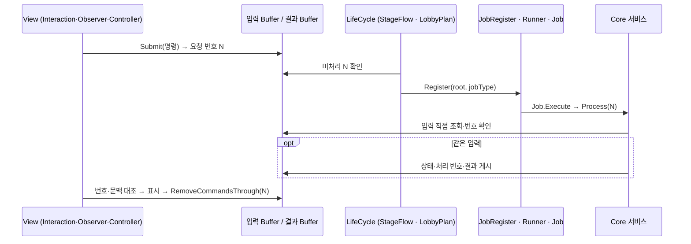
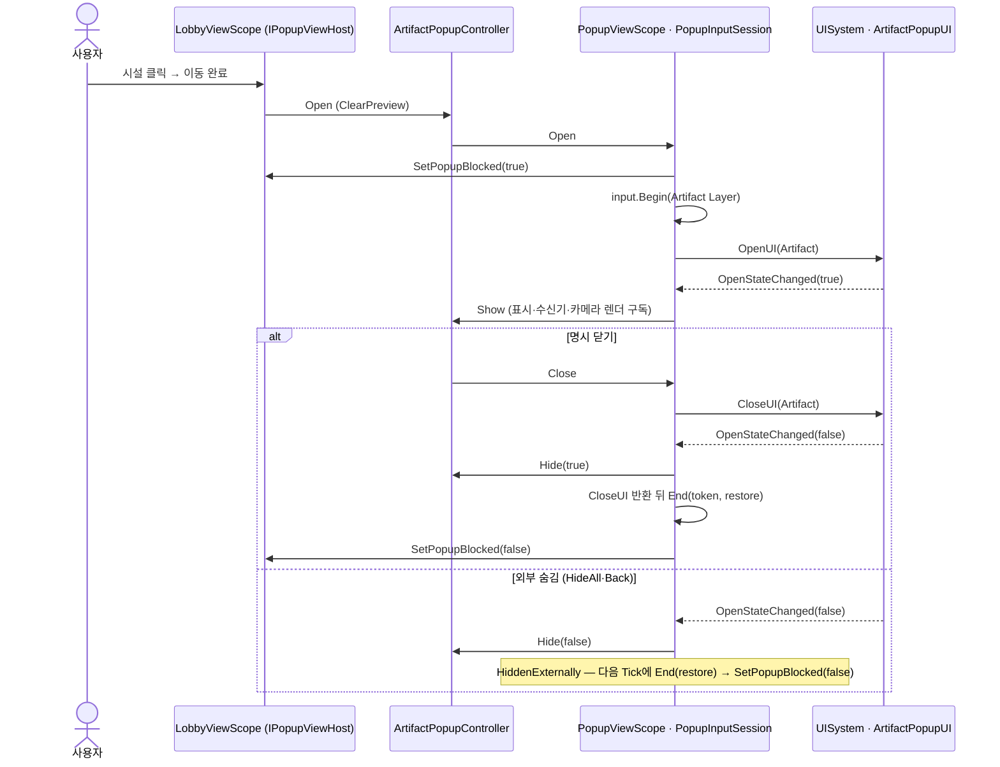

# View 구조 설계

- 작성자: 호진(이호진)
- 상태: 비전투 View Scope 구현 완료(P0~P6, 사용자 Play 확인 2026-10-15). 화면별 입력 조립 Phase1~3 완료(2026-10-18). 책임 분리 V1~V3 완료(2026-10-18), V4·V5 미착수(Phase 지시 대기), V6은 다른 작업으로 풀림.
- 범위: 비전투 View(로비·아티팩트·스테이지 맵·상점·회복·덱 편집 팝업)가 지금 어떤 구조 원칙으로 짜여 있나를 다룬다. 역할, 수명 규칙, 공용 팝업 수명(`PopupViewScope`), 조립 위치, 화면 입력 조립과 소유권, 책임 분리 결정이다. 전투 View 내부 구조(용근님 영역)는 다루지 않는다. 로비·스테이지 맵 기능의 세부는 [로비 설계](2026-10-11-lobby-design-Hojin.md)와 [스테이지 맵 설계](2026-10-10-stage-map-design-Hojin.md)에 있다.
- 계획: [View 구조 계획](../plans/2026-10-13-view-structure-plan-Hojin.md). 새 View 기능을 만드는 사람은 [View 기능 개발 가이드](../viewDocs/view-development-guide-Hojin.md)를 먼저 읽는다.
- 정리: 2026-10-27 `2026-10-13-noncombat-view-scope-design-Hojin.md`, `2026-10-17-view-input-composition-design-Hojin.md`, `2026-10-18-view-responsibility-separation-design-Hojin.md`, `guides/stage-artifact-shop-sequence-uml-Hojin.md`, `2026-10-09-db-unused-audit-Hojin.md`(아직 맞는 항목만 부록)를 이 문서로 합쳤다. 옛 판은 git `10914570`.

## 1 목적과 범위

세 번의 구조 정리를 한 원칙으로 묶는다.

| 정리 | 날짜 | 풀려던 문제 |
|---|---|---|
| 비전투 View Scope | 2026-10-13 설계 | 한 객체가 System·Factory·Scope를 겸했다(`LobbyViewSystem.Attach` 약 120줄, 상점 조립 인자 13개). 씬 연결 수명을 세대 번호와 흩어진 토큰으로 관리했다. 팝업 수명이 아티팩트·상점·덱에 세 벌 따로 있었다. `ArtifactViewSystem`과 `LobbyViewSystem`이 구체 클래스로 서로 묶였다. 정리 예외 수집이 여섯 벌이었다. |
| 화면별 입력 조립 | 2026-10-17 설계 | Runtime 루트(`RunTimeSystemFactory`)가 화면 슬롯 4·Controller 5·옵션 Controller 2·Layer 8·키 설정 대상 6을 직접 조립하고 슬롯을 루트에 공개했다. |
| 책임 분리 검토 | 2026-10-18 설계 | 기본 팝업 Factory가 PostBindService 시점의 DB 참조에 기댔다. 맵 진입 관찰이 구체 이동 클래스에 의존했다. 맵 공통 모달 Layer가 상점 기능 안에 있었다. 로비가 전역 첫 `ArtifactSceneRoot`를 골랐다. Boot가 화면별 UI 정책을 가졌다. |

### 1.1 바꾸지 않는 경계

| 경계 | 지키는 내용 |
|---|---|
| Framework | 모듈 등록(`AddModule`), 6단계 순서, Build 한 번(FW-001~003). 새 서비스 키·System·이벤트 버스·DI를 만들지 않는다. Scope·Factory·Controller·화면 어댑터는 모듈·서비스로 등록하지 않는다. |
| 씬 연결 | Enter 100·Exit -100, `SceneIndices` 상수, 씬 오브젝트는 Attach에서 한 번만 찾는다([런타임 씬 연결 안내](../viewDocs/runtime-scene-binding-guide.md)). |
| UI | `UIBase`·`UISystem`·`UIInputBinding`·`UIId`를 그대로 쓴다. 열기·닫기는 `IUISystemService`로만 한다. UISystem 폴더(현강님)는 고치지 않는다(FW-008·009, `Assets/AGENTS.md`). |
| Camera | 로비 카메라는 Catalog 핸들로 빌리고 Handle 경로로 돌려준다. Stage와 Lobby 핸들을 공유하지 않는다(FW-011). |
| Core | Core·Buffer 계약은 바꾸지 않는다. View는 자기 입력 Buffer의 WriteSink만 쓴다. |
| 씬·MonoBehaviour | 이 구조 작업으로 씬·프리팹을 바꾸지 않는다. MonoBehaviour의 파일·네임스페이스를 옮기지 않는다. |
| 입력 | 액션·Layer 이름(아래 V3 예외), 물리 키·GUID, Press/Release/Canceled, 누름 소유자, Configure 1회, 종료 중 마지막 Canceled 전달을 바꾸지 않는다. `PlayerInputActions.inputactions`는 고치지 않는다. |

## 2 지금 구조

### 2.1 역할

| 역할 | 맡는 일 | 맡지 않는 일 | 지금 예 |
|---|---|---|---|
| `XxxViewSystem` (System) | InitData(View DB 참조), PostBindService(좁은 서비스 보관·기본 팝업 Factory 생성 함수 준비), Initialize(기본 팝업 Factory 조립·Enter/Exit/AfterLoad 등록), Tick 전달, StopInput, Shutdown, 씬 루트 찾기(Attach 때 한 번), Scope 게시·폐기 | 하위 객체 조립, 세대 검사, 도메인 판단 | `LobbyViewSystem`, `StageMapViewSystem` |
| `XxxViewScope` (Scope) | 씬 연결 한 번의 하위 객체 생성·소유·Tick·폐기, 이 연결이 현재인지 판단, 팝업의 호스트(`IPopupViewHost`) | 서비스 찾기, 씬 검색 | `LobbyViewScope`, `StageMapViewScope` |
| `PopupViewScope` (Scope) | 팝업 하나의 열기·닫기 확인, 열림 알림 구독, 입력 Layer 토큰, 호스트 입력 차단, 외부 숨김·열림 처리 | 팝업 내용, 게임 규칙 | 팝업 다섯 개가 각각 한 인스턴스 |
| `XxxPopupViewFactory` | 씬과 무관한 고정 의존성(Buffer 싱크·DB 조회·서비스)을 한 번 받아 두고, 씬 연결마다 팝업 한 벌을 만든다 | 서비스 꺼내 주기, 만든 객체의 수명 소유 | `ArtifactPopupViewFactory`, `ShopPopupViewFactory`, `RecoveryPopupViewFactory`, `DeckEditPopupViewFactory`(용근님 2026-10-20) |
| `XxxPopupController` | 팝업 하나의 표시·입력 수신 연결·결과 소비. 자기 `PopupViewScope`를 만들어 소유한다 | UISystem 직접 호출, 입력 Layer 변경 | `ArtifactPopupController`, `ShopPopupController`, `RecoveryPopupController`, `LobbyDeckPopupController`, `DeckEditPopupController` |
| `XxxPopupViewScreen` (어댑터) | UI 화면 하나의 `IsOpen`·열림 알림을 `IPopupViewScreen`으로 감싼다 | 표시·입력 | 팝업마다 하나 |
| `XxxInputFactory` (화면 입력 조립) | 그 화면의 슬롯 하나와 Controller를 같은 인스턴스로 잇고, 읽기 전용 등록 정보를 돌려준다 | 입력 판정, Bind/Unbind, Configure | `StageInputFactory`, `StageSelectionInputFactory`, `ArtifactInputFactory`, `LobbyInputFactory`, `TutorialInputFactory` |
| `ViewGroup.Input` | 화면 슬롯 넷의 보관·접근(`IInGameViewInputContext`) | 슬롯 재생성, 루트 재공개 | `InGameViewInputContext` |
| `InGameViewSystemFactory` | 화면 입력 조립 결과를 묶고 View System·오류 정리를 조립한다 | 화면별 Controller·Layer·키 정의를 직접 나열 | `CreateComposition` |
| Runtime 루트 | 그룹 연결만(Buffer → Global → InGame → LifeCycle) | 화면·옵션 객체 생성, 입력 목록 작성 | `RunTimeSystemFactory` |
| Global 입력 | 등록 정보 소비, Configure 1회, 옵션 입력 소유 | 화면 구체 타입 생성 | `GlobalSystemFactory.CreateWithInputRegistration`, `UnityInputBridge` |

System만 Framework 모듈이다. 나머지는 View 안의 일반 객체다.

### 2.2 구조도

```text
RunTimeSystemFactory (그룹 연결만: Buffer → Global → InGame → LifeCycle)
 ├─ GlobalSystemFactory.CreateWithInputRegistration(View 등록 정보)   옵션 입력 Router 소유, Configure 1회
 └─ InGameViewSystemFactory.CreateComposition
     ├─ 화면 입력 Factory 5개 → 슬롯 + InputRegistrationSet (Combine)
     ├─ ViewGroup.Input (Stage · StageSelection · Artifact · Lobby 슬롯)
     ├─ CombatViewSystem(용근님) · StageMapViewSystem · LobbyViewSystem · RecoveryRequestLifetime · TutorialViewSystem
     └─ InGameViewFaultCleanup (전투 → 맵 → 로비 → 회복 요청 → 튜토리얼)

LobbyViewSystem
 └─ LobbyViewScope (씬 연결 1회)
     ├─ 카메라 핸들 · 외형 · 캐릭터 · 배경 출력 · 이동 · LobbyInteraction · LobbyDeparturePresenter
     ├─ LobbyDeckPopupController ── PopupViewScope (LobbyDeckPopupViewScreen, 부모가 직접 만듦)
     └─ ArtifactPopupController  ── PopupViewScope (ArtifactPopupViewScreen, ArtifactPopupViewFactory가 만듦)

StageMapViewSystem
 └─ StageMapViewScope (씬 연결 1회)
     ├─ Display · Reader · Picker · CameraDrag · Interaction · StageMapNodeMovement · StageMapEntryObserver
     ├─ StageMapSelectionPresentation (팝업 종료 뒤 선택 화면 복귀, 스테이지 맵 설계)
     ├─ ShopPopupController     ── PopupViewScope (ShopPopupViewFactory)
     ├─ RecoveryPopupController ── PopupViewScope (RecoveryPopupViewFactory)
     └─ DeckEditPopupController ── PopupViewScope (DeckEditPopupViewFactory)

ViewSystem/Common       PopupViewScope · IPopupViewController · IPopupViewScreen · IPopupViewHost
                        PopupInputSession · ScreenUIPointerBlocker · ChessPieceMotion(+Settings)
RuntimeSystem/ErrorHandling   CleanupErrors · RuntimeFaultBoundary (2026-10-25 Common에서 옮김)
```

### 2.3 수명 규칙

1. `System.Attach(root)`: 정지·오류 상태면 거부한다 → 새 루트를 검사한다 → 기존 Scope를 폐기한다 → 새 Scope를 만든다 → 이전 Scope에 `Supersede()` → **외부 호출 전에** 게시한다(`_scope = scope`) → `scope.Start()`.
2. Scope는 외부 호출(카메라 대여, Layer 변경, UI 서비스, 슬롯 Bind) 뒤마다 자기 상태를 확인하고 끝났으면 그 자리에서 멈춘다. 세대 번호를 따로 두지 않는다. **Scope 객체가 곧 세대다.**
3. Scope는 두 상태를 따로 둔다(계획 R1). `IsDisposed`는 폐기 시작 때 켜서 새 작업과 늦은 콜백을 막는다. `IsSuperseded`는 새 Scope가 게시되면 켜서 Layer·UI 변경을 막는다. `CanWork = !IsDisposed && !IsSuperseded && !faults.IsFaulted`, `IsCurrent = !IsSuperseded`다. 폐기 중이어도 아직 현재 연결이면 자기 Layer를 정리할 수 있다.
4. `Detach()`는 `_scope.Dispose()` 뒤 `_scope`가 아직 같은 객체일 때만 비운다. 정리 콜백이 게시한 새 연결은 이전 Detach가 지우지 않는다. 더 새로운 Scope가 재진입으로 게시됐으면 바깥 Attach는 멈춘다(`_lastPublishedScope`로 판별).
5. `Dispose`는 여러 번 불려도 안전하다. 실패는 `CleanupErrors`로 모아 마지막에 한 번 던진다.
6. 늦게 도착한 콜백(정리 콜백, 이전 화면 알림, Delay 예약)은 자기 Scope가 끝났으면 아무것도 하지 않는다. Layer 래퍼(`AttachmentInputLayers`)도 Scope가 소유해, 교체된 Scope가 새 연결의 Layer를 바꾸지 못한다. 팝업은 이 판단을 `IPopupViewHost.IsCurrent`로 묻는다(D18).
7. `StopInput()`은 System의 정지 표시를 켜고 Scope를 폐기한다. 정지 뒤 Attach는 거부한다.
8. Scope 생성자 인자는 묶지 않고 이름 붙은 인자로 나열한다(D9). 팝업별 고정 의존성은 팝업별 Factory가 들고 있어 Scope는 Factory 하나만 받는다.

바뀐 것: 카메라 핸들 대여 자리 Scope Start → Catalog의 AfterLoad 재수집 뒤 `BindCameraHandle`(로비·맵 모두, 2026-10-19 `58e36c6a`). 반환이 폐기의 마지막인 규칙은 같다. 로비 출력 카메라·배경 연결은 [로비 설계](2026-10-11-lobby-design-Hojin.md)에 있다.

### 2.4 조립 위치와 초기화 단계

**조립 위치.** 객체의 생성·등록은 그 객체의 수명·소유 그룹 Factory에 둔다. 루트(`RunTimeSystemFactory`)는 그룹 연결만 한다. Global에는 화면 구체 타입이 아닌 읽기 전용 등록 정보(`InputRegistrationSet`)만 넘긴다(규칙 ①, §3.6).

| 무엇 | 두는 곳 |
|---|---|
| System 조립·서비스 Export·Group/Runtime 구성 | `Systems/Factory/...`(Boot 때 한 번). 예: `InGameViewSystemFactory` |
| 씬 연결마다 팝업 한 벌 | 그 팝업 폴더의 `XxxPopupViewFactory`(`ViewSystem/ArtifactPopup`, `ViewSystem/StageMap/Shop` 등) |
| 화면 입력 슬롯·Controller·Layer·키 설정 대상 | 그 화면 입력 폴더의 `XxxInputFactory`·`XxxInputLayers`·`XxxInputKeyBindings` |
| 의존성이 적은 팝업(덱) | 부모 Scope가 직접 만든다 |

**초기화 단계(V1).** 단계마다 하는 일이 정해져 있다. Framework는 InitData와 PostBindService의 상대 순서를 고정하지 않으므로(FW-016) 어느 순서로 와도 같은 결과여야 한다.

| 단계 | 하는 일 |
|---|---|
| InitData | View DB 참조를 저장한다. |
| PostBindService | 부모 Context에서 좁은 서비스를 꺼낸다. 기본 팝업 Factory는 **생성 함수만** 준비한다. resolver·`IBufferQuery`·Context 전체를 붙잡지 않는다. |
| Initialize | 선행 검사 뒤 기본 팝업 Factory를 한 번 조립한다(`ComposeDefaultPopups`·`ComposeDefaultArtifactPopup`). 명시적으로 주입된 Factory(`BindShop`·`BindRecovery`·`BindArtifactPopup`)는 덮어쓰지 않는다. 쓰고 난 생성 함수는 버린다. 그 뒤 로딩 콜백(Enter 100·Exit -100·AfterLoad)을 등록한다. |
| Attach(Enter 100) | 씬 루트를 한 번 찾고 검사한 뒤 Scope를 게시·Start한다. Controller·Unity 객체·입력 Bind는 여기서 생긴다. |
| AfterLoad | 카메라 핸들을 빌린다(로비·맵). |
| Exit -100 | Detach. |

### 2.5 공용 오류 정리

`InGameViewSystemFactory`가 각 View의 StopInput을 `InGameViewFaultCleanup` 하나로 묶어 `RuntimeFaultBoundary`에 연결한다. 오류가 나면 **전투 → 맵(상점·회복·덱 편집 팝업 포함) → 로비(아티팩트 포함) → 회복 요청 수명 → 튜토리얼** 순서로 정리한다. 한 정리가 실패해도 나머지를 시도하고 실패는 `CleanupErrors`로 모아 던진다. 정상 Shutdown에서도 StopInput이 두 번 올 수 있어 멱등이다.

- 로비 StopInput: 정지 표시 → Scope 폐기 → Scope 유무와 관계없이 아티팩트 입력·프리뷰 Buffer를 비운다(계획 R2). 발급·처리 번호는 그대로다.
- 맵 StopInput: Scope와 맵 표시를 폐기하고 요청·상점 입력 Buffer를 비운다(P5 착수 전 사용자 승인 2026-10-15). 정상 Detach의 AMB 정지는 그대로이고 오류 때 AMB를 즉시 멈추는 정책은 더하지 않았다.
- 전투 정리는 활성 Layer를 비운다. 그래서 "어떤 오류에서도 다른 화면 Layer를 보존한다"고 일반화하지 않는다.

## 3 결정 기록

### 3.1 비전투 View Scope (D1~D23)

D1~D20은 2026-10-13 사용자 결정, D21~D23은 P5.8 실측 뒤 2026-10-15 사용자 승인이다.

| ID | 결정 | 지금 |
|---|---|---|
| D1 | `XxxViewSystem`은 Framework 연결(6단계, Enter/Exit 등록, StopInput)만 맡는다. 씬 연결 1회는 `XxxViewScope`가 맡는다(JMH 지침 §2·§7의 Scope). | 그대로 |
| D2 | View 쪽 **새** 역할 타입 이름에 View를 넣는다(`LobbyViewScope`, `StageMapViewScope`, `PopupViewScope`, `XxxPopupViewFactory`, `IPopupViewController`, `IPopupViewScreen`, `IPopupViewHost`, `XxxPopupViewScreen`). | 규칙 ② |
| D3 | 별도 `XxxViewServices` 묶음을 만들지 않는다. 서비스 조회는 PostBindService에 두고 Scope에는 좁은 인터페이스만 넘긴다. | 그대로 |
| D4 | `ArtifactViewSystem`을 없애고 아티팩트 팝업을 `LobbyViewScope` 안의 팝업으로 흡수한다. `SceneIndices.Artifact`(4)는 지우지 않는다. | 그대로(4 유지, 10-27 확인) |
| D5 | 팝업 입력 순서는 **입력 먼저**(호스트 입력 차단 → 팝업 Layer → OpenUI)다. 상점도 이 순서다. | 그대로 |
| D6 | 열림 알림은 기존 `OpenStateChanged`를 쓰고 구독은 `PopupViewScope` 한 곳에서만 한다. UISystem 폴더는 고치지 않는다. | 그대로 |
| D7 | 시험이 쓰는 이름(`LobbyViewSystem`, `StageMapViewSystem`, `Root`, `AttachPriority`·`DetachPriority`, internal `Attach`·`Detach`·`Bind*`)은 위임으로 유지한다. | 그대로 |
| D8 | 기록 누락 처리 정책을 이 설계에서 정한다(§6). | §6 |
| D9 | Scope 생성자 인자는 묶지 않고 나열한다. 씬과 무관한 의존성이 많은 팝업은 팝업별 Factory가 PostBindService 쪽에서 받아 두고 씬 연결마다 팝업 한 벌을 만든다. | 생성 시점은 V1로 Initialize |
| D10 | 팝업이 외부에서 숨겨지면 호스트 입력을 복귀한다. 단 **UI 알림 안에서는 Layer를 바꾸지 않는다.** 알림 안에서는 표시만 정리하고 Layer 반납·복귀는 다음 Tick에 한다. 다른 UI가 Layer를 가져갔으면 복귀하지 않는다. | 그대로 |
| D11 | 로비 기록 누락은 "그 도메인만 정지 + 이탈 허용"이다(§6). | 바뀐 것: 구현 자리 `LobbyLifeCycle`·`LobbyFlow`(P4) → `LobbyArtifactDomain`·`LobbyPlan`(2026-10-23 로비 Job·Plan 재구성, 정책 같음) |
| D12 | 맵 도메인이 멈췄을 때의 탈출 경로와 문구는 로비 재진입(LV10) 뒤에 정한다. | 미정(§11) |
| D13 | 팝업 객체 이름은 기존 `XxxPopupController`를 유지한다. 새 이름은 `ArtifactPopupController`(Session 대체) 하나다. `XxxContent`는 현강님 UI의 **표시 데이터** 이름이라 View 동작 객체에 쓰지 않는다. | 규칙 ③ |
| D14 | `StagePopupSession`을 없앤다. 그 시험은 `PopupInputSession` 시험으로 옮긴다. | 그대로 |
| D15 | `InGameViewFaultCleanup` 생성자에서 아티팩트 인자를 없앤다. 로비 StopInput이 아티팩트를 포함한다(용근님 공유). | 바뀐 것: 이후 회복 요청·튜토리얼 인자가 붙어 `(faults, combat, stageMap, lobby, recovery, tutorial)` |
| D16 | 화면 연결은 대리자 대신 내부 인터페이스 `IPopupViewScreen`과 화면별 어댑터로 한다(`Assets/AGENTS.md`의 delegate 금지와 겹치지 않게). | 그대로 |
| D17 | `LobbyViewScope` 폐기 순서를 명시한다. 카메라 핸들은 맨 마지막에 Handle 경로로 돌려준다(FW-011). | 바뀐 것: 앞에 배경 출력·캐릭터·아티팩트 출력 마스크 정리가 붙었다(2026-10-24~26, §5.1). 카메라 마지막은 같다 |
| D18 | 팝업은 부모 연결을 `IPopupViewHost`(`IsCurrent`·`SetPopupBlocked`) 하나로 받는다. 부모가 현재가 아니면 `PopupViewScope`는 UI와 Layer를 바꾸지 않는다. | 그대로 |
| D19 | `Open()`을 거치지 않은 열림 알림(외부 열림)은 알림 안에서 입력을 시작하지 않고 다음 Tick에 넘겨받는다. 씬 연결 때 이미 열린 화면은 `Start`에서 바로 넘겨받는다. | 그대로 |
| D20 | D11의 "이탈 허용"을 Tick에도 적용한다. 아티팩트가 정지하면 확인·등록을 건너뛰고 출발은 계속 진행한다. | 바뀐 것: 자리 `LobbyFlow.Tick` → `LobbyPlan.Decide`(2026-10-23) |
| D21 | StageSelect에서 같은 Scope의 같은 맵 표시를 다시 적용할 때 기존 노드·건물·아이콘·완료 봉·연결선·현재 위치 캡슐을 유지하고, 최신 Buffer를 ID별로 다시 연결해 완료·현재 표시만 갱신한다. | 그대로 |
| D22 | 보존 판정은 mapKey, parent, 노드별 StageKey/type/role/depth/width/연결 대상, 프리팹·아이콘·설정, parent의 월드 회전·배율을 **값으로** 비교한다. IsClear·현재 ID는 교체 조건이 아니다. 실제 맵 교체·실패·StopInput·이탈·폐기 때는 기존 정리를 한다. | 그대로 |
| D23 | 측정은 실제 GameObject 생성·소멸 수와 InstanceID 재사용으로 한다. native Destroy API 호출 수는 미측정으로 둔다. 단일 Editor 측정을 Player 평균·전체 프레임 성능으로 읽지 않는다. | 그대로 |

### 3.2 질문·발견과 결정의 대응

| 질문 | 처음 추천 | 재검사 결과 | 결정 |
|---|---|---|---|
| Q1 외부 숨김 뒤 복귀 | 알림 안 즉시 복귀 | 알림 안 Layer 변경은 DR-009의 Canceled를 UISystem 실행 도중에 연쇄시킨다 | D10 |
| Q2 로비 기록 누락 | 도메인 정지 + 이탈 허용 | 전투 F1과의 차이·보드 원본·이탈 검사 둘을 명시해야 함 | D11 |
| Q3 맵 정지 탈출 | LV10 뒤 | — | D12 |
| Q4 팝업 객체 이름 | `XxxPopupContent` | `XxxContent`는 현강님 UI 표시 데이터 이름 | D13 |
| Q5 Scope 생성 인자 | 인자 묶음 struct | 빠진 값을 컴파일러가 못 잡는다 | D9 |
| Q6 `StagePopupSession` | 제거 | — | D14 |
| Q7 오류 정리 인자 | 제거 | 콜백 하나·전투 우선 유지 | D15 |
| E1 화면 연결 방식 | (재검사 발견) | 대리자 연결이 AGENTS.md와 겹친다 | D16 |
| E2 로비 폐기 순서 | (재검사 발견) | 아티팩트·로비 카메라가 한 Scope에 들어온다 | D17 |
| C1 팝업이 부모 연결을 아는 법 | (계획 중 발견) | 재진입 뒤 이전 팝업이 같은 `UIId`의 새 화면을 닫을 수 있다 | D18 |
| C2 외부 열림 | (계획 중 발견) | D10 때문에 알림 안에서 입력을 시작할 수 없다 | D19 |
| C3 D11 적용 범위 | (계획 중 발견) | 아티팩트 정지 뒤 출발 Flow가 돌지 않아 로비를 못 떠난다 | D20 |

### 3.3 승인 예외와 거절한 보완 (2026-10-15)

- **P3.8 좁은 예외(사용자 승인):** 옛 시험의 "UI 닫기 콜백 안에서 새 호스트를 즉시 게시하되 새 Layer는 취하지 않아도 이전 Artifact Layer가 회수된다"는 조합은 검증 보존 대상에서 뺀다. 지금 계약은 UI 서비스 호출이 돌아오기 전에는 정리를 미루고, 이미 교체된 옛 호스트는 Layer를 바꾸지 않는다(D18). 대신 ① 옛 호스트가 현재인 채 UI 반환 직후 토큰·Layer가 정리되는 경계, ② 즉시 게시한 새 부모가 자기 Layer를 가진 경우 옛 콜백이 새 UI·Layer·차단을 건드리지 않는 경계를 검사한다. 두 사례가 옛 조합과 같다고 주장하지 않는다. 이 예외를 일반 재진입 보존 면제로 넓히지 않는다.
- **P3 사전 대조 보완안 거절(사용자 "기존 계획 유지·보완 재검토" → P3 착수 때 거절):** `IArtifactPopupViewFactory` 생성 인터페이스, Boot smoke의 StopInput 기대값 변경, 보호 파일(`ArtifactSceneRoot`·`ArtifactLifeCycle`) 주석 정리, UI fault false 기대값 넷 모두 반영하지 않았다. 실제 Factory는 sealed 구체 클래스 그대로이고 만든 객체를 추적하지 않는다.

### 3.4 화면 입력 조립 결정 (2026-10-17~18)

| 항목 | 결정 | 근거·날짜 |
|---|---|---|
| 소유 위치 | 화면별 입력 정의·조립은 그 View 입력 기능에, 슬롯은 ViewGroup이 소유, 상위 View Factory는 결과를 묶고, Runtime은 그룹·등록 정보만 연결, Global은 등록 정보 소비와 옵션 입력 소유 | 2026-10-17 설계 승인, 규칙 ① |
| 등록 정보 | Factory 사이에서만 쓰는 `InputRegistrationSet` DTO. 실행 상태의 사본이 아니다 | 2026-10-17 |
| Core-only 호환 | `InGameViewSystemGroup` 생성자 끝 선택 인자 `input = null`은 입력을 쓰지 않는 Core-only·빈 ViewGroup·시험 대역에만 허용 | 2026-10-17 |
| 옵션 입력 | `OptionInputRouter`는 Global이 한 번 만들고 Global의 마지막 모듈로 Export. OptionUI는 `Global.OptionCloseRequests`로 조회 | 2026-10-17(Phase2) |
| 종료 순서 | 전체 종료 순서가 옛 루트 우선과 같다고 주장하지 않는다. 옵션이 Global 안에서 UI·Input·Audio보다 먼저 정리되는 부분순서만 지킨다 | 2026-10-17 |
| 실행 모드 | Runtime·InGame·View Factory는 Live 전용이다. 삭제된 `CombatExecutionMode`·`RecordInputOnly`를 복원하지 않는다 | 2026-10-17 View_Refactory 사용자 추가 승인, 2026-10-18 병합(`add48b35`)에서 확정 |

### 3.5 책임 분리 검토 V1~V6 (2026-10-18)

비교한 방법은 (A) 기존 수명·좁은 계약을 두고 생성 시점과 기능 경계만 정리, (B) 화면마다 새 조립 클래스가 모든 서비스 참조를 보관, (C) 전체 Scope 생성·초기화 모델 교체다. **A를 택했다**(2026-10-18 사용자 승인). B는 의존성 가방이 되기 쉽고 C는 검증된 재진입·해제 계약을 다시 인수해야 한다.

| ID | 문제 | 결정 | 지금 |
|---|---|---|---|
| V1 | InitData가 채우는 DB 참조를 PostBindService가 생성자 값으로 고정했다(서비스 먼저 오면 외형 fallback·RequireData 실패) | 기본 팝업 Factory를 Initialize에서 한 번 조립(§2.4, §8.1) | 완료 `2769ccdb` |
| V2 | `StageMapEntryObserver`가 `PresentAccepted`만 쓰면서 구체 `StageMapNodeMovement`에 의존 | 좁은 내부 계약 `IStageMapEntryPresentation`(§8.2) | 완료 `e244a929` |
| V3 | `RecoveryPopupController`가 상점 기능의 `ShopPopupInputLayers`를 참조 | 맵 공통 모달 정의를 상점 밖으로(§8.3) | 완료 `e244a929`. 바뀐 것: `StageMapPopupInputLayers.Popup`("ShopPopup") → `StageSelectionInputLayers.Popup`("StageMapPopup")(2026-10-27 검사 정리 Q-C2) |
| V4 | 로비가 전역 첫 `ArtifactSceneRoot`를 고른다. 다른 씬 root를 인수할 수 있다 | 같은 로비 씬의 활성 root 하나를 고르고 검사한 뒤 Detach(§8.4) | 미착수 |
| V5 | Boot(`GameBootstrap`)가 화면별 UI 정책(+200)과 공통 UI·카메라 연결을 함께 가진다 | 화면별 `StageMapSceneUI`·`LobbySceneUI`·`CombatSceneUI`로(§8.5) | 미착수 |
| V6 | 전투 포기 표시 넷이 빈 구현이고 옛 확인창 상태·콜백이 남았다 | 조건부 Phase5 `CombatAbandonRequest` 제안 | 다른 작업으로 풀림: 용근님 C 단계 C-a(2026-10-23)가 `ICombatAbandonDisplay`를 지우고 `CombatAbandonController`를 `Combat/Input/UiEntry`로 옮겼다 |

V1·V4·V6은 사용자 동작 버그로 재현한 것이 아니라 소스에서 확인한 빈틈이다. V1은 Phase1에서 서비스 우선 실패를 재현하고 고친 뒤 두 순서 모두 확인했다.

### 3.6 사용자 규칙

| 규칙 | 내용 | 날짜·근거 |
|---|---|---|
| ① 루트에 화면 조립을 두지 않는다 | 화면별(전투·로비·스테이지 맵 등) 객체 생성·등록(슬롯·Controller·Layer·키·Plan)을 Runtime 루트(`RunTimeSystemFactory`)나 Global Factory에 넣지 않는다. 소유 그룹 Factory(`InGameViewSystemFactory`/ViewGroup 등)에 두고, 루트는 그룹 연결만 한다. Global에는 구체 타입이 아닌 읽기 전용 등록 정보만 넘긴다. 루트·Global에 화면 이름 타입이 들어가야 하면 설계 단계에서 멈추고 묻는다. | 2026-10-17 사용자 지적("Framework 최상위에 넣으면 다 된다는 생각을 하지 말라"). 입력 조립(§7)이 이 규칙의 첫 적용이다 |
| ② View 쪽 새 타입 이름에 View를 넣는다 | `<대상>View<역할>` 꼴. `StageMapSceneScope`가 아니라 `StageMapViewScope`, `PopupScope`가 아니라 `PopupViewScope`. | 2026-10-13 사용자(D2) |
| ③ 팝업 객체 이름 | 기존 `XxxPopupController` 이름을 유지한다. `XxxContent`는 현강님 UI 표시 데이터 이름(`LobbyDeckCardContent`·`ArtifactPoolItemContent`·`StageOfferCardContent`)이라 View 동작 객체에 쓰지 않는다. | 2026-10-13 사용자(D13) |

## 4 공용 부품

### 4.1 CleanupErrors

여러 정리 예외 수집을 한 곳으로 모은다. 위치는 `RuntimeSystem/ErrorHandling/CleanupErrors.cs`다(2026-10-25 Common 정리로 옮김).

- `Try(Action cleanup, ref List<Exception> errors)`: 정리 하나를 실행하고 예외를 모은다. 다음 정리를 막지 않는다. 오류가 있을 때만 목록을 만든다.
- `ThrowIfAny(List<Exception> errors, string message)`: 모은 예외가 있으면 `AggregateException` 하나로 던진다.
- null 콜백 건너뛰기는 호출하는 쪽에 둔다. `InGameViewFaultCleanup`도 이 부품을 쓴다(R6 후속, 2026-10-15).

### 4.2 PopupViewScope

- **생성:** `(IUISystemService ui, IPopupViewScreen screen, PopupInputSession input, InputLayer? layer, IPopupViewController controller, IPopupViewHost host, RuntimeFaultBoundary faults)`. 팝업 Controller가 만들어 소유하고, 부모 Scope가 Controller를 폐기할 때 함께 폐기된다.
- **멤버:** `CanOpen`·`IsOpen`·`IsDisposed`·`Start()`·`Open()`·`Close()`·`Tick()`·`Dispose()`.
- **상태:** `Closed → Opening → Open → Closing → Closed`. 외부 숨김은 `Open → HiddenExternally → (다음 Tick) Closed`, 외부 열림은 `Closed → OpenedExternally → (다음 Tick) Open`, 그리고 `Disposed`.
- **원본:** 열림 여부의 원본은 UI(`screen.IsOpen`)다. `PopupViewScope`는 진행 상태만 가진다.
- **호스트(D18):** 외부 호출 뒤마다 자기 폐기 여부와 `host.IsCurrent`를 확인한다. 호스트가 현재가 아니면 `CloseUI`와 Layer를 바꾸지 않는다. UISystem은 화면을 ID로 닫으므로, 재진입 뒤 이전 팝업이 같은 ID의 새 화면을 닫지 않게 하기 위해서다.
- **Layer를 바꾸는 다섯 곳(D10):** Layer는 **UI 알림 밖에서만** 바꾼다. Layer를 바꾸면 Canceled 입력이 그 자리에서 나오는데(DR-009), 알림 안에서 바꾸면 UISystem 실행 도중에 입력 콜백이 연쇄되기 때문이다.
  - Open: OpenUI 전
  - Close: CloseUI가 돌아온 뒤
  - 외부 숨김·외부 열림: 다음 Tick(D10·D19)
  - Start: 씬 연결 때 이미 열린 화면을 넘겨받을 때(D19)
  - Dispose: 오류 정지·씬 이탈
- **Start:** 열림 알림을 구독한다. 화면이 이미 열려 있으면(DR-010: UI 재바인딩은 Hide를 보장하지 않음) 알림 밖이므로 바로 넘겨받는다: `host.SetPopupBlocked(true)` → `input.Begin(layer)` → `controller.Show()` → Open.
- **Open(D5 입력 먼저):** `host.SetPopupBlocked(true)` → `input.Begin(layer)` → `ui.OpenUI(id)` → `screen.IsOpen` 확인. UISystem은 등록 안 된 UI에 대해 예외 없이 로그만 남기므로, 열리지 않았으면 토큰을 `End(token, false)`로 돌려주고 차단을 푼 뒤 예외를 던진다.
- **열림 알림(true):** Opening 중이면 `controller.Show()`. 그 밖의 열림 알림은 `OpenedExternally`로만 둔다(D19).
- **Close:** Closing → `ui.CloseUI(id)`. 그 안의 닫힘 알림에서는 `controller.Hide(explicitClose: true)`만 한다. CloseUI가 돌아오면 `!screen.IsOpen` 확인 → `input.End(token, restore: true)` → `host.SetPopupBlocked(false)` → Closed.
- **외부 숨김:** 알림 안에서는 `controller.Hide(false)`만 하고 `HiddenExternally`로 둔다.
- **Tick:** `HiddenExternally`면 `input.End(token, restore: true)` → `host.SetPopupBlocked(false)` → Closed. `PopupInputSession.End`는 팝업 Layer를 아직 갖고 있고 호스트가 복귀할 수 있을 때만 호스트 Layer로 되돌린다. 차단을 실제로 푸는 것은 호스트가 호스트 Layer 복귀를 확인했을 때뿐이다. `OpenedExternally`면 화면이 아직 열려 있을 때 Start와 같은 순서로 넘겨받는다.
- **Dispose:** 구독 해제 → 열려 있고 알림 처리 중이 아니면 `CloseUI` → `controller.Hide(false)` → `input.End(token, false)`. 호스트가 현재가 아니면 구독 해제와 `Hide(false)`만 한다. 씬 이탈 때 View가 직접 `CloseUI`하는 것은 DR-010 때문이다.
- **알림 안의 예외:** 공용 오류 경계에 보고한다. 알림 안에서 UISystem을 다시 부르지 않는다.
- **의도한 1프레임:** 외부 숨김 뒤 다음 Tick까지 팝업 Layer가 남고 수신기는 이미 해제돼 입력이 버려진다. 외부 열림 뒤 다음 Tick까지 호스트 입력이 그대로다.
- **남는 한계:** ① 외부 숨김 때 다른 UI가 Layer를 가져갔다면 호스트 차단이 유지된다. 그 UI가 닫힌 뒤의 복귀는 UISystem에 숨김 사유 API가 없어 다루지 않는다. ② `IPopupViewScreen`은 외부 `HideAllUI` 같은 전체 알림 발송의 시작·끝을 모른다. 뒤쪽 다른 구독자가 Dispose하고 부모가 Tick 전에 사라지는 경로의 지연 토큰 회수는 보장하지 않는다. ③ 외부 열림을 넘겨받는 전환 Tick은 토큰·표시 모델을 할당한다(평상시 Tick은 할당 없음).
- **P3.8 좁은 예외:** §3.3.

### 4.3 IPopupViewScreen과 화면 어댑터 (D16)

UI 화면마다 공통 인터페이스 없이 `IsOpen`과 `OpenStateChanged`를 가진다. UI 폴더를 고치지 않으려고 View 쪽에 내부 인터페이스와 작은 어댑터를 둔다. 대리자 클로저로 연결하지 않는다.

```csharp
internal interface IPopupViewScreen
{
    UIId Id { get; }
    bool IsOpen { get; }
    void Subscribe(Action<bool> openStateChanged);
    void Unsubscribe(Action<bool> openStateChanged);
}
```

어댑터는 각 팝업 폴더에 있다: `ArtifactPopupViewScreen`(`UIId.Artifact`), `ShopPopupViewScreen`(`UIId.Shop`), `RecoveryPopupViewScreen`(`UIId.Recovery`), `LobbyDeckPopupViewScreen`(`UIId.LobbyDeck`), `DeckEditPopupViewScreen`(`UIId.DeckEdit`). `PopupViewScope`는 자기 메서드를 그대로 구독하고 값을 붙잡는 클로저를 만들지 않는다.

### 4.4 IPopupViewController와 IPopupViewHost

- `IPopupViewController`: `Show()`(열림 알림 뒤 내용 표시·입력 수신 연결), `Hide(bool explicitClose)`(입력 수신 해제·임시 표시 정리, true면 사용자가 닫은 것). `PopupViewScope`는 `Show` 전에 `Hide`를 부르지 않고 폐기 뒤에는 아무것도 부르지 않는다.
- `IPopupViewHost`: `IsCurrent`(부모 연결이 아직 현재인지), `SetPopupBlocked(bool)`(호스트 입력 차단. 풀 때는 호스트가 실제 Layer 복귀를 확인한 뒤에만 푼다). `LobbyViewScope`·`StageMapViewScope`가 구현한다. 맵의 `SetPopupBlocked`는 맵 입력을 팝업 Layer가 막으므로 사실상 하는 일이 없다(계획 R4).

인터페이스는 쓰임이 여럿이라 둔다(Controller·Screen은 팝업 다섯, Host는 구현 둘·쓰임 다섯). 설계 원칙 §4.2의 "쓰임이 하나뿐인 인터페이스는 만들지 않는다"에 걸리지 않는다.

### 4.5 팝업별 Factory (D9)

씬과 무관하게 같은 의존성을 많이 쓰는 팝업에만 둔다. 의존성이 적은 덱 팝업은 부모 Scope가 직접 만든다.

- 고정 의존성(Buffer 싱크, DB 조회, Delay, UI, 오류 경계)은 Factory 생성자에, 연결마다 달라지는 것(씬의 화면·루트, 입력 세션, 호스트, 출력 카메라, 맵 변경 알림)은 `Create` 인자로 받는다. Factory는 씬 객체를 보관하지 않는다. 그래서 Stage와 Lobby가 카메라 핸들을 공유할 일이 없다.
- 만든 객체의 수명은 부모 Scope가 소유한다. Factory는 만든 객체를 추적하지 않는다. 반환 전 부분 실패는 Factory가 정리한다.
- 지금 `Create` 서명:
  - `ArtifactPopupViewFactory.Create(ArtifactSceneRoot root, PopupInputSession input, IPopupViewHost host, Camera output, IArtifactPopupOutput popupOutput)`와 씬 없는 시험용 `Create(presenter, dragPresenter, screen, input, host)`
  - `ShopPopupViewFactory.Create(IShopPopupDisplay screen, PopupInputSession input, IPopupViewHost host, Action mapChanged, StageMapSelectionPresentation selection = null)`
  - `RecoveryPopupViewFactory.Create(IRecoveryPopupDisplay screen, ...)` — 상점과 같은 꼴
  - `DeckEditPopupViewFactory.Create(IDeckEditDisplay screen, PopupInputSession input, IPopupViewHost host, Func<bool> canOpen)`(용근님)
- 효과: 상점 의존성이 하나 늘어도 Factory와 System만 바뀌고 `StageMapViewScope`와 그 시험은 그대로다.

## 5 도메인별 구조

### 5.1 로비 (아티팩트 흡수 포함)

- **`LobbyViewSystem`에 남는 것:** InitData(로비 표시 DB, 아티팩트 외형·팝업 설정), PostBindService(로비·출발 Buffer와 서비스, 아티팩트 Factory 생성 함수), Initialize(아티팩트 Factory 조립, Lobby Enter 100·Exit -100·AfterLoad), Tick 전달, StopInput, Shutdown, `Root`, BGM 호출. AttachFromScene은 `LobbySceneRoot`와 `ArtifactSceneRoot`를 한 번 찾는다.
- **`LobbyViewScope`:** 카메라 핸들·외형·캐릭터·배경 출력·이동·`LobbyInteraction`·덱·아티팩트·입력 세션·출발 Presenter를 소유한다. Tick 순서는 아티팩트 → 덱 → 출발 갱신 → 시설 상호작용 → 출발 갱신이다(계획 R3).
- **출발:** `LobbyDeparturePresenter`가 표시 캐시와 자기가 제출한 요청만 소유한다. 처리 상태의 원본은 Buffer다. 바뀐 것: 출발 문구 `LobbyDepartureText`는 2026-10-20 연결이 빠진 뒤 2026-10-27 지웠다(검사 정리 C-3). 출발 거절 사유 표시는 지금 없다.
- **덱:** `LobbyDeckPopupController`는 빈 표시 모델과 입력 허용만 갖고, 열기·닫기·알림·토큰은 `PopupViewScope`에 맡긴다.
- **아티팩트:** `ArtifactPopupController`가 Refresher·Status·DragController·입력 수신기·닫기 수신기·카메라 렌더 구독(`Show`에서 구독, `Hide`·`Dispose`에서 해제)·열기 전 `ClearPreview`를 맡는다. 덱과 아티팩트는 같은 `PopupInputSession`을 쓰고 `PopupViewScope`는 각자 한 인스턴스다.
- **폐기 순서(D17, 지금 코드):**
  1. 배경 출력 연결 해제
  2. 캐릭터 숨김
  3. 아티팩트 출력 마스크 되돌리기
  4. 이 연결이 제출한 출발 요청 취소
  5. 시설 입력 차단
  6. 아티팩트 팝업
  7. 덱 팝업
  8. `LobbyInteraction`
  9. 입력 슬롯 해제와 Lobby Layer 비우기
  10. 캐릭터·외형 반환
  11. 카메라 핸들 반환(맨 마지막)

  1~3은 다른 정리 콜백이 새 연결을 게시하기 전에 공유 출력 설정을 되돌리려고 앞에 둔다(2026-10-24 출력 마스크·캐릭터 표시, 2026-10-26 배경 출력). 4~11이 처음 D17의 8단계이고, 캐릭터 반환이 외형 반환 앞에 붙었다.
- **없어진 것:** `ArtifactViewSystem`, `BindArtifact`, `BindLobbyInput`·`UnbindLobbyInput`의 `object` 토큰, `ArtifactPopupSession`, 같은 씬에 System 둘이 붙는 순서 의존.
- **유지한 것:** `ArtifactSceneRoot`·`ArtifactPopupView`·`ArtifactPopupUI`(MonoBehaviour)와 폴더 `ViewSystem/ArtifactPopup`·네임스페이스.

### 5.2 스테이지 맵 (상점 포함)

- **`StageMapViewSystem`에 남는 것:** InitData(맵·노드·배경 표시, 유닛·소모 아이템·회복 선택지 외형), PostBindService(Buffer·입력·UI·오디오·카메라, 상점·회복 Factory 생성 함수, 덱 편집 Factory), Initialize(상점·회복 Factory 조립, Stage Enter 100·Exit -100·AfterLoad), Tick 전달, StopInput, Shutdown, `RequestMapRedraw`, AttachFromScene. BGM·AMB 호출(현강님 `1b155e02`)은 System에 그대로 있다.
- **`StageMapViewScope`:** Display·Reader·Picker·카메라 드래그와 범위 계산·Interaction·`StageMapNodeMovement`·`StageMapEntryObserver`·`PopupInputSession`·`StageMapSelectionPresentation`·상점·회복·덱 편집 팝업을 소유한다. 노드 이동(2026-10-16)은 새 System·Factory 없이 이 Scope가 직접 만든다.
- **상점:** `ShopPopupController`는 모델·제출 허용·결과 대조·구매 문구 예약·맵 다시 그리기 알림·`TryRestore`만 갖는다. `TryRestore`가 문맥을 확인한 뒤 `PopupViewScope.Open()`을 부른다(입력 먼저).
- **회복·덱 편집:** 같은 `PopupViewScope`·`PopupInputSession`·`StageSelectionInputLayers.Popup`을 쓴다. 회복 요청의 수명은 화면보다 길어 씬 밖 모듈 `RecoveryRequestLifetime`이 소유한다([회복 설계](2026-10-11-noncombat-event-recovery-design-Hojin.md)).
- **같은 맵 객체 보존:** D21~D23.
- **팝업 종료 뒤 선택 화면 복귀**(`StageMapSelectionPresentation`·`StageMapScreenPresentation`, 2026-10-26)와 노드 이동·전투 진입 표시 대기는 [스테이지 맵 설계](2026-10-10-stage-map-design-Hojin.md)가 원본이다.

## 6 기록 누락 처리 정책 (D8·D11·D12)

"기록 누락"은 Job이 정상 반환했는데 Core가 처리 번호를 기록하지 않은 경우다(Core 계약 위반 진단). Core·Job이 던지는 예외는 이 정책과 관계없이 공용 오류(런타임 전체 정지)다.

| 도메인 | 정책 |
|---|---|
| StageSelect(맵·상점·회복) | 오류 로그를 남기고 그 도메인만 정지한다. 다른 도메인은 계속한다(`StageFlow`). |
| 로비(아티팩트 편집) | 같은 정책이다(D11). 처음에는 공용 오류(전체 정지)였다. |
| 전투 | 처리 확인 실패는 F1 정지다(전투 진행 Job·Plan 재구성). 비전투와 다르다. |

D11의 세부:

1. 기록 누락 보고는 공용 오류가 아니라 오류 로그다.
2. **정지한 도메인은 이탈을 막지 않는다.** 정지한 아티팩트는 이탈 검사(처리 안 된 편집)와 결과 확인을 건너뛴다. 남은 아티팩트 입력은 View가 Detach에서 지운다.
3. Tick에서도 정지한 아티팩트의 확인·등록을 건너뛰고 출발은 계속 진행한다(D20).
4. 출발 때의 아티팩트 보드는 **Core의 현재 상태**를 따른다. View가 다시 제출하거나 보드를 맞추지 않는다.
5. 화면 표시는 로그만 남긴다.
6. 맵 도메인이 멈추면 사용자가 맵에서 나갈 길이 없다. 탈출 경로와 문구는 D12대로 미정이다(§11).

지금 구현 자리: `LobbyArtifactDomain`이 정지 한 칸을 소유하고, 정지는 그 객체가 만든 확인 Job만 할 수 있다. 판단은 `LobbyPlan.Decide`·`LobbyPlan.CanLeave`가 `IsArtifactStopped`를 읽는다. 바뀐 것: P4의 `LobbyLifeCycle`·`LobbyFlow`·`ArtifactEditFlow` 수정 → 로비 Job·Plan 재구성(2026-10-23)으로 이 자리에 옮김. 정책은 같다(재구성 Q-LJ2 A, [로비 설계](2026-10-11-lobby-design-Hojin.md)).

## 7 화면 입력 조립과 소유권

### 7.1 책임

| 책임 | 소유 위치 | 맡지 않는 일 |
|---|---|---|
| 액션·Layer 이름·허용 맵 | 각 화면의 `*InputNames`·`*InputLayers` | 상위 Factory에서 문자열·Layer 재정의 |
| 물리 키·상호작용·GUID 기본값 | `PlayerInputActions` 에셋 | Factory에 키 경로 복제 |
| 키 설정 대상·충돌 그룹 | 각 화면의 `*InputKeyBindings` | 키 저장·재지정 |
| 슬롯·Controller 생성과 같은 인스턴스 연결 | 각 화면의 `*InputFactory` | 입력 판정, Bind/Unbind, Configure |
| 화면 조립 결과 합성 | `InGameViewSystemFactory` | 화면별 구체 Controller·Layer·키 정의 나열 |
| 화면 슬롯 보관·접근 | `ViewGroup.Input` | 슬롯 재생성, 루트 재공개 |
| 입력 라우팅·맵 수명·Configure | Global InputSystem·`UnityInputBridge` | 전투·로비 구체 타입 생성 |
| 옵션 Router·Settings Layer 등록 | Global 조립 | 화면별 입력 정의 읽기 |
| 그룹 간 연결·등록 | Runtime 루트 | 화면·옵션 객체 생성, 입력 목록 작성 |
| 화면 진입·이탈의 Bind/Unbind·Layer 전환 | 각 View 수명 코드 | 전환마다 재Configure |

### 7.2 화면별 조립 단위

접두사 `V` = `Assets/ProjectL/Script/Systems/RuntimeSystem/InGameSystem/ViewSystem`.

| 조립 파일 | 결과·슬롯 | 등록 내용 |
|---|---|---|
| `V/StageInput/StageInputFactory.cs` | `StageInputComposition`, `IStageInputReceiverSlot` | Deployment·Combat Controller 2, Stage Layer 2, 키 설정 대상 4(`StageInputKeyBindings`, 충돌 그룹 0) |
| `V/StageSelectionInput/StageSelectionInputFactory.cs` | `StageSelectionInputComposition`, `IStageSelectionReceiverSlot` | StageSelection Controller 1, `Selection`·`Popup` Layer 2 |
| `V/ArtifactInput/ArtifactInputFactory.cs` | `ArtifactInputComposition`, `IArtifactInputSlot` | Artifact Controller 1, Layer 1, 키 설정 대상 2(`ArtifactInputKeyBindings`, 충돌 그룹 1) |
| `V/LobbyInput/LobbyInputFactory.cs` | `LobbyInputComposition`, `ILobbyReceiverSlot` | Lobby Controller 1, `Lobby`·`DeckPopup` Layer 2 |
| `V/TutorialInput/TutorialInputFactory.cs` | `TutorialInputComposition` | 튜토리얼 입력(튜토리얼 작업이 더함). 슬롯은 `TutorialViewSystem`이 직접 받는다 |

각 Factory는 인자 없는 `internal static XxxInputComposition Create()`다. 결과는 get-only `Slot`과 `InputRegistrationSet Registration`을 가진다. Factory는 슬롯을 한 번 만들어 자기 Controller와 결과에 함께 넘기고 다른 화면 슬롯은 만들거나 조회하지 않는다. 팝업 Layer(맵의 `Popup`, 로비의 `DeckPopup`)도 그 화면 조립에 들어가 상위 Factory는 팝업 Layer 이름을 모른다.

### 7.3 공통 등록 정보 InputRegistrationSet

`RuntimeSystem/GlobalSystem/InputSystem/Configuration/InputRegistrationSet.cs`, internal sealed DTO.

- `InputRegistrationSet(IReadOnlyList<IInputController> controllers, IReadOnlyList<InputLayer> layers, IReadOnlyList<KeyBindingDefinition> keyBindings = null)`, `Controllers`·`Layers`·`KeyBindings`, `static Combine(params InputRegistrationSet[] parts)`.
- 목록 구성을 방어 복사하고 읽기 전용으로 공개한다. Controller 참조는 그대로라 슬롯과 같은 인스턴스다. null 키 목록은 빈 목록, null controllers·layers·parts는 거절한다. 조용히 중복을 지우지 않는다.
- 수집·복사·Combine 중 `InputConfiguration.Create`·Configure를 부르지 않는다. Configure의 원본은 `UnityInputBridge.InitData` 한 곳이다.
- 최종 등록 집합은 Controller 7(화면 5 + 옵션 2), Layer 8(화면 7 + Settings 1), 키 설정 대상 6이다(입력 조립 당시, 튜토리얼 입력 추가 전 기준). 기본 활성 Layer를 등록 순서로 정하지 않는다.

### 7.4 ViewGroup.Input

`V/Input/InGameViewInputContext.cs`의 public `IInGameViewInputContext`(`Stage`·`StageSelection`·`Artifact`·`Lobby`)와 internal sealed 구현이다. Group의 좁은 접근 계약이며 서비스 키·모듈이 아니다.

- `IInGameViewSystemGroupService.Input`으로 공개한다. 조회 원본은 `resolver.GetService(SystemGroupsService.InGame).ViewGroup.Input.<화면>`이다.
- runtime마다 따로 만들고 static으로 보관하지 않는다. 운영 루트에는 슬롯을 Export하지 않는다.
- `InGameViewSystemGroup` 생성자 끝 선택 인자 `input = null`은 입력을 쓰지 않는 Core-only·빈 ViewGroup·시험 대역에만 쓴다. null을 감추려고 새 슬롯·루트 fallback·선택적 Global 조회를 더하지 않는다.

### 7.5 생성·등록·초기화 순서

- 조립 결과: `InGameViewSystemComposition`(`Group`, `Registration`)과 `InGameSystemComposition`. `InGameViewSystemFactory.CreateComposition(...)`과 `InGameSystemFactory.CreateComposition(...)`이 반환하고, 기존 `Create`는 같은 경로를 한 번 불러 `.Group`만 돌려준다. 메타데이터를 얻으려고 두 번째 Create·구체 Group 캐스팅·나중 setter를 쓰지 않는다.
- Runtime 루트 순서: 오류 경계·root builder 생성 → InGame 조립 결과 한 번 생성(입력 서비스 사용·씬 검색·Configure 없음) → **Buffer → Global → InGame → LifeCycle** 순서로 Export(Global에는 `CreateWithInputRegistration(Registration, faults)`) → FrameworkRuntime 생성.
- 생성은 앞당겨도 InitData 순서는 Buffer → Global → InGame → LifeCycle 그대로다. 화면 전환은 Bind/Unbind·ChangeLayer/ClearLayer만 한다.

### 7.6 옵션 입력과 종료

- `GlobalSystemFactory`(internal)의 public 정적 `CreateWithInputRegistration(InputRegistrationSet, RuntimeFaultBoundary = null)`이 `OptionInputRouter`를 한 번 만들고, View 등록 정보에 옵션 Open/Close Controller와 `Settings` Layer를 더해 InputSystemFactory에 넘긴다. 기존 목록 기반 `Create`는 같은 경로를 부르는 호환 wrapper다.
- `OptionInputRouter`는 Global의 **마지막 모듈**로 Export한다. `IGlobalSystemGroupService.OptionCloseRequests`가 옵션 닫기 요청을 공개하고 OptionUI는 이것으로 Bind/Unbind한다. 옵션 서비스를 루트에 다시 Export하지 않는다.
- 종료 부분순서(관찰된 trace):

```text
Root:   LifeCycleSystemGroup → InGameSystemGroup → GlobalSystemGroup
Global: OptionInputRouter → JobSystemGroup → UISystem → LodingSystemGroup
        → InputSystemGroup → AudioSystem → UtilitySystemGroup → RenderSystemGroup
InputGroup: UnityInputBridge.Suspend(마지막 Canceled 전달) → 구독·clone 해제 → InputSystem.Shutdown
```

  옵션 Router가 먼저 OptionUI를 닫아 편집·capture·override를 풀고 오디오·timeScale을 되돌린 뒤 UI·Input·Audio가 종료된다. 옛 루트의 Option-first와 전체 위치는 다르다. 전체 Runtime 종료에서 이미 Unbind한 View에 Canceled를 다시 강제하지 않는다. 늦은 입력은 새 수신자에게 확정·Release로 가지 않는다.

## 8 책임 분리 상세

### 8.1 V1 초기화 조립 시점 (완료)

- `StageMapViewSystem`: `_createDefaultShop(IUnitVisualTableQuery, IConsumableItemVisualTableQuery)`·`_createDefaultRecovery(IRecoveryOptionVisualTableQuery)`, `ComposeDefaultPopups()`.
- `LobbyViewSystem`: `_createDefaultArtifact(Func<int, ArtifactViewData>, ArtifactPopupConfigData)`, `ComposeDefaultArtifactPopup()`.
- 생성 함수는 PostBindService에서 얻은 좁은 참조만 캡처하고 DB 참조는 호출 인수로 받는다. Button·UnityEvent 구독이 아닌 단순 생성이며 registry·Builder를 새로 만들지 않는다.
- 명시적 Factory를 덮어쓰지 않는다. 생산 경로 함수가 없는 최소 조립에는 팝업을 강제하지 않는다. 반복 Initialize는 지원하지 않는다(FW-016).
- 팝업 Factory의 standalone 외형 fallback은 그대로 둔다. 이후 상점·회복·덱 편집 Factory를 필수로 바꾼 것은 [검사 후속 정리 설계](2026-10-26-lobby-stage-review-cleanup-design-Hojin.md)(필수 의존)다.

### 8.2 V2 진입 표시 계약 (완료)

`V/StageMap/IStageMapEntryPresentation.cs`: `bool PresentAccepted(StageViewCommand command, CombatEntryRequest combatRequest)`. `StageMapNodeMovement`가 명시적으로 구현하고 Observer는 이 계약만 받는다. 요청·처리 번호·lease·착지 여부·입력 제거의 원본은 그대로다. 착지 완료 전에는 입력을 지우지 않는다. 거절·취소 프로토콜을 노드 프리팹·Delay 없이 검사할 수 있게 됐다.

### 8.3 V3 맵 공통 모달 Layer (완료, 이후 이름 변경)

상점·회복·덱 편집이 함께 쓰는 맵 모달 Layer의 정의를 상점 기능 밖에 한 곳만 둔다. 허용 맵은 `CommonMap`(설정 열기)뿐이다. Recovery 전용 Layer·추가 등록·재Configure는 없다.

바뀐 것: 2026-10-18 `StageMap/StageMapPopupInputLayers`(LayerName `"ShopPopup"`) → 2026-10-27 `StageSelectionInput/StageSelectionInputLayers.Popup`(이름 `"StageMapPopup"`). 이름이 쓰임과 달라 바꾸고, 로비(`LobbyInputLayers`의 `Lobby`·`DeckPopup`)와 같은 꼴로 입력 폴더가 Layer를 갖게 했다(검사 정리 Q-C2). 동작은 같다. `InputLayer`는 이름으로 같음을 판정하므로 이 이름은 화면 안에서 하나여야 한다.

### 8.4 V4 로비 아티팩트 씬 소유 (미착수, 제안)

- 검색 정책은 `LobbyViewSystem.AttachFromScene`에 둔다. `LobbySceneRoot`를 확인한 뒤 **그 root와 같은 씬의 활성 `ArtifactSceneRoot`가 정확히 하나**인지 확인한다. 다른 씬 root는 후보에서 뺀다.
- 직접 `Attach(LobbySceneRoot root, ArtifactSceneRoot artifact = null)`도 검사한다. 다른 씬 root는 거절하고 팝업 없는 최소 조립의 `artifact = null`은 유지한다.
- `ArtifactSceneRoot.Validate()`에 자기 씬과 같은지 검사를 더한다. 새 직렬화 필드는 없다.
- **검사 뒤 Detach** 순서로 기존 연결을 보존한다. Global CameraCatalog의 검색·중복 정책은 고치지 않는다.
- 지금 코드: `AttachFromScene`이 `FindFirstObjectByType<ArtifactSceneRoot>()`로 전역 첫 객체를 고른다.

### 8.5 V5 Boot와 화면 UI 정책 (미착수, 제안)

- 새 내부 `StageMapSceneUI`·`LobbySceneUI`·`CombatSceneUI`가 각각 `Show()`·`Dispose()`를 갖는다. 서비스가 아니며 UI 열림 상태를 복제하지 않는다. `Show`는 Boot의 해당 메서드 본문을 그대로 옮기고 호출 사이 fault·폐기 검사를 지킨다.
- 바뀐 것: 2026-10-18 제안 때의 호출 순서는 그 뒤 바뀌었다. 지금 Boot는 맵 `OpenStageUI` = `ShowStageSelect`, 로비 `ShowLobbyUI` = `ShowLobby` → `OpenUI(Clicker)`, 전투 `PrepareCombatDeckUI`(덱 준비)와 `OpenCombatUI`(`ShowCombat`·개발 전투 분기 → CombatLog → NightChecker → Deck → 조건부 UnitCard)다. 착수 때 그 시점 본문과 다시 대조한다.
- 각 화면 System이 PostBindService에서 만들고 Initialize에서 자기 씬의 +200(`SceneNodeOrder.OpenSceneUI`)에 Show를 한 번 등록한다. StopInput·Shutdown 때 기존 정리보다 **먼저** Dispose해 늦은 +200 콜백을 막는다. 정상 Detach에서는 Dispose하지 않는다.
- Boot에서는 +200 화면별 등록과 `OpenStageUI`·`ShowLobbyUI`·`OpenCombatUI`·불필요해진 `_globalUI` 참조만 뺀다. 공통 UI BindScene(-200)과 카메라 BindScene(-190), Global Canvas·BGM·개발 Run 준비·Tick·Shutdown은 Boot에 남는다.
- 지금 코드: Boot의 씬 진입 표에 `OpenSceneUI` 세 줄과 `PrepareCombatDeck` 한 줄이 그대로 있다. Boot·개발 진입과 공용 오류 경계는 용근님 작업 영역(CLAUDE.md 영역 규칙)이므로 착수 전 용근님과 범위를 확인한다.

### 8.6 이번에 묶지 않은 후보

`ArtifactPopupController` 생성자 안의 Mapper·Drag·Refresher·Status 조립, `StageMapViewScope`의 비전투 복원 정책·카메라 끝점 계산, 전투 완료 표시 Controller는 후속 후보다. 실제 기능 확장이 생기면 기존 Factory에 흡수할 수 있는지 먼저 본다.

## 9 흐름 (시퀀스)

### 9.1 입력 → 실행 → 결과 → 표시

Buffer는 의도·상태를 보관하고, LifeCycle(Flow·Plan)은 언제 실행할지 정하고, Job은 Core 서비스를 부른다. Core는 입력 Buffer에서 내용을 직접 읽고 게임 상태·처리 번호·결과를 게시한다. 결과 표시와 입력 제거는 View가 맡는다. Job은 프로젝트의 Tick 기반 JobRunner이며 Unity Jobs가 아니다.

| 영역 | 입력 | 판단 | Job | Core 처리 |
|---|---|---|---|---|
| 맵 비전투 진입 | `StageViewBuffer` | `StageFlow` → `StageNodeEntryFlow` | `StagePlan` → `StageNodeEntryJob` | `StageCommandProcessingService.ProcessNextNodeCommand` |
| 맵 전투 진입 | 같은 `StageViewBuffer` | `StageNodeEntryFlow` → `CombatEntryService`(`Register(Combat, JobType.Entry)`) | `CombatPrepareJob` → `CombatEntryTransitionJob`(착지 대기는 `EntryTransition`) | `TryProcessNextBattleCommand` |
| 상점 구매·완료 | `ShopViewBuffer` | `StageFlow` → `ShopFlow` | `ShopPlan` → `ShopCommandJob` | `ProcessNextShopCommand` |
| 회복 | `RecoveryRequestLifetime`(씬 밖 요청 수명) | `StageFlow` → `RecoveryFlow` | `RecoveryPlan` → `RecoveryCommandJob` | `CoreGroup.RecoveryCommands`([회복 설계](2026-10-11-noncombat-event-recovery-design-Hojin.md)) |
| 아티팩트 편집·프리뷰 | `ArtifactViewBuffer` | `LobbyLifeCycle` → `Register(Lobby, Next)` → `LobbyPlan.Decide` | `ArtifactPlan.CreateCommand`·`CreatePreview` + 확인 Job(`LobbyArtifactCheckJob`) | `ArtifactEditingService.ProcessNextCommand`·`ProcessLatestPreview` |

`StageFlow`는 모든 대기 확인 뒤 **맵 진입 → 상점 → 회복** 순서로 한 Tick에 하나만 등록한다. 전투 진입의 lease·착지 대기·Stage 복귀는 [스테이지 맵 설계](2026-10-10-stage-map-design-Hojin.md)와 [전투 Job·Plan 설계](2026-10-10-combat-job-plan-restructure-design.md), 로비 판단은 [로비 설계](2026-10-11-lobby-design-Hojin.md)가 원본이다.



실행 전에 입력이 지워지거나 번호가 바뀌면 Core는 아무것도 쓰지 않고 `false`로 끝난다. 동기 실행을 시작한 뒤의 입력 Clear는 거래 롤백이 아니다.

### 9.2 팝업 열기·닫기 (아티팩트 예)



이미 제출한 편집 명령은 두 경로 모두 보존하며 숨김 Tick에서도 일치 결과를 소비한다. 상점도 같은 수명이며 `TryRestore`가 `Open`을 부른다. 상점 완료·상태 불일치 결과면 Controller가 `Close` 뒤 맵 다시 그리기를 요청한다.

### 9.3 공용 오류 정리

정리 순서는 §2.5에 있다. `InGameViewFaultCleanup`은 연결·해제·StopInput 호출만 소유하고, 드래그·잠금·보드·슬롯 같은 각 화면의 정리 책임은 해당 View에 남는다. `LifeCycleSystemFactory`도 같은 경계를 LifeCycle에 전달하며 오류 경계를 따로 만들지 않는다.

## 10 원칙 점검

| 사실 | 원본 | 하지 않는 것 |
|---|---|---|
| 팝업이 열렸는가 | UI(`screen.IsOpen`) | `PopupViewScope`가 열림 여부를 따로 들고 맞추기 |
| 팝업 수명 규칙·열림 알림 구독 | `PopupViewScope` 한 곳 | 팝업마다 수명 재작성 |
| 이 연결이 현재인가 | Scope 객체(팝업은 `IPopupViewHost.IsCurrent`) | 세대 번호·토큰 |
| 모달 입력 토큰 | `PopupInputSession` | 팝업 Controller에 토큰 복제 |
| 입력 명령·처리 번호 | View 입력 Buffer·Core 결과 Buffer | — |
| 아티팩트 보드 | Core(`ArtifactBuffer`) | 기록 누락 뒤 View가 보드 맞추기·재제출 |
| 화면 슬롯 | runtime별 `ViewGroup.Input` 한 곳 | 루트·Global 재공개, static 공유 |
| 액션·Layer 이름·키 설정 대상 | 화면별 `*InputNames`·`*InputLayers`·`*InputKeyBindings` | 상위 Factory·루트에 복사 |

- **SOLID:** System(Framework 연결)·ViewScope(씬 1회)·PopupViewScope(팝업 1개 수명)·Controller(표시와 결과)·Factory(생성)로 나뉜다. 새 팝업은 Controller·Factory·어댑터를 더하는 것으로 끝나고 기존 팝업은 바뀌지 않는다. Scope·Controller·Factory는 필요한 싱크만 받고 `IBufferQuery` 전체를 넘기지 않는다.
- **FW:** FW-001~003 등록 방식 그대로(아티팩트 모듈 제거는 Build 전 구성 변경), FW-005/006 Configure 1회, FW-008·009 UI 서비스, FW-011 Handle 반환, FW-016 초기화 단계(V1), DR-009 UI 알림 밖 Layer 변경, DR-010 씬 이탈 때 직접 `CloseUI`, 지침 §20·21 구독 해제.
- **기능 변경 독립성([§4.6](../handoffs/2026-09-30-combat-view-design-session-handoff.md#46-기능-변경의-독립성--조립과-기능-구현-분리)):**

| 변경 | 고치고 확인할 곳 | 남는 공통 경계 |
|---|---|---|
| 팝업 내용 | 그 Controller·모델·표시 | — |
| 팝업 의존성 하나 추가 | 그 팝업 Factory·System | Scope는 그대로 |
| 공용 팝업 수명 | `PopupViewScope`와 모든 팝업 회귀 | — |
| 전투 액션 하나 추가 | Stage Names·Controller·Factory·키 정의 | 공통 route 중복·키 충돌 검증 |
| 새 화면 입력 | 그 화면 정의·조립, View context·상위 조립 | context 소비자 컴파일 |
| 진입 거절·취소 대조 | Observer + 좁은 표시 대역(V2) | 실제 착지·lease 통합 검사 |
| Configure·취소·종료 수명 | Global 입력과 모든 화면 | 이 작업들에서 바꾸지 않은 계약 |

## 11 보류·결정 대기

| 항목 | 상태 |
|---|---|
| V4 로비 아티팩트 씬 소유 | 미착수. 책임 분리 Phase3 지시 대기 |
| V5 화면별 SceneUI | 미착수. Phase4 지시 대기. Boot는 용근님 작업 영역이라 범위 확인 필요 |
| V6 포기 요청 계약 | 다른 작업으로 풀림. 조건부 Phase5를 취소할지 사용자 확인 필요 |
| D12 맵 도메인 정지 탈출 경로·문구 | 미정. Run 종료 로비 복귀(2026-10-20)는 생겼지만 맵 정지 탈출 UI는 없다 |
| `PopupViewScope` 남는 한계(§4.2) | UISystem에 숨김 사유·전체 발송 경계 API가 생기면 풀 수 있다(현강님 영역) |
| 루트 조립 잔여 사례(규칙 ①) | `JobRegisterSystem`의 화면별 Plan 표, OptionUI의 `InGame.ViewGroup.Combat` 조회, Global `KeyBindingAction` enum이 남아 있다. 별도 계획으로 다룬다 |
| 옛 이름 주석 | `ArtifactSceneRoot.cs`의 `ArtifactViewSystem` cref, `ArtifactLifeCycle.cs`의 `ArtifactPopupSession` 설명. P3 때 사용자가 고치지 않기로 했다 |
| 서비스 키 분리 `b308c88`(민형님) | 이 구조는 지금 키로 구현했다. 키 파일 분리 인수 때 매핑을 따른다. 카메라 재수집(AfterLoad)은 로비 출력 카메라 이전에서 다뤘다([로비 설계](2026-10-11-lobby-design-Hojin.md)) |

## 12 다른 작업자 영향

| 작업자 | 고친 파일·줄 | 공유 메모 | 전달 |
|---|---|---|---|
| 용근님(전투 View) | `InGameViewSystemFactory`의 아티팩트 View 생성·`BindArtifact`·정리 인자 줄, `InGameViewFaultCleanup` 생성자(P3, D15). 비전투 기록 누락 정책이 전투 F1과 다르다는 것 | [P3 사전 안내·최종 메모](../handoffs/2026-10-15-noncombat-view-scope-combat-share-yonggeun-Hojin.md) | 미전달(사전 안내는 "직접 전달 예정", 실제 전달 미확인) |
| 용근님 | `StageMap/Deck/DeckEditPopupController.cs:41`(Layer 참조, 2026-10-27 이름·자리 변경) | [맵 팝업 Layer 변경](../handoffs/2026-10-27-stage-map-popup-layer-share-yonggeun-Hojin.md) | 미전달 |
| 현강님(UI) | UI 폴더 무수정. `OpenStateChanged` 구독이 `PopupViewScope` 한 곳, 화면은 View 어댑터로 감쌈. 입력 조립 Phase2에서 `OptionUI.cs`의 닫기 요청 조회 한 줄, Phase1에서 `KeyBindingDefinition.cs`의 XML 주석 | [UI 공유](../handoffs/2026-10-15-noncombat-view-scope-ui-share-hyeongang-Hojin.md). OptionUI·KeyBindingDefinition 변경은 [Framework 공유](../handoffs/2026-10-17-view-input-composition-framework-share-Hojin.md)에만 있다 | 미전달 |
| 민형님(Framework) | Framework 계약 무변경, View 모듈 하나 줄어듦, DR-009를 "UI 알림 밖에서만 Layer 변경"으로 다룸. 입력 조립에서 `RunTimeSystemFactory`·`GlobalSystemFactory`·`GlobalSystemGroup`(옵션 Global 소유) | [Scope Framework 공유](../handoffs/2026-10-15-noncombat-view-scope-framework-share-minhyeong-Hojin.md), [입력 조립 Framework 공유](../handoffs/2026-10-17-view-input-composition-framework-share-Hojin.md) | 미전달 |
| 천명님(Core) | 없음 | — | — |

공용 오류 정리 조정 기록은 [오류 정리 조정 문서](../handoffs/2026-10-06-artifact-popup-fault-cleanup-coordination-Hojin.md)에 있다.

## 부록 A DB 미사용 점검 (2026-10-09, 2026-10-27 재확인)

2026-10-09 정적 점검(코드 이름 참조, 에셋 GUID 참조)의 결과 중 2026-10-27에도 맞는 것만 남긴다. 사용자 결정(2026-10-09): Excel 임포터에서 쓸 수 있으므로 **아무것도 지우지 않는다.** 아래는 보고용이다.

| 에셋 | 2026-10-27 상태 | 처리 제안 |
|---|---|---|
| `InGameGroup/{Chapter,Character,Description,Item,Method,Object,Obstacle,Stage,Terrain,UpgradeStatistic}Table/Core/Table/*MasterDataTableSO.asset`(10개) | 에셋을 참조하는 곳 없음, `InGameGroup` 미등록. 코드(`*MasterDataTableSO.cs` 10개)는 `CoreTableQueryTests`가 쓴다 | 유지. 민형님 Excel 임포터 영역이라 민형님 확인 대상 |
| `InGameGroup/Stage/Event/Recovery/RecoveryOptionDataTable.asset`(회복 선택지 테이블 사본) | 참조 없음. 등록된 원본은 `InGameGroup/Recovery/` | 삭제 후보(사용자 확인) |
| `InGameGroup/Stage/Event/Recovery/Item/RecoveryOption_1~3.asset`(사본) | `Event_Recovery.asset`이 사본 1·2와 **원본** 3을 섞어 참조한다. 사본 3은 사본 테이블만 참조 | `Event_Recovery`를 원본 셋으로 바꾼 뒤 사본 폴더 정리(사용자 확인). 코드는 선택지 ID만 쓴다 |
| `RenderGroup/TempMaterialTable/TempMaterialDataTable.asset`(DR-003 임시) | 참조 없음 | 삭제 후보. Render 담당(민형님) 확인 뒤 |

풀린 것: `Stage_Shop`·`Stage_Event`는 `StageRootDataTable`에, `NodeVisual_Shop_Regular`·`NodeVisual_Event_Regular`는 `StageNodeVisualDataTable`에 등록됐다.

`Assets/ProjectL/DataBaseSO`에서 스크립트를 찾지 못하는(Missing Script) 에셋은 2026-10-27에도 0개다(에셋 `m_Script` GUID 107종이 모두 `.cs.meta`에 있음).
