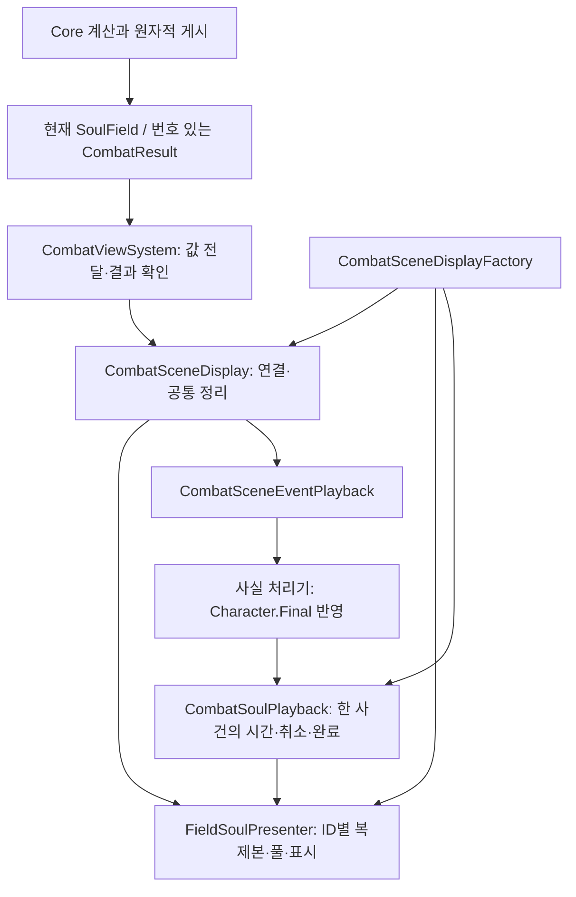

# 소울 드랍 설계

- 작성자: 호진(이호진)
- 상태: SD1 DB 정합 완료(사용자 커밋 `51f5a892`). SDV0 인수 완료(2026-10-15). 필드 표시 SDV1~SDV4는 미구현이며, 2026-10-15 사용자 승인으로 전투 View 작업자에게 이관했다. 구슬 표현(색·재질·경로·초수)은 미확정이다.
- 범위: 소울 드랍 아티팩트(1003)의 DB 저작과, 전장 영혼을 빛 구슬로 보이고 수집·비수집 소멸을 짧게 연출하는 View 설계. 영혼 규칙(생성·수집·성장·수명·이동 비용)은 Core가 정하고 바꾸지 않는다. 가시심장 반사, 원격 획득, 새 HUD·턴 숫자, 영혼 전용 카메라, Audio·새 Render EffectType·Shader, Framework 변경은 다루지 않는다.
- 계획: [소울 드랍 계획](../plans/2026-10-15-soul-drop-plan-Hojin.md)
- 인계: [소울 드랍 인계](../handoffs/2026-10-15-soul-drop-handoff-Hojin.md)(전투 View 구현 인계, Core 계약 확인 메모, SpawnSoul DB 사용법).
- 정리: 2026-10-27 이 문서를 한 틀로 다시 썼다. 옛 `handoffs/2026-10-15-soul-drop-spawnsoul-db-handoff.md`의 내용은 인계 3부에 있다. 옛 판은 git `10914570`.

## 1 목적과 범위

배치한 소울 드랍이 만든 전장 영혼을 빛 구슬로 보여 주고, 실제 수집과 비수집 제거를 짧은 연출로 구분한다. 생성 여부·위치·수집자·소비 ID·성장·체력·남은 유닛 턴은 Core·Buffer가 정한다. View는 게시된 사실을 결과 순서대로 표현만 한다.

포함: 현재 영혼 목록의 설치·복구, ID별 구슬 재사용, 사건 시점의 생성·수집·소멸, 기존 결과 재생·정리 수명 연결, 전용 View 설정과 구슬 에셋, 자동·출력·사람 검증의 구분.

## 2 지금 구조

### 2.1 Core 사실(이미 있음)

| 계약 | 내용 |
|---|---|
| `SoulFieldFacts` | `Id`·`Origin`·`Cell`·`RemainingUnitTurns`·`HealAmount` |
| `SoulFieldSnapshot` | 불변 `Entries`·`NextSoulId` |
| `CombatSoulEvent` | `Field.Expected/Final`, `CollectorId`, `Characters`, `ConsumedIds`. 종류 `SoulsCollected`(수집 있음)·`SoulFieldSettled`(수집 없음) |
| `ICombatStateBufferReadSink.SoulField` | 최초·최종 영혼 상태 |

새 Core 필드는 필요 없다(2026-10-27 코드 대조로 계약 그대로).

### 2.2 지금 View

- 영혼 사건은 사실 처리기만 지난다. 사건 형식 표 `CombatEventTypeTable`이 `CombatSoulEvent`를 사실 처리기 칸에 두고, `CombatFactEventHandler`가 `Characters`(성장 등)를 반영한다.
- 필드 구슬·수집/소멸 연출은 없다. `SoulFieldVisual`·`FieldSoulPresenter`·`CombatSoulPlayback`은 아직 코드에 없다.

### 2.3 계획한 구조(SDV1~SDV4)

| 구성 | 맡는 일 | 하지 않는 일 |
|---|---|---|
| `CombatViewSystem` | SoulField와 설치 때 미확인 결과를 값으로 넘기고, 기존 순서로 결과를 확인 | 영혼 diff·규칙·애니메이션 |
| `CombatSceneDisplayFactory` | 설정·필드 루트로 두 부품을 한 번 만들어 주입 | 영혼 자원 생성(Bind에서 만든다) |
| `FieldSoulPresenter` | 모든 idle·수집·제거 복제본과 풀, ID 소유 | 시간 진행, 규칙 계산 |
| `CombatSoulPlayback` | 한 사건의 경과 시간·콜백·취소 무효화, 초기 표시 스냅샷 선택 | 결과 번호·게임 상태 소유 |
| `SoulFieldVisual` View 표(singleton) | 프리팹과 표현 값 | 회복·성장·수명·진영·확률 |

새 씬 Scope·별도 `SoulViewSystem`·전역 이벤트·Update·Coroutine·Delay 예약·입력 Controller는 만들지 않는다. 영혼 표시 수명은 전투 Display와 같고, 짧은 연출은 `CombatSoulPlayback.Cancel`에 묶는다. 내부 부품을 Framework 서비스나 `ICombatEventPlayback` 구현으로 등록하지 않는다.

주의: 위 이름·파일 자리는 2026-10-15 코드 기준이다. 그 뒤 전투 View가 Presenter 분리(10-18, 사건 처리기 표), 폴더·네임스페이스 정리(10-21, `Input/`·`Display/`·`Playback/`·`Presentation/`)를 거쳤다. 인수자는 [전투 View 폴더 배치 안내](../viewDocs/combat-view-folder-guide.md)와 지금 처리기 표에 맞춰 자리를 다시 정한다.

## 3 결정 기록

| ID | 결정 | 날짜·근거 |
|---|---|---|
| SD1 | `Artifact_SoulDrop.asset`(1003)의 두 ModifyStat 항목을 SpawnSoul 한 항목으로 저작(밤·적 UnitDied·아군 Collector·DeathPosition·공격력/최대 HP +1/+1·수명 5 유닛 턴·`healAmount` 0). ID·초기 수량·T자 4칸·등록·View 모형·GUID는 그대로 | 2026-10-15 사용자 승인, Core `ArtifactEffectCompiler.ValidateSoulAltar`·`ValidateSoulGrowth` |
| — | 기존 Display 안에 영혼 표시·재생 부품 + 전용 View 설정(추천안). 별도 `SoulViewSystem`·전역 Update는 결과 순서·취소 소유자가 늘어 채택 안 함. 공용 `EffectScope` + 새 EffectType은 정식 Particle VFX로 바꿀 때 다시 본다 | 2026-10-15 설계 |
| — | 표현 기본안(§4.2)은 승인하지 않고 구슬 제작·연출 연결을 전투 View 작업자에게 넘긴다. SDV1~SDV4 구현 담당 이관. 이관은 표현·구현 실행 승인이 아니다 | 2026-10-15 사용자(SDV0 중) |
| — | 수집 연출은 기존 사실 처리 뒤에 시작한다. 능력치가 구슬 도착 뒤에만 보인다고 보장하지 않는다(View가 스탯을 계산하거나 반영을 늦추지 않음) | 2026-10-15 독립 리뷰 보완(초안의 "성장을 흡수 뒤로 늦춤"이 최신 사실 표시와 충돌) |
| — | 가시심장과 분리해 소울 드랍만 검증한다. 바뀐 것: 설계 때는 Core `SoulEffectCalculator.RequireSupportedAttackSettlement`가 가시심장과 함께면 예외를 던져 중단 조건이었다 → 천명님 `ebf26246`(2026-10-16 "가시 심장 반사 연결 완료") 뒤 그 검사는 코드에 없다(2026-10-27 확인) | 2026-10-15, 2026-10-27 |
| — | 새 Core 요청 없음 | 2026-10-15 SDV0 대조 |

## 4 기획 원문과 표현 기본안

### 4.1 기획 원문

사용자가 빛 구슬 외형을 확인했고, 동작은 `Project L`(Dropbox, 저장소 밖)의 PPT·Word·txt를 보도록 지정했다. 텍스트·발표자 노트만 검색했고 삽입 그림·동영상 전체를 본 것은 아니다.

| 출처 | 내용 | 적용 |
|---|---|---|
| `기획 브레인스토밍/안재령의고뇌/아티팩트 효과 (임시).txt` 21~29·54~61행 | 밤·적 사망 위치의 영혼, 5턴 뒤 소멸, 그 칸에 온 플레이어 캐릭터의 HP·Atk 성장, 획득 이동 비용 환급 금지 | 실제 판정은 Core가 게시한 사실을 따른다 |
| 같은 폴더 `아티팩트 기획서.pptx` 3~4·14슬라이드 | 배치해야 효과, 전투 중 배치 편집 금지 | 보유만으로 발동하지 않는다. 배치는 로비 보드 |
| `기획 문서/아트 관련 문서/아티팩트 아트 기획서 초안.pptx` 9슬라이드 | 영혼 포식자 보드 모형(해골·촛불·T형) | 보드 모형을 필드 구슬로 재사용하지 않는다 |
| `통합 기획서.pptx`, `게임 방향성.docx` 등 | 구슬 비행 곡선·색·초수 명세 없음 | §4.2는 기획 확정값이 아니다 |

- 옛 txt의 "HP+1"은 지금 Core의 **최대 HP 성장 +1, 추가 회복 0**이다. 현재 HP 회복으로 바꾸지 않는다.
- "5턴"은 Core의 5 유닛 턴이다. 턴 종료 생성 직후 처음 게시되는 남은 값이 4일 수 있고 보정하지 않는다.
- 기획과 지금 규칙을 바꿔야 한다는 요구가 나오면 Core 인계 후 멈춘다.

### 4.2 표현 기본안(미승인)

- 구슬은 Core 셀 중심 위에 놓는다. 그 칸에 실제 도착해 수집된 뒤에만 같은 사건 수집자의 몸통 위치로 짧게 흡수한다. 비수집 제거는 제자리 축소다.
- 원거리 흡인·추적·별도 획득 반경은 없다. 생성은 바로 보이고, 잔류 동안 View 타이머를 돌리지 않는다.
- 같은 셀에 여러 영혼이 있어도 ID별 인스턴스·대여/반환을 유지한다. 개수 합치기·임의 셀 이동·개수 HUD는 넣지 않는다.

| View 설정 | 기본안 |
|---|---|
| `prefab` | 필드 영혼 전용 빛 구슬. 임시 흰 Unlit 구체는 미승인. 아티팩트 보드 모형은 그대로 |
| `fieldHeight` | 셀 폭 기준 0.25, `mapper.WorldUp` 방향, 유한·0 이상 |
| `collectorHeight` | 셀 폭 기준 0.5, 수집자 `Final.Anchor` 위 도착점, 유한·0 이상 |
| `collectSeconds`·`removeSeconds` | 각 0.2초 제안, 유한·0~1, 0은 즉시 완료 |
| 경로·크기 | 수집은 고정 출발·도착점 선형 이동 + 끝에서 0으로 축소, 비수집 제거는 제자리 축소. 같은 사건의 구슬은 함께 진행 |

## 5 사건과 표시 분류

| 사건·경계 | 표시 |
|---|---|
| `Final`에만 있는 ID | `Final.Cell`에 새 구슬. Died·Fell 사건을 보고 View가 만들지 않음 |
| `SoulsCollected`의 `ConsumedIds` | `Expected`의 그 ID에서 출발, 같은 사건 `Characters` 중 `CollectorId`의 `Final.Anchor`로 흡수. `Result.ActorId`·최신 Transform/Buffer로 대신하지 않음 |
| `SoulFieldSettled`의 `Expected`에만 있는 ID | 비수집 제거 축소(Core countdown 제거 포함, 만료 사유 필드를 가정하지 않음) |
| 같은 ID의 TTL·사실 갱신 | 인스턴스 유지, Core가 준 값만 갱신. 초·프레임·라운드로 TTL을 줄이지 않음 |
| 전투 종료·Detach·취소·재설치·Release | 표시 자원 정리. 획득·만료 연출을 꾸며 내지 않음 |

한 결과 안에 생성 → 수집, 여러 수집자, 같은 칸 여러 영혼이 있을 수 있다. 강제 이동의 수집자는 명령 행위자와 다를 수 있다. 통과 칸·Return·거절·사망 도착에서 View가 수집을 만들지 않는다. 초기 ID는 다음 전투에서 다시 1이 될 수 있으므로 연결·설치마다 이전 표시와 연출 세대를 비운다.

## 6 표시 데이터와 초기 복구

- `SoulFieldVisual` singleton View 표. SO가 매번 새 읽기 전용 `SoulFieldVisualData`(`Prefab`, `FieldHeight`·`CollectorHeight`·`CollectSeconds`·`RemoveSeconds`)를 만든다. Query `ISoulFieldVisualTableQuery.Config`는 설정 정확히 1개, 프리팹 필수, 유한 범위를 검사한다. InGame·Render 표는 바꾸지 않는다.
- `CombatDisplayTables`가 새 설정을, `CombatDisplayValues`가 SoulField 불변 참조와(설치 때만) 미확인 결과 참조를 넘긴다. `ReadDisplayValues(includeUnpresentedResult: true)`는 `latest.Sequence > PresentedResultSequence`일 때 결과 참조만 담고 재생·skip·ack하지 않는다.
- 설치 때 미확인 결과에 영혼 사건이 있으면 **첫 영혼 사건의 `Field.Expected`**로 구슬을 설치하고, 없으면 현재 SoulField를 쓴다. 설치 끝의 Refresh에도 `WithSoulField(initialField)`로 그 값을 넘겨 최신 Final이 미리 보이지 않게 한다. 마지막 정상 Refresh는 현재 SoulField로 맞춘다.

## 7 재생·완료·정리 계약

1. 기존 결과 재생 경로(`OrderedCombatPresentation` → Display → `CombatSceneEventPlayback`)를 유지하고 영혼 사건만 `CombatSoulPlayback.Begin`으로 넘긴다.
2. 표시 부품은 Expected/Final·소비 ID·수집자를 모두 검증한 뒤 바꾼다. 잘못된 `CollectorId`·필드 밖 셀·누락된 소비 ID를 최신 Buffer로 보정하지 않고 F1로 보고한다.
3. `PrepareEvent`가 Expected를 맞추고 새 구슬·제거·흡수 대상과 고정 끝점을 준비한다. Tick은 정규화 진행률로 위치·크기만 바꾼다.
4. 모든 구슬은 사건마다 설정 초수 안에 함께 끝난다. TTL만 바뀌거나 생성만 있으면 즉시 끝난다. 결과 밖에 연출을 남기지 않는다.
5. 영혼 사건은 먼저 기존 사실 처리(Character.Final·소리 등)를 지나고, 그 콜백에서 같은 세대인지 확인한 뒤 연출을 시작한다. 마지막 프레임에 완료 콜백을 먼저 떼고 복제본 반환·Final 정렬을 끝낸 뒤, 세대가 유효할 때만 완료를 알린다.
6. 재생 완료 판정과 다음 사건 허용에 영혼 완료를 넣는다. 다른 Tick 뒤 영혼 Tick을 두고, 외부 호출마다 정리 세대를 다시 확인한다. 영혼 Begin·Tick·반환 실패는 같은 세대의 실패 정리와 F1로 잇고 원인·정리 예외를 함께 보존한다. 정상 완료 순서(최종 Refresh → 입력 후처리 → 명령 제거 → ack → 재생 수명 해제)는 그대로다.
7. Cancel은 콜백·세대를 먼저 무효화하고 자기 표시를 비우며 완료를 알리지 않는다. 늦은 Tick·콜백은 새 연결·재사용 ID를 건드리지 않는다. 결과 완료 번호의 주인은 계속 `CombatResultPlayback`이다.
8. 필드 해제 전에 영혼 Cancel·Clear, 최종 Release에 영혼 반환을 둔다. 일부가 실패해도 나머지를 정리한다(`CleanupErrors.RunAll`). 반복 Clear·Release, OnEnable·OnDisable 재진입에서 중복 대여·반환이 없어야 한다.

복제본은 원본 프리팹·머티리얼을 바꾸지 않는다. 하위는 IgnoreRaycast, Collider 끔, 클릭 수신·실제 Light·카메라 없음으로 필드 선택·공격 피커·UI를 막지 않는다. 재대여 때 위치·회전·스케일·활성을 원본 기준으로 되돌린다. 좌표는 `FieldGridMapper`의 `WorldUp`·`CellCenterToWorld`·`WorldCellWidth`를 쓴다.

## 8 검증 인수 기준

- 단위: 같은 셀 여러 ID, 신규·유지·제거, TTL만 갱신, 범위 밖 셀의 실패 불변, 대여 재사용·중복 반환 0·원본 보존·피커/카메라 비간섭.
- 사건: 같은 결과의 생성 → 수집, ActorId와 다른 CollectorId·강제 도착, 여러 수집자, TTL 1 제거 + 신규 TTL 4 동시 게시, 즉시 완료, 0초·큰 delta·NaN 설정.
- 수명: 중간 Cancel·Detach·StopInput·fault, 완료 반환 중 재진입, 정리 실패, 다음 전투 ID 1 재사용, 미확인 결과를 가진 재연결. 실패·취소는 결과를 ack하지 않는다.
- 통합: 실제 SO·DB와 소울 드랍 배치 뒤 밤 전투의 생성·최종 도착 수집·미수집 소멸, 성장 사실과 다음 전투 지속. 실제 Boot 경로·Core fixture·합성 입력·이미지·사람 조작의 출처를 나눠 적는다.

## 9 보류·중단 조건

- 미확정: 구슬 정식 에셋·색·재질·경로·초수. 인수자가 정한 뒤 SDV1을 시작한다.
- 멈출 때: 새 Core 사실·정산·수명 변경, 기존 사건으로 표현할 수 없는 수집자·좌표, 기획과 현재 성장·수명 규칙의 변경 요구, 소유 파일 동시 수정, 기존 계약과 다른 결정이 필요할 때. Core 변경은 [Core 전달 문서](../handoffs/2026-09-24-view-core-data-boundary-handoff.md)에 요청으로 남기고 구현하지 않는다.
- 가시심장: 위 결정 기록대로 지금은 같이 장착해도 예외가 나지 않는다. 그래도 이 기능의 검증은 소울 드랍만으로 한다.

## 10 다른 작업자 영향

| 누구 | 내용 | 공유 |
|---|---|---|
| 용근님(전투 View) | SDV1~SDV4 구현 담당 이관. 전투 View 공용 파일(`CombatDisplayTables`·`CombatDisplayValues`·`CombatViewSystem`·`CombatSceneDisplay`·`CombatSceneEventPlayback`·`CombatSceneDisplayFactory`)을 고치게 된다 | [소울 드랍 인계 1부](../handoffs/2026-10-15-soul-drop-handoff-Hojin.md#1부-소울-드랍-전투-view-구현-인계--2026-10-15)(미전달) |
| 천명님(Core) | Core 변경 없음. 이미 있는 계약과 SD1 DB 반영을 확인만 | [소울 드랍 인계 2부](../handoffs/2026-10-15-soul-drop-handoff-Hojin.md#2부-소울-드랍-core-계약-확인-메모--2026-10-15)(미전달), [Core 전달 문서 §17](../handoffs/2026-09-24-view-core-data-boundary-handoff.md#17-soul-drop-spawnsoul-db-alignment-2026-10-15) |
| 민형님·호진(DB 조립) | SDV1에서 `ViewDataBase`·`ViewDataBaseFactory`·`DataBaseGroupServiceKey`·`ViewGroup.asset`에 조회 키 하나를 더하게 된다(아직 안 함) | SDV1 때 |
