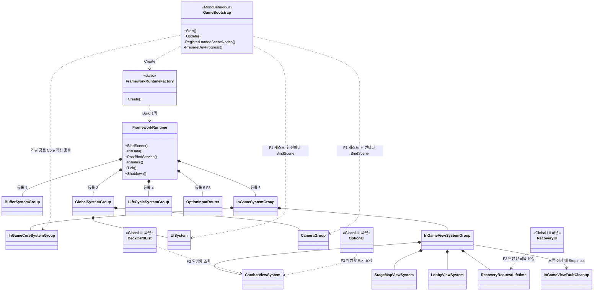
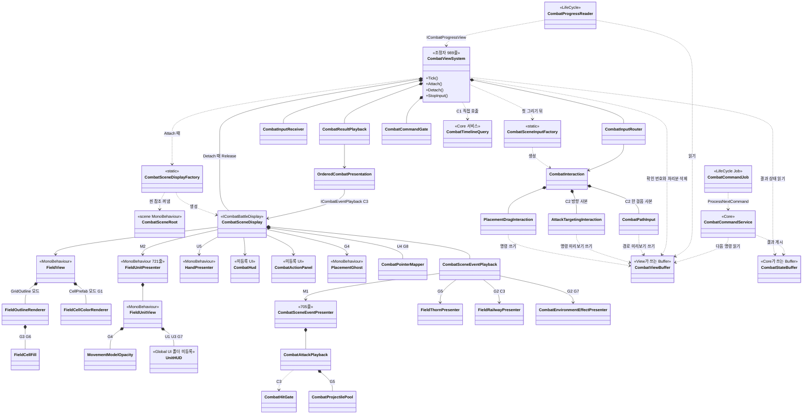
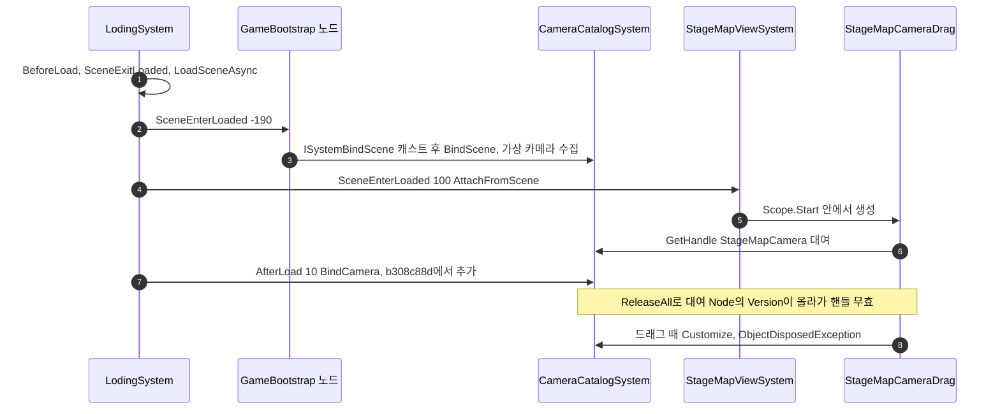

# View의 Framework 사용·구조 리뷰와 현재 UML — 2026-10-18

코드 스냅샷: `feature/Cheon/refactor/core-system` HEAD `a6bc2bce`(작업 트리 깨끗함). 비교한 다른 브랜치는 `origin/feature/JMH/RenderSystemViewRefactoring` `b308c88d`(2026-10-17)다. 실행 검증이 아니라 정적 리뷰다. Unity 컴파일·EditMode·Play는 돌리지 않았다.

**범위:** `Systems/RuntimeSystem/InGameSystem/ViewSystem/` 전체와 `Systems/Factory/Runtime/InGame/View/`. 비교 대상은 Global(Render·UI·Input·Audio·Utility·Loading·Job), Framework, Buffer, LifeCycle, Core 경계다. Core와 주고받는 경로(CombatViewBuffer → LifeCycle Job → Core)는 이 리뷰 전에 확인했으므로 UML에만 넣는다.

**판정 기준:**
- [Framework 개발 가이드](../../../Assets/ProjectL/Script/Systems/Documentation/framework-programmer-guide.md): §6 FW-001~016(MUST), FW-101~104(SHOULD), §8, §13
- [설계 세션 인계](../handoffs/2026-09-30-combat-view-design-session-handoff.md) §4: SSOT, SOLID, §4.6 기능 변경 독립성
- `CLAUDE.md` DB 규칙 P1~P7

판정은 가이드 §13을 따른다.
- **FAIL:** MUST 계약 위반이나 재현 가능한 회귀
- **WARNING:** 권장 사항이나 유지보수 문제
- **NDR**(NEEDS DESIGN REVIEW): 공개 계약에 없는 수명·소유권 정책을 새로 정해야 하는 것

**방법:** 영역 4개(렌더, 수명·의존성, UI·입력·오디오, 계층·SSOT)를 검토 에이전트로 나눠 읽었다. 표의 "확인" 열 값은 다음 뜻이다.
- **직접:** 작성자가 코드를 다시 열어 확인했다.
- **에이전트:** 검토 에이전트가 코드를 읽어 확인했고, 작성자는 다시 열지 않았다.

## 1. 결론

- **FAIL은 0건이다.** FW-001~016을 구체적으로 어긴 곳은 찾지 못했다. 다음은 모두 Framework/Global 경로를 쓴다.
  - 서비스·모듈 등록, Builder 1회 Build, Runtime 단계 순서
  - 입력 Submit 경로, 팝업 화면 전환
  - 렌더 Handle 반환 순서
  - Audio, 씬 로딩
- **"Framework를 안 쓴다"는 지적에 대해:**
  - 쓰지 않는 서비스는 SelectOutline·Light·RenderFeature·CameraEffect·EventBus다. TextEffect는 0바이트 빈 파일이라 서비스 자체가 없다.
  - 이 기능들을 View가 따로 만든 곳은 없다.
  - 전투 재생이 `IDelayService` 대신 자체 Tick을 쓰는 것은 정당하다. Delay에는 취소·dt·일시정지가 없다(U8).
- **"구조를 깬다"에 가까운 것은 네 묶음이다. 모두 NDR이다.**
  1. **씬 재바인딩:** Bootstrap이 서비스를 모듈 인터페이스로 캐스트해서 씬마다 직접 호출한다(F1). 민형님의 10-17 수정과 합치면 스테이지 맵 카메라 핸들이 무효가 된다(F2). 병합 전에 조정해야 한다.
  2. **역방향 의존:** Global UI 화면 3개가 InGame View 서비스를 직접 조회한다(F3). 등록 순서는 Global이 InGame보다 먼저인데, 의존은 반대 방향이다.
  3. **Core 규칙:** View가 Core 규칙 일부를 복사하고(C2), "이동 원인"을 Core 사건 순서로 여러 곳에서 각자 추론한다(C3).
  4. **Render 조합:** View가 렌더 조합을 직접 가진다. 칸 채우기는 AreaOutline 머티리얼·셰이더 키에 기대고(G3), 이동 반투명은 셰이더 이름 목록과 `new Material`로 처리한다(G4).
- **자원 수명 경고:**
  - 셀 프리팹 모드의 ColorHandle을 반환하지 않는다(G1). 지금 DB 설정에서는 이 경로를 타지 않아 잠재 문제다.
  - 기차 이펙트가 발동할 때마다 EffectScope를 새로 받아 쌓는다(G2).

## 2. 먼저 볼 것

| 순서 | 항목 | 이유 | 영역 |
|---|---|---|---|
| 1 | F2 카메라 핸들 무효(병합 회귀) | `b308c88d`를 병합하면 스테이지 맵 드래그가 예외로 멈춘다 | Framework(민형님), View 비전투 |
| 2 | F1 Bootstrap 캐스트 재바인딩 | F2의 원인이다. 씬 재바인딩 계약이 없다(DR-001·DR-010) | Framework, Boot |
| 3 | F3 Global UI → View 역방향 | 포트 소유자와 수명 계약이 없다 | UI, View |
| 4 | C2·C3 Core 규칙 사본, 사건 순서 추론 | Core가 바뀌면 View가 경고 없이 어긋난다. **Core 쪽에서 할 수 있는 일이다** | Core, View 전투 |
| 5 | G1·G2 Color·Effect 자원 누적 | 전투에 들어갈 때마다 쌓인다 | View 전투, Framework |

## 3. 지적 목록

### 3.1 Framework 경계와 수명

| ID | 판정 | 내용 | 위치 | 규칙 | 확인 |
|---|---|---|---|---|---|
| F1 | NDR | `IUISystemService`와 `ICameraGroupServiceContext`를 `ISystemBindScene`으로 캐스트해서 씬에 들어갈 때마다 `BindScene`을 직접 부른다. 공개 서비스 인터페이스에는 BindScene이 없으므로, 구현 객체가 바뀌면 `InvalidCastException`이 난다. Effect·Light·Audio는 다시 바인딩하지 않는다. | `ViewSystem/Boot/GameBootstrap.cs:244-247, 253` | §8 "캐스트로 꺼내 수동 조작", FW-004 경계, DR-001·010 | 직접 |
| F2 | NDR (병합 회귀) | `b308c88d`에서 CameraCatalog가 AfterLoad(10)에 `BindCamera`를 등록했고, 그 안에서 `ReleaseAll`을 한다. View는 그보다 먼저 실행되는 SceneEnterLoaded(100)에서 핸들을 빌린다. 그래서 빌린 핸들이 모두 무효가 되고, 첫 드래그의 `Customize`에서 `ObjectDisposedException`이 난다. JMH 브랜치에도 Bootstrap의 -190 수동 바인딩이 남아 있어 한 번 로드에 두 번 바인딩한다. | `StageMapViewSystem.cs:124`, `StageMapViewScope.cs:139`, `LodingSystem.cs:156-164`, JMH 브랜치의 `CameraCatalogSystem.cs:49` | 대여 수명(FW-011 취지), 변경 영향 | 직접 |
| F3 | NDR | `DeckCardList`·`OptionUI`·`RecoveryUI`가 `InGame.ViewGroup.Combat`·`RecoveryRequests`를 조회한다. 반대로 `HandPresenter`는 `Screens.Global`을 using한다. 표시 방향은 UI 포트(`IShopPopupDisplay` 등)로 정리돼 있는데 입력 방향만 거꾸로다. | `Screens/Global/DeckCardList.cs:115`, `Screens/Global/OptionUI.cs:118`, `Screens/Stage/RecoveryUI.cs:70`, `Display/HandPresenter.cs:6` | 인계 §4.2 D, 가이드 §3 등록 순서 | 직접 |
| F4 | WARNING | GameBootstrap이 맡은 일이 너무 많다(아래 목록). 클래스 주석은 "화면·입력은 맡지 않는다"인데 씬별로 열 화면을 직접 정한다. 씬 하나를 추가하려면 노드 3종과 `ValidateScenes`를 모두 고쳐야 한다. | `GameBootstrap.cs:139-275, 370-415`, `Dev/DevBossStageBattleSource.cs:39` | 인계 §4.2 S, §4.6 | 에이전트 |
| F5 | NDR (낮음) | `RecoveryRequestLifetime.Shutdown`이 예약이 남아 있으면 공용 Job Runner 전체를 `Clear`한다. View 모듈 하나가 모든 도메인의 Job 정리를 결정한다. | `Recovery/RecoveryRequestLifetime.cs:186-194` | DR-007 | 직접 |
| F6 | WARNING | "개발 빌드 전용"인 `RecordInputOnly`가 릴리스에서도 직렬화된 값 그대로 적용된다. 막는 `#if`가 없다. 씬에 이 값이 저장되면 처리 Job이 없는 전투가 된다. | `GameBootstrap.cs:77, 155`, `CombatExecutionMode.cs:12` | — | 직접 |
| F7 | WARNING | 조립 루트(GameBootstrap)와 Core 입력 공급자가 View 폴더에 있다. Dev 소스는 InGameQuery를 읽는다. 네임스페이스가 `ViewSystem → Factory.Runtime → InGameViewSystemFactory → ViewSystem`으로 순환한다. Dev 코드는 `#if`로 막혀 있다. | `GameBootstrap.cs:5-6, 155`, `Dev/DevBattleInitializationSource.cs:70` | 가이드 §2 배치표, CLAUDE.md | 에이전트 |
| F8 | WARNING (낮음) | `OptionInputRouter`가 LifeCycle 뒤에 루트로 등록된다. 가이드 §3 순서(Buffer → Global → InGame → LifeCycle)와 다르다. | `Factory/Runtime/RunTimeSystemFactory.cs:88` | 가이드 §3 | 직접 |

F4의 GameBootstrap이 하는 일:
- 중복 생성 방지, Build Settings 검증
- DB 생성, Global UI Canvas 생성
- 수명 4단계 호출
- 개발 보스 소스를 수동으로 PostBindService
- BGM 프리셋·재생
- UI·카메라 재바인딩 노드 등록, 씬별 화면 열기
- 보드 준비 폴링, 개발 진행용 Core 직접 호출
- 매 프레임 Tick과 진입 상태 폴링

### 3.2 렌더·그래픽

| ID | 판정 | 내용 | 위치 | 규칙 | 확인 |
|---|---|---|---|---|---|
| G1 | WARNING (영향 큼, 잠재) | 셀 프리팹 모드의 ColorHandle을 Dispose하지 않는다(주석: "Shutdown이 맡음"). 그런데 `ColorHandle.Dispose`는 Renderer가 null이면 바로 반환하므로, 씬이 내려간 뒤에는 Shutdown도 정리하지 못한다. 결과적으로 전투마다 ColorSystem 등록이 쌓인다. 현재 DB는 GridOutline(`fieldDisplayMode: 1`)이라 이 경로를 쓰지 않는다. | `Display/FieldCellHandle.cs:11-12, 42`, `FieldCellPool.cs`, `FieldCellColorRenderer.cs:114-143`, `ColorSystem/ColorHandle.cs:93-96` | 가이드 §10, DR-004 | 직접 |
| G2 | WARNING / Framework NDR | 기차가 발동할 때마다 `GetEffectHandle()`을 부른다. EffectSystem은 Scope를 목록에 넣고 Shutdown 때만 정리하므로, 앱이 끝날 때까지 쌓인다. Framework에 Scope를 해제하는 공개 API가 없다. | `Display/FieldRailwayPresenter.cs:196, 277-278`, `Display/CombatEnvironmentEffectPresenter.cs:73`, `EffectSystem.cs:46, 83-88, 99-101` | FW-103 | 직접 |
| G3 | NDR | GridOutline 칸 채우기(`FieldCellFill`)가 Render DB `_AreaOutline`과 같은 머티리얼(`AreaOutline.mat`, guid `c02e9d97…`)을 View DB `highlightFillMaterial`로 따로 참조한다. 또 AreaOutline 셰이더 키와 정렬값(-1)을 전제한다. AreaOutline이 바뀌면 경고 없이 깨진다. | `Display/FieldCellFill.cs:25-26, 62, 99-103`, `FieldOutlineRenderer.cs:89-90`, `AreaOutlineData.asset:16-17`, `StageFieldView_Default.asset:30` | SSOT, 가이드 §7 | 직접 |
| G4 | WARNING / NDR(DR-004) | 이동 반투명을 셰이더 이름 4개 화이트리스트 + `new Material` + 키워드 직접 설정으로 처리한다. 목록 밖 셰이더면 이동 중에 예외가 난다. ColorHandle이 붙은 Renderer에 `SetPropertyBlock`을 직접 호출한다. 같은 "유닛 반투명"을 `PlacementGhost`는 DB `ghostMaterial`로 처리한다(현재 null). | `Display/MovementModelOpacity.cs:143-163, 197-224`, `Display/PlacementGhost.cs:188-194` | SSOT, DR-004 | 직접(셰이더 목록), 에이전트(나머지) |
| G5 | WARNING | 발사체 풀과 가시밭 풀이 같은 보조 코드(비활성 루트, 안전 SetActive, 지연 파괴)를 각자 가진다. 파괴 규칙을 고치면 두 곳을 함께 바꿔야 한다. | `Display/CombatProjectilePool.cs:344-522`, `Display/FieldThornPresenter.cs:301-436` | SSOT | 에이전트 |
| G6 | WARNING (작은 결함) | AreaOutline 슬롯이 `Update` 전에 `Remember`를 한다. Update가 예외를 던지면 다음 Refresh가 같은 값이라고 보고 건너뛴다. 같은 파일의 선 슬롯은 Update 뒤에 Remember한다. | `Display/FieldOutlineRenderer.cs:304-315` | 파일 내부 일관성 | 직접 |
| G7 | WARNING | 렌더 상수가 하드코딩돼 있다: 폭발 `EffectType.Boom`(기차·가시밭은 View 표에서 읽음), 회전 -90, `layer = 5`, `sortingOrder = 10`, IgnoreRaycast 2, 정렬 -1 | `CombatSceneDisplayFactory.cs:67`, `CombatEnvironmentEffectPresenter.cs:76`, `FieldUnitView.cs:52, 57`, `FieldThornPresenter.cs:23`, `FieldCellFill.cs:26` | SSOT(D12 전례) | 직접(일부) |
| G8 | WARNING | 출력 Camera를 얻는 방식이 화면마다 다르다(아래 목록). 가상 카메라가 있는 씬에서는 `CinemachineCore.Instance.FindPotentialTargetBrain(vcam).OutputCamera`로 얻을 수 있지만, 전투 씬에는 가상 카메라가 0개다(모든 브랜치). 로비는 Catalog가 이미 하는 이름 유일 검사를 다시 하고, 빌린 핸들은 쓰지 않는다. | `StageMapViewSystem.cs:316`, `CombatPointerMapper.cs:194`, `LobbySceneRoot.cs:108`, `Lobby/LobbyCameraController.cs` | SSOT, Catalog 문서 | 직접 |

G8에서 화면별로 출력 Camera를 얻는 방식:
- 전투: SceneRoot 필드, 없으면 매번 `Camera.main`
- 스테이지 맵: `Camera.main`을 Attach 때 한 번
- 로비·아티팩트: SceneRoot 필드

### 3.3 UI·입력·오디오

| ID | 판정 | 내용 | 위치 | 규칙 | 확인 |
|---|---|---|---|---|---|
| U1 | WARNING (Play 확인 필요) | 유닛 HUD Canvas는 런타임에 `FieldUnits`(씬 루트, Canvas 없음) 아래에 만들어진다. UI 오디오 Scope는 BindScene 때 있던 Canvas의 루트에만 붙는다. 그래서 HUD 상태 아이콘의 Click·Hover 소리가 빠졌을 수 있다. | `Display/FieldUnitView.cs:51-53`, `UISystem.cs:240-252`, `UIInputBinding.cs:49` | audio-integration.md | 직접(구조), Play 미확인 |
| U2 | WARNING | `CombatAbandonPanel`은 씬·프리팹·코드 어디에서도 참조되지 않는다. 포기는 `OptionUI → ConfirmUI → IUISystemService`로 옮겨졌다. `BindAbandon`은 빈 계약이고, `IsConfirmOpen`이 참이 될 경로가 없어서 수신 창구의 확인창 차단 분기가 죽은 코드다. **삭제하지 않고 보고만 한다**(CLAUDE.md). | `Display/CombatAbandonPanel.cs`, `CombatSceneDisplay.cs:265-271`, `CombatInputReceiver.cs:106`, `CombatViewSystem.cs:885` | SSOT | 직접(참조 0) |
| U3 | NDR | `UnitHUD`는 Global UI 폴더에 있지만 UIBase가 아니고 등록되지도 않는다. 전투 전용이고, Core Contracts와 Buffer를 참조한다. 유닛마다 World Space Canvas와 GraphicRaycaster를 하나씩 만든다. | `Screens/Stage/UnitHUD.cs`, `FieldUnitView.cs:51-56` | FW-009 범위 밖, 배치 | 에이전트 |
| U4 | WARNING | UI 가림 판정이 두 벌 있다. 둘 다 같은 `RaycastAll` + `GraphicRaycaster` 로직이다. | `Combat/CombatPointerMapper.cs:160-190`, `Common/ScreenUIPointerBlocker.cs` | SSOT | 직접 |
| U5 | WARNING (낮음) | Framework Tick 밖에서 도는 프레임 작업이 있다: 손패 호버(`Update` + `Time.unscaledDeltaTime`), HUD 빌보드(`LateUpdate`), UnitHUD. 오류로 정지한 뒤에도 계속 돈다. MUST 규칙은 없다. | `Display/HandPresenter.cs:181-190`, `FieldUnitView.cs:72-78`, `UnitHUD.cs:350-353` | FW-016 취지 | 직접(HandPresenter) |
| U6 | WARNING | BGM 프리셋 숫자가 5곳에 흩어져 있고, 유닛별 오디오 switch는 `CategoryKey` 숫자 값에 기댄다. 전투 BGM을 Display와 사건 Presenter 두 곳이 정한다. Audio는 R4 결정으로 리팩토링 범위 밖이다. | `GameBootstrap.cs:164`, `CombatSceneDisplay.cs:175`, `CombatSceneEventPresenter.cs:619-658`, `CombatViewSystem.cs:785`, `StageMapViewSystem.cs:225` | SSOT | 에이전트 |
| U7 | WARNING | 팝업 화면 어댑터 4개가 `UIBase.ID`와 같은 UIId를 다시 선언한다. 로비 덱 팝업 Layer 이름은 문자열로 직접 적는다. | `ArtifactPopupViewScreen.cs:18`, `ShopPopupViewScreen.cs:18`, `RecoveryPopupViewScreen.cs:16`, `LobbyDeckPopupViewScreen.cs:16`, `LobbyInputLayers.cs:13` | FW-102 | 에이전트 |
| U8 | PASS (설계 메모) | 전투 HUD와 행동 버튼은 등록하지 않은 독립 UI라 FW-009 범위 밖이다. 버튼은 Submit을 거치지 않지만 Policy가 실제 Layer를 다시 검사하므로 일관된다. 대가는 `HideAllUI`·`BackCloseUI`가 닿지 않는 것인데, 현재 호출하는 곳이 없다. 전투의 자체 Tick 재생도 PASS다. | `CombatHud.cs:24`, `CombatActionPanel.cs:23`, `CombatInputPolicy.cs:52, 73` | FW-007·009 판정 주의 | 에이전트 |

### 3.4 Core 경계·SSOT

| ID | 판정 | 내용 | 위치 | 규칙 | 확인 |
|---|---|---|---|---|---|
| C1 | WARNING | 타임라인을 Core 서비스에 직접 묻는다(VR6 대기). **Core 쪽 작업:** 타임라인을 Buffer로 게시한다. | `CombatViewSystem.cs:172, 716` | 인계 §4.1 | 직접 |
| C2 | WARNING | Core 기하 규칙의 사본이 View에 있다: 공격 방향 오프셋(`AppointShapeCalculator`), 경로 한 걸음은 상하좌우 1칸(`MovementRouteValidator`). 최종 검증은 Core가 한다. **Core 쪽 작업 후보:** Contracts에 방향 오프셋과 한 걸음 판정을 공개한다. | `AttackTargetingInteraction.cs:445-460`, `StageInput/MovementDraft.cs:22-24` | 인계 §4.1, P6 | 직접(방향) |
| C3 | NDR | "이동 원인"(자발 이동인지 공격 후속인지)을 View 4곳 이상이 Core 사건 순서로 각자 추론하고, 기준도 서로 다르다(`IsMovement` 집합 차이). 기차 사건 바로 뒤에 Died가 이어진다고 가정한다. 이 사건 순서 계약은 Core 경계 문서에 없다. Q2(Core 요청 없음)는 사용자 결정이라 FAIL이 아니다. **Core 쪽 작업 후보:** 순서 계약을 데이터 경계 인계 §5에 적거나, 원인 사실을 제공하는 방안을 검토한다. | `CombatHitFollowUps.cs:20-101`, `CombatEnemyPresentationPacing.cs:33-55`, `OrderedCombatPresentation.cs:211-241`, `CombatSceneEventPresenter.cs:155-158`, `CombatRailwayContactPlayback.cs:82-90` | 인계 §4.1·§4.6 | 에이전트 |
| C4 | WARNING | `StageMapViewSystem`이 InGame DB까지 열린 `IDataBaseQueryContext`를 받는다. 실제로는 ViewQuery만 쓴다. | `StageMapViewSystem.cs:36, 79` | FW-101, CLAUDE.md | 직접 |
| C5 | WARNING (낮음) | 회복 상태를 Buffer 그룹이 아니라 `CoreGroup.RecoveryState`(읽기 싱크)로 받는다. | `StageMapViewSystem.cs:114-115` | 인계 §4.1 | 직접 |
| C6 | WARNING | 유닛 표시 이름과 아이콘의 원본이 View DB와 UI SO 여러 곳에 있다. | `UnitVisualDataSO`, `UnitCardVisualsSO.cs`, `DeckCharacterImagesSO.cs`, `CombatLogUI.cs:32-38` | SSOT | 에이전트 |

### 3.5 유지보수 구조 (§4.6)

| ID | 판정 | 내용 | 위치 | 규칙 | 확인 |
|---|---|---|---|---|---|
| M1 | WARNING | 새 Core 사건 하나를 추가하려면 `CombatSceneEventPresenter`(705줄)의 네 곳(`CanPresent`, `BeginEvent`, `ShowHighlight`, `PlayAudio`)을 고쳐야 한다. 재평가 문서는 492줄 시점에 "양호"로 판정했다. | `CombatSceneEventPresenter.cs:266, 274, 426, 600` | §4.2 O, §4.6 | 직접(위치) |
| M2 | WARNING | `FieldUnitPresenter`(721줄)에 책임이 10가지 넘게 섞여 있다(아래 목록). 협력 클래스 8개가 구체 타입에 의존한다. | `Display/FieldUnitPresenter.cs` | §4.2 S·I | 에이전트 |
| M3 | WARNING | 스테이지 맵 씬 연결이 다른 화면과 다르다. `FindFirstObjectByType`이라 루트가 하나인지 검사하지 않는다(Combat·Lobby는 검사한다). 인자가 약 20개인 Scope 생성을 두 갈래로 중복해서, 의존성 하나를 추가하려면 6곳을 고쳐야 한다. | `StageMapViewSystem.cs:205-217, 313` | §4.6 | 에이전트 |
| M4 | WARNING (낮음) | View 그룹이 Combat·Recovery를 생성자 인자로 받으면서 내부 Store에도 등록한다(Store 쪽을 읽는 곳은 없다). `ICombatViewService`가 Attach/Detach까지 공개하고, Global UI(`DeckCardList`)가 그 넓은 서비스를 그대로 보관한다. | `InGameViewSystemGroup.cs:42-47`, `InGameViewSystemFactory.cs:43-46`, `DeckCardList.cs:115` | FW-101 | 직접(일부) |

M2의 FieldUnitPresenter에 섞인 책임:
- 풀, 사실 렌더, HUD, 체력 미리보기
- 사망 유지, Ballista
- 자세 대여, 회전, 이동 투명도
- 히트 몸 모양

## 4. 확인했고 문제없는 것

- **FW-001/002/003:** View 시스템 4개가 서비스를 인터페이스로 등록하고 `AddModule`도 한다. 각 Builder는 한 번만 Build한다. 그룹은 6단계를 모두 자식에게 전달하고, 종료는 역순으로 하며 실패를 모은다.
- **FW-016:** Boot 순서(BindScene → InitData → PostBindService → Initialize → Tick)가 맞다.
- **FW-004:** View는 Render 내부 인터페이스(`IColorSystemOnlyHandleService`, MeshNode 등)로 캐스트하지 않는다(F1의 Bootstrap 캐스트는 별개).
- **FW-010/011:**
  - `GridCubeCreateData`를 구체 타입으로 넘긴다.
  - Handle 반환 순서가 맞다: `FieldCellFill.Release`(color → mesh → Destroy), `PlacementGhost`, `MovementModelOpacity.Dispose`, `FieldOutlineRenderer.ReleaseHandles`.
  - `CombatSceneDisplay.Release`가 씬을 내리기 전 Detach에서 실행된다.
- **FW-007·009:**
  - View에는 `UnityEngine.Input`, `Keyboard.current`, `onClick.AddListener`가 없다.
  - 팝업 4종은 `PopupViewScope → OpenUI/CloseUI`로 열고 닫는다.
  - 등록된 UIBase를 직접 Open/Hide하거나 SetActive하는 곳이 없다.
- **Audio·Loading:** View에 FMOD나 AudioSource를 직접 쓰는 곳이 없다. `SceneManager.LoadScene`도 부르지 않는다.
- **Core 경계:**
  - View는 Core Domain·Application 네임스페이스를 0건 참조하고 Contracts만 쓴다.
  - `CombatHitGate`·`CombatContactGeometry`·`RailwayContactSchedule`·`CombatExplosionRules`는 Core 사실을 읽기만 하고 판정하지 않는다.
  - View가 쓰는 Buffer는 *View Buffer뿐이다.
  - 보관 값(`_shownRunGold`, `_turnOrders`, `_shownCharacters`)은 파생 캐시다.
- **씬 검색:** 시스템마다 씬 진입 노드 한 곳에서만 한다. Tick·입력 경로에는 없다.
- **구독 해제:**
  - `CombatSceneRoot` 이벤트는 Detach 첫 줄에서 해제된다.
  - `RenderPipelineManager.beginCameraRendering`은 Hide·Dispose에서 해제된다.
  - 팝업 이벤트는 등록과 해제가 짝이 맞다.
- **배치:** `Dev/*`는 `#if UNITY_EDITOR || DEVELOPMENT_BUILD`로 막혀 있다. 씬 번호는 모두 `SceneIndices`를 거친다. 서비스 키는 모두 `Systems/ServiceKeys`에 있다.

## 5. 현재 구조 UML

관계 표기:
- `*--`: 생성·수명 소유
- `-->`: 보관 참조·위임
- `..>`: 호출·데이터 의존
- 관계선 이름의 `F1`·`G3` 같은 ID는 3절의 지적을 가리킨다.

스테레오타입:
- `<<미사용>>`: View가 쓰지 않는 Global 서비스
- `<<Unity 직접>>`: Framework 서비스를 거치지 않고 Unity API를 직접 쓰는 지점

### 5.1 조립과 수명

### 5.2 View와 Global 서비스 사용 지도

```mermaid
classDiagram
    direction LR
    class CombatViewSystem {
        <<View>>
    }
    class StageMapViewSystem {
        <<View>>
    }
    class LobbyViewSystem {
        <<View>>
    }
    class RecoveryRequestLifetime {
        <<View>>
    }
    class InputLayerAndSlot {
        <<Global 사용>>
    }
    class LodingRegisterService {
        <<Global 사용>>
    }
    class AudioSystemService {
        <<Global 사용>>
    }
    class UISystemService {
        <<Global 사용>>
    }
    class DelayService {
        <<Global 사용>>
    }
    class JobRunner {
        <<Global 사용>>
    }
    class ColorSystem {
        <<Render 사용>>
    }
    class EffectSystem {
        <<Render 사용>>
    }
    class MeshSystem {
        <<Render 사용>>
    }
    class AreaOutlineSystem {
        <<Render 사용>>
    }
    class DrawPointLineSystem {
        <<Render 사용>>
    }
    class CameraCatalogSystem {
        <<Render 사용>>
    }
    class SelectOutlineSystem {
        <<미사용>>
    }
    class LightSystem {
        <<미사용>>
    }
    class RenderFeatureSystem {
        <<미사용>>
    }
    class CameraEffectSystem {
        <<미사용>>
    }
    class EventBusSystem {
        <<미사용>>
    }
    class UnityCamera {
        <<Unity 직접>>
    }
    class CinemachineVirtualCamera {
        <<Unity 직접>>
    }
    class UnityEventSystemRaycast {
        <<Unity 직접>>
    }
    class UnityMaterialShader {
        <<Unity 직접>>
    }
    class UnityFrameLoop {
        <<Unity 직접>>
    }
    CombatViewSystem --> InputLayerAndSlot
    CombatViewSystem --> LodingRegisterService
    CombatViewSystem --> AudioSystemService : U6
    CombatViewSystem --> ColorSystem : G1 G4
    CombatViewSystem --> EffectSystem : G2
    CombatViewSystem --> MeshSystem
    CombatViewSystem --> AreaOutlineSystem : G3 G6
    CombatViewSystem --> DrawPointLineSystem
    CombatViewSystem ..> UnityCamera : G8 SceneRoot 또는 Camera.main
    CombatViewSystem ..> UnityEventSystemRaycast : U4 중복 판정
    CombatViewSystem ..> UnityMaterialShader : G3 G4
    CombatViewSystem ..> UnityFrameLoop : U5 Update LateUpdate
    StageMapViewSystem --> InputLayerAndSlot
    StageMapViewSystem --> LodingRegisterService
    StageMapViewSystem --> AudioSystemService
    StageMapViewSystem --> UISystemService : 상점 회복 팝업
    StageMapViewSystem --> DelayService : 노드 이동
    StageMapViewSystem --> CameraCatalogSystem : 드래그 F2
    StageMapViewSystem ..> UnityCamera : G8 Camera.main
    StageMapViewSystem ..> CinemachineVirtualCamera : 초기값과 회전 읽기
    LobbyViewSystem --> InputLayerAndSlot
    LobbyViewSystem --> LodingRegisterService
    LobbyViewSystem --> UISystemService : 덱 아티팩트 팝업
    LobbyViewSystem --> DelayService : 체스 이동
    LobbyViewSystem --> CameraCatalogSystem : 핸들만 대여 G8
    LobbyViewSystem ..> UnityCamera : SceneRoot 출력 카메라
    LobbyViewSystem ..> CinemachineVirtualCamera : 이름 검사 중복 G8
    LobbyViewSystem ..> UnityEventSystemRaycast : ScreenUIPointerBlocker U4
    RecoveryRequestLifetime --> JobRunner : F5 종료 때 Clear
```

`<<미사용>>` 서비스 5개는 View가 대신 직접 구현한 곳도 없다. TextEffect는 빈 파일이라 그리지 않았다.

### 5.3 전투 View 상세와 Core 경계

### 5.4 스테이지 맵·로비·팝업과 카메라

```mermaid
classDiagram
    direction TB
    class StageMapViewSystem
    class StageMapSceneRoot {
        <<scene MonoBehaviour>>
    }
    class StageMapViewScope {
        <<생성 인자 약 20개>>
    }
    class StageMapViewDisplay
    class StageMapInteraction
    class StageNodePicker
    class StageMapCameraDrag
    class StageMapNodeMovement
    class ShopPopupViewFactory
    class RecoveryPopupViewFactory
    class PopupViewScope
    class LobbyViewSystem
    class LobbySceneRoot {
        <<scene MonoBehaviour>>
    }
    class LobbyViewScope
    class LobbyCameraController
    class LobbyFacilityPicker
    class ScreenUIPointerBlocker
    class ArtifactPopupViewFactory
    class ArtifactPopupController
    class ArtifactSceneRoot {
        <<scene MonoBehaviour>>
    }
    class CameraCatalogSystem {
        <<Global Render>>
    }
    class UISystemService {
        <<Global>>
    }
    class DelayService {
        <<Global>>
    }
    class UnityCamera {
        <<Unity 직접>>
    }
    class CinemachineVirtualCamera {
        <<Unity 직접>>
    }
    class RecoveryStateReadSink {
        <<CoreGroup 경유>>
    }
    StageMapViewSystem ..> StageMapSceneRoot : FindFirstObjectByType M3
    StageMapViewSystem ..> UnityCamera : Camera.main G8
    StageMapViewSystem *-- StageMapViewScope : 두 갈래 생성 M3
    StageMapViewSystem *-- ShopPopupViewFactory
    StageMapViewSystem *-- RecoveryPopupViewFactory
    StageMapViewSystem ..> RecoveryStateReadSink : C5
    StageMapViewScope *-- StageMapViewDisplay
    StageMapViewScope *-- StageMapInteraction
    StageMapViewScope *-- StageNodePicker
    StageMapViewScope *-- StageMapCameraDrag : SceneEnter 100에서 생성
    StageMapViewScope *-- StageMapNodeMovement
    StageNodePicker --> UnityCamera : ScreenPointToRay
    StageMapCameraDrag --> UnityCamera : WorldToScreenPoint
    StageMapCameraDrag --> CinemachineVirtualCamera : 초기값 복사
    StageMapCameraDrag --> CameraCatalogSystem : GetHandle Customize F2
    StageMapNodeMovement --> DelayService
    ShopPopupViewFactory ..> PopupViewScope
    RecoveryPopupViewFactory ..> PopupViewScope
    PopupViewScope --> UISystemService : OpenUI CloseUI
    LobbyViewSystem ..> LobbySceneRoot : 루트 1개 검사
    LobbyViewSystem *-- LobbyViewScope
    LobbyViewSystem *-- ArtifactPopupViewFactory
    LobbyViewScope *-- LobbyCameraController
    LobbyViewScope *-- LobbyFacilityPicker
    LobbyViewScope *-- ScreenUIPointerBlocker : U4
    LobbyCameraController --> CameraCatalogSystem : 대여만 G8
    LobbyFacilityPicker --> UnityCamera : 출력 카메라 Ray
    LobbySceneRoot --> CinemachineVirtualCamera : 이름 유일 검사 중복 G8
    ArtifactPopupViewFactory ..> ArtifactPopupController : 생성
    ArtifactPopupController --> ArtifactSceneRoot
    ArtifactSceneRoot --> UnityCamera : 출력 카메라와 렌더 훅
    ArtifactPopupController ..> PopupViewScope
```

### 5.5 씬 로드 순서와 카메라 핸들 (F2)

현재 브랜치에는 7번 단계가 없다. `b308c88d`를 병합하면 7번 단계가 생기고, 그 결과 8번에서 예외가 난다.

## 6. 넘길 곳

작업자 영역은 `CLAUDE.md`와 기존 인계 문서 기준이다. 이 문서는 보고만 하고 다른 영역 코드는 고치지 않았다.

| 영역 | 항목 | 방법 |
|---|---|---|
| Core (이 브랜치) | C1 타임라인 Buffer 게시(VR6), C2 방향 오프셋·한 걸음 판정 Contracts 공개 검토, C3 사건 순서 계약 기록 | Core 쪽에서 바로 처리하거나 데이터 경계 인계 §5에 기록 |
| Framework (민형님) | F1 씬 재바인딩 공개 계약, **F2 병합 전 조정**, G2 EffectScope 해제 API, G3 칸 채우기를 AreaOutline 옵션으로 둘지 | Framework 공유 문서 |
| View 전투 | F4, F6, G1, G4~G7, U2, U4, U5, M1, M2 | View 계획 후보로 기록 |
| View 비전투 (호진님) | G8 카메라, C4, C5, M3, U7 일부 | 공유 메모 |
| UI (현강님) | U1(Play 확인), U3, C6, U7 일부, F3의 UI 쪽 포트 | 공유 메모 |
| Audio | U6 (R4 결정으로 범위 밖) | 공유 메모 |

## 7. 확인하지 않은 것

- Unity 컴파일, EditMode, Play를 돌리지 않았다.
- U1은 Play에서 소리를 확인해야 한다.
- G1은 CellPrefab 모드에서만 재현된다.
- F2는 `b308c88d` 병합 뒤에만 재현되며, 현재 브랜치 상태가 아니다.
- G4는 실제 유닛 머티리얼의 셰이더를 확인하지 않았다.
- "에이전트" 표시 항목은 작성자가 코드를 다시 열지 않았다.
