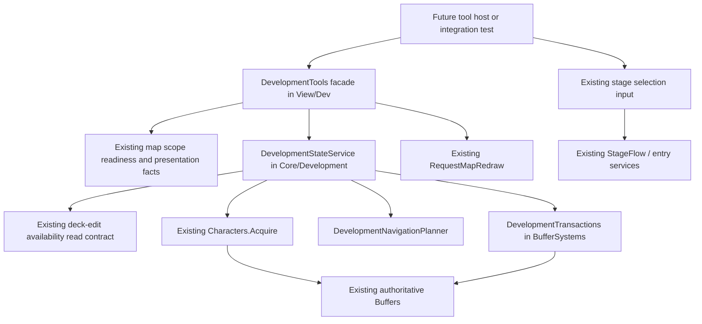

# Optional Development Tools Design

Date: 2026-10-23  
Status: A/B and the separately authorized C implementation are delivered. Final Phase C acceptance remains open for actual-scene round-trip and manual View checks. This document alone does not authorize further implementation.  
Code inspected: `feature/Cheon/refactor/core-system`, `8644c702`.  
Second review: 2026-10-23; see §12 for findings and corrections.  
Companion: [implementation plan](../plans/2026-10-23-development-tools-plan.md).

## 1. Intent and confirmed constraints

Provide convenient local C# APIs for granting a unit, adding gold, passing a stage without rewards, and preparing access to a particular stage. These tools are optional. Removing them must leave the ordinary game's responsibilities and execution paths intact.

The user confirmed:

- A skip passes a stage without granting rewards, then allows the next stage to be selected.
- Version 1 operates only while StageSelect is idle. Skipping an active battle is deferred.
- Development convenience does not justify restructuring the original systems.
- The plan must identify reusable paths, code placement, allowed changes, forbidden alternatives, and phase review points.

API means an in-process C# contract here. A network API, command console, runtime panel, hotkey, EditorWindow, save system, and arbitrary state inspector are not required for this first delivery. A later presentation can call these same APIs.

This document proposes the following additional limits: preserve the current Run; operate within its currently generated chapter; retain normal unit ownership rules; reject boss bypass and unsupported navigation cases. These limits are explicit scope decisions, not existing capabilities.

## 2. Guideline assessment

The attached `feature-change-locality-guidelines.md` is review input, not an instruction to refactor the repository. Its central criterion is whether a change requires understanding unrelated feature internals. It permits necessary composition changes and rejects artificial isolation that duplicates authoritative state.

Development APIs are compatible with that criterion when they are optional consumers of existing ownership boundaries. The following alternatives were considered:

| Approach | Consequence | Decision |
|---|---|---|
| Put cheats in Bootstrap, ordinary battle commands, or ordinary navigation branches | Spreads development concerns into gameplay orchestration and rules | Reject |
| Add a universal command bus, force-completion model, state editor, or replacement runtime | Changes more infrastructure than this convenience feature requires | Reject |
| Add a small development facade, Core-owned actions, and narrow Buffer transactions; reuse normal entry afterward | Localizes exceptional operations while retaining original owners | Adopt |

Directly calling a writable Buffer from a panel is not an acceptable shortcut. Conversely, a development-only Core transaction is not a second gameplay authority when it intentionally updates the existing authoritative state, validates its inputs, and does not change ordinary gameplay rules.

There are two deliberately new mutation operations: additive development gold and pre-entry progress bypass. No existing complete command implements them. Their implementation reuses the owning stores and their prepare/install contracts; it must not be described as zero new mutation code. Unit acquisition and actual target entry reuse their existing complete routes. This distinction prevents “reuse” from concealing a replacement gameplay route.

## 3. Current evidence and reuse decisions

Paths in this table are relative to `Assets/ProjectL/Script/Systems/`.

| Current source | Observed behavior | Design consequence |
|---|---|---|
| `RuntimeSystem/InGameSystem/CoreSystem/CharacterSystem/CharacterRosterService.cs`, `Acquire` | Existing definition validation, ownership rules, instance allocation, and acquisition publication | Delegate unit grants to `Acquire(key)`; do not copy those rules |
| `RuntimeSystem/BufferSystems/Currency/CurrencyBuffer.cs`, `SetAmount`, `PrepareAmount`, `InstallAmount` | `SetAmount` resets `RunSpent`; expected-balance installation preserves spending on increases | Add through a narrow transaction; never use initialization setters for a runtime grant |
| `RuntimeSystem/InGameSystem/CoreSystem/CombatSystem/CombatInputAssembler.cs:83` | Combat reads the same `CurrencyReadSink.Amount` | This checkout has one Run gold balance; do not introduce StageGold based on historical documentation |
| `RuntimeSystem/LifeCycleSystem/LifeCycles/Stage/StageDeckEditWindow.cs`, `ReadReason` | Existing idle-stage predicate includes loading, queued input, jobs, interaction and fault checks | Reuse it as a conservative prerequisite without renaming it or changing deck policy |
| `RuntimeSystem/InGameSystem/CoreSystem/CharacterSystem/RunDeckService.cs`, `ReadAvailability` | Also rejects retained battles and ended Runs | Development Core admission independently checks these authoritative facts |
| `RuntimeSystem/InGameSystem/CoreSystem/CoreCaculator/Domain/StageMap/ChapterNavigationRules.cs`, `Evaluate` | Normal entry requires a passed source and an uncleared adjacent target in the same chapter | Leave the rule unchanged; prepare a valid ordinary source instead of adding an unrestricted entry mode |
| `RuntimeSystem/BufferSystems/Core/ProgressTransactions.cs`, `PublishStageClear` | A noncombat pass can set the existing node clear flag without a combat victory | Bypass uses the existing node flag; no new normal outcome enum is needed |
| `RuntimeSystem/BufferSystems/Current/CurrentProgressBuffer.cs`, store prepare/install methods | Current selection can be prepared separately from installation | Prepare selection and all node changes before installing a bypass |
| `RuntimeSystem/InGameSystem/ViewSystem/StageMap/StageMapViewSystem.cs:172` | `RequestMapRedraw` already exists | Reuse it after navigation changes; do not replace the map view |
| `RuntimeSystem/InGameSystem/ViewSystem/StageMap/StageMapViewScope.cs:343` | Restoring a selected Event without recovery state throws, including a cleared Event | Reject Event bypass in version 1; do not weaken this validation for the tool |
| `RuntimeSystem/InGameSystem/ViewSystem/Dev/DevSelectedStageBattleSource.cs` | Substitutes a combat definition while progress remains attached to the original node | Keep as a separate boot content-test feature; do not describe it as a true progress jump |
| `RuntimeSystem/InGameSystem/CoreSystem/CombatSystem/BattleLifetime.cs`, `EndCompleted` | Active battle cleanup requires a completion | Do not change this contract; version 1 rejects any retained battle |

The normal roster service does not itself guarantee the StageSelect idle window. Its reusability does not remove the development facade's admission requirements. No runtime tests were performed for this design.

## 4. Responsibility and dependency direction



The diagram separates dependency and invocation; it does not introduce a second game loop. Calls execute synchronously on the initialized Unity main-thread runtime, without awaits or reentrant callbacks during a state transaction.

| Owner | Responsibility | Must not receive |
|---|---|---|
| Development facade, `ViewSystem/Dev` | Check local presentation readiness, call the narrow Core development command, request existing redraw, return results | Buffer state writers, InGame DB tables, battle settlement internals |
| `CoreSystem/Development` | Admission, reuse existing acquisition, calculate added gold, plan an explicit progress bypass | UI objects, MonoBehaviours, `StageMapViewSystem`, scenes, loading or rendering commands |
| `BufferSystems/Core/DevelopmentTransactions` | Compare expected state, prepare all affected stores, then install | UI or Flow references, DB queries, reward/ownership/pathfinding policy |
| Existing LifeCycle/Flow/Plan/Job | Normal stage entry, execution and exit | New development branches in ordinary navigation or combat policies |
| Existing Factory/Group | Create, register, inject and expose optional interfaces | Grant arithmetic, path search, bypass rules, scene presentation details |

Pure development DTOs belong under `CoreCaculator/Contracts/Development`; the pure path planner belongs under `CoreCaculator/Application/Development`. Neither references Systems, Buffer, Framework, or Unity assemblies. The runtime Core service converts current read models into those pure inputs. Do not move runtime storage DTOs into a higher-level assembly just to avoid that conversion.

Ordinary systems never acquire a development service as a required dependency. The development facade depends on their existing capabilities. A small read-only adapter in the map scope is allowed for readiness; it must not make the scope call Core development commands.

## 5. Public API and lifetime

The following names are proposed, not existing APIs. Exact DTO fields and installation contracts are fixed in the plan.

```csharp
public interface IDevelopmentTools : IServiceModule
{
    DevelopmentContext ReadContext();
    DevelopmentGoldResult GrantGold(DevelopmentContext expected, int amount);
    DevelopmentUnitResult GrantUnit(DevelopmentContext expected, EntityKey key);
    DevelopmentNavigationResult SkipNextNode(DevelopmentContext expected, StageNodeId nodeId);
    DevelopmentNavigationResult PrepareJumpToNode(DevelopmentContext expected, StageNodeId targetNodeId);
}
```

Expose this through a development-only `InGame.ViewGroup.DevelopmentTools` property. The facade calls internal `IDevelopmentStateCommands` with the same operation signatures. The existing Core Group implements an internal `IDevelopmentStateProvider` accessor; its ordinary public `IInGameCoreSystemGroupService` interface gains no development member. These two boundaries serve distinct responsibilities: presentation readiness versus authoritative gameplay mutation. The provider is a capability of the existing Group object, not another registered service, forwarding object or dispatch layer.

`DevelopmentContext` is an immutable caller snapshot with the Run ID, chapter, selection presence and selected node/stage IDs. It is not an independent current-state store or a promise that execution will succeed. Each command rechecks it and the idle window. The service additionally captures operation-specific expected data immediately before calculation: balance for gold; roster/deck version through the existing acquisition service; copied graph values and current selection for navigation.

There is no invented global Run revision, retained development queue, durable receipt store, or automatic retry. `RosterSourceVersion` is internal to Core and does not cover currency, current selection, or battle state. Repeated successful gold calls are separate intentional grants. Stale contexts and repeated node skips reject; clients must not retry mutations automatically.

Results are immutable and state whether the operation applied, its failure reason, and the actual change. Expected refusals include `Unavailable`, `Busy`, `NoActiveRun`, `RunEnded`, `BattleRetained`, `StaleContext`, `InvalidAmount`, `Overflow`, `InvalidTarget`, `AlreadyPassed`, `UnsupportedNode`, `NoSupportedPath`, and `RosterRejected`. `DevelopmentUnitResult` retains the existing `RosterAcquireResult`; navigation results preserve the existing `ChapterSelectionFailureReason` when normal navigation rejects the command. Missing required composition is an exception, not a successful empty result.

The facade receives the existing shared `RuntimeFaultBoundary` from the View factory. Unexpected command or redraw exceptions are reported there and rethrown; expected refusals do not fault the runtime. The facade does not connect another StopInput callback or create a new boundary. If publication succeeded before redraw failed, the committed state remains committed: report the fault, stop further calls, and never return a normal refusal implying no change or automatically retry the command.

The only external host entry point is `IDevelopmentTools`. Core command/provider interfaces and the provider's accessor remain internal to Systems. Only the facade and focused integration tests consume them. Same-assembly access is not a security sandbox; an unrelated Systems feature calling that internal command directly is a plan violation. Do not widen the API or add permission tokens to solve this.

## 6. Admission and build boundary

All mutations require:

1. `UNITY_EDITOR || DEVELOPMENT_BUILD`; the optional composition is present and initialized.
2. A nonempty, matching Run ID and `RunOutcome.InProgress`.
3. No retained battle, including a completed battle awaiting cleanup.
4. Existing `ReadDeckEditAvailability().CanEdit` is true. Do not change what that service means to deck editing.
5. An attached, ready StageMap scope whose map is shown, no marker movement, and no open shop, recovery or deck popup. The facade checks presentation facts; Core does not depend on the scope. After `RequestMapRedraw`, the existing `_isShown` is false: `ReadContext().IsAvailable` remains false until a real redraw completes.
6. No loading, fault, pending combat return or running Job. The facade also requires the existing stage request Buffer to be empty (`!_requests.TryGetNextCommand(0, out _)` in the scope): the deck window alone only detects unregistered/unconfirmed Flow work and can miss a handled request whose View result has not been consumed.

A caller's cached enabled button is never the admission authority. No waiting queue is created when busy; return a refusal and let the caller try again deliberately.

Reusing the deck availability read contract is a deliberate conservative dependency on its Stage interaction window, not on deck composition rules. It also requires a nonempty roster. Empty-roster recovery grants are unsupported in version 1; do not change deck availability or add a general permission service to enable them.

Gate definitions, implementations, registration and consuming references consistently. A release build must compile without the development properties/types and must not register the services. A development build's normal paths still execute without calling these services. Do not add `IsDeveloperMode` branches throughout ordinary gameplay or modify shared asmdef references to make lower layers see View.

## 7. Unit and gold semantics

### 7.1 Unit grant

Call `Characters.Acquire(key)` at its default level 1. Core remains the only source for definition validity, player ownership eligibility, duplicate/category limits and initialization. Preserve the current rejection of unsupported/enemy-only definitions. Return the assigned `CharacterInstanceId` and the existing acquisition result.

Acquisition does not select the unit into RunDeck, replace Main, alter battle membership, spawn a unit, or change levels/XP of an already owned unit. The existing deck editor remains the way to select an acquired unit. Do not add force flags or temporarily relax ownership rules.

### 7.2 Gold grant

Require `amount > 0`. Compute `checked(currentBalance + amount)` in Core. A development Buffer transaction checks the expected Run, balance and admission-sensitive state, then calls the existing currency store's `PrepareAmount` and `InstallAmount`.

For example, balance 70 with `RunSpent = 30`, plus a grant of 50, becomes balance 120 with `RunSpent = 30`. Later purchases count as ordinary spending. Do not synthesize a battle reward, reset spending, change Fame, increment kills, or replace `LastSummary`. There is no separate StageGold in this checkout.

## 8. Navigation semantics without a new entry route

### 8.1 `SkipNextNode`

In StageSelect there is no active stage to terminate. The method passes the explicitly chosen next node before entering it. The chosen node must be an ordinary adjacent, uncleared, nonterminal Combat node in the current generated chapter. Restricting bypass to ordinary Combat nodes avoids opening or fabricating shop/recovery visits and preserves existing restore invariants.

Core calls the existing `ChapterNavigationRules.Evaluate` for the actual source and target, then applies only the additional development bypass restrictions. It prepares one development change: set that node's existing `IsClear` flag and move the current selection to it. A single Buffer transaction validates all expected sources and prepares all changes before installing either. The facade requests the existing map redraw. The player remains in StageSelect and chooses among that node's normal successors.

No battle is created or completed. No gold, XP, souls, Fame, kill count, reward receipt, map clear or Run completion is produced. No already committed state is rolled back. The result explicitly records the bypassed node; `IsClear` is not evidence of a combat victory.

Reject boss nodes and nodes with no successors. Do not call `CompleteChapter`, `AbandonBattle`, `EndBattle`, or `StartNewRun` to make a skip work.

### 8.2 `PrepareJumpToNode`

Prepare the current Run for normal entry into a future node. This is a forward-path bypass, not an arbitrary teleport or a content-definition replacement.

- The target is an existing, uncleared node in the current generated chapter, identified by node ID; Core resolves and verifies its stage key.
- Search actual forward edges, respecting normal depth progression. Every intermediate node to bypass must satisfy the same ordinary Combat restriction as a single skip. Do not pass through an Event, Shop, boss or terminal node in version 1.
- Call `ChapterNavigationRules.Evaluate` for each candidate hop and the final target, using command-local simulated progress in which only preceding planned bypasses are marked passed. Normal admission is not reimplemented. The planner adds only supported-bypass filtering and deterministic path choice.
- Choose the lexicographically smallest sequence of node IDs among supported paths. Return the chosen bypass list so branching effects are visible. Do not edit topology, clear unrelated branches, regenerate the chapter, or synthesize predecessor nodes.
- Mark only intermediate nodes passed and move the cursor to the last bypassed predecessor. Leave the requested target uncleared. It may be a boss or a supported noncombat target because it will be entered normally, not bypassed.
- If the target is already adjacent, succeed with an empty bypass list and no progress write. The synthetic start node has no real StageKey and must never become a fabricated current selection.
- Reject backward, cross-chapter, absent, already-cleared and unsupported-path targets before mutation. A DB stage key absent from this generated graph is not silently substituted.

After a successful preparation, the host waits for the existing redraw to be applied and selects the target using the existing StageSelect interaction. A later UI may explain this as “prepare access, then select.” Version 1 does not promise a one-call scene teleport. An automated host must use the existing stage input contract and its result tracking; it must not invoke battle preparation or scene changes directly.

Progress preparation and later ordinary entry are separate operations. If ordinary entry subsequently rejects (for example, invalid deck or missing content), the bypassed path remains committed and the user remains at its predecessor. Report that distinction; do not claim rollback across scene loading or reverse a successful bypass automatically.

### 8.3 Publication and presentation

The development navigation preparation contains expected Run/current selection and an immutable copy of the graph values used, plus the bypass list and final selection. Core owns path policy. Buffer only checks that those facts still match and prepares/install stores.

For the chosen bypass nodes and requested target, Core resolves existing stage definitions and compares `StageKey`, `MapKey`, `StageType` and `MapRole` with the captured graph. Bypassed nodes require real regular Combat details. Reuse `StageServiceManager.GetStage`, `StageRootData.Validate` and `StageServiceManager.ValidateEntry`; the latter alone does not check graph binding. Do not copy the chapter generator or validate unrelated branches' full content to perform a grant/bypass. An initially inconsistent configured definition is a configuration fault before mutation; changed captured progress is a stale-context refusal.

Do not reuse a `BattleEntrySelection` DTO to pretend that a progress-only edit is battle entry. Add a development-only current-selection preparation method to the owning Buffer store; keep the normal battle overload unchanged. Pass only expected chapter/selection and final node/key/name to that method, not the complete development graph/path preparation. Reuse `StageSelectionData.RequireEntry`, the store's `MatchesExpected`, existing `PreparedCurrentSelection` and assignment-only install path. The aggregate transaction owns Run/graph/map comparisons. Prepare every clear and the final selection before any install; no public setter loop, await or external callback is permitted between preparation and installation.

`RequestMapRedraw` refreshes node clear indicators; an ordinary map tick alone only synchronizes the marker. Preserve normal map movement and restoration. Tests must cover redraw and later rebind. The Event restriction must remain until a separate design approves broader support; hiding a restore exception or fabricating a completed recovery is forbidden.

## 9. Composition, removal and UI boundaries

Register the internal Core development command service in `InGameCoreSystemFactory` and expose it through its Group's internal provider only. Register the public facade in `InGameViewSystemFactory` and expose it through ViewGroup. Each factory passes the same registered instance to a guarded, optional final constructor parameter of its owning Group; the accessor stores that interface reference. The default null means the optional feature was not composed. Do not call mandatory `GetService` for an omitted feature, catch a lookup exception, or modify Framework to add optional lookup. A composed facade requires the internal provider and its non-null command instance; missing either is a configuration fault. Inject existing map readiness/redraw delegates and the existing shared fault boundary at creation. These dependencies point from the optional facade to existing owners; the map does not store the facade.

Fix lifecycle interfaces to `ISystemPostBindService` and `ISystemShutdown` for both new runtime components. CoreGroup already forwards these; it does not forward `ISystemInitialize`. Use existing Stage readiness for admission, and mark retained references unavailable on shutdown. Do not add CoreGroup initialization/tick forwarding, manually initialize existing services, or use a static runtime handle. The facade resolves the internal Core provider once through the existing InGame parent during PostBind; leaf helpers do not resolve services.

Composition is explicit. Existing lower Core/View factories default to `includeDevelopmentTools = false`. The paired InGame factory forwards the same immutable construction option to both. Only the full runtime composition in `Systems/Factory/Runtime/RunTimeSystemFactory.cs` opts in under the development compile condition. This class is named `FrameworkRuntimeFactory`, but its file is Systems composition; no file in Framework changes. Do not infer inclusion from a failed dependency lookup. This preserves old isolated factory fixtures without silently weakening required dependencies when tooling is included. The existing development Buffer aggregate can remain inert when both command services are omitted.

Compose the small development transaction in `BufferSystemGroup`'s constructor alongside its existing transaction aggregates. The same Group implements internal `IDevelopmentBufferProvider` with the narrow transaction accessor; the ordinary `IBufferQuery` interface stays unchanged. Core PostBind obtains the existing Buffer parent through `BufferSystemKey.Buffer`, explicitly checks this provider once, and retains only the required read/transaction dependencies. Missing provider/transaction in a composed development service is a configuration fault. Neither optional provider is registered/exported as another service and neither introduces a forwarding object. This keeps optional tooling out of broad normal contracts and avoids changing their unrelated test doubles. Transaction bodies stay in their own class. Do not move existing aggregates to a new factory or register the aggregate at the root. Register actual service interfaces once (FW-001); add modules only for actual lifecycle work (FW-002); finish registration before Build (FW-003).

Omitting the paired command/facade composition removes callable tooling; compile-time exclusion also removes its Buffer capability and types. No regular rule, outcome enum, stage command kind, JobType, scene contract, or required constructor parameter changes. Only the listed additive construction options/accessors are allowed. Do not create new global roots, extend Framework with game-specific concepts, or change the ordinary Flow decision order.

Any future panel remains a separate task: use `UIBase`/UISystem, existing `UIInputBinding`/receiver conventions, InputSystem-owned shortcuts, and ViewGroup's facade. Define its UIId, policy and bind/unbind lifetime then. This plan adds no panel, persistent overlay, prefab or scene wiring.

## 10. Locality, SOLID and preserved contracts

| Representative change | Edit/understanding scope | Required verification | Unrelated internals no longer needed |
|---|---|---|---|
| Change development gold input validation | Development grant action and its contract | Added amount, overflow, expected balance, preserved spending, safe admission | Shop prices, combat damage, reward settlement algorithms |
| Change which unit the tool requests | Host plus existing acquisition API | Existing ownership result, fresh ID, unchanged selected deck | Unit construction, roster storage and ownership-rule reimplementation |
| Change supported bypass path selection | Development planner and its tests | Actual graph, atomic progress publication, map redraw/rebind, ordinary entry | Combat completion, reward calculations, chapter victory internals |

SSOT remains in existing Buffers. Snapshots/results are immutable observations, never shadow balances or progress maps. SRP separates Core policy, storage installation, View presentation and composition. OCP is served by optional additions without edits to ordinary rule switches. LSP preserves the meaning of ordinary entry, completion, and acquisition contracts. ISP keeps tooling away from broad write access. DIP uses narrow contracts; pure Core layers do not reference View or Unity.

Necessary shared boundaries still need integration tests. Locality does not excuse skipping them. FW-004 applies to framework-owned internal state; the project Core/View ownership rules separately forbid direct gameplay Buffer writes from View. FW-016 initialization/shutdown guarantees still apply. No Framework contract is weakened for convenience.

## 11. Acceptance and delivery

The [plan](../plans/2026-10-23-development-tools-plan.md) divides work into A (grants), B (progress bypass), and C (facade/integration). Each phase requires separate authorization and stops for review. B does not need a new UI; C does not authorize changes to ordinary rules.

Acceptance requires: development/release compile coverage; absence of services in release; rejected operations leave gameplay facts unchanged; positive grants preserve statistics; unit acquisition preserves deck membership; skip/jump never creates completion/rewards; normal entry/exit still follows its existing path; map redraw/rebind succeeds; disabling the optional composition preserves normal play.

At initial design review, evidence was static only. The user subsequently authorized A, B and C separately. Grants, forward-path preparation, the optional View facade and map integration are now delivered. [Plan §13–15](../plans/2026-10-23-development-tools-plan.md#15-phase-c-delivery-and-outstanding-acceptance--2026-10-23) records exact tests and limits: C adds 57 passing cases, actual Development/Release Player builds succeed, and packaged Release assemblies contain no development feature surface. The combined regression evidence retains 32 exact baseline failures, including a reproduced existing audio assertion after actual Combat entry. Full actual-scene round-trip and manual View acceptance remain open, so C is not marked fully complete. The existing [boundary handoff §30](../handoffs/2026-09-24-view-core-data-boundary-handoff.md) records local ownership and delivery. No commit, push or external delivery occurred.

## 12. Second review findings and disposition

The 2026-10-23 review compared the design/plan with current source and the attached locality guideline. These were design ambiguities or coupling risks, not observed runtime defects in an implemented feature.

| Finding | Minimal correction | Evidence / implementation gate |
|---|---|---|
| Optional wording permitted copying normal navigation rules | Every hop must call existing `ChapterNavigationRules.Evaluate` | B1 includes normal-rule parity and unchanged-rule diff review |
| Public Core command access could bypass the facade | Internal command/provider on the existing Group; only View facade is external | C1 checks surface visibility and no alternate consumers |
| Shared query extensions required unrelated test-double changes | Keep public CoreGroup and ordinary Buffer query unchanged using two internal capabilities on existing objects | No provider service registration, new root, or generic capability framework; only ViewGroup conformance remains |
| Handled input could remain unconsumed while Flow looked idle | Require existing input Buffer empty at the View gate | C2 covers handled rejection before observer consumption |
| Unexpected API/redraw exceptions had no specified reporting owner | Inject existing shared fault boundary into facade; report and rethrow | C1/C2 verify one report, stopped calls, and no false rollback claim |
| Full route preparation leaked into the selection store | Pass selection-only values; reuse current format/expected-state checks | B2 keeps graph/route knowledge in the aggregate transaction |
| Content preflight did not establish graph/DB binding | Compare chosen-node identities/role/kind explicitly using current definition APIs | B2 separates initial misconfiguration from changed-source refusal |
| Lifecycle and test-conformance work was underspecified | Pin PostBind/Shutdown and enumerate the minimal ViewGroup test-double changes | A/C compile all affected test assemblies; no Framework or normal gameplay edits |
| Lower factory calls would suddenly require optional dependencies | Default-off construction options, with paired opt-in only at the existing full Systems composition | Old isolated calls remain valid; explicit inclusion still fails on missing dependencies |

These corrections do not authorize implementation or broader supported scenarios. Runtime correctness, player compilation and manual acceptance remain future phase gates.
