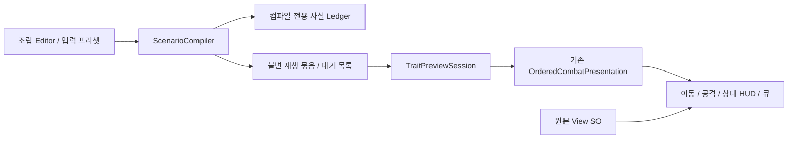

# 특성 시연 도구 — 사건 블록 조립 설계

- 날짜: 2026-10-31
- 상태: **A~E 코드 반영·대표 수동 검증 완료. 공유 HUD 설명 팝업 연결은 사용자 결정으로 후속 보류.** 실행 근거와 잔여 확인은 Task 계획 §10~11을 따른다.
- Task: [조립식 시연 계획](../plans/2026-10-31-composable-trait-preview-plan.md).
- 이어받는 기능: [즉시 재생 환경](2026-10-30-trait-activation-preview-design.md), [Unit Actions 목록](2026-10-31-trait-unit-action-list-design.md).
- 사용자 요구: 이동 후 버프 아이콘, 다른 아군 공격 후 공격력 증가처럼 특성 발동 전후의 사건과 상태 수명을 확인한다. 공통 사건 블록을 직접 조립하고 그 조합을 프리셋으로 저장한다.

## 1. 목표와 경계

초기 배치 위에 **이동·공격·상태 변경·특성 발동·대기**를 조립한다. 가속·깔끔한 뒷정리·희생 등의 예제는 같은 블록으로 저장한 프리셋이며 특성별 시나리오 실행 클래스를 만들지 않는다. 기존 단일 Activation 재생은 빠른 확인 입구로 유지한다.

실행은 기존 Play Mode 전용 씬과 운영 이동·공격·HUD·큐 재생기를 사용한다. View 시연을 위한 합성 사실이며 실제 특성의 발동 조건·증가 공식·공격 가능 여부·피해·턴 수명은 계산하지 않는다. 예를 들어 이동 블록을 넣었다고 가속을 자동 부여하지 않는다. 사용자가 원하는 상태 변경과 발동을 함께 조립한다. 이 구분은 창 상단에 표시한다.

### 이번 구현 범위

| 포함 | 구체 범위 |
|---|---|
| 배치 | 기존 8×8 필드, 유닛 외형·진영·칸·방향·HP·기본 능력치, 지원하는 보유 특성/초기 상태 |
| 사건 | 자발 이동 경로, 일반 공격과 피해/사망, 일반 특성 발동, 추가 공격, 공격에 붙는 가로채기 |
| 상태 | **가속 보유 공격력**, **특성 공격력 부여 목록**의 설정·교체·제거. 초기 상태와 도중 변경에 같은 변환기 사용 |
| 표시 | 기존 버프 HUD 아이콘·설명, 원본 Activation 큐/Unit Actions, Editor의 단계별 전후 수치 진단 |
| 조작 | 추가·복제·정렬·제거, 재생 묶음별 진행, 경계에서 멈춤/계속, 시간 대기, 중단·초기화, 전체 반복 |
| 저장 | 팀 공유용 조립 프리셋, 기존 네 프리셋을 명시적으로 가져오는 입구 |

임의 버프 이름/아이콘을 직접 띄우는 블록, 모든 Core 상태의 범용 필드 편집, 실제 Core 명령 실행, 턴/승패/보상 진행, 지형·흔적·기차·소환 편집, 공격 내부 임의 시점 중단·스크럽·배속, 자유 병렬 그래프·분기/반복문은 후속 범위다. 일반 공격의 피해는 입력값이며 공격력 증가에 비례해 자동 계산하지 않는다. 전체 시나리오 반복만 제공한다.

## 2. 현재 코드에서 확인한 의존성

| 확인한 사실 | 설계에 반영 |
|---|---|
| `TraitPreviewResultBuilder`의 Moment는 `CombatEffectsEvent` 하나를 합성하며 초기 `TraitStatuses`는 비어 있음 | 초기 상태와 `CombatTraitStateEvent`를 생성하는 블록 필요 |
| `CombatTraitStateEvent`는 Expected/Final 캐릭터 사실, 선택적 Origin·능력치 쌍을 제공 | Core 수정 없이 상태 변화 사건 합성 가능. 전후 사실은 컴파일러가 연결 |
| `CombatFactEventHandler`는 TraitStateEvent.Final을 표시 사실에 적용. 별도 FinalStats는 현재 보관하지 않음 | HUD 변화는 Final의 실제 상태 필드로 전달. FinalStats만 바꾸는 구현 금지 |
| `CombatUnitStatuses`의 가속은 `AccelerationTraitStatusSnapshot.HeldAttackBonus`, 공격력 증가는 `TraitEffects.AttackBonus`를 읽음 | 두 상태를 각자의 계약 필드에 작성. Magnitude나 TraitVisual.icon으로 대체하지 않음 |
| 두 UnitStatusVisual SO에 현재 아이콘 참조가 있음 | 에셋을 새로 만들지 않고 기존 상태 외형을 사용. 실제 품질은 Play에서 확인 |
| 일반 공격은 `CombatAttackEvent`와 출처가 같은 피해 후속 사건으로 재생 | 공격 블록이 접촉·피해·사망을 한 번만 생성 |
| ChildAttack은 FollowUpAttack/KillChainAttack과 독립 공격 그룹을 요구. Interception은 공격 결과 안 반응만 허용 | 특수 발동의 입력 위치·부모 공격을 구조적으로 제한 |
| `OrderedCombatPresentation.IsSettled`는 현재 Result 안에서 후속을 찾음 | 공격과 그 피격·가로채기 후속을 Result 경계로 나누지 않음 |
| Ordered 완료 통지는 모든 사건과 `IsPresentationComplete`를 기다림 | 다음 재생 묶음은 이 통지 뒤 시작. 고정 애니메이션 길이 추정 금지 |
| 현 Session은 한 결과마다 표시를 다시 생성하며 완료 때 Final을 Refresh | 조립 재생에서는 최초/초기화 때만 표시 생성. 묶음 사이 표시·HUD·상태 유지 |
| 프리뷰 Host는 runtime Tick 뒤 Session Tick. 전체 런타임은 생성하지만 전투는 시작하지 않음 | 같은 소유자·Tick 경로 유지. 별도 Update/게임 Flow 추가 없음 |

의존성 원본: [ResultBuilder](../../../Assets/ProjectL/Script/Systems/RuntimeSystem/InGameSystem/ViewSystem/Dev/TraitPreview/TraitPreviewResultBuilder.cs), [Session](../../../Assets/ProjectL/Script/Systems/RuntimeSystem/InGameSystem/ViewSystem/Dev/TraitPreview/TraitPreviewSession.cs), [사건 계약](../../../Assets/ProjectL/Script/Systems/RuntimeSystem/InGameSystem/CoreSystem/CoreCaculator/Contracts/Combat/CombatEvent.cs), [TraitActivationSnapshot](../../../Assets/ProjectL/Script/Systems/RuntimeSystem/InGameSystem/CoreSystem/CoreCaculator/Contracts/Snapshots/Traits/TraitActivationSnapshot.cs), [Ordered](../../../Assets/ProjectL/Script/Systems/RuntimeSystem/InGameSystem/ViewSystem/Combat/Playback/Ordering/OrderedCombatPresentation.cs), [상태 HUD](../../../Assets/ProjectL/Script/Systems/RuntimeSystem/InGameSystem/ViewSystem/Combat/Display/Unit/CombatUnitStatuses.cs).

현재 계약으로 첫 범위를 설계할 수 있으며 외부 Core 작업의 선행 완료는 요구하지 않는다. 구현 중 계약 부족을 발견하면 해당 항목을 Core 요청 문서에 기록하고 설계를 갱신한다. Core 내부 Rule/Application 호출로 보완하지 않는다.

## 3. 편집 구조

```text
조립 프리셋
  환경: Stage View Key / 초기 유닛 목록 / 전체 반복 설정
  순서 목록
    재생 묶음: "이동"
      이동 블록
    재생 묶음: "가속 획득"
      상태 변경 블록
      일반 특성 발동 블록
    시간 대기: 1초
    재생 묶음: "공격과 소모"
      일반 공격 블록
      상태 변경 블록 (이 공격의 타격 후속)
      일반 특성 발동 블록 (이 공격의 타격 후속)
    수동 대기
```

**블록은 작성 단위, 재생 묶음은 취소·완료와 단계 진행의 단위다.** 새 블록을 추가하면 기본적으로 새 묶음에 들어간다. 상태 변경·일반 발동은 앞의 호환 묶음에 붙이거나 별도 묶음으로 이동할 수 있다. 묶음 안 순서는 사건 기록 순서이며 실제 겹침/Hit Gate는 기존 재생기가 결정한다. Unit Actions 목록의 동시 행동 의미는 유지한다.

첫 범위의 묶음 구성은 다음으로 제한한다.

- 상태 변경/일반 발동만 있는 묶음.
- 한 유닛의 이동 경로 하나와 그 뒤 상태 변경/일반 발동. 매 칸 변화를 보고 싶으면 이동을 여러 묶음으로 나눈다.
- 일반 공격 하나와 피해·사망 및 선택적인 가로채기 반응, 상태 변경/일반 발동 후속.
- 추가 공격 발동 하나와 그 피해·사망 및 선택적인 가로채기 반응, 상태 변경/일반 발동 후속.

일반 공격 두 개, 일반 공격과 추가 공격, 이동과 공격은 각각 별도 묶음으로 둔다. 대기는 묶음 사이에만 넣는다. 공격과 해당 피격 사이에 대기를 끼우려 하면 오류 위치와 이유를 표시한다. 이 제한으로 출처를 유지하면서 조립 범위를 명확히 한다.

### 3.1 저장 모델

| 입력 | 보관할 것 | 보관하지 않을 것 |
|---|---|---|
| Scenario | 버전, 환경 설정, 유닛 목록, 순서 목록, 관찰/반복 설정 | 현재 커서·핸들·Transform·운영 Buffer |
| Unit | 안정적인 ID, 편집 이름, 기존 외형/배치 입력, 지원 보유 특성·초기 상태 | 목록 인덱스에서 파생되는 참조 |
| Entry | 안정적인 ID, 이름, 재생 묶음 또는 시간/수동 대기 | 실행 콜백 |
| Block | 안정적인 ID, 종류, 해당 종류의 입력 | 원본 큐/공격 SO 값 사본 |
| Attack grant | 안정적인 부여 ID, 수혜자·출처 유닛·특성 키, 양·남은 수명 | 합산 AttackBonus 별도 입력 |

유닛/블록 참조는 목록 순서가 바뀌어도 유지되는 ID를 사용한다. 유닛 ID에서 EntityId 매핑을 만들고 공격 그룹·명령/결과 번호는 컴파일 시 발급한다. 저장된 참조 ID는 재정렬할 때 재발급하지 않는다. 유닛/묶음 복제는 새 ID를 발급하고 내부 참조를 명시적으로 재매핑하며, 외부 참조는 진단으로 남긴다. 삭제된 참조를 다른 유닛으로 자동 치환하지 않는다.

직렬화는 **구체 Serializable 입력 + 종류 enum**을 사용한다. 블록/순서 항목은 종류에 대응하는 구체 payload를 갖고 Editor는 활성 payload만 그린다. `[SerializeReference]`와 타입 이름 문자열 저장을 새로 도입하지 않는다. 종류 변경 시 기존 payload를 명시적으로 초기화하고 Undo를 제공한다. 새 입력은 JsonUtility 복사·SO 저장/다시 열기에도 의미가 같아야 한다.

기존 `TraitActivationPreviewInput`/Preset은 유지한다. 조립용 입력·Preset 타입을 별도로 추가하고, 기존 값을 직접 덮어쓰는 자동 마이그레이션은 하지 않는다. 명시적인 가져오기로 새 조립 프리셋을 만든다.

## 4. 공통 블록 계약

| 블록 | 작성 입력 | 생성/처리 |
|---|---|---|
| 이동 | 행동 유닛, 순서 있는 경유 칸, 최종 방향 | 현재 칸에서 경유 칸까지 걸음별 Moved Expected/Final, Voluntary 원인. 기존 이동 표시로 경로 재생 |
| 일반 공격 | 공격자, 지정 대상/칸·방향, 대상별 최종 HP（0이면 사망） | AttackResult·접촉·공격 그룹 및 HealthChanged/Died. HP 감소량은 전후 HP에서 생성하며 한 곳에서만 작성 |
| 상태 변경 | 수혜자, 지원 상태 종류, 설정/제거 입력, 적용 관계 | CombatTraitStateEvent. 같은 유닛의 직전 사실을 Expected로 사용 |
| 일반 발동 | TraitVisual SO·Kind, 발동자·대상·칸·Magnitude, 적용 관계 | CombatEffectsEvent. 상태/추가 피해를 자동 생성하지 않음 |
| 추가 공격 발동 | 일반 발동 입력 + 공통 공격 피해 입력 | WithChildAttack을 가진 발동 사건과 그 피해 후속. 직전 공격과 별도 공격 그룹 |
| 가로채기 반응 | 같은 묶음의 공격, 특성·Kind, 수호자·보호 대상·접촉 | 공격 결과의 Reactions에 포함. 실제 피해는 보호 대상에서 수호자로 한 번만 연결 |
| 시간 대기 | 유한한 0 이상 초 | Session의 대기. CombatEvent를 새로 정의하지 않음 |
| 수동 대기 | 이름 | 안전한 묶음 경계에서 다음 진행 버튼 대기 |

일반/추가 공격의 대상별 최종 HP 입력과 기존 간단 입력의 damage/kill은 가져오기 단계에서 한 번 변환한다. 조립 모델에 최종 HP·피해량·kill 세 값을 동시 원본으로 두지 않는다. 첫 범위는 단일 칸 유닛·직접 타격 대상 목록이며 관통/넉백/끌어오기 등의 규칙 합성은 포함하지 않는다.

이동 경로는 필드 범위·인접성·점유 충돌·생존을 검사한다. 실제 이동 비용·사거리·지형 통과 규칙은 판정하지 않는다. 공격도 참조·생존·선택 칸·피해 계약을 검사하며 최종 HP는 현재 HP 이하의 0 이상 값이어야 한다. InGame DB의 지정 방식/사거리는 읽지 않는다. 지원하지 않는 프리셋 버전·종류 값, 빈/중복 ID, 가로채기 세 역할의 충돌은 재생 전에 오류로 보고한다.

### 4.1 상태 변경과 아이콘

| 지원 상태 | 입력 원본 | 계약 필드와 표시 |
|---|---|---|
| 가속 축적 | 보유 특성=Acceleration, held 값 설정(0 이상) | Stats.TraitStatuses의 AccelerationTraitStatusSnapshot. held>0이면 기존 가속 버프 아이콘, 0이면 버프 제거. 보유 특성 자체는 유지 |
| 특성 공격력 부여 | 출처별 grant ID·Amount·RemainingControllerTurnEnds 설정/제거 | TraitEffects.AttackGrants. 같은 출처 항목을 교체하거나 제거. AttackBonus 합계·아이콘·설명은 기존 DTO/HUD 사용 |

버프 상태와 보유 특성 아이콘을 구분한다. `TraitVisual.icon`은 보유 특성, `UnitStatusVisual.icon`은 현재 걸린 버프다. 가속 소모 때 보유 특성을 삭제하지 않는다. 깔끔한 뒷정리의 공격자는 다른 아군이고, 상태 수혜자/발동자는 특성 보유자다. 이 역할은 각각 선택한다.

시연 사실의 능력치 투영은 **명시적으로 입력한 기여분을 계약 필드에 일관되게 옮기는 구조 변환**에 한정한다. 기본 공격력·부여 목록·가속 held가 원본이고, 합계는 기존 DTO의 합산 접근자를 우선 사용한다. 지원한 기여분의 합을 TraitAttackBonus에 투영하는 좁은 변환은 한 곳에만 둔다. 이동 칸수×특성 계수, 진영/발동 조건, 수신자별 피해 공식은 계산하지 않는다. 유효 공격력·증가 합계를 별도 편집 필드로 중복 저장하지 않는다. 지원하지 않는 초기 공격 기여/상태를 조용히 잃는 대신 오류로 알린다.

가속·공격력 부여 수명은 사용자가 후속 상태 변경 블록으로 명시한다. 공격 블록이 자동으로 소모하거나 대기 시간이 턴을 줄이지 않는다. 상태 변경만 넣어도 아이콘은 바뀌고, 발동 블록만 넣으면 해당 큐/행동만 나온다. 두 블록을 함께 넣으면 각각의 사건이 같은 운영 경로로 재생된다.

초기 보유 특성/상태는 첫 범위에서 지원 변환기가 있는 가속·깔끔한 뒷정리부터 제공한다. 기존 일반/추가 공격/희생의 SO 발동 선택은 유지한다. 다른 특성의 상세 런타임 상태와 보유 HUD까지 편집하려면 해당 **상태 변환기**를 추가한다. 새 시나리오 클래스는 필요하지 않다.

### 4.2 사건 연결과 타이밍

상태 변경·일반 발동의 적용 관계는 다음 두 가지다.

1. **기록 순서:** 묶음 안에서 앞 사건 다음에 기록한다. 출처 없는 일반 사실/발동이며, 정확한 전체 연출 경계가 필요하면 별도 묶음으로 분리한다.
2. **이 묶음 공격의 타격 후속:** 같은 묶음의 일반/추가 공격에서 발급한 Origin을 사용한다. 피격과 같은 기존 Gate가 적용되며 Hit 이후의 실제 처리 시점은 운영 재생 정책이 정한다. 공격 출처를 고정 Delay로 흉내 내지 않는다.

가로채기는 후속 사건이 아니라 공격 안 반응이므로 같은 묶음의 공격에 연결된다. 최종 피해 수신자를 접촉에 매핑하고 기존 희생 Unit Actions의 두 동작과 수호자 정산 대기를 사용한다. ChildAttack과 Interception의 기존 Kind/주체/수신자 검증을 완화하지 않는다. ChildAttack은 중첩 시나리오 실행이 아니라 하나의 발동 블록이 공통 공격 작성기를 사용하는 형태다.

후속 블록이 다른 묶음의 공격 Origin을 참조하는 것은 허용하지 않는다. 첫 공격이 끝난 뒤 추가 공격을 보고 싶으면 두 재생 묶음을 순서대로 둔다. 이는 시연자가 정한 순서이며 현재 Retired 특성의 인게임 발동을 복구하지 않는다.

## 5. 컴파일과 사실의 단일 원본

재생 전에 입력 사본 전체를 검사하고 `CompiledScenario`를 만든다. 실패하면 배치/서비스를 바꾸기 전에 묶음·블록·필드를 지목한다. 프리셋이나 SO를 컴파일 과정에서 수정하지 않는다.



Ledger는 컴파일 중에만 살아 있는 합성 Expected/Final의 원본이다. 유닛별 최신 사실을 읽고 블록 변환 뒤 갱신한다. 사용자는 Expected/Final 전체 사본을 매 블록 입력하지 않는다. 각 묶음의 Before/After와 사건 배열은 Ledger에서 파생한 불변 결과이며 실행용 가변 전투 상태 저장소를 따로 만들지 않는다. 변경 대상 외의 식별·배치·카테고리·보유 상태·경험치·기록 등은 기존 With 계약을 이용해 보존한다.

공격 작성은 두 단계로 한다. 먼저 공격 입력과 가로채기 반응을 수집해 실제 수신자·그룹·접촉을 확정한다. 다음에 공격 사건, 피해/사망, 작성한 상태/발동 후속을 기록 순서대로 만든다. 피해를 공격 작성기와 반응 작성기 양쪽에서 중복 생성하지 않는다. 같은 수신자의 여러 접촉은 하나의 일관된 전후 사실로 정규화한다.

모든 블록에 안정적인 진단 위치를 부여하고 생성 사건 범위를 연결한다. 재생 중 상세 Raw Core DTO 편집이나 Core 동작 조건을 흉내 낸 자유 스크립트 입력은 제공하지 않는다.

## 6. 실행·대기·취소

Session이 유일한 조립 재생 진행자다. 상태는 `Idle → PlayingPacket → WaitingTime/WaitingNext → PlayingPacket → Completed`이며 실패는 Error, 중단은 Idle로 복귀한다. 경계 멈춤 요청은 현재 묶음 완료 후 적용한다. 전역 Time.timeScale이나 운영 Tick을 멈추지 않는다.

- 시작: 입력 고정·전체 컴파일 → 이전 실행 취소 → 표시 한 번 생성 → Initial 표시 → 첫 묶음 시작.
- 묶음 완료: 기존 Ordered의 전체 완료 통지를 받은 뒤 그 묶음 After로 표시를 맞춘다. 앞 묶음 Final을 건너뛰고 전체 시나리오 Final로 덮지 않는다. 표시 Factory/Scope를 다시 만들지 않는다.
- 다음 묶음: 같은 Ordered/Display를 유지하고 다음 Tick에 시작한다. 완료 콜백 안에서 Play를 재귀 호출하지 않는다. 연속 0초 대기도 상태 전환을 유한하게 제한해 Editor 멈춤을 막는다.
- 대기: Time 대기 동안 표시 Tick은 계속된다. `다음 진행`은 수동 대기나 묶음 경계에서만 활성화한다. 비행 중인 투사체/희생 이동의 내부 사건을 임의로 한 단계씩 넘기지 않는다.
- 중단·초기화: 세대 증가 → Ordered 취소/해제 → 대기/반복/예약된 다음 진행 제거 → Initial로 표시 재생성. 늦은 완료는 무시한다.
- 반복: 전체 완료 후 Observation Seconds+Repeat Interval을 기다리고 Initial부터 재시작한다. 중간 묶음 완료는 CompletedCount를 올리지 않는다. 전체 반복 시 기존 자원 반환 정책을 재사용한다.
- 편집: 입력/관련 SO 수정·프리셋 교체는 현재 재생·대기를 중단한다. 다음 재생에서 재컴파일하고 최신 SO를 읽는다. 맵 변경은 현재처럼 환경 종료 후 다시 연다.
- 재생 중 오류: 실행 위치를 포함해 보고하고 후속 묶음·반복을 막는다. 종료는 다른 정리도 계속 시도하는 기존 CleanupErrors 계약을 유지한다.

`Observation Seconds`는 전체 완료 뒤 시간이다. 최초 로딩 이후 배치를 먼저 보고 싶으면 첫 Time/Manual 대기를 넣는다. 묶음 사이 간격은 명시적인 대기 블록으로 정한다. ParticleSystem 전체 종료는 여전히 완료 판정 범위 밖이다.

## 7. Editor와 기존 입력 호환

현재 창에 **간단 재생 / 조립 재생**을 둔다. 새 게임 내 UI나 별도 HUD 패널은 만들지 않는다. EditorWindow는 기존 UnityEditor 입력을 사용하며, 운영 Unit HUD는 기존 UI 등록/수명을 재사용한다.

조립 편집 영역은 환경·유닛, 순서/묶음 목록, 선택 블록 상세, 읽기 전용 진단으로 나눈다. 블록 상세는 종류별 Editor 그리기 부품에 맡긴다. 외부 MonoBehaviour/Presenter를 Inspector 필드로 모으는 관리자 창을 만들지 않는다.

| 제어 | 동작 |
|---|---|
| 추가/복제/위아래 이동/제거 | 블록 또는 묶음 편집, Undo 지원, ID/출처 검증 갱신 |
| 묶음에 붙이기/분리 | 허용 구성으로만 이동. 공격 반응이 부모 없이 남으면 명확한 오류 |
| 환경 열기 / 처음부터 재생 | 전체 입력을 검증하고 Initial부터 재생 |
| 묶음마다 멈춤 / 계속 | 묶음 전체 완료 경계에서 진행 제어 |
| 다음 진행 | 수동 대기 또는 경계 멈춤에서 다음 항목 실행. 공격 내부 중단 버튼으로 쓰지 않음 |
| 중단·초기화 / 환경 종료 | 기존 수명 정책 + 조립 커서/대기 취소 |
| 조립 프리셋 저장/불러오기 | 입력만 보관. 원본 View SO 수정 없음 |
| 간단 입력 가져오기 | 기존 Moment/ChildAttack/Interception을 같은 공통 블록으로 변환 |

간단 입력도 변환 후 동일 컴파일러·Session을 통과한다. 기존 Moment 한 묶음, ChildAttack 한 묶음, Interception 공격+반응 한 묶음이 대응된다. 기존 프리셋 4개와 meta/GUID는 유지하고, 조립 예제는 별도 새 에셋으로 추가한다. 기존 8×8/좌표·Kind·출처/카메라 진단은 유지한다.

Editor 진단에는 현재 묶음 번호/이름·전체 완료 횟수, 블록→사건 대응, 유닛별 기본/유효 공격력·가속 held·부여 공격력 합·HP의 전후 값을 표시한다. 시나리오 전체 Final을 현재 상태로 미리 표시하지 않는다. 숫자 증가는 Editor 진단으로 확인하고, 인게임 HUD에 새 공격력 숫자 위젯이 생긴다고 약속하지 않는다.

## 8. 책임과 변경 독립성

경로와 이름은 구현 계획의 기준이며 무상태 헬퍼를 불필요하게 서비스 등록하지 않는다.

| 책임 | 배치/역할 |
|---|---|
| 공개 입력·Preset | 기존 Dev/TraitPreview 아래 Scenario 하위. Editor 어셈블리가 사용할 최소 DTO만 public |
| ScenarioCompiler | 같은 하위 경로 internal. 순서 검증·Ledger·ID 발급·불변 프로그램 생성 |
| 블록별 작성기 | Movement / Attack / Trait / State의 구체 부품. 관련 계약만 읽음 |
| 상태 변환기 | 가속·공격력 부여별 입력 변환. 초기/변경 공용, 지원 종류를 명시 |
| Session | 기존 TraitPreviewSession 확장. 커서·대기·세대·전체 반복·오류만 소유 |
| 조립 | Preview 구성 Factory에서 작성기/변환기 등록을 한 번 구성. Display 조립은 기존 CombatTraitPreviewFactory 유지 |
| Editor | 기존 창은 모드·명령·상태 표시. Scenario 목록/각 블록 Editor를 별도 파일로 분리 |
| 운영 재생 | 기존 Ordered/Handlers/UnitStatuses. 이번 기능의 분기/특성 목록을 운영 처리기에 넣지 않음 |

블록 종류의 입력 enum/payload 선언과 한 곳의 등록 목록은 확장 시 변경되는 명시적 경계다. 변환기 선택은 등록 목록으로 구성해 창/Session에 특성별 switch를 늘리지 않는다. 인터페이스는 복수 작성기·상태 변환기를 동일 경로로 호출하는 실제 필요 범위에만 둔다.

| 변경 사례 | 수정/이해 범위 | 확인 범위 |
|---|---|---|
| 가속 증가량이나 관찰 간격 변경 | 프리셋 입력 | 해당 예제 재생 |
| 이동 경로 UI 변경 | 이동 블록 Editor | 경로 입력·Undo·저장·이동 재생 |
| 공격력 부여 표시 사실 변환 수정 | 해당 상태 변환기 | 해당 초기/변경/제거·HUD·전후 사실 |
| 새 상태 지원 | 해당 입력·변환기·Editor·등록 | 새 상태 예제 및 공통 컴파일 계약 |
| 공격 출처/취소·묶음 경계 변경 | Attack 작성기/Compiler/Session | 일반 공격·추가 공격·희생·상태 후속·중단 회귀 |

공통 경계는 캐릭터 사실 계약, AttackGroup/접촉, Ordered 완료, 세대 취소, Display/Scope 해제다. 공통 경계를 바꾸면 영향 기능을 함께 확인한다. 기능 분리가 전체 회귀를 항상 0으로 만드는 보장은 아니다.

### 원칙 점검

- **SSOT:** 연출은 View SO, 입력 상태는 프리셋, 컴파일 중 전후 사실은 Ledger, 재생 진행은 Session. 운영 Buffer에는 쓰지 않는다. 상태 합계·유효 공격력·피해를 중복 입력하지 않는다.
- **SOLID:** 입력/블록 작성/상태 변환/실행/표시 조립 분리(S), 새 블록/상태는 등록으로 확장(O), 기존 완료·취소 계약 유지(L), 입력·작성·표시의 좁은 계약(I), Editor는 Bridge와 DTO, Session은 기존 재생 계약에 의존(D).
- **FW/JMH:** 서비스 생성→내부 등록→상위 Export→소비자 조회 그래프는 기존 런타임과 동일. 신규 전역 서비스/상위 재등록 없음. Builder Build 1회(FW-001~004), Scope/Handle 반환(FW-011), DB 요구조건(FW-012), runtime 선행/Tick(FW-016) 유지. 기존 Global Context를 통해서만 UI/Render를 받는다.
- **UI:** 새 운영 등록 단위·UIId·부모/정책은 없다. 기존 Unit HUD 등록·풀·해제 유지. Editor 도구는 게임 화면이 아니므로 UIBase 등록 대상이 아니다.
- **독립성:** 기능 부품과 Factory 연결을 나누고 공유 수명 변경만 통합 회귀한다. 기준은 [설계 인계 §4.6](../handoffs/2026-09-30-combat-view-design-session-handoff.md#46-기능-변경의-독립성--조립과-기능-구현-분리).

## 9. 예제 프리셋과 수용 기준

| 예제 | 공통 블록 조합 | 눈으로 확인할 결과 |
|---|---|---|
| 가속 획득·소모 | 초기 held=0 → 이동 → held=5 설정+AttackGranted → 대기 → 공격+held=0/StatusConsumed 후속 | 이동이 먼저 보임, 가속 버프 등장·설명 +5, 공격 후 버프 제거, 보유 특성 유지 |
| 다른 아군 공격·자기 공격력 증가 | 아군 A 공격 → B에게 출처 있는 grant=5+AttackGranted → 대기 → grant 제거+StatusExpired | A 공격 뒤 B에게 버프 등장, B 공격력 전후 진단, 제거 시 아이콘 사라짐 |
| 희생 생존/사망 | 공격+가로채기 반응 → 대기 | 수호자와 보호 대상 동시 나가기, 실제 수신자 피격, 생존자 복귀 |
| 첫 공격·추가 공격 | 일반 공격 → 대기(선택) → ChildAttack 발동 | 첫 공격 뒤 추가 공격 시작. 합성 시연이며 Retired 가용성 변화 없음 |
| 직접 조립·재정렬 | 위 프리셋을 코드 없이 복제·값/순서 수정 | 새 시나리오 코드 없이 재생, 참조 ID 유지, 모순은 진단 |

공격력 수치/피해는 **합성 입력의 일관성과 표시**를 확인하는 기준이다. 실제 수식과 동일하다는 판정은 포함하지 않는다. 원본 Activation 줄이 비어 있으면 상태/HUD는 바뀌어도 전용 큐는 없을 수 있다.

검증은 컴파일·계약/참조 대조·Unity 수동 Play로 한다. **새 View 테스트 코드·자동 검증 메뉴는 만들지 않는다.** 저장 후 다시 열기, 잘못된 참조/중복/Kind/출처, 재생 전 오류의 무변경 보장, 여러 묶음 상태 유지, 반복·중단·SO 수정 취소를 확인한다. 기존 간단 프리셋 4개도 최종 공통 경로로 수동 회귀한다.

종료 시 Setting UI 미등록 오류는 사용자 결정대로 유지하며 이번 작업의 완료 기준에 포함하지 않는다. 다른 신규 오류는 구분해 기록한다. Unity를 다른 작업자가 사용하는 경우 조작 충돌을 확인하고 수동 검증을 미실행으로 남긴다.

## 10. 결정 요약

| ID | 결정 |
|---|---|
| CP1 | 공통 블록 + 재생 묶음 + 입력 프리셋. 특성별 시나리오 클래스 없음 |
| CP2 | 합성 View 사건 재생. 조건·공식·턴 계산은 Core 경계 유지 |
| CP3 | 첫 상태는 가속·특성 공격력 부여. 상태 변환기로 확장 |
| CP4 | 공격/가로채기와 피해 후속은 같은 Result. 묶음 경계에서만 대기·다음 진행 |
| CP5 | 초기/변경 상태 같은 변환, Ledger에서 Expected/Final 생성 |
| CP6 | 안정적 참조 ID, 구체 Serializable DTO, 새 SerializeReference 없음 |
| CP7 | 기존 간단 입력·프리셋 보존, 공통 컴파일러로 명시적 변환 |
| CP8 | 기존 Scene/Factory/Ordered/HUD 재사용. Core·FieldCamera·Architecture 변경 없음 |
| CP9 | View 테스트 코드 추가 없음. Phase별 컴파일/수동 확인 후 보고·리뷰 |

## 11. 구현 후 확인된 의존성

2026-10-31: 전용 환경의 HUD 포인터 입력은 Preview Factory가 Unity EventSystem/InputSystemUIInputModule을 조립하고 Host 수명에 해제한다. 기존 입력 모듈이 있으면 새로 만들지 않는다. 게임 명령은 제출하지 않는다.

공유 HUD.prefab의 descriptionPanel/descriptionText 참조가 비어 있어 현재 설명 팝업은 표시되지 않는다. 상태 아이콘·상태 수치/전후 진단·소모는 확인했지만, §9 설명 팝업 수용 항목은 완료로 판정하지 않는다. 사용자가 “설명 팝업은 후속으로 남김”을 선택해 공유 프리팹의 설명 패널 추가/연결은 후속 보류했다. 공유 HUD 프리팹은 수정하지 않는다.
