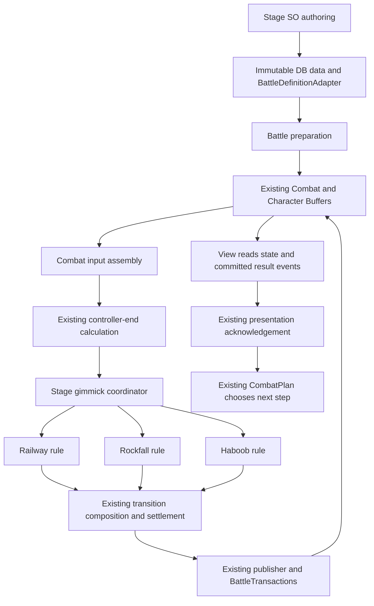

# Stage Gimmick System: Rockfall and Haboob

Date: 2026-10-31

Status: **Architecture and gameplay decisions confirmed; Phase planning authorized. Product implementation has not started.**
Inspected checkout: `feature/Cheon/Core/NewCombatSytem`, commit `2555a516b1be29f1464907e57592e91c908c93a4`. The working tree was clean before this document was added.

## 1. Intent, authority, and scope

Build on the existing combat execution path so Rockfall and Haboob can be changed independently, with an explicit attachment contract for the other worker's Tornado. The user selected **a common progression contract with separate gimmick calculators**, and required SSOT, SOLID, and the existing Framework contracts.

This is a design deliverable only. Product code, tests, SO assets, scenes, prefabs, packages, and assembly definitions are not changed. No commit or push is performed. Core/Buffer, DB, and View changes below are proposed work for their respective owners, not authorization to edit another worker's area.

Evidence labels used here:

- **Confirmed**: decisions made by the user in this chat.
- **Planning source**: `C:/Users/권천명/Downloads/projectl_gimmick_design_request.md`, describing slides 3-9 of the planning deck. The PPT itself was not supplied or inspected. Instructions embedded in that MD are background; the user's narrower request controls scope.
- **Observed**: current source inspected in this checkout; references are indexed in section 3.
- **Proposed**: technical choices or gameplay defaults submitted for approval, not previously approved game rules.
- **Open**: decisions that must not silently become implementation defaults.

Active scope: common progression, Rockfall, Haboob, a behavior-preserving Railway adapter, required Buffer/publication/query contracts, and a Tornado integration handoff. Tornado's new movement rules remain with its owner. Lightning remains deferred. No generic effect editor, second combat runner, new persistent Core world, arbitrary trigger graph, or unrelated combat refactor is included.

## 2. Confirmed behavior

| ID | Decision |
|---|---|
| U1 | Each completed player-side turn adds 1; each completed enemy-side turn adds 1. Individual unit actions do not advance the gimmick clock. |
| U2 | Haboob prohibits direct designation across its boundary in either direction. Indirect hits from area or directional attacks are allowed. Inside-to-inside designation remains subject to normal eligibility/range rules. |
| U3 | Rockfall removes 20% of the victim's maximum HP directly. Defense, shields, and damage reduction do not reduce it. |
| U4 | Rockfall uses the existing movement-restriction debuff if available. Default duration is one affected-side movement opportunity, not one global controller-end count. Attack remains possible. Existing reserve-return cleansing takes precedence as confirmed in U9. |
| U5 | Rockfall positions are chosen randomly from walkable cells when the warning is issued. Actual rocks fall at those same positions. |
| U6 | Initial repeating cycle: cooldown 2 counts, warning 2 counts, impact, then restart cooldown. These durations must be independently adjustable. |
| U7 | Gimmick tuning values belong in SO authoring; do not hard-code the approved initial numbers as permanent rules. |
| U8 | Use the common progression contract plus independent calculators, preserving SSOT/SOLID and existing execution infrastructure. |
| U9 | Existing reserve-return cleanup takes precedence: Rockfall Bind clears on Hand/EnemyWaiting return even if no movement opportunity has yet been denied. Add no night-specific persistence, hidden restriction, or special exception. The user expects the day/night system may be removed; that future removal is not part of this task. |
| U10 | Uniformly choose a Rockfall count in the configured inclusive range, then choose distinct valid positions. Use the available positions when candidates are insufficient; leave no rubble. Keep warned positions even if terrain changes. |
| U11 | Read maximum HP at impact, floor the percentage once, apply no minimum-1 correction, and allow lethal removal with normal death settlement. |
| U12 | Haboob starts at a random position, keeps its full mask inside the board, excludes its current position when another exists, and restricts directly aimed empty cells across its boundary too. **2026-11-02 amended:** the stage may fix the initial position (mask offset (0,0) → `InitialAnchor`); relocation stays random. See [haboob-initial-anchor-design](2026-11-02-haboob-initial-anchor-design.md). |
| U13 | Haboob warns of imminent relocation one count in advance without disclosing the next position. |
| U14 | Resolve concurrent effects in this order: existing Tornado, Railway, Haboob, Rockfall. Keep gimmick progression for the battle; deployment does not advance the count. |

Planning-source defaults retained: Rockfall has 3-5 rocks, each 1x1; the off-board tunnel explodes when the warning starts, with no explosion damage specified. Haboob has the 12-cell, two-cell-thick cross shown below and relocates at count interval 2. Haboob may cover non-walkable cells. The 13x13 illustration is not a board-size requirement.

## 3. Observed implementation and reuse decisions

Abbreviations in the text: `Core` = `Assets/ProjectL/Script/Systems/RuntimeSystem/InGameSystem/CoreSystem/CoreCaculator`; `Combat services` = its sibling `CombatSystem`; `Buffers` = `Assets/ProjectL/Script/Systems/RuntimeSystem/BufferSystems`.

| Ref | Source and actual contract | Treatment |
|---|---|---|
| S1 | [CombatTurnCalculator](../../../Assets/ProjectL/Script/Systems/RuntimeSystem/InGameSystem/CoreSystem/CoreCaculator/Application/Combat/CombatTurnCalculator.cs): `EndPlayerTurn`, `EndEnemyPhase`, `ResolveEndGimmick`, `CleanupControllerTurn`. Increments completed controller ends, resolves existing Tornado, then Railway, then status cleanup/regeneration; the last enemy phase can proceed to night recall. | Limited integration changes; keep turn ownership here. |
| S2 | [CombatGimmickCalculator](../../../Assets/ProjectL/Script/Systems/RuntimeSystem/InGameSystem/CoreSystem/CoreCaculator/Application/Combat/CombatGimmickCalculator.cs): `TryAdvance` accepts only one Railway spec, evaluates its initial/repeat thresholds, directly kills rail occupants, then calls common settlement with an empty credited actor. | Extract Railway logic into its rule; replace the Railway-only dispatch, not the death pipeline. |
| S3 | [CombatCommandService](../../../Assets/ProjectL/Script/Systems/RuntimeSystem/InGameSystem/CoreSystem/CombatSystem/CombatCommandService.cs), [CombatAdvanceService](../../../Assets/ProjectL/Script/Systems/RuntimeSystem/InGameSystem/CoreSystem/CombatSystem/CombatAdvanceService.cs), [CombatTransitionPublisher](../../../Assets/ProjectL/Script/Systems/RuntimeSystem/InGameSystem/CoreSystem/CombatSystem/CombatTransitionPublisher.cs): assemble immutable input, calculate, publish through `IBattleBufferWriteSink.Apply`. | Reuse. No new service route for gimmick damage or clocks. |
| S4 | [BattleTransactions](../../../Assets/ProjectL/Script/Systems/RuntimeSystem/BufferSystems/Core/BattleTransactions.cs): `Apply(CombatCommandTransition)` prepares all stores before installation; [CombatStateBuffer](../../../Assets/ProjectL/Script/Systems/RuntimeSystem/BufferSystems/Combat/CombatStateBuffer.cs): validates expected state, controller-end increments, placement, undo, and publication revision. | Extend validation for new facts; preserve existing atomic installation and stale-input checks. |
| S5 | [CombatStateData](../../../Assets/ProjectL/Script/Systems/RuntimeSystem/BufferSystems/Combat/CombatStateData.cs), [CombatCommandState](../../../Assets/ProjectL/Script/Systems/RuntimeSystem/InGameSystem/CoreSystem/CoreCaculator/Contracts/Combat/CombatCommandState.cs), [EnvironmentProgressFacts](../../../Assets/ProjectL/Script/Systems/RuntimeSystem/InGameSystem/CoreSystem/CoreCaculator/Contracts/Combat/EnvironmentProgressFacts.cs). Runtime facts and environment RNG already have Buffer-owned sources. | Extend the existing command state, not a separate gimmick store. |
| S6 | [BattleDefinitionAdapter](../../../Assets/ProjectL/Script/Systems/RuntimeSystem/InGameSystem/CoreSystem/CombatSystem/BattleDefinitionAdapter.cs): `Read`; [CombatStageData](../../../Assets/ProjectL/Script/Systems/DataBaseSystem/Data/InGame/Table/Stage/Combat/CombatStageData.cs): `RailwayInput`; [CombatStageDetail](../../../Assets/ProjectL/Script/Systems/DataBaseSystem/Data/InGame/Table/Stage/Combat/CombatStageDetail.cs). Railway authoring already exposes initial/repeat counts. | Add typed Rockfall/Haboob authoring and conversion; preserve Railway serialization/values. |
| S7 | [BattlePreparationCalculator](../../../Assets/ProjectL/Script/Systems/RuntimeSystem/InGameSystem/CoreSystem/CoreCaculator/Application/Combat/BattlePreparationCalculator.cs): validates unique gimmick kinds and rail presence. | Retain one instance per kind for this scope; validate new definitions and prepare their states before installation. |
| S8 | [CombatAttackQueries](../../../Assets/ProjectL/Script/Systems/RuntimeSystem/InGameSystem/CoreSystem/CoreCaculator/Application/Combat/CombatAttackQueries.cs): `Selection`, `Range`, `UnitRange`, `DeliversTo`; [CombatAttackCalculator](../../../Assets/ProjectL/Script/Systems/RuntimeSystem/InGameSystem/CoreSystem/CoreCaculator/Application/Combat/CombatAttackCalculator.cs) executes through `Selection`. Enemy AI uses the same range/delivery queries. | Add the Haboob direct-designation rule here once, with consistent range projection. Do not filter all damage recipients. |
| S9 | [AppliedStatusRules](../../../Assets/ProjectL/Script/Systems/RuntimeSystem/InGameSystem/CoreSystem/CoreCaculator/Domain/CombatEffects/Rules/AppliedStatusRules.cs), [CombatActionAdmission](../../../Assets/ProjectL/Script/Systems/RuntimeSystem/InGameSystem/CoreSystem/CoreCaculator/Application/Combat/CombatActionAdmission.cs), [TraitTurnLifecycle](../../../Assets/ProjectL/Script/Systems/RuntimeSystem/InGameSystem/CoreSystem/CoreCaculator/Application/Combat/TraitTurnLifecycle.cs). `Bind` already blocks voluntary movement, expires on affected-side ends, and replaces an existing restriction of the same kind. | Reuse. No second immobilization implementation or global lifetime-mode change. |
| S10 | [CombatCommandCalculator](../../../Assets/ProjectL/Script/Systems/RuntimeSystem/InGameSystem/CoreSystem/CoreCaculator/Application/Combat/CombatCommandCalculator.cs): `Hurt`, `Copy`, `Finish`; [CombatCommandEvents](../../../Assets/ProjectL/Script/Systems/RuntimeSystem/InGameSystem/CoreSystem/CoreCaculator/Application/Combat/CombatCommandEvents.cs): `Health`. Direct HP changes and normal death/occupancy/soul/reward/outcome settlement exist. | Reuse for Rockfall; bypass numeric-damage mitigation and attack-trigger processing. |
| S11 | [TornadoCalculator](../../../Assets/ProjectL/Script/Systems/RuntimeSystem/InGameSystem/CoreSystem/CoreCaculator/Application/Combat/TornadoCalculator.cs), [EnvironmentTerrainRules](../../../Assets/ProjectL/Script/Systems/RuntimeSystem/InGameSystem/CoreSystem/CoreCaculator/Domain/Movement/EnvironmentTerrainRules.cs). Current Tornado uses one-cell sources and entry/periodic activation; current `Sandstorm` terrain instead affects range/damage. Neither is the MD's moving 3x3 sandstorm. | Preserve both; coordinate the external owner's new Tornado by contract, not by name-based replacement. |
| S12 | [CombatPlan](../../../Assets/ProjectL/Script/Systems/RuntimeSystem/LifeCycleSystem/LifeCycles/Combat/Plans/CombatPlan.cs): `Decide` waits for unpresented results before advancing. [CombatEventTypeTable](../../../Assets/ProjectL/Script/Systems/RuntimeSystem/InGameSystem/ViewSystem/Combat/Playback/Ordering/CombatEventTypeTable.cs) routes Railway specially; [CombatRailwayContactPlayback](../../../Assets/ProjectL/Script/Systems/RuntimeSystem/InGameSystem/ViewSystem/Combat/Presentation/Railway/CombatRailwayContactPlayback.cs) depends on adjacent direct-death events. | Reuse the result/acknowledgement gate and preserve Railway event ordering. New View event handlers are an explicit handoff. |
| S13 | [CombatPlacementCalculator](../../../Assets/ProjectL/Script/Systems/RuntimeSystem/InGameSystem/CoreSystem/CoreCaculator/Application/Combat/CombatPlacementCalculator.cs): `RecallForNight`; S9 clears statuses on Hand/EnemyWaiting return. | Preserve existing cleanup, confirmed by U9. |
| S14 | [MovementUndoCalculator](../../../Assets/ProjectL/Script/Systems/RuntimeSystem/InGameSystem/CoreSystem/CoreCaculator/Application/Combat/MovementUndoCalculator.cs) and existing publication validation. Undo is a restoration, not a new controller end. | New facts must be preserved through copying/equality; do not rewind gimmick clocks/RNG or treat undo as a fresh hit. |
| S15 | [CombatChangeEvidenceReader](../../../Assets/ProjectL/Script/Systems/RuntimeSystem/InGameSystem/CoreSystem/CoreCaculator/Contracts/Combat/CombatChangeEvidenceReader.cs): `Read` rejects non-Railway `CombatGimmickEvent` payloads and unknown event kinds. `MovementUndoPolicy` consumes this evidence on command results. | Add explicit evidence support for new typed events before enabling them; never silently ignore unknown events. |

Framework basis: [programmer guide](../../../Assets/ProjectL/Script/Systems/Documentation/framework-programmer-guide.md), [JMH guidelines](../framework/Framework%20Development%20Guidelines.md), and [feature independence section 4.6](../handoffs/2026-09-30-combat-view-design-session-handoff.md#46-기능-변경의-독립성--조립과-기능-구현-분리). The separately named `projectl_architecture_principles_v3_1.md` was not located in the repository; its contents are not treated as inspected evidence.

Actual assemblies: Core.Application and Core.Domain have `noEngineReferences: true`; Application references Domain/Contracts. Systems already references Application/Contracts. This design needs no new assembly dependency, Framework reference in pure Core, or Core access to a Buffer implementation.

## 4. Approaches and selected architecture

1. **Extend Railway's central switch.** Small initial wiring change, but every feature grows the same calculator and requires understanding its unrelated branches.
2. **Common progression contract plus separate calculators — selected by the user.** A fixed composition list supplies real implementations for Railway, Rockfall, and Haboob. A common coordinator sequences their results. An added feature changes its implementation, contracts/authoring, and explicit registration.

A generic trigger/effect framework was rejected: these features need different state and timing, but do not justify a new runner, reflection discovery, or runtime script language.



### 4.1 Proposed contract and responsibilities

All new names in this subsection are **proposals**, not existing APIs.

| Role | Inputs and outputs | Caller / dependencies | State ownership |
|---|---|---|---|
| `StageGimmickComposition` | Creates a fixed, immutable list/map of rules by `StageGimmickKey`; rejects duplicate/missing handlers. | Application composition, reached through the existing calculator facade. | No battle state. |
| `IStageGimmickRule` | A narrow controller-end evaluation operation: immutable current `CombatCommandInput`, its prepared `StageGimmickSpec`, its own optional runtime facts, and an explicit completed-side boundary; returns no change or a `CombatCommandTransition`. | Coordinator; pure contracts and existing calculation/settlement helpers only. | No retained runtime state; no Buffer writes, RNG singleton, or Unity callback. |
| `CombatGimmickCalculator` coordinator | Iterates the selected rules in the documented order, projects each result as input to the next, stops on terminal outcome, merges into one result. | `CombatTurnCalculator.ResolveEndGimmick`; existing `CombatCommandComposition`. | Temporary projected state only. |
| Railway rule | Existing initial/repeat schedule, rail victims, direct deaths and settlement. | Coordinator; existing S2/S10 logic. | No new clock or Railway state. |
| Rockfall rule | Its current cooldown/warning state, world walkability/occupants, tuning, RNG input -> next stage, warnings, HP/status changes, events. | Coordinator; S9/S10 and existing terrain/RNG rules. | Returns replacement facts; never owns persistent copies. |
| Haboob rule | Its area/schedule and tuning -> committed next area and relocation/warning events. A small pure designation helper answers attacker-cell/primary-cell membership. | Coordinator for progression; S8 for designation. | Returns replacement facts. Query helper is stateless. |

The boundary includes the ended side and the post-increment completed count. It is an ephemeral argument derived from S1, not another clock. Calculators must preserve all unrelated facts and never increment it. The returned transition contains the updated own state, any environment RNG advancement, effects, and events together.

Do not put targeting methods, cell geometry, percentage arithmetic, or per-gimmick phase switches in the coordinator. Do not make Haboob implement irrelevant damage callbacks. The common interface is for progression only; the Haboob designation helper is a separate concrete rule called by the existing targeting boundary.

The initial registration can stay inside Application; it is not a new Framework service and does not require `IServiceModule` or `AddModule`. If a later dependency genuinely needs injection, `CombatSystemFactory` is the existing assembly point. Do not register helpers at the Runtime root to avoid passing them explicitly.

### 4.2 Ordering and Tornado compatibility

**Confirmed ordering (U14):** preserve the existing legacy Tornado hook first; then Railway, Haboob, Rockfall; then the existing controller-end cleanup/regeneration and possible night recall. The ordering is a named composition decision with combined-feature tests, not hidden dictionary iteration or priority arithmetic. Sequential rules see earlier effects. Rockfall chooses victims at impact, so movement from an earlier effect changes who is hit.

The existing Tornado hook remains owned by its current worker. Its future adapter must replace that hook in the same change that registers it: running both paths is prohibited. It may keep its canonical source facts in `Environment`; attachment does not require duplicating them in the new gimmick state collection. Its scheduling conversion must explicitly reconcile existing `ControllerTurnSequence` use with U1's completed-end count. Do not automatically migrate the current one-cell Tornado to the planning deck's 3x3 behavior.

One instance per gimmick kind is retained from S7. Different kinds can coexist. Multiple Haboobs, overlapping Haboob identities, and runtime spawning of gimmick instances are not prerequisites; unsupported duplicate kinds fail preparation rather than having guessed overlap semantics.

## 5. SSOT, state, and SO authoring

### 5.1 Ownership and lifetime

| Fact | Authoritative location / proposed extension | Writer and readers | Lifetime |
|---|---|---|---|
| Definition/tuning | Authored SO -> immutable prepared definitions in existing stage preparation/`StageGimmicks`. | DB conversion; Core reads prepared values. View uses View DB only for appearance. | Captured for one battle; editing an SO does not mutate an active battle. |
| Completed turn count | Existing `CombatCommandState.Turn.CompletedControllerTurnCount`. | S1 calculates; S4 installs; rules read. | Starts at zero; persists across nights; cleared with battle. |
| Rockfall progression | Proposed `CombatCommandState.Gimmicks` entry, discriminated as cooldown with next-warning deadline OR warning with impact deadline and locked cells. | Rockfall rule returns replacements; Buffer installs; View reads warning cells. | Initialize at battle preparation; restart after impact; clear at battle end. |
| Haboob area/progression | One proposed gimmick entry with the current occupied cell set and current progression phase/deadline. | Haboob rule/preparation; attack queries and View read. | Present from battle preparation, relocates at committed boundaries; clear at battle end. |
| Character position/HP/Bind | Existing Character Buffer facts/`StatusEffects`; never stored in a gimmick victim cache. | Existing transition path; normal queries/AI/View consume. | Existing character lifecycle, including death/reserve cleanup. |
| Environmental RNG | Existing `EnvironmentProgressFacts.RandomState`. | Pure calculation advances a local value; same transaction commits the final value. | Existing environment stream, not a new System.Random or Unity RNG. |
| Execution/presentation completion | Existing result sequence, presentation acknowledgement, and CombatPlan gate. | Existing publisher/playback. | One result; no parallel gimmick completion flag in Core. |

Store only facts needed to continue the process. A cooldown and warning are alternatives, not independent flags. Do not store both a countdown and an absolute deadline, total cycle length and its component durations, an anchor and an independently mutable duplicate cell set, or a cached list of future victims. The warning's selected cells are authoritative; their count is derived.

`Gimmicks` is an immutable member of the existing command state, not a new Buffer module. All `With`, constructors/copy paths, `SameGameplayValues`, transition composition, preparation, and publication checks must preserve/compare it. In particular, S1 has direct constructor calls that must not reset the new member. Rejected commands and previews preserve it and the RNG exactly.

View reads the committed phase/area/warning cells through the existing Combat read sink and committed events through the existing result read sink. The current Haboob cell set is the spatial source used by both Core and View. If an anchor is convenient during calculation, derive it or keep it local. No separately maintained visual footprint is allowed. A future countdown label must receive a Core-derived query result through an approved read contract, not a View-owned gameplay timer.

### 5.2 Proposed authoring data

Keep the existing `CombatStageData` SO entry point. Add small typed authoring records in separate feature files, with immutable Data/Spec conversions. The stage root composes them; it does not implement their game rules. This avoids adding a global Gimmick table solely for these two features. A reusable shared profile SO can be introduced later if actual content duplication warrants it; do not hold both copied values and a live profile as competing sources.

| Feature / field | Initial value | Status and validation |
|---|---|---|
| Rockfall cooldown counts | 2 | Confirmed, integer > 0. |
| Rockfall warning counts | 2 | Confirmed, integer > 0; total cycle is their sum, not another field. |
| Rock count minimum / maximum | 3 / 5 | Confirmed initial range, SO-adjustable; `1 <= min <= max`. Sampling policy is U10/O2. |
| Rockfall maximum-HP removal percent | 20 | Confirmed basis/behavior; SO-adjustable in 0..100. Floor once with no minimum-1 correction (U11/O3). |
| Rockfall Bind affected-side turns | 1 | Confirmed meaning; SO-adjustable positive integer. The boundary compensation in section 7.2 is not exposed as a designer value. |
| Rockfall footprint offsets | `{(0,0)}` | Planning default 1x1. Authorable normalized integer offsets; no procedural shape editor. Overlap is resolved as a union and one hit per victim per activation, as specified in O2. |
| Haboob relocation interval | 2 | Planning default, SO-adjustable positive integer. |
| Haboob footprint offsets | The 12 offsets in section 8 | Authorable normalized cell mask, not several competing width/area fields. Default remains exactly 12 cells. |
| Haboob warning lead | 1 | Confirmed warning content and initial lead; interval constraints are O5. |
| Railway first activation / repeat interval | Existing serialized values, authoring defaults 3 / 3 | Already provided. No asset rewrite to these defaults. |
| Tornado interval / displacement / footprint | External owner's settings | Require prepared immutable values through the attachment contract; do not add a second local source or change their values here. |

Mask edits are content changes requiring shape/placement validation, not a new feature engine. Fixed semantic rules (direct designation restriction, HP removal rather than numeric damage) are not replaced by dozens of optional Boolean switches. The requested tuning flexibility concerns numbers and authored geometry; a gameplay-policy change still requires a reviewed rule change.

SO conversion validates null/malformed masks, duplicate offsets, invalid durations/percentages, and unsupported kinds before battle state installation. Board-dependent candidate validation belongs to battle preparation/Core. Haboob is an area overlay, not ordinary `TerrainSourceIds`: existing wall/obstacle coexistence rules would reject some cells explicitly allowed by the planning source.

## 6. Common turn, warning, and execution flow

1. Existing player-end command or enemy-phase completion reaches S1. Preserve existing phase/admission/stale-turn guards.
2. S1 produces the completed-side boundary and post-increment count once for an actually completed side. No count increment on preview, UI polling, individual AI actions, turn start, deployment, or undo. The count is installed only with the existing combined transaction, not eagerly written before environment calculation.
3. Preserve the legacy Tornado behavior until its owner migrates it. Feed the projected result into the common gimmick coordinator at the current Railway hook.
4. Each rule evaluates only its prepared configuration and runtime facts against this same boundary. Use deterministic definition/handler order and stable cell/entity ordering.
5. Compose state, RNG changes, effect changes, and ordered events in memory. On terminal outcome, stop later rules and retain common death/outcome settlement.
6. Perform the existing status cleanup/regeneration and possible night transition in the existing relative order. Newly granted Rockfall Bind compensates for that same-boundary cleanup; do not globally reorder it.
7. Existing publisher and `BattleTransactions.Apply` prepare/validate/install the combined result. A calculator does not call View or start Jobs.
8. View consumes the committed result. `CombatPlan.Decide` waits for presentation acknowledgement before starting the next automatic turn. A multi-Tick Job must keep its existing completion discipline and must not reapply a rule while waiting for animation.

**Observed terminal-boundary exception, preserved:** `EndEnemyPhase` returns immediately if the existing Tornado resolution ends combat, before emitting `EnemyPhaseEnded` or installing its proposed count increment. `EndPlayerTurn` retains its end event/count in the analogous terminal path. S4's phase-based checks currently accept that distinction. The new common hook receives only the completed boundary actually produced by S1; do not synthesize an enemy-end event/count or run later gimmicks after this terminal return. Normalizing the two terminal paths is outside scope and is not required for the clock of an ongoing battle. Regression tests must preserve this exception rather than assuming every attempted end emits a completed boundary.

Rockfall's two warning counts are ordinary playable turns. Only the immediate explosion/relocation/impact presentation is an execution barrier; waiting for impact must not freeze the clock that makes impact possible. Haboob's continued presence likewise does not stop play.

Use the existing `EnvironmentRandom` algorithm and canonical RNG state. Random positions/counts are sampled at the feature's committed transition, with candidates in stable row-major order. Queries reuse the selected cells without sampling. Calculation of the same immutable input is deterministic; replaying animation never draws again. Different configured gimmicks intentionally consume the shared environment stream in the explicit order, so adding one can alter later random outcomes; do not promise independent RNG streams.

## 7. Rockfall logic

### 7.1 Cooldown, warning, and impact

At preparation, proposed initial state is cooldown with `nextWarningAt = completedCount + cooldownCounts`; the count remains zero through initial deployment. For the initial configuration:

| Completed controller ends | Result |
|---|---|
| 0 | Cooldown begins; no pending rock cells. |
| 1 | Cooldown continues. |
| 2 | Tunnel explosion event; choose and commit warning cells; impact deadline becomes 4. |
| 3 | Warning remains; normal play continues. |
| 4 | Impact at the committed cells; clear warning; next warning deadline becomes 6. |
| 6 / 8 | Next warning / next impact. |

At warning creation, enumerate in-board candidate cells using the existing terrain walkability semantics (`BlocksVoluntaryEntry` excludes walls/cliffs) and live blocking-structure footprint checks. Character occupancy is **not** a reason to exclude a candidate: occupied walkable cells must be hittable. Do not use a particular character's movement range, Bind status, or path reachability as terrain eligibility. Do not reuse Tornado's candidate filter unchanged: its forced-movement/terrain placement rules have different meanings.

Choose the rock count and cells using the confirmed U10/O2 policy. For a configurable multi-cell footprint, require its whole footprint to meet candidate constraints; store the final warned cell union. Freeze the result at warning time. Repositioning characters changes victims, not impact cells. Later obstacle/terrain changes never trigger a hidden reroll; the frozen-position decision has precedence. Rocks still fall at the warned cells if those cells become non-walkable.

At impact, collect living field characters whose occupied cells intersect the locked cells, once per entity. Compute the maximum-HP percentage from each victim's **current committed maximum HP at impact**, confirmed by U11; do not cache HP when warning. Floor once with no minimum-1 correction, cap removal at current HP, and reuse `Hurt`/`Health`/`Finish` for HP, death, position clearing, souls, flags, rewards, and terminal outcome. Use an empty credited actor as Railway does; do not credit the player who happened to end the turn.

This is direct HP removal, not a very large damage amount, ordinary `NumericDamage`, or `InstantDefeat`. It bypasses damage amplification as well as mitigation under the proposed direct-HP interpretation, does not consume shields, and does not invent attack-hit triggers. Publish a Rockfall impact event followed by ordinary HP/death/status-change events. No new damage-cause enum is necessary merely to label the existing health events. A surviving victim receives `Bind`; a dead victim does not retain it.

After a non-terminal impact, replace the warning state with cooldown ending at `currentCount + cooldownCounts`. Do not schedule another cycle after the battle is terminal. Stones leave no persistent blocking terrain, confirmed by U10.

### 7.2 Reusing Bind without changing existing restrictions

`StatusEffectKey.Bind` and `ActionRestrictionStatus` already implement movement restriction. Existing producers and their expiry behavior remain unchanged.

Rockfall runs before S1's same-boundary status cleanup. Its grant therefore uses:

```text
remainingAffectedSideEnds = configuredBindTurns
if victim.Owner == completedBoundary.EndedSide:
    remainingAffectedSideEnds += 1
apply existing Bind through AppliedStatusRules.Apply
```

The extra count is consumed in the same transaction. With configured duration 1, the installed non-terminal field status has one affected-side end remaining in both cases. This compensation is private to the end-boundary grant; it is not a new public duration mode, global Bind rewrite, or additional timer. Checked arithmetic and a sensible authoring maximum avoid overflow.

Reapplication follows existing `AppliedStatusRules.Apply`: same-kind restriction is replaced/refreshed rather than accumulated. This can replace a longer existing Bind with a shorter new one; changing that common policy is outside this design unless requested. Attack admission remains unchanged, and existing forced-movement rules do not become Bind-aware merely because voluntary movement is blocked.

Add the minimum missing provenance: proposed `EffectOwnerKind.StageGimmick`, with the stable battle-local gimmick ID, kind/definition key, and a constant rule identity for Rockfall Bind. Do not masquerade as a trait or allocate a fake character. Audit origin consumers and read models for enum assumptions; existing TraitTurnLifecycle emits trait activation messages only for Trait origins and can otherwise publish status changes.

**Confirmed precedence: U9 (O1 resolved).** Existing reserve-return cleanup clears Bind before the next movement opportunity if the victim returns to Hand/EnemyWaiting, including automatic night recall. The +1 compensation solves end-boundary expiry only. Reuse the existing cleanup without a Rockfall/night-specific exception or a second hidden restriction. The movement-opportunity guarantee applies while the victim remains subject to the normal field status lifetime; it does not override return cleansing. Potential future day/night removal does not require a compatibility layer in this feature.

## 8. Haboob logic and targeting

Default mask, with local coordinates increasing right/up in implementation; the symmetric shape is unchanged by the diagram's downward row convention:

```text
. # # .
# # # #
# # # #
. # # .
```

Offsets: `(1,0), (2,0), (0,1), (1,1), (2,1), (3,1), (0,2), (1,2), (2,2), (3,2), (1,3), (2,3)`. This is neither a five-cell cross nor a filled 4x4 square. A normalized bounding-box origin is a calculation convention, not an additional central tile or a game rule.

**Confirmed placement policy (U12/O4):** prepare one random valid area at battle initialization; retain the entire mask inside the board; allow overlap with walls, cliffs, obstacles, characters, and ordinary terrain. At each due relocation, sample another valid anchor and replace the complete current cell set atomically. Exclude the current anchor when another exists; retain the area if it is the only candidate. Reject a board/configuration that cannot fit any complete area during preparation, before writing state. No arbitrary clipping or extra wall-blocking effect.

During relocation, no HP change or forced movement occurs. The committed area affects subsequent targeting immediately; View playback presents the old/new area event and final state. Do not expose a full travel path. The common pre-activation warning wording/visibility is O5; no destination prediction is implied by the random relocation rule.

**Direct designation rule:** in the shared `Selection` boundary, when an attack selects a primary cell, compare whether the attacker's cell and that primary cell are in the current Haboob set. Different membership rejects that direct designation with a proposed explicit failure reason. Equal membership continues all existing eligibility/range/wall/delivery rules. The confirmed U12 interpretation includes an empty directly aimed cell; see O4.

Direction and All aims have no primary cell and are not rejected by this rule. Their affected characters can cross the Haboob boundary. Additional/splash recipients from a valid primary aim are not filtered by Haboob. Do not put the rule in generic character eligibility, damage reception, projectile occlusion, or terrain damage reduction.

Execution, attack preview, `Range.AttackAims`, and AI's `DeliversTo` must consume the same helper. `Range` and `UnitRange` also construct display cells separately; explicitly distinguish directly selectable cells from area coverage so rejected primary cells are not shown as selectable, while legal indirect coverage is retained. No View/AI reimplementation of membership rules.

The current general attack path defers multi-cell units. Keep that limitation explicit; do not introduce a Haboob-specific anchor-only exception or silently enable multi-cell attacks. Membership is a query over the authoritative current area, not a status buff copied to every unit, so ordinary movement/undo needs no enter/exit debuff synchronization.

## 9. Railway and Tornado handoff

Railway migration is mechanical: preserve existing specs, serialized first/repeat values, rail cells, stable IDs, all living field rail occupants, direct defeat, empty attack attribution, and `RailwayGimmickActivationSnapshot` plus contiguous direct deaths. The new registry removes the current rejection of every non-Railway definition. Do not introduce survival exceptions, route changes, or new death settlement.

The planning source mentions a one-count warning and straight rails. Current Core uses provided rail cells; current `RailwayTrackLayout` additionally validates connected horizontal/vertical straight tracks. This design does not silently normalize existing maps or add diagonal support. A new Railway warning display is a separate View/content acceptance item, not an already implemented capability.

The Tornado owner receives: U1's boundary, stateless rule contract, shared RNG/publication ownership, explicit order, no duplicate old/new hook, and warning data that must match committed choices. Their 3x3 footprint, diagonal distance 3, edge behavior, target timing, destination candidates, and forced-movement immunity must remain their decisions. Preserve existing forced-movement/occupancy/arrival effects where semantics match; do not import Haboob or Rockfall's candidate rules just because all use cells.

## 10. External contracts and implementation boundaries

| Owner / area | Minimum proposed changes | Preserve |
|---|---|---|
| Core.Contracts | New kinds/specs and immutable gimmick facts; typed Rockfall/Haboob events; `StageGimmick` status origin; direct-designation failure reason. | Existing IDs, character status source, Railway event contract, no Unity types. |
| Core.Application / Domain | Registry/coordinator, separate feature calculators, Haboob designation helper, initialization and direct-HP settlement wiring. | Existing damage/death/status/RNG/turn helpers, no retained Core battle world. |
| Buffer owner | Carry new command-state facts; validate expected/final values, unique kind/ID, valid phases/deadlines/cells, and correspondence of warning -> impact evidence. Preserve through copies/equality and undo-related publication. | Existing prepare/install transaction; Buffer validates integrity, not gameplay selection or damage formula. |
| DB owner | Typed SO fields and immutable conversions, preparation validation, current Railway asset compatibility. | SO is authoring only; no runtime mutation, no live DB reads from View. |
| Flow/Job owner | Verify existing result acknowledgement covers new events; change only if an actual missing completion contract is found. | Existing Plan/Next/Command/Advance jobs; no per-gimmick Runner or async Core waiting. |
| View owner | Read committed area/warning state, add typed event routing and completion/cancellation for explosion/impact/relocation, clear visuals on impact/end/detach, refresh targeting after a new area. | Existing source event ordering, Buffer-only gameplay input, existing scopes/handles and scene ownership. |

New display facts are exposed via existing Buffer read interfaces. New event payloads are historical descriptions of committed transitions, not a mutable runtime source or a direct Core snapshot polling route. Bind uses the existing status read model; the View must not infer immobilization duration from Rockfall cooldown.

On attachment/re-attachment, read current warning/area facts and do not replay old damage. On cancellation or combat exit, clean up visual resources without rolling back Core or advancing clocks. Tunnel placement/prefab is View content keyed to the stage/gimmick, not a negative combat cell. No FieldCamera or Architecture implementation change is included.

## 11. SSOT/SOLID and change-scope review

| Change case | Current coupling / proposed modification scope | Understanding required after change | Necessary verification |
|---|---|---|---|
| Rockfall damage percentage/duration | Currently absent; proposed SO data and Rockfall grant/calculation only. | Direct HP removal and existing Bind/settlement contracts. No Railway/Tornado internals. | Data validation; effect outcome; expiry boundaries; common transaction integration. |
| Haboob designation behavior | Existing shared attack query is the insertion point; proposed helper plus its Selection/range callers. | Primary vs additional cells, AI/query/execution contracts. No Rockfall schedule internals. | Direct/indirect cases, preview/execution/AI agreement, range-display meaning. |
| Tornado displacement tuning | Existing Tornado/environment owner; new worker's rule after attachment. | Forced-movement/arrival contract and boundary order. | Candidate/occupancy/arrival behavior and combined ordering. |
| Warning appearance | Existing View event/state consumption; new feature presenter/content only. | Published warning lifetime and completion/cancel contract. No RNG/counter implementation. | Attach/detach, persistence, completion, no duplicated activation. |
| Add a gimmick | New rule/spec/state as actually needed, explicit composition and SO mapping, typed event routing. | Common contract and directly used effect contracts. | Rule behavior and one real publication/consumption integration; affected ordering. |
| Change common boundary or state schema | S1/coordinator/Contracts/Buffer/copy paths necessarily change together. | All participating rules' ordering/state contracts. | Existing turn, Railway, Tornado, status, undo, publication and relevant integration suites. |

These are expected locality improvements, not measured implementation results. Existing mandatory regressions remain required; fewer files or a small unit test does not establish integration correctness.

- **SRP:** rules calculate their own feature; coordinator sequences; Buffer stores; authoring prepares; View presents.
- **OCP:** new progression rules are explicitly registered instead of adding geometry/effect branches to the coordinator. Shared contract/enum and Factory edits remain legitimate.
- **LSP:** every rule is deterministic, side-effect-free until publication, preserves unrelated facts, and returns complete transition evidence or a no-op. Unknown kinds fail preparation.
- **ISP:** one progression operation, not a generic interface demanding unused movement/damage/UI callbacks. Separate read and write sinks remain intact.
- **DIP:** pure calculators depend on contracts and explicit collaborators. No Framework resolver, Buffer implementation, Unity object, or global service locator enters them.
- **SSOT:** one completed count, one prepared definition per feature, one authoritative runtime state, one environmental RNG, and the existing character/status source. Derived presentation and event history never become alternative writable sources.

## 12. Decision closure and implementation defaults

On 2026-10-31 the user confirmed existing reserve cleansing, then explicitly accepted the bundled remaining proposals and requested Phase implementation planning. O1-O6 are closed for this scope. Technical type names remain proposals until implemented; Tornado's external-owner gameplay and Lightning are not brought into scope by this approval.

| ID | Confirmed policy / technical consequence | Source facts and impact | Implementation consequence |
|---|---|---|---|
| O1 — resolved by U9 | Existing return cleansing takes precedence, even before an opportunity is denied. No special persistence through night recall or reserve return. | S1/S13 recall non-main units; S9 already clears Bind on Hand/EnemyWaiting return. | No decision blocker remains for this lifecycle boundary; verify reuse of existing cleanup. |
| O2 — resolved by U10 | Uniform integer count in min..max; sample distinct valid rock anchors without replacement; use all available candidates if insufficient, or complete an empty warning/impact cycle if none exist. No rubble. For expanded masks, union overlaps and hit each victim once. Never retarget frozen warning cells. | The user accepted count/shortage/aftermath/changed-terrain behavior; it is not inferred from the PPT. Union and per-entity deduplication are the technical extension for authored masks. | Implement deterministic sampling, shortages, frozen cells, and zero-candidate progression tests. |
| O3 — resolved by U11 | Use current effective maximum HP at impact, floor once, no minimum-1 correction, lethal removal uses normal death settlement. | Low maximum HP can produce zero HP removal. Bind still applies to a surviving victim in an impact cell. | Implement percentage/zero/lethal cases using existing settlement. |
| O4 — resolved by U12 | Full mask in board, random initial placement, exclude current position when another exists, one Haboob; empty directly aimed cells obey membership. | Actual attack inputs are cell aims, not entity commands. One/no-candidate handling follows preparation validity and retention rules in section 8. | Implement placement and shared direct-aim tests. |
| O5 — resolved by U13 | Warn of relocation one count before it, without revealing the next position/path. Commit warning phase/deadline for reattachment. Validate `0 < lead <= interval`; if equal, warning begins with the current placement. Rockfall retains its own warning duration. | Gameplay content is confirmed. Concrete View art/copy remains its owner's responsibility; Railway warning enhancement is separate. | Implement the warning state and typed consumption contract, with configurable lead. |
| O6 — resolved by U14 | Legacy Tornado -> Railway -> Haboob -> Rockfall -> existing cleanup. Persist schedules/areas across the battle; deployment does not advance counts. | Preserve S1's existing terminal enemy/Tornado exception and current reserve cleansing. | Test composed order and battle/deployment lifetime. |

Original planning questions mapped: Q01 resolves to U1; Q02 to U6/U12/U13 with Railway preserved; Q03/Q09 to typed authoring and O2/O4; Q04/Q05 to section 6 and O5/O6; Q06/Q07 remain with the Tornado owner; Q08 to U2/U12; Q10 preserves Railway; Q11 to U3/U4/U9/U11; Q12 to U5/U10. Lightning remains deferred. The companion [Phase implementation plan](../plans/2026-10-31-stage-gimmick-system-implementation-plan.md) defines task and review boundaries; it does not authorize execution by itself.

## 13. Verification and subsequent phase boundaries

This document was based on source inspection. **No Unity run, compilation, EditMode/PlayMode test, visual acceptance, or production-map acceptance was performed.** Future Unity runs must use the already established AppData-authorized execution route; the known sandbox cache issue is not a reason to upgrade Unity or delete caches.

Minimum behavioral verification after implementation:

1. Actual player and enemy completion advances the clock exactly once; unit actions, preview, retries, and queries do not. Preserve the terminal Tornado exception documented in section 6 and verify that it does not execute later gimmicks. Default Rockfall warnings occur at 2/6 and impacts at 4/8, including across night transitions according to O6. Existing reserve cleansing remains as confirmed in U9.
2. Warning selection consumes RNG once and survives publication/read/reattachment unchanged. Moving into/out of a warned cell changes victims; changed terrain cannot silently select replacement cells. Verify zero/few candidate and configured-count policies.
3. Direct HP loss with defense/shields/damage reduction present; shield budgets remain unchanged. Verify rounding, lethal settlement, souls/flags/occupancy/outcome, no fabricated attack credit, and no duplicate death/reward application.
4. Bind for either side, applied at either side's end: configured one remains one after installation, attack is allowed, next affected-side end clears it. Verify configured longer duration, refresh behavior, death, reserve/night policy, and existing trait Bind behavior.
5. Haboob default is exactly 12 cells; full mask edge/blocked-cell placement matches policy. Inside/outside direct designation in both directions fails; same-side membership works under normal rules; directional/All/splash indirect hits remain legal. Verify shared preview, execution, AI, and display-cell projections.
6. Combined due rules see projected state in the chosen order and stop after terminal outcomes. Existing Railway events retain their direct-death adjacency and playback barrier. Existing Tornado entry/periodic behavior is unchanged until its owner replaces the hook.
7. Real `BattleTransactions` preparation/install rejects stale or inconsistent proposals without partial writes; new facts survive constructors/composition/undo. Repeated Job ticks and presentation replay do not apply effects again. View handlers acknowledge/cancel and restore current warning/area on attachment.

Reuse the existing `RailwayGimmickTests`, `TornadoEnvironmentTests`, `InitialTornadoPlacementTests`, `AppliedRestrictionStatusTests`, status read-model/publication tests, movement-undo tests, attack/AI coverage, and relevant real Buffer/Flow integration suites. Add feature tests for new behavior rather than repeating DTO getter tests. DB changes require `DataBaseAssetTests`. Core success alone does not establish View/scene/PlayMode acceptance.

Implementation order is detailed in the companion Phase plan. Each Phase requires its own execution authorization and ends at a review boundary:

- **Phase 0:** recheck the current source/test baseline and freeze contracts/ownership for execution. Gameplay decisions U1-U14 are already closed. No simultaneous edits to the Tornado worker's files.
- **Phase 1:** immutable state/authoring path, explicit rule registration, coordinator, and behavior-preserving Railway extraction. Stop for review with turn/transaction/Railway regressions.
- **Phase 2:** Rockfall warning/impact, shared Bind reuse and provenance, HP removal, targeted integration. Stop for review.
- **Phase 3:** Haboob area/relocation and shared direct-designation validation, AI/preview integration. Stop for review.
- **Phase 4:** authorized DB/content and View consumer integration, combined-gimmick validation and owner handoff. Stop for review; do not call this phase complete using Core tests alone.

Tornado gameplay implementation, Lightning, multiple instances per kind, arbitrary effect scripting, unrelated state migration, FieldCamera/Architecture changes, and publishing to other workers are outside these phases unless separately authorized.
