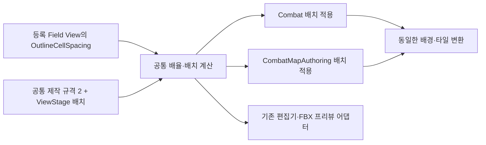

# 전투 배경·타일 공통 배율 설계 — 기존 표시 결과 보존

- 갱신: 2026-11-10. 작성: 전투 View 작업.
- 상태: CS4 구형 직렬화 필드 및 일회성 이전 도구 정리 후 사용자 Unity 확인 완료(문제 없음 보고). Codex 자체 컴파일·재생 실행과 구분한다.
- 계획: [공통 배율 Task 계획](../plans/2026-11-10-combat-map-common-scale-plan.md).
- 적용: `PrefabWithTiles`의 Combat 런타임과 CombatMapAuthoring. 같은 SO를 읽고 쓰는 기존 편집기·FBX 전투 프리뷰도 함께 대응한다.
- 이전 계약: [타일 맞춤 TA1~TA4](2026-10-28-combat-map-tile-alignment-design.md), [소수 크기 지원](2026-10-31-combat-map-tile-fractional-size-design.md), [배경 작업 씬 S2~S6](2026-11-09-combat-map-authoring-scene-design.md). 운영 제작 규격/배율은 이 문서의 공통 계약으로 전환했다. 범용 불변 타일 데이터/Fit의 기존 크기 API는 유지한다.

## 1. 최우선 수락 조건

사용자 요구: **변경 전 그려지는 결과와 변경 후 그려지는 결과가 동일해야 한다.** 이 작업은 배율의 원본과 계산 경계를 정리하는 작업이다. 어긋난 타일을 임의로 키우거나, 배경 구도를 다시 잡거나, 높이를 새 규칙으로 고치는 작업을 포함하지 않는다.

1. 같은 스테이지·필드·카메라·외형 선택에서 전환 전후 배경과 각 프랍, 타일의 위치·회전·크기·높이·모서리, 필드 격자 위치·간격, 유닛 발 위치와 표시 크기를 보존한다.
2. Combat의 이전/이후, CombatMapAuthoring의 이전/이후를 각각 비교한다. 두 화면이 동일한 새 배치 계산을 쓰는 것과, 각 화면의 기존 결과를 보존하는 것은 별개의 필수 검사다.
3. 운영 화면에 원래 없던 그리드 데칼을 켜지 않는다. 카메라 구도·줌·투영·조명 설정·재질·타일 종류/변형/회전 선택 정책을 변경하지 않는다.
4. 기존 씬의 저장하지 않은 작업 값·프랍 override를 운영 SO와 혼동하지 않는다. 임의 저장/재불러오기로 현재 화면을 잃지 않는다. 이전 직전 사용자가 확정한 작업 상태를 별도 기준 자료로 보관한다.
5. 기존 간격이 이미 필드와 다른 경우, **화면 보존과 자동 1:1 정렬을 동시에 충족할 수 없을 수 있다.** 이 경우 현재 값을 자동 수정하거나 완료로 처리하지 않고 전환을 보류한다. 화면을 바꾸는 수정 또는 기존 비율 유지 정책은 별도 사용자 결정이 필요하다.

## 2. 전환 전에 확인한 경로와 문제

아래 표는 변경 전 비교 기준이다. 구현 후 상태는 §6과 계획 실행 기록을 따른다.

| 경계 | 현재 동작 |
|---|---|
| `FieldCellSpacing.FromGridOutline` | 등록된 Field View의 `OutlineCellSpacing`을 최종 필드 칸 간격으로 사용한다. |
| `StageViewPropPresenter.Show/ShowTiles` | 프리팹 원본 배율 × `ScaleOffset`을 배경에 적용하고, 배경 자식 타일에 같은 배율을 물려준다. 기준 타일 정렬은 위치·방향을 맞추며 간격을 수정하지 않는다. |
| `StageMapTiles.Build` | SO `TileSize`로 타일 중심을 배치하고 타일 프리팹 자체의 회전/배율을 보존한다. |
| `CombatMapAuthoringPlacement` | 프리팹 저장 오염 방지를 위해 타일과 배경을 형제로 만들지만, 타일에 배경 배율을 복사하여 같은 결과를 재현한다. |
| `CombatMapAuthoringGridPreview` | 배경과 독립된 필드 원점·운영 칸 간격으로 데칼을 만든다. |
| 기존 편집기·FBX 전투 프리뷰 | `CombatStageSoAssets`, `CombatStageSoTiles.cs`의 Fit/Scene, `FbxCombatStagePreview` 등에 크기/배치 소비 경로가 있다. 두 주요 화면만 바꾸면 이 경로가 옛 값을 다시 저장할 수 있다. |
| `CombatMapTileSurface.Build` | 칸 중심이 놓인 타일을 찾고 그 종류의 `SurfaceHeight` 값을 그대로 사용한다. 배경 월드 Y나 배율을 곱하지 않는다. |

최신 병합 점검 당시 `Map3GrayBoxP`의 원본 루트 배율은 1에서 0.744198로 변경됐다. `Test 1`의 SO 배율 0.75와 곱해 타일 루트 배율은 0.5581485, `TileSize=2`의 간격은 1.116297이 되며 필드 간격 1.5와 다르다. 이는 당시 파일 조사 값이며 이후 사용자 변경을 대신하는 기준 자료가 아니다. 구현 직전 다시 읽어야 한다.

2026-11-10 문서 갱신 시 ViewStage Item 파일 21개에서 `tileSize=(2,2)`, `scaleOffset=(0.75,0.75,0.75)`를 확인했다. 이것만으로 호환 판정을 내리지 않는다. 각 프리팹 원본 배율·공유 소비자·등록 상태·씬 override·높이·전체 최종 변환은 별도 조사 대상이다.

## 3. 목표 계약 — 한 제작 규격, 한 최종 간격

### CS1. 공통 제작 규격과 자동 배율

- 배경과 바닥 타일은 **제작 좌표에서 한 칸 2 × 2**를 기준으로 한다. 스테이지별 `TileSize` 입력은 목표 모델에서 제거한다.
- 제작 규격 2는 기존 `ProjectL.Tool.Runtime` 공용 계산 영역의 한 정의(가칭 `CombatMapAuthoringMetrics`)만 소유한다. 런타임/에디터에 숫자 2를 별도로 복제하지 않는다. 이는 규칙 데이터가 아닌 View 에셋 제작 규격이다.
- 최종 간격의 원본은 등록된 Field View의 `OutlineCellSpacing`이다. 운영은 기존 `FieldCellSpacing.FromGridOutline`, 에디터는 등록 SO 읽기 어댑터로 같은 값을 전달한다. 자동 계산기가 DB나 씬을 직접 찾지 않는다.
- 정사각 간격을 `c`, 제작 규격을 `b=2`라 하면 **공통 균일 배율 `s=c/b`**다. 배경과 타일 모두 XYZ에 동일한 `s`를 적용한다. 독립적인 타일 배율 설정을 추가하지 않는다.
- `PrefabWithTiles`의 수동 `ScaleOffset`과 프리팹 원본 루트 배율을 `s`에 다시 곱하지 않는다. 새 모델의 배경 원본 루트는 배율 1이어야 하며, 타일 프리팹의 자체 변환은 제작 외형의 일부로 보존·검증한다.
- 비정사각 `OutlineCellSpacing`, 음수/반사·비균일 루트 배율, 기울어진 바닥, 제작 규격 불일치는 자동 보정 대상이 아니다. 활성화 전 구체 에셋/축/값을 알려 전환을 보류한다. 이를 지원하려고 임의로 X/Z를 늘이거나 Y를 평균값으로 정하지 않는다. 기존 경로에서 유효했던 데이터는 전환 전에 유지한다.
- `Prefab`/`MapDefinition`은 이 타일 제작 규격을 강제하지 않는다. 기존 배치·수동 배율 경로를 보존한다. 공용 `ScaleOffset` 필드를 모든 모드에서 삭제하지 않는다.

### CS2. 공통 배치 결과, 씬별 적용만 분리

공용 계산(가칭 `CombatMapPlacementLayout`)은 필드 간격/칸 수, 타일 수, 기준 타일, 높이·회전·타일 오프셋을 받아 배경과 타일의 필드 기준 변환 및 제작 규격을 돌려준다. 공통 배율, 축 정렬, 기준 타일 이동을 한 경로에서 계산하며 기존 `CombatTileAlignmentMath`와 중복된 식을 만들지 않는다.

- Combat의 타일은 배경 자식으로 유지할 수 있다. 최종 배경 변환과 제작 좌표의 TileOffset으로 구성해 공통 결과와 같아야 한다.
- Authoring의 타일은 현재처럼 프리팹 인스턴스 밖에 둔다. 공통 결과를 형제 오브젝트에 적용하고, 부모 관계가 다른 이유로 다른 배율 식을 만들지 않는다.
- 기준 타일의 필드 기준 좌하단 맞춤, 90° 축 교환/반전, 넘침 진단과 필드 원점은 유지한다. 타일 수와 필드 칸 수는 별개다.
- 원본 프리팹의 변환을 매 프레임 읽어 배율을 추적하지 않는다. 읽기/생성 시 제작 규격을 검증하고, 비정상 값은 명시적으로 거절한다. 잘못된 루트 배율을 조용히 무시해 겉보기만 맞추지 않는다.

### CS3. 위치·높이·작업 UI

- TileOffset은 계속 배경 제작 좌표에서 타일 루트 중심을 지정한다. 월드 X/Z의 별도 저장 원본을 만들지 않는다.
- `배경 월드 X/Z`는 최종 위치 표시와 역산 입력이다. 새 공통 변환으로 역산하고 기존 `보정 SO 저장` 경계를 사용한다. TileOffset X/Z는 읽기 전용, Y는 편집 가능을 유지한다.
- `자동 배율`은 읽기 전용으로 표시하며 계산 근거인 제작 규격과 필드 간격을 함께 보여준다. `PrefabWithTiles`에서 수동 배율을 다시 입력하는 UI를 제공하지 않는다.
- `positionOffset.y`와 TileOffset Y를 무조건 0으로 초기화하지 않는다. 배경 바닥, 타일 피벗, 타일 메시 윗면의 이전 높이를 각각 보존한다. 배경 높이와 유닛의 바탕 `SurfaceHeight`는 같은 값으로 합치지 않는다.
- `SurfaceHeight` 값은 현재 사용 단위를 유지한다. 균일 배율 적용을 이유로 값을 추가로 곱하거나 변환 후 중복 배율을 넣지 않는다. 칸→타일 대응과 유닛 발 높이는 전환 전후 같아야 한다.
- 이전의 프랍 저장 제외 규칙, 카메라 비활성화, Undo와 명시적 저장, 표시 타일/그리드/참고 유닛 저장 제외를 유지한다.

## 4. 화면 보존을 위한 이전 판정

### CS4. 일치 가능 조건을 먼저 검사

기존 타일 로컬 간격을 `t`, 프리팹 원본 배율과 SO 배율의 곱을 `a`, 새 공통 배율을 `s=c/2`라 하면 수평 간격 보존에는 **`t×a=c`**가 필요하다(회전 후 필드 X/Z 각각 검사). 타일 외형의 기존 변환까지 보존해야 하므로 간격 식 통과만으로 완료하지 않는다.

| 사례 | 처리 |
|---|---|
| `t=2`, `a=0.75`, `c=1.5`, XYZ 균일 | 자동 배율 0.75로 바꾸어도 같은 변환을 만들 수 있는 후보. 위치·높이·자식 변환·공유 영향 확인 뒤 이전한다. |
| `t=2`, `a=0.5581485`, `c=1.5` | 기존 1.116297 간격을 1.5로 바꾸면 화면과 칸→타일 대응이 달라진다. 전환 보류. |
| 소수/다칸 비율, 다른 TileSize, 직사각 간격, 다른 Y 배율 | 기존 소수 크기 지원 이력을 유지한다. 자동 1:1 모델로의 무손실 전환을 가정하지 않고 조사 결과를 사용자에게 보고한다. |

타일 중심을 옛 간격에 두고 메시만 늘이거나, 숨은 스테이지별 배율로 차이를 덮거나, 필드/카메라를 옮겨 비슷하게 보이게 하는 것은 허용하지 않는다. 화면 동일성과 단일 배율 원본 중 하나를 몰래 포기하는 구현이다.

**호환되지 않는 데이터가 남은 동안 기존 읽기·배치 경로와 직렬화 필드를 제거하지 않는다.** 새로운 Legacy 모드/자동 fallback을 승인 없이 추가하지 않는다. 전체 운영 전환을 보류하고 사용자에게 충돌 사례와 선택지를 제시한다. 설계 갱신은 현 데이터 모두가 전환 가능하다는 보장이 아니다.

### CS5. 동일성을 계산으로 확인하고 저장

1. 운영 등록 항목과 미등록 편집 항목, 공유 배경/타일 프리팹의 모든 참조를 목록화한다. SO·프리팹·필드 설정·씬 작업 값/override의 원본 해시와 이전 값을 보관한다. 이후 변경됐으면 이전 계획을 다시 계산한다.
2. 이전 계산기로 정렬 완료 후 배경/타일 및 중요 자식의 행렬, 타일 중심/모서리·전체 범위, 칸→타일 대응·높이, 공용 카메라 자세를 보관한다. 저장된 씬의 실제 변환이 재계산 값과 다르면 어느 것이 기준인지 먼저 확인하고 자동 재적용하지 않는다.
3. 새 계산기의 후보 결과를 메모리에서 만든다. 목표는 `Mnew = Mold`이며 부동소수점 허용 오차는 위치/길이 0.0001 Unity 단위, 회전 0.001도, 배율 성분 0.00001로 시작한다. 이를 늘려 시각 변화를 통과시키지 않는다. 꼭짓점·범위 차이도 함께 검사한다.
4. 다른 부모 아래에 같은 외형을 유지하려면 `Lnew = inverse(Pnew) × Wold`로 후보 로컬 변환을 구한다. Unity TRS로 표현할 수 없는 shear/반사 조합이면 중단한다. 행렬 보존을 이유로 공통 배율 규격에 맞지 않는 타일 간격을 숨겨 남기지 않는다.
5. 루트 배율 1 정리는 동일성 검증을 통과하는 **별도 이전 절차**다. 루트만 1로 바꾸거나 모든 자식에 무조건 옛 배율을 곱하지 않는다. 배경 최종 루트 배율이 이미 새 공통 배율과 같다면 자식 변환을 건드릴 필요가 없다. 공유 프리팹의 다른 소비자에 영향이 있으면 전역 수정을 보류하고 원본 정리/전용 에셋 분리 결정을 받는다. GUID나 프리팹 링크를 임의로 바꾸지 않는다.
6. 모든 관련 읽기·쓰기 소비자가 준비된 뒤에만 사용자에게 변경 대상과 전후 차이를 제시하고 명시적인 이전을 수행한다. 현재 씬을 포함한 관련 에셋을 한 이전 묶음으로 취급하고, 실패 시 이번 이전분만 복구한다. 사용자 변경을 `git reset/checkout`으로 덮지 않는다.
7. 타일 외형 후보·회전의 무작위 선택은 기존 정책을 유지한다. 전후 시각 비교는 같은 외형/회전이 선택된 조건에서 진행하며, 편집 고정 시드와 운영 무작위 시드가 원래 다름을 구분한다. 조명/파티클 시간 차이를 좌표 변경 증거로 오인하지 않되 실제 메시·그림자·콜라이더 변화는 확인한다.

## 5. 책임·외부 경계·확장 평가

| 기준 | 설계와 검토 조건 |
|---|---|
| SSOT | 제작 규격은 공용 정의, 최종 간격은 Field View, 배치 의도는 ViewStage, 계산은 공용 Layout 한 곳. 계산된 자동 배율·배경 월드 X/Z를 SO에 중복 저장하지 않는다. |
| SRP | 입력 읽기, 순수 배치 계산, 런타임 생성/수명, 편집 생성/저장, 일회성 이전을 분리한다. Presenter/Inspector에 이전·스캔·프리팹 변환 코드를 몰아넣지 않는다. |
| OCP | 제작 규격 변경은 한 정의와 해당 에셋 이전, 새 편집 표면은 계산 소비 어댑터에 한정한다. 승인되지 않은 다칸 타일 지원용 옵션을 미리 늘리지 않는다. |
| LSP | 기존 생성·해제·실패 정리와 기본 비타일 모드를 보존한다. 기존 유효 데이터가 새 검증에서 깨지면 배포 전 차단하며 실행 중 fallback으로 숨기지 않는다. |
| ISP/DIP | 계산기는 수치/배치 입력만 받고 SO·DB·씬·Core를 조회하지 않는다. Editor는 Systems 내부 타입을 우회 참조하지 않고 기존 SO 어댑터를 사용한다. |
| JMH/FW | 기존 Factory 주입·씬 수명·DB query 경로를 유지한다. 내부 계산을 새 전역 서비스로 등록하거나 루트 재노출하지 않는다. 자원은 기존 소유자가 해제한다. |
| 외부 경계 | Core·Buffer·InGame 규칙·FieldCamera·Architecture 변경 없음. 보드 크기는 기존 Buffer 읽기, 표시 간격은 View DB에서 받는다. 런타임에 에셋 쓰기/이전 없음. |
| 독립성 | 배율 공식 변경은 공용 계산과 직접 소비자만, 프랍 저장 변경은 저장기만, 카메라 변경은 기존 카메라 경계만 이해한다. 공유 타일 대응·높이·지형 교체는 실제 영향이 있어 통합 확인한다. |
| 성능 | 배치 계산은 생성/작업 값 변경 때 O(1), 타일 생성·이전 대조는 타일 수/자식 수에 비례한다. 프레임별 전체 에셋 스캔·DB 재생성·타일 재생성 없음. 캐시 무효화는 스테이지/간격/배치 값 변경 시점에 한정한다. |

새 파일이 필요하면 기존 `ProjectL.Tool.Runtime` 공유 어셈블리 경계를 활용하고 대응 `.meta`를 추가한다. asmdef/Framework 변경이 필요해지면 계획 밖 결정으로 먼저 확인한다. 실제 파일명은 계획의 책임 범위 안에서 확정한다.

## 6. 완료 판단과 현재 상태

완료는 자동 배율 코드가 존재한다는 뜻이 아니다. 운영/편집 데이터 전체의 이전 가능 여부가 확인되고, 양쪽 화면에서 이전/이후 결과 보존과 같은 계산 사용이 확인돼야 한다.

2026-11-10 연속 구현에서 최신 파일을 다시 조사했다. Map3GrayBoxP 원본 루트 배율은 사용자가 1로 변경했으며, 현재 21개 ViewStage의 유효 배율 0.75는 새 자동 배율 1.5/2와 일치한다. [기준 자료](../handoffs/2026-11-10-combat-map-common-scale-baseline.md)에 에셋 값/해시와 저장된 씬 작업 값을 남겼다. 원본 SO·프리팹·씬 값을 다시 쓰거나 자식 배율을 바꿀 필요가 없어 수치 이전은 수행하지 않았다.

`CombatMapAuthoringMetrics`와 `CombatMapPlacementLayout`을 Combat/Authoring/기존 스테이지 편집기/FBX 프리뷰가 함께 사용한다. Inspector와 저장 경로의 타일 수동 배율·크기 입력도 차단했다. 일반 SO Inspector의 자동 배율은 계산식으로, 작업 도구는 수치와 계산 기준으로 표시한다. TileOffset X/Z 읽기 전용과 월드 X/Z 역산은 Authoring 작업 화면에서 유지한다.

이전 확인에는 `CombatMapScaleMigrationWindow`를 제공했다. 사용자 확인 후 비교 대상인 구형 필드를 정리하면서 이 일회성 도구와 `.meta`·전용 읽기 API도 제거했다. 기준 자료는 변경 전 이력으로 보존한다. 나중에 규격이 다른 원본을 도입할 경우 해당 입력을 조사해 별도 이전 결정을 내린다.

2026-11-10 사용자가 Unity 확인 후 “문제 없어”라고 보고하고 구형 필드 정리를 요청했다. `CombatMapTilesInput.tileSize`와 21개 ViewStage 에셋의 `mapTiles.tileSize`를 제거했다. 에디터 읽기도 SO 필드를 찾지 않고 공통 규격을 사용한다. 고정 정사각 제작 규격에서 도달하지 않는 입력 회전 분기도 정리했다.

`ScaleOffset`과 Authoring의 `draftScaleOffset`은 Prefab/MapDefinition의 실제 설정이므로 유지한다. 타일 방식에서는 여전히 계산/저장에 사용하지 않는다. 기존 타일 방식 에셋의 ScaleOffset 값을 임의 초기화하지 않는다. 불변 타일 데이터·범용 Fit의 크기 API와 편집 작업본 규격 검증도 유지한다.

이번 정리는 배치 공식·SurfaceHeight·카메라·프리팹·씬을 바꾸지 않는다. **정리 후 컴파일 미확인**이며 Test 코드·MSBuild·Unity 실행은 수행하지 않았다. 사용자 확인은 앞선 구현의 검증 증거이고 정리 후 재실행 증거와 구분한다. 세부 실행 기록과 최소 확인 항목은 계획을 따른다.

후속 확인: 사용자가 구형 필드 정리 후에도 Unity에서 문제없음을 보고했다. 정리 후 확인 대기는 해소됐으며, 개별 시험 로그/직접 실행 증거와 구분해 계획의 최신 기록에 남겼다.
