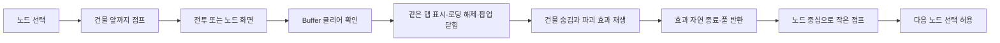

# 스테이지 노드 앞 이동·파괴 후 작은 점프 설계

- 작성: Codex, 호진님 요청. 2026-11-11.
- 상태: **Phase A~D 에셋·코드 반영 및 Phase E 정적 점검·인계 문서 정리 완료. 사용자 Unity 컴파일·기본 완료 연출 정상 확인(2026-11-11). 효과 8종 전체/세부 회귀/DataBaseAssetTests 인수는 대기.**
- 코드 확인 기준: `5fcbc0e08`. 파괴 에셋 원본: `f3406ea904db28bfa8275ddb86ab2f77633ad68e`.
- 작업 계획: [Phase별 계획](../plans/2026-11-11-stage-node-clear-presentation-plan-Hojin.md).
- Phase A의 EffectType 키·에셋 등록은 반영했다. Phase B의 앞쪽 계산·두 점프 종류·착지 보존 계약까지 반영했다. Phase C의 방문 기록·효과 어댑터·서비스 주입까지 반영했다. Phase D의 완료 조정자와 자동 재생 연결을 반영했다. Phase E에서 사용자 컴파일·기본 완료 연출 정상 답변을 인수했다. 효과별 전체 파편 종료·반환/취소·정렬의 세부 인수 상태는 작업 계획 Phase E를 따른다.

## 1. 사용자 결정과 범위

| ID | 확정 내용 |
|---|---|
| NC1 | 노드 클릭 시 메인 유닛은 건물을 밟지 않고 건물 앞 바닥으로 점프한다. |
| NC2 | **2026-11-11 사용자 변경:** 앞쪽은 방금 출발한 노드와 목적지를 잇는 연결선 쪽이다. 목적지 건물에서 출발 노드 쪽으로 여백을 두고 선 위에 착지한다. 카메라 방향이나 여러 진입선의 평균 방향은 사용하지 않는다. |
| NC3 | 클리어 후 건물 파괴 이펙트가 끝나면, 건물이 있던 노드 중심으로 낮고 짧게 점프한다. |
| NC4 | 전투·상점·회복·강화·이벤트 등 **모든 실제 노드**에 적용한다. 시작 장식은 스테이지가 아니므로 제외한다. 비전투는 처리 완료 확인 및 해당 팝업 닫힘 이후 재생한다. |
| NC5 | 로비·다음 챕터로 가는 기존 전환은 유지한다. 기존 맵으로 돌아오는 경우 또는 같은 맵에서 완료되는 경우에만 연출한다. 이전 맵을 연출 때문에 다시 열지 않는다. |
| NC6 | 파괴 표현은 민형님이 만든 에셋을 사용한다. 설계·계획 작성 뒤 사용자가 승인한 Phase만 구현한다. 최신 승인 범위와 조건은 작업 계획의 상태·실행 기록에서 관리한다. |

현재 운영 튜닝값: 앞쪽 여백 `1` 맵 로컬 단위, 작은 점프 높이 `0.2` 맵 로컬 단위, 시간 `0.25초`. 2026-11-11 사용자의 건물에서 조금 더 떨어져 착지하도록 하는 요청에 따라 운영 에셋의 여백을 초기 제안 `0.4`에서 `0.8`로 늘렸다. Phase D 최종 확인 시 운영 에셋의 여백은 `1`이었으며, 이 기존 튜닝값을 유지했다. Unity 화면 확인은 남아 있다. 기존 노드 간 점프 높이·시간은 유지한다.

## 2. 설계 전 확인한 구조 (`5fcbc0e08` 기준)

경로 기준 `S = Assets/ProjectL/Script/Systems`, `V = S/RuntimeSystem/InGameSystem/ViewSystem/StageMap`.

- `V/StageMapViewMarkerJump.cs`: 일반 노드 이동·출전 미리 이동이 공유하는 점프/소리/카메라 동행 부품. 목적지는 노드 중심으로 고정돼 있다.
- `V/StageCurrentMarkerView.cs`: `ShowAt`·`CompleteMove`가 마커를 노드 자식으로 붙이고 로컬 위치를 0으로 만든다. 점프 목적지만 바꾸면 착지 직후 다시 중심으로 튄다.
- `V/StageNodeView.cs`: `buildingShown = !isCurrent && !isCleared`. 건물 표시와 클릭 상자를 함께 켜고 끈다.
- `V/StageMapViewEntryPreparation.cs`: 로딩 중 배치와 인트로 준비를 끝내고 `Complete`를 반환한다. 전투 복귀 시에도 현재 위치를 동기화한다.
- `V/StageMapViewScope.cs`: 이동·팝업·인트로·선택 화면 Tick과 `IsMapIdle`을 조정한다. 모든 노드의 실제 클리어 여부는 `IStageProgressBufferReadSink.IsCleared(mapKey, nodeId)`로 읽을 수 있다.
- 상점·회복 완료 닫기는 `RequestMapRedraw`로 다시 준비한다. 준비 버전이 바뀌므로 완료 연출을 씬 Scope 내부 기록에만 두면 놓칠 수 있다.
- `V/Entry/StageNodeDropEffects.cs`: EffectScope 하나를 System 수명에서 재사용하고, 별도 받침 아래 재생한 효과가 풀로 반환되면 완료로 본다. 취소 시 `StopAll()` 후 받침을 정리한다.
- `EffectScope.Play(EffectScopeRequest)`는 `void`이고 공개 재생별 완료 콜백/핸들이 없다. `ParticleStopNotifier`의 콜백은 풀 반환용이므로 소비자가 덮어쓰지 않는다.

### 2.1 파괴 에셋 인수 사실

`Assets/ProjectL/Script/Render/Effect/BackGroundEffect/StageNode/`에 프리팹 8종이 있다. 각각 루트 ParticleSystem 1개와 파편 자식 7개다. 8종 모두 루트 `ParticleStopNotifier`가 없고, 루트 방출은 꺼져 있다. `EffectType`·EffectTable·노드 외형 데이터에 파괴 연결이 없다.

현재 EffectSystem은 루트 ParticleSystem 및 ParticleStopNotifier를 필수 검사한다. 일반 전투용 효과 루트에는 크기 2가 저장돼 있다. 따라서 **에셋 추가만으로 재생 가능하거나, 루트 종료가 파편 전체 종료라고 인수하지 않는다.**

## 3. 접근 방식과 선택

| 방식 | 평가 |
|---|---|
| View가 원본 프리팹을 직접 생성하고 고정 시간 후 점프 | 현재 Effect DB/Scope/Pool 경로와 별도 수명 체계가 생긴다. 사용하지 않는다. |
| **EffectSystem + 파괴 전용 어댑터 + 스테이지 완료 연출 조정자** | 사용자 요청한 기존 구조를 따른다. 파괴 자원 수명, 점프, 순서를 분리하고 기존 낙하 효과의 반환 확인 패턴을 재사용한다. 채택. |
| 공용 EffectSystem에 재생별 완료 핸들을 먼저 도입 | 장기적으로 가능하지만 공용 영향이 더 크다. 현재 Phase에는 포함하지 않는다. 에셋 계약으로 전체 종료를 보장하지 못하면 자동 확대하지 않고 민형님과 계약 변경을 논의한다. |

## 4. 화면 동작과 상태

| 상황 | 건물·유닛 표시 |
|---|---|
| 미방문 노드 | 건물 표시. 기존 진입 가능 판정을 유지한다. |
| 출전 미리 이동·미클리어 현재 노드 | 건물을 유지하고 유닛은 앞에서 대기한다. 현재 노드를 다시 실행하는 입력은 기존 진입 정책으로 차단한다. |
| 클리어됐고 이번 방문의 연출이 대기 중 | 건물은 연출 시작까지 유지하고 유닛은 앞에 둔다. 클리어 사실 자체는 바꾸지 않는다. |
| 파괴 중 | 건물·해당 클릭 상자·호버 강조를 숨기고 독립 받침에서 효과를 재생한다. 노드 위치 Transform은 남긴다. |
| 작은 점프 중·완료 | 건물은 계속 숨긴다. 효과 반환 뒤 중심으로 점프하며, 착지 후 입력을 푼다. |
| 이미 연출했거나 이 실행에서 방문 기록 없는 과거 클리어 노드 | 건물은 숨긴 채 복원한다. 과거 파괴를 몰아서 재생하지 않는다. 현재 노드라면 유닛은 중심에 놓는다. |
| 출전 취소·거절 | 클리어 연출 기록을 만들지 않는다. 기존 원래 노드·카메라 복원 정책을 유지한다. |

### 4.1 앞쪽 위치와 착지 보정

`StageMarkerPlacement`라는 계산 부품을 `StageMapViewScene`이 여백 값으로 만든다. 사용자 후속 선택에 따라 카메라 기준을 출발 연결선 기준으로 교체한다. 선택한 실제 선을 따르는 방법을 채택했고, 여러 진입선을 평균 내는 방법은 선택한 경로와 어긋나므로 사용하지 않는다. 카메라는 기존 동행/취소 기능만 유지한다.

1. 목적지 중심 `p`에서 실제 출발 노드 중심 `s`를 향하는 벡터를 맵 로컬 XZ에서 정규화하여 방향 `d`를 얻는다. 출발 마커의 앞쪽 오프셋은 방향 계산에 섞지 않는다.
2. `StageNodeView`가 이미 계산한 건물 클릭 상자의 모서리 8개를 맵 로컬로 바꿔, 노드 중심 `p`에 대한 앞쪽 최대 거리 `r = max(dot(corner - p, d))`를 구한다.
3. 목적지 바닥점은 `p + d * (max(0, r) + FrontClearance)`다. Y는 기존 노드 바닥의 Y를 유지한다. 기존 `MarkerOffset`은 모델 표시 보정에만 계속 적용한다.
4. 출발/목적지가 같은 XZ 위치이거나 여백을 포함한 바닥점이 출발 노드까지 넘어가면 구성 오류로 진단한다. 카메라나 임의 축으로 대체하지 않는다.
5. 이 값은 한 이동/한 준비 때 계산하고 착지까지 고정한다. 건물 회전과 카메라 방향이 달라도 선택한 연결선 쪽을 유지한다.

일반 이동/출전 미리 이동은 시작 시 Display가 가진 출발 NodeId를 사용한다. 같은 노드 재준비·취소 복원·씬 복귀의 Front 계산은 Buffer의 **직전 깊이 + 목적지로 연결 + 시작 또는 클리어**인 유일한 선을 사용한다. 현재 Core는 클리어한 현재 노드에서 정확히 다음 깊이로만 진행하므로 정상 경로의 출발점은 하나다(`ChapterNavigationRules.Evaluate`). 이 조회는 계산 시점에만 하며 경로/클리어 상태를 View에 복제하지 않는다. 복원 후보가 없거나 여러 개라면 대상 NodeId를 명시한 구성 오류로 진단한다. 시작/클리어 최종 표시를 Center로 놓을 때는 출발점이 필요 없다. 사용자 동작 변경 승인에 따른 B 후속이며 C/D의 자동 파괴 연출은 추가하지 않는다.

노드 루트 기준 착지 오프셋을 `StageCurrentMarkerView.ShowAt`·`CompleteMove`까지 전달한다. `StageMapViewDisplay`가 노드 ID와 최종 표시 자리(`Front/Center`)를 보관하고, 반복 `SetCurrentNode`는 같은 방문의 앞자리를 중심으로 덮어쓰지 않는다. 실제 이동 목표는 맵 로컬, 최종 부모 아래 오프셋은 노드 로컬로 명시적으로 변환한다.

표시 준비에는 별도 `PlaceCurrentMarker(int nodeId, StageMarkerLanding landing)`을 사용한다. 이 메서드는 이동이 정리된 상태에서 **같은 NodeId라도** 요청한 자리에 다시 배치한다. 매 Tick의 `SynchronizeCurrentNode`와 구분한다. 따라서 작은 점프 도중 취소 후 같은 인스턴스로 다시 준비해도 `SetCurrentNode`의 동일 ID 조기 return 때문에 공중/앞쪽에 남지 않는다. 앞쪽 계산은 변환한 클릭 상자 모서리 8개를 직접 투영하며, 다시 만든 축정렬 Bounds로 감싸 거리를 늘리지 않는다.

`StageMapViewMarkerJump`를 두 목적에 재사용한다. `Approach`는 기존 점프 설정과 카메라 동행을 쓰고 **실제 앞쪽 바닥점**으로 카메라를 정렬한다. `Settle`은 작은 점프 설정을 쓰고 카메라는 고정한다. 기존 `ChessPieceMotion`·`StageMapMovementDelay`의 취소/세대 검사를 그대로 사용한다. `Settle`은 같은 NodeId 내 이동을 허용하되 다른 이동과 동시 실행하지 않는다.

`TryArrive`도 종류에 따라 판정한다. Approach는 기존처럼 마커와 카메라 완료를 기다린다. Settle은 유효 문맥과 마커 완료만 확인하며 `SetProgress(0, ...)`를 호출하지 않는다. 카메라 operation 없는 Settle에 `Begin/SetProgress/Commit/Cancel`을 호출하지 않는다. 작은 점프 소리는 실제 이동 시작 때 기존 이동 소리를 한 번 재사용하고, 별도 파괴 사운드 추가는 이번 범위에 넣지 않는다.

작은 점프는 로컬 위치만 바꾼다. Core 명령 제출·전투 진입 lease 완료·현재 Stage 변경을 다시 하지 않는다. 취소 복원은 출발 노드의 Front/Center 자리까지 복원한다.

### 4.2 클리어 관찰과 한 번 재생

`StageNodeClearHistory`를 System 수명에 하나 둔다. 키는 `(RunId, MapKey, NodeId)`이며 Unity 객체·클리어 여부는 저장하지 않는다. `Arm`(이번 실행에서 수락한 방문)과 `TryConsume`(연출을 실제 시작함)만 관리한다.

- 전투는 출전 미리 클릭 때 Arm하지 않는다. `StageCombatDeparture.CompleteAccepted`에서 같은 요청의 수락·준비·착지를 확인한 뒤 Arm한다. 일반 수락 이동 경로도 앞쪽 착지 완료 시 Arm한다.
- 시작 노드는 Arm하지 않는다. 동일 요청 반복 관찰은 멱등이다. Run 변경 시 이전 기록을 버린다.
- 매 Tick 현재 노드에 대해 Buffer의 `IsCleared`를 읽는다. Arm된 현재 노드가 클리어됐을 때만 연출 후보가 된다. Scene 복귀/팝업 닫힘으로 준비 버전이 바뀌어도 Arm 기록은 남는다.
- 게임 재시작/개발 도구로 처음부터 클리어된 맵을 여는 경우, Arm 기록이 없으므로 과거 연출은 재생하지 않는다. 저장 데이터 확대는 범위 밖이다.
- 실제 파괴를 시작하기 직전에 유효 문맥을 확인하고 `TryConsume`한다. 그 뒤 씬 교체로 끊기면 재생을 반복하지 않고 다음 준비에서 클리어 최종 표시·중심 위치로 복원한다. 대기 중 취소는 소비하지 않아 정상 복귀 때 시작할 수 있다.
- `IsPending`은 Arm되어 있고 아직 소비하지 않은 키에만 true다. 소비한 키에 다시 Arm해도 소비 기록을 되돌리지 않는다. 활성 `Breaking/Settling`은 자신의 세대가 계속 소유하며, 이후 Tick에서 History.IsPending이 false가 됐다는 이유로 연출을 완료/취소하지 않는다.
- 새 Run·다른 맵·다른 현재 노드의 옛 대기/콜백은 폐기한다. 같은 숫자 NodeId를 새 Run의 대상으로 오인하지 않는다.

### 4.3 로딩·팝업·입력 순서

완료 연출 상태는 `Idle → WaitingForPresentation → Breaking → Settling → Done`이며 오류/문맥 무효화는 `Cancelled`로 끝낸다. 이 상태는 노드 클리어 여부가 아니라 연출 실행 단계다.

- 준비 단계는 후보를 결정한 뒤 건물/앞쪽 유닛을 배치한다. 로딩 준비 완료는 배치만 기다리고 파괴·점프 재생을 기다리지 않는다.
- 실제 시작 조건: 유효한 준비 문맥, 현재 노드 일치, Buffer 클리어, 로딩 종료, 기존 인트로 종료, 다른 노드 이동/출전/처리 전 요청 없음, 팝업의 `IsAnyOpen/IsAnyWaiting`이 모두 false, 맵 선택 Layer, `Time.timeScale > 0`.
- 시작 조건은 `IsMapIdle()`을 호출하지 않는다. 완료 연출 자신이 IsMapIdle을 막기 때문에 상호 대기하면 안 된다. 위 공통 기반 조건은 Scope의 이름 있는 함수 한 곳에서 주입한다.
- `BlocksMapInput`은 클리어된 후보를 기다리는 순간부터 작은 점프 착지까지 true다. 아직 클리어되지 않은 노드 방문은 false이므로 상점/회복 팝업을 여는 기존 경로를 막지 않는다.
- Scope는 기존 이동/표시 갱신·팝업 Tick 뒤 완료 연출을 평가하고, **선택 화면 복귀·비전투 복원·증강 자동 열기보다 먼저** 예약/차단을 적용한다. `IsMapIdle`에 `!BlocksMapInput`을 한 번만 합친다. 선택 화면의 복귀 예약은 막는 동안 보존하여 착지 후 열리게 한다.
- 보상 증강이 아직 열리지 않았다면 파괴/작은 점프 뒤 기존 `TryOpen` 순서로 연다. 이미 열린 팝업은 닫힘/처리 종료를 기다린다.
- 설정으로 일시정지하면 파티클과 작은 점프 모두 게임 시간 기준으로 정지한다. 취소·씬 해제는 일시정지와 무관하게 즉시 정리한다.
- NC5에 따라 로비·다른 챕터로 이동하면 옛맵 연출을 실행하지 않는다. Core·LifeCycle 전환 정책은 수정하지 않는다.

## 5. 파괴 효과 등록·완료 계약

### 5.1 데이터의 한 원본

- Render Effect DB: `EffectType → 풀용 Prefab`의 유일한 원본.
- `StageNodeVisualData(SO)`: `BreakEffect` 키를 추가. 기존 StageKey 우선/종류·역할 fallback 조회를 그대로 사용한다. StageType switch로 별도 매핑을 만들지 않는다.
- `StageMapViewData(SO)`: 새 읽기 전용 `StageMarkerVisitData`에 앞쪽 여백·작은 점프 높이/시간을 둔다. 현재 운영 에셋은 `FrontClearance=1`, `SettleJumpHeight=0.2`, `SettleJumpSeconds=0.25`다. 새 SO 생성용 코드 기본 여백은 초기값 `0.4`이며 운영 값은 에셋에서 조절한다. 앞쪽 여백/시간은 유한한 양수, 높이는 유한한 0 이상이다.
- 대상 외형마다 Empty가 아닌 정의된 BreakEffect가 필요하며 View Data 생성 때 검사한다. 실제 Render Table 등록은 Phase A의 에셋 대조 및 기존 EffectSystem의 요청 시 검증을 따른다. 조회 편의를 위해 View에 Render Query를 새로 노출하지 않는다. 기존 생성자 호출부/기존 시험의 컴파일 호환도 함께 확인하되 새 시험은 만들지 않는다.

| 제안 EffectType 이름 | 민형님 원본 프리팹의 stem | 연결할 외형 에셋 |
|---|---|---|
| StageNodeBreakCombat | StandardBattleStageNodeEffect | NodeVisual_Combat_Regular |
| StageNodeBreakBoss | BossBattleStageNodeEffect | NodeVisual_Combat_Boss |
| StageNodeBreakMainCharacter | MainCharacterUpgradeStageNodeEffect | NodeVisual_MainCharacterUpgrade |
| StageNodeBreakMainSkill | MainSkillUpgradeStageNodeEffect | NodeVisual_MainSkillUpgrade |
| StageNodeBreakRecruitment | MercenaryRecruitmentStageNodeEffect | NodeVisual_MercenaryRecruitment, NodeVisual_Chapter2_Shop |
| StageNodeBreakRandomEvent | RandomEventStageNodeEffect | NodeVisual_RandomEvent |
| StageNodeBreakRecovery | RecoveryStageNodeEffect | NodeVisual_Recovery |
| StageNodeBreakSupportingCharacter | SupportingCharacterGrowthStageNodeEffect | NodeVisual_SupportingCharacterGrowth, NodeVisual_Chapter2_Enhancement |

enum은 기존 숫자를 바꾸지 않고 뒤에 추가한다. 2챕터 에셋 둘은 기존 StageKey 전용 외형과 같은 건물 계열을 연결한다. 보스 효과 등록과 실제 재생 여부(NC5)는 별개다.

Phase A에서 위 키를 18~25로 등록하고 Variant 8종을 구성했다. 자식 파편 수명 0.85초 / 숨은 루트 제어 입자 1초, 실제 운영 건물 스케일에 맞춘 정렬 설정 및 미확인 항목은 [효과 인수 기록](../handoffs/2026-11-11-stage-node-clear-effect-integration-Hojin.md)을 따른다. 에셋 구성 반영은 Gate A 재생 인수 완료와 구분한다.

### 5.2 원본을 보존한 풀용 Variant와 Phase A 인수

기본안은 `Assets/ProjectL/Prefabs/StageMap/Effects/<원본 stem>_Pooled.prefab` Variant 8종을 만드는 것이다. 원본 파편 모양/머티리얼은 민형님 소유로 유지한다. Variant에는 루트 `ParticleStopNotifier`와 풀 반환용 루트 파티클 수명 설정을 둔다.

루트 Renderer는 비활성으로 유지한다. 루트가 전체 자식 재생을 포괄하도록 **보이지 않는 제어 입자 한 개**를 방출하고, 수명을 유한한 자식 방출 종료+최대 생존 시간 이상으로 설정한다. 정확한 값은 에셋의 실제 곡선/지연/버스트를 대조해 기록하며, View 코드의 타이머로 복제하지 않는다. 루트 종료 시 모든 자식이 끝난다는 보장은 Phase A의 사용자 Unity 재생 확인을 통과해야 한다. 이 방식으로 보장하지 못하면 공용 notifier를 임의 수정하지 않고 민형님에게 전체 자식 종료 계약을 요청한다.

검증 증거는 두 단계로 나눈다. **A에서는 Unity의 기존 프리팹/파티클 미리보기로 루트와 자식의 수명·정렬, 등록 데이터를 확인한다.** 이 시점에는 운영 재생 호출자가 없으므로 EffectScope의 실제 반환/StopAll 성공까지 확인했다고 적지 않는다. **D에서 연결된 실제 노드 완료 경로로 자연 풀 반환·취소·두 번째 방문 재생을 확인한다.** 테스트 도우미나 임시 런타임 재생 코드를 만드는 것으로 이 간격을 메우지 않는다.

원본 효과와 건물의 피벗/크기가 다르므로 Variant의 정렬을 맞춘다. 목표는 **건물의 최종 월드 위치·회전에서 단위 스케일 받침으로 재생했을 때 실제 건물 크기와 일치하는 것**이다. Phase A에서 현재 운영 `NodeScale=1`, 맵 스케일과 외형별 회전까지 확인한다. `EffectScopeRequest`에는 크기 인자가 없으므로 임의의 MapRoot/NodeScale 조합까지 지원된다고 선언하지 않는다. 비단위/비균일 스케일까지 런타임 지원해야 하면 공용 크기 계약 별도 설계가 필요하며 이 Phase에서 중단·보고한다. 운영 설정 밖 스케일은 명시적으로 검사한다.

### 5.3 파괴 전용 어댑터

`StageNodeBreakEffects`는 `IEffectSystemServices`만 받아 Scope 하나를 재사용한다. 파괴 중인 건물의 자식이 아닌 별도 받침을 소유 씬에 만들고, 실제 건물의 보정된 월드 Pose에 놓는다. 효과는 Scope로만 대여/반환한다. `StageNodeDropEffects`의 받침 방식은 재사용하되 낙하 Scope와 섞지 않는다.

- `Begin(EffectType type, Transform sceneOwner, Pose pose) → long generation`: 검증 뒤 받침/효과 하나를 시작한다.
- `GetStatus(long generation) → StageNodeBreakStatus`: 현재 세대는 `Playing/Completed`, 무효·취소된 세대는 `Cancelled`. **무효 세대를 Completed로 취급해 점프하지 않는다.**
- `End(long generation)`: 멱등. `StopAll`이 끝나 풀 반환을 확인한 뒤 받침을 파괴한다. Play 도중 동기 재진입 취소는 반환 요청으로 보관하고 Play 등록 완료 뒤 실행한다.
- 정상 완료는 유효 세대의 받침에서 효과 자식이 풀로 돌아간 사실로 판정한다. Phase A의 전체 종료 계약이 전제다. 받침 유실·필수 데이터 누락은 예외로 오류 경계에 전달한다.

Begin 중 동기 재진입으로 조정자가 취소될 수 있다. 호출자는 반환된 세대를 보관한 직후 문맥을 다시 확인하고, 취소됐으면 그 세대도 End로 정리한다. Begin 반환 전의 End(0)만으로 취소가 끝났다고 취급하지 않는다.

조정자의 정상 후속은 `GetStatus == Completed → End(generation) → 문맥 재확인 → Settle 시작`이다. 자연 풀 반환만으로 어댑터의 받침/현재 세대가 정리되는 것은 아니므로 **정상 완료에도 End를 호출한다.** GetStatus가 Cancelled이면 점프를 시작하지 않는다. End가 실패하면 오류 경계로 보고하고 다음 단계로 넘어가지 않는다. 씬 이탈 시에는 같은 End를 멱등으로 호출한다.

공용 EffectScope는 System 종료까지 내부 핸들을 보관하므로 방문마다 새 Scope를 발급하지 않는다. View는 ParticleStopNotifier.Play를 직접 호출하거나 Pool의 GameObject를 직접 Destroy하지 않는다(FW-011).

## 6. 구현 단위와 조립

| 단위 | 책임·수명 |
|---|---|
| `StageMarkerPlacement` (신규, V) | 실제 출발 연결선 쪽 앞 바닥점 계산. 여백 값으로 만드는 계산 부품. 건물/마커/효과 수명은 소유하지 않는다. |
| `StageCurrentMarkerView`, `StageMapViewDisplay` (수정) | 마커의 최종 자리와 실제 Transform. 명시한 착지 오프셋을 끝까지 유지한다. |
| `StageMapViewMarkerJump` (수정) | Approach/Settle 점프 실행. 파괴 상태·클리어 판정은 모른다. |
| `StageNodeClearHistory` (신규, V/Completion) | System 수명의 방문 Arm/연출 소비 기록. Buffer 클리어 사실을 복사하지 않는다. |
| `StageNodeBreakEffects` (신규, V/Completion) | System 수명의 EffectScope 재사용, 재생별 받침·세대. 씬 이탈 때 현재 재생만 끝낸다. |
| `StageNodeClearPresentation` (신규, V/Completion) | Scope 수명의 후보/건물 유지/파괴/작은 점프 순서. 표시 문맥 검증과 입력 차단 상태를 제공한다. |
| `StageMapViewSystem` / `StageMapSceneFactory` | 서비스 조회·System 수명 객체 생성 / 씬 완료 연출 생성. 기존 Context 경로로 주입한다. |
| `StageMapViewScope` / `StageMapViewEntryPreparation` | 완료 부품의 Tick·Cancel 호출, 배치 준비와 입력 정책 연결. 효과/경로 계산 본문은 넣지 않는다. |

`StageMapViewCompletionServices`라는 좁은 묶음에 History, Effects, Buffer read sinks, Delay, Audio, View 설정을 둔다. `StageMapViewServices`는 이 묶음만 추가로 연결한다. 이동 호출자는 필요한 History만 따로 받는다. SceneFactory는 이미 만들어진 Scene에 완료 부품을 조립하는 명시적 생성 메서드로 연결하고, Scope 생성자에 효과 생성 로직을 쌓지 않는다.

서비스 경로: 기존 `RenderSystemFactory`가 EffectSystem 생성 → 내부 Builder에 `IEffectSystemServices` 등록 → `RenderSystemGroup.CoreGroup` 공개 → `StageMapViewSystem.PostBindService`에서 `global.RenderServiceCommand.CoreGroup.EffectSystemServices` 조회. 새 전역 서비스/루트 재등록은 없다.

## 7. 표시 갱신·취소 계약

- `StageNodeView`의 정적 표시 기본은 미클리어 건물 표시/과거 클리어 건물 숨김이다. 현재 노드라는 이유로 숨기지 않는다. 시작 장식의 기존 정책은 유지한다.
- 현재 클리어 후보의 건물 유지와 파괴 시작 숨김은 완료 부품이 소유한 **노드 ID와 준비 버전이 붙은 임시 표시 지정**으로 전달한다. `Refresh/Show`도 동일 지정을 적용한다. 별도 IsClear 사본은 만들지 않는다.
- 후보 판정은 `ShowNodes` 이전에 한다. 로딩 중 이미 사라진 건물을 로딩 종료 후 다시 켜는 깜빡임을 피한다. 파괴 후보는 인트로의 낙하 대상으로 수집하지 않는다.
- 기존 outline/hover 수명 경로로 강조를 해제한 뒤 건물을 숨긴다. 숨긴 건물과 Effect 받침은 서로 다른 루트다. 노드 좌표 루트와 연결선은 보존한다.
- 재준비/씬 이탈/Run 변경에서는 준비 버전과 재생 세대를 먼저 무효화 → 효과 End → 점프 취소 → 노드/마커/씬 표시 해제 순서다. 옛 콜백이 새 표시를 만지지 않는다.
- 파괴 시작 전 해제는 대기 기록을 유지한다. 시작 후 해제는 §4.2의 소비 정책에 따라 최종 상태로 복원한다. 취소는 정상 완료 콜백/전투 lease 완료를 게시하지 않는다.
- 오류는 `RuntimeFaultBoundary`로 보고하고 입력을 멈춘다. 누락 에셋/필수 설정을 무시하고 성공한 것으로 진행하지 않는다.

## 8. 원칙 점검

- **SSOT:** 클리어/현재 위치는 Buffer, 효과 Prefab은 Render DB, 노드별 효과 선택은 View DB, 방문 연출 기록은 History 하나, 실제 마커 Transform은 MarkerView 하나다.
- **S:** 경로 계산, 효과 수명, 연출 순서, 조립을 분리한다. **O:** 건물별 효과 변경은 View/Render 데이터로 한다. **L:** 취소를 완료로 위장하지 않고 기존 전투 진입 lease의 의미를 유지한다. **I:** 완료 부품은 read sinks/효과/이동만 받는다. **D:** Global Context의 서비스 인터페이스를 주입하고 전역 검색하지 않는다.
- **JMH/FW:** 기존 Builder 등록과 수명을 유지(FW-001~004), 입력 명령은 기존 경로(FW-005~007), UI 개폐는 UISystem 경로(FW-008/009), 이펙트는 Scope 반환과 DB 검증(FW-011/012).
- **기능 독립성:** 점프 높이 변경은 이동 설정, 파편 변경은 Variant/Render DB, 특정 건물 효과 교체는 외형 SO, 완료 순서 변경은 Completion에 머문다. 공통으로 남는 경계는 Display의 자리/건물 표시와 Scope의 입력 잠금·취소다. 이 경계만 이동·취소·재준비 확인에 포함한다.
- Core·FieldCamera·Architecture·공용 EffectSystem 구현은 기본 수정 범위 밖이다. 공용 enum/Factory 연결 변경은 민형님 공유 메모에 명시하되 자동 발송하지 않는다.

근거: [공동 원칙 §4](../handoffs/2026-09-30-combat-view-design-session-handoff.md#4-반드시-지킬-설계-원칙), [JMH 개발 지침](../framework/Framework%20Development%20Guidelines.md), [Framework 계약](../../../Assets/ProjectL/Script/Systems/Documentation/framework-programmer-guide.md), [리팩토링 설계 §2.6·2.8·2.9](2026-11-09-stage-select-refactor-design-Hojin.md).

## 9. 인수와 구현 전 조건

제품 동작에 필요한 사용자 질문 NC4·NC5는 2026-11-11 답변으로 해결됐다. 아래는 사용자 취향 질문이 아니라 구현 Phase에서 증거를 확보할 조건이다.

1. Phase A: 원본/Variant의 루트·자식 수명 관계, 반복 미리보기, 운영 건물과 위치/회전/크기 정렬, DB 등록을 확인한다. 실패하면 B 이후 연결을 진행하지 않는다. 실제 EffectScope 반환·취소·재대여의 인수는 호출 경로가 생기는 D에서 한다.
2. 각 Phase는 보고 후 멈춘다. 문서 작성 요청은 코드/에셋 구현 승인으로 간주하지 않는다.
3. View 시험 코드 작성 금지. 컴파일·EditMode·재생은 사용자가 Unity에서 확인한다. DB 변경 시 기존 DataBaseAssetTests를 확인 항목에 포함한다. 사용자 확인 전까지 **컴파일 미확인**으로 기록하며, 최신 확인 상태는 작업 계획 Phase E를 따른다. 사용자 확인을 Codex 직접 실행으로 기록하지 않는다.
4. 코드는 기존 관련 파일의 최신 변경과 동시 작성자를 다시 확인한 뒤 수정한다. 커밋·push는 사용자만 한다.

## 10. 문서 검토 기록

- 2026-11-11 별도 읽기 전용 builder check: 완료용 점프 생성 시 기존 필수 `StageMapCameraFocus` 주입이 계획 서명에 빠졌다는 지적을 수용했다. 계획 D1의 Factory 인자에 공유 focus를 추가했고 Settle은 카메라 operation을 시작하지 않는다고 명시했다.
- 추가로 구현 방향을 바꾸는 미결정은 보고되지 않았다. 이는 문서/연결 검토이며 Phase A 파티클 인수나 Unity 컴파일·재생 확인을 대신하지 않는다.
- 같은 날 사용자 요청 재점검: Settle의 카메라 없는 완료 판정, 같은 NodeId 재준비의 명시 배치, 정상 효과 종료 후 End, 소비 기록과 활성 연출 수명 분리, 앞쪽 좌표 입력 형식, 운영 호출자 생성 전/후 검증 구분을 보완했다. 제품 요구 변경이나 코드 구현은 없다.
