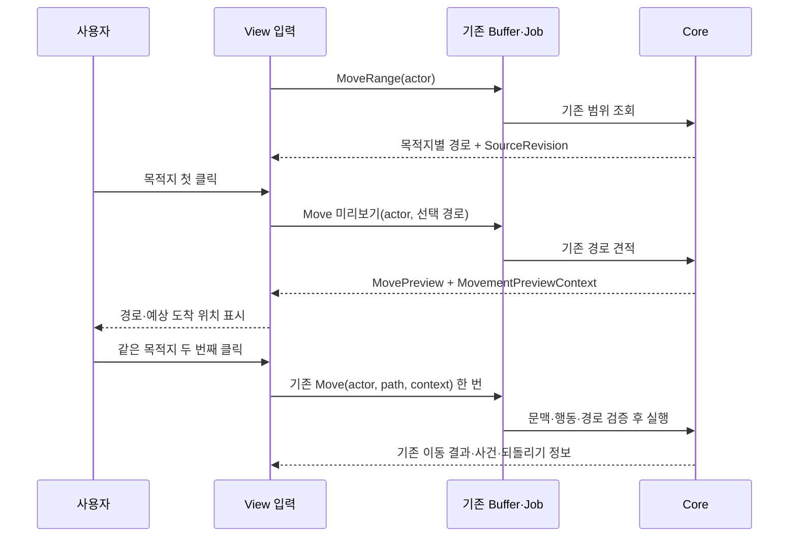

# 전투 클릭 최단 경로 이동 — Core 제공 계약 설계 (2026-11-17)

- **상태:** 2026-11-17 사용자 설계 승인. [Core Phase별 구현 계획](../plans/2026-11-17-combat-click-shortest-move-core-plan.md) 작성 완료, Core·View 구현 미착수.
- **목표:** 기존 드래그 이동과 **목적지 첫 클릭 → 최단 경로·도착 위치 미리보기 → 같은 목적지 두 번째 클릭 → 이동**을 동시에 지원한다.
- **이번 산출물:** Core 작업자가 구현 계획을 세울 수 있는 경로 제공 계약과 View 인수 조건. 코드·에셋·시험은 변경하지 않는다.
- **조사 기준:** `feature/Cheon/Core/NewCombatSytem`, HEAD `f4e6a352ed53e4799d8abaeb400a2a30085157fb`와 2026-11-17 현재 작업 트리. 이미 준비된 다른 변경이 있으므로 HEAD만의 동작을 조사했다는 뜻은 아니다.
- **기준 구분:** 현재 동작은 아래 소스로 확인했다. `2026-10-27-combat-click-move-design.md`는 과거 초안으로만 확인했으며, 당시 미결정 사항·API·비용·검증 기록을 이번 설계의 기준으로 삼지 않는다. 이번 요청의 설계 원본은 이 문서다.

## 1. 요구사항과 설계 제안

### 1.1 사용자가 정한 것

| 항목 | 요구사항 |
|---|---|
| 이동 방식 | 드래그와 클릭을 별도 설정 없이 동시에 사용한다. |
| 드래그 | 유닛을 누른 채 경로를 그리고 놓는 기존 이동을 유지한다. |
| 클릭 | 유닛 선택 후 목적지를 한 번 클릭하면 미리보기를 보여 준다. 한 번 더 클릭해야 실제 이동한다. |
| 경로 | 클릭 이동은 최단 거리로 이동한다. |
| 작업 범위 | Core 쪽에서 추가할 수 있도록 설계 문서를 작성한다. |

### 1.2 이 문서에서 제안하는 세부 정책

다음은 작성 당시 사용자 최초 요구와 구분해 제안한 세부 정책이다. 2026-11-17 사용자가 이 설계를 기준으로 Core 구현 계획 작성을 요청했으므로, 후속 계획은 이 정책을 구현 기준으로 사용한다.

1. 두 번째 클릭은 **현재 미리보기를 보는 동일 목적 칸**에서 해야 한다. 다른 목적 칸을 클릭하면 미리보기만 교체한다.
2. 미리보기가 준비되기 전의 추가 클릭은 확정으로 예약하지 않는다. 사용자가 미리보기를 본 뒤 다시 눌러야 한다.
3. 최단 거리는 현재 직교 이동 규칙에 따른 **상하좌우 한 칸 진입 횟수**다. 같은 길이면 `Right → Up → Left → Down` 순서의 BFS에서 먼저 발견한 경로를 선택한다.
4. 피해·획득물·효과의 유불리를 경로 점수로 추가하지 않는다. 최단 경로가 위험 칸을 지나더라도 더 긴 안전 경로를 자동 선택하지 않는다. 수동 우회는 드래그로 한다.
5. 첫 도입에서 클릭 이동의 입력 대상은 현재 선택한 유닛의 **이동 범위에 있는 빈 목적 칸**이다. 다른 유닛 클릭은 기존 선택 변경을 유지한다. 자리 교환은 기존 드래그로 계속 사용할 수 있다. Core는 자리 교환 목적지를 포함한 전체 합법 범위의 경로를 제공한다.
6. 범위 밖 빈 칸 클릭은 기존 선택 해제를 유지한다. 우클릭·취소 입력은 클릭 미리보기를 먼저 취소하며 이동을 제출하지 않는다.
7. 현재 선택의 이동 범위를 계산·갱신하는 동안 빈 칸 클릭은 무시하고 유닛 선택을 유지한다. 가용성 조회·단일 슬롯 대기도 포함한다. 나중에 응답이 와도 그 클릭을 실행하거나 미리보기로 예약하지 않는다.
8. 후보를 고른 뒤 조회 revision이 바뀌면 목적 후보 전체를 버린다. 최신 범위가 준비된 후 새 첫 클릭부터 시작하며, 이전 목적지를 자동 복원하지 않는다.

설정 메뉴, 이동 규칙 개편, 이동 거리 증가, 자동 위험 회피, 적 AI 변경, 다중 유닛 명령은 범위에 포함하지 않는다. 배치·회수·공격·액티브 스킬의 지정 방식도 변경하지 않는다.

## 2. 현재 구현에서 재사용할 것

| 현재 사실 | 확인한 소스와 의미 |
|---|---|
| 일반 이동 입력은 드래그다. | [CombatPathInput][view-path]의 `SelectPressed`는 활성 유닛의 앵커를 눌렀을 때 시작한다. `SelectReleased`가 끝점을 확정한다. |
| 목적지까지의 최단 거리는 이미 계산한다. | [CombatMovementCalculator][core-movement]의 `Range` → `Reach`가 이동 한도 내에서 4방향 BFS를 수행한다. 부모 칸은 보관하지 않는다. |
| 범위 응답에는 경로가 없다. | [MovementRangeResult][range-result]의 `Destinations`와 [MovementDestination][destination]은 목적 칸·점유 칸·걸음 수를 전달한다. |
| 통과와 도착은 서로 다른 판정이다. | [MovementRouteValidator][route-validator]의 `CanTraverse`·`CanLand`, `CombatMovementCalculator.CanLand`가 도약·자리 교환·지형·점유를 처리한다. |
| 이동에는 이미 경로 값이 있다. | [MovementPath][movement-path]는 원점부터 목적지까지 칸 목록을 복사해 불변으로 보관한다. `StepCount = Cells.Count - 1`이다. |
| 견적과 실행은 같은 이동 계산을 사용한다. | `CombatMovementCalculator.Preview`·`Calculate`가 경로 정규화·검증·진입 효과 계산을 거친다. 범위 조회만으로 실제 도착이나 실행을 승인하지 않는다. |
| 실제 제출에는 미리보기 문맥이 필요하다. | [CombatViewCommandData.Move][view-command]는 `MovementPath`와 `MovementPreviewContext`를 받는다. [MovementContextCalculator][movement-context]가 공개 기대값을 대조한다. |
| 드래그는 확정 후 응답이 오면 자동 제출한다. | [CombatMovementInteraction][view-interaction]의 `Confirm`은 `_frozen`을 세우고, `OnPreview`가 승인 문맥을 얻으면 `SubmitFrozen`을 호출한다. **첫 클릭을 이 흐름의 Confirm으로 연결하면 사용자 요구와 어긋난다.** |
| 범위 요청은 별도 수명 검사를 한다. | [CombatMovementRangeRequest][view-range-request]는 요청 번호·세대·전투·행위자·원점·결과 순번을 확인한다. 현재 `CombatMovementRangeFacts`에는 `QueryRevision`이 없다(`CombatInputFacts`에는 이미 있다). |
| 선택 처리가 이동 입력보다 앞선다. | [CombatSceneInputDriver][scene-driver]의 `Route`가 조건에 따라 먼저 `InspectUnit`을 호출한다. 목적지 누름을 먼저 구분하지 않으면 빈 칸 클릭이 선택을 해제한다. |
| 토네이도 목적 범위 고정도 클릭을 쓴다. | [CombatSceneInput][scene-input]은 Router 처리 후 전경 입력이 사용하지 않은 누름을 환경 호버로 전달한다. 클릭 이동 후보도 전경 입력으로 취급해야 한다. |
| 현재 행동 제한을 그대로 적용해야 한다. | [CombatActionAdmission][action-admission]이 차례·행동 사용·기절 등의 자격을 검사한다. `MovementProjection.BeginOrdinaryMove`가 기존 이동 행동 사용을 기록한다. 과거 문서의 고정 AP 비용이나 남은 거리만큼 반복 이동한다는 설명을 적용하지 않는다. |

## 3. 접근 방식 비교와 권장안

| 방식 | 장점 | 추가 책임·비용 | 판단 |
|---|---|---|---|
| **A. 기존 이동 범위에 목적지별 경로 제공** | 이미 수행하는 BFS의 부모를 기록하면 된다. 범위 표시와 클릭 경로가 같은 계산에서 나온다. 기존 Move 견적·명령을 사용한다. | 범위 응답에 경로 보관 비용이 추가된다. 응답 출처와 수명을 검사해야 한다. | **권장안. 아래 계약은 A 기준이다.** |
| B. 목적지만 받는 새 경로 조회 미리보기 추가 | 클릭한 목적지 경로만 만든다. | 새 Preview 종류·라우팅·응답 계약이 필요하고 기존 범위와 같은 탐색을 공유하도록 조립해야 한다. | 큰 맵의 응답 비용이 실제 문제로 확인될 때 재검토한다. |
| C. View가 거리 정보로 경로 복원 | Core 변경이 적어 보인다. | 도약의 중간 칸, 자리 교환 종점, 공개 지형 규칙을 View가 판단하게 된다. | P6·규칙 SSOT와 맞지 않아 채택하지 않는다. |

Core가 경로를 제공하더라도 마우스 클릭 횟수는 Core 규칙이 아니다. 두 입력은 최종적으로 동일한 `Move(actor, path, context)` 명령을 만든다. 새 `ClickMove` 명령이나 실행 서비스를 만들지 않는다.

## 4. Core 제공 계약

### C1. 최단 경로의 정확한 뜻

- 탐색 시점의 불변 전투 입력과 해당 유닛에게 공개된 환경(`VisibleTo(actor.Owner)`)을 사용한다.
- 간선은 기존 규칙으로 허용된 상하좌우 인접 칸 진입이며 비용은 각각 1이다. 대각선을 한 걸음으로 세지 않는다. 기존 드래그의 대각 입력 정규화는 그대로 둔다.
- 이동 한도는 `CombatActionAdmission.MovementAllowance`를 사용한다. View가 DB의 기본 사거리나 맨해튼 거리만으로 이동 가능 여부를 계산하지 않는다.
- **중간 칸**은 `MovementRouteValidator.CanTraverse(..., landing: false, visible)`로 판정한다. **마지막 칸**은 `CombatMovementCalculator.CanLand`로 판정해 자리 교환의 프로필·면역 검사까지 포함한다.
- 도약으로 통과만 가능한 칸은 탐색 중간 정점에 포함하되 목적지로 내보내지 않는다. 통과는 안 되지만 자리 교환으로 도착 가능한 칸은 종점으로만 포함하고 그 너머로 탐색하지 않는다.
- 경로의 최단성은 위 공개 기하에서의 걸음 수 최소를 뜻한다. 진입 효과를 모두 시뮬레이션해 생존·피해·강제 이동까지 최적화하는 탐색이 아니다.
- 숨은 지뢰 등의 비공개 사실로 경로 선택이나 동률 해소를 바꾸지 않는다. 실제 실행에서 드러나는 효과는 기존 실행 규칙으로 처리한다.

예: `(1,1) → (3,2)`가 빈 공간이면 3걸음이며, 동률 규칙에 따라 `(1,1), (2,1), (3,1), (3,2)`를 고른다. 장애물로 우회가 필요하면 실제 합법 경로의 걸음 수로 한도를 검사한다. 2걸음 위험 경로와 4걸음 안전 경로가 있으면 클릭은 2걸음 경로다.

### C2. 기존 BFS에 부모 기록 추가

`Reach`의 검색 책임을 작은 내부 구체 계산기 `Application/Combat/MovementRangeSearch`로 분리하는 안을 권장한다. `Range`와 `UnitMoveCells`가 같은 탐색을 사용하고, 도착 가능 판정은 기존 소유자에게 맡긴다. 새 서비스·인터페이스·DI 계층은 만들지 않는다.

1. 원점의 거리 0을 기록하고 FIFO 큐에 넣는다.
2. `Right → Up → Left → Down` 순서로 이웃을 검사한다. 이 순서는 한 곳에만 둔다.
3. 허용 한도보다 먼 칸과 이미 발견한 칸을 제외한다.
4. 통과 가능하면 거리와 부모를 기록하고 큐에 넣는다. 통과 불가라도 도착 가능하면 거리와 부모만 기록한다.
5. 부모는 최초 발견 때만 정한다. 같은 거리로 다시 발견해도 바꾸지 않는다.
6. 반환할 목적지만 부모를 따라 원점까지 역추적하고 뒤집어 `MovementPath`를 만든다. 원점 자신은 목적지에서 제외한다.
7. 결과 목적지 순서는 기존 `Y → X` 정렬을 유지한다. 배열 출력 순서와 경로 동률 해소 순서를 혼동하지 않는다.

FIFO BFS와 모든 간선 비용 1이 최단성을 보장한다. 통과만 가능한 정점과 종점 전용 정점을 구분하는 기존 `Reach` 동작을 보존해야 한다. `EnemyMovementPathfinder`는 지뢰 회피 등 선택 목적이 달라 가져오지 않는다. 기존 `MovementPathCalculator`의 발자국 계산도 이 탐색과 다른 책임이다.

탐색은 방문 칸·간선 수에 비례한다(기존 판정 함수 비용 별도). 전체 경로 출력량은 목적지 수 × 평균 경로 길이에 비례한다. 범위 한 번에 BFS 한 번을 수행하며 목적지별 BFS나 매 프레임 탐색은 하지 않는다. `UnitMoveCells`는 경로 목록을 복원하지 않고 탐색 결과의 칸만 소비한다. 이번 기능 때문에 캐시·풀·범용 그래프 프레임워크를 추가하지 않는다.

### C3. `MovementRangeResult`에서 경로 조회

공통 `MovementDestination`에 필수 경로를 붙이면 이동 견적·기존 계약 소비자까지 결합된다. **경로는 범위 응답의 책임으로 한정**한다.

| 공개 계약 제안 | 의미 |
|---|---|
| 기존 `Succeeded`, `FailureReason`, `UnitId`, `Destinations` | 기존 조회 형태를 유지한다. |
| `Success(EntityId unitId, IReadOnlyList<MovementPath> routes)` | 성공 응답은 경로 목록을 원본으로 만든다. 기존 `Success(EntityId, MovementDestination[])` 생산 호출을 이 서명으로 이전한다. |
| `bool TryGetRoute(CellCoord target, out MovementPath route)` | 해당 목적지의 불변 경로를 반환한다. 실패 응답·빈 범위·범위 밖 목적지는 false이며 route는 null이다. |
| `long SourceRevision` | 실제 게시된 범위를 계산한 `CombatStateBuffer.QueryRevision`. 0은 미게시 순수 계산 결과를 뜻한다. |
| `WithSourceRevision(long revision)` | Systems의 게시 어댑터가 양수인 revision을 붙여 새 불변 응답을 만든다. 경로 규칙을 다시 계산하지 않는다. |

성공 결과의 불변식:

- `UnitId`는 유효하며, 모든 경로는 null이 아니고 1걸음 이상이며 같은 원점에서 출발한다. 목적지는 중복하지 않는다.
- `Range`가 내보낸 모든 목적지에는 정확히 하나의 경로가 있다. 경로 없는 성공 목적지를 호환 기본값으로 만들지 않는다.
- `Destinations`는 입력받은 경로에서 한 번 파생한다. `TargetAnchor = route.Endpoint`, `StepDistance = route.StepCount`, 현재 단일 칸 유닛의 점유 칸은 `[route.Endpoint]`다. 거리와 경로를 별개 인자로 받아 불일치를 허용하지 않는다.
- 범위 생산자는 `route.Origin == actor.Anchor`를 보장한다. 맵·점유·행동 규칙 검증은 Core 계산 책임이며 DTO에 복제하지 않는다.
- 외부 컬렉션을 방어적으로 복사하고 경로의 기존 불변성을 유지한다. 내부 조회용 저장 형태는 구현자가 선택하되 변경 가능한 사전을 공개하지 않는다.
- 정상적인 빈 범위는 `Succeeded = true`와 빈 목적지/경로 목록이다. 유닛 없음·차례 아님 등의 조회 실패는 기존 `MovementFailureReason`을 유지한다. default 응답은 클릭 근거로 사용하지 않는다.

`MovementDestination` 생성자와 `MovePreview`·`MovementResult`·`MovementPathResult`의 의미는 유지한다. 경로 없는 예전 `Success` 생산 API를 남겨 운영 경로에서 누락을 숨기지 않는다. 현재 검색에서 운영 생산 호출은 `CombatMovementCalculator.Range`에 있으며, 구현 시작 시 최신 작업 트리의 호출처를 다시 검색한다.

### C4. 게시 시점과 오래된 답

[CombatPreviewService.ProcessLatestPreview][preview-service]는 이미 입력 조립 전에 `QueryRevision`을 읽는다. 이를 재사용한다.

1. `MoveRange` 결과에 **계산 전에 읽은** revision을 붙인다. 계산 후 최신 revision으로 바꿔 찍지 않는다.
2. 게시 직전 요청 번호·전투 일치 검사에 더해 `MoveRange`도 revision·진영 턴이 계산 시점과 같은지 검사한다. 달라졌으면 게시하지 않는다. 다른 Preview 종류 전체를 일괄 수정하지 않는다.
3. View는 요청 번호·세대·전투·행위자·원점 검사와 함께 `SourceRevision > 0 && SourceRevision == current.QueryRevision`를 확인한다. 기존 범위 사실에도 조회 revision을 포함한다.
4. 클릭 후보가 유지되는 동안 같은 비교를 수행한다. 다른 유닛의 행동으로 지형·점유·이동 조건이 바뀌어도 원점이 같다는 이유로 이전 최단 경로를 재사용하지 않는다.
5. 같은 턴·같은 선택이라도 revision이 바뀌면 목적 후보·견적·확정 자격 전체를 즉시 버리고 범위만 새로 조회한다. 목적지 자동 복원이나 자동 재견적은 하지 않는다. 최신 범위가 준비된 뒤 새 첫 클릭으로 미리보기를 만들고, 그다음 재클릭으로 확정한다. 변경을 감지한 누름을 확정이나 새 후보로 재해석하지 않는다. 턴·모드·전투 변경과 결과 재생도 후보 전체를 취소한다.

`QueryRevision`과 범위 응답은 **경로 선택 당시의 출처**다. 실행 권한은 여전히 `MovementPreviewContext`다. 두 상태를 하나의 토큰으로 대체하지 않는다. 경로는 미리보기 시점에 최단으로 정하고, 제출 후에는 기존 문맥 검증을 거쳐 그 경로를 실행한다. 다른 길을 실행 직전에 몰래 다시 찾아 적용하지 않는다.

### C5. 기존 이동 견적·실행에 합류

- 첫 클릭과 조회는 전투 상태·행동 사용·난수 진행을 확정 변경하지 않는다. 결과 대기 중에도 이동 명령을 넣지 않는다.
- 두 번째 클릭에서 후보·견적·문맥이 모두 유효할 때 기존 Move 하나를 제출한다. 칸마다 별도 Move를 보내지 않는다.
- 견적은 전체 경로에 대해 받는다. `ValidStepCount` 접두만 잘라 다른 목적지로 자동 이동하지 않는다.
- 경로의 공개 지형 효과 때문에 견적의 `FinalStop`이 요청 종점과 다를 수 있다. View는 요청 경로와 Core가 알려 준 예상 실제 도착 위치를 구분해 보여 준다. 재클릭 대상은 **처음 선택한 목적 칸**이다.
- 견적이 기존 계약상 허용하는 중단·강제 이동은 그대로 허용한다. 숨은 효과로 실행 결과가 달라질 수도 있으며, Core의 실제 `PathMovement`·사건을 재생한다. 안전 경로를 다시 찾거나 이동을 이어 가지 않는다.
- `StaleContext`, `StaleTurn` 등 실행 거절은 기존 실패 경로로 알리고 후보를 버린다. 다시 선택 가능한 상태에서 범위를 갱신한 뒤 새 첫 클릭을 받는다. 거절 뒤 자동 재견적·재제출하지 않는다.
- 이동 성공 효과, 이동 사건, 행동 사용, Undo의 대상과 수명은 기존 Move와 같다. 클릭으로 이동 횟수나 Undo 규칙을 추가하지 않는다.

## 5. View 작업자에게 필요한 입력 계약

이 절은 Core만 구현했을 때 화면 기능까지 완료됐다고 오해하지 않도록 적은 인수 조건이다. 이번 문서 작성에서 View 코드를 수정하지 않는다.

### V1. 클릭 상태와 전이

클릭 후보는 행위자·목적지·범위 출처·선택 경로·미리보기 요청 수명을 한 소유자가 보관한다. 기존 경로 견적·제출 코드를 재사용하되, **미리보기 준비와 사용자 확정은 별개 상태**로 둔다.

| 상태 / 입력 | 처리 |
|---|---|
| 현재 선택의 범위 계산·갱신 대기 → 빈 칸 클릭 | 누름을 소비하되 후보를 만들지 않고 선택 유지. 범위 응답 후 클릭을 새로 받아야 함. |
| 유닛 선택, 후보 없음 → 합법 빈 목적 칸 클릭 | 후보를 잡고 경로 견적 요청. 이동 명령 0개. |
| 견적 대기 → 동일 목적 칸 클릭 | 무시. 미래 확정 예약 없음. |
| 견적 대기/미리보기 준비 → 다른 합법 빈 목적 칸 클릭 | 이전 후보·견적 자격을 버리고 새 목적지의 견적 요청. 이동 명령 0개. |
| 미리보기 준비 → 동일 목적 칸 재클릭 | 최신 조건과 문맥이 유효하면 Move 1개 제출. |
| 미리보기 준비 → 포인터만 이동 | 선택한 목적지와 미리보기 유지. 호버만으로 후보 교체·확정하지 않음. |
| 후보 유지 → 행위자에서 드래그 시작 | 클릭 후보를 취소하고 기존 드래그 경로 편집으로 진입. 놓을 때 기존 방식으로 확정. |
| 후보 유지 → 다른 유닛 클릭 | 후보를 취소하고 기존 유닛 선택 변경. |
| 후보 유지 → 범위 밖 빈 칸 클릭 | 후보 취소와 기존 선택 해제. |
| 후보 유지 → 우클릭/ESC/FocusLost/SelectCanceled | 후보·자기 견적을 취소. 이 입력으로 이동 확정 금지. |
| 후보 유지 → 상태 변경/공격·스킬·배치 모드/턴 종료/결과 재생/씬 해제 | 후보·확정 자격을 정리. 오래된 응답 무시. |
| 제출 후 반복 클릭·반복 Release | 기존 명령 대기 게이트로 차단. 추가 제출 없음. |

각 클릭은 목적 칸에서 누르고 같은 칸에서 떼는 한 번의 동작으로 판정한다. 누른 뒤 다른 칸·UI·필드 밖에서 놓으면 그 클릭은 취소한다. 드래그 인식과 충돌하지 않도록 첫 누름의 소유자를 유지한다. 미리보기가 대기 중일 때 시작한 누름은 응답이 도중에 와도 두 번째 확정 클릭으로 승격하지 않는다.

### V2. 선택·미리보기 슬롯·수명

- `CombatSceneInputDriver.Route`의 선택 처리 **이전**에 이동 입력 소유자에게 해당 누름을 가져가는지 묻는다. 범위의 합법 빈 목적지 누름이면 빈 칸 선택 해제를 건너뛴다. 현재 선택의 범위가 아직 준비되지 않은 이동 모드에서는 필드 안 빈 칸 누름을 소비하고 선택만 유지한다. 응답이 누름/뗌 사이에 와도 그 누름을 후보 생성으로 승격하지 않는다. 확정된 실패/빈 범위는 계산 대기가 아니며 정상 선택 처리를 유지한다. 다른 유닛 선택과 원점 드래그는 기다리지 않는다. 선택 상태 클래스에 경로 탐색을 넣지 않는다.
- 클릭 후보를 전경 입력으로 보아 토네이도 목적 범위 고정 등 같은 누름을 사용하는 기능에 중복 전달하지 않는다. 첫 클릭·후보 교체·범위 대기 중 소비한 빈 칸 누름 모두 적용한다. 대기 클릭 때문에 지속 후보를 만들 필요는 없으며, 해당 누름의 소비 사실을 조정 경계에서 전달한다.
- 첫 클릭 뒤 후보 상태에서도 **다른 유닛 선택을 명시적으로 허용**해야 한다. 기존의 전경 활성 여부 하나로 모든 선택을 막으면 V1을 만족하지 못한다. 드래그·제출 대기 중 선택 차단과 구분한다.
- 범위 소유자는 수락한 `MovementRangeResult`와 출처를 보관하고 현재 사실에 맞는 경로만 제공한다. 범위 표시와 클릭 경로의 원본을 나누지 않는다.
- `MoveRange`·Move 견적·다른 미리보기는 기존 단일 슬롯을 사용한다. 클릭 견적 대기/준비 중에는 배경 요청이 그 슬롯을 덮지 않게 기존 소유 규칙에 연결한다. 취소할 때 **자신의 요청 번호**로만 비운다.
- 같은 목적지의 오래된 응답도 요청 번호·후보 세대·전체 경로·전투·행위자·원점·revision이 맞지 않으면 버린다. 취소 후 같은 칸을 다시 고른 경우도 새 요청이다.
- 기존 `OnPreview`의 문맥·경로 일치 검사를 공통으로 사용한다. 클릭 첫 선택은 `Confirm`/`_frozen` 자동 제출 상태로 보내지 않는다. 유효 견적 표시 후 두 번째 클릭에서만 기존 확정·제출 입구를 사용한다.
- 미리보기 실패는 확정 불가로 표시한다. 응답 실패나 경로 없음이 플레이어의 정상 선택 결과인 경우는 기존 거절 피드백을 사용하고, 성공 목적지에 경로가 누락된 등의 구성 위반은 숨기지 않는다.
- RecordInputOnly는 Core 견적·문맥이 없으므로 클릭 이동의 실행 명령을 기록하지 않는다. 검증 없이 경로를 View에서 만들지 않는다.

새 클릭 후보의 상태 처리는 작은 내부 협력 객체로 분리할 수 있다. 이를 새 Framework 서비스로 등록하거나, 두 번 클릭을 구현하려고 드래그 샘플링·공격·기믹 표시 전체를 재구성하지 않는다. 구체적인 클래스명과 표시 재사용 방식은 View Task 계획에서 정한다.

## 6. 변경 경계와 인계 순서

| 담당 | 예상 변경 지점 | 책임 |
|---|---|---|
| Core.Contracts | `MovementRangeResult` | 경로 기반 성공 생성, 목적지별 조회, SourceRevision. |
| Core.Application | `MovementRangeSearch`(신규 제안), `CombatMovementCalculator.Range/Reach/UnitMoveCells` | 공통 BFS·부모 복원. 통과·도착·거리 규칙 재사용. |
| Systems의 Core 게시 어댑터 | `CombatPreviewService`의 MoveRange 갈래 | 출처 revision 부착과 게시 직전 유효성 확인. |
| View 후속 작업 | `CombatMovementRangeTracker/Request`, `CombatPathInput`, `CombatMovementInteraction` 또는 클릭 협력 객체 | 범위 보관·클릭 후보·견적 준비·두 번째 클릭 확정·취소. |
| View 입력 조정 | `CombatSceneInputDriver`, `CombatSceneInput`, `CombatInteraction`의 필요한 위임 | 선택보다 먼저 누름 소유 판정, 다른 유닛 선택, 환경 클릭 우선순위. |

Core.Application은 Buffer를 참조하지 않는다. 출처 revision 부착은 `CombatPreviewService`가 맡고, 실제 입력·게시 흐름은 기존 Buffer/Job에 남긴다. View는 InGame DB와 Core 런타임 상태에 직접 접근하지 않는다.

`CombatViewCommandKind`·`CombatViewPreviewKind`에 종류를 추가하지 않는다. `Move`·`MoveRange`·Move 견적을 재사용한다. 기존 `MovementDestination`, 적 AI, FieldCamera, Framework, DB/SO, 씬은 Core 제공 단계의 수정 대상이 아니다. 새 C# 파일을 만들 때 `.meta`를 함께 만든다.

설계 승인 후 Task 계획에서 다음 리뷰 지점으로 나눈다.

1. **Core 경로 제공:** C1~C4와 공개 계약 인계. 이 단계만으로 클릭 입력이 동작하지는 않는다. 끝나면 멈추고 보고한다.
2. **View 두 번 클릭 연결:** V1~V2와 기존 Move 합류. 드래그와 입력 충돌을 확인하고 멈춰 보고한다.
3. **Unity 인수와 조작 안내:** 아래 조건 확인 뒤 사용 안내·필요한 튜토리얼 문구를 담당자가 정리한다.

Core의 세부 Task·Phase는 [Core 구현 계획](../plans/2026-11-17-combat-click-shortest-move-core-plan.md)에 있다. View Task 계획·구현은 별도이며 아직 시작하지 않았다. Core 전달 요청은 [플랜 전용 View 인계][core-handoff]에 연결한다.

## 7. 설계 원칙 점검

| 원칙 | 적용과 남는 공통 경계 |
|---|---|
| SSOT·P6/P7 | 이동 가능 규칙은 기존 Core 판정, 최단 경로는 공통 BFS, 범위의 거리·종점은 경로에서 파생, 실행 승인은 기존 context. View는 받은 경로만 고른다. 별도 이동 비용·최단 경로 캐시·지형 규칙을 만들지 않는다. |
| S — 단일 책임 | 탐색, DTO, 게시 출처, 클릭 입력, 실제 이동 실행을 구분한다. 클릭 횟수는 Core가 모르고 탐색기는 마우스·Buffer를 모른다. |
| O — 개방/폐쇄 | 새 입력을 기존 Move 실행에 합류시킨다. 탐색과 범위 계약만 필요한 만큼 확장하며 기존 이동 효과·Undo에 클릭 분기를 넣지 않는다. |
| L — 치환 가능 | 기존 드래그 Move의 승인·거절·중단·사건·행동 사용 보장을 유지한다. 범위 조회가 실행 승인인 것처럼 동작하지 않는다. 성공 목적지의 경로 제공 계약은 항상 지킨다. |
| I — 인터페이스 분리 | View는 범위·경로 조회와 기존 입력 쓰기 싱크만 사용한다. 입력 소유권 질문 때문에 Core 내부 상태나 전체 서비스를 노출하지 않는다. |
| D — 의존성 역전 | 순수 계약을 통해 Core와 View를 잇고 기존 서비스 조회·Factory 조립을 유지한다. 미래 교체만을 위한 인터페이스는 추가하지 않는다. |
| JMH·FW | 기존 `CombatSystemFactory`가 `CombatPreviewService`를 생성하고 그 서비스가 제공 인터페이스/모듈을 기존 Core sink에 등록한다(FW-001/002). 루트 재등록·새 Builder 없음(FW-003). Buffer 경계를 지키고(FW-004) 기존 InputSystem Submit·수신 슬롯을 사용한다(FW-005~007). 독립 UI를 추가하지 않으며 기존 표시 자원의 해제 계약을 유지한다(FW-008~012). 새 이벤트·풀·큐·수명 단계도 만들지 않는다(FW-013~016). |

서비스 경로도 기존 계층을 유지한다. 생성은 `CombatSystemFactory`, 내부 등록은 `InGameCoreSystemFactory`의 Builder에 `CombatPreviewService.ExportServices`, 상위 공개는 `InGameCoreSystemGroup`의 그룹 인터페이스 → `InGameSystemGroup.CoreGroup`이다. 소비자는 `CombatStepContext.From`에서 `CoreGroup.CombatPreview`를 받아 `CombatPreviewJob`에 넘긴다. 클릭 기능을 위해 개별 Preview 서비스를 루트에 다시 등록하거나 View가 직접 호출하는 경로를 만들지 않는다.

[프로젝트 적용 기준 §4.6][design-principles]에 따른 기능 독립성 비교:

| 변경 시나리오 | 잘못 묶였을 때의 영향 | 이 설계의 변경·검증 범위 |
|---|---|---|
| 최단 경로 동률 규칙 변경 | View 경로 그리기·입력·AI까지 같은 규칙 수정 | 공통 BFS와 범위 경로 검증. 드래그 초안과 AI 정책은 유지. |
| 두 번째 클릭의 취소·표시 변경 | Core Move 명령·이동 효과·Buffer 종류까지 변경 | View 클릭 후보와 표시. 선택·드래그·환경 클릭은 공유 입력 경계에 한해 회귀. |
| 이동 통과 규칙 변경 | 범위용·클릭용·드래그용 판정을 각각 수정 | 기존 통과/도착 판정 소유자에서 변경. 영향을 받는 범위·경로 견적·실행을 함께 검증. |
| 객체 생성·의존성 변경 | 입력 조정자가 직접 생성하며 기능 로직까지 포함 | 기존 Factory에서 연결. 기능 내부는 좁은 의존성만 받음. |

관련 없는 공격 계산·상점·챕터 생성 검증을 클릭 이동 인수의 필수 단계로 늘리지 않는다. 공유 입력과 이동 규칙의 실제 영향은 검증에서 제외하지 않는다.

## 8. 인수 조건

아래는 Core 작업자와 사용자가 확인할 동작 목록이다. 이번 작업의 테스트 코드 작성·실행 지시가 아니다. View Test 코드는 작성하지 않고 전투 View MSBuild를 실행하지 않는다. 기존 시험은 컴파일 영향에 필요한 최소 호출 맞춤만 허용하며, 타인 작성 시험의 실행 실패 수정은 사전 확인 규칙을 따른다.

| # | 확인할 상황 | 기대 결과 |
|---|---|---|
| A1 | 빈 격자, 1칸/여러 칸/대각 방향 목적지 | 상하좌우 걸음 수가 최단. 대각을 1걸음으로 계산하지 않음. |
| A2 | 벽·유닛·구조물 우회, 이동 한도 경계 | 실제 우회 길이로 판단. 한도 밖·고립된 목적지 경로 없음. 가까운 칸으로 부분 이동하지 않음. |
| A3 | 같은 최단 경로가 여러 개, 반복 조회 | 정해진 방향 순서로 항상 같은 경로. 입력 컬렉션 순서에 의존하지 않음. |
| A4 | 도약의 통과 전용 칸, 자리 교환 종점 | 중간 통과와 착지 차이를 지킴. 종점 전용 칸 너머로 탐색하지 않음. 기존 드래그 자리 교환 유지. |
| A5 | 공개 위험 칸/더 긴 안전 경로/숨은 지뢰 | 걸음 최소 우선. 비공개 효과만 바뀌어도 공개 경로는 같음. 실행 효과는 기존 규칙대로. |
| A6 | 모든 반환 경로 | 원점·종점·걸음 수·4방향 인접·반복 없음·기존 정적 경로 검증 일치. 견적의 효과 중단은 도달 가능 기하와 구분. |
| A7 | 첫 클릭, 견적 응답, 포인터 이동 | 경로와 예상 도착 위치만 표시. 명령 수·위치·행동 사용 변화 없음. |
| A8 | 견적 표시 뒤 동일 목적지 재클릭, 연속 입력 | 유효 문맥으로 Move 1개. 거리만큼 여러 명령을 내지 않음. |
| A9 | 응답 전 재클릭/응답 전 누르고 응답 후 놓기/견적 미표시 상태의 빠른 중복 클릭 | 미리보기 전에 확정 예약하지 않음. 추가 사용자 확인 전 이동 없음. |
| A10 | 다른 목적지 클릭, 이전 답이 늦게 도착 | 새 미리보기로 교체, 이전 경로로 실행하지 않음. |
| A11 | 우클릭·ESC·UI/필드 밖 Release·포커스 손실·모드/씬 전환 | 해당 후보/입력을 취소. 자기 요청만 정리, 취소에서 Move 제출 없음. |
| A12 | 범위 이후/견적 이후 상태 변경, 턴·전투 교체 | 목적 후보 전체 취소. 최신 범위 준비 후 새 첫 클릭부터 시작. 이전 목적지 자동 복원·재견적·재제출 없음. |
| A13 | 드래그, 클릭 후보에서 드래그 전환, 다른 유닛 선택 | 드래그는 놓으면 기존 방식으로 실행. 클릭 후보 중 다른 유닛 선택 가능. |
| A14 | 공격·스킬 모드, 튜토리얼 제한, 토네이도 범위 겹침 | 각 입력 우선순위와 제한 유지. 클릭 이동과 환경 선택의 중복 반응 없음. |
| A15 | 실제 이동·지형 중단·강제 이동·Undo | 기존 사건과 재생·행동 사용·되돌리기 보장 유지. 요청한 경로와 실제 결과를 혼동하지 않음. |
| A16 | 실패/빈 범위/default/복사한 컬렉션 변경 | 경로 누락을 숨기지 않음. 실패·빈 범위는 클릭 실행 불가. 응답 불변성 유지. |
| A17 | Core 제공만 반영한 단계 | 기존 범위 표시·드래그 소비 API 유지. `UnitMoveCells` 결과와 적 AI 선택 정책을 불필요하게 변경하지 않음. |
| A18 | 유닛 선택 직후 범위 준비 전/범위 갱신 대기의 빈 칸 클릭 | 선택 유지, 후보·명령 없음. 환경 클릭으로 중복 전달하지 않음. 범위 준비 후 새 클릭 필요. |

**문서 작성 시 검증:** 현재 소스·호출 경계 대조, 독립 구현 관점 검토, 로컬 참조 파일·인코딩·공백·변경 범위 검사를 수행했다. 독립 검토에서 나온 범위 대기 클릭과 revision 변경 후 후보 수명 두 질문은 §1.2·C4·V1/V2에 반영하고 재검토했다. **컴파일 미확인.** Unity 재생·EditMode·MSBuild·새 시험 작성·커밋·push·외부 전달 없음.

## 9. 구현자가 정할 수 있는 사항

부모/거리 테이블의 내부 자료구조, 경로 조회의 내부 색인 방식, 작은 계산기·클릭 협력 객체의 최종 이름, 기존 표시기를 재사용하는 세부 호출은 구현자가 정할 수 있다. 단, 두 번 클릭의 확정 시점, 최단성·동률 규칙, 공개 정보 경계, 단일 Move 실행, 출처 수명, 취소·다른 유닛 선택 정책이 바뀌면 설계 변경으로 먼저 확인한다.

[view-path]: ../../../Assets/ProjectL/Script/Systems/RuntimeSystem/InGameSystem/ViewSystem/Combat/Input/MovePath/CombatPathInput.cs
[core-movement]: ../../../Assets/ProjectL/Script/Systems/RuntimeSystem/InGameSystem/CoreSystem/CoreCaculator/Application/Combat/CombatMovementCalculator.cs
[range-result]: ../../../Assets/ProjectL/Script/Systems/RuntimeSystem/InGameSystem/CoreSystem/CoreCaculator/Contracts/Results/MovementRangeResult.cs
[destination]: ../../../Assets/ProjectL/Script/Systems/RuntimeSystem/InGameSystem/CoreSystem/CoreCaculator/Contracts/Results/MovementDestination.cs
[route-validator]: ../../../Assets/ProjectL/Script/Systems/RuntimeSystem/InGameSystem/CoreSystem/CoreCaculator/Domain/Movement/MovementRouteValidator.cs
[movement-path]: ../../../Assets/ProjectL/Script/Systems/RuntimeSystem/InGameSystem/CoreSystem/CoreCaculator/Contracts/Combat/MovementPath.cs
[view-command]: ../../../Assets/ProjectL/Script/Systems/RuntimeSystem/BufferSystems/CombatView/CombatViewCommand.cs
[movement-context]: ../../../Assets/ProjectL/Script/Systems/RuntimeSystem/InGameSystem/CoreSystem/CoreCaculator/Application/Combat/MovementContextCalculator.cs
[view-interaction]: ../../../Assets/ProjectL/Script/Systems/RuntimeSystem/InGameSystem/ViewSystem/Combat/Input/MovePath/CombatMovementInteraction.cs
[view-range-request]: ../../../Assets/ProjectL/Script/Systems/RuntimeSystem/InGameSystem/ViewSystem/Combat/Input/MovePath/CombatMovementRangeRequest.cs
[scene-driver]: ../../../Assets/ProjectL/Script/Systems/RuntimeSystem/InGameSystem/ViewSystem/Combat/Input/CombatSceneInputDriver.cs
[scene-input]: ../../../Assets/ProjectL/Script/Systems/RuntimeSystem/InGameSystem/ViewSystem/Combat/Input/CombatSceneInput.cs
[action-admission]: ../../../Assets/ProjectL/Script/Systems/RuntimeSystem/InGameSystem/CoreSystem/CoreCaculator/Application/Combat/CombatActionAdmission.cs
[preview-service]: ../../../Assets/ProjectL/Script/Systems/RuntimeSystem/InGameSystem/CoreSystem/CombatSystem/CombatPreviewService.cs
[core-handoff]: ../handoffs/2026-11-17-combat-click-shortest-move-view-handoff.md
[design-principles]: ../handoffs/2026-09-30-combat-view-design-session-handoff.md#46-기능-변경의-독립성--조립과-기능-구현-분리
